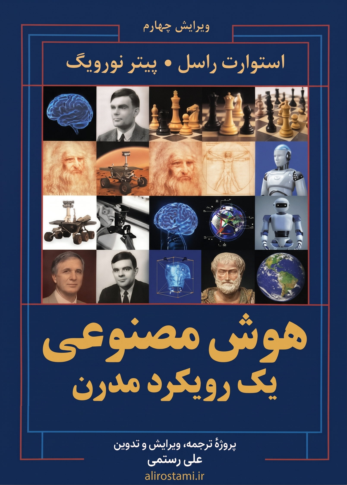

# هوش مصنوعی: یک رویکرد مدرن — ترجمهٔ فارسی

<p align="center">
  
  
  
  
  
  
</p>

<p align="center">
  <strong>Artificial Intelligence: A Modern Approach — 4th Edition</strong>
  <br />
  <sub>ترجمه و آماده‌سازی فارسی کتاب «هوش مصنوعی: یک رویکرد مدرن» اثر استوارت راسل و پیتر نورویگ</sub>
</p>

<p align="center">
  
</p>

<p align="center">
  <a href="https://github.com/alirostami01/aima-4e-persian">GitHub</a> ·
  <a href="https://github.com/alirostami01/aima-4e-persian/tree/main/markdown">Markdown</a> ·
  <a href="https://github.com/alirostami01/aima-4e-persian/tree/main/html">HTML</a> ·
  <a href="https://www.alirostami.com/support/">حمایت از پروژه</a>
</p>

---

## 📚 دربارهٔ پروژه

این مخزن یک پروژهٔ متن‌باز برای **ترجمه، تدوین و ارائهٔ فارسی** کتاب شناخته‌شدهٔ **Artificial Intelligence: A Modern Approach (AIMA), 4th Edition** نوشتهٔ **Stuart Russell** و **Peter Norvig** است.

هدف پروژه این است که مفاهیم گستردهٔ هوش مصنوعی را به شکلی ساختاریافته، خوانا و قابل استفاده برای فارسی‌زبانان ارائه کند؛ از مبانی عامل‌های هوشمند و جستجو گرفته تا یادگیری عمیق، پردازش زبان طبیعی، بینایی رایانه‌ای، رباتیک، اخلاق و آیندهٔ هوش مصنوعی.

> **توجه:** این پروژه یک ترجمهٔ مستقل و غیررسمی است و وابستگی یا تأیید رسمی از سوی نویسندگان یا ناشر کتاب ندارد. حقوق اثر اصلی متعلق به صاحبان حقوق آن است.

## ✨ ویژگی‌های پروژه

- 🇮🇷 ترجمهٔ فارسی ساختاریافتهٔ پیشگفتار و **۲۸ فصل کتاب**
- 📝 نسخهٔ **Markdown** برای مطالعه، ویرایش، مشارکت و استفادهٔ توسعه‌دهندگان
- 🌐 نسخهٔ **HTML** با قالب خواندنی و کتاب‌گونه
- 📕 نسخهٔ **PDF** حرفه‌ای با موتور Chromium و قلم‌های زیبای وزیرمتن (کل کتاب یکپارچه + فصل‌ها به‌صورت مجزا)
- 🖼️ مجموعهٔ تصاویر و شکل‌های کتاب با فایل‌های واقعی در پوشهٔ `figures/`
- 🔗 ارتباط منظم بین فصل‌ها و منابع داخلی پروژه
- 💻 حفظ **Pseudocode**‌های فنی به زبان انگلیسی برای نزدیک‌ماندن به متن اصلی
- 📖 مناسب برای دانشجویان، برنامه‌نویسان، پژوهشگران و علاقه‌مندان هوش مصنوعی
- 🌱 توسعهٔ عمومی و مشارکتی در GitHub

## 🗂️ ساختار مخزن

```text
.
├── html/                    # نسخهٔ HTML فصل‌ها برای مطالعهٔ راحت‌تر
│   ├── 00-پیشگفتار.html
│   ├── 01-فصل۱-مقدمه.html
│   ├── ...
│   └── 28-فصل۲۸-آینده-هوش-مصنوعی.html
│
├── markdown/                # متن اصلی فصل‌ها در قالب Markdown
│   ├── 00-پیشگفتار.md
│   ├── 01-فصل۱-مقدمه.md
│   ├── ...
│   └── 28-فصل۲۸-آینده-هوش-مصنوعی.md
│
├── figures/                 # تصاویر و شکل‌های کتاب، تفکیک‌شده بر اساس فصل
│   ├── ch01/
│   ├── ch02/
│   ├── ...
│   └── ch26/
│
├── pdf/                     # خروجی‌های PDF کتاب و فونت‌ها
│   ├── aima-4e-persian.pdf  # کتاب کامل با صفحهٔ عنوان، فهرست و نشانک‌ها
│   ├── chapters/            # PDF جداگانهٔ هر یک از فصل‌ها
│   └── fonts/               # فونت‌های تعبیه‌شده (Vazirmatn و DejaVu Sans Mono)
│
├── build_pdf.py             # اسکریپت ساخت PDF با Chromium و PyMuPDF
├── LICENSE
└── README.md
```

## 📖 فهرست فصل‌ها

> 📥 **دانلود نسخهٔ کامل کتاب:** [aima-4e-persian.pdf](pdf/aima-4e-persian.pdf) (۱٬۱۷۶ صفحه — ۳۵ مگابایت)

| # | عنوان | Markdown | HTML | PDF |
|---|---|---|---|---|
| 00 | پیشگفتار | [مطالعه](markdown/00-پیشگفتار.md) | [HTML](html/00-پیشگفتار.html) | [PDF](pdf/chapters/chapter-00.pdf) |
| 01 | مقدمه | [مطالعه](markdown/01-فصل۱-مقدمه.md) | [HTML](html/01-فصل۱-مقدمه.html) | [PDF](pdf/chapters/chapter-01.pdf) |
| 02 | عامل‌های هوشمند | [مطالعه](markdown/02-فصل۲-عاملهای-هوشمند.md) | [HTML](html/02-فصل۲-عاملهای-هوشمند.html) | [PDF](pdf/chapters/chapter-02.pdf) |
| 03 | حل مسئله با جستجو | [مطالعه](markdown/03-فصل۳-حل-مسئله-با-جستجو.md) | [HTML](html/03-فصل۳-حل-مسئله-با-جستجو.html) | [PDF](pdf/chapters/chapter-03.pdf) |
| 04 | جستجو در محیط‌های پیچیده | [مطالعه](markdown/04-فصل۴-جستجو-در-محیطهای-پیچیده.md) | [HTML](html/04-فصل۴-جستجو-در-محیطهای-پیچیده.html) | [PDF](pdf/chapters/chapter-04.pdf) |
| 05 | جستجوی رقابتی و بازی‌ها | [مطالعه](markdown/05-فصل۵-جستجوی-رقابتی-و-بازیها.md) | [HTML](html/05-فصل۵-جستجوی-رقابتی-و-بازیها.html) | [PDF](pdf/chapters/chapter-05.pdf) |
| 06 | ارضای قیود | [مطالعه](markdown/06-فصل۶-ارضای-قیود.md) | [HTML](html/06-فصل۶-ارضای-قیود.html) | [PDF](pdf/chapters/chapter-06.pdf) |
| 07 | عامل‌های منطقی | [مطالعه](markdown/07-فصل۷-عاملهای-منطقی.md) | [HTML](html/07-فصل۷-عاملهای-منطقی.html) | [PDF](pdf/chapters/chapter-07.pdf) |
| 08 | منطق مرتبهٔ اول | [مطالعه](markdown/08-فصل۸-منطق-مرتبه-اول.md) | [HTML](html/08-فصل۸-منطق-مرتبه-اول.html) | [PDF](pdf/chapters/chapter-08.pdf) |
| 09 | استنتاج در منطق مرتبهٔ اول | [مطالعه](markdown/09-فصل۹-استنتاج-منطق-مرتبه-اول.md) | [HTML](html/09-فصل۹-استنتاج-منطق-مرتبه-اول.html) | [PDF](pdf/chapters/chapter-09.pdf) |
| 10 | بازنمایی دانش | [مطالعه](markdown/10-فصل۱۰-بازنمایی-دانش.md) | [HTML](html/10-فصل۱۰-بازنمایی-دانش.html) | [PDF](pdf/chapters/chapter-10.pdf) |
| 11 | برنامه‌ریزی خودکار | [مطالعه](markdown/11-فصل۱۱-برنامهریزی-خودکار.md) | [HTML](html/11-فصل۱۱-برنامهریزی-خودکار.html) | [PDF](pdf/chapters/chapter-11.pdf) |
| 12 | کمی‌کردن عدم قطعیت | [مطالعه](markdown/12-فصل۱۲-کمی-کردن-عدم-قطعیت.md) | [HTML](html/12-فصل۱۲-کمی-کردن-عدم-قطعیت.html) | [PDF](pdf/chapters/chapter-12.pdf) |
| 13 | استدلال احتمالاتی | [مطالعه](markdown/13-فصل۱۳-استدلال-احتمالاتی.md) | [HTML](html/13-فصل۱۳-استدلال-احتمالاتی.html) | [PDF](pdf/chapters/chapter-13.pdf) |
| 14 | استدلال احتمالاتی در طول زمان | [مطالعه](markdown/14-فصل۱۴-استدلال-احتمالاتی-در-طول-زمان.md) | [HTML](html/14-فصل۱۴-استدلال-احتمالاتی-در-طول-زمان.html) | [PDF](pdf/chapters/chapter-14.pdf) |
| 15 | برنامه‌نویسی احتمالاتی | [مطالعه](markdown/15-فصل۱۵-برنامهنویسی-احتمالاتی.md) | [HTML](html/15-فصل۱۵-برنامهنویسی-احتمالاتی.html) | [PDF](pdf/chapters/chapter-15.pdf) |
| 16 | تصمیم‌گیری ساده | [مطالعه](markdown/16-فصل۱۶-تصمیم‌گیری-ساده.md) | [HTML](html/16-فصل۱۶-تصمیم‌گیری-ساده.html) | [PDF](pdf/chapters/chapter-16.pdf) |
| 17 | تصمیم‌گیری پیچیده | [مطالعه](markdown/17-فصل۱۷-تصمیم‌گیری-پیچیده.md) | [HTML](html/17-فصل۱۷-تصمیم‌گیری-پیچیده.html) | [PDF](pdf/chapters/chapter-17.pdf) |
| 18 | تصمیم‌گیری چندعاملی | [مطالعه](markdown/18-فصل۱۸-تصمیم‌گیری-چندعاملی.md) | [HTML](html/18-فصل۱۸-تصمیم‌گیری-چندعاملی.html) | [PDF](pdf/chapters/chapter-18.pdf) |
| 19 | یادگیری از مثال‌ها | [مطالعه](markdown/19-فصل۱۹-یادگیری-از-مثال‌ها.md) | [HTML](html/19-فصل۱۹-یادگیری-از-مثال‌ها.html) | [PDF](pdf/chapters/chapter-19.pdf) |
| 20 | یادگیری مدل‌های احتمالاتی | [مطالعه](markdown/20-فصل۲۰-یادگیری-مدل‌های-احتمالاتی.md) | [HTML](html/20-فصل۲۰-یادگیری-مدل‌های-احتمالاتی.html) | [PDF](pdf/chapters/chapter-20.pdf) |
| 21 | یادگیری عمیق | [مطالعه](markdown/21-فصل۲۱-یادگیری-عمیق.md) | [HTML](html/21-فصل۲۱-یادگیری-عمیق.html) | [PDF](pdf/chapters/chapter-21.pdf) |
| 22 | یادگیری تقویتی | [مطالعه](markdown/22-فصل۲۲-یادگیری-تقویتی.md) | [HTML](html/22-فصل۲۲-یادگیری-تقویتی.html) | [PDF](pdf/chapters/chapter-22.pdf) |
| 23 | پردازش زبان طبیعی | [مطالعه](markdown/23-فصل۲۳-پردازش-زبان-طبیعی.md) | [HTML](html/23-فصل۲۳-پردازش-زبان-طبیعی.html) | [PDF](pdf/chapters/chapter-23.pdf) |
| 24 | یادگیری عمیق برای زبان طبیعی | [مطالعه](markdown/24-فصل۲۴-یادگیری-عمیق-زبان-طبیعی.md) | [HTML](html/24-فصل۲۴-یادگیری-عمیق-زبان-طبیعی.html) | [PDF](pdf/chapters/chapter-24.pdf) |
| 25 | بینایی رایانه‌ای | [مطالعه](markdown/25-فصل۲۵-بینایی-رایانهای.md) | [HTML](html/25-فصل۲۵-بینایی-رایانهای.html) | [PDF](pdf/chapters/chapter-25.pdf) |
| 26 | رباتیک | [مطالعه](markdown/26-فصل۲۶-رباتیک.md) | [HTML](html/26-فصل۲۶-رباتیک.html) | [PDF](pdf/chapters/chapter-26.pdf) |
| 27 | فلسفه، اخلاق و ایمنی هوش مصنوعی | [مطالعه](markdown/27-فصل۲۷-فلسفه-اخلاق-ایمنی.md) | [HTML](html/27-فصل۲۷-فلسفه-اخلاق-ایمنی.html) | [PDF](pdf/chapters/chapter-27.pdf) |
| 28 | آیندهٔ هوش مصنوعی | [مطالعه](markdown/28-فصل۲۸-آینده-هوش-مصنوعی.md) | [HTML](html/28-فصل۲۸-آینده-هوش-مصنوعی.html) | [PDF](pdf/chapters/chapter-28.pdf) |

## 📕 نسخهٔ PDF و ساخت آن

کتاب به دو شکل PDF با کیفیت بالا تولید و ارائه می‌شود:
1. **کتاب کامل و یکپارچه ([pdf/aima-4e-persian.pdf](pdf/aima-4e-persian.pdf)):** شامل ۱٬۱۷۶ صفحه همراه با صفحهٔ عنوان (با درج خودکار نسخه و کامیت)، فهرست مطالب کاملِ دوگذرگاهی با شماره‌گذاری فارسی صفحات، تفکیک بخش‌های هفت‌گانه و درخت کامل نشانک‌های PDF (Bookmarks).
2. **فصل‌های جداگانه ([pdf/chapters/](pdf/chapters/)):** PDF مستقل برای هر یک از فصل‌های ۲۸‌گانه به همراه پیشگفتار.

### نحوهٔ ساخت PDF از فایل‌های HTML

موتور ساخت PDF از **Chromium** (از راه Playwright) برای شکل‌دهی دقیق حروف فارسی و چیدمان راست‌به‌چپ (RTL)، و **PyMuPDF** برای استخراج شماره‌های صفحات فهرست و درخت نشانک‌ها استفاده می‌کند. فونت‌های پروژه (وزیرمتن و DejaVu Sans Mono) درون مخزن در پوشهٔ `pdf/fonts/` قرار دارند و نیازی به نصب فونت روی سیستم‌عامل نیست.

```bash
# نصب پیش‌نیازها
pip install playwright pymupdf
playwright install chromium  # یا استفاده از Google Chrome نصب‌شده روی سیستم

# ساخت نسخهٔ کامل کتاب و تمامی فصل‌ها
python3 build_pdf.py

# فقط ساخت کتاب کامل (pdf/aima-4e-persian.pdf)
python3 build_pdf.py --book-only

# فقط ساخت PDF فصل‌های جداگانه (در پوشهٔ pdf/chapters/)
python3 build_pdf.py --chapters-only

# ساخت فصل‌های مشخص (مثلاً فصل‌های ۱ و ۲، عدد 0 برای پیشگفتار)
python3 build_pdf.py --chapters 0 1 2
```

## 🌐 نسخهٔ HTML

نسخهٔ HTML برای کسانی طراحی شده که می‌خواهند متن را مانند یک کتاب مطالعه کنند، بدون اینکه نیاز به ابزار Markdown داشته باشند.

ویژگی‌های نسخهٔ HTML شامل موارد زیر است:

- فهرست مطالب و ساختار فصل‌ها
- تیترها و بخش‌بندی خوانا
- جدول‌ها و جعبه‌های محتوایی
- نمایش مناسب نقل‌قول‌ها و یادداشت‌ها
- بلوک‌های شبه‌کد با قالب‌بندی مناسب
- پانوشت‌ها و پیوندهای داخلی
- پیوند فصل قبل و بعد
- تصاویر و شکل‌های واقعی کتاب

> برای مطالعهٔ سریع‌تر، پیشنهاد می‌شود از نسخهٔ **HTML** استفاده کنید.

## 🖼️ تصاویر و شکل‌ها

تصاویر پروژه در پوشهٔ `figures/` و به تفکیک فصل نگهداری می‌شوند. در مجموع **۴۰۷ شکل** مربوط به فصل‌های ۱ تا ۲۶ در مخزن قرار گرفته است؛ فصل‌های ۲۷ و ۲۸ شکل کتابی ندارند.

مسیر تصاویر به‌صورت ساختاریافته است:

```text
figures/
├── ch01/
├── ch02/
├── ch03/
├── ...
└── ch26/
```

نسخه‌های Markdown و HTML از فایل‌های واقعی تصویر استفاده می‌کنند و تصاویر به‌صورت Base64 داخل متن نگهداری نمی‌شوند.

## 🧠 Pseudocode

شبه‌کدهای فنی کتاب به زبان **انگلیسی** نگهداری شده‌اند تا ساختار، نام الگوریتم‌ها و اصطلاحات آن‌ها تا حد امکان با متن اصلی و ویرایش چهارم AIMA یکسان باقی بماند.

این تصمیم برای خوانندگان فنی مزیت مهمی دارد: الگوریتم‌ها را می‌توان مستقیماً با نسخهٔ انگلیسی کتاب، منابع علمی و پیاده‌سازی‌های نرم‌افزاری مقایسه کرد.

## 🤝 مشارکت در پروژه

این پروژه یک کار در حال توسعه است و مشارکت علاقه‌مندان می‌تواند کیفیت آن را بهتر کند.

اگر در متن، ترجمه، اصطلاحات، شکل‌ها، قالب‌بندی یا ساختار پروژه مشکلی پیدا کردید:

1. یک **Issue** در GitHub ایجاد کنید؛ یا
2. تغییر پیشنهادی خود را به‌صورت **Pull Request** ارسال کنید.

لطفاً هنگام پیشنهاد اصلاحات، تا حد امکان به بخش یا فصل مربوطه اشاره کنید تا بررسی تغییر آسان‌تر باشد.

## ⭐ حمایت از پروژه

اگر این پروژه برای شما مفید است، یکی از بهترین راه‌های حمایت، **ستاره‌دادن به مخزن GitHub** و معرفی آن به دیگر علاقه‌مندان هوش مصنوعی است.

اگر مایل هستید به ادامهٔ توسعه، نگهداری، ترجمه و آماده‌سازی این پروژه کمک مالی کنید، می‌توانید از صفحهٔ رسمی حمایت استفاده کنید:

### ❤️ [حمایت از پروژه‌های من](https://www.alirostami.com/support/)

هر حمایت، حتی کوچک، به ادامهٔ توسعه و نگهداری پروژه‌های متن‌باز کمک می‌کند.

## 📜 مجوز

کد و محتوای قابل‌انتشار این مخزن تحت **GNU General Public License v3.0** ارائه شده است. برای جزئیات دقیق، فایل [LICENSE](LICENSE) را ببینید.

> مجوز پروژهٔ GitHub به معنی انتقال یا تغییر حقوق مالکیت معنوی اثر اصلی نیست. این پروژه یک ترجمه و ارائهٔ مستقل از اثر دارای حق نشر است.

## ⚖️ دربارهٔ اثر اصلی

**Artificial Intelligence: A Modern Approach, 4th Edition** اثر:

- **Stuart Russell**
- **Peter Norvig**

این مخزن با هدف آموزشی و ایجاد دسترسی بهتر برای فارسی‌زبانان ایجاد شده و ارتباط رسمی با نویسندگان یا ناشر اثر اصلی ندارد.

---

<p align="center">
  <strong>اگر این پروژه برایتان مفید است، ⭐ Star کنید و آن را با دیگران به اشتراک بگذارید.</strong>
  <br />
  <a href="https://www.alirostami.com/support/">❤️ حمایت از ادامهٔ پروژه</a>
</p>
