# فصل ۳ — حل مسئله با جستجو

**فصل ۳: حل مسئله با جستجو (Solving Problems by Searching)**

*در این فصل می‌بینیم عامل چگونه می‌تواند به آینده بنگرد و توالی‌ای از کنش‌ها بیابد که سرانجام به هدفش می‌رسد.*

وقتی کنشِ درستِ لازم بدیهی نباشد، عامل ممکن است نیاز داشته باشد پیش‌بینی کند: توالی‌ای از کنش‌ها را در نظر بگیرد که مسیری به یک حالت هدف می‌سازند. چنین عاملی «عامل حل‌کنندهٔ مسئله» (Problem-Solving Agent) نامیده می‌شود و فرایند محاسباتی‌ای که انجام می‌دهد «جستجو» (Search) است.

عامل‌های حل‌کنندهٔ مسئله از بازنمایی‌های اتمی استفاده می‌کنند، چنان‌که در بخش 2.4.7 توصیف شد — یعنی حالت‌های جهان به‌صورت کل در نظر گرفته می‌شوند، بدون هیچ ساختار درونیِ قابل مشاهده برای الگوریتم‌های حل مسئله. عامل‌هایی که از بازنمایی‌های عاملی یا ساختاریافتهٔ حالت استفاده می‌کنند، عامل‌های برنامه‌ریز (Planning Agents) نامیده می‌شوند و در فصل‌های ۷ و ۱۱ بحث می‌شوند.

چندین الگوریتم جستجو را پوشش خواهیم داد. در این فصل فقط ساده‌ترین محیط‌ها را در نظر می‌گیریم: تکرارشونده، تک‌عاملی، کاملاً قابل مشاهده، جبرگرایانه، ایستا، گسسته و شناخته‌شده. میان الگوریتم‌های مطلع (Informed) — که در آن‌ها عامل می‌تواند تخمین بزند چقدر تا هدف فاصله دارد — و الگوریتم‌های نامطلع (Uninformed) — که چنین تخمینی در دسترس نیست — تمایز قائل می‌شویم.

فصل ۴ قیدهای محیطی را شل می‌کند و فصل ۵ عامل‌های چندگانه را در نظر می‌گیرد.

این فصل از مفاهیم پیچیدگی مجانبی (یعنی نماد O(n)) استفاده می‌کند. خوانندگانی که با این مفاهیم آشنا نیستند باید به پیوست الف مراجعه کنند.

## 3.1 عامل‌های حل‌کنندهٔ مسئله

عاملی را تصور کنید که در رومانی به گشت‌وگذار تفریحی مشغول است. عامل می‌خواهد از دیدنی‌ها دیدن کند، رومانیایی‌اش را بهبود دهد، از شب‌زنده‌داری لذت ببرد، از خماری بپرهیزد و مانند آن. مسئلهٔ تصمیم، مسئله‌ای پیچیده است. حال فرض کنید عامل اکنون در شهر آراد است و بلیطی غیرقابل استرداد برای پرواز روز بعد از بخارست دارد. عامل تابلوهای خیابان را می‌بیند و متوجه می‌شود سه جاده از آراد خارج می‌شوند: یکی به سمت سیبیو، یکی به تیمیشوآرا و یکی به زرند. هیچ‌کدام هدف نیستند، پس مگر آنکه عامل با جغرافیای رومانی آشنا باشد، نمی‌داند کدام جاده را دنبال کند.¹ اگر عامل اطلاعات اضافی نداشته باشد — یعنی اگر محیط ناشناخته باشد — چاره‌ای جز اجرای تصادفی یکی از کنش‌ها ندارد. این وضعیت غم‌انگیز در فصل ۴ بحث می‌شود. در این فصل فرض می‌کنیم عامل‌های ما همیشه به اطلاعاتی دربارهٔ جهان دسترسی دارند، مانند نقشهٔ شکل ۳.۱. با آن اطلاعات، عامل می‌تواند این فرایند حل مسئلهٔ چهارمرحله‌ای را دنبال کند:

- **صورت‌بندی هدف (Goal Formulation):** عامل هدف رسیدن به بخارست را برمی‌گیرد. هدف‌ها با محدودکردن هدف‌ها و در نتیجه کنش‌های در نظرگرفته‌شده، رفتار را سازمان می‌دهند.


**شکل ۳.۱ — نقشهٔ جاده‌ای ساده‌شده از بخشی از رومانی، با فاصله‌های جاده‌ای بر حسب مایل.** (شهرها: اورادئا، زرند، آراد، تیمیشوآرا، لوگوژ، مهadia، دروبتا، کرایووا، ریمنیکو ویلچا، سیبیو، فاگاراش، پیتشتی، بخارست، جیورگیو، اورزیچنی، هیرشووا، اِفوریه، واسیویی، یاشی، نئامت)

- **صورت‌بندی مسئله (Problem Formulation):** عامل توصیفی از حالت‌ها و کنش‌های لازم برای رسیدن به هدف تدوین می‌کند — مدلی انتزاعی از بخشِ مرتبطِ جهان. برای عامل ما، یک مدل خوب آن است که کنش‌ها را سفر از شهری به شهریِ مجاور در نظر بگیریم و بنابراین تنها واقعیتی از حالت جهان که بر اثر کنش تغییر می‌کند، شهر کنونی است.
- **جستجو (Search):** پیش از انجام هر کنشی در جهان واقعی، عامل توالی‌های کنش را در مدلش شبیه‌سازی می‌کند و جستجو می‌کند تا توالی کنشی را بیابد که به هدف می‌رسد. چنین توالی‌ای «راه‌حل» (Solution) نامیده می‌شود. عامل ممکن است ناگزیر شود چند توالی را شبیه‌سازی کند که به هدف نمی‌رسند، اما سرانجام راه‌حلی خواهد یافت (مانند رفتن از آراد به سیبیو به فاگاراش به بخارست) یا خواهد یافت که راه‌حلی ممکن نیست.
- **اجرا (Execution):** عامل اکنون می‌تواند کنش‌های راه‌حل را یکی‌یکی اجرا کند.

خاصیت مهمی که هست این است که در محیط کاملاً قابل مشاهده، جبرگرایانه و شناخته‌شده، ◮ راه‌حل هر مسئله‌ای توالی ثابتی از کنش‌هاست: به سیبیو بران، سپس فاگاراش، سپس بخارست. اگر مدل درست باشد، پس از آنکه عامل راه‌حل را یافت، هنگام اجرای کنش‌ها می‌تواند ادراک‌های حسی‌اش را نادیده بگیرد — به اصطلاح چشم‌هایش را ببندد — زیرا راه‌حل تضمین‌شده به هدف می‌رسد. نظریه‌پردازان کنترل این را سامانهٔ حلقه‌باز (Open-Loop) می‌نامند: نادیده‌گرفتن ادراک‌های حسی، حلقهٔ میان عامل و محیط را می‌بُرد. اگر احتمال نادرست‌بودن مدل وجود داشته باشد، یا محیط ناجبرگرایانه باشد، عامل با رویکرد حلقه‌بسته (Closed-Loop) که ادراک‌های حسی را پایش می‌کند ایمن‌تر خواهد بود (بخش 4.4 را ببینید).

در محیط‌های تا حدی قابل مشاهده یا ناجبرگرایانه، راه‌حل، راهبردی انشعابی خواهد بود که بسته به ادراک‌های حسیِ دریافتی، کنش‌های آیندهٔ متفاوتی پیشنهاد می‌کند. برای نمونه، عامل ممکن است برنامه‌ریزی کند از آراد به سیبیو براند، اما به برنامهٔ احتیاطی نیاز داشته باشد در صورتی که تصادفاً به زرند برسد یا تابلو «جاده بسته» ببیند.

### 3.1.1 مسائل جستجو و راه‌حل‌ها

مسئلهٔ جستجو را می‌توان به‌صورت صوری چنین تعریف کرد:

- مجموعه‌ای از حالت‌های ممکن که محیط می‌تواند در آن‌ها باشد. این را «فضای حالت» (State Space) می‌نامیم. حالت‌ها (States) بازنمایی‌های اتمی‌اند.
- «حالت آغازین» (Initial State) که عامل از آن آغاز می‌کند. برای نمونه: آراد.
- مجموعه‌ای از یک یا چند «حالت هدف» (Goal States). گاهی یک حالت هدف هست (مثلاً بخارست)، گاهی مجموعهٔ کوچکی از حالت‌های هدف جایگزین، و گاهی هدف با ویژگی‌ای تعریف می‌شود که بر حالت‌های فراوانی (احتمالاً بی‌نهایت) صدق می‌کند. برای نمونه، در جهان جاروبرقی، هدف ممکن است این باشد که در هیچ مکانی کثیفی نباشد، صرف‌نظر از هر واقعیت دیگری دربارهٔ حالت. می‌توانیم هر سه امکان را با مشخص کردن روش IS-GOAL برای مسئله پوشش دهیم. در این فصل برای سادگی گاهی «هدف» می‌گوییم، اما آنچه می‌گوییم بر «هر یک از حالت‌های هدف ممکن» نیز صدق می‌کند.
- کنش‌های (Actions) در دسترس عامل. با داشتن حالت s، تابع ACTIONS(s) مجموعه‌ای متناهی² از کنش‌های قابل اجرا در s را بازمی‌گرداند. می‌گوییم هر یک از این کنش‌ها در s «کاربردپذیر» (Applicable) است. مثالی: ACTIONS(Arad) = {ToSibiu, ToTimisoara, ToZerind}.
- «مدل گذار» (Transition Model) که توصیف می‌کند هر کنش چه می‌کند. RESULT(s, a) حالتی را بازمی‌گرداند که از انجام کنش a در حالت s حاصل می‌شود. برای نمونه: RESULT(Arad, ToZerind) = Zerind.
- «تابع هزینهٔ کنش» (Action Cost Function) که با ACTION-COST(s,a,s′) هنگام برنامه‌نویسی یا c(s,a,s′) هنگام ریاضی نشان داده می‌شود و هزینهٔ عددی اعمال کنش a در حالت s برای رسیدن به حالت s′ را می‌دهد. عامل حل‌کنندهٔ مسئله باید از تابع هزینه‌ای استفاده کند که معیار عملکرد خودش را بازتاب می‌دهد؛ برای نمونه، برای عامل‌های مسیریاب، هزینهٔ یک کنش ممکن است طول بر حسب مایل (چنان‌که در شکل ۳.۱ دیده می‌شود) یا زمان لازم برای تکمیل کنش باشد.

توالی کنش‌ها «مسیر» (Path) می‌سازد و راه‌حل، مسیری از حالت آغازین به حالت هدف است. فرض می‌کنیم هزینه‌های کنش جمع‌شدنی‌اند؛ یعنی هزینهٔ کل یک مسیر، مجموع هزینه‌های کنش‌های منفرد است. «راه‌حل بهینه» (Optimal Solution) کمترین هزینهٔ مسیر را میان همهٔ راه‌حل‌ها دارد. در این فصل فرض می‌کنیم همهٔ هزینه‌های کنش مثبت‌اند تا از برخی پیچیدگی‌ها بپرهیزیم.³

فضای حالت را می‌توان به‌صورت گرافی بازنمایی کرد که رأس‌هایش حالت‌ها و یال‌های جهت‌دارش کنش‌ها هستند. نقشهٔ رومانیِ شکل ۳.۱ چنین گرافی است، که در آن هر جاده دو کنش را نشان می‌دهد، یکی در هر جهت.

### 3.1.2 صورت‌بندی مسائل

صورت‌بندی ما از مسئلهٔ رسیدن به بخارست، مدلی است — توصیفی ریاضی انتزاعی — نه خودِ واقعیت. توصیف حالت اتمی سادهٔ «آراد» را با یک سفر واقعی بین‌شهری مقایسه کنید، جایی که حالت جهان شامل چیزهای بسیار زیادی است: هم‌سفرها، برنامهٔ رادیوییِ در حال پخش، منظرهٔ بیرون پنجره، نزدیکی مأموران اجرای قانون، فاصله تا توقفگاه بعدی، وضعیت جاده، آب‌وهوا، ترافیک و... همهٔ این ملاحظات از مدل ما بیرون گذاشته شده‌اند، زیرا به مسئلهٔ یافتن مسیر به بخارست بی‌ربط‌اند.

فرایند حذف جزئیات از یک بازنمایی «انتزاع» (Abstraction) نامیده می‌شود. صورت‌بندی مسئلهٔ خوب، سطح مناسبی از جزئیات دارد. اگر کنش‌ها در سطح «پای راست را یک سانتی‌متر جلو ببر» یا «فرمان را یک درجه به چپ بچرخان» بودند، عامل احتمالاً هرگز راهش را از پارکینگ بیرون نمی‌یافت، چه رسد به بخارست.

آیا می‌توانیم دربارهٔ سطح انتزاعِ مناسب دقیق‌تر باشیم؟ به حالت‌ها و کنش‌های انتزاعیِ برگزیده‌مان بیندیشید، چنان‌که با مجموعه‌های بزرگِ حالت‌های جهانِ جزئی و توالی‌های کنشِ جزئی متناظرند. اکنون راه‌حلی برای مسئلهٔ انتزاعی در نظر بگیرید: برای نمونه، مسیر از آراد به سیبیو به ریمنیکو ویلچا به پیتشتی به بخارست. این راه‌حل انتزاعی با تعداد زیادی مسیر جزئی‌تر متناظر است. برای نمونه، می‌توانیم با روشن‌بودن رادیو از سیبیو به ریمنیکو ویلچا برانیم و سپس برای بقیهٔ سفر خاموشش کنیم.

انتزاع معتبر است اگر بتوانیم هر راه‌حل انتزاعی را به راه‌حلی در جهان جزئی‌تر بسط دهیم؛ شرط کافی آن است که برای هر حالت جزئی که «در آراد» است، مسیری جزئی به حالتی که «در سیبیو» است وجود داشته باشد، و همین‌طور الی آخر.⁴ انتزاع مفید است اگر اجرای هر یک از کنش‌های راه‌حل از خودِ مسئلهٔ اصلی آسان‌تر باشد؛ در مورد ما، کنش «رانندگی از آراد به سیبیو» را می‌توان بدون جستجو یا برنامه‌ریزی بیشتر توسط راننده‌ای با مهارت متوسط انجام داد. پس انتخاب انتزاع خوب شامل حذف هرچه بیشتر جزئیات است در حالی که اعتبار حفظ شود و اطمینان حاصل شود کنش‌های انتزاعی آسان‌اند. اگر توانایی ساخت انتزاع‌های مفید نبود، عامل‌های هوشمند کاملاً در جهان واقعی غرق می‌شدند.

## 3.2 مسائل نمونه

رویکرد حل مسئله در گسترهٔ وسیعی از محیط‌های تکلیف به کار رفته است. برخی از شناخته‌شده‌ترین‌ها را در این‌جا فهرست می‌کنیم، با تمایز میان مسائل استانداردشده و مسائل جهان واقعی.

مسئلهٔ استانداردشده (Standardized Problem) برای نشان دادن یا تمرین روش‌های گوناگون حل مسئله در نظر گرفته شده. می‌توان توصیف موجز و دقیقی به آن داد و بنابراین به‌عنوان معیاری مناسب برای مقایسهٔ عملکرد الگوریتم‌ها توسط پژوهشگران است. مسئلهٔ جهان واقعی (Real-World Problem)، مانند ناوبری ربات، مسئله‌ای است که راه‌حل‌هایش را مردم واقعاً استفاده می‌کنند و صورت‌بندی‌اش ویژهٔ خودش است، نه استاندارد؛ برای نمونه، چون هر ربات حسگرهای متفاوتی دارد که داده‌های متفاوتی تولید می‌کنند.

### 3.2.1 مسائل استانداردشده

مسئلهٔ جهان شبکه‌ای (Grid World) آرایهٔ دوبعدی مستطیلی از خانه‌های مربعی است که عامل‌ها می‌توانند از خانه‌ای به خانهٔ دیگر حرکت کنند. معمولاً عامل می‌تواند به هر خانهٔ مجاورِ بدون مانع حرکت کند — افقی و عمودی و در برخی مسائل مورب. خانه‌ها می‌توانند اشیا داشته باشند که عامل بتواند بردارد، هل دهد یا به نحوی بر آن‌ها کنش کند؛ دیوار یا مانع غیرقابل عبور در خانه‌ای، عامل را از ورود به آن خانه بازمی‌دارد.

جهان جاروبرقی از بخش 2.1 را می‌توان چنین به‌صورت مسئلهٔ جهان شبکه‌ای صورت‌بندی کرد:

- **حالت‌ها:** حالت جهان می‌گوید کدام اشیا در کدام خانه‌ها هستند. برای جهان جاروبرقی، اشیا عبارت‌اند از عامل و هر کثیفی. در نسخهٔ سادهٔ دوخانه‌ای، عامل می‌تواند در هر یک از دو خانه باشد و هر خانه یا کثیفی دارد یا نه، پس ۲×۲×۲ = ۸ حالت هست (شکل ۳.۲ را ببینید). در حالت کلی، محیط جاروبرقی با n خانه، n·2ⁿ حالت دارد.
- **حالت آغازین:** هر حالتی را می‌توان حالت آغازین تعیین کرد.
- **کنش‌ها:** در جهان دوخانه‌ای سه کنش تعریف کردیم: Suck (بمک)، حرکت به چپ و حرکت به راست. در جهان چندخانه‌ای دوبعدی به کنش‌های حرکتی بیشتری نیاز داریم. می‌توانیم Upward و Downward (بالا و پایین) را بیفزاییم و چهار کنش حرکتی مطلق داشته باشیم، یا به کنش‌های خودمحور (Egocentric) روی بیاوریم که نسبت به دیدگاه عامل تعریف می‌شوند — برای نمونه: Forward (به جلو)، Backward (به عقب)، TurnRight (چرخش به راست) و TurnLeft (چرخش به چپ).
- **مدل گذار:** Suck هر کثیفی را از خانهٔ عامل می‌زداید؛ Forward عامل را یک خانه در جهتِ روبه‌رویش جلو می‌برد، مگر آنکه به دیوار بخورد که در آن صورت کنش اثری ندارد. Backward عامل را در جهت مخالف می‌برد، در حالی که TurnRight و TurnLeft جهتِ روبه‌رو را ۹۰ درجه تغییر می‌دهند.
- **حالت‌های هدف:** حالت‌هایی که در آن‌ها همهٔ خانه‌ها تمیزند.
- **هزینهٔ کنش:** هر کنش ۱ هزینه دارد.

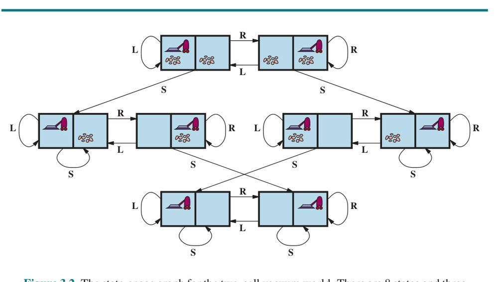

**شکل ۳.۲ — گراف فضای حالت برای جهان جاروبرقی دوخانه‌ای.** ۸ حالت و برای هر حالت سه کنش هست: L = چپ، R = راست، S = مکیدن.

نوع دیگری از جهان شبکه‌ای، معمای سوکوبان (Sokoban Puzzle) است که هدف عامل هل‌دادن تعدادی جعبه — پراکنده در شبکه — به مکان‌های ذخیرهٔ معین است. در هر خانه حداکثر یک جعبه می‌تواند باشد. وقتی عامل به جلو به خانه‌ای که جعبه دارد می‌رود و خانهٔ خالی در آن‌سوی جعبه هست، هم جعبه و هم عامل به جلو می‌روند. عامل نمی‌تواند جعبه را به جعبهٔ دیگر یا دیوار هل دهد. برای جهانی با n خانهٔ بدون مانع و b جعبه، n × n!/(b!(n−b)!) حالت هست؛ برای نمونه روی شبکهٔ ۸×۸ با یک دوجین جعبه، بیش از ۲۰۰ تریلیون حالت هست.

در معمای کاشی‌لغزان (Sliding-Tile Puzzle)، تعدادی کاشی (که گاهی بلوک یا مهره نامیده می‌شوند) در شبکه‌ای با یک یا چند فضای خالی چیده می‌شوند تا برخی کاشی‌ها بتوانند به فضای خالی بلغزند. یکی از تغییرها، معمای «ساعت شلوغی» (Rush Hour) است که در آن خودروها و کامیون‌ها در شبکهٔ ۶×۶ می‌لغزند تا خودرویی از ترافیک آزاد شود. شاید شناخته‌شده‌ترین تغییر، معمای ۸ (8-Puzzle) باشد (شکل ۳.۳) که از شبکهٔ ۳×۳ با هشت کاشی شماره‌دار و یک فضای خالی تشکیل شده، و معمای ۱۵ (15-Puzzle) روی شبکهٔ ۴×۴. هدف رسیدن به حالت هدفِ مشخص است، مانند آنچه سمت راست شکل نشان می‌دهد. صورت‌بندی استاندارد معمای ۸ چنین است:

- **حالت‌ها:** توصیف حالت، مکان هر یک از کاشی‌ها را مشخص می‌کند.
- **حالت آغازین:** هر حالتی را می‌توان حالت آغازین تعیین کرد. توجه کنید ویژگی «جفت‌بودن» (Parity) فضای حالت را تقسیم می‌کند — هر هدفِ داده‌شده دقیقاً از نیمی از حالت‌های آغازین ممکن قابل دسترسی است (تمرین 3.PART).
- **کنش‌ها:** در حالی که در جهان فیزیکی کاشی است که می‌لغزد، ساده‌ترین راه توصیف کنش آن است که به حرکتِ فضای خالی به چپ، راست، بالا یا پایین بیندیشیم. اگر فضای خالی در لبه یا گوشه باشد، همهٔ کنش‌ها کاربردپذیر نخواهند بود.
- **مدل گذار:** حالت و کنش را به حالت حاصل نگاشت می‌کند؛ برای نمونه، اگر Left را روی حالت آغازین شکل ۳.۳ اعمال کنیم، حالت حاصل، کاشی ۵ و فضای خالی را جابه‌جا می‌کند.
- **حالت هدف:** هرچند هر حالتی می‌تواند هدف باشد، معمولاً حالتی را با اعداد به‌ترتیب مشخص می‌کنیم، چنان‌که در شکل ۳.۳.
- **هزینهٔ کنش:** هر کنش ۱ هزینه دارد.

توجه کنید هر صورت‌بندی مسئله شامل انتزاع‌هایی است. کنش‌های معمای ۸ به حالت‌های آغازین و نهاییشان انتزاع شده‌اند و مکان‌های میانیِ لغزش کاشی نادیده گرفته می‌شوند. کنش‌هایی مانند تکان‌دادن تخته وقتی کاشی‌ها گیر می‌کنند را انتزاع کرده‌ایم و بیرون‌آوردن کاشی‌ها با چاقو و برگرداندنشان را منتفی دانسته‌ایم. برای ما توصیفی از قواعد می‌ماند، بدون همهٔ جزئیات دست‌کاری فیزیکی.

آخرین مسئلهٔ استانداردشده‌مان را دونالد کنوت (۱۹۶۴) ابداع کرد و نشان می‌دهد فضای حالتِ بی‌نهایت چگونه می‌تواند پدید آید. کنوت حدس زد با شروع از عدد ۴، توالی‌ای از عمل‌های جذر، جزءصحیح (Floor) و فاکتوریل می‌تواند به هر عدد صحیح مثبت دلخواه برسد. برای نمونه، می‌توان از ۴ به ۵ رسید:

√((4!)! / ...) — برای نمونه: √⌊√((4!)!)⌋... = 5

تعریف مسئله ساده است:

- **حالت‌ها:** اعداد حقیقی مثبت.
- **حالت آغازین:** ۴.
- **کنش‌ها:** اعمال جذر، جزءصحیح یا فاکتوریل (فاکتوریل فقط برای اعداد صحیح).
- **مدل گذار:** طبق تعریف‌های ریاضی عمل‌ها.
- **حالت هدف:** عدد صحیح مثبتِ دلخواه.
- **هزینهٔ کنش:** هر کنش ۱ هزینه دارد.

فضای حالت این مسئله بی‌نهایت است: برای هر عدد صحیح بزرگ‌تر از ۲، عملگر فاکتوریل همیشه عدد صحیح بزرگ‌تری می‌دهد. مسئله جالب است، زیرا اعداد بسیار بزرگ را می‌کاود: کوتاه‌ترین مسیر به ۵ از (4!)! = ۶۲۰٬۴۴۸٬۴۰۱٬۷۳۳٬۲۳۹٬۴۳۹٬۳۶۰٬۰۰۰ می‌گذرد.

فضاهای حالت بی‌نهایت اغلب در تکلیف‌های تولید عبارت‌های ریاضی، مدارها، برهان‌ها، برنامه‌ها و دیگر اشیای بازگشتی‌تعریف‌شده پدید می‌آیند.

### 3.2.2 مسائل جهان واقعی

پیش‌تر دیدیم مسئلهٔ مسیریابی چگونه بر حسب مکان‌های مشخص و گذارها در طول یال‌های میان آن‌ها تعریف می‌شود. الگوریتم‌های مسیریابی در کاربردهای گوناگونی استفاده می‌شوند. برخی، مانند پایگاه‌های وب و سامانه‌های داخل خودرو که مسیر رانندگی می‌دهند، بسط‌های نسبتاً سرراست مثال رومانی‌اند. (پیچیدگی‌های اصلی عبارت‌اند از هزینه‌های متغیر به‌سبب تأخیرهای وابسته به ترافیک و تغییر مسیر به‌سبب بسته‌شدن جاده‌ها.) برخی دیگر، مانند مسیریابی جریان‌های ویدئویی در شبکه‌های رایانه‌ای، برنامه‌ریزی عملیات نظامی و سامانه‌های برنامه‌ریزی سفر هوایی، مشخصات بسیار پیچیده‌تری در بر دارند.

مسئله‌های سفر هوایی را در نظر بگیرید که پایگاه وب برنامه‌ریزی سفر باید حل کند:

- **حالت‌ها:** هر حالت بدیهی است شامل مکان (مثلاً فرودگاه) و زمان کنونی است. وانگهی، چون هزینهٔ یک کنش (یک قطعه پرواز) ممکن است به قطعه‌های قبلی، مبنای قیمت‌شان و وضعیت داخلی/بین‌المللی‌بودنشان بستگی داشته باشد، حالت باید اطلاعات اضافی دربارهٔ این جنبه‌های «تاریخی» ثبت کند.
- **حالت آغازین:** فرودگاه خانگی کاربر.
- **کنش‌ها:** گرفتن هر پروازی از مکان کنونی، در هر ردهٔ صندلی، با حرکت پس از زمان کنونی، با زمان کافی برای انتقال درون‌فرودگاهی در صورت نیاز.
- **مدل گذار:** حالتی که از گرفتن پرواز حاصل می‌شود، مقصد پرواز را مکان تازه و زمان ورود پرواز را زمان تازه خواهد داشت.
- **حالت هدف:** شهر مقصد. گاهی هدف می‌تواند پیچیده‌تر باشد، مانند «رسیدن به مقصد با پرواز بی‌واسطه».
- **هزینهٔ کنش:** ترکیبی از هزینهٔ پولی، زمان انتظار، زمان پرواز، مراحل گمرک و مهاجرت، کیفیت صندلی، زمان روز، نوع هواپیما، امتیازهای پاداش مسافرِ همیشگی و مانند آن.

سامانه‌های مشاورهٔ سفر تجاری از چنین صورت‌بندی مسئله‌ای استفاده می‌کنند، با پیچیدگی‌های اضافی فراوان برای رسیدگی به ساختارهای قیمت‌گذاری پیچیدهٔ شرکت‌های هواپیمایی. هر مسافرِ با تجربه‌ای می‌داند، اما همهٔ سفرهای هوایی طبق برنامه پیش نمی‌روند. سامانهٔ واقعاً خوب باید برنامه‌های احتیاطی در بر داشته باشد — اگر این پرواز تأخیر بخورد و اتصال از دست برود چه؟

مسائل گشت‌وگذار (Touring Problems) مجموعه‌ای از مکان‌ها را توصیف می‌کنند که باید بازدید شوند، نه یک مقصد هدف واحد. مسئلهٔ فروشندهٔ دوره‌گرد (Traveling Salesperson Problem، یا TSP) مسئلهٔ گشت‌وگذاری است که در آن باید از هر شهر روی نقشه بازدید شود. هدف یافتن گشتی با هزینهٔ < C است (یا در نسخهٔ بهینه‌سازی، یافتن گشتی با کمترین هزینهٔ ممکن). تلاش عظیمی برای بهبود توانایی الگوریتم‌های TSP صرف شده. الگوریتم‌ها را می‌توان برای رسیدگی به ناوگان‌های وسایل نقلیه نیز بسط داد. برای نمونه، الگوریتم جستجو و بهینه‌سازی برای مسیریابی اتوبوس‌های مدرسه در بوستون ۵ میلیون دلار صرفه‌جویی کرد، ترافیک و آلودگی هوا را کاهش داد و در زمان رانندگان و دانش‌آموزان صرفه‌جویی کرد (برتسیماس و همکاران، ۲۰۱۹). افزون بر برنامه‌ریزی سفرها، الگوریتم‌های جستجو برای تکلیف‌هایی مانند برنامه‌ریزی حرکت مته‌های خودکار مدار چاپی و ماشین‌های قفسه‌چینی در کف کارگاه‌ها به کار رفته‌اند.

مسئلهٔ چیدمان VLSI مستلزم مکان‌دهی میلیون‌ها مؤلفه و اتصال روی تراشه است تا مساحت، تأخیر مدار و ظرفیت‌های سرگردان کمینه و بازده تولید بیشینه شود. مسئلهٔ چیدمان پس از فاز طراحی منطقی می‌آید و معمولاً به دو بخش تقسیم می‌شود: چیدمان سلولی و مسیریابی کانال. در چیدمان سلولی، مؤلفه‌های اولیهٔ مدار در سلول‌هایی گروه‌بندی می‌شوند که هر یک کارکرد شناخته‌شده‌ای انجام می‌دهد. هر سلول ردپای ثابتی (اندازه و شکل) دارد و به تعداد معینی اتصال به هر سلول دیگر نیاز دارد. هدف آن است که سلول‌ها روی تراشه چنان گذاشته شوند که هم‌پوشانی نکنند و جایی برای سیم‌های اتصال میان سلول‌ها باشد. مسیریابی کانال برای هر سیم مسیری خاص در میان شکاف‌های بین سلول‌ها می‌یابد. این مسائل جستجو بسیار پیچیده‌اند، اما قطعاً ارزش حل‌شدن دارند.

ناوبری ربات (Robot Navigation) تعمیمی از مسئلهٔ مسیریابیِ پیش‌ترتوصیف‌شده است. ربات به‌جای دنبال‌کردن مسیرهای متمایز (مانند جاده‌های رومانی) می‌تواند پرسه بزند و عملاً مسیرهای خودش را بسازد. برای ربات دایره‌ای که روی سطح صاف حرکت می‌کند، فضا اساساً دوبعدی است. وقتی ربات بازوها و پاهایی دارد که باید کنترل شوند، فضای جستجو چندبعدی می‌شود — برای هر زاویهٔ مفصل یک بُعد. فنون پیشرفته فقط برای متناهی‌کردن فضای جستجوی اساساً پیوسته لازم است (فصل ۲۶ را ببینید). افزون بر پیچیدگی مسئله، ربات‌های واقعی باید با خطاهای خوانش حسگرها و کنترل موتور، با مشاهده‌ناپذیری تا حدی، و با عامل‌های دیگری که ممکن است محیط را تغییر دهند نیز کنار بیایند.

توالی‌یابی مونتاژ خودکار (Automatic Assembly Sequencing) اشیای پیچیده (مانند موتورهای الکتریکی) توسط ربات از دههٔ ۱۹۷۰ رویهٔ استاندارد صنعت بوده است. الگوریتم‌ها نخست توالی مونتاژ شدنی می‌یابند و سپس برای بهینه‌سازی فرایند کار می‌کنند. کمینه‌کردن مقدار کار انسانیِ دستی در خط مونتاژ می‌تواند صرفه‌جویی چشمگیری در زمان و هزینه ایجاد کند. در مسائل مونتاژ، هدف یافتن ترتیبی برای سوارکردن قطعات شیء است. اگر ترتیب اشتباه انتخاب شود، بعداً راهی برای افزودن قطعه‌ای در توالی نخواهد بود مگر با بازکردن بخشی از کار انجام‌شده. بررسی شدنی‌بودن کنشی در توالی، مسئلهٔ جستجوی هندسی دشواری است که به ناوبری ربات نزدیک است. پس تولید کنش‌های قانونی بخش پرهزینهٔ توالی‌یابی مونتاژ است. هر الگوریتم عملی باید از کاوش همهٔ فضای حالت به‌جز کسری کوچک بپرهیزد. یکی از مسائل مهم مونتاژ، طراحی پروتئین (Protein Design) است که هدفش یافتن توالی‌ای از اسیدهای آمینه است که به پروتئینی سه‌بعدی با ویژگی‌های درست برای درمان بیماری‌ای تا شود.

## 3.3 الگوریتم‌های جستجو

الگوریتم جستجو (Search Algorithm) مسئلهٔ جستجو را به‌عنوان ورودی می‌گیرد و راه‌حل یا نشانهٔ شکست بازمی‌گرداند. در این فصل الگوریتم‌هایی را در نظر می‌گیریم که درخت جستجویی را بر روی گراف فضای حالت سوار می‌کنند و مسیرهای گوناگونی از حالت آغازین می‌سازند و می‌کوشند مسیری بیابند که به حالت هدف برسد. هر گره (Node) در درخت جستجو با حالتی در فضای حالت متناظر است و یال‌های درخت جستجو با کنش‌ها متناظرند. ریشهٔ درخت با حالت آغازین مسئله متناظر است. مهم است تمایز میان فضای حالت و درخت جستجو را بفهمیم.

فضای حالت مجموعهٔ (احتمالاً بی‌نهایت) حالت‌های جهان و کنش‌هایی را توصیف می‌کند که گذار از حالتی به حالت دیگر را ممکن می‌کنند. درخت جستجو مسیرهای میان این حالت‌ها را توصیف می‌کند و به سوی هدف پیش می‌رود. درخت جستجو ممکن است چندین مسیر به هر حالتِ داده‌شده (و در نتیجه چند گره برای آن) داشته باشد، اما هر گره در درخت مسیری یکتا به ریشه دارد (مانند همهٔ درخت‌ها). شکل ۳.۴ نخستین گام‌های یافتن مسیر از آراد به بخارست را نشان می‌دهد. گرهٔ ریشهٔ درخت جستجو در حالت آغازین، آراد، است. می‌توانیم گره را «گسترش» (Expand) دهیم: کنش‌های در دسترس برای آن حالت را در نظر بگیریم، با تابع RESULT ببینیم آن کنش‌ها به کجا می‌رسند، و برای هر یک از حالت‌های حاصل، گرهٔ تازه‌ای (که گرهٔ فرزند (Child Node) یا گرهٔ جانشین (Successor Node) نامیده می‌شود) تولید کنیم. هر گرهٔ فرزند، آراد را به‌عنوان گرهٔ والد (Parent Node) دارد.


**شکل ۳.۴ — سه درخت جستجوی جزئی برای یافتن مسیر از آراد به بخارست.** گره‌های گسترش‌یافته بنفش با حروف ضخیم‌اند؛ گره‌های روی جبهه که تولید شده‌اند اما هنوز گسترش نیافته‌اند سبزند؛ به مجموعهٔ حالت‌های متناظر با این دو نوع گره می‌گوییم «رسیده» (Reached) شده‌اند. گره‌هایی که می‌توانند بعداً تولید شوند با خط‌چین کمرنگ نشان داده شده‌اند. توجه کنید در درخت پایینی چرخه‌ای از آراد به سیبیو به آراد هست؛ آن نمی‌تواند مسیر بهینه باشد، پس جستجو نباید از آنجا ادامه یابد.

اکنون باید برگزینیم کدام‌یک از این سه گرهٔ فرزند را بعدی در نظر بگیریم. این جوهر جستجوست — دنبال‌کردن یک گزینه اکنون و کنارگذاشتن بقیه برای بعد. فرض کنیم اول سیبیو را گسترش دهیم. شکل ۳.۴ (پایین) نتیجه را نشان می‌دهد: مجموعه‌ای از ۶ گرهٔ گسترش‌نیافته (با خط ضخیم مشخص شده‌اند). این را «جبهه» (Frontier) درخت جستجو می‌نامیم. می‌گوییم هر حالتی که گره‌ای برایش تولید شده «رسیده» (Reached) شده است (چه آن گره گسترش یافته باشد چه نه).⁵ شکل ۳.۵ درخت جستجو را سوار بر گراف فضای حالت نشان می‌دهد.

توجه کنید جبهه دو ناحیه از گراف فضای حالت را از هم جدا می‌کند: ناحیهٔ داخلی که هر حالتش گسترش یافته، و ناحیهٔ بیرونی از حالت‌هایی که هنوز رسیده نشده‌اند. این ویژگی در شکل ۳.۶ نشان داده شده. (به این ویژگی «خاصیت جداسازی» (Separation Property) می‌گوییم.)


**شکل ۳.۵ — توالی‌ای از درخت‌های جستجوی تولیدشده توسط جستجوی گرافی روی مسئلهٔ رومانی شکل ۳.۱.** در هر مرحله، همهٔ گره‌های روی جبهه را گسترش داده‌ایم و هر مسیر را با همهٔ کنش‌های کاربردپذیری که به حالتی از‌پیش‌رسیده نمی‌انجامند بسط داده‌ایم. توجه کنید در مرحلهٔ سوم، بالاترین شهر (اورادئا) دو جانشین دارد که هر دو از مسیرهای دیگر از‌پیش رسیده شده‌اند، پس هیچ مسیری از اورادئا بسط نمی‌یابد.


**شکل ۳.۶ — خاصیت جداسازی جستجوی گرافی، روی مسئلهٔ شبکهٔ مستطیلی.** جبهه (سبز) درون (بنفش) را از بیرون (خط‌چین کمرنگ) جدا می‌کند. جبهه مجموعهٔ گره‌هایی (و حالت‌های متناظر) است که رسیده شده‌اند اما هنوز گسترش نیافته‌اند؛ درون مجموعهٔ گره‌هایی (و حالت‌های متناظر) است که گسترش یافته‌اند؛ و بیرون مجموعهٔ حالت‌هایی است که رسیده نشده‌اند. در (الف) فقط ریشه گسترش یافته. در (ب) گرهٔ بالایی جبهه گسترش می‌یابد. در (ج) جانشین‌های باقی‌ماندهٔ ریشه در جهت عقربه‌های ساعت گسترش می‌یابند.

برخی نویسندگان جبهه را «فهرست باز» (Open List) می‌نامند که هم از نظر جغرافیایی گویا کمتر است و هم از نظر محاسباتی نامناسب‌تر، زیرا صف از فهرست کارآمدتر است. آن نویسندگان از اصطلاح «فهرست بسته» (Closed List) برای مجموعهٔ گره‌های قبلاً گسترش‌یافته استفاده می‌کنند که در اصطلاحات ما «گره‌های رسیده منهای جبهه» می‌شود.

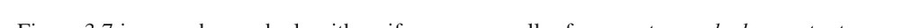

**شکل ۳.۷ — الگوریتم جستجوی بهترین-اول، و تابع گسترش یک گره.** ساختارهای دادهٔ به‌کاررفته در این‌جا در بخش 3.3.2 توصیف شده‌اند. برای yield به پیوست ب مراجعه کنید.

```
function BEST-FIRST-SEARCH(problem, f) returns a solution node or failure
  node ← NODE(STATE=problem.INITIAL)
  frontier ← a priority queue ordered by f, with node as an element
  reached ← a lookup table, with one entry keyed by problem.INITIAL and value node
  while not IS-EMPTY(frontier) do
    node ← POP(frontier)
    if problem.IS-GOAL(node.STATE) then return node
    for each child in EXPAND(problem, node) do
      s ← child.STATE
      if s is not in reached or child.PATH-COST < reached[s].PATH-COST then
        reached[s] ← child
        add child to frontier
  return failure

function EXPAND(problem, node) yields nodes
  s ← node.STATE
  for each action in problem.ACTIONS(s) do
    s′ ← problem.RESULT(s, action)
    cost ← node.PATH-COST + problem.ACTION-COST(s, action, s′)
    yield NODE(STATE=s′, PARENT=node, ACTION=action, PATH-COST=cost)
```

### 3.3.1 جستجوی بهترین-اول

چگونه تصمیم می‌گیریم کدام گره از جبهه را بعدی گسترش دهیم؟ رویکرد بسیار عمومی، «جستجوی بهترین-اول» (Best-First Search) نامیده می‌شود که در آن گره‌ای مانند n را با کمترین مقدارِ تابع ارزیابی (Evaluation Function) f(n) برمی‌گزینیم. شکل ۳.۷ الگوریتم را نشان می‌دهد. در هر تکرار، گره‌ای روی جبهه با کمترین مقدار f(n) برمی‌گزینیم؛ اگر حالتش حالت هدف باشد آن را برمی‌گردانیم وگرنه EXPAND را برای تولید گره‌های فرزند اعمال می‌کنیم. هر گرهٔ فرزند به جبهه افزوده می‌شود اگر پیش‌تر رسیده نشده باشد، یا دوباره افزوده می‌شود اگر اکنون با مسیری با هزینهٔ کمتر از هر مسیر قبلی رسیده می‌شود. الگوریتم یا نشانهٔ شکست بازمی‌گرداند، یا گره‌ای که مسیری به هدف را بازنمایی می‌کند. با به‌کارگیری توابع f(n) گوناگون، الگوریتم‌های خاص متفاوتی می‌گیریم که این فصل آن‌ها را پوشش می‌دهد.

### 3.3.2 ساختارهای دادهٔ جستجو

الگوریتم‌های جستجو به ساختار داده‌ای برای پیگیری درخت جستجو نیاز دارند. گرهٔ درخت با ساختار داده‌ای با چهار مؤلفه بازنمایی می‌شود:

- node.STATE: حالتی که گره با آن متناظر است؛
- node.PARENT: گره‌ای در درخت که این گره را تولید کرده؛
- node.ACTION: کنشی که به حالت والد اعمال شده تا این گره تولید شود؛
- node.PATH-COST: هزینهٔ کل مسیر از حالت آغازین تا این گره. در فرمول‌های ریاضی از g(node) به‌عنوان مترادف PATH-COST استفاده می‌کنیم.

دنبال‌کردن اشاره‌گرهای PARENT از گره‌ای به عقب، به ما امکان می‌دهد حالت‌ها و کنش‌های طول مسیر تا آن گره را بازیابی کنیم. انجام این کار از گرهٔ هدف، راه‌حل را به ما می‌دهد.

برای ذخیرهٔ جبهه به ساختار داده‌ای نیاز داریم. انتخاب مناسب، صف (Queue) از نوعی است، زیرا عملیات روی جبهه عبارت‌اند از:

- IS-EMPTY(frontier): فقط اگر گره‌ای در جبهه نباشد true برمی‌گرداند.
- POP(frontier): گرهٔ بالای جبهه را حذف و بازمی‌گرداند.
- TOP(frontier): گرهٔ بالای جبهه را بازمی‌گرداند (بدون حذف).
- ADD(node, frontier): گره را در جای مناسبش در صف درج می‌کند.

سه نوع صف در الگوریتم‌های جستجو به کار می‌رود:

- «صف اولویت‌دار» (Priority Queue) نخست گره‌ای را برمی‌دارد که طبق تابع ارزیابی f کمترین هزینه را دارد. در جستجوی بهترین-اول به کار می‌رود.
- «صف FIFO» یا صف اول-در-اول-خروج نخست گره‌ای را برمی‌دارد که اول به صف افزوده شده؛ خواهیم دید در جستجوی سطح-اول به کار می‌رود.
- «صف LIFO» یا صف آخر-در-اول-خروج (که «پشته» (Stack) نیز نامیده می‌شود) نخست تازه‌ترین گرهٔ افزوده‌شده را برمی‌دارد؛ خواهیم دید در جستجوی عمق-اول به کار می‌رود.

حالت‌های رسیده را می‌توان در جدول جست‌وجو (مثلاً جدول درهم‌سازی) ذخیره کرد که هر کلید حالت و هر مقدار، گرهٔ آن حالت است.

### 3.3.3 مسیرهای زائد

درخت جستجوی شکل ۳.۴ (پایین) شامل مسیری از آراد به سیبیو و بازگشت دوباره به آراد است. می‌گوییم آراد «حالت تکراری» (Repeated State) در درخت جستجوست که در این مورد توسط چرخه (Cycle) — که مسیر حلقه‌ای (Loopy Path) نیز نامیده می‌شود — تولید شده. پس حتی با آنکه فضای حالت فقط ۲۰ حالت دارد، درخت جستجوی کامل بی‌نهایت است، زیرا محدودیتی برای تعداد دفعات طی یک حلقه نیست.

چرخه حالت خاصی از «مسیر زائد» (Redundant Path) است. برای نمونه، می‌توان از مسیر آراد–سیبیو (۱۴۰ مایل) یا مسیر آراد–زرند–اورادئا–سیبیو (۲۹۷ مایل) به سیبیو رسید. این مسیر دوم زائد است — فقط راهی بدتر برای رسیدن به همان حالت است — و در جست‌وجوی مسیرهای بهینه نیازی به در نظر گرفتنش نیست.

عاملی را در جهان شبکه‌ای ۱۰×۱۰ در نظر بگیرید با توانایی حرکت به هر یک از ۸ خانهٔ مجاور. اگر مانعی نباشد، عامل می‌تواند در ۹ حرکت یا کمتر به هر یک از ۱۰۰ خانه برسد. اما شمار مسیرهای به‌طول ۹ تقریباً ۸⁹ است (کمی کمتر به‌سبب لبه‌های شبکه)، یعنی بیش از ۱۰۰ میلیون. به بیان دیگر، میانگین هر خانه با بیش از یک میلیون مسیر زائد به‌طول ۹ قابل دسترسی است و اگر مسیرهای زائد را حذف کنیم، می‌توانیم جستجو را تقریباً یک میلیون بار سریع‌تر کامل کنیم. چنان‌که ضرب‌المثل می‌گوید: الگوریتم‌هایی که ◮ گذشته را به خاطر نمی‌سپارند، محکوم به تکرارش هستند. سه رویکرد برای این مسئله هست.

نخست، می‌توانیم همهٔ حالت‌های قبلاً رسیده را به خاطر بسپاریم (چنان‌که جستجوی بهترین-اول می‌کند) تا بتوانیم همهٔ مسیرهای زائد را شناسایی کنیم و فقط بهترین مسیر به هر حالت را نگه داریم. این برای فضاهای حالتی که مسیرهای زائد فراوان دارند مناسب است و انتخاب ترجیحی وقتی است که جدول حالت‌های رسیده در حافظه جا شود.

دوم، می‌توانیم نگران تکرار گذشته نباشیم. برخی صورت‌بندی‌های مسئله هست که در آن‌ها نادر یا ناممکن است دو مسیر به همان حالت برسند. مثالی مسئلهٔ مونتاژ است که در آن هر کنش قطعه‌ای به مجموعهٔ در حال شکل‌گیری می‌افزاید و ترتیبی از قطعات هست که افزودن A و سپس B ممکن است اما B و سپس A نه. برای آن مسائل، اگر حالت‌های رسیده را پیگیری نکنیم و برای مسیرهای زائد بررسی نکنیم، در حافظه صرفه‌جویی می‌کنیم. الگوریتم جستجو را «جستجوی گرافی» (Graph Search) می‌نامیم اگر مسیرهای زائد را بررسی کند و «جستجوی درخت‌مانند» (Tree-Like Search)⁶ اگر بررسی نکند. الگوریتم BEST-FIRST-SEARCH در شکل ۳.۷ الگوریتم جستجوی گرافی است؛ اگر همهٔ ارجاع‌ها به reached را حذف کنیم، جستجوی درخت‌مانندی می‌گیریم که حافظهٔ کمتری مصرف می‌کند اما مسیرهای زائد به همان حالت را بررسی می‌کند و بنابراین کندتر اجرا می‌شود.

سوم، می‌توانیم مصالحه کنیم و چرخه‌ها را بررسی کنیم، اما نه مسیرهای زائد را به‌طور کلی. چون هر گره زنجیره‌ای از اشاره‌گرهای والد دارد، می‌توانیم چرخه‌ها را بدون نیاز به حافظهٔ اضافی با دنبال‌کردن زنجیرهٔ والدها بررسی کنیم تا ببینیم آیا حالتِ انتهای مسیر در بخش‌های پیشین مسیر ظاهر شده. برخی پیاده‌سازی‌ها این زنجیره را تا بالا دنبال می‌کنند و بدین ترتیب همهٔ چرخه‌ها را حذف می‌کنند؛ برخی دیگر فقط چند پیوند را دنبال می‌کنند (مثلاً تا والد، پدربزرگ و پدربزرگِ پدر) و بدین ترتیب زمان ثابتی می‌برند و همهٔ چرخه‌های کوتاه را حذف می‌کنند (و برای چرخه‌های بلند به سازوکارهای دیگر تکیه می‌کنند).

### 3.3.4 سنجش عملکرد حل مسئله

پیش از ورود به طراحی الگوریتم‌های جستجوی گوناگون، معیارهای به‌کاررفته برای انتخاب میان آن‌ها را بررسی می‌کنیم. عملکرد الگوریتم را از چهار راه می‌توان ارزیابی کرد:

- **کامل بودن (Completeness):** آیا الگوریتم تضمین می‌کند راه‌حل بیابد وقتی راه‌حلی هست، و شکست را درست گزارش کند وقتی نیست؟
- **بهینگی هزینه (Cost Optimality):** آیا راه‌حلی با کمترین هزینهٔ مسیر در میان همهٔ راه‌حل‌ها می‌یابد؟⁷
- **پیچیدگی زمانی (Time Complexity):** یافتن راه‌حل چقدر طول می‌کشد؟ این را می‌توان بر حسب ثانیه سنجید، یا انتزاعی‌تر با شمار حالت‌ها و کنش‌های در نظرگرفته‌شده.
- **پیچیدگی فضایی (Space Complexity):** برای انجام جستجو چقدر حافظه لازم است؟

برای فهم کامل بودن، مسئلهٔ جستجویی با یک هدف واحد را در نظر بگیرید. آن هدف می‌تواند هر جای فضای حالت باشد؛ پس الگوریتم کامل باید بتواند هر حالتی را که از حالت آغازین قابل دسترسی است به‌شکل نظام‌مند کاوش کند. در فضاهای حالت متناهی این سرراست به دست می‌آید: تا وقتی مسیرها را پیگیری و مسیرهای چرخه‌ای را قطع کنیم (مانند آراد به سیبیو به آراد)، سرانجام به هر حالت قابل دسترسی می‌رسیم.

در فضاهای حالت بی‌نهایت، دقت بیشتری لازم است. برای نمونه، الگوریتمی که مکرراً عملگر «فاکتوریل» را در مسئلهٔ «۴» کنوت اعمال کند، مسیر بی‌نهایتی از ۴ به ۴! به (۴!)! و الی آخر را دنبال می‌کند. به همین ترتیب، روی شبکهٔ بی‌نهایت بدون مانع، حرکت مکرر به جلو در خط راست نیز مسیر بی‌نهایتی از حالت‌های تازه را دنبال می‌کند. در هر دو مورد الگوریتم هرگز به حالتی که قبلاً رسیده بازنمی‌گردد، اما ناقص است، زیرا پهنه‌های گسترده‌ای از فضای حالت هرگز رسیده نمی‌شوند.

برای کامل بودن، الگوریتم جستجو باید در شیوهٔ کاوش فضای حالت بی‌نهایت «نظام‌مند» (Systematic) باشد و مطمئن شود سرانجام می‌تواند به هر حالتی برسد که به حالت آغازین متصل است. برای نمونه، روی شبکهٔ بی‌نهایت، یک نوع جستجوی نظام‌مند مسیر مارپیچی است که همهٔ خانه‌های فاصلهٔ s از مبدأ را می‌پوشاند پیش از آنکه به خانه‌های فاصلهٔ s+1 برود.

متأسفانه، در فضای حالت بی‌نهایت بدون راه‌حل، الگوریتم درست باید برای همیشه به جستجو ادامه دهد؛ نمی‌تواند پایان یابد، زیرا نمی‌تواند بداند حالت بعدی هدف خواهد بود یا نه.

پیچیدگی زمانی و فضایی نسبت به معیاری از دشواری مسئله در نظر گرفته می‌شود. در علوم رایانهٔ نظری، معیار معمول اندازهٔ گراف فضای حالت است: |V| + |E| که |V| شمار رأس‌ها (گره‌های حالت) و |E| شمار یال‌ها (جفت‌های حالت/کنش متمایز) است. این وقتی مناسب است که گراف ساختار دادهٔ صریحی باشد، مانند نقشهٔ رومانی. اما در بسیاری از مسائل هوش مصنوعی، گراف فقط به‌صورت ضمنی با حالت آغازین، کنش‌ها و مدل گذار بازنمایی می‌شود. برای فضای حالت ضمنی، پیچیدگی را می‌توان بر حسب این‌ها سنجید: d، «عمق» (Depth) یا شمار کنش‌های راه‌حل بهینه؛ m، بیشینهٔ شمار کنش‌ها در هر مسیر؛ و b، «ضریب انشعاب» (Branching Factor) یا شمار جانشین‌های گره‌ای که باید در نظر گرفته شوند.

## 3.4 راهبردهای جستجوی نامطلع

به الگوریتم جستجوی نامطلع هیچ سرنخی دربارهٔ نزدیکی حالت به هدف(ها) داده نمی‌شود. برای نمونه، عامل ما در آراد با هدف رسیدن به بخارست را در نظر بگیرید. عامل نامطلعی که دانشی از جغرافیای رومانی ندارد، هیچ سرنخی ندارد که رفتن به زرند یا سیبیو گام اول بهتری است. در برابر، عامل مطلع (بخش 3.5) که مکان هر شهر را می‌داند، می‌داند سیبیو به بخارست بسیار نزدیک‌تر است و بنابراین به احتمال بیشتر روی کوتاه‌ترین مسیر است.

### 3.4.1 جستجوی سطح-اول

وقتی همهٔ کنش‌ها هزینهٔ یکسان دارند، راهبرد مناسب «جستجوی سطح-اول» (Breadth-First Search) است که در آن نخست گرهٔ ریشه گسترش می‌یابد، سپس همهٔ جانشین‌های گرهٔ ریشه، سپس جانشین‌های آن‌ها، و همین‌طور ادامه. این راهبرد جستجوی نظام‌مندی است و بنابراین حتی در فضاهای حالت بی‌نهایت نیز کامل است. می‌توانیم جستجوی سطح-اول را به‌صورت فراخوانی BEST-FIRST-SEARCH پیاده کنیم که تابع ارزیابی f(n) عمق گره است — یعنی شمار کنش‌های لازم برای رسیدن به گره.

اما با چند حربه می‌توانیم کارایی بیشتری بگیریم. صف FIFO از صف اولویت‌دار سریع‌تر خواهد بود و ترتیب درست گره‌ها را به ما می‌دهد: گره‌های تازه (که همیشه از والدهایشان عمیق‌ترند) به انتهای صف می‌روند و گره‌های قدیمی، که از گره‌های تازه کم‌عمق‌ترند، اول گسترش می‌یابند. افزون بر این، reached می‌تواند مجموعه‌ای از حالت‌ها باشد نه نگاشتی از حالت‌ها به گره‌ها، زیرا وقتی به حالتی رسیده‌ایم، هرگز نمی‌توانیم مسیر بهتری به آن حالت بیابیم. آن نیز بدان معناست که می‌توانیم «آزمون هدف زودهنگام» (Early Goal Test) انجام دهیم — بررسی کنیم آیا گره به‌محض تولید شدن راه‌حل است — به‌جای «آزمون هدف دیرهنگام» (Late Goal Test) که جستجوی بهترین-اول به کار می‌برد و تا بیرون‌آمدن گره از صف صبر می‌کند. شکل ۳.۸ پیشرفت جستجوی سطح-اول را روی درخت دودویی نشان می‌دهد و شکل ۳.۹ الگوریتم را با بهبودهای کاراییِ آزمون زودهنگام نشان می‌دهد.

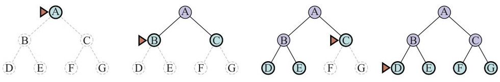

**شکل ۳.۸ — جستجوی سطح-اول روی درخت دودویی ساده.** در هر مرحله، گره‌ای که بعدی گسترش می‌یابد با نشانگر مثلثی مشخص شده.

جستجوی سطح-اول همیشه راه‌حلی با کمترین شمار کنش می‌یابد، زیرا وقتی گره‌هایی در عمق d تولید می‌کند، همهٔ گره‌های عمق d−1 را قبلاً تولید کرده و اگر یکی از آن‌ها راه‌حل بود، یافته می‌شد. این بدان معناست برای مسائلی که همهٔ کنش‌ها هزینهٔ یکسان دارند بهینهٔ هزینه است، اما نه برای مسائلی که آن ویژگی را ندارند. در هر دو مورد کامل است.

از نظر زمان و فضا، جستجو در درختی یکنواخت را تصور کنید که هر حالت b جانشین دارد. ریشهٔ درخت جستجو b گره تولید می‌کند، هر یک b گرهٔ دیگر، و در مجموع b² در سطح دوم. هر یک از این‌ها b گرهٔ دیگر تولید می‌کند و b³ گره در سطح سوم به دست می‌آید، و همین‌طور ادامه. حال فرض کنیم راه‌حل در عمق d است. پس شمار کل گره‌های تولیدشده برابر است با:

1 + b + b² + b³ + ... + bᵈ = O(bᵈ)

همهٔ گره‌ها در حافظه می‌مانند، پس پیچیدگی زمانی و فضایی هر دو O(bᵈ) است. کران‌های نمایی از این دست ترسناک‌اند. به‌عنوان مثال معمولِ جهان واقعی، مسئله‌ای با ضریب انشعاب b = 10، سرعت پردازش ۱ میلیون گره در ثانیه و نیاز حافظهٔ ۱ کیلوبایت به ازای هر گره در نظر بگیرید. جستجو تا عمق d = 10 کمتر از ۳ ساعت طول می‌کشد، اما ۱۰ ترابایت حافظه نیاز دارد. نیازهای حافظه برای جستجوی سطح-اول ◭ مشکل بزرگ‌تری از زمان اجراست. اما زمان همچنان عامل مهمی است. در عمق d = 14، حتی با حافظهٔ بی‌نهایت، جستجو ۳٫۵ سال طول می‌کشد. در حالت کلی، مسائل جستجوی با پیچیدگی نمایی را ◭ برای هیچ‌چیز جز کوچک‌ترین نمونه‌ها نمی‌توان با جستجوی نامطلع حل کرد.

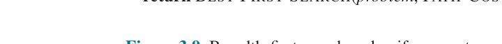

**شکل ۳.۹ — الگوریتم‌های جستجوی سطح-اول و جستجوی هزینه-یکنواخت.**

```
function BREADTH-FIRST-SEARCH(problem) returns a solution node or failure
  node ← NODE(problem.INITIAL)
  if problem.IS-GOAL(node.STATE) then return node
  frontier ← a FIFO queue, with node as an element
  reached ← {problem.INITIAL}
  while not IS-EMPTY(frontier) do
    node ← POP(frontier)
    for each child in EXPAND(problem, node) do
      s ← child.STATE
      if problem.IS-GOAL(s) then return child
      if s is not in reached then
        add s to reached
        add child to frontier
  return failure
```

### 3.4.2 الگوریتم دیکسترا یا جستجوی هزینه-یکنواخت

وقتی کنش‌ها هزینه‌های متفاوت دارند، انتخاب بدیهی به‌کارگیری جستجوی بهترین-اول با تابع ارزیابیِ هزینهٔ مسیر از ریشه تا گرهٔ کنونی است. این را جامعهٔ علوم رایانهٔ نظری «الگوریتم دیکسترا» و جامعهٔ هوش مصنوعی «جستجوی هزینه-یکنواخت» (Uniform-Cost Search) می‌نامد. ایده این است که جستجوی سطح-اول در موج‌هایی با عمق یکنواخت پخش می‌شود — نخست عمق ۱، سپس عمق ۲ و الی آخر — حال آنکه جستجوی هزینه-یکنواخت در موج‌هایی با هزینهٔ مسیر یکنواخت پخش می‌شود. الگوریتم را می‌توان به‌صورت فراخوانی BEST-FIRST-SEARCH با PATH-COST به‌عنوان تابع ارزیابی پیاده کرد، چنان‌که در شکل ۳.۹ نشان داده شده.

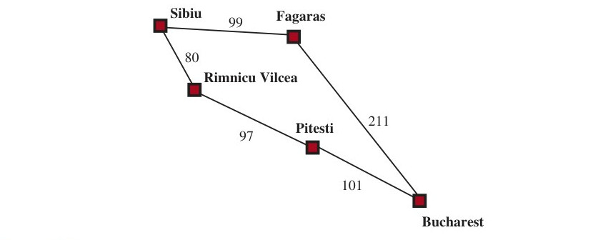

**شکل ۳.۱۰ — بخشی از فضای حالت رومانی، برگزیده برای نشان دادن جستجوی هزینه-یکنواخت.** (شهرها: سیبیو، فاگاراش، پیتشتی، ریمنیکو ویلچا، بخارست)

شکل ۳.۱۰ را در نظر بگیرید که مسئله رسیدن از سیبیو به بخارست است. جانشین‌های سیبیو ریمنیکو ویلچا و فاگاراش‌اند با هزینه‌های ۸۰ و ۹۹. گرهٔ کم‌هزینه‌ترین، ریمنیکو ویلچا، بعدی گسترش می‌یابد و پیتشتی را با هزینهٔ ۸۰+۹۷=۱۷۷ می‌افزاید. اکنون کم‌هزینه‌ترین گره فاگاراش است، پس گسترش می‌یابد و بخارست را با هزینهٔ ۹۹+۲۱۱=۳۱۰ می‌افزاید. بخارست هدف است، اما الگوریتم هدف‌ها را فقط هنگام گسترش گره آزمایش می‌کند، نه هنگام تولید گره، پس هنوز تشخیص نداده که این مسیری به هدف است. الگوریتم ادامه می‌دهد، پیتشتی را برای گسترش برمی‌گزیند و مسیر دومی به بخارست با هزینهٔ ۸۰+۹۷+۱۰۱=۲۷۸ می‌افزاید. هزینهٔ آن کمتر است، پس مسیر قبلی را در reached جایگزین می‌کند و به جبهه افزوده می‌شود. معلوم می‌شود این گره اکنون کمترین هزینه را دارد، پس بعدی در نظر گرفته می‌شود، هدف یافت می‌شود و بازگردانده می‌شود. توجه کنید اگر هنگام تولید گره به‌جای هنگام گسترش کم‌هزینه‌ترین گره، هدف را بررسی کرده بودیم، مسیر پرهزینه‌تر (آن که از فاگاراش می‌گذرد) را بازگردانده بودیم.

پیچیدگی جستجوی هزینه-یکنواخت بر حسب C∗، هزینهٔ راه‌حل بهینه،⁸ و ε، کران پایینی بر هزینهٔ هر کنش با ε > 0، توصیف می‌شود. آنگاه پیچیدگی زمانی و فضایی بدترین حالت الگوریتم O(b^(1+⌊C∗/ε⌋)) است که می‌تواند بسیار بزرگ‌تر از bᵈ باشد. این به‌سبب آن است که جستجوی هزینه-یکنواخت می‌تواند درخت‌های بزرگی از کنش‌های کم‌هزینه را پیش از کاوشِ مسیرهای شامل کنشی پرخرج و شاید مفید کاوش کند. وقتی همهٔ هزینه‌های کنش برابرند، b^(1+⌊C∗/ε⌋) همان b^(d+1) است و جستجوی هزینه-یکنواخت شبیه جستجوی سطح-اول است.

جستجوی هزینه-یکنواخت کامل و بهینهٔ هزینه است، زیرا نخستین راه‌حلی که می‌یابد هزینه‌ای دست‌کم به کم‌ی هزینهٔ هر گره دیگر جبهه دارد. جستجوی هزینه-یکنواخت همهٔ مسیرها را به‌صورت نظام‌مند به‌ترتیب هزینهٔ فزاینده در نظر می‌گیرد و هرگز در مسیر بی‌نهایتِ تکی گیر نمی‌افتد (با فرض اینکه همهٔ هزینه‌های کنش > ε > 0 هستند).

### 3.4.3 جستجوی عمق-اول و مسئلهٔ حافظه

جستجوی عمق-اول (Depth-First Search) همیشه نخست عمیق‌ترین گرهٔ جبهه را گسترش می‌دهد. می‌توان آن را به‌صورت فراخوانی BEST-FIRST-SEARCH پیاده کرد که تابع ارزیابی f منفی عمق است. اما معمولاً نه به‌صورت جستجوی گرافی، بلکه به‌صورت جستجوی درخت‌مانندی پیاده می‌شود که جدول حالت‌های رسیده نگه نمی‌دارد. پیشرفت جستجو در شکل ۳.۱۱ نشان داده شده؛ جستجو بلافاصله به عمیق‌ترین سطح درخت جستجو می‌رود، جایی که گره‌ها جانشینی ندارند. سپس جستجو «به عقب برمی‌گردد» به بعدی‌ترین گره‌ای که هنوز جانشین‌های گسترش‌نیافته دارد.


**شکل ۳.۱۱ — دوازده گام (چپ به راست، بالا به پایین) در پیشرفت جستجوی عمق-اول روی درخت دودویی از حالت آغازین A به هدف M.** جبهه سبز است و مثلث گره‌ای را که بعدی گسترش می‌یابد نشان می‌دهد. گره‌های قبلاً گسترش‌یافته بنفش‌اند و گره‌های بالقوهٔ آینده خط‌چین کمرنگ دارند. گره‌های گسترش‌یافتهٔ بدون نواده در جبهه (خط‌های بسیار کمرنگ) را می‌توان دور ریخت.

جستجوی عمق-اول بهینهٔ هزینه نیست؛ نخستین راه‌حلی را که بیابد بازمی‌گرداند، حتی اگر ارزان‌ترین نباشد. برای فضاهای حالت متناهیِ درخت‌شکل کارآمد و کامل است؛ برای فضاهای حالت بدون چرخه ممکن است همان حالت را بارها از مسیرهای گوناگون گسترش دهد، اما (سرانجام) کل فضا را به‌شکل نظام‌مند کاوش خواهد کرد. در فضاهای حالت چرخه‌ای می‌تواند در حلقهٔ بی‌نهایت گیر کند؛ بنابراین برخی پیاده‌سازی‌های جستجوی عمق-اول هر گرهٔ تازه را از نظر چرخه بررسی می‌کنند. سرانجام، در فضاهای حالت بی‌نهایت، جستجوی عمق-اول نظام‌مند نیست: می‌تواند در مسیر بی‌نهایتی گیر کند، حتی اگر چرخه‌ای نباشد. پس جستجوی عمق-اول ناقص است.

با این همه خبر بد، چرا کسی باید به‌جای جستجوی سطح-اول یا بهترین-اول از جستجوی عمق-اول استفاده کند؟ پاسخ آن است که برای مسائلی که جستجوی درخت‌مانند در آن‌ها شدنی است، جستجوی عمق-اول نیازهای حافظهٔ بسیار کمتری دارد. ما اصلاً جدول reached نگه نمی‌داریم و جبهه بسیار کوچک است: جبهه در جستجوی سطح-اول را سطحِ کره‌ای همیشه‌درحال‌گسترش تصور کنید، حال آنکه جبهه در جستجوی عمق-اول فقط شعاع کره است.

برای فضای حالت متناهیِ درخت‌شکل مانند شکل ۳.۱۱، جستجوی درخت‌مانند عمق-اول زمانی متناسب با شمار حالت‌ها می‌برد و پیچیدگی حافظه‌ای فقط O(bm) دارد، که b ضریب انشعاب و m بیشینهٔ عمق درخت است. برخی مسائل که با جستجوی سطح-اول به اگزابایت حافظه نیاز دارند، با جستجوی عمق-اول فقط با چند کیلوبایت مدیریت می‌شوند. به‌سبب مصرف کم‌خرجِ حافظه، جستجوی درخت‌مانند عمق-اول به‌عنوان «اسب‌کار» پایهٔ بسیاری از حوزه‌های هوش مصنوعی برگزیده شده، از جمله ارضای قیود (فصل ۶)، ارضاپذیری گزاره‌ای (فصل ۷) و برنامه‌نویسی منطقی (فصل ۹). تغییری از جستجوی عمق-اول به نام جستجوی بازگشتی (Backtracking Search) حافظهٔ حتی کمتری مصرف می‌کند. (فصل ۶ را برای جزئیات بیشتر ببینید.) در بازگشت، در هر لحظه فقط یک جانشین تولید می‌شود نه همهٔ جانشین‌ها؛ هر گرهٔ نیمه‌گسترش‌یافته به خاطر می‌سپارد کدام جانشین را بعدی تولید کند. افزون بر این، جانشین‌ها با اصلاح مستقیم توصیف حالت کنونی تولید می‌شوند، نه با تخصیص حافظه برای حالت کاملاً تازه. این نیازهای حافظه را به فقط یک توصیف حالت و مسیری از O(m) کنش کاهش می‌دهد؛ صرفه‌جویی چشمگیری نسبت به O(bm) حالت در جستجوی عمق-اول. با بازگشت همچنین این گزینه را داریم که ساختار دادهٔ مجموعه‌ای کارآمد برای حالت‌های مسیر کنونی نگه داریم تا چرخه را در زمان O(1) بررسی کنیم نه O(m). برای کارکردن بازگشت، باید بتوانیم هر کنش را هنگام بازگشت به عقب، خنثی کنیم. بازگشت برای موفقیت بسیاری از مسائل با توصیف حالت بزرگ، مانند مونتاژ رباتیک، حیاتی است.

### 3.4.4 جستجوی محدود-به-عمق و تعمیق تکراری

برای بازداشتن جستجوی عمق-اول از سرگردانی در مسیر بی‌نهایت، می‌توانیم از جستجوی محدود-به-عمق (Depth-Limited Search) استفاده کنیم؛ نسخه‌ای از جستجوی عمق-اول که در آن حد عمق ℓ می‌دهیم و همهٔ گره‌های عمق ℓ را چنان می‌پنداریم که گویی جانشینی ندارند (شکل ۳.۱۲). پیچیدگی زمانی O(b^ℓ) و پیچیدگی فضایی O(bℓ) است. متأسفانه، اگر ℓ را بد انتخاب کنیم، الگوریتم به راه‌حل نخواهد رسید و دوباره ناقص می‌شود.

چون جستجوی عمق-اول جستجوی درخت‌مانندی است، نمی‌توانیم به‌طور کلی جلوی تلف‌کردن زمان در مسیرهای زائد را بگیریم، اما می‌توانیم چرخه‌ها را به بهای اندکی زمان محاسبه حذف کنیم. اگر فقط چند پیوند در زنجیرهٔ والدها نگاه کنیم، بیشتر چرخه‌ها را می‌گیریم؛ چرخه‌های بلندتر را حد عمق مدیریت می‌کند. گاهی می‌توان حد عمق خوبی را بر اساس دانش مسئله برگزید. برای نمونه، روی نقشهٔ رومانی ۲۰ شهر هست. پس ℓ=19 حدی معتبر است. اما اگر نقشه را به‌دقت مطالعه کنیم، کشف می‌کنیم هر شهری را می‌توان در حداکثر ۹ کنش از هر شهر دیگر رسید. این عدد، که «قطر» (Diameter) گراف فضای حالت نامیده می‌شود، حد عمق بهتری به ما می‌دهد که به جستجوی محدود-به-عمق کارآمدتر می‌انجامد. اما برای بیشتر مسائل، حد عمق خوبی را تا حل مسئله نخواهیم شناخت.

جستجوی تعمیق تکراری (Iterative Deepening Search) مسئلهٔ برگزیدن مقدار خوب برای ℓ را با آزمودن همهٔ مقادیر حل می‌کند: نخست ۰، سپس ۱، سپس ۲ و الی آخر — تا آنکه یا راه‌حلی یافت شود، یا جستجوی محدود-به-عمق به‌جای مقدار cutoff مقدار failure بازگرداند. الگوریتم در شکل ۳.۱۲ نشان داده شده. تعمیق تکراری بسیاری از مزیت‌های جستجوی عمق-اول و سطح-اول را ترکیب می‌کند. مانند جستجوی عمق-اول، نیازهای حافظه‌اش اندک است: O(bd) وقتی راه‌حلی هست، یا O(bm) در فضاهای حالت متناهی بدون راه‌حل. مانند جستجوی سطح-اول، تعمیق تکراری برای مسائلی که همهٔ کنش‌ها هزینهٔ یکسان دارند بهینه است، و در فضاهای حالت بدون چرخهٔ متناهی، یا در هر فضای حالت متناهی وقتی گره‌ها را تا بالای مسیر از نظر چرخه بررسی کنیم، کامل است.

![**شکل ۳.۱۲ — جستجوی تعمیق تکراری و جستجوی محدود-به-عمق درخت‌مانند.** تعمیق تکراری به‌طور مکرر جستجوی محدود-به-عمق را با حدهای فزاینده اعمال می‌کند. یکی از سه نوع مقدار را بازمی‌گرداند: یا گرهٔ راه‌حل؛ یا failure، وقتی همهٔ گره‌ها را تمام کرده و ثابت کرده در هیچ عمقی راه‌حلی نیست؛ یا cutoff، به این معنا که ممکن است راه‌حلی در عمقی بیشتر از ℓ باشد. این الگوریتم جستجوی درخت‌مانندی است که حالت‌های رسیده را پیگیری نمی‌کند و بنابراین حافظهٔ بسیار کمتری از جستجوی بهترین-اول مصرف می‌کند، اما خطر بازدید همان حالت را چند بار از مسیرهای گوناگون دارد. همچنین، اگر بررسی IS-CYCLE همهٔ چرخه‌ها را بررسی نکند، الگوریتم ممکن است در حلقه گیر کند.](../figures/ch03/fig-3-12.jpg)

**شکل ۳.۱۲ — جستجوی تعمیق تکراری و جستجوی محدود-به-عمق درخت‌مانند.** تعمیق تکراری به‌طور مکرر جستجوی محدود-به-عمق را با حدهای فزاینده اعمال می‌کند. یکی از سه نوع مقدار را بازمی‌گرداند: یا گرهٔ راه‌حل؛ یا failure، وقتی همهٔ گره‌ها را تمام کرده و ثابت کرده در هیچ عمقی راه‌حلی نیست؛ یا cutoff، به این معنا که ممکن است راه‌حلی در عمقی بیشتر از ℓ باشد. این الگوریتم جستجوی درخت‌مانندی است که حالت‌های رسیده را پیگیری نمی‌کند و بنابراین حافظهٔ بسیار کمتری از جستجوی بهترین-اول مصرف می‌کند، اما خطر بازدید همان حالت را چند بار از مسیرهای گوناگون دارد. همچنین، اگر بررسی IS-CYCLE همهٔ چرخه‌ها را بررسی نکند، الگوریتم ممکن است در حلقه گیر کند.

```
function ITERATIVE-DEEPENING-SEARCH(problem) returns a solution node or failure
  for depth = 0 to ∞ do
    result ← DEPTH-LIMITED-SEARCH(problem, depth)
    if result ≠ cutoff then return result

function DEPTH-LIMITED-SEARCH(problem, ℓ) returns a node or failure or cutoff
  frontier ← a LIFO queue (stack) with NODE(problem.INITIAL) as an element
  result ← failure
  while not IS-EMPTY(frontier) do
    node ← POP(frontier)
    if problem.IS-GOAL(node.STATE) then return node
    if DEPTH(node) > ℓ then
      result ← cutoff
    else
      for each child in EXPAND(problem, node) do
        add child to frontier
  return result
```

پیچیدگی زمانی O(bᵈ) است وقتی راه‌حلی هست، یا O(bᵐ) وقتی نیست. هر تکرار جستجوی تعمیق تکراری سطح تازه‌ای تولید می‌کند، همان‌گونه که جستجوی سطح-اول می‌کند، اما سطح-اول این کار را با ذخیرهٔ همهٔ گره‌ها در حافظه انجام می‌دهد، در حالی که تعمیق تکراری با تکرار سطح‌های قبلی انجامش می‌دهد و بدین ترتیب به بهای زمان بیشتر، حافظه صرفه‌جویی می‌کند. شکل ۳.۱۳ چهار تکرار جستجوی تعمیق تکراری را روی درخت جستجوی دودویی نشان می‌دهد که راه‌حل در تکرار چهارم یافته می‌شود.


**شکل ۳.۱۳ — چهار تکرار جستجوی تعمیق تکراری برای هدف M روی درخت دودویی، با حد عمقِ متغیر از ۰ تا ۳.** توجه کنید گره‌های داخلی یک مسیر واحد می‌سازند. مثلث گره‌ای را که بعدی گسترش می‌یابد نشان می‌دهد؛ گره‌های سبز با خط تیره روی جبهه‌اند؛ گره‌های بسیار کمرنگ به‌شکل اثبات‌پذیر نمی‌توانند با این حد عمق بخشی از راه‌حل باشند.

جستجوی تعمیق تکراری ممکن است اسراف‌کارانه بنماید، زیرا حالت‌های نزدیک بالای درخت جستجو چند بار بازتولید می‌شوند. اما برای بسیاری از فضاهای حالت، بیشتر گره‌ها در سطح پایین‌اند، پس تکرار سطح‌های بالایی چندان مهم نیست. در جستجوی تعمیق تکراری، گره‌های سطح پایین (عمق d) یک بار تولید می‌شوند، گره‌های سطح ماقبل آخر دو بار، و الی آخر تا فرزندان ریشه که d بار تولید می‌شوند. پس شمار کل گره‌های تولیدشده در بدترین حالت:

N(IDS) = (d)b¹ + (d−1)b² + (d−2)b³ + ... + bᵈ

که پیچیدگی زمانی O(bᵈ) می‌دهد — مجانباً همان جستجوی سطح-اول. برای نمونه، اگر b = 10 و d = 5:

N(IDS) = 50+400+3,000+20,000+100,000 = 123,450
N(BFS) = 10+100+1,000+10,000+100,000 = 111,110

اگر واقعاً نگران تکرار هستید، می‌توانید رویکرد ترکیبی به کار گیرید که جستجوی سطح-اول را تا وقتی تقریباً تمام حافظهٔ در دسترس مصرف شود اجرا می‌کند و سپس تعمیق تکراری را از همهٔ گره‌های جبهه اجرا می‌کند. در حالت کلی، تعمیق تکراری روش ترجیحی ◮ جستجوی نامطلع است وقتی فضای حالت جستجو بزرگ‌تر از آن است که در حافظه جا شود و عمق راه‌حل شناخته‌شده نیست.

### 3.4.5 جستجوی دوطرفه

الگوریتم‌هایی که تاکنون پوشش داده‌ایم از حالت آغازین شروع می‌کنند و می‌توانند به هر یک از حالت‌های هدفِ متعدد برسند. رویکرد جایگزینی به نام جستجوی دوطرفه (Bidirectional Search) به‌طور هم‌زمان از حالت آغازین به جلو و از حالت(های) هدف به عقب جستجو می‌کند، به این امید که دو جستجو به هم برسند. انگیزه آن است که b^(d/2) + b^(d/2) بسیار کمتر از bᵈ است (مثلاً ۵۰٬۰۰۰ برابر کمتر وقتی b = d = 10).


**شکل ۳.۱۴ — جستجوی بهترین-اول دوطرفه دو جبهه و دو جدول حالت‌های رسیده نگه می‌دارد.** وقتی مسیری در یک جبهه به حالتی می‌رسد که در نیمهٔ دیگر جستجو نیز رسیده شده، دو مسیر (با تابع JOIN-NODES) به هم می‌پیوندند و راه‌حل می‌سازند. نخستین راه‌حلی که می‌گیریم تضمین‌شده بهترین نیست؛ تابع TERMINATED تعیین می‌کند چه‌وقت جست‌وجوی راه‌حل‌های تازه را متوقف کنیم.

```
function BIBF-SEARCH(problemF, fF, problemB, fB) returns a solution node, or failure
    nodeF ← NODE(problemF.INITIAL) // Node for a start state
    nodeB ← NODE(problemB.INITIAL) // Node for a goal state
    frontierF ← a priority queue ordered by fF, with nodeF as an element
    frontierB ← a priority queue ordered by fB, with nodeB as an element
    reachedF ← a lookup table, with one key nodeF.STATE and value nodeF
    reachedB ← a lookup table, with one key nodeB.STATE and value nodeB
    solution ← failure
    while not TERMINATED(solution, frontierF, frontierB) do
        if fF(TOP(frontierF)) < fB(TOP(frontierB)) then
            solution ← PROCEED(F, problemF, frontierF, reachedF, reachedB, solution)
        else solution ← PROCEED(B, problemB, frontierB, reachedB, reachedF, solution)
    return solution

function PROCEED(dir, problem, frontier, reached, reached2, solution) returns a solution
    // Expand node on frontier; check against the other frontier in reached2.
    // The variable "dir" is the direction: either F for forward or B for backward.
    node ← POP(frontier)
    for each child in EXPAND(problem, node) do
        s ← child.STATE
        if s not in reached or PATH-COST(child) < PATH-COST(reached[s]) then
            reached[s] ← child
            add child to frontier
            if s is in reached2 then
                solution2 ← JOIN-NODES(dir, child, reached2[s])
                if PATH-COST(solution2) < PATH-COST(solution) then
                    solution ← solution2
    return solution
```

برای اینکه این کار کند، باید دو جبهه و دو جدول حالت‌های رسیده پیگیری کنیم و باید بتوانیم به عقب استدلال کنیم: اگر حالت s′ جانشین s در جهت جلو است، باید بدانیم s جانشین s′ در جهت عقب است. وقتی دو جبهه به هم برخورد کنند راه‌حل داریم.⁹ نسخه‌های بسیار متفاوتی از جستجوی دوطرفه هست، همان‌گونه که الگوریتم‌های جستجوی یک‌طرفهٔ بسیاری هست. در این بخش جستجوی بهترین-اول دوطرفه را توصیف می‌کنیم.

هرچند دو جبههٔ جدا هست، گره‌ای که بعدی گسترش می‌یابد همیشه گره‌ای با کمترین مقدار تابع ارزیابی، در هر کدام از جبهه‌ها، است. وقتی تابع ارزیابی هزینهٔ مسیر باشد، جستجوی هزینه-یکنواخت دوطرفه می‌گیریم و اگر هزینهٔ مسیر بهینه C∗ باشد، هیچ گرهی با هزینهٔ بیشتر از C∗/2 گسترش نخواهد یافت. این می‌تواند شتاب قابل توجهی به بار آورد. الگوریتم عمومی جستجوی بهترین-اول دوطرفه در شکل ۳.۱۴ نشان داده شده. دو نسخه از مسئله و تابع ارزیابی را وارد می‌کنیم: یکی در جهت جلو (زیرنویس F) و یکی در جهت عقب (زیرنویس B). وقتی تابع ارزیابی هزینهٔ مسیر است، می‌دانیم نخستین راه‌حلِ یافته‌شده راه‌حل بهینه خواهد بود، اما با توابع ارزیابی متفاوت این لزوماً درست نیست. بنابراین بهترین راه‌حلِ یافته‌شده تاکنون را پیگیری می‌کنیم و ممکن است پیش از آنکه آزمون TERMINATED ثابت کند راه‌حل بهتری باقی نمانده، چند بار به‌روزش کنیم.

### 3.4.6 مقایسهٔ الگوریتم‌های جستجوی نامطلع

شکل ۳.۱۵ الگوریتم‌های جستجوی نامطلع را بر حسب چهار معیار ارزیابیِ بخش 3.3.4 مقایسه می‌کند. این مقایسه برای نسخه‌های جستجوی درخت‌مانند است که حالت‌های تکراری را بررسی نمی‌کنند. برای جستجوهای گرافی که بررسی می‌کنند، تفاوت‌های اصلی این‌اند که جستجوی عمق-اول برای فضاهای حالت متناهی کامل است و پیچیدگی‌های زمانی و فضایی با اندازهٔ فضای حالت (شمار رأس‌ها و یال‌ها، |V|+|E|) کران‌دار می‌شوند.


**شکل ۳.۱۵ — ارزیابی الگوریتم‌های جستجو.** b ضریب انشعاب؛ m بیشینهٔ عمق درخت جستجو؛ d عمق کم‌عمق‌ترین راه‌حل، یا m وقتی راه‌حلی نیست؛ ℓ حد عمق. زیرنویس‌ها: ¹ کامل اگر b متناهی باشد و فضای حالت یا راه‌حل داشته باشد یا متناهی باشد. ² کامل اگر همهٔ هزینه‌های کنش ≥ ε > 0 باشند. ³ بهینهٔ هزینه اگر هزینه‌های کنش همه یکسان باشند. ⁴ اگر هر دو جهت سطح-اول یا هزینه-یکنواخت باشند.

| معیار | سطح-اول | هزینه-یکنواخت | عمق-اول | محدود-به-عمق | تعمیق تکراری | دوطرفه (در صورت امکان) |
|---|---|---|---|---|---|---|
| کامل؟ | بله¹ | بله¹,² | نه | نه | بله¹ | بله¹,⁴ |
| هزینهٔ بهینه؟ | بله³ | بله | نه | نه | بله³ | بله³,⁴ |
| زمان | O(bᵈ) | O(b^(1+⌊C∗/ε⌋)) | O(bᵐ) | O(b^ℓ) | O(bᵈ) | O(b^(d/2)) |
| فضا | O(bᵈ) | O(b^(1+⌊C∗/ε⌋)) | O(bᵐ) | O(b^ℓ) | O(bᵈ) | O(b^(d/2)) |

## 3.5 راهبردهای جستجوی مطلع (اکتشافی)

این بخش نشان می‌دهد راهبرد جستجوی مطلع (Informed Search) — که از سرنخ‌های حوزه‌ویژه دربارهٔ مکان هدف‌ها استفاده می‌کند — چگونه می‌تواند راه‌حل‌ها را کارآمدتر از راهبرد نامطلع بیابد. سرنخ‌ها در قالب تابع اکتشافی (Heuristic Function) می‌آیند که با h(n) نشان داده می‌شود:¹⁰

> h(n) = هزینهٔ تخمینیِ ارزان‌ترین مسیر از حالتِ گرهٔ n تا حالت هدف.

برای نمونه، در مسائل مسیریابی، می‌توانیم فاصلهٔ حالت کنونی تا هدف را با محاسبهٔ فاصلهٔ خط مستقیم روی نقشه میان دو نقطه تخمین بزنیم. اکتشافی‌ها و سرچشمه‌هایشان را در بخش 3.6 با جزئیات بیشتری مطالعه می‌کنیم.

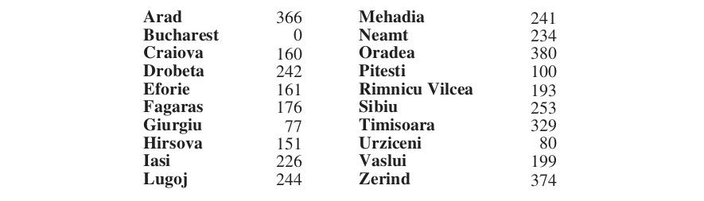

**شکل ۳.۱۶ — مقادیر hSLD — فاصله‌های خط مستقیم تا بخارست.** (شهرها با مقادیر فاصلهٔ خط مستقیم تا بخارست بر حسب مایل)

### 3.5.1 جستجوی بهترین-اول حریصانه

جستجوی بهترین-اول حریصانه (Greedy Best-First Search) شکلی از جستجوی بهترین-اول است که نخست گره‌ای با کمترین مقدار h(n) را گسترش می‌دهد — گره‌ای که به نظر می‌رسد به هدف نزدیک‌ترین است — به این دلیل که این به احتمال زیاد به‌سرعت به راه‌حل می‌انجامد. پس تابع ارزیابی f(n) = h(n) است.

ببینیم این برای مسائل مسیریابی در رومانی چگونه کار می‌کند؛ از اکتشافی فاصلهٔ خط مستقیم استفاده می‌کنیم که hSLD می‌نامیمش. اگر هدف بخارست باشد، باید فاصله‌های خط مستقیم تا بخارست را بدانیم که در شکل ۳.۱۶ نشان داده شده‌اند. برای نمونه، hSLD(Arad)=366. توجه کنید مقادیر hSLD را نمی‌توان از خودِ توصیف مسئله (یعنی توابع ACTIONS و RESULT) محاسبه کرد. وانگهی، دانش جهانی معینی لازم است تا بدانیم hSLD با فاصله‌های جاده‌ای واقعی همبسته است و بنابراین اکتشافیِ مفیدی است.

شکل ۳.۱۷ پیشرفت جستجوی بهترین-اول حریصانه با hSLD را برای یافتن مسیر از آراد به بخارست نشان می‌دهد. نخستین گره‌ای که از آراد گسترش می‌یابد سیبیو خواهد بود، زیرا اکتشافی می‌گوید به بخارست نزدیک‌تر از زرند یا تیمیشوآراست. گرهٔ بعدی که گسترش می‌یابد فاگاراش خواهد بود، زیرا اکنون طبق اکتشافی نزدیک‌ترین است. فاگاراش به نوبهٔ خود بخارست را تولید می‌کند که هدف است. برای این مسئلهٔ خاص، جستجوی بهترین-اول حریصانه با hSLD بدون گسترش هیچ گره‌ای که روی مسیر راه‌حل نیست، راه‌حل می‌یابد.

اما راه‌حلی که یافت هزینهٔ بهینه ندارد: مسیر از طریق سیبیو و فاگاراش به بخارست ۳۲ مایل از مسیرِ گذرنده از ریمنیکو ویلچا و پیتشتی بلندتر است. به همین دلیل الگوریتم «حریصانه» نامیده می‌شود — در هر تکرار می‌کوشد تا حد ممکن به هدف نزدیک شود، اما حریصی می‌تواند به نتایج بدتر از محتاطی بینجامد.

جستجوی گرافی بهترین-اول حریصانه در فضاهای حالت متناهی کامل است، اما در بی‌نهایت نه. پیچیدگی زمانی و فضایی بدترین حالت O(|V|) است. اما با تابع اکتشافی خوب، پیچیدگی را می‌توان به‌شکل چشمگیری کاهش داد و در برخی مسائل به O(bᵐ) رساند.

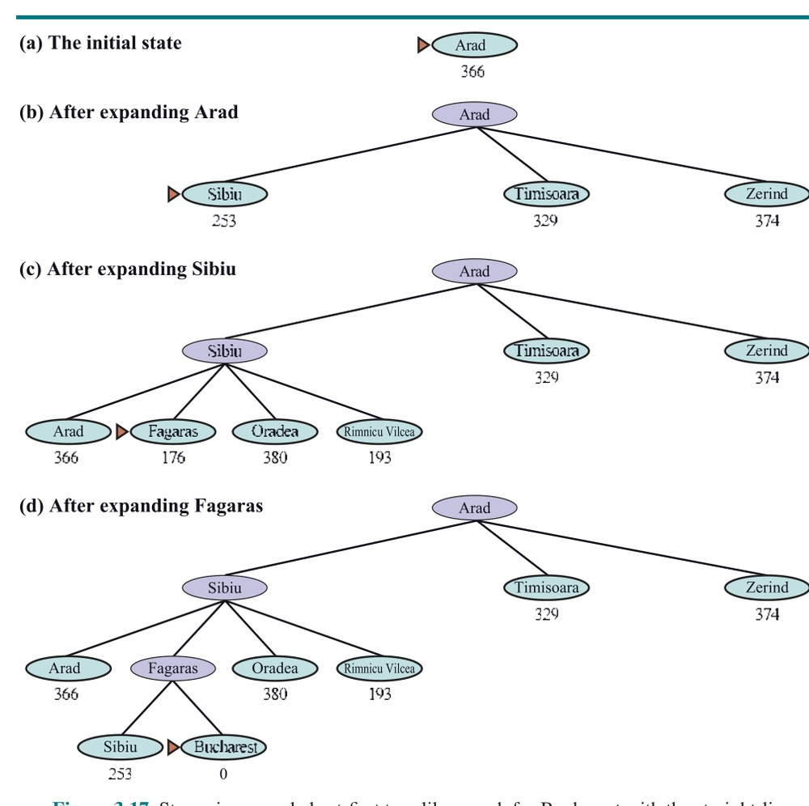

**شکل ۳.۱۷ — مراحل جستجوی درخت‌مانند بهترین-اول حریصانه برای بخارست با اکتشافی فاصلهٔ خط مستقیم hSLD.** گره‌ها با مقادیر h خود برچسب‌گذاری شده‌اند.

### 3.5.2 جستجوی A∗

رایج‌ترین الگوریتم جستجوی مطلع، جستجوی A∗ (تلفظ «A-ستار») است؛ جستجوی بهترین-اولی که از تابع ارزیابی f(n) = g(n) + h(n) استفاده می‌کند، که در آن g(n) هزینهٔ مسیر از حالت آغازین تا گرهٔ n و h(n) هزینهٔ تخمینی کوتاه‌ترین مسیر از n تا حالت هدف است؛ پس داریم:

f(n) = هزینهٔ تخمینی بهترین مسیری که از n تا یک هدف ادامه می‌یابد.

در شکل ۳.۱۸ پیشرفت جستجوی A∗ با هدف رسیدن به بخارست را نشان می‌دهیم. مقادیر g از هزینه‌های کنش در شکل ۳.۱ و مقادیر hSLD در شکل ۳.۱۶ محاسبه می‌شوند. توجه کنید بخارست نخست در گام (e) روی جبهه ظاهر می‌شود، اما برای گسترش برگزیده نمی‌شود (و بنابراین به‌عنوان راه‌حل شناسایی نمی‌شود)، زیرا با f = 450 کم‌هزینه‌ترین گرهٔ جبهه نیست — پیتشتی با f = 417 است. به بیان دیگر، ممکن است راه‌حلی از طریق پیتشتی با هزینه‌ای به‌کمی ۴۱۷ وجود داشته باشد، پس الگوریتم به راه‌حلی با هزینهٔ ۴۵۰ تن نمی‌دهد. در گام (f)، مسیر متفاوتی به بخارست اکنون کم‌هزینه‌ترین گره است، با f = 418، پس برگزیده و به‌عنوان راه‌حل بهینه شناسایی می‌شود.


**شکل ۳.۱۸ — مراحل جستجوی A∗ برای بخارست.** گره‌ها با f = g + h برچسب‌گذاری شده‌اند. مقادیر h فاصله‌های خط مستقیم تا بخارست‌اند که از شکل ۳.۱۶ گرفته شده‌اند. (مراحل: (الف) حالت آغازین؛ (ب) پس از گسترش آراد؛ (ج) پس از گسترش سیبیو؛ (د) پس از گسترش ریمنیکو ویلچا؛ (هـ) پس از گسترش فاگاراش؛ (و) پس از گسترش پیتشتی — با مقادیر f مربوط: آراد 366=0+366، سیبیو 393=140+253، تیمیشوآرا 447=118+329، زرند 449=75+374، ... و سرانجام بخارست 418=418+0)

جستجوی A∗ کامل است.¹¹ اینکه آیا A∗ بهینهٔ هزینه است به ویژگی‌های خاصی از اکتشافی بستگی دارد. ویژگی کلیدی «مقبولیت» (Admissibility) است: اکتشافیِ مقبول (Admissible Heuristic) اکتشافی‌ای است که هرگز هزینهٔ رسیدن به هدف را بیش‌تخمین نزند. (اکتشافی مقبول پس خوش‌بینانه است.) با اکتشافی مقبول، A∗ بهینهٔ هزینه است، که می‌توانیم با برهان خلف نشان دهیم. فرض کنیم مسیر بهینه هزینهٔ C∗ دارد، اما الگوریتم مسیری با هزینهٔ C > C∗ بازمی‌گرداند. پس باید گرهٔ n وجود داشته باشد که روی مسیر بهینه است و گسترش‌نیافته (زیرا اگر همهٔ گره‌های مسیر بهینه گسترش یافته بودند، همان راه‌حل بهینه را بازگردانده بودیم). پس، با نماد g∗(n) برای هزینهٔ مسیر بهینه از آغاز تا n و h∗(n) برای هزینهٔ مسیر بهینه از n تا نزدیک‌ترین هدف:

f(n) > C∗ (وگرنه n گسترش می‌یافت)
f(n) = g(n) + h(n) (طبق تعریف)
f(n) = g∗(n) + h(n) (زیرا n روی مسیر بهینه است)
f(n) ≤ g∗(n) + h∗(n) (به‌سبب مقبولیت، h(n) ≤ h∗(n))
f(n) ≤ C∗ (طبق تعریف، C∗ = g∗(n) + h∗(n))

سطر اول و آخر تناقض‌اند، پس این فرض که الگوریتم می‌تواند مسیر غیربهینه بازگرداند باید نادرست باشد — باید A∗ فقط مسیرهای بهینهٔ هزینه بازگرداند.

ویژگی کمی قوی‌تر «سازگاری» (Consistency) نامیده می‌شود. اکتشافی h(n) سازگار است اگر برای هر گرهٔ n و هر جانشین n′ از n که توسط کنش a تولید می‌شود، داشته باشیم:

h(n) ≤ c(n, a, n′) + h(n′)

این شکلی از نابرابری مثلث (Triangle Inequality) است که مقرر می‌دارد ضلعی از مثلث نمی‌تواند از مجموع دو ضلع دیگر بلندتر باشد (شکل ۳.۱۹). نمونهٔ اکتشافی سازگار، فاصلهٔ خط مستقیم hSLD است که برای رسیدن به بخارست به کار بردیم.

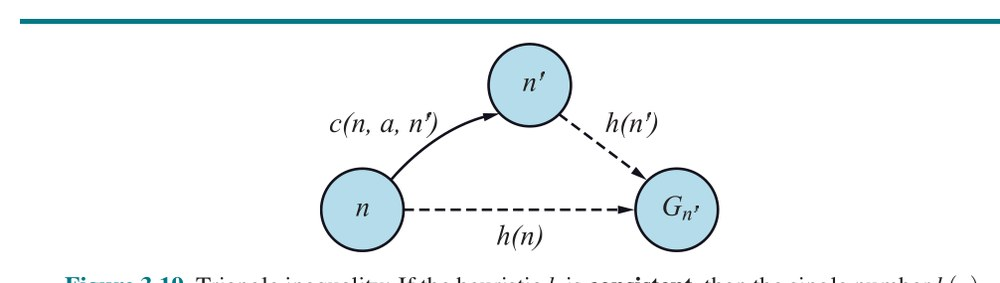

**شکل ۳.۱۹ — نابرابری مثلث:** اگر اکتشافی h سازگار باشد، عدد تکی h(n) از مجموع هزینهٔ کنش c(n,a,n′) از n به n′ به‌علاوهٔ تخمین اکتشافی h(n′) کوچک‌تر خواهد بود.

هر اکتشافی سازگار مقبول است (اما نه برعکس)، پس با اکتشافی سازگار، A∗ بهینهٔ هزینه است. افزون بر این، با اکتشافی سازگار، نخستین باری که به حالتی می‌رسیم روی مسیر بهینه خواهد بود، پس هرگز لازم نیست حالتی را دوباره به جبهه بیفزاییم و هرگز لازم نیست مدخلی در reached تغییر دهیم. اما با اکتشافی ناسازگار، ممکن است به چند مسیرِ رساننده به همان حالت برسیم و اگر هر مسیر تازه هزینهٔ کمتری از قبلی داشته باشد، چند گره برای آن حالت در جبهه خواهیم داشت که هم زمان و هم فضا برایمان هزینه دارد. به همین دلیل، برخی پیاده‌سازی‌های A∗ مراقبت می‌کنند حالتی را فقط یک بار وارد جبهه کنند و اگر مسیر بهتری به حالت یافت شد، همهٔ جانشین‌های حالت به‌روز شوند (که مستلزم آن است گره‌ها افزون بر اشاره‌گر والد، اشاره‌گر فرزند هم داشته باشند). این پیچیدگی‌ها بسیاری از پیاده‌سازان را واداشته از اکتشافی‌های ناسازگار بپرهیزند، اما فلنر و همکاران (۲۰۱۱) استدلال می‌کنند بدترین اثرها به‌ندرت در عمل رخ می‌دهند و نباید از اکتشافی‌های ناسازگار هراسید.

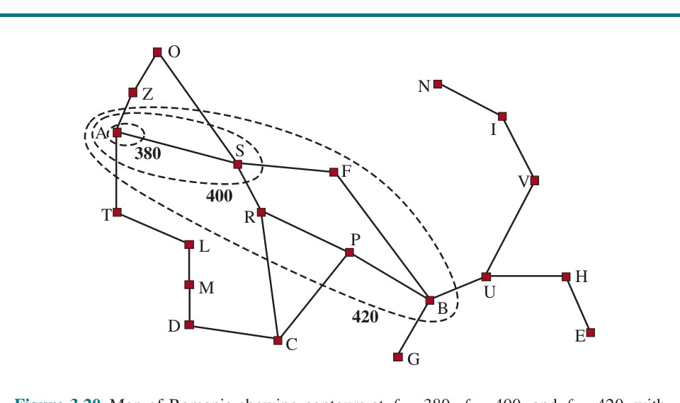

**شکل ۳.۲۰ — نقشهٔ رومانی با خطوط تراز در f = 380، f = 400 و f = 420، با آراد به‌عنوان حالت آغازین.** گره‌های درون هر خط تراز هزینه‌های f = g + h کمتر یا مساوی مقدار تراز دارند.

با اکتشافی نامقبول، A∗ ممکن است بهینهٔ هزینه باشد یا نباشد. دو مورد هست که هست: نخست، اگر دست‌کم یک مسیر بهینهٔ هزینه وجود داشته باشد که h(n) برای همهٔ گره‌های n روی مسیر مقبول باشد، آن مسیر یافته خواهد شد، صرف‌نظر از آنچه اکتشافی برای حالت‌های بیرون مسیر می‌گوید. دوم، اگر راه‌حل بهینه هزینهٔ C∗ و راه‌حل دوم‌بهترین هزینهٔ C2 داشته باشد، و h(n) برخی هزینه‌ها را بیش‌تخمین بزند اما هرگز بیشتر از C2 − C∗، آنگاه A∗ تضمین‌شده راه‌حل‌های بهینهٔ هزینه بازمی‌گرداند.

### 3.5.3 خطوط تراز جستجو

راه مفیدی برای تجسم جستجو، رسم خطوط تراز (Contour) در فضای حالت است، درست مانند خطوط تراز در نقشهٔ توپوگرافیک. شکل ۳.۲۰ نمونه‌ای را نشان می‌دهد. درون ترازِ برچسب‌خورده با ۴۰۰، همهٔ گره‌ها f(n) = g(n) + h(n) ≤ 400 دارند، و الی آخر. سپس، چون A∗ گرهٔ جبهه را با کمترین هزینهٔ f گسترش می‌دهد، می‌بینیم جستجوی A∗ از گرهٔ آغاز به بیرون بادبزن می‌شود و گره‌ها را در نوارهای هم‌مرکز با هزینهٔ f فزاینده می‌افزاید.

با جستجوی هزینه-یکنواخت نیز خطوط تراز داریم، اما از هزینهٔ g نه g + h. خطوط تراز با جستجوی هزینه-یکنواخت «دایره‌ای» دور حالت آغاز خواهند بود و به‌طور یکسان در همهٔ جهات پخش می‌شوند، بدون هیچ ترجیحی به سوی هدف.

اما بدیهی نیست که هزینهٔ f = g + h به‌صورت یکنواخت افزایش یابد. با بسط مسیر از n به n′، هزینه از g(n) + h(n) به g(n) + c(n,a,n′) + h(n′) می‌رود. با حذف جملهٔ g(n)، می‌بینیم هزینهٔ مسیر یکنواخت‌افزاینده خواهد بود اگر و فقط اگر h(n) ≤ c(n,a,n′) + h(n′)، یعنی اگر و فقط اگر اکتشافی سازگار باشد.¹³ اما توجه کنید مسیر ممکن است چند گرهِ پیاپی با امتیاز g(n) + h(n) یکسان داشته باشد؛ این هرگاه رخ می‌دهد که کاهش h دقیقاً برابر با هزینهٔ کنشِ تازه‌گرفته‌شده باشد (برای نمونه، در مسئلهٔ شبکه‌ای، وقتی n در همان سطر هدف است و یک گام به سوی هدف برمی‌دارید، g یک واحد زیاد و h یک واحد کم می‌شود).

اگر C∗ هزینهٔ مسیر راه‌حل بهینه باشد، می‌توانیم چنین بگوییم:

- A∗ همهٔ گره‌هایی را گسترش می‌دهد که از حالت آغازین در مسیری قابل دسترسی‌اند که همهٔ گره‌هایش f(n) < C∗ دارند. می‌گوییم این‌ها «گره‌های قطعاً گسترش‌یافته» (Surely Expanded Nodes) هستند.
- A∗ سپس ممکن است برخی از گره‌های دقیقاً روی «تراز هدف» (جایی که f(n) = C∗) را پیش از برگزیدن گرهٔ هدف گسترش دهد.
- A∗ هیچ گره‌ای با f(n) > C∗ گسترش نمی‌دهد.

می‌گوییم A∗ با اکتشافی سازگار «بهینه‌کارا» (Optimally Efficient) است، به این معنا که هر الگوریتمی که مسیرهای جستجو را از حالت آغازین بسط دهد و از همان اطلاعات اکتشافی استفاده کند، باید همهٔ گره‌هایی را گسترش دهد که A∗ قطعاً گسترش می‌دهد (زیرا هر یک از آن‌ها می‌توانست بخشی از راه‌حل بهینه باشد). در میان گره‌های با f(n) = C∗، ممکن است الگوریتمی شانس بیاورد و اول گرهٔ بهینه را برگزیند در حالی که الگوریتم دیگر بدشانس باشد؛ در تعریف بهینه‌کارایی این تفاوت را در نظر نمی‌گیریم.

A∗ کاراست، زیرا گره‌های درخت جستجو را که برای یافتن راه‌حل بهینه لازم نیستند «هرس» (Pruning) می‌کند. در شکل ۳.۱۸(ب) می‌بینیم تیمیشوآرا f = 447 و زرند f = 449 دارد. حتی با آنکه آن‌ها فرزندان ریشه‌اند و در جستجوی هزینه-یکنواخت یا سطح-اول از نخستین گره‌های گسترش‌یافته می‌بودند، هرگز توسط جستجوی A∗ گسترش نمی‌یابند، زیرا راه‌حل با f = 418 نخست یافته می‌شود. مفهوم هرس — حذف امکان‌ها از ملاحظه بدون نیاز به بررسی آن‌ها — برای بسیاری از حوزه‌های هوش مصنوعی مهم است.

اینکه جستجوی A∗ کامل، بهینهٔ هزینه و در میان همهٔ این‌گونه الگوریتم‌ها بهینه‌کاراست نسبتاً رضایت‌بخش است. متأسفانه، به این معنا نیست که A∗ پاسخ همهٔ نیازهای جستجوی ماست. نکتهٔ ظریف آن است که برای بسیاری از مسائل، شمار گره‌های گسترش‌یافته می‌تواند در طول راه‌حل نمایی باشد. برای نمونه، نسخه‌ای از جهان جاروبرقی را در نظر بگیرید با جاروبرقی فوق‌قدرتمند که می‌تواند هر خانه‌ای را به هزینهٔ ۱ واحد تمیز کند، حتی بدون نیاز به بازدید از آن خانه؛ در آن سناریو، خانه‌ها را به هر ترتیبی می‌توان تمیز کرد. با N خانهٔ آغازینِ کثیف، 2ᴺ حالت هست که زیرمجموعه‌ای تمیز شده‌اند؛ همهٔ آن حالت‌ها روی مسیر راه‌حل بهینه‌اند و بنابراین f(n) < C∗ را ارضا می‌کنند، پس همهٔ آن‌ها توسط A∗ بازدید می‌شوند.

### 3.5.4 جستجوی رضایت‌بخش: اکتشافی‌های نامقبول و A∗ وزنی

جستجوی A∗ کیفیت‌های خوب فراوانی دارد، اما گره‌های زیادی گسترش می‌دهد. اگر حاضر باشیم راه‌حل‌هایی بپذیریم که فروبهینه‌اند اما «به‌اندازهٔ کافی خوب» — که راه‌حل‌های رضایت‌بخش (Satisficing) می‌نامیم — می‌توانیم گره‌های کمتری (با زمان و فضای کمتر) کاوش کنیم. اگر به جستجوی A∗ اجازه دهیم از اکتشافی نامقبول (Inadmissible Heuristic) — که ممکن است بیش‌تخمین بزند — استفاده کند، خطر ازدست‌دادن راه‌حل بهینه را می‌پذیریم، اما اکتشافی می‌تواند بالقوه دقیق‌تر باشد و بدین ترتیب شمار گره‌های گسترش‌یافته را کاهش دهد. برای نمونه، مهندسان راه مفهوم «شاخص انحراف» (Detour Index) را می‌دانند؛ ضریبی که بر فاصلهٔ خط مستقیم اعمال می‌شود تا پیچ‌وخم معمول جاده‌ها را در نظر بگیرد. شاخص انحراف ۱٫۳ یعنی اگر دو شهر با فاصلهٔ خط مستقیم ۱۰ مایل از هم باشند، تخمین خوبی برای بهترین مسیر میان آن‌ها ۱۳ مایل است. برای بیشتر مناطق، شاخص انحراف بین ۱٫۲ و ۱٫۶ است.

می‌توانیم این ایده را بر هر مسئله‌ای اعمال کنیم، نه فقط مسائل مربوط به جاده، با رویکردی به نام جستجوی A∗ وزنی (Weighted A∗ Search) که در آن مقدار اکتشافی را سنگین‌تر وزن می‌کنیم و تابع ارزیابی را می‌گیریم:

f(n) = g(n) + W × h(n) ، برای W > 1

شکل ۳.۲۱ مسئلهٔ جستجو را در جهان شبکه‌ای نشان می‌دهد. در (الف)، جستجوی A∗ راه‌حل بهینه می‌یابد، اما برای یافتنش باید بخش بزرگی از فضای حالت را کاوش کند. در (ب)، جستجوی A∗ وزنی راه‌حلی اندکی پرهزینه‌تر می‌یابد، اما زمان جستجو بسیار کمتر است. می‌بینیم جستجوی وزنی تراز حالت‌های رسیده را به سوی هدف متمرکز می‌کند. این بدان معناست که حالت‌های کمتری کاوش می‌شوند، اما اگر مسیر بهینه هرگز بیرون از تراز جستجوی وزنی منحرف شود (چنان‌که در این مورد می‌شود)، مسیر بهینه یافته نخواهد شد. در حالت کلی، اگر راه‌حل بهینه C∗ هزینه داشته باشد، جستجوی A∗ وزنی راه‌حلی با هزینه‌ای بین C∗ و W × C∗ می‌یابد؛ اما در عمل معمولاً نتایجی بسیار نزدیک‌تر به C∗ از W × C∗ می‌گیریم.


**شکل ۳.۲۱ — دو جستجو روی همان شبکه: (الف) جستجوی A∗ و (ب) جستجوی A∗ وزنی با وزن W = 2.** میله‌های خاکستری موانع‌اند، خط بنفش مسیر از آغاز سبز تا هدف قرمز است، و نقطه‌های کوچک حالت‌هایی هستند که هر جستجو به آن‌ها رسیده. در این مسئلهٔ خاص، A∗ وزنی ۷ برابر حالت کمتری کاوش می‌کند و مسیری ۵٪ پرهزینه‌تر می‌یابد.

جستجوهایی را در نظر گرفته‌ایم که حالت‌ها را با ترکیب g و h به شیوه‌های گوناگون ارزیابی می‌کنند؛ A∗ وزنی را می‌توان تعمیم بقیه دید:

- جستجوی A∗: g(n) + h(n) (W = 1)
- جستجوی هزینه-یکنواخت: g(n) (W = 0)
- جستجوی بهترین-اول حریصانه: h(n) (W = ∞)
- جستجوی A∗ وزنی: g(n) + W × h(n) (1 < W < ∞)

می‌توانید A∗ وزنی را «جستجوی تا حدی حریصانه» بنامید: مانند جستجوی بهترین-اول حریصانه، جستجو را به سوی هدف متمرکز می‌کند؛ از سوی دیگر، هزینهٔ مسیر را کاملاً نادیده نمی‌گیرد و مسیری را که با هزینهٔ زیاد پیشرفت اندک می‌کند معلق خواهد کرد.

الگوریتم‌های جستجوی فروبهینهٔ گوناگونی هست که با معیارهای «به‌اندازهٔ کافی خوب» مشخص می‌شوند. در جستجوی فروبهینهٔ کران‌دار (Bounded Suboptimal Search)، به دنبال راه‌حلی هستیم که تضمین‌شده در ضریب ثابت W از هزینهٔ بهینه باشد. A∗ وزنی این تضمین را می‌دهد. در جستجوی کران-هزینه (Bounded-Cost Search)، به دنبال راه‌حلی هستیم که هزینه‌اش از ثابت C کمتر باشد. و در جستجوی بی‌کران-هزینه (Unbounded-Cost Search)، راه‌حلی با هر هزینه‌ای می‌پذیریم، تا وقتی بتوانیم سریع بیابیمش. نمونهٔ الگوریتم جستجوی بی‌کران-هزینه، جستجوی سریع (Speedy Search) است؛ نسخه‌ای از جستجوی بهترین-اول حریصانه که به‌عنوان اکتشافی، شمار تخمینی کنش‌های لازم برای رسیدن به هدف را به کار می‌گیرد، صرف‌نظر از هزینهٔ آن کنش‌ها. پس برای مسائلی که همهٔ کنش‌ها هزینهٔ یکسان دارند، همان جستجوی بهترین-اول حریصانه است، اما وقتی کنش‌ها هزینه‌های متفاوت دارند، تمایل دارد جستجو را به‌سرعت به راه‌حل برساند، حتی اگر راه‌حل هزینهٔ بالایی داشته باشد.

### 3.5.5 جستجوی محدود-به-حافظه

مسئلهٔ اصلی A∗ مصرف حافظه‌اش است. در این بخش چند ترفند پیاده‌سازی صرفه‌جویانه در فضا و سپس الگوریتم‌های کاملاً تازه‌ای را پوشش می‌دهیم که از فضای در دسترس بهتر بهره می‌گیرند. حافظه میان جبهه و حالت‌های رسیده تقسیم می‌شود. در پیاده‌سازی ما از جستجوی بهترین-اول، حالتی که روی جبهه است در دو جا ذخیره می‌شود: به‌صورت گره‌ای در جبهه (تا تصمیم بگیریم چه چیزی را بعدی گسترش دهیم) و به‌صورت مدخلی در جدول حالت‌های رسیده (تا بدانیم قبلاً از حالت بازدید کرده‌ایم). برای بسیاری از مسائل (مانند کاوش شبکه)، این تکرار نگران‌کننده نیست، زیرا اندازهٔ جبهه بسیار کوچک‌تر از reached است و تکرار حالت‌ها در جبهه حافظهٔ نسبتاً ناچیزی می‌طلبد. اما برخی پیاده‌سازی‌ها حالتی را فقط در یکی از دو جا نگه می‌دارند و کمی فضا صرفه‌جویی می‌کنند به بهای پیچیده‌کردن (و شاید کندکردن) الگوریتم.

امکان دیگر، حذف حالت‌ها از reached وقتی است که بتوانیم ثابت کنیم دیگر لازم نیستند. برای برخی مسائل، می‌توانیم از خاصیت جداسازی (شکل ۳.۶ در صفحهٔ ۷۲) به‌همراه ممنوعیت کنش‌های دورِ کامل (U-turn) استفاده کنیم تا مطمئن شویم همهٔ کنش‌ها یا از جبهه به بیرون حرکت می‌کنند یا به حالتِ دیگری روی جبهه. در آن صورت، فقط باید جبهه را برای مسیرهای زائد بررسی کنیم و می‌توانیم جدول reached را حذف کنیم.

برای مسائل دیگر، می‌توانیم شمار ارجاع (Reference Count) تعداد دفعات رسیده‌شدن یک حالت را نگه داریم و وقتی راه دیگری برای رسیدن به حالت نماند، آن را از جدول reached حذف کنیم. برای نمونه، در جهان شبکه‌ای که هر حالت فقط از چهار همسایه‌اش قابل رسیدن است، وقتی چهار بار به حالتی رسیده‌ایم، می‌توانیم آن را از جدول حذف کنیم.

حال الگوریتم‌های تازه‌ای را در نظر بگیریم که برای صرفه‌جویی در مصرف حافظه طراحی شده‌اند.

جستجوی پرتوی (Beam Search) اندازهٔ جبهه را محدود می‌کند. ساده‌ترین رویکرد نگه‌داشتن فقط k گره با بهترین امتیازهای f و دورریختن هر گرهٔ گسترش‌یافتهٔ دیگر است. این البته جستجو را ناقص و فروبهینه می‌کند، اما می‌توانیم k را چنان برگزینیم که از حافظهٔ در دسترس استفادهٔ خوبی کند، و الگوریتم سریع اجرا می‌شود، زیرا گره‌های کمتری گسترش می‌دهد. برای بسیاری از مسائل می‌تواند راه‌حل‌های خوبِ نزدیک‌به‌بهینه بیابد. می‌توانید جستجوی هزینه-یکنواخت یا A∗ را به‌صورت پخش‌شدن در همه‌جا در خطوط تراز هم‌مرکز بپندارید و جستجوی پرتوی را به‌صورت کاوش فقط بخشی متمرکز از آن خطوط تراز، بخشی که k نامزدِ برتر را در بر دارد.

نسخهٔ جایگزین جستجوی پرتوی محدودیت سختی بر اندازهٔ جبهه نمی‌گذارد، بلکه هر گره‌ای را نگه می‌دارد که امتیاز f آن در فاصلهٔ δ از بهترین امتیاز f باشد. بدین ترتیب، وقتی چند گرهٔ قوی‌امتیاز هست، فقط چند گره نگه داشته می‌شود، اما اگر گره قوی‌ای نباشد، گره‌های بیشتری نگه داشته می‌شوند تا گرهٔ قوی پدیدار شود.

جستجوی A∗ تعمیق تکراری (Iterative-Deepening A∗، یا IDA∗) برای A∗ همان است که جستجوی تعمیق تکراری برای عمق-اول: IDA∗ مزیت‌های A∗ را بدون نیاز به نگه‌داشتن همهٔ حالت‌های رسیده در حافظه می‌دهد، به بهای بازدید برخی حالت‌ها چند بار. این الگوریتم بسیار مهم و پرکاربردی است برای مسائلی که در حافظه جا نمی‌شوند.

در تعمیق تکراری استاندارد، cutoff عمق است که در هر تکرار یک واحد زیاد می‌شود. در IDA∗ cutoff هزینهٔ f (یعنی g + h) است؛ در هر تکرار، مقدار cutoff کوچک‌ترین هزینهٔ f هر گره‌ای است که در تکرار قبلی از cutoff فراتر رفته. به بیان دیگر، هر تکرار به‌صورت جامع یک تراز f را جستجو می‌کند، گره‌ای را درست آن‌سوی آن تراز می‌یابد و هزینهٔ f آن گره را به‌عنوان تراز بعدی به کار می‌گیرد. برای مسائلی مانند معمای ۸ که هزینهٔ f هر مسیر عدد صحیح است، این بسیار خوب کار می‌کند و در هر تکرار پیشرفت پایداری به سوی هدف به بار می‌آورد. اگر راه‌حل بهینه هزینهٔ C∗ داشته باشد، نمی‌توان بیش از C∗ تکرار باشد (برای نمونه، در سخت‌ترین مسائل معمای ۸ حداکثر ۳۱ تکرار). اما برای مسئله‌ای که هر گره هزینهٔ f متفاوتی دارد، هر تراز تازه ممکن است فقط یک گرهٔ تازه در بر داشته باشد و شمار تکرارها می‌تواند با شمار حالت‌ها برابر شود.

جستجوی بهترین-اول بازگشتی (Recursive Best-First Search، یا RBFS) (شکل ۳.۲۲) می‌کوشد عملکرد جستجوی استاندارد بهترین-اول را تقلید کند، اما فقط با فضای خطی. RBFS شبیه جستجوی بازگشتی عمق-اول است، اما به‌جای ادامهٔ بی‌نهایت در مسیر کنونی، از متغیر f limit برای پیگیری مقدار f بهترین مسیر جایگزینِ در دسترس از هر نیای گرهٔ کنونی استفاده می‌کند. اگر گرهٔ کنونی از این حد فراتر رود، بازگشت به مسیر جایگزین بازمی‌شود. هنگام بازشدن بازگشت، RBFS مقدار f هر گره را در طول مسیر با مقدار پشتیبان‌گرفته‌شده (Backed-Up Value) — بهترین مقدار f فرزندانش — جایگزین می‌کند. بدین ترتیب RBFS مقدار f بهترین برگ در زیردرخت فراموش‌شده را به خاطر می‌سپارد و بنابراین می‌تواند تصمیم بگیرد آیا در زمان بعدی ارزش بازگسترش زیردرخت را دارد. شکل ۳.۲۳ نشان می‌دهد RBFS چگونه به بخارست می‌رسد.

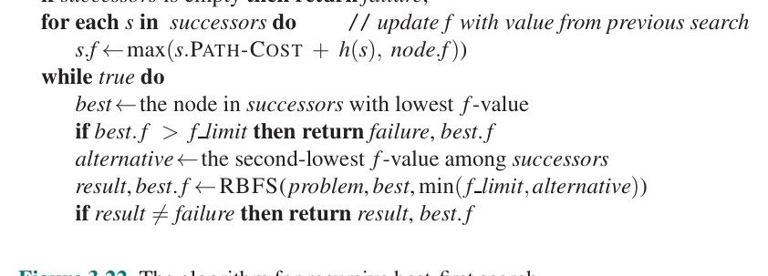

**شکل ۳.۲۲ — الگوریتم جستجوی بهترین-اول بازگشتی.**

```
function RECURSIVE-BEST-FIRST-SEARCH(problem) returns a solution or failure
  solution, fvalue ← RBFS(problem, NODE(problem.INITIAL), ∞)
  return solution

function RBFS(problem, node, f_limit) returns a solution or failure, and a new f-cost limit
  if problem.IS-GOAL(node.STATE) then return node
  successors ← LIST(EXPAND(node))
  if successors is empty then return failure, ∞
  for each s in successors do     // update f with value from previous search, if any
    s.f ← max(s.PATH-COST + h(s), node.f)
  while true do
    best ← the lowest f-value node in successors
    if best.f > f_limit then return failure, best.f
    alternative ← the second-lowest f-value among successors
    result, best.f ← RBFS(problem, best, min(f_limit, alternative))
    if result ≠ failure then return result
```

![**شکل ۳.۲۳ — مراحل جستجوی RBFS برای کوتاه‌ترین مسیر به بخارست.** مقدار f limit برای هر فراخوانی بازگشتی بالای هر گرهٔ کنونی نشان داده شده و هر گره با هزینهٔ f خود برچسب‌گذاری شده. (الف) مسیر از طریق ریمنیکو ویلچا دنبال می‌شود تا آنکه بهترین برگ کنونی (پیتشتی) مقداری بدتر از بهترین مسیر جایگزین (فاگاراش) داشته باشد. (ب) بازگشت باز می‌شود و بهترین مقدار برگ زیردرخت فراموش‌شده (۴۱۷) به ریمنیکو ویلچا پشتیبان‌گرفته می‌شود؛ سپس فاگاراش گسترش می‌یابد و بهترین مقدار برگ ۴۵۰ را آشکار می‌کند. (ج) بازگشت باز می‌شود و بهترین مقدار برگ زیردرخت فراموش‌شده (۴۵۰) به فاگاراش پشتیبان‌گرفته می‌شود؛ سپس ریمنیکو ویلچا گسترش می‌یابد. این بار، چون بهترین مسیر جایگزین (از طریق تیمیشوآرا) دست‌کم ۴۴۷ هزینه دارد، گسترش تا بخارست ادامه می‌یابد.](../figures/ch03/fig-3-23.jpg)

**شکل ۳.۲۳ — مراحل جستجوی RBFS برای کوتاه‌ترین مسیر به بخارست.** مقدار f limit برای هر فراخوانی بازگشتی بالای هر گرهٔ کنونی نشان داده شده و هر گره با هزینهٔ f خود برچسب‌گذاری شده. (الف) مسیر از طریق ریمنیکو ویلچا دنبال می‌شود تا آنکه بهترین برگ کنونی (پیتشتی) مقداری بدتر از بهترین مسیر جایگزین (فاگاراش) داشته باشد. (ب) بازگشت باز می‌شود و بهترین مقدار برگ زیردرخت فراموش‌شده (۴۱۷) به ریمنیکو ویلچا پشتیبان‌گرفته می‌شود؛ سپس فاگاراش گسترش می‌یابد و بهترین مقدار برگ ۴۵۰ را آشکار می‌کند. (ج) بازگشت باز می‌شود و بهترین مقدار برگ زیردرخت فراموش‌شده (۴۵۰) به فاگاراش پشتیبان‌گرفته می‌شود؛ سپس ریمنیکو ویلچا گسترش می‌یابد. این بار، چون بهترین مسیر جایگزین (از طریق تیمیشوآرا) دست‌کم ۴۴۷ هزینه دارد، گسترش تا بخارست ادامه می‌یابد.

RBFS تا حدی کارآمدتر از IDA∗ است، اما همچنان از بازتولید بیش از حد گره رنج می‌برد. در مثال شکل ۳.۲۳، RBFS مسیر از طریق ریمنیکو ویلچا را دنبال می‌کند، سپس «نظرش عوض می‌شود» و فاگاراش را می‌آزماید، و سپس دوباره نظر عوض می‌کند. این عوض‌شدن‌های نظر رخ می‌دهند، زیرا هر بار که بهترین مسیر کنونی بسط می‌یابد، مقدار f آن به احتمال زیاد افزایش می‌یابد — h معمولاً برای گره‌های نزدیک‌تر به هدف کمتر خوش‌بینانه است. وقتی این رخ می‌دهد، دومین‌بهترین مسیر ممکن است بهترین مسیر شود، پس جستجو باید برای دنبال‌کردنش به عقب برگردد. هر عوض‌شدن نظر با تکرار IDA∗ متناظر است و ممکن است بازگسترش‌های فراوانی از گره‌های فراموش‌شده لازم باشد تا بهترین مسیر بازآفرینی و یک گره دیگر بسط شود.

RBFS اگر تابع اکتشافی h(n) مقبول باشد بهینه است. پیچیدگی فضایی‌اش در عمق عمیق‌ترین راه‌حل بهینه خطی است، اما پیچیدگی زمانی‌اش به‌سختی قابل توصیف است: هم به دقت تابع اکتشافی و هم به اینکه بهترین مسیر هر چند وقت یک بار با گسترش گره‌ها تغییر می‌کند بستگی دارد. گره‌ها را به‌ترتیب امتیاز f فزاینده گسترش می‌دهد، حتی اگر f غیریکنواخت باشد.

IDA∗ و RBFS از مصرف کمِ حافظه رنج می‌برند. میان تکرارها، IDA∗ فقط یک عدد را نگه می‌دارد: حد هزینهٔ f کنونی. RBFS اطلاعات بیشتری در حافظه نگه می‌دارد، اما فقط از فضای خطی استفاده می‌کند: حتی اگر حافظهٔ بیشتری در دسترس باشد، RBFS راهی برای استفاده از آن ندارد. چون این دو بیشترِ آنچه را انجام داده‌اند فراموش می‌کنند، ممکن است هر دو سرانجام همان حالت‌ها را بارها بازکاوش کنند.

پس معقول می‌نماید تعیین کنیم چقدر حافظه در دسترس داریم و به الگوریتم اجازه دهیم از همهٔ آن استفاده کند. دو الگوریتم که این کار را می‌کنند MA∗ (A∗ محدود-به-حافظه) و SMA∗ (MA∗ ساده‌شده) هستند. SMA∗ — خوب — ساده‌تر است، پس آن را توصیف می‌کنیم. SMA∗ دقیقاً مانند A∗ پیش می‌رود و بهترین برگ را گسترش می‌دهد تا حافظه پر شود. در این نقطه، نمی‌تواند گرهٔ تازه‌ای به درخت جستجو بیفزاید مگر آنکه گرهٔ قدیمی‌ای را بیندازد. SMA∗ همیشه بدترین گرهٔ برگ — آن با بیشترین مقدار f — را می‌اندازد. مانند RBFS، SMA∗ سپس مقدار گرهٔ فراموش‌شده را به والدش پشتیبان می‌گیرد. بدین ترتیب، نیای زیردرخت فراموش‌شده کیفیت بهترین مسیر آن زیردرخت را می‌داند. با این اطلاعات، SMA∗ زیردرخت را فقط وقتی بازتولید می‌کند که همهٔ مسیرهای دیگر بدتر از مسیر فراموش‌شده نشان داده شوند. به بیان دیگر، اگر همهٔ نوادگان گرهٔ n فراموش شوند، نخواهیم دانست از n به کدام سو برویم، اما هنوز ایده‌ای خواهیم داشت که رفتن از n به هر سو چقدر ارزشمند است. الگوریتم کامل در مخزن کد آنلاینِ همراه این کتاب توصیف شده است.

یک ظرافت هست که ارزش یادکرد دارد. گفتیم SMA∗ بهترین برگ را گسترش و بدترین برگ را حذف می‌کند. اگر همهٔ گره‌های برگ مقدار f یکسانی داشته باشند چه؟ برای پرهیز از انتخاب همان گره برای حذف و گسترش، SMA∗ تازه‌ترین بهترین برگ را گسترش و قدیمی‌ترین بدترین برگ را حذف می‌کند. این‌ها وقتی بر هم منطبق می‌شوند که فقط یک برگ هست، اما در آن صورت درخت جستجوی کنونی باید مسیری واحد از ریشه تا برگ باشد که همهٔ حافظه را پر کرده. اگر برگ گرهٔ هدف نباشد، حتی اگر روی مسیر راه‌حل بهینه باشد، آن راه‌حل با حافظهٔ در دسترس دست‌یافتنی نیست. پس گره را می‌توان دقیقاً چنان دور انداخت که گویی جانشینی ندارد.

SMA∗ کامل است اگر راه‌حلِ قابل دسترسی‌ای باشد — یعنی اگر d، عمق کم‌عمق‌ترین گرهٔ هدف، کمتر از اندازهٔ حافظه (بر حسب گره) باشد. بهینه است اگر هر راه‌حل بهینه‌ای قابل دسترسی باشد؛ وگرنه بهترین راه‌حل قابل دسترسی را بازمی‌گرداند. در عمل، SMA∗ انتخاب نسبتاً استواری برای یافتن راه‌حل‌های بهینه است، به‌ویژه وقتی فضای حالت گراف باشد، هزینه‌های کنش یکنواخت نباشند و تولید گره در مقایسه با سربار نگه‌داشتن جبهه و مجموعهٔ رسیده پرهزینه باشد.

اما در مسائل بسیار سخت، اغلب چنین خواهد بود که SMA∗ وادار می‌شود پیوسته میان بسیاری از مسیرهای راه‌حل نامزد رفت‌وبرگشت کند که فقط زیرمجموعهٔ کوچکی از آن‌ها در حافظه جا می‌شود. (این شبیه مسئلهٔ «تلمبه‌زدن» (Thrashing) در سامانه‌های صفحه‌بندی دیسک است.) آنگاه زمان اضافیِ لازم برای بازتولید مکرر همان گره‌ها بدان معناست که مسائلی که با A∗ با حافظهٔ نامحدود عملاً حل‌شدنی می‌بودند، برای SMA∗ ناشدنی می‌شوند. یعنی محدودیت‌های حافظه می‌توانند مسئله‌ای را ◭ از دید زمان محاسبه ناشدنی کنند. هرچند هیچ نظریهٔ کنونی داد‌وستد زمان و حافظه را توضیح نمی‌دهد، به نظر می‌رسد این مسئله‌ای گریزناپذیر است. تنها راه خروج، کنارگذاشتن الزام بهینگی است.

### 3.5.6 جستجوی اکتشافی دوطرفه

با جستجوی بهترین-اول یک‌طرفه، دیدیم به‌کارگیری f(n) = g(n) + h(n) به‌عنوان تابع ارزیابی، جستجوی A∗ می‌دهد که تضمین‌شده راه‌حل‌های بهینهٔ هزینه می‌یابد (با فرض h مقبول) و در شمار گره‌های گسترش‌یافته بهینه‌کاراست.

با جستجوی بهترین-اول دوطرفه نیز می‌توانیم به‌کارگیری f(n) = g(n) + h(n) را امتحان کنیم، اما متأسفانه هیچ تضمینی نیست که به راه‌حل بهینهٔ هزینه بینجامد، نه اینکه بهینه‌کارا باشد، حتی با اکتشافی مقبول. با جستجوی دوطرفه معلوم می‌شود نه گره‌های منفرد، بلکه جفت‌گره‌ها (یکی از هر جبهه) هستند که می‌توان اثبات کرد قطعاً گسترش می‌یابند، پس هر برهان کارایی باید جفت‌گره‌ها را در نظر بگیرد (اکرله و همکاران، ۲۰۱۷). با چند نماد تازه آغاز می‌کنیم. از fF(n) = gF(n) + hF(n) برای گره‌های در حال حرکت در جهت جلو (با حالت آغازین به‌عنوان ریشه) و fB(n) = gB(n) + hB(n) برای گره‌های جهت عقب (با حالت هدف به‌عنوان ریشه) استفاده می‌کنیم. هرچند هر دو جستجوی جلو و عقب همان مسئله را حل می‌کنند، توابع ارزیابی متفاوتی دارند، زیرا برای نمونه اکتشافی‌ها بسته به اینکه به سوی هدف یا حالت آغازین می‌کوشید متفاوت‌اند. اکتشافی‌های مقبول را فرض می‌کنیم.

مسیر جلویی از حالت آغازین تا گرهٔ m و مسیر عقبی از هدف تا گرهٔ n را در نظر بگیرید. می‌توانیم کران پایینی بر هزینهٔ راه‌حلی تعریف کنیم که از مسیرِ حالت آغازین تا m پیروی می‌کند، سپس به‌نحوی به n می‌رسد، سپس مسیر تا هدف را دنبال می‌کند:

lb(m,n) = max(gF(m) + hF(m), gB(n) + hB(n), (gF(m) + gB(n) + dist(m,n))/2)

که در آن dist(m,n) هزینهٔ کمترین مسیر میان m و n است (که می‌توان با اکتشافی دیگری تخمین زد). اگر جستجوی دوطرفه گره‌ها را به‌ترتیب صعودیِ این کران پایین گسترش دهد، می‌توان نشان داد راه‌حلی که نخست به آن می‌رسد بهینه است. اما چنین راهبردی می‌تواند در عمل کند باشد، و مشخص شده راهبردهای جایگزین اغلب سریع‌ترند.

## 3.6 توابع اکتشافی

در این بخش می‌نگریم دقت اکتشافی چگونه بر عملکرد جستجو اثر می‌گذارد و نیز اینکه اکتشافی‌ها را چگونه می‌توان ابداع کرد. به‌عنوان مثال اصلی‌مان به معمای ۸ بازمی‌گردیم. چنان‌که در بخش 3.2 یاد شد، هدف معما لغزاندن کاشی‌ها به‌صورت افقی یا عمودی به فضای خالی است تا پیکربندی با پیکربندی هدف همخوان شود (شکل ۳.۲۵).

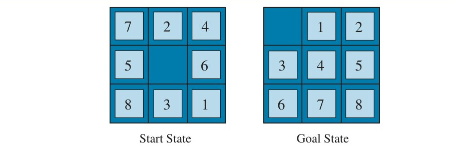

**شکل ۳.۲۵ — نمونه‌ای معمولی از معمای ۸: حالت آغازین و حالت هدف.** (همچنین در شکل ۳.۳)

اکتشافی استانداردی که برای معمای ۸ به کار می‌رود، «کاشی‌های نابجا» (Misplaced Tiles) است: اکتشافی h1 تعداد کاشی‌هایی است که در جای اشتباه‌اند. چون هر کاشی نابجا باید دست‌کم یک بار جابه‌جا شود، h1 مقبول است. معمولاً h1 خیلی هم خوب نیست، زیرا برای حل معما، کاشی‌ها باید بیش از یک بار جابه‌جا شوند. اکتشافی بهتر، مجموع «فاصلهٔ منهتن» (Manhattan Distance) کاشی‌ها از موقعیت‌های هدفشان است؛ فاصلهٔ منهتن مجموع فاصله‌های افقی و عمودی است، بی‌توجه به موانع (شکل ۳.۲۶). اکتشافی h2 مقبول است، زیرا هر حرکت فقط یک کاشی را یک خانه به فاصلهٔ منهتنِ هدفش نزدیک‌تر می‌کند؛ کاشی در هر حالت باید دست‌کم به اندازهٔ فاصلهٔ منهتن‌اش از هدف حرکت کند. میانگین دشواری معمای ۸ تصادفی حدود ۲۲ حرکت است و ضریب انشعاب حدود ۳ (هر حالت تقریباً سه حرکت قانونی دارد). این بدان معناست جستجوی سطح‌اولِ بدون اکتشافی تا حدود ۳²² ≈ ۳٫۱ × 10¹⁰ حالت کاوش می‌کند؛ با h2، A∗ فقط ۱۷۰ گره گسترش می‌دهد (کورف، ۱۹۸۵) — کاهشی چشمگیر. با h1، A∗ حدود ۴٬۰۰۰ گره گسترش می‌دهد. به‌طور کلی، اکتشافی خوب می‌تواند هزینهٔ جستجو را به‌شدت کاهش دهد.

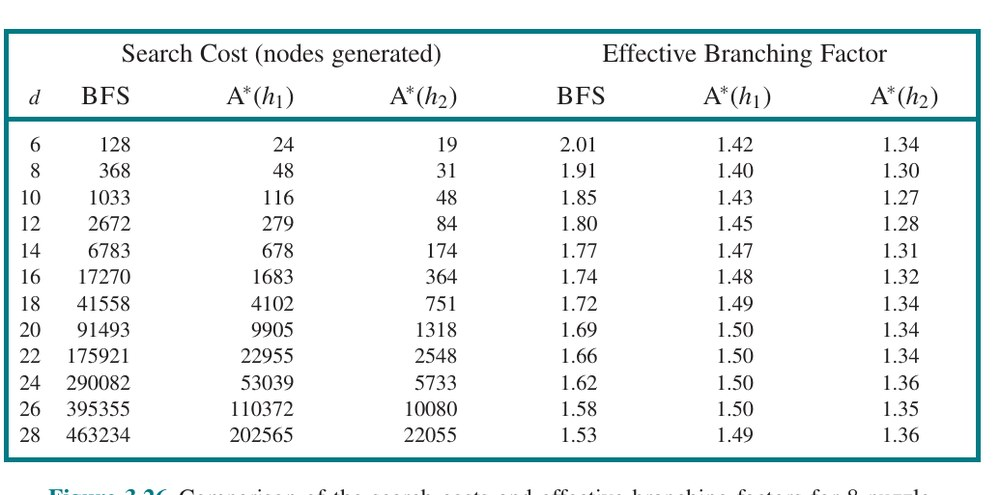

**شکل ۳.۲۶ — فاصلهٔ منهتن.** هر کاشی با عدد خودش برچسب‌گذاری شده و در موقعیت‌های هدفش قرار گرفته است. مجموع فاصله‌های منهتن کاشی‌ها از موقعیت‌هایشان در حالت آغازین برابر h2 است؛ برای این حالت، h2 = 4 + 0 + 3 + 3 + 1 + 0 + 3 + 1 = 15.

### 3.6.1 اثر دقت اکتشافی بر عملکرد

یکی از راه‌های توصیف کیفیت اکتشافی، «ضریب انشعاب مؤثر» (Effective Branching Factor) b∗ است. اگر شمار کل گره‌های تولیدشده توسط A∗ برای مسئله‌ای N و عمق راه‌حل d باشد، b∗ ضریب انشعابی است که درخت یکنواختِ عمق d برای دربرگرفتن N+1 گره باید داشته باشد. پس:

N+1 = 1 + b∗ + (b∗)² + ... + (b∗)ᵈ

برای نمونه، اگر A∗ راه‌حلی در عمق ۵ با ۵۲ گره بیابد، ضریب انشعاب مؤثر ۱٫۹۲ است. ضریب انشعاب مؤثر می‌تواند در نمونه‌های مسئله متفاوت باشد، اما معمولاً برای حوزه‌ای خاص (مانند معمای ۸) در همهٔ نمونه‌های غیربدیهی نسبتاً ثابت است. پس اندازه‌گیری‌های تجربی b∗ روی مجموعه‌ای کوچک از مسائل می‌تواند راهنمای خوبی برای سودمندی کلی اکتشافی باشد. اکتشافیِ خوب‌طراحی‌شده باید مقدار b∗ نزدیک به ۱ داشته باشد و به مسائل نسبتاً بزرگ اجازه دهد با هزینهٔ محاسباتی معقول حل شوند.

ممکن است بپرسید آیا h2 همیشه بهتر از h1 است. پاسخ «اساساً بله» است. از تعریف‌های دو اکتشافی به‌راحتی دیده می‌شود برای هر گرهٔ n، h2(n) ≥ h1(n). پس می‌گوییم h2 بر h1 «غلبه» (Domination) دارد. غلبه مستقیماً به کارایی ترجمه می‌شود: A∗ با h2 هرگز گره‌های بیشتری از A∗ با h1 گسترش نمی‌دهد (به‌جز در مورد شکستن تصادفیِ تساوی‌ها). استدلال ساده است. مشاهدهٔ صفحهٔ ۹۰ را به یاد آورید که هر گره با f(n) < C∗ قطعاً گسترش می‌یابد. این همان گفتنِ این است که هر گره با h(n) < C∗ − g(n) وقتی h سازگار است قطعاً گسترش می‌یابد. اما چون h2 برای همهٔ گره‌ها دست‌کم به اندازهٔ h1 است، هر گره‌ای که با h2 توسط A∗ قطعاً گسترش می‌یابد با h1 نیز قطعاً گسترش می‌یابد و h1 ممکن است سبب گسترش گره‌های دیگر هم بشود. از این رو، به‌طور کلی بهتر است از تابع اکتشافی با مقادیر بالاتر استفاده کنیم، به شرط آنکه سازگار باشد و زمان محاسبهٔ اکتشافی بیش از حد طولانی نباشد.

### 3.6.2 تولید اکتشافی‌ها از مسائل ساده‌شده

دیده‌ایم که h1 (کاشی‌های نابجا) و h2 (فاصلهٔ منهتن) هر دو اکتشافی‌های نسبتاً خوبی برای معمای ۸ هستند و h2 بهتر است. چگونه ممکن است کسی به h2 رسیده باشد؟ آیا ممکن است رایانه چنین اکتشافی را به‌صورت مکانیکی ابداع کند؟

h1 و h2 تخمین‌هایی از طول مسیر باقی‌مانده برای معمای ۸ هستند، اما آن‌ها همچنین طول‌های مسیر کاملاً دقیقی برای نسخه‌های ساده‌شدهٔ معما هستند. اگر قواعد معما چنان تغییر می‌کرد که کاشی می‌توانست به هر جایی حرکت کند به‌جای فقط خانهٔ خالیِ مجاور، آنگاه h1 طول دقیق کوتاه‌ترین راه‌حل را می‌داد. به همین ترتیب، اگر کاشی می‌توانست در هر جهتی یک خانه حرکت کند، حتی به خانهٔ اشغال‌شده، h2 طول دقیق کوتاه‌ترین راه‌حل را می‌داد. مسئله‌ای با قیدهای کمتر بر کنش‌ها «مسئلهٔ ساده‌شده» (Relaxed Problem) نامیده می‌شود. گراف فضای حالت مسئلهٔ ساده‌شده، «ابرگراف» (Supergraph) فضای حالت اصلی است، زیرا حذف قیدها یال‌های افزوده‌ای در گراف ایجاد می‌کند.

چون مسئلهٔ ساده‌شده به گراف فضای حالت یال می‌افزاید، هر راه‌حل بهینه در مسئلهٔ اصلی، طبق تعریف، راه‌حلی در مسئلهٔ ساده‌شده نیز هست؛ اما مسئلهٔ ساده‌شده ممکن است راه‌حل‌های بهتری داشته باشد اگر یال‌های افزوده میان‌بُر فراهم کنند. از این رو، هزینهٔ ◮ راه‌حل بهینهٔ یک مسئلهٔ ساده‌شده، اکتشافی مقبولی برای مسئلهٔ اصلی است. وانگهی، چون اکتشافیِ مشتق‌شده هزینهٔ دقیقی برای مسئلهٔ ساده‌شده است، باید نابرابری مثلث را رعایت کند و بنابراین سازگار است (صفحهٔ ۸۸ را ببینید).

اگر تعریف مسئله به زبان صوری نوشته شود، ساخت خودکار مسئله‌های ساده‌شده ممکن است.¹⁴ برای نمونه، اگر کنش‌های معمای ۸ چنین توصیف شوند: «کاشی می‌تواند از خانهٔ X به خانهٔ Y حرکت کند اگر X مجاور Y باشد و Y خالی باشد»، می‌توانیم سه مسئلهٔ ساده‌شده با حذف یکی یا هر دو شرط تولید کنیم:

(الف) کاشی می‌تواند از خانهٔ X به خانهٔ Y حرکت کند اگر X مجاور Y باشد.
(ب) کاشی می‌تواند از خانهٔ X به خانهٔ Y حرکت کند اگر Y خالی باشد.
(ج) کاشی می‌تواند از خانهٔ X به خانهٔ Y حرکت کند.

از (الف)، می‌توانیم h2 (فاصلهٔ منهتن) را مشتق کنیم. استدلال این است که h2 امتیاز درست می‌بود اگر هر کاشی را به‌نوبت به مقصدش می‌بردیم. اکتشافیِ مشتق‌شده از (ب) در تمرین 3.GASC بحث شده. از (ج)، می‌توانیم h1 (کاشی‌های نابجا) را مشتق کنیم، زیرا امتیاز درست می‌بود اگر کاشی‌ها می‌توانستند در یک کنش به مقصد مورد نظرشان بروند. توجه کنید حیاتی است که مسئله‌های ساده‌شدهٔ تولیدشده با این فن را بتوان اساساً بدون جستجو حل کرد، زیرا قواعد ساده‌شده به مسئله اجازه می‌دهند به هشت زیرمسئلهٔ مستقل تجزیه شود. اگر مسئلهٔ ساده‌شده به‌سختی حل شود، به‌دست‌آوردن مقادیر اکتشافی متناظر پرهزینه خواهد بود.

برنامه‌ای به نام ABSOLVER می‌تواند با روش «مسئلهٔ ساده‌شده» و فنون گوناگون دیگر، اکتشافی‌ها را به‌صورت خودکار از تعریف‌های مسئله تولید کند (پریدیتیس، ۱۹۹۳). ABSOLVER اکتشافی تازه‌ای برای معمای ۸ تولید کرد که از هر اکتشافیِ پیشین بهتر بود و نخستین اکتشافیِ مفید را برای معمای نامدار مکعب روبیک یافت.

اگر مجموعه‌ای از اکتشافی‌های مقبول h1...hm برای مسئله‌ای در دسترس باشد و هیچ‌کدام به‌وضوح از بقیه بهتر نباشد، کدام را باید برگزینیم؟ معلوم می‌شود می‌توانیم بهترین همهٔ جهان‌ها را داشته باشیم، با تعریف h(n) = max{h1(n), ..., hk(n)}. این اکتشافیِ ترکیبی هر تابعی را برمی‌گزیند که برای گرهٔ موردنظر دقیق‌ترین است. چون مؤلفه‌های hi مقبول‌اند، h مقبول است (و اگر همهٔ hi سازگار باشند، h سازگار است). وانگهی، h بر همهٔ اکتشافی‌های مؤلفه‌اش غلبه دارد. تنها عیبش آن است که محاسبهٔ h(n) زمان بیشتری می‌برد. اگر این مسئله‌ساز باشد، جایگزین آن است که در هر ارزیابی یکی از اکتشافی‌ها را تصادفی برگزینیم، یا از الگوریتم یادگیری ماشین برای پیش‌بینی بهترین اکتشافی استفاده کنیم. این کار می‌تواند به اکتشافی ناسازگار بینجامد (حتی اگر هر hi سازگار باشد)، اما در عمل معمولاً به حل سریع‌تر مسئله می‌انجامد.

### 3.6.3 تولید اکتشافی‌ها از زیرمسئله‌ها: پایگاه‌داده‌های الگو

اکتشافی‌های مقبول را می‌توان از هزینهٔ راه‌حلِ «زیرمسئله» (Subproblem) مسئلهٔ داده‌شده نیز مشتق کرد. برای نمونه، شکل ۳.۲۷ زیرمسئله‌ای از نمونهٔ معمای ۸ شکل ۳.۲۵ را نشان می‌دهد. زیرمسئله شامل رساندن کاشی‌های ۱، ۲، ۳، ۴ و فضای خالی به موقعیت‌های درستشان است. بدیهی است هزینهٔ راه‌حل بهینهٔ این زیرمسئله کران پایینی بر هزینهٔ مسئلهٔ کامل است. معلوم می‌شود در برخی موارد از فاصلهٔ منهتن دقیق‌تر است. ایدهٔ پشت «پایگاه‌داده‌های الگو» (Pattern Databases) ذخیرهٔ این هزینه‌های دقیق راه‌حل برای هر نمونهٔ ممکنِ زیرمسئله است — در مثال ما، هر پیکربندی ممکن از چهار کاشی و فضای خالی. (در پایگاه‌داده ۹ × ۸ × ۷ × ۶ × ۵ = ۱۵٬۱۲۰ الگو خواهد بود. هویت چهار کاشی دیگر برای حل زیرمسئله بی‌ربط است، اما حرکت‌های آن کاشی‌ها در هزینهٔ راه‌حل زیرمسئله شمرده می‌شود.) سپس برای هر حالتِ روی‌مواجه‌شده در جستجو، اکتشافی مقبول hDB را صرفاً با جست‌وجوی پیکربندی زیرمسئلهٔ متناظر در پایگاه‌داده محاسبه می‌کنیم. خودِ پایگاه‌داده با جستجوی به عقب از هدف و ثبت هزینهٔ هر الگوی تازه‌ای که با آن مواجه می‌شویم ساخته می‌شود؛¹⁵ هزینهٔ این جستجو بر نمونه‌های مسئلهٔ بعدی سرشکن می‌شود و بنابراین اگر انتظار داشته باشیم از ما خواسته شود مسائل بسیاری حل کنیم، منطقی است.

انتخاب کاشی‌های ۱-۲-۳-۴ برای همراهی با فضای خالی نسبتاً دلبخواهانه است؛ می‌توانیم پایگاه‌داده‌هایی برای ۵-۶-۷-۸، برای ۲-۴-۶-۸ و الی آخر نیز بسازیم. هر پایگاه‌داده اکتشافی مقبول می‌دهد و این اکتشافی‌ها را می‌توان، چنان‌که پیش‌تر توضیح داده شد، با گرفتن بیشینهٔ مقدار ترکیب کرد. اکتشافیِ ترکیبی از این نوع بسیار دقیق‌تر از فاصلهٔ منهتن است؛ شمار گره‌های تولیدشده هنگام حل معمای ۱۵ تصادفی را می‌توان با ضریب ۱۰۰۰ کاهش داد. اما با هر پایگاه‌دادهٔ اضافی بازدهی کاهشی و هزینه‌های حافظه و محاسبهٔ فزاینده هست.

ممکن است بپرسید آیا اکتشافی‌های به‌دست‌آمده از پایگاه‌دادهٔ ۱-۲-۳-۴ و ۵-۶-۷-۸ را می‌توان جمع کرد، چون دو زیرمسئله به نظر نمی‌رسد هم‌پوشانی داشته باشند. آیا این همچنان اکتشافی مقبول می‌دهد؟ پاسخ نه است، زیرا راه‌حل‌های زیرمسئلهٔ ۱-۲-۳-۴ و زیرمسئلهٔ ۵-۶-۷-۸ برای حالتِ داده‌شده تقریباً به‌طور قطع برخی حرکت‌ها را مشترک‌اند — بعید است ۱-۲-۳-۴ بدون دست‌زدن به ۵-۶-۷-۸ سر جای خود بنشیند و برعکس. اما اگر آن حرکت‌ها را نشماریم چه — اگر کاشی‌های دیگر را به ستاره انتزاع نکنیم، بلکه آن‌ها را محو کنیم چه؟ یعنی نه هزینهٔ کل حل زیرمسئلهٔ ۱-۲-۳-۴، بلکه فقط شمار حرکت‌های شامل ۱-۲-۳-۴ را ثبت کنیم. آنگاه مجموع دو هزینه همچنان کران پایینی بر هزینهٔ حل کل مسئله است. این ایده‌ی پشت «پایگاه‌داده‌های الگوی ناهم‌پوش» (Disjoint Pattern Databases) است. با چنین پایگاه‌داده‌هایی، حل معمای ۱۵ تصادفی در چند میلی‌ثانیه ممکن است — شمار گره‌های تولیدشده در مقایسه با فاصلهٔ منهتن با ضریب ۱۰٬۰۰۰ کاهش می‌یابد. برای معمای ۲۴، شتاب تقریباً یک میلیون‌برابر به دست می‌آید. پایگاه‌داده‌های الگوی ناهم‌پوش برای معماهای کاشی‌لغزان کار می‌کنند، زیرا مسئله را می‌توان چنان تقسیم کرد که هر حرکت فقط یک زیرمسئله را تحت تأثیر قرار دهد — چون فقط یک کاشی در هر بار حرکت می‌کند.

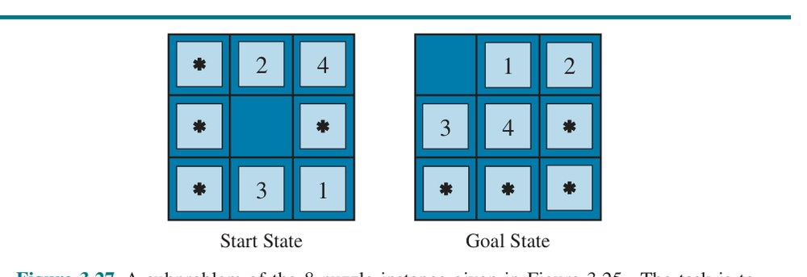

**شکل ۳.۲۷ — زیرمسئله‌ای از نمونهٔ معمای ۸ شکل ۳.۲۵.** تکلیف رساندن کاشی‌های ۱، ۲، ۳، ۴ و فضای خالی به موقعیت‌های درستشان است، بدون نگرانی از آنچه بر کاشی‌های دیگر می‌گذرد.

### 3.6.4 تولید اکتشافی‌ها با نقطه‌های نشانه

سرویس‌های آنلاینی هست که نقشه‌هایی با ده‌ها میلیون رأس میزبانی می‌کنند و مسیرهای رانندگی بهینهٔ هزینه را در چند میلی‌ثانیه می‌یابند (شکل ۳.۲۸). چگونه می‌توانند این کار را بکنند، در حالی که بهترین الگوریتم‌های جستجویی که تاکنون در نظر گرفته‌ایم حدود یک میلیون بار کندترند؟ حربه‌های بسیاری هست، اما مهم‌ترین آن «پیش‌محاسبه» (Precomputation) برخی هزینه‌های مسیر بهینه است. هرچند پیش‌محاسبه می‌تواند زمان‌بر باشد، فقط یک بار لازم است انجام شود و سپس می‌توان آن را بر میلیاردها درخواست جستجوی کاربران سرشکن کرد.

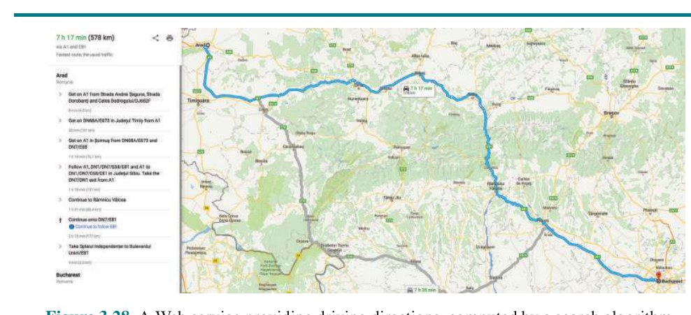

**شکل ۳.۲۸ — سرویس وب ارائه‌دهندهٔ مسیرهای رانندگی، محاسبه‌شده توسط الگوریتم جستجو.**

می‌توانیم اکتشافی کاملی تولید کنیم با پیش‌محاسبه و ذخیرهٔ هزینهٔ مسیر بهینه میان هر جفت رأس. آن O(|V|²) فضا و O(|E|³) زمان می‌برد — برای گراف‌های با ده هزار رأس عملی است، اما نه برای ده میلیون.

رویکرد بهتر آن است که چند (شاید ۱۰ یا ۲۰) «نقطهٔ نشانه» (Landmark Point)¹⁶ از میان رأس‌ها برگزینیم. سپس برای هر نقطهٔ نشانهٔ L و هر رأس v دیگر در گراف، C∗(v,L) — هزینهٔ دقیق مسیر بهینه از v تا L — را محاسبه و ذخیره می‌کنیم. (به C∗(L,v) نیز نیاز داریم؛ روی گراف بدون جهت این همان C∗(v,L) است؛ روی گراف جهت‌دار — مثلاً با خیابان‌های یک‌طرفه — باید جداگانه محاسبه‌اش کنیم.) با جدول‌های C∗ ذخیره‌شده، به‌راحتی می‌توانیم اکتشافی کارآمدی (هرچند نامقبول) بسازیم: کمینه، روی همهٔ نقطه‌های نشانه، هزینهٔ رسیدن از گرهٔ کنونی به نقطهٔ نشانه و سپس به هدف:

hL(n) = min over L in Landmarks [C∗(n,L) + C∗(L,goal)]

اگر مسیر بهینه اتفاقاً از نقطهٔ نشانه‌ای بگذرد، این اکتشافی دقیق خواهد بود؛ اگر نه، نامقبول است — هزینه تا هدف را بیش‌تخمین می‌زند. در جستجوی A∗، اگر اکتشافی‌های دقیق داشته باشید، پس از رسیدن به گره‌ای روی مسیر بهینه، هر گره‌ای که گسترش دهید از آن پس روی مسیر بهینه خواهد بود. به خطوط تراز بیندیشید که این مسیر بهینه را دنبال می‌کنند. جستجو مسیر بهینه را دنبال می‌کند و در هر تکرار کنشی با هزینهٔ c می‌افزاید تا به حالت نتیجه‌ای برسد که مقدار h آن c کمتر است، یعنی امتیاز کل f = g + h در تمام طول مسیر در C∗ ثابت می‌ماند.

برخی الگوریتم‌های مسیریابی با افزودن «میان‌بُرها» (Shortcuts) — یال‌های مصنوعی در گراف که مسیر بهینهٔ چندکنشه را تعریف می‌کنند — زمان بیشتری صرفه‌جویی می‌کنند. برای نمونه، اگر میان‌بُرهایی از پیش میان همهٔ ۱۰۰ شهر بزرگ آمریکا تعریف شده بود و ما می‌خواستیم از پردیس برکلی در کالیفرنیا به دانشگاه نیویورک در نیویورک برویم، می‌توانستیم میان‌بُر میان ساکرامنتو و منهتن را برداریم و ۹۰٪ مسیر را در یک کنش بپیماییم.

hL(n) کارآمد است اما مقبول نیست. اما با کمی دقت بیشتر، می‌توانیم اکتشافی‌ای به دست آوریم که هم کارآمد است هم مقبول:

hDH(n) = max over L in Landmarks |C∗(n,L) − C∗(goal,L)|

این «اکتشافی تفاضلی» (Differential Heuristic) نامیده می‌شود (به‌سبب تفریق). این را با نقطهٔ نشانه‌ای تصور کنید که جایی آن‌سوی هدف است. اگر هدف اتفاقاً روی مسیر بهینه از n تا نقطهٔ نشانه باشد، این می‌گوید «کل مسیر از n تا L را در نظر بگیر، سپس بخش آخر آن مسیر، از هدف تا L را کم کن، و هزینهٔ دقیق مسیر از n تا هدف را به ما می‌دهد.» تا آنجا که هدف کمی بیرون از مسیر بهینه به نقطهٔ نشانه است، اکتشافی نادقیق خواهد بود، اما همچنان مقبول. نقطه‌های نشانه‌ای که آن‌سوی هدف نیستند مفید نخواهند بود؛ نقطهٔ نشانه‌ای که دقیقاً نیمه‌راه میان n و هدف است hDH = 0 می‌دهد که کمکی نمی‌کند.

چند راه برای برگزیدن نقطه‌های نشانه هست. برگزیدن تصادفی نقاط سریع است، اما اگر مراقبت کنیم نقطه‌های نشانه را پخش کنیم تا زیاد به هم نزدیک نباشند، نتایج بهتری می‌گیریم. رویکرد حریصانه آن است که نخستین نقطهٔ نشانه را تصادفی برگزینیم، سپس نقطه‌ای را بیابیم که از آن دورترین است و آن را به مجموعهٔ نقطه‌های نشانه بیفزاییم، و ادامه دهیم و در هر تکرار نقطه‌ای را بیفزاییم که فاصله‌اش تا نزدیک‌ترین نقطهٔ نشانه را بیشینه می‌کند. اگر گزارش‌های درخواست‌های جستجوی گذشتهٔ کاربرانتان را دارید، می‌توانید نقطه‌های نشانه‌ای را برگزینید که در جستجوها پرتقاضایند. برای اکتشافی تفاضلی خوب است نقطه‌های نشانه دور محیط گراف پخش شده باشند. پس فن خوب آن است که مرکز ثقل گراف را بیابیم، k گوهٔ کیک‌شکل دور مرکز ثقل بچینیم و در هر گوه رأسی را برگزینیم که از مرکز دورترین است. نقطه‌های نشانه به‌ویژه در مسائل مسیریابی خوب کار می‌کنند، به‌سبب شیوهٔ چیدمان جاده‌ها در جهان: بخش بزرگی از ترافیک واقعاً می‌خواهد میان نقطه‌های نشانه سفر کند، پس مهندسان عمران پهن‌ترین و سریع‌ترین جاده‌ها را در این مسیرها می‌سازند؛ جستجوی نشانه‌ای بازیابی این مسیرها را آسان‌تر می‌کند.

### 3.6.5 یادگیری جستجوی بهتر

چند راهبرد جستجوی ثابت ارائه کرده‌ایم — سطح-اول، A∗ و مانند آن — که توسط دانشمندان رایانه با دقت طراحی و برنامه‌ریزی شده‌اند. آیا عامل می‌تواند یاد بگیرد چگونه بهتر جستجو کند؟ پاسخ بله است و روش بر مفهوم مهمی به نام «فضای حالت فراسطح» (Metalevel State Space) استوار است. هر حالت در فضای حالت فراسطح، حالت درونی (محاسباتی) برنامه‌ای را در بر می‌گیرد که در فضای حالت عادی مانند نقشهٔ رومانی جستجو می‌کند. (برای جدا نگه‌داشتن دو مفهوم، نقشهٔ رومانی را «فضای حالت سطح‌شیء» (Object-Level State Space) می‌نامیم.) برای نمونه، حالت درونی الگوریتم A∗ شامل درخت جستجوی کنونی است. هر کنش در فضای حالت فراسطح، گام محاسباتی است که حالت درونی را تغییر می‌دهد؛ برای نمونه، هر گام محاسباتی در A∗ یک گرهٔ برگ را گسترش می‌دهد و جانشین‌هایش را به درخت می‌افزاید. پس شکل ۳.۱۸، که توالی‌ای از درخت‌های جستجوی بزرگ‌وبزرگ‌تر را نشان می‌دهد، می‌تواند به‌مثابه ترسیم مسیری در فضای حالت فراسطح دیده شود که هر حالتش روی مسیر، درخت جستجوی سطح‌شیء است. حال، مسیر شکل ۳.۱۸ پنج گام دارد، از جمله گامی — گسترش فاگاراش — که چندان کمکی نیست. برای مسائل دشوارتر، چنین لغزش‌های بسیاری خواهد بود و الگوریتم یادگیری فراسطح (Metalevel Learning) می‌تواند از این تجربه‌ها بیاموزد که از کاوش زیردرخت‌های بی‌امید بپرهیزد. فنون به‌کاررفته برای این نوع یادگیری در فصل ۲۲ توصیف شده‌اند. هدف یادگیری، کمینه‌کردن هزینهٔ کل حل مسئله است، با داد‌وستد میان هزینهٔ محاسباتی و هزینهٔ مسیر.

### 3.6.6 یادگیری اکتشافی‌ها از تجربه

دیده‌ایم یکی از راه‌های ابداع اکتشافی، تدوین مسئلهٔ ساده‌شده‌ای است که راه‌حل بهینه‌اش به‌راحتی یافت می‌شود. جایگزین، یادگیری از تجربه است. «تجربه» در این‌جا یعنی حل بسیاری معمای ۸، برای نمونه. هر راه‌حل بهینهٔ یک مسئلهٔ معمای ۸، نمونهٔ (هدف، مسیر) فراهم می‌کند. از این نمونه‌ها، الگوریتم یادگیری می‌تواند تابع h بسازد که (با خوش‌شانسی) هزینهٔ مسیر واقعی حالت‌های دیگرِ روی‌آمده در جستجو را تقریب بزند. بیشتر این رویکردها تقریب ناکاملی از تابع اکتشافی یاد می‌گیرند و بنابراین ریسک نامقبول‌بودن دارند. این به داد‌وستد ناگزیری میان زمان یادگیری، زمان اجرای جستجو و هزینهٔ راه‌حل می‌انجامد. فنون یادگیری ماشین در فصل ۱۹ نشان داده می‌شوند. روش‌های یادگیری تقویتیِ توصیف‌شده در فصل ۲۲ نیز بر جستجو کاربردپذیرند.

برخی فنون یادگیری ماشین وقتی بهتر کار می‌کنند که به‌جای توصیف خام حالت، «ویژگی‌هایی» (Features) از حالت در اختیارشان گذاشته شود که برای پیش‌بینی مقدار اکتشافی حالت مرتبط‌اند. برای نمونه، ویژگی «شمار کاشی‌های نابجا» ممکن است در پیش‌بینی فاصلهٔ واقعی حالت معمای ۸ تا هدف کمکی باشد. این ویژگی را x1(n) بنامیم. می‌توانیم ۱۰۰ پیکربندی تصادفی معمای ۸ تولید کنیم و آمار هزینه‌های راه‌حل واقعی‌شان را گرد آوریم. ممکن است بیابیم وقتی x1(n) برابر ۵ است، میانگین هزینهٔ راه‌حل حدود ۱۴ است، و الی آخر. البته می‌توانیم از چند ویژگی استفاده کنیم. ویژگی دوم x2(n) ممکن است «شمار جفت‌کاشی‌های مجاوری باشد که در حالت هدف مجاور نیستند». x1(n) و x2(n) را چگونه باید برای پیش‌بینی h(n) ترکیب کرد؟ رویکرد رایج استفاده از ترکیب خطی است:

h(n) = c1x1(n) + c2x2(n)

ثابت‌های c1 و c2 برای بهترین برازش داده‌های واقعی در میان پیکربندی‌های تصادفی‌تولیدشده تنظیم می‌شوند. انتظار می‌رود هر دو c1 و c2 مثبت باشند، زیرا کاشی‌های نابجا و جفت‌های مجاورِ نادرست مسئله را دشوارتر می‌کنند. توجه کنید این اکتشافی شرط h(n)=0 برای حالت‌های هدف را برآورده می‌کند، اما لزوماً مقبول یا سازگار نیست.

## خلاصهٔ فصل

این فصل الگوریتم‌های جستجویی را معرفی کرد که عامل می‌تواند برای انتخاب توالی‌های کنش در گسترهٔ وسیعی از محیط‌ها به کار گیرد — تا وقتی آن محیط‌ها تکرارشونده، تک‌عاملی، کاملاً قابل مشاهده، جبرگرایانه، ایستا، گسسته و کاملاً شناخته‌شده باشند. داد‌وستدهایی هست که باید میان زمانِ جستجو، حافظهٔ در دسترس و کیفیت راه‌حل انجام شود. می‌توانیم کارآمدتر باشیم اگر دانش وابسته به حوزه در قالب تابع اکتشافی داشته باشیم که تخمین می‌زند حالتِ داده‌شده چقدر تا هدف فاصله دارد، یا اگر راه‌حل‌های جزئی شامل الگوها یا نقطه‌های نشانه را از پیش محاسبه کنیم.

- پیش از آنکه عامل بتواند جستجو را آغاز کند، باید مسئله‌ای خوب‌تعریف‌شده صورت‌بندی شود.
- مسئله از پنج بخش تشکیل شده: حالت آغازین، مجموعه‌ای از کنش‌ها، مدل گذارِ توصیف‌کنندهٔ نتایج آن کنش‌ها، مجموعه‌ای از حالت‌های هدف، و تابع هزینهٔ کنش.
- محیط مسئله با گراف فضای حالت بازنمایی می‌شود. مسیری در فضای حالت (توالی‌ای از کنش‌ها) از حالت آغازین به حالت هدف، راه‌حل است.
- الگوریتم‌های جستجو عموماً حالت‌ها و کنش‌ها را اتمی می‌دانند، بدون هیچ ساختار درونی (هرچند هنگام یادگیری ویژگی‌های حالت را معرفی کردیم).
- الگوریتم‌های جستجو بر اساس کامل بودن، بهینگی هزینه، پیچیدگی زمانی و پیچیدگی فضایی داوری می‌شوند.
- روش‌های جستجوی نامطلع فقط به تعریف مسئله دسترسی دارند. الگوریتم‌ها درخت جستجویی می‌سازند تا راه‌حلی بیابند. الگوریتم‌ها در اینکه کدام گره را نخست گسترش می‌دهند متفاوت‌اند:
  - جستجوی بهترین-اول گره‌ها را برای گسترش با تابع ارزیابی برمی‌گزیند.
  - جستجوی سطح-اول نخست کم‌عمق‌ترین گره‌ها را گسترش می‌دهد؛ کامل است، برای هزینه‌های کنش واحد بهینه است، اما پیچیدگی فضایی نمایی دارد.
  - جستجوی هزینه-یکنواخت گره‌ای با کمترین هزینهٔ مسیر، g(n)، را گسترش می‌دهد و برای هزینه‌های کنش عمومی بهینه است.
  - جستجوی عمق-اول نخست عمیق‌ترین گرهٔ گسترش‌نیافته را گسترش می‌دهد. نه کامل است نه بهینه، اما پیچیدگی فضایی خطی دارد. جستجوی محدود-به-عمق کران عمقی می‌افزاید.
  - جستجوی تعمیق تکراری، جستجوی عمق-اول را با حدهای عمق فزاینده فراخوانی می‌کند تا هدف یافته شود. با بررسی کامل چرخه کامل است، برای هزینه‌های کنش واحد بهینه است، پیچیدگی زمانی قابل مقایسه با جستجوی سطح-اول و پیچیدگی فضایی خطی دارد.
  - جستجوی دوطرفه دو جستجو را هم‌زمان اجرا می‌کند، یکی از حالت آغازین به جلو و یکی از هدف به عقب؛ اگر هر دو جستجو جستجوی سطح-اول (یا هزینه-یکنواخت) باشند، راه‌حل بهینه می‌یابد و پیچیدگی زمانی‌اش به‌شکل مجانبی بهتر است.
- روش‌های جستجوی مطلع از تابع اکتشافی h(n) استفاده می‌کنند که تخمینی از فاصله تا هدف می‌دهد:
  - جستجوی بهترین-اول حریصانه گره‌ای را گسترش می‌دهد که طبق h به هدف نزدیک‌ترین می‌نماید؛ سریع است اما همیشه بهینه نیست.
  - جستجوی A∗ با f(n) = g(n) + h(n) گسترش می‌دهد؛ با اکتشافی مقبول کامل و بهینهٔ هزینه است، اما پیچیدگی فضایی نمایی دارد.
  - اکتشافی سازگار (که نابرابری مثلث را رعایت می‌کند) مقبول است و باعث می‌شود A∗ هر حالت را فقط یک بار گسترش دهد.
  - با A∗ وزنی می‌توان سرعت را بر بهینگی ترجیح داد؛ راه‌حل‌های با تضمینِ درون ضریب W از بهینه می‌یابد.
  - IDA∗ و RBFS جستجوی بهینه انجام می‌دهند و فضای کمتری مصرف می‌کنند، اما برخی حالت‌ها را چند بار بازتولید می‌کنند.
  - SMA∗ از حافظهٔ موجود استفادهٔ کامل می‌کند و می‌تواند راه‌حل بهینهٔ قابل دسترسی را بیابد.
- اکتشافی‌ها را می‌توان از ساده‌سازی مسئله (که در آن اکتشافی هزینهٔ راه‌حل بهینهٔ مسئلهٔ ساده‌شده است)، از زیرمسئله‌ها (پایگاه‌داده‌های الگو)، از نقطه‌های نشانهٔ از‌پیش‌محاسبه‌شده، از یادگیری ماشین و از راه‌های دیگر تولید کرد.

## یادداشت‌های کتاب‌شناختی و تاریخی

مطالعهٔ سیستماتیک جستجوی حالت‌فضا در میانه‌های دههٔ ۱۹۵۰ با مقالهٔ «برنامه‌ریزی و حل مسئله» نیوول و سایمون (۱۹۵۶) آغاز شد و در دههٔ ۱۹۶۰ به سرعت رشد کرد. کتاب «حل مسئلهٔ انسانی» (نیوول و سایمون، ۱۹۷۲) همچنان منبع غنی بینش دربارهٔ جستجو و استدلال است. ایدهٔ درخت جستجو در کار هارت، نیلسون و رافائل (۱۹۶۸) و نیلسون (۱۹۷۱) صوری شد. «الگوریتم‌های حل مسئله» نیلسون (۱۹۷۱) و کتاب‌های بعدی او (۱۹۸۰، ۱۹۸۸) مرورهای استاندارد آن دوره بودند. توصیف‌های کلی‌تر جستجو را در کورف (۱۹۸۸)، پیرل (۱۹۸۴) و کتاب‌های درسی الگوریتم (کورمن و همکاران، ۲۰۰۹) و هوش مصنوعی (پول و مک‌ورث، ۲۰۱۷) می‌توان یافت. هر یک از مسائل جستجوی جهان واقعیِ فهرست‌شده در فصل موضوع تلاش پژوهشی فراوانی بوده است. روش‌های انتخاب پروازهای هوایی بهینه بیشتر اختصاصی مانده‌اند، اما کارل د مارکن با تقلیل به مسائل تصمیم دیوفانتی نشان داده قیمت‌گذاری و محدودیت‌های بلیت هواپیما چنان درهم‌پیچیده شده که مسئلهٔ انتخاب پرواز بهینه به‌صورت صوری تصمیم‌ناپذیر است (رابینسون، ۲۰۰۲). مسئلهٔ فروشندهٔ دوره‌گرد (TSP) مسئلهٔ ترکیبیاتی استانداردی در علوم رایانهٔ نظری است (لاولر و همکاران، ۱۹۹۲). کارپ (۱۹۷۲) مسئلهٔ تصمیم TSP را NP-سخت اثبات کرد، اما روش‌های تقریب اکتشافی مؤثری توسعه یافت (لین و کرنیگان، ۱۹۷۳). آرورا (۱۹۹۸) طرح تقریب کاملاً چندجمله‌ای برای TSP اقلیدسی ابداع کرد. روش‌های چیدمان VLSI توسط لاپو (۲۰۱۰) مرور شده و مقاله‌های بهینه‌سازی چیدمان فراوانی در ژورنال‌های VLSI ظاهر می‌شوند. ناوبری رباتیک در فصل ۲۶ بحث می‌شود. توالی‌یابی مونتاژ خودکار نخستین بار توسط فردی (مایکی، ۱۹۷۲) نشان داده شد؛ مرور جامعی توسط (باهوبالندرونی و بیسوال، ۲۰۱۶) ارائه شده.

الگوریتم‌های جستجوی نامطلع موضوع مرکزی علوم رایانه (کورمن و همکاران، ۲۰۰۹) و تحقیق در عملیات (دریفوس، ۱۹۶۹) هستند. جستجوی سطح-اول برای حل مارپیچ‌ها توسط مور (۱۹۵۹) صورت‌بندی شد. روش برنامه‌نویسی پویا (بلمن، ۱۹۵۷؛ بلمن و دریفوس، ۱۹۶۲)، که به‌صورت نظام‌مند راه‌حل‌های همهٔ زیرمسئله‌های با طول فزاینده را ثبت می‌کند، می‌تواند شکلی از جستجوی سطح-اول دیده شود.

الگوریتم دیکسترا به شکلی که معمولاً ارائه می‌شود (دیکسترا، ۱۹۵۹) برای گراف‌های متناهی صریح کاربردپذیر است. نیلسون (۱۹۷۱) نسخه‌ای از الگوریتم دیکسترا را معرفی کرد که آن را جستجوی هزینه-یکنواخت نامید (زیرا الگوریتم «در امتداد خطوط ترازِ هزینهٔ مسیرِ یکسان پخش می‌شود») و گراف‌های ضمنیِ بی‌نهایت را ممکن می‌سازد. کار نیلسون همچنین ایدهٔ فهرست‌های بسته و باز و اصطلاح «جستجوی گرافی» را معرفی کرد. نام BEST-FIRST-SEARCH در «راهنمای هوش مصنوعی» (بار و فایگنباوم، ۱۹۸۱) معرفی شد. الگوریتم‌های فلوید–وارشال (فلوید، ۱۹۶۲) و بلمن–فورد (بلمن، ۱۹۵۸؛ فورد، ۱۹۵۶) هزینه‌های گام منفی را (تا وقتی چرخهٔ منفی نباشد) ممکن می‌کنند.

نسخه‌ای از تعمیق تکراری که برای بهره‌برداری کارآمد از ساعت شطرنج طراحی شده نخستین بار توسط اسلیت و آتکین (۱۹۷۷) در برنامهٔ بازی شطرنج CHESS 4.5 به کار رفت. الگوریتم B مارتلی (۱۹۷۷) نیز جنبهٔ تعمیق تکراری در بر دارد. فن تعمیق تکراری توسط برترام رافائل (۱۹۷۶) معرفی شد و در کار کورف (۱۹۸۵) به اوج رسید.

کاربرد اطلاعات اکتشافی در حل مسئله در مقالهٔ آغازین سایمون و نیوول (۱۹۵۸) آمده، اما عبارت «جستجوی اکتشافی» و به‌کارگیری توابع اکتشافیِ تخمین‌زنندهٔ فاصله تا هدف کمی بعدتر آمد (نیوول و ارنست، ۱۹۶۵؛ لین، ۱۹۶۵). دورن و مایکی (۱۹۶۶) مطالعات تجربی گسترده‌ای در جستجوی اکتشافی انجام دادند. هرچند آنان طول مسیر و «نفوذ» (نسبت طول مسیر به شمار کل گره‌های بررسی‌شده تاکنون) را تحلیل کردند، به نظر می‌رسد اطلاعاتِ ارائه‌شده توسط هزینهٔ مسیر g(n) را نادیده گرفته‌اند. الگوریتم A∗، که هزینهٔ مسیر کنونی را در جستجوی اکتشافی وارد می‌کند، توسط هارت، نیلسون و رافائل (۱۹۶۸) توسعه یافت. دچتر و پیرل (۱۹۸۵) شرایطی را مطالعه کردند که A∗ در آن بهینه‌کارا (در شمار گره‌های گسترش‌یافته) است.

مقالهٔ اصلی A∗ (هارت و همکاران، ۱۹۶۸) شرط سازگاری را بر توابع اکتشافی معرفی کرد. شرط یکنواختی توسط پول (۱۹۷۷) به‌عنوان جایگزینی ساده‌تر معرفی شد، اما پیرل (۱۹۸۴) نشان داد این دو معادل‌اند.

پول (۱۹۷۷) پیش‌گام مطالعهٔ رابطهٔ میان خطا در توابع اکتشافی و پیچیدگی زمانی A∗ شد. نتایج پایه برای جستجوی درخت‌مانند با هزینه‌های کنش واحد و یک حالت هدف واحد (پول، ۱۹۷۷؛ گاشنیگ، ۱۹۷۹؛ هوین و همکاران، ۱۹۸۰؛ پیرل، ۱۹۸۴) و با چند حالت هدف (دینه و همکاران، ۲۰۰۷) به دست آمد. کورف و رید (۱۹۹۸) نشان دادند چگونه شمار دقیق گره‌های گسترش‌یافته (نه فقط تقریب مجانبی) را در گستره‌ای از حوزه‌های مسئلهٔ واقعی پیش‌بینی کنند. «ضریب انشعاب مؤثر» توسط نیلسون (۱۹۷۱) به‌عنوان معیار تجربی کارایی پیشنهاد شد. برای جستجوی گرافی، هلمرت و رگر (۲۰۰۸) یادآور شدند چند مسئلهٔ شناخته‌شده حاوی گره‌های نمایی‌چندانی روی مسیرهای راه‌حلِ بهینهٔ هزینه هستند که پیچیدگی زمانی نمایی برای A∗ دلالت دارد.

تغییرهای بسیاری بر الگوریتم A∗ هست. پول (۱۹۷۰) جستجوی A∗ وزنی و بعداً نسخهٔ پویایش (۱۹۷۳) را معرفی کرد که در آن وزن با عمق درخت تغییر می‌کند. ابن‌دت و درشلر (۲۰۰۹) نتایج را ترکیب و برخی کاربردها را بررسی می‌کنند. هاتم و رومل (۲۰۱۴) نسخهٔ ساده‌شده و بهبودیافتهٔ A∗ وزنی را نشان می‌دهند که پیاده‌سازی‌اش آسان‌تر است. ویلت و رومل (۲۰۱۴) جستجوی سریع را به‌عنوان جایگزینی برای جستجوی حریصانه معرفی می‌کنند که بر کمینه‌کردن زمان جستجو متمرکز است، و ویلت و رومل (۲۰۱۶) نشان می‌دهند بهترین اکتشافی‌ها برای جستجوی رضایت‌بخش با بهترین‌ها برای جستجوی بهینه متفاوت‌اند. برنز و همکاران (۲۰۱۲) چند ترفند پیاده‌سازی برای نوشتن کد جستجوی سریع می‌دهند و فلنر (۲۰۱۸) بررسی می‌کند پیاده‌سازی هنگام استفاده از آزمون هدف زودهنگام چگونه تغییر می‌کند.

پول (۱۹۷۱) جستجوی دوطرفه را معرفی کرد. هولته و همکاران (۲۰۱۶) نسخه‌ای از جستجوی دوطرفه را توصیف می‌کنند که تضمین‌شده در میانه به هم می‌رسد و آن را کاربردی‌تر می‌کند. اکرله و همکاران (۲۰۱۷) مجموعهٔ جفت‌گره‌های قطعاً گسترش‌یافته را توصیف و نشان می‌دهند هیچ جستجوی دوطرفه‌ای نمی‌تواند بهینه‌کارا باشد. الگوریتم NBS (چن و همکاران، ۲۰۱۷) به‌صراحت از صفی از جفت‌گره‌ها استفاده می‌کند.

ترکیبی از A∗ دوطرفه و نقطه‌های نشانهٔ شناخته‌شده برای یافتن کارآمد مسیرهای رانندگیِ سرویس نقشهٔ آنلاین مایکروسافت به کار رفت (گلدبرگ و همکاران، ۲۰۰۶). الگوریتم پس از کش‌کردن مجموعه‌ای از مسیرهای میان نقطه‌های نشانه، می‌تواند مسیر بهینهٔ هزینه را میان هر جفت نقطه در گراف ۲۴ میلیون‌نقطه‌ای ایالات متحده بیابد و کمتر از ۰٫۱٪ گراف را جستجو کند. کورف (۱۹۸۷) نشان می‌دهد چگونه با زیرهدف‌ها، عملگرهای کلان و انتزاع، شتاب‌های چشمگیری نسبت به فنون قبلی به دست آوریم. دلینگ و همکاران (۲۰۰۹) توصیف می‌کنند چگونه از جستجوی دوطرفه، نقطه‌های نشانه، ساختار سلسله‌مراتبی و دیگر حربه‌ها برای یافتن مسیرهای رانندگی استفاده کنند. اندرسون و همکاران (۲۰۰۸) فن مرتبطی به نام جستجوی درشت‌به‌ریز (Coarse-to-Fine Search) را توصیف می‌کنند که می‌توان آن را تعریف نقطه‌های نشانه در سطح‌های انتزاعی سلسله‌مراتبی گوناگون دانست. کورف (۱۹۸۷) شرایطی را توصیف می‌کند که جستجوی درشت‌به‌ریز در آن‌ها شتاب نمایی می‌دهد. نابلاک (۱۹۹۱) نتایج تجربی و تحلیل برای کمّی‌کردن مزیت‌های جستجوی سلسله‌مراتبی ارائه می‌دهد.

A∗ و دیگر الگوریتم‌های جستجوی فضای حالت با فنون شاخه‌وکران (Branch-and-Bound) که در تحقیق در عملیات پرکاربردند پیوند نزدیک دارند (لاولر و وود، ۱۹۶۶؛ ری‌وارد-اسمیت و همکاران، ۱۹۹۶). کومار و کانال (۱۹۸۸) «وحدت بزرگ» جستجوی اکتشافی، برنامه‌نویسی پویا و فنون شاخه‌وکران را زیر نام CDP — «فرایند تصمیم مرکب» — می‌آزمایند. چون بیشتر رایانه‌های دههٔ ۱۹۶۰ فقط چند هزار واژه حافظهٔ اصلی داشتند، جستجوی اکتشافی محدود-به-حافظه موضوع پژوهشی آغازینی بود. «پیمایش‌گر گراف» (دورن و مایکی، ۱۹۶۶)، یکی از کهن‌ترین برنامه‌های جستجو، پس از جستجوی بهترین-اول تا حد حافظه، به کنشی متعهد می‌شود. IDA∗ (کورف، ۱۹۸۵) نخستین الگوریتم جستجوی اکتشافی محدود-به-حافظهٔ پرکاربردِ بهینه بود و تعداد زیادی تغییر برایش توسعه یافته. تحلیلی از کارایی IDA∗ و دشواری‌هایش با اکتشافی‌های مقدار-حقیقی در پاتریک و همکاران (۱۹۹۲) آمده.

نسخهٔ اصلی RBFS (کورف، ۱۹۹۳) در واقع تا حدی پیچیده‌تر از الگوریتم نشان‌داده‌شده در شکل ۳.۲۲ است که در واقع به الگوریتمی مستقل‌توسعه‌یافته به نام بسط تکراری (Iterative Expansion) یا IE (راسل، ۱۹۹۲) نزدیک‌تر است. RBFS از کران پایین نیز به‌همراه کران بالا استفاده می‌کند؛ دو الگوریتم با اکتشافی‌های مقبول یکسان رفتار می‌کنند، اما RBFS گره‌ها را به‌ترتیب بهترین-اول حتی با اکتشافی نامقبول گسترش می‌دهد. ایدهٔ پیگیری بهترین مسیر جایگزین پیش‌تر در پیاده‌سازی زیبای پرولوگ A∗ توسط براتکو (۲۰۰۹) و در الگوریتم DTA∗ (راسل و وفالد، ۱۹۹۱) آمده بود. کار اخیر همچنین فضاهای حالت فراسطح و یادگیری فراسطح را بحث می‌کند.

الگوریتم MA∗ در چاکرابارتی و همکاران (۱۹۸۹) آمد. SMA∗، یا MA∗ ساده‌شده، از تلاشی برای پیاده‌سازی MA∗ (راسل، ۱۹۹۲) برخاست. کایندل و خرسند (۱۹۹۴) SMA∗ را برای تولید الگوریتم جستجوی دوطرفه‌ای اعمال کردند که به‌شکل چشمگیری از الگوریتم‌های قبلی سریع‌تر بود. کورف و ژانگ (۲۰۰۰) رویکرد تقسیم‌وتسلط توصیف می‌کنند و ژو و هانسن (۲۰۰۲) جستجوی گرافی A∗ محدود-به-حافظه و راهبردی برای سوئیچ به جستجوی سطح-اول برای افزایش کارایی حافظه معرفی می‌کنند (ژو و هانسن، ۲۰۰۶).

ایدهٔ اینکه اکتشافی‌های مقبول را می‌توان با ساده‌سازی مسئله مشتق کرد در مقالهٔ بنیادین هلد و کارپ (۱۹۷۰) آمده که از اکتشافی درخت پوشای کمینه برای حل TSP استفاده کردند. (تمرین 3.MSTR را ببینید.) خودکارسازی فرایند ساده‌سازی با موفقیت توسط پریدیتیس (۱۹۹۳) پیاده شد. ادبیات رو به رشدی دربارهٔ کاربرد یادگیری ماشین برای کشف توابع اکتشافی هست (سمدی و همکاران، ۲۰۰۸؛ آرفایی و همکاران، ۲۰۱۰؛ تایر و همکاران، ۲۰۱۱؛ للیس و همکاران، ۲۰۱۲).

استفاده از پایگاه‌داده‌های الگو برای مشتق‌کردن اکتشافی‌های مقبول از گاسر (۱۹۹۵) و کالبرسون و شفر (۱۹۹۶، ۱۹۹۸) است؛ پایگاه‌داده‌های الگوی ناهم‌پوش توسط کورف و فلنر (۲۰۰۲) توصیف شده؛ روش مشابهی با الگوهای نمادین از ادلکمپ (۲۰۰۹) است. فلنر و همکاران (۲۰۰۷) نشان می‌دهند چگونه پایگاه‌داده‌های الگو را برای صرفه‌جویی در فضا فشرده کنند. تفسیر احتمالاتی اکتشافی‌ها توسط پیرل (۱۹۸۴) و هانسون و مایر (۱۹۸۹) بررسی شد.

---

**پانوشت‌ها:**

¹ فرض می‌کنیم بیشتر خوانندگان در همان وضعیت‌اند و به‌راحتی می‌توانند خود را به همان اندازهٔ عامل ما بی‌اطلاع تصور کنند. از خوانندگان رومانیایی که نمی‌توانند از این ابزار آموزشی بهره ببرند پوزش می‌خواهیم.
² برای مسائلی با شمار بی‌نهایت کنش، به فنونی فراتر از این فصل نیاز خواهیم داشت.
³ در هر مسئله‌ای با چرخه‌ای با هزینهٔ خالص منفی، راه‌حل بهینهٔ هزینه آن است که بی‌نهایت بار دور آن چرخه بزند. الگوریتم‌های بلمن–فورد و فلوید–وارشال (که این‌جا پوشش داده نمی‌شوند) کنش‌های هزینه‌منفی را مدیریت می‌کنند، تا وقتی چرخهٔ منفی نباشد. تطبیق کنش‌های هزینه‌صفر آسان است، تا وقتی شمار کنش‌های هزینه‌صفرِ پیاپی کران‌دار باشد. برای نمونه، ممکن است رباتی داشته باشیم که حرکت هزینه دارد اما چرخش ۹۰ درجه هزینه‌ای ندارد؛ الگوریتم‌های این فصل می‌توانند این را مدیریت کنند تا وقتی بیش از سه چرخش ۹۰ درجهٔ پیاپی مجاز نباشد. پیچیدگی دیگری نیز با مسائلی هست که شمار بی‌نهایت هزینهٔ کنشِ خودسرانه کوچک دارند. نسخه‌ای از پارادوکس زنو را در نظر بگیرید که کنشی برای حرکت به نیمهٔ راهِ هدف با هزینهٔ نصف حرکت قبلی هست. این مسئله با شمار متناهی کنش راه‌حل ندارد، اما برای جلوگیری از گرفتن شمار بی‌کران کنش بدون رسیدن کامل به هدف، می‌توانیم ایجاب کنیم همهٔ هزینه‌های کنش دست‌کم ε باشند، برای ε مثبتِ کوچکی.
⁴ بخش 11.4 را ببینید.
⁵ برخی نویسندگان جبهه را «فهرست باز» می‌نامند و مجموعهٔ گره‌های قبلاً گسترش‌یافته را «فهرست بسته»؛ ما اصطلاحات جبهه و رسیده را ترجیح می‌دهیم.
⁶ «درخت‌مانند» می‌گوییم، زیرا فضای حالت همچنان همان گراف است، هرگونه که جستجو کنیم؛ ما فقط انتخاب می‌کنیم آن را چنان رفتار کنیم که گویی درخت است، با فقط یک مسیر از هر گره به ریشه.
⁷ برخی نویسندگان از اصطلاح «مقبولیت» برای ویژگی یافتن راه‌حل کم‌هزینه‌ترین استفاده می‌کنند و برخی فقط «بهینگی»، اما آن را می‌توان با انواع دیگر بهینگی اشتباه گرفت.
⁸ در این‌جا و در سراسر کتاب، «ستاره» در C∗ به معنای مقدار بهینهٔ C است.
⁹ در پیاده‌سازی ما، ساختار دادهٔ reached از پرس‌وجوی عضویت پشتیبانی می‌کند و جبهه (صف اولویت‌دار) نه؛ پس برخورد را با reached بررسی می‌کنیم؛ اما از نظر مفهومی می‌پرسیم آیا دو جبهه به هم رسیده‌اند. پیاده‌سازی را می‌توان برای چند حالت هدف با بارگذاری گرهٔ هر حالت هدف در جبههٔ عقب و جدول reached عقب بسط داد.
¹⁰ ممکن است عجیب بنماید که تابع اکتشافی روی گره عمل می‌کند، در حالی که واقعاً فقط به حالت گره نیاز دارد. سنت بر آن است که به‌جای h(s) از h(n) استفاده شود تا با تابع ارزیابی f(n) و هزینهٔ مسیر g(n) سازگار باشد.
¹¹ باز هم، با فرض همهٔ هزینه‌های کنش > ε > 0 و اینکه فضای حالت یا راه‌حل دارد یا متناهی است.
¹³ در واقع، اصطلاح «اکتشافی یکنواخت» مترادف «اکتشافی سازگار» است. دو ایده مستقل توسعه یافتند و سپس اثبات شد معادل‌اند (پیرل، ۱۹۸۴).
¹⁴ در فصل‌های ۸ و ۱۱ زبان‌های صوری مناسبی برای این تکلیف توصیف می‌کنیم؛ با توصیف‌های صوریِ قابل دست‌کاری، ساخت مسئله‌های ساده‌شده قابل خودکارسازی است. فعلاً از انگلیسی استفاده می‌کنیم.
¹⁵ با کار به عقب از هدف، هزینهٔ دقیق راه‌حل هر نمونهٔ روی‌مواجه‌شده بلافاصله در دسترس است. این مثالی از برنامه‌نویسی پویاست که در فصل ۱۷ بیشتر بحث می‌کنیم.
¹⁶ نقطه‌های نشانه گاهی «محور» (Pivot) یا «لنگر» (Anchor) نامیده می‌شوند.
