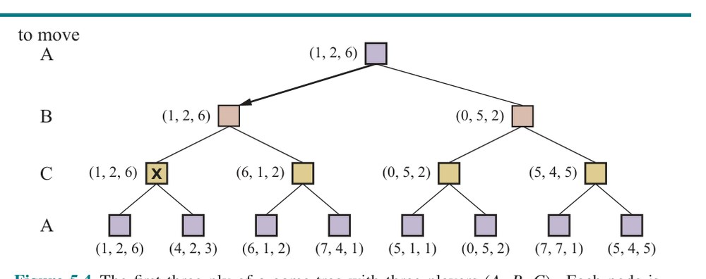
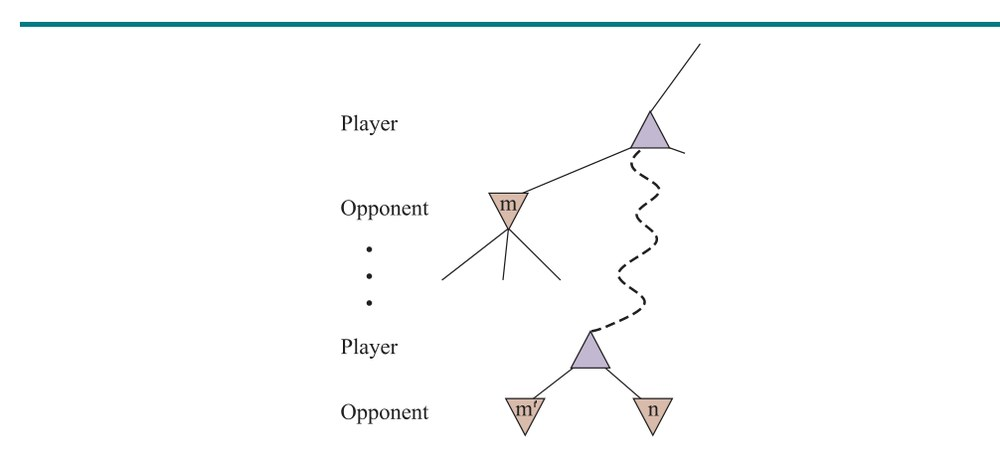
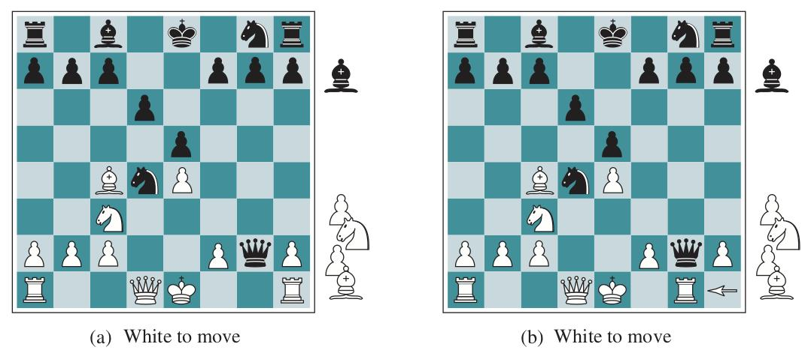
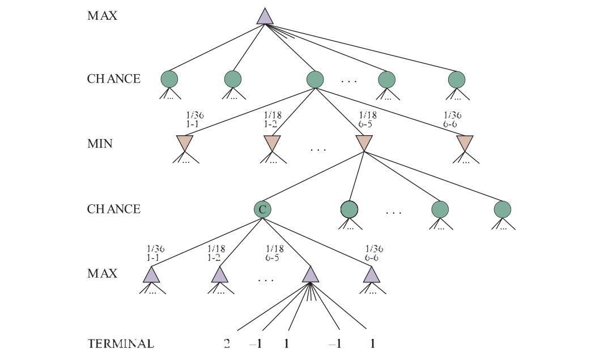
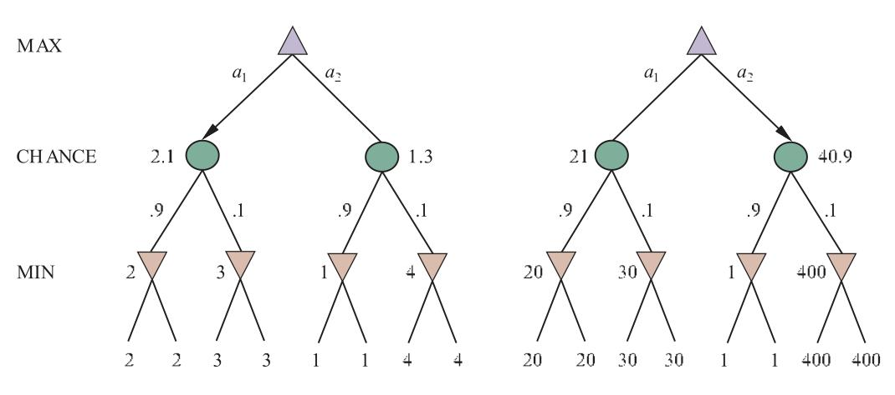
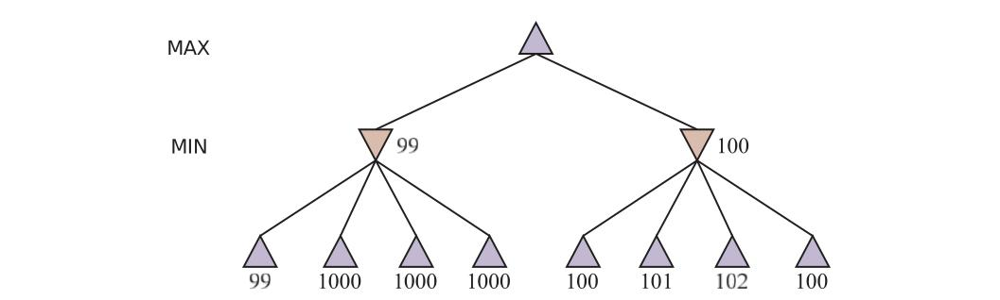

# فصل ۵ — جستجوی رقابتی و بازی‌ها

**فصل ۵: جستجوی رقابتی و بازی‌ها (Adversarial Search and Games)**

*در این فصل محیط‌هایی را می‌کاویم که در آن‌ها عامل‌های دیگر علیه ما توطئه می‌کنند.*

در این فصل محیط‌های رقابتی را پوشش می‌دهیم که در آن‌ها دو یا چند عامل هدف‌های متعارض دارند و این به مسائل جستجوی رقابتی (Adversarial Search) می‌انجامد. به‌جای سروکار داشتن با هرج‌ومرج درگیری‌های جهان واقعی، بر بازی‌ها تمرکز می‌کنیم: شطرنج، گو، پوکر و مانند آن. برای پژوهشگران هوش مصنوعی، سرشت ساده‌شدهٔ این بازی‌ها یک امتیاز است: حالت بازی به‌راحتی بازنمایی می‌شود و عامل‌ها معمولاً به شمار کمی کنش محدودند که اثراتشان با قواعد دقیق تعریف می‌شود. بازی‌های فیزیکی مانند کروکت و هاکی روی یخ توصیف‌های پیچیده‌تری دارند، گسترهٔ بزرگ‌تری از کنش‌های ممکن، و قواعد نسبتاً نادقیقی برای تعریف قانونی‌بودن کنش‌ها. به‌جز فوتبال رباتیک، این بازی‌های فیزیکی چندان توجه جامعهٔ هوش مصنوعی را جلب نکرده‌اند.

## ۵.۱ نظریهٔ بازی

دست‌کم سه نگرش می‌توانیم به محیط‌های چندعاملی داشته باشیم. نگرش نخست، مناسب وقتی که شمار بسیار زیادی عامل هست، آن است که آن‌ها را به‌صورت مجموعی به‌مثابه یک اقتصاد (Economy) در نظر بگیریم؛ این به ما امکان می‌دهد چیزهایی مانند افزایش تقاضا → افزایش قیمت‌ها را پیش‌بینی کنیم، بدون آنکه کنش هیچ عامل فردی را پیش‌بینی کنیم.

دوم، می‌توانیم عامل‌های رقیب را فقط بخشی از محیط بدانیم — بخشی که محیط را ناجبرگرایانه می‌کند. اما اگر رقبا را همان‌گونه مدل کنیم که مثلاً باران را (که گاهی می‌بارد و گاهی نمی‌بارد)، این ایده را از دست می‌دهیم که رقبای ما فعالانه می‌کوشند ما را شکست دهند، حال آنکه باران ظاهراً چنین نیتی ندارد.

نگرش سوم آن است که عامل‌های رقیب را به‌صراحت با فنون جستجوی درخت بازی رقابتی مدل کنیم. این همان چیزی است که این فصل پوشش می‌دهد. با ردهٔ محدودی از بازی‌ها آغاز می‌کنیم و حرکت بهینه و الگوریتمی برای یافتنش تعریف می‌کنیم: جستجوی مینیمکس (Minimax)، تعمیمی از جستجوی AND–OR (از شکل ۴.۱۱). نشان می‌دهیم هرس (Pruning) با نادیده‌گرفتن بخش‌هایی از درخت جستجو که هیچ تفاوتی در حرکت بهینه ایجاد نمی‌کنند، جستجو را کارآمدتر می‌کند. برای بازی‌های غیربدیهی، معمولاً زمان کافی برای اطمینان از یافتن حرکت بهینه نخواهیم داشت (حتی با هرس)؛ باید در نقطه‌ای جستجو را قطع کنیم.

برای هر حالتی که انتخاب می‌کنیم جستجو را در آن متوقف کنیم، می‌پرسیم چه کسی برنده است. برای پاسخ به این پرسش انتخابی داریم: می‌توانیم تابع ارزیابی اکتشافی را اعمال کنیم تا بر اساس ویژگی‌های حالت تخمین بزنیم چه کسی برنده است (بخش ۵.۳)، یا می‌توانیم میانگین پیامدهای بسیاری شبیه‌سازی سریع بازی از آن حالت تا پایان را بگیریم (بخش ۵.۴).

بخش ۵.۵ بازی‌های شامل عنصر شانس را بحث می‌کند (از طریق ریختن تاس یا به‌هم‌زدن ورق) و بخش ۵.۶ بازی‌های اطلاعات ناقص (مانند پوکر و بریج که همهٔ ورق‌ها برای همهٔ بازیکنان قابل مشاهده نیست) را پوشش می‌دهد.

### ۵.۱.۱ بازی‌های دونفرهٔ جمع-صفر

بازی‌هایی که بیشتر در هوش مصنوعی مطالعه می‌شوند (مانند شطرنج و گو) همان‌هایی هستند که نظریه‌پردازان بازی «جبرگرایانه، دونفره، نوبتی، اطلاعات کامل، جمع-صفر» می‌نامند. «اطلاعات کامل» (Perfect Information) مترادف «کاملاً قابل مشاهده» است¹ و «جمع-صفر» (Zero-Sum) بدان معناست که آنچه برای یک بازیکن خوب است دقیقاً به همان اندازه برای دیگری بد است: هیچ پیامد «برد-برد»ی نیست. برای بازی‌ها اغلب از اصطلاح «حرکت» (Move) به‌عنوان مترادف «کنش» و «موضع» (Position) به‌عنوان مترادف «حالت» استفاده می‌کنیم.

دو بازیکن خود را MAX و MIN می‌نامیم، به دلایلی که به‌زودی آشکار خواهد شد. MAX نخست حرکت می‌کند و سپس بازیکنان نوبتی حرکت می‌کنند تا بازی تمام شود. در پایان بازی، به بازیکن برنده امتیاز داده می‌شود و به بازنده جریمه. بازی را می‌توان به‌صورت صوری با عناصر زیر تعریف کرد:

- **S0:** حالت آغازین، که مشخص می‌کند بازی در آغاز چگونه چیده شده.
- **TO-MOVE(s):** بازیکنی که در حالت s نوبت حرکت اوست.
- **ACTIONS(s):** مجموعهٔ حرکت‌های قانونی در حالت s.
- **RESULT(s, a):** مدل گذار (Transition Model) که حالتی را تعریف می‌کند که از برداشتن کنش a در حالت s حاصل می‌شود.
- **IS-TERMINAL(s):** آزمون پایانی (Terminal Test) که وقتی بازی تمام شده true و وگرنه false است. حالت‌هایی که بازی در آن‌ها تمام شده، حالت‌های پایانی (Terminal States) نامیده می‌شوند.
- **UTILITY(s, p):** تابع مطلوبیت (که تابع هدف یا تابع بازده نیز نامیده می‌شود) که مقدار عددی نهایی را برای بازیکن p وقتی بازی در حالت پایانی s تمام می‌شود تعریف می‌کند.

در شطرنج، پیامد برد، باخت یا تساوی است با مقادیر ۱، ۰ یا 1/2.² برخی بازی‌ها گسترهٔ وسیع‌تری از پیامدهای ممکن دارند — برای نمونه، بازده‌های تخته‌نرد از ۰ تا ۱۹۲ می‌روند. بسیار شبیه فصل ۳، حالت آغازین، تابع ACTIONS و تابع RESULT «گراف فضای حالت» را تعریف می‌کنند — گرافی که رأس‌هایش حالت‌ها، یال‌هایش حرکت‌ها و هر حالتی ممکن است با چند مسیر رسیده شود. مانند فصل ۳، می‌توانیم «درخت جستجو» را بر بخشی از آن گراف سوار کنیم تا تعیین کنیم چه حرکتی بکنیم. «درخت بازی کامل» (Game Tree) را به‌عنوان درخت جستجویی تعریف می‌کنیم که هر توالی حرکت را تا حالت پایانی دنبال می‌کند. درخت بازی ممکن است بی‌نهایت باشد اگر خودِ فضای حالت بی‌کران باشد یا قواعد بازی امکان تکرار بی‌نهایت موضع‌ها را بدهند.

شکل ۵.۱ بخشی از درخت بازی برای دوز (tic-tac-toe) را نشان می‌دهد. از حالت آغازین، MAX نه حرکت ممکن دارد. بازی میان گذاشتن X توسط MAX و O توسط MIN در نوسان است تا آنکه به گره‌های برگِ متناظر با حالت‌های پایانی برسیم، چنان‌که یک بازیکن سه خانه در یک ردیف داشته باشد یا همهٔ خانه‌ها پر شوند. عدد روی هر گرهٔ برگ، مقدار مطلوبیت حالت پایانی را از دیدگاه MAX نشان می‌دهد؛ مقادیر بالا برای MAX خوب و برای MIN بد است (و بدین ترتیب بازیکنان نام‌هایشان را می‌گیرند).


**شکل ۵.۱ — درخت بازی (بخشی از) برای بازی دوز.** گرهٔ بالایی حالت آغازین است و MAX نخست حرکت می‌کند و X را در خانهٔ خالی می‌گذارد. بخشی از درخت را نشان می‌دهیم با حرکت‌های متناوب MIN (O) و MAX (X)، تا آنکه سرانجام به حالت‌های پایانی می‌رسیم که می‌توان بر اساس قواعد بازی به آن‌ها مطلوبیت نسبت داد.

برای دوز، درخت بازی نسبتاً کوچک است — کمتر از 9! = ۳۶۲٬۸۸۰ گرهٔ پایانی (با فقط ۵٬۴۷۸ حالت متمایز). اما برای شطرنج بیش از 10⁴⁰ گره هست، پس درخت بازی را بهتر است سازه‌ای نظری دانست که نمی‌توانیم در جهان فیزیکی محقق کنیم.

## ۵.۲ تصمیم‌های بهینه در بازی‌ها

MAX می‌خواهد توالی کنشی بیابد که به برد می‌انجامد، اما MIN حرفی برای گفتن دارد. این بدان معناست که راهبرد MAX باید برنامهٔ شرطی باشد — راهبردی احتیاطی که پاسخی برای هر یک از حرکت‌های ممکن MIN مشخص می‌کند. در بازی‌هایی که پیامد دودویی دارند (برد یا باخت)، می‌توانیم از جستجوی AND–OR (صفحهٔ ۱۲۵) برای تولید برنامهٔ شرطی استفاده کنیم. در واقع، برای چنین بازی‌هایی، تعریف راهبرد برنده برای بازی با تعریف راه‌حل برای مسئلهٔ برنامه‌ریزی ناجبرگرایانه یکسان است: در هر دو مورد، پیامد مطلوب باید تضمین شود، صرف‌نظر از آنچه «طرف دیگر» می‌کند. برای بازی‌های با چند امتیاز پیامد، به الگوریتم کمی کلی‌تر به نام جستجوی مینیمکس نیاز داریم.

**جستجوی مینیمکس (Minimax Search):** بازی پیش‌پاافتادهٔ شکل ۵.۲ را در نظر بگیرید. حرکت‌های ممکن برای MAX در گرهٔ ریشه a1، a2 و a3 برچسب‌گذاری شده‌اند. پاسخ‌های ممکن به a1 برای MIN عبارت‌اند از b1، b2، b3 و الی آخر. این بازی خاص پس از یک حرکت از هر یک از MAX و MIN پایان می‌یابد. (توجه: در برخی بازی‌ها، واژهٔ «حرکت» یعنی هر دو بازیکن کنشی برداشته‌اند؛ پس از واژهٔ «نیم‌حرکت» (Ply) برای معنای بدون‌ابهامِ یک حرکت توسط یک بازیکن استفاده می‌شود که ما را یک سطح در درخت بازی عمیق‌تر می‌کند.) مطلوبیت‌های حالت‌های پایانی این بازی از ۲ تا ۱۴ می‌روند.

با درخت بازیِ داده‌شده، راهبرد بهینه را می‌توان با محاسبهٔ «مقدار مینیمکس» هر حالت در درخت تعیین کرد که آن را MINIMAX(s) می‌نویسیم. مقدار مینیمکس، مطلوبیت (برای MAX)ِ بودن در آن حالت است، با این فرض که هر دو بازیکن از آن‌جا تا پایان بازی بهینه بازی می‌کنند. مقدار مینیمکس حالت پایانی فقط مطلوبیتش است. در حالت غیرپایانی، MAX ترجیح می‌دهد وقتی نوبت اوست به حالتی با بیشینهٔ مقدار حرکت کند و MIN حالتی با کمینهٔ مقدار را ترجیح می‌دهد (یعنی کمینهٔ مقدار برای MAX و بنابراین بیشینهٔ مقدار برای MIN). پس داریم:

```
MINIMAX(s) =
  UTILITY(s, MAX)                             اگر IS-TERMINAL(s)
  max_{a ∈ Actions(s)} MINIMAX(RESULT(s, a))  اگر TO-MOVE(s) = MAX
  min_{a ∈ Actions(s)} MINIMAX(RESULT(s, a))  اگر TO-MOVE(s) = MIN
```


**شکل ۵.۲ — درخت بازی دونیم‌حرکته.** گره‌های △ «گره‌های MAX» هستند که نوبت حرکت MAX است و گره‌های ▽ «گره‌های MIN». گره‌های پایانی مقادیر مطلوبیت را برای MAX نشان می‌دهند؛ بقیهٔ گره‌ها با مقادیر مینیمکس‌شان برچسب‌گذاری شده‌اند. بهترین حرکت MAX در ریشه a1 است، زیرا به حالتی با بیشترین مقدار مینیمکس می‌انجامد، و بهترین پاسخ MIN b1 است، زیرا به حالتی با کمترین مقدار مینیمکس می‌انجامد.

این تعریف‌ها را بر درخت بازی شکل ۵.۲ اعمال کنیم. گره‌های پایانی سطح پایین مقادیر مطلوبیت‌شان را از تابع UTILITY بازی می‌گیرند. نخستین گرهٔ MIN، با برچسب B، سه حالت جانشین با مقادیر ۳، ۱۲ و ۸ دارد، پس مقدار مینیمکسش ۳ است. به همین ترتیب، دو گرهٔ MIN دیگر مقدار مینیمکس ۲ دارند. گرهٔ ریشه گرهٔ MAX است؛ حالت‌های جانشینش مقادیر مینیمکس ۳، ۲ و ۲ دارند؛ پس مقدار مینیمکس ۳ دارد. همچنین می‌توانیم «تصمیم مینیمکس» (Minimax Decision) را در ریشه شناسایی کنیم: کنش a1 انتخاب بهینه برای MAX است، زیرا به حالتی با بیشترین مقدار مینیمکس می‌انجامد.

این تعریف از بازی بهینه برای MAX فرض می‌کند MIN نیز بهینه بازی می‌کند. اگر MIN بهینه بازی نکند چه؟ آنگاه MAX دست‌کم به خوبیِ بازی‌کردن در برابر بازیکن بهینه عمل خواهد کرد، احتمالاً بهتر. اما این بدان معنا نیست که هنگام رویارویی با حریف فروبهینه، همیشه بهترین کار بازی‌کردنِ حرکت بهینهٔ مینیمکس است. موقعیتی را در نظر بگیرید که بازی بهینهٔ هر دو طرف به تساوی می‌انجامد، اما برای MAX یک حرکت پرریسک هست که به حالتی می‌انجامد که در آن ۱۰ پاسخ ممکن از MIN هست که همگی معقول می‌نمایند، اما ۹ تای آن‌ها باخت برای MIN است و یکی باخت برای MAX. اگر MAX باور کند MIN توان محاسباتی کافی برای کشف حرکت بهینه را ندارد، شاید بخواهد حرکت پرریسک را امتحان کند، به این دلیل که شانس 9/10 برد از تساوی قطعی بهتر است.

### ۵.۲.۱ الگوریتم جستجوی مینیمکس

حال که می‌توانیم MINIMAX(s) را محاسبه کنیم، می‌توانیم آن را به الگوریتم جستجویی تبدیل کنیم که بهترین حرکت را برای MAX با آزمودن همهٔ کنش‌ها و برگزیدن کنشی که حالت حاصلش بیشترین مقدار MINIMAX را دارد می‌یابد. شکل ۵.۳ الگوریتم را نشان می‌دهد. الگوریتمی بازگشتی است که تمام‌راه تا برگ‌های درخت پیش می‌رود و سپس هنگام بازشدن بازگشت، مقادیر مینیمکس را در درخت به عقب پشتیبان می‌گیرد. برای نمونه، در شکل ۵.۲، الگوریتم نخست به سه گرهٔ پایین-چپ بازگشت می‌کند و از تابع UTILITY روی آن‌ها استفاده می‌کند تا کشف کند مقادیرشان به‌ترتیب ۳، ۱۲ و ۸ است. سپس کمینهٔ این مقادیر، یعنی ۳، را می‌گیرد و آن را به‌عنوان مقدار پشتیبان‌گرفته‌شدهٔ گرهٔ B بازمی‌گرداند. فرایند مشابهی مقادیر پشتیبان‌گرفته‌شدهٔ ۲ برای C و ۲ برای D می‌دهد. سرانجام، بیشینهٔ ۳، ۲ و ۲ را می‌گیریم تا مقدار پشتیبان‌گرفته‌شدهٔ ۳ برای گرهٔ ریشه به دست آید.

```
function MINIMAX-SEARCH(game, state) returns an action
  player ← game.TO-MOVE(state)
  value, move ← MAX-VALUE(game, state)
  return move

function MAX-VALUE(game, state) returns a (utility, move) pair
  if game.IS-TERMINAL(state) then return game.UTILITY(state, player), null
  v ← −∞
  for each a in game.ACTIONS(state) do
    v2, a2 ← MIN-VALUE(game, game.RESULT(state, a))
    if v2 > v then v, move ← v2, a
  return v, move

function MIN-VALUE(game, state) returns a (utility, move) pair
  if game.IS-TERMINAL(state) then return game.UTILITY(state, player), null
  v ← +∞
  for each a in game.ACTIONS(state) do
    v2, a2 ← MAX-VALUE(game, game.RESULT(state, a))
    if v2 < v then v, move ← v2, a
  return v, move
```

**شکل ۵.۳ — الگوریتم محاسبهٔ حرکت بهینه با مینیمکس — حرکتی که به حالت پایانی با بیشینهٔ مطلوبیت می‌انجامد، با این فرض که حریف برای کمینه‌کردن مطلوبیت بازی می‌کند.** توابع MAX-VALUE و MIN-VALUE تمام درخت بازی را تا برگ‌ها می‌پیمایند تا مقدار پشتیبان‌گرفته‌شدهٔ حالت و حرکتی که به آن‌جا می‌رسد را تعیین کنند.

الگوریتم مینیمکس کاوش عمق-اول کاملی از درخت بازی انجام می‌دهد. اگر بیشینهٔ عمق درخت m باشد و در هر نقطه b حرکت قانونی باشد، پیچیدگی زمانی الگوریتم مینیمکس O(bᵐ) است. پیچیدگی فضایی برای الگوریتمی که همهٔ کنش‌ها را یک‌جا تولید می‌کند O(bm) است، یا O(m) برای الگوریتمی که کنش‌ها را یکی‌یکی تولید می‌کند (صفحهٔ ۸۰ را ببینید). پیچیدگی نمایی MINIMAX را برای بازی‌های پیچیده غیرعملی می‌کند؛ برای نمونه، شطرنج ضریب انشعابی حدود ۳۵ دارد و میانگین بازی عمقی حدود ۸۰ نیم‌حرکت دارد، و جستجوی 35⁸⁰ ≈ 10¹²³ حالت شدنی نیست. MINIMAX اما به‌عنوان مبنایی برای تحلیل ریاضی بازی‌ها عمل می‌کند. با تقریب زدن تحلیل مینیمکس به شیوه‌های گوناگون، می‌توانیم الگوریتم‌های عملی‌تری مشتق کنیم.

### ۵.۲.۲ تصمیم‌های بهینه در بازی‌های چندبازیکنه

بسیاری از بازی‌های محبوب بیش از دو بازیکن دارند. بگذارید بررسی کنیم چگونه ایدهٔ مینیمکس را به بازی‌های چندبازیکنه بسط دهیم. این از دیدگاه فنی سرراست است، اما مسائل مفهومی تازهٔ جالبی برمی‌انگیزد.

نخست، باید مقدار تکی هر گره را با برداری از مقادیر جایگزین کنیم. برای نمونه، در بازی سه‌بازیکنه با بازیکنان A، B و C، بردار ⟨vA,vB,vC⟩ با هر گره همراه می‌شود. برای حالت‌های پایانی، این بردار مطلوبیت حالت را از دیدگاه هر بازیکن می‌دهد. (در بازی‌های دوبازیکنهٔ جمع-صفر، بردار دوعنصری را می‌توان به مقدار تکی کاهش داد، زیرا مقادیر همیشه متضادند.) ساده‌ترین راه پیاده‌سازی این است که تابع UTILITY بردار مطلوبیت‌ها را بازگرداند.



**شکل ۵.۴ — سه نیم‌حرکت نخست درخت بازی با سه بازیکن (A، B، C).** هر گره با مقادیری از دیدگاه هر بازیکن برچسب‌گذاری شده. بهترین حرکت در ریشه علامت‌گذاری شده.

حال باید حالت‌های غیرپایانی را در نظر بگیریم. گرهٔ علامت‌گذاری‌شده با X در درخت بازی شکل ۵.۴ را در نظر بگیرید. در آن حالت، بازیکن C انتخاب می‌کند چه کند. دو انتخاب به حالت‌های پایانی با بردارهای مطلوبیت ⟨vA=1,vB=2,vC=6⟩ و ⟨vA=4,vB=2,vC=3⟩ می‌انجامند. چون ۶ از ۳ بزرگ‌تر است، C باید نخستین حرکت را برگزیند. این بدان معناست اگر حالت X رسیده شود، بازی بعدی به حالت پایانی با مطلوبیت‌های ⟨vA=1,vB=2,vC=6⟩ می‌انجامد. از این رو، مقدار پشتیبان‌گرفته‌شدهٔ X این بردار است. در حالت کلی، مقدار پشتیبان‌گرفته‌شدهٔ گرهٔ n، بردار مطلوبیتِ حالت جانشینی است که بیشترین مقدار را برای بازیکنی که در n انتخاب می‌کند دارد.

هر کسی که بازی‌های چندبازیکنه مانند دیپلماسی یا «مهاجران کاتان» بازی کند، به‌سرعت متوجه می‌شود خیلی چیزهای بیشتری از بازی‌های دوبازیکنه در جریان است. بازی‌های چندبازیکنه معمولاً شامل اتحادها (Alliances) — رسمی یا غیررسمی — میان بازیکنان‌اند. اتحادها با پیش‌رفتن بازی بسته و شکسته می‌شوند. چگونه باید چنین رفتاری را فهمید؟ آیا اتحادها پیامد طبیعی راهبردهای بهینه برای هر بازیکن در بازی چندبازیکنه‌اند؟ معلوم می‌شود می‌توانند باشند. برای نمونه، فرض کنیم A و B در مواضع ضعیف‌اند و C در موضع قوی‌تر. آنگاه اغلب برای هر دو A و B بهینه است که به C حمله کنند نه به همدیگر، مبادا C هر یک را جداگانه نابود کند. بدین ترتیب، همکاری از رفتار کاملاً خودخواهانه پدیدار می‌شود. البته به‌محض آنکه C زیر هجوم مشترک ضعیف شود، اتحاد ارزشش را از دست می‌دهد و A یا B می‌توانند توافق را نقض کنند. در برخی موارد، اتحادهای صریح فقط آنچه به هر حال رخ می‌داد را عینیت می‌بخشند. در موارد دیگر، انگ اجتماعی به شکستن اتحاد چسبیده، پس بازیکنان باید مزیت فوری شکستن اتحاد را در برابر زیان بلندمدتِ نادیده‌دیده‌شدن به‌عنوان فردی غیرقابل‌اعتماد بسنجند. برای این پیچیدگی‌ها بخش ۱۸.۲ را ببینید.

اگر بازی جمع-صفر نباشد، همکاری می‌تواند حتی با فقط دو بازیکن رخ دهد. فرض کنیم، برای نمونه، حالت پایانی با مطلوبیت‌های ⟨vA=1000,vB=1000⟩ هست و ۱۰۰۰ بیشترین مطلوبیت ممکن برای هر بازیکن است. آنگاه راهبرد بهینه برای هر دو بازیکن آن است که هر کاری ممکن است برای رسیدن به این حالت انجام دهند — یعنی بازیکنان خودکار برای دستیابی به هدفی دوجانبهٔ مطلوب همکاری خواهند کرد.

### ۵.۲.۳ هرس آلفا–بتا

شمار حالت‌های بازی در عمق درخت نمایی است. هیچ الگوریتمی نمی‌تواند نما را کامل حذف کند، اما گاهی می‌توانیم آن را نصف کنیم: محاسبهٔ تصمیم درست مینیمکس بدون بررسی هر حالت، با هرس (صفحهٔ ۹۰ را ببینید) بخش‌های بزرگی از درخت که هیچ تفاوتی در پیامد ایجاد نمی‌کنند. فن خاصی که بررسی می‌کنیم «هرس آلفا–بتا» (Alpha–Beta Pruning) نامیده می‌شود.

درخت بازی دونیم‌حرکتهٔ شکل ۵.۲ را دوباره در نظر بگیرید. بار دیگر محاسبهٔ تصمیم بهینه را مرور کنیم، این بار با توجه دقیق به آنچه در هر نقطه از فرایند می‌دانیم. گام‌ها در شکل ۵.۵ توضیح داده شده‌اند. پیامد آن است که می‌توانیم تصمیم مینیمکس را بدون ارزیابی هرگزِ دو تا از گره‌های برگ شناسایی کنیم.

![**شکل ۵.۵ — مراحل محاسبهٔ تصمیم بهینه برای درخت بازی شکل ۵.۲.** در هر نقطه، گسترهٔ مقادیر ممکن برای هر گره را نشان می‌دهیم. (الف) نخستین برگ زیر B مقدار ۳ دارد. از این رو B، که گرهٔ MIN است، مقداری حداکثر ۳ دارد. (ب) دومین برگ زیر B مقدار ۱۲ دارد؛ MIN از این حرکت می‌پرهیزد، پس مقدار B همچنان حداکثر ۳ است. (ج) سومین برگ زیر B مقدار ۸ دارد؛ همهٔ حالت‌های جانشین B را دیده‌ایم، پس مقدار B دقیقاً ۳ است. حال می‌توانیم استنتاج کنیم مقدار ریشه دست‌کم ۳ است، زیرا MAX در ریشه انتخابی به‌ارزش ۳ دارد. (د) نخستین برگ زیر C مقدار ۲ دارد. از این رو C، که گرهٔ MIN است، مقداری حداکثر ۲ دارد. اما می‌دانیم B به‌ارزش ۳ است، پس MAX هرگز C را برنمی‌گزیند. بنابراین دلیلی برای نگاه‌کردن به سایر حالت‌های جانشین C نیست. این نمونه‌ای از هرس آلفا–بتاست. (هـ) نخستین برگ زیر D مقدار ۱۴ دارد، پس D حداکثر ۱۴ می‌ارزد. این همچنان از بهترین بدیل MAX (یعنی ۳) بالاتر است، پس باید کاوش حالت‌های جانشین D را ادامه دهیم. همچنین توجه کنید اکنون برای همهٔ جانشین‌های ریشه کران داریم، پس مقدار ریشه نیز حداکثر ۱۴ است. (و) دومین جانشین D به‌ارزش ۵ است، پس باز باید کاوش را ادامه دهیم. سومین جانشین به‌ارزش ۲ است، پس اکنون D دقیقاً ۲ می‌ارزد. تصمیم MAX در ریشه حرکت به B است، با مقدار ۳.](../figures/ch05/fig-5-5.jpg)

**شکل ۵.۵ — مراحل محاسبهٔ تصمیم بهینه برای درخت بازی شکل ۵.۲.** در هر نقطه، گسترهٔ مقادیر ممکن برای هر گره را نشان می‌دهیم. (الف) نخستین برگ زیر B مقدار ۳ دارد. از این رو B، که گرهٔ MIN است، مقداری حداکثر ۳ دارد. (ب) دومین برگ زیر B مقدار ۱۲ دارد؛ MIN از این حرکت می‌پرهیزد، پس مقدار B همچنان حداکثر ۳ است. (ج) سومین برگ زیر B مقدار ۸ دارد؛ همهٔ حالت‌های جانشین B را دیده‌ایم، پس مقدار B دقیقاً ۳ است. حال می‌توانیم استنتاج کنیم مقدار ریشه دست‌کم ۳ است، زیرا MAX در ریشه انتخابی به‌ارزش ۳ دارد. (د) نخستین برگ زیر C مقدار ۲ دارد. از این رو C، که گرهٔ MIN است، مقداری حداکثر ۲ دارد. اما می‌دانیم B به‌ارزش ۳ است، پس MAX هرگز C را برنمی‌گزیند. بنابراین دلیلی برای نگاه‌کردن به سایر حالت‌های جانشین C نیست. این نمونه‌ای از هرس آلفا–بتاست. (هـ) نخستین برگ زیر D مقدار ۱۴ دارد، پس D حداکثر ۱۴ می‌ارزد. این همچنان از بهترین بدیل MAX (یعنی ۳) بالاتر است، پس باید کاوش حالت‌های جانشین D را ادامه دهیم. همچنین توجه کنید اکنون برای همهٔ جانشین‌های ریشه کران داریم، پس مقدار ریشه نیز حداکثر ۱۴ است. (و) دومین جانشین D به‌ارزش ۵ است، پس باز باید کاوش را ادامه دهیم. سومین جانشین به‌ارزش ۲ است، پس اکنون D دقیقاً ۲ می‌ارزد. تصمیم MAX در ریشه حرکت به B است، با مقدار ۳.

راه دیگر نگاه‌کردن به این، ساده‌سازی فرمول MINIMAX است. دو جانشین ارزیابی‌نشدهٔ گرهٔ C در شکل ۵.۵ را x و y بگذارید. آنگاه مقدار گرهٔ ریشه چنین است:

```
MINIMAX(root) = max(min(3, 12, 8), min(2, x, y), min(14, 5, 2))
              = max(3, min(2, x, y), 2)
              = max(3, z, 2)   که z = min(2, x, y) ≤ 2
              = 3
```

به بیان دیگر، مقدار ریشه و در نتیجه تصمیم مینیمکس مستقل از مقادیر برگ‌های x و y است و بنابراین می‌توان آن‌ها را هرس کرد.

هرس آلفا–بتا را می‌توان بر درخت‌های هر عمقی اعمال کرد و اغلب می‌توان کل زیردرخت‌ها را هرس کرد نه فقط برگ‌ها را. اصل کلی چنین است: گرهٔ n را در جایی از درخت در نظر بگیرید (شکل ۵.۶ را ببینید)، چنان‌که بازیکن انتخابی برای حرکت به n دارد. اگر بازیکن انتخاب بهتری یا در همان سطح (مثلاً m′ در شکل ۵.۶) یا در هر نقطه‌ای بالاتر در درخت (مثلاً m در شکل ۵.۶) داشته باشد، بازیکن هرگز به n حرکت نخواهد کرد. پس به‌محض آنکه به اندازهٔ کافی دربارهٔ n فهمیدیم (با بررسی برخی از نوادگانش) تا به این نتیجه برسیم، می‌توانیم آن را هرس کنیم.

به خاطر بسپارید جستجوی مینیمکس عمق-اول است، پس در هر زمان فقط باید گره‌های طول یک مسیر واحد در درخت را در نظر بگیریم. هرس آلفا–بتا نامش را از دو پارامتر اضافی در MAX-VALUE(state, α, β) (شکل ۵.۷) می‌گیرد که کران‌هایی بر مقادیر پشتیبان‌گرفته‌شده‌ای توصیف می‌کنند که در هر جای مسیر ظاهر می‌شوند:

- **α =** مقدار بهترین (یعنی بیشترین‌مقدار) انتخابی که تاکنون در هر نقطهٔ انتخاب در طول مسیر برای MAX یافته‌ایم. بیندیشید: α = «دست‌کم».
- **β =** مقدار بهترین (یعنی کمترین‌مقدار) انتخابی که تاکنون در هر نقطهٔ انتخاب در طول مسیر برای MIN یافته‌ایم. بیندیشید: β = «حداکثر».

جستجوی آلفا–بتا مقادیر α و β را هنگام پیش‌رفتن به‌روز می‌کند و به‌محض اینکه دانسته شود مقدار گرهٔ کنونی از مقدار α یا β کنونی برای MAX یا MIN بدتر است، شاخه‌های باقی‌مانده را در یک گره هرس می‌کند (یعنی فراخوانی بازگشتی را خاتمه می‌دهد). الگوریتم کامل در شکل ۵.۷ داده شده. شکل ۵.۵ پیشرفت الگوریتم را روی درخت بازی دنبال می‌کند.



**شکل ۵.۶ — حالت عمومی هرس آلفا–بتا.** اگر m یا m′ برای بازیکن از n بهتر باشد، هرگز در بازی به n نخواهیم رسید.

```
function ALPHA-BETA-SEARCH(game, state) returns an action
  player ← game.TO-MOVE(state)
  value, move ← MAX-VALUE(game, state, −∞, +∞)
  return move

function MAX-VALUE(game, state, α, β) returns a (utility, move) pair
  if game.IS-TERMINAL(state) then return game.UTILITY(state, player), null
  v ← −∞
  for each a in game.ACTIONS(state) do
    v2, a2 ← MIN-VALUE(game, game.RESULT(state, a), α, β)
    if v2 > v then v, move ← v2, a
    α ← MAX(α, v)
    if v ≥ β then return v, move
  return v, move

function MIN-VALUE(game, state, α, β) returns a (utility, move) pair
  if game.IS-TERMINAL(state) then return game.UTILITY(state, player), null
  v ← +∞
  for each a in game.ACTIONS(state) do
    v2, a2 ← MAX-VALUE(game, game.RESULT(state, a), α, β)
    if v2 < v then v, move ← v2, a
    β ← MIN(β, v)
    if v ≤ α then return v, move
  return v, move
```

**شکل ۵.۷ — الگوریتم جستجوی آلفا–بتا.** توجه کنید این توابع همان توابع MINIMAX-SEARCH شکل ۵.۳ هستند، به‌جز آنکه کران‌ها را در متغیرهای α و β نگه می‌داریم و از آن‌ها برای قطع جستجو وقتی مقداری بیرون از کران‌هاست استفاده می‌کنیم.

### ۵.۲.۴ ترتیب حرکت

اثربخشی هرس آلفا–بتا به‌شدت به ترتیبی که حالت‌ها بررسی می‌شوند بستگی دارد. برای نمونه، در شکل ۵.۵(هـ) و (و)، نتوانستیم هیچ جانشینی از D را هرس کنیم، زیرا بدترین جانشین‌ها (از دیدگاه MIN) نخست تولید شدند. اگر سومین جانشین D نخست تولید شده بود، با مقدار ۲، می‌توانستیم دو جانشین دیگر را هرس کنیم. این پیشنهاد می‌کند ارزشش را دارد نخست جانشین‌هایی را بررسی کنیم که به احتمال زیاد بهترین‌اند.

اگر این کار به‌صورت کامل انجام می‌شد، آلفا–بتا برای انتخاب بهترین حرکت فقط به بررسی O(b^(m/2)) گره نیاز داشت، به‌جای O(bᵐ) برای مینیمکس. این بدان معناست ضریب انشعاب مؤثر به‌جای b، √b می‌شود — برای شطرنج، حدود ۶ به‌جای ۳۵. به بیان دیگر، آلفا–بتا با ترتیب حرکت کامل می‌تواند درختِ تقریباً دو برابر عمیق‌تر از مینیمکس را در همان زمان حل کند. با ترتیب حرکت تصادفی، شمار کل گره‌های بررسی‌شده برای b متوسط تقریباً O(b^(3m/4)) خواهد بود. حال، بدیهی است نمی‌توانیم به ترتیب حرکت کامل برسیم — در آن صورت تابع ترتیب‌دهی را می‌شد برای بازی کامل به کار برد! اما اغلب می‌توانیم نسبتاً نزدیک شویم. برای شطرنج، تابع ترتیب‌دهی نسبتاً ساده (مانند نخست شکارها، سپس تهدیدها، سپس حرکت‌های رو به جلو، و سپس حرکت‌های عقب) شما را تا حدود ضریب ۲ از نتیجهٔ بهترین حالت O(b^(m/2)) می‌رساند.

افزودن طرح‌های ترتیب حرکت پویا، مانند آزمودن نخست حرکت‌هایی که در گذشته بهترین یافته شده‌اند، ما را کاملاً نزدیک حد نظری می‌کند. «گذشته» می‌تواند حرکت قبلی باشد — اغلب همان تهدیدها باقی می‌مانند — یا می‌تواند از کاوش قبلیِ حرکت کنونی از طریق فرایند تعمیق تکراری (صفحهٔ ۸۰ را ببینید) بیاید. نخست، یک نیم‌حرکت جستجو کنید و رتبه‌بندی حرکت‌ها را بر اساس ارزیابی‌هایشان ثبت کنید. سپس یک نیم‌حرکت عمیق‌تر جستجو کنید و از رتبه‌بندی قبلی برای آگاه‌کردن ترتیب حرکت استفاده کنید؛ و الی آخر. زمان جستجوی افزایش‌یافته از تعمیق تکراری را می‌توان بیش از آن با ترتیب حرکت بهتر جبران کرد. بهترین حرکت‌ها به‌عنوان «حرکت‌های قاتل» (Killer Moves) شناخته می‌شوند و آزمودن نخست آن‌ها «اکتشافی حرکت قاتل» (Killer Move Heuristic) نامیده می‌شود.

در بخش ۳.۳.۳ یادآوری کردیم مسیرهای زائد به حالت‌های تکراری می‌توانند افزایش نمایی در هزینهٔ جستجو ایجاد کنند و نگه‌داشتن جدولی از حالت‌های قبلاً رسیده می‌تواند این مسئله را حل کند. در جستجوی درخت بازی، حالت‌های تکراری می‌توانند به‌سبب «جابه‌جایی‌ها» (Transpositions) رخ دهند — جایگشت‌های متفاوتی از توالی حرکت که به همان موضع می‌انجامند — و مسئله را می‌توان با «جدول جابه‌جایی» (Transposition Table) که مقدار اکتشافی حالت‌ها را کش می‌کند حل کرد. برای نمونه، فرض کنیم سفید حرکتی w1 دارد که سیاه می‌تواند با b1 پاسخش دهد و حرکتی نامرتبط w2 در آن‌سوی تخته که می‌توان با b2 پاسخش داد، و توالی حرکت [w1,b1,w2,b2] را جستجو کنیم؛ حالت حاصل را s بنامیم. پس از کاوش زیردرخت بزرگ زیر s، مقدار پشتیبان‌گرفته‌شده‌اش را می‌یابیم که در جدول جابه‌جایی ذخیره می‌کنیم. وقتی بعداً توالی [w2,b2,w1,b1] را جستجو می‌کنیم، دوباره به s می‌رسیم و می‌توانیم مقدار را در جدول نگاه کنیم به‌جای تکرار جستجو. در شطرنج، استفاده از جدول‌های جابه‌جایی بسیار مؤثر است و به ما امکان می‌دهد عمق جستجوی قابل دسترسی را در همان زمان دو برابر کنیم.

حتی با هرس آلفا–بتا و ترتیب حرکت هوشمندانه، مینیمکس برای بازی‌هایی مانند شطرنج و گو کار نخواهد کرد، زیرا هنوز حالت‌های بسیار زیادی برای کاوش در زمان در دسترس هست. کلود شانون در نخستین مقالهٔ بازی رایانه‌ای، «برنامه‌نویسی یک رایانه برای بازی شطرنج» (شانون، ۱۹۵۰)، این مسئله را شناخت و دو راهبرد پیشنهاد کرد: راهبرد نوع A همهٔ حرکت‌های ممکن را تا عمقی معین در درخت جستجو در نظر می‌گیرد و سپس از تابع ارزیابی اکتشافی برای تخمین مطلوبیت حالت‌های آن عمق استفاده می‌کند. بخشی پهن اما کم‌عمق از درخت را کاوش می‌کند. راهبرد نوع B حرکت‌هایی را که بد به نظر می‌رسند نادیده می‌گیرد و خطوط امیدوارکننده را «تا آنجا که ممکن است» دنبال می‌کند. (این در بخش ۵.۴ پوشش داده می‌شود، زیرا ضریب انشعاب در گو بسیار بالاتر است.) اخیراً، برنامه‌های نوع B سطح قهرمانی جهان را در گستره‌ای از بازی‌ها نشان داده‌اند، از جمله شطرنج (سیلور و همکاران، ۲۰۱۸).

## ۵.۳ جستجوی درختی آلفا–بتا اکتشافی

برای بهره‌بردن از زمان محاسباتی محدودمان، می‌توانیم جستجو را زود قطع کنیم و تابع ارزیابی اکتشافی را بر حالت‌ها اعمال کنیم و عملاً گره‌های غیرپایانی را چنان رفتار کنیم که گویی پایانی‌اند. به بیان دیگر، تابع UTILITY را با EVAL جایگزین می‌کنیم که مطلوبیت حالت را تخمین می‌زند. همچنین آزمون پایانی را با «آزمون قطع» (Cutoff Test) جایگزین می‌کنیم که باید برای حالت‌های پایانی true بازگرداند، اما در بقیهٔ موارد آزاد است تصمیم بگیرد چه‌وقت جستجو را قطع کند، بر اساس عمق جستجو و هر ویژگی از حالت که انتخاب می‌کند در نظر بگیرد. این فرمول H-MINIMAX(s, d) را برای مقدار مینیمکس اکتشافی حالت s در عمق جستجوی d به ما می‌دهد:

```
H-MINIMAX(s, d) =
  EVAL(s, MAX)                                       اگر IS-CUTOFF(s, d)
  max_{a ∈ Actions(s)} H-MINIMAX(RESULT(s, a), d+1)  اگر TO-MOVE(s) = MAX
  min_{a ∈ Actions(s)} H-MINIMAX(RESULT(s, a), d+1)  اگر TO-MOVE(s) = MIN
```

### ۵.۳.۱ توابع ارزیابی

تابع ارزیابی اکتشافی EVAL(s, p) تخمینی از مطلوبیت مورد انتظار حالت s برای بازیکن p بازمی‌گرداند، درست همان‌گونه که توابع اکتشافی فصل ۳ تخمینی از فاصله تا هدف بازمی‌گردانند. برای حالت‌های پایانی باید EVAL(s, p) = UTILITY(s, p) باشد و برای حالت‌های غیرپایانی، ارزیابی باید جایی میان باخت و برد باشد: UTILITY(loss, p) ≤ EVAL(s, p) ≤ UTILITY(win, p).

فراتر از این الزام‌ها، چه چیزی تابع ارزیابی خوب می‌سازد؟ نخست، محاسبه نباید زیاد طول بکشد! (تمام نکته جستجوی سریع‌تر است.) دوم، تابع ارزیابی باید با شانس‌های واقعی برد همبستگی قوی داشته باشد. ممکن است دربارهٔ عبارت «شانس‌های برد» سؤال کنید. بالاخره شطرنج بازی شانسی نیست: حالت کنونی را با قطعیت می‌دانیم و هیچ تاسی در کار نیست؛ اگر هیچ بازیکنی اشتباه نکند، پیامد از پیش تعیین‌شده است. اما اگر جستجو باید در حالت‌های غیرپایانی قطع شود، الگوریتم ناگزیر دربارهٔ پیامدهای نهایی آن حالت‌ها نامطمئن خواهد بود (حتی اگر آن عدم قطعیت با منابع محاسباتی بی‌نهایت قابل حل بود).

این ایده را عینی‌تر کنیم. بیشتر توابع ارزیابی با محاسبهٔ ویژگی‌های (Features) گوناگون حالت کار می‌کنند — برای نمونه، در شطرنج، ویژگی‌هایی برای شمار سربازهای سفید، سربازهای سیاه، وزیرهای سفید، وزیرهای سیاه و الی آخر داریم. ویژگی‌ها با هم، رده‌ها یا رده‌های هم‌ارزی گوناگونی از حالت‌ها تعریف می‌کنند: حالت‌های هر رده مقادیر یکسانی برای همهٔ ویژگی‌ها دارند. برای نمونه، رده‌ای ممکن است شامل همهٔ پایان‌بازی‌های دوسرباز در برابر یک‌سرباز باشد. هر ردهٔ داده‌شده شامل برخی حالت‌هاست که (با بازی کامل) به برد، برخی که به تساوی و برخی که به باخت می‌انجامند.

تابع ارزیابی نمی‌داند کدام حالت‌ها کدام‌اند، اما می‌تواند مقدار تکی‌ای بازگرداند که نسبت حالت‌های هر پیامد را تخمین می‌زند. برای نمونه، فرض کنیم تجربه‌مان پیشنهاد می‌کند ۸۲٪ از حالت‌های روی‌آمده در ردهٔ دوسرباز در برابر یک‌سرباز به برد می‌انجامند (مطلوبیت +1)؛ ۲٪ به باخت (۰)؛ و ۱۶٪ به تساوی (1/2). آنگاه ارزیابی معقول برای حالت‌های آن رده «مقدار مورد انتظار» (Expected Value) است: (0.82 × +1) + (0.02 × 0) + (0.16 × 1/2) = 0.90. در اصل، مقدار مورد انتظار را می‌توان برای هر رده از حالت‌ها تعیین کرد و به تابع ارزیابی‌ای رسید که برای هر حالتی کار می‌کند.

در عمل، این نوع تحلیل به رده‌های بسیار زیادی نیاز دارد و از این رو به تجربهٔ بسیار زیادی برای تخمین همهٔ احتمال‌ها. در عوض، بیشتر توابع ارزیابی سهم‌های عددی جداگانه‌ای از هر ویژگی محاسبه و سپس برای یافتن مقدار کل ترکیب می‌کنند. قرن‌هاست شطرنج‌بازان با همین ایده روش‌هایی برای قضاوت دربارهٔ ارزش موضع توسعه داده‌اند. برای نمونه، کتاب‌های مقدماتی شطرنج «ارزش مادی» (Material Value) تقریبی برای هر مهره می‌دهند: هر سرباز ۱، اسب یا فیل ۳، رخ ۵ و وزیر ۹ می‌ارزد. دیگر ویژگی‌ها مانند «ساختار خوب سربازها» و «ایمنی شاه» شاید نیم‌سرباز بی‌ارزند. سپس این مقادیر ویژگی به‌سادگی جمع می‌شوند تا ارزیابی موضع به دست آید.

از نظر ریاضی، این نوع تابع ارزیابی «تابع خطی وزن‌دار» (Weighted Linear Function) نامیده می‌شود، زیرا می‌توان آن را چنین بیان کرد:

```
EVAL(s) = w₁f₁(s) + w₂f₂(s) + ... + wₙfₙ(s) = Σᵢ wᵢfᵢ(s)
```

که هر fᵢ ویژگی موضع (مانند «شمار فیل‌های سفید») و هر wᵢ وزن (که می‌گوید آن ویژگی چقدر مهم است) است. وزن‌ها باید نرمال شوند تا مجموع همیشه در گسترهٔ باخت (۰) تا برد (+1) باشد. برتری امنی معادل یک سرباز، احتمال بردِ چشمگیری می‌دهد و برتری امنی معادل سه سرباز باید پیروزی تقریباً قطعی بدهد، چنان‌که شکل ۵.۸(الف) نشان می‌دهد. گفتیم تابع ارزیابی باید با شانس‌های واقعی برد همبستگی قوی داشته باشد، اما لازم نیست همبستگی خطی باشد: اگر حالت s دو برابر حالت s′ احتمال برد داشته باشد، الزامی نیست EVAL(s) دو برابر EVAL(s′) باشد؛ فقط EVAL(s) > EVAL(s′) لازم است.



**شکل ۵.۸ — دو موضع شطرنج که فقط در مکان رخِ پایین-راست تفاوت دارند.** در (الف)، سیاه برتری اسب و دو سرباز دارد که باید برای بردن بازی کافی باشد. در (ب)، سفید وزیر را خواهد گرفت و برتری‌ای خواهد داشت که باید برای برد به اندازهٔ کافی قوی باشد.

جمع‌کردن مقادیر ویژگی‌ها کار معقولی به نظر می‌رسد، اما در واقع فرض قوی‌ای در بر دارد: اینکه سهم هر ویژگی مستقل از مقادیر دیگر ویژگی‌هاست. به همین دلیل، برنامه‌های کنونی شطرنج و دیگر بازی‌ها از ترکیب‌های غیرخطی ویژگی‌ها نیز استفاده می‌کنند. برای نمونه، یک جفت فیل ممکن است بیش از دو برابر ارزش فیل تکی بی‌ارزد و فیل در پایان‌بازی بیشتر از اوایل بازی می‌ارزد — وقتی ویژگی شمار حرکت بالا یا ویژگی شمار مهره‌های باقی‌مانده پایین است.

ویژگی‌ها و وزن‌ها از کجا می‌آیند؟ آن‌ها بخشی از قواعد شطرنج نیستند، اما بخشی از فرهنگ تجربهٔ شطرنج‌بازی انسانی‌اند. در بازی‌هایی که این نوع تجربه در دسترس نیست، وزن‌های تابع ارزیابی را می‌توان با فنون یادگیری ماشین فصل ۲۲ تخمین زد. اعمال این فنون بر شطرنج تأیید کرده فیل واقعاً حدود سه سرباز می‌ارزد و به نظر می‌رسد قرن‌ها تجربهٔ انسانی را می‌توان در فقط چند ساعت یادگیری ماشین بازتولید کرد.

### ۵.۳.۲ قطع جستجو

گام بعدی اصلاح ALPHA-BETA-SEARCH است تا وقتی مناسب است جستجو را قطع کند و تابع اکتشافی EVAL را فراخوانی کند. دو خطِ شکل ۵.۷ که به IS-TERMINAL اشاره می‌کنند را با خط زیر جایگزین می‌کنیم:

```
if game.IS-CUTOFF(state, depth) then return game.EVAL(state, player), null
```

همچنین باید کتابداری‌ای ترتیب دهیم تا عمق کنونی در هر فراخوانی بازگشتی افزایش یابد. سرراست‌ترین رویکرد برای کنترل مقدار جستجو، تعیین حد عمق ثابت است، چنان‌که IS-CUTOFF(state, depth) برای همهٔ عمق‌های بزرگ‌تر از عمق ثابت d (و نیز برای همهٔ حالت‌های پایانی) true بازگرداند. عمق d چنان برگزیده می‌شود که حرکتی در زمان تخصیص‌یافته انتخاب شود. رویکرد استوارتر، اعمال تعمیق تکراری است (فصل ۳ را ببینید). وقتی زمان تمام می‌شود، برنامه حرکتی را بازمی‌گرداند که عمیق‌ترین جستجوی کامل‌شده انتخاب کرده. به‌عنوان امتیاز، اگر در هر دور تعمیق تکراری مدخل‌هایی در جدول جابه‌جایی نگه داریم، دورهای بعدی سریع‌تر خواهند بود و می‌توانیم از ارزیابی‌ها برای بهبود ترتیب حرکت استفاده کنیم.

این رویکردهای ساده می‌توانند به‌سبب سرشت تقریبی تابع ارزیابی به خطاهایی بینجامند. تابع ارزیابی سادهٔ شطرنج بر اساس برتری مادی را دوباره در نظر بگیرید. فرض کنیم برنامه تا حد عمق جستجو می‌کند و به موضع شکل ۵.۸(ب) می‌رسد، جایی که سیاه با یک اسب و دو سرباز جلوست. آن را به‌عنوان مقدار اکتشافی حالت گزارش می‌کند و بدین ترتیب اعلام می‌کند حالت، بردِ احتمالی سیاه است. اما حرکت بعدی سفید وزیر سیاه را بدون جبران می‌گیرد. از این رو، موضع در واقع به نفع سفید است، اما این فقط با نگاه به جلو دیده می‌شود.

تابع ارزیابی باید فقط بر موضع‌هایی اعمال شود که «ساکن» (Quiescent) باشند — یعنی موضع‌هایی که در آن‌ها هیچ حرکتِ در انتظاری (مانند شکار وزیر) نیست که ارزیابی را به‌شکل وحشیانه‌ای بچرخاند. برای موضع‌های ناساکن، IS-CUTOFF false بازمی‌گرداند و جستجو ادامه می‌یابد تا به موضع‌های ساکن برسد. این «جستجوی سکون» (Quiescence Search) اضافی گاهی محدود به در نظر گرفتن فقط انواع خاصی از حرکت‌ها، مانند حرکت‌های شکار، می‌شود که عدم قطعیت‌های موضع را به‌سرعت حل می‌کنند.

«اثر افق» (Horizon Effect) دشوارتر است و حذفش سخت‌تر. وقتی پدیدار می‌شود که برنامه با حرکت حریفی روبه‌روست که آسیب جدی وارد می‌کند و در نهایت گریزناپذیر است، اما می‌توان با تاکتیک‌های تأخیری موقتاً از آن گریخت. موضع شطرنج شکل ۵.۹ را در نظر بگیرید. روشن است هیچ راهی برای گریز فیل سیاه نیست. برای نمونه، رخ سفید می‌تواند با حرکت به h1، سپس a1 و سپس a2 آن را شکار کند؛ شکار در عمق ۶ نیم‌حرکت.

اما سیاه توالی حرکتی دارد که شکار فیل را «آنسوی افق» می‌برد. فرض کنیم سیاه تا عمق ۸ نیم‌حرکت جستجو کند. بیشتر حرکت‌های سیاه به شکار نهایی فیل می‌انجامند و بنابراین به‌عنوان حرکت‌های «بد» علامت می‌خورند. اما سیاه همچنین توالی حرکتی را در نظر می‌گیرد که با کیش‌کردن شاه با سرباز آغاز می‌شود و شاه را وسوسه می‌کند سرباز را بگیرد. سیاه می‌تواند همین کار را با سرباز دوم بکند. این به اندازهٔ کافی حرکت مصرف می‌کند که شکار فیل در بقیهٔ جستجوی سیاه کشف نشود. سیاه می‌اندیشد این خط بازی فیل را به بهای دو سرباز نجات داده، در حالی که در واقع فقط سربازها را تلف کرده و شکار ناگزیر فیل را آنسوی افقی که سیاه می‌بیند برده است.


**شکل ۵.۹ — اثر افق.** با نوبت سیاه، فیل سیاه قطعاً محکوم است. اما سیاه می‌تواند آن رویداد را با کیش‌کردن شاه سفید با سربازهایش به تأخیر بیندازد و شاه را تشویق کند سربازها را بگیرد. این باخت ناگزیر فیل را آنسوی افق می‌برد و بدین ترتیب قربانی‌کردن سربازها از دید الگوریتم جستجو حرکت‌های خوبی دیده می‌شوند نه بد.

یکی از راهبردهای کاهش اثر افق، اجازهٔ «بسط تکین» (Singular Extensions) است: حرکت‌هایی که در موضعِ داده‌شده «به‌وضوح بهتر» از همهٔ حرکت‌های دیگرند، حتی وقتی جستجو معمولاً باید در آن نقطه قطع شود. در مثال ما، جستجو آشکار خواهد کرد سه حرکت رخ سفید — h2 به h1، سپس h1 به a1، و سپس a1 شکار فیل در a2 — هر یک به‌نوبت حرکت‌های به‌وضوح بهترند، پس حتی اگر توالی حرکت سربازها ما را به افق برساند، این حرکت‌های به‌وضوح بهتر شانس بسط جستجو را خواهند گرفت. این درخت را عمیق‌تر می‌کند، اما چون معمولاً بسط‌های تکین اندک‌اند، راهبرد گره‌های چندانی به درخت نمی‌افزاید و در عمل مؤثر ثابت شده.

### ۵.۳.۳ هرس رو به جلو

هرس آلفا–بتا شاخه‌هایی از درخت را هرس می‌کند که هیچ اثری بر ارزیابی نهایی نمی‌توانند داشته باشند، اما «هرس رو به جلو» (Forward Pruning) حرکت‌هایی را هرس می‌کند که به نظر می‌رسد حرکت‌های ضعیفی‌اند، اما شاید خوب باشند. پس راهبرد به بهای ریسک خطا، زمان محاسبه صرفه‌جویی می‌کند. به زبان شانون، این راهبرد نوع B است. بدیهی است بیشتر شطرنج‌بازان انسانی این کار را می‌کنند و از هر موضع فقط چند حرکت را (دست‌کم آگاهانه) در نظر می‌گیرند.

یک رویکرد برای هرس رو به جلو، جستجوی پرتوی (Beam Search) است (صفحهٔ ۱۱۵ را ببینید): در هر نیم‌حرکت، فقط «پرتویی» از n حرکت برتر (بر اساس تابع ارزیابی) را در نظر بگیرید به‌جای همهٔ حرکت‌های ممکن. متأسفانه این رویکرد نسبتاً خطرناک است، زیرا هیچ تضمینی نیست که بهترین حرکت هرس نشود.

الگوریتم PROBCUT یا «قطع احتمالاتی» (بورو، ۱۹۹۵) نسخهٔ هرس-رو-به-جلوِ جستجوی آلفا–بتاست که از آمار به‌دست‌آمده از تجربهٔ قبلی برای کم‌کردن احتمال هرس‌شدن بهترین حرکت استفاده می‌کند. جستجوی آلفا–بتا هر گره‌ای را که به‌شکل اثبات‌پذیر بیرون از پنجرهٔ (α,β) کنونی است هرس می‌کند. PROBCUT همچنین گره‌هایی را هرس می‌کند که «احتمالاً» بیرون از پنجره‌اند. این احتمال را با جستجوی کم‌عمق برای محاسبهٔ مقدار پشتیبان‌گرفته‌شدهٔ v یک گره و سپس استفاده از تجربهٔ گذشته برای تخمین این محاسبه می‌کند که چقدر محتمل است امتیاز v در عمق d از درخت بیرون از (α,β) باشد. بورو این فن را بر برنامهٔ اوتلویش، LOGISTELLO، اعمال کرد و یافت نسخه‌ای از برنامه‌اش با PROBCUT در ۶۴٪ مواقع نسخهٔ عادی را می‌برد، حتی وقتی به نسخهٔ عادی دو برابر زمان داده می‌شد.

فن دیگر، «کاهش حرکت دیرهنگام» (Late Move Reduction)، با این فرض کار می‌کند که ترتیب حرکت خوب انجام شده و بنابراین حرکت‌هایی که دیرتر در فهرست حرکت‌های ممکن ظاهر می‌شوند کمتر احتمال دارد حرکت‌های خوبی باشند. اما به‌جای هرس کامل آن‌ها، فقط عمق جستجوی این حرکت‌ها را کاهش می‌دهیم و بدین ترتیب زمان صرفه‌جویی می‌کنیم. اگر جستجوی کاهش‌یافته با مقداری بالاتر از مقدار α کنونی بازگردد، می‌توانیم جستجو را با عمق کامل دوباره اجرا کنیم.

ترکیب همهٔ فنون توصیف‌شده در این‌جا به برنامه‌ای می‌انجامد که می‌تواند شطرنج (یا بازی‌های دیگر) قابل قبولی بازی کند. فرض کنیم تابع ارزیابی شطرنج، آزمون قطع معقول با جستجوی سکون پیاده کرده‌ایم. همچنین فرض کنیم پس از ماه‌ها بیت‌بازی خسته‌کننده، می‌توانیم روی تازه‌ترین رایانهٔ شخصی حدود یک میلیون گره در ثانیه تولید و ارزیابی کنیم. ضریب انشعاب شطرنج به‌طور میانگین حدود ۳۵ است و 35⁵ حدود ۵۰ میلیون است، پس اگر از جستجوی مینیمکس استفاده می‌کردیم، فقط می‌توانستیم در حدود یک دقیقه محاسبه، پنج نیم‌حرکت به جلو بنگریم؛ قواعد رقابت به ما زمان کافی برای جستجوی شش نیم‌حرکت نمی‌داد.

هرچند نالایق نیست، چنین برنامه‌ای را یک شطرنج‌باز متوسط انسانی می‌تواند شکست دهد، که گاهی می‌تواند شش یا هشت نیم‌حرکت جلوتر برنامه‌ریزی کند. با جستجوی آلفا–بتا و جدول جابه‌جایی بزرگ به حدود ۱۴ نیم‌حرکت می‌رسیم که به سطح بازی استادی می‌انجامد. می‌توانستیم رایانهٔ شخصی‌مان را با ایستگاه کاری ۸ GPU معاوضه کنیم و به بیش از یک میلیارد گره در ثانیه برسیم، اما برای رسیدن به مقام استادبزرگ همچنان به تابع ارزیابیِ به‌طور گسترده تنظیم‌شده و پایگاه‌دادهٔ بزرگی از حرکت‌های پایان‌بازی نیاز داشتیم. برنامه‌های برتر شطرنج مانند استاک‌فیش (STOCKFISH) همهٔ این‌ها را دارند و اغلب در درخت جستجو به عمق ۳۰ یا بیشتر می‌رسند و بسیار فراتر از توانایی هر بازیکن انسانی‌اند.

### ۵.۳.۴ جستجو در برابر جدول‌جست‌وجو

به نوعی اسراف می‌نماید برنامهٔ شطرنج بازی را با در نظر گرفتن درختی از میلیارد حالت بازی آغاز کند، فقط برای اینکه نتیجه بگیرد سرباز به e4 بازی می‌کند (محبوب‌ترین حرکت نخست). کتاب‌هایی که بازی خوب در گشایش و پایان‌بازی شطرنج را توصیف می‌کنند بیش از یک قرن در دسترس بوده‌اند (تاترزال، ۱۹۱۱). پس تعجب‌آور نیست بسیاری از برنامه‌های بازی‌کننده به‌جای جستجو از جدول‌جست‌وجو برای گشایش و پایان بازی‌ها استفاده می‌کنند.

برای گشایش‌ها، رایانه بیشتر به تخصص انسان‌ها تکیه می‌کند. بهترین توصیهٔ کارشناسان انسانی دربارهٔ چگونگی بازی هر گشایش را می‌توان از کتاب‌ها کپی و برای استفادهٔ رایانه در جدول‌ها وارد کرد. افزون بر این، رایانه‌ها می‌توانند از پایگاه‌دادهٔ بازی‌های قبلی‌بازی‌شده آمار جمع کنند تا ببینند کدام توالی‌های گشایش بیشتر به برد می‌انجامند. برای چند حرکت نخست امکان‌های اندکی هست و بیشتر موضع‌ها در جدول خواهند بود. معمولاً پس از حدود ۱۰ یا ۱۵ حرکت به موضعی به‌ندرت‌دیده‌شده می‌رسیم و برنامه باید از جدول‌جست‌وجو به جستجو سوئیچ کند. نزدیک پایان بازی نیز دوباره موضع‌های ممکن کمتری هست و بنابراین جدول‌جست‌وجو آسان‌تر است. اما این‌جا این رایانه است که تخصص دارد: تحلیل رایانه‌ای پایان‌بازی‌ها بسیار فراتر از توانایی‌های انسانی می‌رود. انسان‌های تازه‌کار می‌توانند پایان‌بازی شاه-و-رخ در برابر شاه (KRK) را با دنبال‌کردن چند قاعدهٔ ساده ببرند. پایان‌های دیگر، مانند شاه، فیل و اسب در برابر شاه (KBNK)، برای استادی دشوارند و توصیف راهبردی موجزی ندارند.

رایانه اما می‌تواند پایان‌بازی را به‌طور کامل با تولید «سیاست» (Policy) حل کند؛ سیاست، نگاشتی از هر حالت ممکن به بهترین حرکت در آن حالت است. آنگاه رایانه می‌تواند با نگاه‌کردن به حرکت درست در این جدول کامل بازی کند. جدول با «جستجوی مینیمکس قهقرایی» (Retrograde Minimax Search) ساخته می‌شود: با در نظر گرفتن همهٔ راه‌های چیدن مهره‌های KBNK روی تخته آغاز کنید. برخی از موضع‌ها برد سفیدند؛ آن‌ها را چنین علامت بزنید. سپس قواعد شطرنج را معکوس کنید تا به‌جای حرکت‌ها، حرکت‌های معکوس انجام دهید. هر حرکتی از سفید که، صرف‌نظر از حرکتی که سیاه پاسخ می‌دهد، به موضعی علامت‌خورده به‌عنوان برد ختم شود، باید برد نیز باشد. این جستجو را ادامه دهید تا همهٔ موضع‌های ممکن به‌صورت برد، باخت یا تساوی حل شوند و جدول‌جست‌وجوی خطاناپذیری برای همهٔ پایان‌بازی‌ها با آن مهره‌ها داشته باشید. این نه فقط برای پایان‌های KBNK، بلکه برای همهٔ پایان‌ها با هفت مهره یا کمتر انجام شده. جدول‌ها شامل ۴۰۰ تریلیون موضع‌اند. جدول هشت‌مهره‌ای به ۴۰ کوادریلیون موضع نیاز خواهد داشت.

## ۵.۴ جستجوی درختی مونت‌کارلو

بازی گو دو ضعف عمدهٔ جستجوی درختی آلفا–بتا اکتشافی را نشان می‌دهد: نخست، گو ضریب انشعابی دارد که از ۳۶۱ آغاز می‌شود، یعنی جستجوی آلفا–بتا فقط به ۴ یا ۵ نیم‌حرکت محدود می‌شد. دوم، تعریف تابع ارزیابی خوب برای گو دشوار است، زیرا ارزش مادی شاخص قوی‌ای نیست و بیشتر موضع‌ها تا پایان‌بازی در تلاطم‌اند. در پاسخ به این دو چالش، برنامه‌های گوی مدرن جستجوی آلفا–بتا را رها کرده و به‌جایش از راهبردی به نام جستجوی درختی مونت‌کارلو (Monte Carlo Tree Search، یا MCTS)³ استفاده می‌کنند.

راهبرد پایهٔ MCTS از تابع ارزیابی اکتشافی استفاده نمی‌کند. در عوض، مقدار یک حالت به‌عنوان میانگین مطلوبیت بر روی شماری «شبیه‌سازی» (Simulation) از بازی‌های کاملِ شروع‌شده از آن حالت تخمین زده می‌شود. شبیه‌سازی (که «بازی‌آزمایی» (Playout) یا «رول‌اوت» (Rollout) نیز نامیده می‌شود) نخست برای یک بازیکن حرکت‌ها را برمی‌گزیند، سپس برای دیگری، و تکرار می‌کند تا به موضع پایانی برسد. در آن نقطه، قواعد بازی (نه اکتشافی‌های خطاپذیر) تعیین می‌کنند چه کسی برده یا باخته و با چه امتیازی.

برای بازی‌هایی که تنها پیامدها برد یا باخت‌اند، «میانگین مطلوبیت» همان «درصد برد» است. چگونه انتخاب می‌کنیم چه حرکت‌هایی در طول بازی‌آزمایی انجام دهیم؟ اگر فقط تصادفی انتخاب کنیم، پس از چند شبیه‌سازی پاسخی برای این پرسش می‌گیریم: «بهترین حرکت چیست اگر هر دو بازیکن تصادفی بازی کنند؟» برای برخی بازی‌های ساده، این اتفاقاً همان پاسخ «بهترین حرکت چیست اگر هر دو بازیکن خوب بازی کنند؟» است، اما برای بیشتر بازی‌ها نیست. برای گرفتن اطلاعات مفید از بازی‌آزمایی، به «سیاست بازی‌آزمایی» (Playout Policy) نیاز داریم که حرکت‌ها را به سوی حرکت‌های خوب سوگیری دهد. برای گو و بازی‌های دیگر، سیاست‌های بازی‌آزمایی با موفقیت از بازی خودآموز با استفاده از شبکه‌های عصبی آموخته شده‌اند. گاهی اکتشافی‌های ویژهٔ بازی به کار می‌روند، مانند «حرکت‌های شکار را در نظر بگیر» در شطرنج یا «خانهٔ گوشه را بگیر» در اوتلو.

با داشتن سیاست بازی‌آزمایی، باید دو چیز را تصمیم بگیریم: از چه موضع‌هایی بازی‌آزمایی‌ها را آغاز کنیم و چند بازی‌آزمایی به هر موضع تخصیص دهیم؟ ساده‌ترین پاسخ، که «جستجوی مونت‌کارلو ناب» (Pure Monte Carlo Search) نامیده می‌شود، انجام N شبیه‌سازی از حالت کنونی بازی و پیگیری اینکه کدام یک از حرکت‌های ممکن از موضع کنونی بیشترین درصد برد را دارد. برای برخی بازی‌های تصادفی، این با افزایش N به بازی بهینه همگرا می‌شود، اما برای بیشتر بازی‌ها کافی نیست — به «سیاست انتخاب» (Selection Policy) نیاز داریم که منابع محاسباتی را به‌صورت انتخابی بر بخش‌های مهم درخت بازی متمرکز کند. این سیاست دو عامل را موازنه می‌کند: «اکتشاف» (Exploration) حالت‌هایی که بازی‌آزمایی‌های کمی داشته‌اند، و «بهره‌برداری» (Exploitation) از حالت‌هایی که در بازی‌آزمایی‌های گذشته خوب عمل کرده‌اند تا تخمین دقیق‌تری از مقدارشان بگیرد.

فرایند MCTS در هر تکرار شامل چهار گام اصلی است:
۱. **انتخاب (Selection):** با شروع از ریشهٔ درخت جستجو، بر اساس یک سیاست انتخاب (مانند UCT) در درخت پایین می‌رویم تا به یک گرهٔ برگ برسیم.
۲. **بسط (Expansion):** یک یا چند گرهٔ فرزند جدید (متناظر با حرکت‌های قانونی) تولید و به درخت افزوده می‌شوند.
۳. **شبیه‌سازی (Simulation):** از گرهٔ جدید، با استفاده از سیاست بازی‌آزمایی (معمولاً با حرکت‌های تصادفی یا اکتشافی سریع) یک بازی کامل تا پایان شبیه‌سازی می‌شود تا نتیجه مشخص گردد.
۴. **بازانتشار (Back-propagation):** نتیجهٔ بازی‌آزمایی در طول مسیر به سمت بالا تا ریشه منتشر می‌شود و آمار شمار بازدیدها و بردهای گره‌های مسیر به‌روزرسانی می‌گردد.


**شکل ۵.۱۰ — یک تکرار از فرایند انتخاب حرکت با جستجوی درختی مونت‌کارلو (MCTS) با معیار انتخاب UCT، پس از ۱۰۰ تکرارِ از‌پیش‌انجام‌شده.** در (الف) حرکت‌ها را تا پایین درخت انتخاب می‌کنیم و به گرهٔ برگِ علامت‌خوردهٔ 27/35 می‌رسیم (برای ۲۷ برد سیاه از ۳۵ بازی‌آزمایی). در (ب) گرهٔ انتخاب‌شده را بسط می‌دهیم و شبیه‌سازی (بازی‌آزمایی) انجام می‌دهیم که به برد سیاه می‌انجامد. در (ج) نتایج شبیه‌سازی به بالای درخت بازانتشار می‌یابد.

این چهار گام را یا برای شمار ثابتی تکرار یا تا انقضای زمان تخصیص‌یافته تکرار می‌کنیم و سپس حرکتی را با بیشترین شمار بازی‌آزمایی بازمی‌گردانیم.

```
function MONTE-CARLO-TREE-SEARCH(state) returns an action
  tree ← NODE(state)
  while IS-TIME-REMAINING() do
    leaf ← SELECT(tree)
    child ← EXPAND(leaf)
    result ← SIMULATE(child)
    BACK-PROPAGATE(result, child)
  return the action in ACTIONS(state) whose node has the most playouts
```

**شکل ۵.۱۱ — الگوریتم جستجوی درختی مونت‌کارلو.** درخت بازی، tree، مقداردهی می‌شود و سپس چرخهٔ SELECT / EXPAND / SIMULATE / BACK-PROPAGATE را تا تمام‌شدن زمان تکرار می‌کنیم و حرکتی را بازمی‌گردانیم که به گره‌ای با بیشترین شمار بازی‌آزمایی انجامید.

یکی از سیاست‌های انتخاب بسیار مؤثر «کران اطمینان بالایی اعمال‌شده بر درخت‌ها» یا UCT نامیده می‌شود. سیاست هر حرکت ممکن را بر اساس فرمول کران اطمینان بالایی به نام UCB1 رتبه‌بندی می‌کند. (برای جزئیات بیشتر بخش ۱۷.۳.۳ را ببینید.) برای گرهٔ n، فرمول چنین است:

```
UCB1(n) = U(n)/N(n) + C × √(ln N(PARENT(n)) / N(n))
```

که U(n) مطلوبیت کل همهٔ بازی‌آزمایی‌هایی است که از گرهٔ n گذشتند، N(n) شمار بازی‌آزمایی‌های گذرنده از n، و PARENT(n) گرهٔ والد n در درخت است. پس U(n)/N(n) جملهٔ بهره‌برداری است: میانگین مطلوبیت n. جملهٔ با ریشهٔ دوم جملهٔ اکتشاف است: شمار N(n) در مخرج دارد، یعنی جمله برای گره‌هایی که فقط چند بار کاوش شده‌اند بالا خواهد بود. در صورت، لگاریتم تعداد دفعاتی را دارد که والد n را کاوش کرده‌ایم. این بدان معناست اگر n را درصدی غیرصفر از زمان انتخاب کنیم، جملهٔ اکتشاف با افزایش شمارها به صفر می‌گراید و سرانجام بازی‌آزمایی‌ها به گره‌ای با بیشترین میانگین مطلوبیت داده می‌شوند.

C ثابتی است که بهره‌برداری و اکتشاف را موازنه می‌کند. استدلال نظری‌ای هست که C باید √2 باشد، اما در عمل، برنامه‌نویسان بازی مقادیر متعددی برای C آزمایش و بهترین را برمی‌گزینند. (برخی برنامه‌ها فرمول‌های کمی متفاوت استفاده می‌کنند؛ برای نمونه، آلفازیرو جمله‌ای برای احتمال حرکت می‌افزاید که توسط شبکهٔ عصبیِ آموزش‌دیده از بازی خودآموزِ گذشته محاسبه می‌شود.) با C=1.4، گرهٔ 60/79 در شکل ۵.۱۰ بالاترین امتیاز UCB1 را دارد، اما با C=1.5، گرهٔ 2/11 خواهد بود.

شکل ۵.۱۱ الگوریتم کامل MCTS با UCT را نشان می‌دهد. وقتی تکرارها پایان می‌یابند، حرکتی با بیشترین شمار بازی‌آزمایی بازگردانده می‌شود. شاید فکر کنید بهتر است گره‌ای با بیشترین میانگین مطلوبیت بازگردانده شود، اما ایده آن است که گره با 65/100 برد از گره با 2/3 برد بهتر است، زیرا دومی عدم قطعیت زیادی دارد. در هر حال، فرمول UCB1 تضمین می‌کند گره‌ای با بیشترین بازی‌آزمایی تقریباً همیشه گره‌ای با بیشترین درصد برد است، زیرا فرایند انتخاب با افزایش شمار بازی‌آزمایی‌ها بیشتر و بیشتر درصد برد را ترجیح می‌دهد.

زمان محاسبهٔ یک بازی‌آزمایی در عمق درخت بازی خطی است نه نمایی، زیرا در هر نقطهٔ انتخاب فقط یک حرکت برداشته می‌شود. این زمان فراوانی برای چندین بازی‌آزمایی به ما می‌دهد. برای نمونه: بازی‌ای با ضریب انشعاب ۳۲ را در نظر بگیرید که میانگین بازی ۱۰۰ نیم‌حرکت طول می‌کشد. اگر توان محاسباتی کافی برای در نظر گرفتن یک میلیارد حالت بازی پیش از برداشتن حرکت داشته باشیم، مینیمکس می‌تواند ۶ نیم‌حرکت عمق جستجو کند، آلفا–بتا با ترتیب حرکت کامل ۱۲ نیم‌حرکت، و جستجوی مونت‌کارلو ۱۰ میلیون بازی‌آزمایی. کدام رویکرد بهتر خواهد بود؟ به دقت تابع اکتشافی در برابر سیاست‌های انتخاب و بازی‌آزمایی بستگی دارد.

حکمت مرسوم چنین بوده که جستجوی مونت‌کارلو بر آلفا–بتا برای بازی‌هایی مانند گو برتری دارد که ضریب انشعاب بسیار بالاست (و بنابراین آلفا–بتا نمی‌تواند به اندازهٔ کافی عمیق جستجو کند)، یا وقتی تعریف تابع ارزیابی خوب دشوار است. کاری که آلفا–بتا می‌کند، انتخاب مسیر به گره‌ای با بیشترین امتیاز تابع ارزیابیِ دست‌یافتنی است، با توجه به اینکه حریف خواهد کوشید امتیاز را کمینه کند. پس اگر تابع ارزیابی نادقیق باشد، آلفا–بتا نادقیق خواهد بود. محاسبهٔ اشتباه روی یک گره تکی می‌تواند آلفا–بتا را به‌اشتباه به انتخاب (یا اجتناب از) مسیری به آن گره بکشاند. اما جستجوی مونت‌کارلو بر مجموع بسیاری بازی‌آزمایی تکیه می‌کند و بنابراین به‌اندازهٔ یک خطای تکی آسیب‌پذیر نیست. ترکیب MCTS و توابع ارزیابی ممکن است: برای تعداد معینی حرکت بازی‌آزمایی انجام دهید، اما سپس بازی‌آزمایی را کوتاه کنید و تابع ارزیابی را اعمال کنید. همچنین ترکیب جنبه‌های آلفا–بتا و جستجوی مونت‌کارلو ممکن است. برای نمونه، در بازی‌هایی که می‌توانند حرکت‌های بسیاری ادامه یابند، ممکن است بخواهیم از «خاتمهٔ زودهنگام بازی‌آزمایی» (Early Playout Termination) استفاده کنیم که در آن بازی‌آزمایی‌ای را که حرکت‌های زیادی می‌برد متوقف می‌کنیم و یا با تابع ارزیابی اکتشافی ارزیابی‌اش می‌کنیم یا صرفاً تساوی اعلامش می‌کنیم.

جستجوی مونت‌کارلو را می‌توان بر بازی‌های کاملاً تازه اعمال کرد که هیچ مجموعه‌تجربه‌ای برای تعریف تابع ارزیابی وجود ندارد. تا وقتی قواعد بازی را بدانیم، جستجوی مونت‌کارلو به هیچ اطلاعات اضافی نیاز ندارد. سیاست‌های انتخاب و بازی‌آزمایی می‌توانند از دانش خبرهٔ دست‌ساخته وقتی در دسترس است استفادهٔ خوبی کنند، اما سیاست‌های خوب را می‌توان با شبکه‌های عصبیِ آموزش‌دیده با بازی خودآموزِ تنها یاد گرفت.

جستجوی مونت‌کارلو زمانی نقطه‌ضعف دارد که محتمل باشد یک حرکت تکی بتواند مسیر بازی را تغییر دهد، زیرا سرشت تصادفی جستجوی مونت‌کارلو بدان معناست ممکن است آن حرکت را در نظر نگیرد. به بیان دیگر، هرس نوع B در جستجوی مونت‌کارلو بدان معناست که خط حیاتی بازی ممکن است اصلاً کاوش نشود. جستجوی مونت‌کارلو همچنین وقتی نقطه‌ضعف دارد که حالت‌های بازی «بدیهیاً» برد یک طرف یا طرف دیگرند (بر اساس دانش انسانی و تابع ارزیابی)، اما با این حال در بازی‌آزمایی حرکت‌های بسیاری لازم است تا برنده تأیید شود. مدتی طولانی بر این باور بودند آلفا–بتا برای بازی‌هایی مانند شطرنج با ضریب انشعاب کم و توابع ارزیابی خوب مناسب‌تر است، اما اخیراً رویکردهای مونت‌کارلو در شطرنج و بازی‌های دیگر موفقیت نشان داده‌اند.

ایدهٔ کلیِ شبیه‌سازی حرکت‌ها در آینده، مشاهدهٔ پیامد و استفاده از پیامد برای تعیین کدام حرکت‌ها خوب‌اند، نوعی یادگیری تقویتی است که در فصل ۲۲ پوشش داده می‌شود.

## ۵.۵ بازی‌های تصادفی

بازی‌های تصادفی (Stochastic Games) با گنجاندن عنصر تصادفی، مانند ریختن تاس، ما را کمی به پیش‌بینی‌ناپذیری زندگی واقعی نزدیک‌تر می‌کنند. تخته‌نرد بازی تصادفیِ نمونه‌ای است که شانس و مهارت را ترکیب می‌کند. در موضع تخته‌نرد شکل ۵.۱۲، سفید تاس 6–5 ریخته و چهار حرکت ممکن دارد (هر یک یک مهره را ۵ خانه به جلو (در جهت عقربه‌های ساعت) و یک مهره را ۶ خانه به جلو می‌برد).

![**شکل ۵.۱۲ — موضع نمونهٔ تخته‌نرد.** هدف بازی بردن همهٔ مهره‌های خود از تخته است. سیاه در جهت عقربه‌های ساعت به سوی ۲۵ حرکت می‌کند و سفید در خلاف جهت عقربه‌های ساعت به سوی ۰. مهره می‌تواند به هر موضعی حرکت کند مگر آنکه چند مهرهٔ حریف آن‌جا باشد؛ اگر یک مهرهٔ حریف باشد، شکار می‌شود و باید از نو آغاز کند. در موضع نشان‌داده‌شده، سیاه تاس 6–5 ریخته و باید از میان چهار حرکت قانونی انتخاب کند: (5–11,5–10)، (5–11,19–24)، (5–10,10–16) و (5–11,11–16)، که نشانهٔ (5–11,11–16) یعنی یک مهره را از موضع ۵ به ۱۱ ببر و سپس مهره‌ای را از ۱۱ به ۱۶ ببر.](../figures/ch05/fig-5-12.jpg)

**شکل ۵.۱۲ — موضع نمونهٔ تخته‌نرد.** هدف بازی بردن همهٔ مهره‌های خود از تخته است. سیاه در جهت عقربه‌های ساعت به سوی ۲۵ حرکت می‌کند و سفید در خلاف جهت عقربه‌های ساعت به سوی ۰. مهره می‌تواند به هر موضعی حرکت کند مگر آنکه چند مهرهٔ حریف آن‌جا باشد؛ اگر یک مهرهٔ حریف باشد، شکار می‌شود و باید از نو آغاز کند. در موضع نشان‌داده‌شده، سیاه تاس 6–5 ریخته و باید از میان چهار حرکت قانونی انتخاب کند: (5–11,5–10)، (5–11,19–24)، (5–10,10–16) و (5–11,11–16)، که نشانهٔ (5–11,11–16) یعنی یک مهره را از موضع ۵ به ۱۱ ببر و سپس مهره‌ای را از ۱۱ به ۱۶ ببر.

در این نقطه سیاه می‌داند چه حرکت‌هایی می‌تواند بکند، اما نمی‌داند سفید چه تاسی خواهد ریخت و بنابراین نمی‌داند حرکت‌های قانونی سفید چه خواهند بود. این بدان معناست سیاه نمی‌تواند درخت بازی استانداردی از نوعی که در شطرنج و دوز دیدیم بسازد. درخت بازی در تخته‌نرد باید افزون بر گره‌های MAX و MIN، «گره‌های شانس» (Chance Nodes) نیز شامل شود. گره‌های شانس در شکل ۵.۱۳ به‌صورت دایره نشان داده شده‌اند. شاخه‌های خروجی از هر گرهٔ شانس، تاس‌های ممکن را نشان می‌دهند؛ هر شاخه با تاس و احتمال آن برچسب‌گذاری شده. ۳۶ راه برای ریختن دو تاس هست که هر یک به یک اندازه محتمل است؛ اما چون 6–5 همان 5–6 است، فقط ۲۱ تاس متمایز هست. شش تاس دوبل (1–1 تا 6–6) هر یک احتمال 1/36 دارند، پس می‌گوییم P(1–1) = 1/36. پانزده تاس متمایز دیگر هر یک احتمال 1/18 دارند.

گام بعدی فهم چگونگی گرفتن تصمیم‌های درست است. بدیهی است همچنان می‌خواهیم حرکتی را برگزینیم که به بهترین موضع می‌انجامد. اما موضع‌ها مقدار مینیمکس قطعی ندارند. در عوض، فقط می‌توانیم «مقدار مورد انتظار» (Expected Value) موضع را محاسبه کنیم: میانگین روی همهٔ پیامدهای ممکن گره‌های شانس.

این ما را به «مقدار اکسپکتیمینیمکس» (Expectiminimax Value) برای بازی‌های با گره‌های شانس می‌رساند؛ تعمیمی از مقدار مینیمکس برای بازی‌های جبرگرایانه. گره‌های پایانی و گره‌های MAX و MIN دقیقاً مثل قبل کار می‌کنند (با این ملاحظه که حرکت‌های قانونی MAX و MIN به پیامد تاسِ گرهٔ شانس قبلی بستگی خواهند داشت). برای گره‌های شانس، مقدار مورد انتظار را محاسبه می‌کنیم که مجموع مقدار روی همهٔ پیامدها، وزن‌دهی‌شده با احتمال هر کنش شانسی است:

```
EXPECTIMINIMAX(s) =
  UTILITY(s, MAX)                                    اگر IS-TERMINAL(s)
  max_{a ∈ Actions(s)} EXPECTIMINIMAX(RESULT(s, a))  اگر TO-MOVE(s) = MAX
  min_{a ∈ Actions(s)} EXPECTIMINIMAX(RESULT(s, a))  اگر TO-MOVE(s) = MIN
  Σᵣ P(r) EXPECTIMINIMAX(RESULT(s, r))                اگر TO-MOVE(s) = CHANCE
```

که r یک تاس ممکن (یا رویداد شانسی دیگر) و RESULT(s, r) همان حالت s با این واقعیت اضافی است که نتیجهٔ تاس r است.



**شکل ۵.۱۳ — درخت بازی شماتیک برای موضعی در تخته‌نرد.**

### ۵.۵.۱ توابع ارزیابی برای بازی‌های شانسی

مانند مینیمکس، تقریب بدیهی برای اکسپکتیمینیمکس آن است که جستجو را در نقطه‌ای قطع کنیم و تابع ارزیابی را بر هر برگ اعمال کنیم. شاید فکر کنید توابع ارزیابی برای بازی‌هایی مانند تخته‌نرد باید دقیقاً مانند توابع ارزیابی شطرنج باشند — فقط باید به موضع‌های بهتر مقادیر بالاتر بدهند. اما در واقع، حضور گره‌های شانس بدان معناست باید دربارهٔ معنای مقادیر دقت بیشتری به خرج داد.

شکل ۵.۱۴ نشان می‌دهد چه اتفاقی می‌افتد: با تابع ارزیابی که مقادیر [1, 2, 3, 4] را به برگ‌ها نسبت می‌دهد، حرکت a1 بهترین است؛ با مقادیر [1, 20, 30, 400]، حرکت a2 بهترین است. از این رو، برنامه اگر تغییری در برخی از مقادیر ارزیابی بدهیم رفتاری کاملاً متفاوت خواهد داشت، حتی اگر ترتیب ترجیح یکسان بماند.



**شکل ۵.۱۴ — تبدیل حفظ‌کنندهٔ ترتیب روی مقادیر برگ، بهترین حرکت را تغییر می‌دهد.**

معلوم می‌شود برای پرهیز از این مسئله، تابع ارزیابی باید مقادیری بازگرداند که «تبدیل خطی مثبتِ» احتمال برد باشند (یا مطلوبیت مورد انتظار، برای بازی‌هایی که پیامدهایی غیر از برد/باخت دارند). این رابطه با احتمال، ویژگی مهم و عمومیِ موقعیت‌های درگیر با عدم قطعیت است و در فصل ۱۶ بیشتر بحثش می‌کنیم. اگر برنامه از پیش همهٔ تاس‌هایی را می‌دانست که برای بقیهٔ بازی رخ خواهند داد، حل بازی با تاس دقیقاً مانند حل بازی بدون تاس بود که مینیمکس در O(bᵐ) انجامش می‌دهد، که b ضریب انشعاب و m بیشینهٔ عمق درخت بازی است. چون اکسپکتیمینیمکس همچنین همهٔ توالی‌های تاسِ ممکن را در نظر می‌گیرد، O(bᵐnᵐ) طول می‌کشد، که n شمار تاس‌های متمایز است.

حتی اگر جستجو به عمق کوچک d محدود شود، هزینهٔ اضافی در مقایسه با مینیمکس، در نظر گرفتنِ خیلی دور به جلو را در بیشتر بازی‌های شانسی غیرواقعی می‌کند. در تخته‌نرد n برابر ۲۱ و b معمولاً حدود ۲۰ است، اما در برخی موقعیت‌ها برای تاس‌های دوبل می‌تواند تا ۴۰۰۰ هم برود. ما احتمالاً فقط می‌توانستیم سه نیم‌حرکت جستجو را مدیریت کنیم.

راه دیگر اندیشیدن به مسئله چنین است: مزیت آلفا–بتا آن است که تحولات آینده‌ای را نادیده می‌گیرد که با بازی خوب قرار نیست رخ دهند. پس بر رخدادهای محتمل تمرکز می‌کند. اما در بازی‌ای که پرتاب دو تاس پیش از هر حرکت است، توالی‌های حرکتِ محتملی وجود ندارد؛ حتی محتمل‌ترین حرکت فقط در 2/36 مواقع رخ می‌دهد، زیرا برای وقوع حرکت، تاس‌ها باید نخست به‌گونه‌ای درست درآیند که آن را قانونی کنند. این مسئلهٔ عمومی هرگاه عدم قطعیت وارد تصویر می‌شود هست: امکان‌ها به‌شکل عظیمی چند برابر می‌شوند و ساختن برنامه‌های کنشِ مفصل بی‌معنا می‌شود، زیرا جهان احتمالاً همکاری نخواهد کرد.

شاید به ذهنتان رسیده باشد چیزی مانند هرس آلفا–بتا را می‌توان بر درخت‌های بازی با گره‌های شانس اعمال کرد. معلوم می‌شود می‌شود. تحلیل برای گره‌های MIN و MAX تغییر نمی‌کند، اما می‌توانیم با کمی نبوغ گره‌های شانس را نیز هرس کنیم. گرهٔ شانس C در شکل ۵.۱۳ و آنچه با مقدارش هنگام ارزیابی فرزندانش رخ می‌دهد را در نظر بگیرید. آیا ممکن است کران بالایی بر مقدار C پیش از نگاه‌کردن به همهٔ فرزندانش بیابیم؟ (به یاد آورید این همان چیزی است که آلفا–بتا برای هرس گره و زیردرختش نیاز دارد.) در نگاه نخست، ممکن است ناممکن بنماید، زیرا مقدار C میانگین مقادیر فرزندانش است و برای محاسبهٔ میانگین مجموعه‌ای از اعداد، باید به همهٔ اعداد نگاه کنیم. اما اگر کران‌هایی بر مقادیر ممکن تابع مطلوبیت بگذاریم، می‌توانیم بدون نگاه‌کردن به هر عدد به کران‌هایی برای میانگین برسیم. برای نمونه، بگوییم همهٔ مقادیر مطلوبیت بین −2 و +2 هستند؛ آنگاه مقدار گره‌های برگ کران‌دار است و به‌نوبهٔ خود می‌توانیم کران بالایی بر مقدار گرهٔ شانس بدون نگاه‌کردن به همهٔ فرزندانش بگذاریم.

در بازی‌هایی که ضریب انشعاب گره‌های شانس بالاست — بازی‌ای مانند یاتزی را در نظر بگیرید که در هر نوبت ۵ تاس می‌ریزید — شاید بخواهید هرس رو به جلویی را در نظر بگیرید که شمار کوچک‌تری از شاخه‌های شانسِ ممکن را نمونه‌گیری می‌کند. یا شاید بخواهید به‌کلی از تابع ارزیابی اجتناب کنید و به‌جایش جستجوی درختی مونت‌کارلو را برگزینید، که در آن هر بازی‌آزمایی شامل تاس‌های تصادفی است.

## ۵.۶ بازی‌های تا حدی قابل مشاهده

بابی فیشر اعلام کرد «شطرنج جنگ است»، اما شطرنج دست‌کم یک ویژگی عمدهٔ جنگ‌های واقعی را ندارد، یعنی مشاهده‌ناپذیری تا حدی. در «مه جنگ»، مکان یگان‌های دشمن اغلب تا آشکارشدن با تماس مستقیم ناشناخته است. در نتیجه، جنگ شامل استفاده از پیش‌آهنگ‌ها و جاسوس‌ها برای جمع‌آوری اطلاعات و استفاده از پنهان‌کاری و بلوف برای گیج‌کردن دشمن است. بازی‌های تا حدی قابل مشاهده این ویژگی‌ها را مشترک‌اند و بنابراین از نظر کیفی با بازی‌های بخش‌های پیشین متفاوت‌اند. بازی‌های ویدئویی مانند استارکرافت به‌ویژه چالش‌برانگیزند، زیرا تا حدی قابل مشاهده، چندعاملی، ناجبرگرایانه، پویا و ناشناخته‌اند.

در بازی‌های جبرگرایانهٔ تا حدی قابل مشاهده، عدم قطعیت دربارهٔ حالت تخته کاملاً از نبودِ دسترسی به انتخاب‌های حریف ناشی می‌شود. این رده شامل بازی‌های کودکان مانند نبرد کشتی‌ها (جایی که کشتی‌های هر بازیکن در مکان‌های پنهان از حریف گذاشته می‌شوند) و استراتگو (جایی که مکان مهره‌ها معلوم اما نوع مهره‌ها پنهان است) می‌شود. بازی «کریگ‌اشپیل» (Kriegspiel) را بررسی می‌کنیم؛ تغییر تا حدی قابل مشاهدهٔ شطرنج که در آن مهره‌ها کاملاً از حریف نامرئی‌اند. بازی‌های دیگر نیز نسخه‌های تا حدی قابل مشاهده دارند: گوی شبح، دوز شبح و شوگی پرده‌ای.

### ۵.۶.۱ کریگ‌اشپیل: شطرنج تا حدی قابل مشاهده

قواعد کریگ‌اشپیل چنین است: سفید و سیاه هر یک تخته‌ای می‌بینند که فقط مهره‌های خودشان را دارد. داور (Referee) که همهٔ مهره‌ها را می‌بیند، بازی را داوری می‌کند و دوره‌ای اعلام‌هایی می‌کند که هر دو بازیکن می‌شنوند. نخست، سفید حرکتی را به داور پیشنهاد می‌کند که اگر مهره‌های سیاه نبودند قانونی می‌بود. اگر مهره‌های سیاه مانع حرکت شوند، داور اعلام می‌کند «غیرقانونی» و سفید به پیشنهاد حرکت‌ها ادامه می‌دهد تا حرکت قانونی‌ای یافت شود — و در این فرایند دربارهٔ مکان مهره‌های سیاه بیشتر می‌آموزد.

به‌محض پیشنهاد حرکت قانونی، داور یک یا چند مورد از این‌ها را اعلام می‌کند: «شکار در خانهٔ X» اگر شکاری هست، و «کیش از D» اگر شاه سیاه در کیش است، که D جهت کیش است و می‌تواند یکی از «اسب»، «ردیف»، «ستون»، «قطر بلند» یا «قطر کوتاه» باشد. اگر سیاه کیش‌ومات یا پات باشد، داور می‌گوید؛ وگرنه نوبت حرکت سیاه است.

کریگ‌اشپیل ممکن است به‌طرز وحشتناکی ناممکن بنماید، اما انسان‌ها آن را خوب مدیریت می‌کنند و برنامه‌های رایانه‌ای در حال رسیدن‌اند. یادآوری مفهوم حالت باورِ تعریف‌شده در بخش ۴.۴ و نشان‌داده‌شده در شکل ۴.۱۴ کمک می‌کند — مجموعهٔ همهٔ حالت‌های تختهٔ منطقاً ممکن با توجه به تاریخچهٔ کامل ادراک‌های تاکنون. در آغاز، حالت باور سفید تکی است، زیرا مهره‌های سیاه هنوز حرکت نکرده‌اند. پس از آنکه سفید حرکتی می‌کند و سیاه پاسخ می‌دهد، حالت باور سفید شامل ۲۰ موضع است، زیرا سیاه ۲۰ پاسخ به هر حرکت گشایشی دارد. پیگیری حالت باور هنگام پیش‌رفتن بازی دقیقاً مسئلهٔ تخمین حالت است که گام به‌روزرسانی‌اش در معادلهٔ (۴.۶) در صفحهٔ ۱۳۲ داده شده.⁴ می‌توانیم تخمین حالت کریگ‌اشپیل را مستقیماً بر چارچوب تا حدی قابل مشاهده و ناجبرگرایانهٔ بخش ۴.۴ نگاشت کنیم اگر حریف را منشأ ناجبرگرایی بدانیم؛ یعنی RESULTS حرکت سفید از پیامد (قابل پیش‌بینی) حرکتِ خودِ سفید و پیامدِ پیش‌بینی‌ناپذیرِ داده‌شده توسط پاسخ سیاه ترکیب می‌شود.

با حالت باور کنونی، سفید ممکن است بپرسد: «آیا می‌توانم بازی را ببرم؟» برای بازی تا حدی قابل مشاهده، مفهوم راهبرد تغییر می‌کند؛ به‌جای مشخص‌کردن حرکتی برای هر حرکت ممکن حریف، برای هر توالی ادراکِ ممکنِ دریافتی به حرکتی نیاز داریم.

برای کریگ‌اشپیل، راهبرد برنده، یا «کیش‌ومات تضمینی» (Guaranteed Checkmate)، راهبردی است که برای هر توالی ادراک ممکن، به کیش‌ومات واقعی برای هر حالت تختهٔ ممکن در حالت باور کنونی می‌انجامد، صرف‌نظر از نحوهٔ حرکت حریف. با این تعریف، حالت باور حریف بی‌ربط است — راهبرد باید حتی اگر حریف همهٔ مهره‌ها را ببیند کار کند. این محاسبه را بسیار ساده می‌کند. شکل ۵.۱۵ بخشی از کیش‌ومات تضمینی را در پایان‌بازی KRK (شاه و رخ در برابر شاه) نشان می‌دهد. در این مورد، سیاه فقط یک مهره (شاه) دارد، پس حالت باور سفید را می‌توان در یک تخته با علامت‌زدن هر موضع ممکن شاه سیاه نشان داد. الگوریتم عمومی جستجوی AND–OR را می‌توان بر فضای حالت باور برای یافتن کیش‌ومات‌های تضمینی اعمال کرد، درست مانند بخش ۴.۴. الگوریتم حالت باورِ افزایشیِ یادشده در بخش ۴.۴.۲ اغلب کیش‌ومات‌های میانه‌بازی تا عمق ۹ می‌یابد — بسیار فراتر از توانایی‌های بیشتر بازیکنان انسانی.


**شکل ۵.۱۵ — بخشی از کیش‌ومات تضمینی در پایان‌بازی KRK، نشان‌داده‌شده روی تختهٔ کوچک‌شده.** در حالت باور آغازین، شاه سیاه در یکی از سه مکان ممکن است. با ترکیبی از حرکت‌های کاوشگر، راهبرد این را به یک مکان محدود می‌کند. تکمیل کیش‌ومات به‌عنوان تمرین واگذار می‌شود.

افزون بر کیش‌ومات‌های تضمینی، کریگ‌اشپیل مفهوم کاملاً تازه‌ای را می‌پذیرد که در بازی‌های کاملاً قابل مشاهده معنایی ندارد: «کیش‌ومات احتمالاتی» (Probabilistic Checkmate). چنین کیش‌ومات‌هایی همچنان باید در هر حالت تختهٔ حالت باور کار کنند؛ آن‌ها از نظر تصادفی‌سازیِ حرکت‌های بازیکن برنده احتمالاتی‌اند. برای درک ایدهٔ پایه، مسئلهٔ یافتن شاه سیاهِ تنها را با فقط شاه سفید در نظر بگیرید. صرفاً با حرکت تصادفی، شاه سفید سرانجام به شاه سیاه خواهد خورد حتی اگر دومی بکوشد از این سرنوشت بگریزد، زیرا سیاه نمی‌تواند بی‌نهایت حرکت‌های فراریِ درست را حدس بزند. به زبان نظریهٔ احتمال، شناسایی با احتمال ۱ رخ می‌دهد.

پایان‌بازی KBNK — شاه، فیل و اسب در برابر شاه — به این معنا برده می‌شود؛ سفید توالی تصادفی بی‌نهایتی از انتخاب‌ها به سیاه ارائه می‌دهد که برای یکی از آن‌ها سیاه اشتباه حدس می‌زند و موضعش را آشکار می‌کند و به کیش‌ومات می‌انجامد. از سوی دیگر، پایان‌بازی KBBK با احتمال 1 − ε برده می‌شود. سفید تنها با پذیرفتن یک ریسک حساب‌شده می‌تواند برد را تحمیل کند: رها کردن یکی از فیل‌ها بدون محافظ برای یک حرکت. اگر سیاه اتفاقاً در جای درست باشد و فیل را شکار کند (حرکتی که اگر فیل‌ها محافظت می‌شدند غیرقانونی می‌بود)، بازی مساوی می‌شود. سفید می‌تواند انتخاب کند حرکت پرریسک را در نقطه‌ای تصادفی‌برگزیده در میانهٔ توالی بسیار بلندی انجام دهد و بدین ترتیب ε را به ثابتی دلخواه کوچک کاهش دهد، اما نمی‌تواند ε را به صفر برساند.

گاهی راهبرد کیش‌ومات برای برخی از حالت‌های تخته در حالت باور کنونی کار می‌کند اما نه بقیه. آزمودن چنین راهبردی ممکن است موفق شود و به «کیش‌ومات اتفاقی» (Accidental Checkmate) بینجامد — اتفاقی به این معنا که سفید نمی‌توانست بداند کیش‌ومات خواهد بود — اگر مهره‌های سیاه اتفاقاً در مکان‌های درست باشند. (بیشتر کیش‌ومات‌ها در بازی‌های میان انسان‌ها از این نوع اتفاقی‌اند.) این ایده به‌طور طبیعی به این پرسش می‌انجامد که احتمال بردِ راهبردِ داده‌شده چقدر است، که به‌نوبهٔ خود به این پرسش می‌انجامد که احتمال اینکه هر حالت تخته در حالت باور کنونی، حالت تختهٔ واقعی باشد چقدر است.

نخستین گرایش ممکن است پیشنهاد این باشد که همهٔ حالت‌های تخته در حالت باور کنونی به یک اندازه محتمل‌اند — اما این نمی‌تواند درست باشد. برای نمونه، حالت باور سفید را پس از نخستین حرکت سیاه در بازی در نظر بگیرید. طبق تعریف (با فرض بازی بهینهٔ سیاه)، سیاه باید حرکت بهینه‌ای بازی کرده باشد، پس به همهٔ حالت‌های تختهٔ برآمده از حرکت‌های فروبهینه باید احتمال صفر نسبت داده شود.

این استدلال نیز کاملاً درست نیست، زیرا هدف هر بازیکن نه فقط حرکت‌دادن مهره‌ها به خانه‌های درست، بلکه کمینه‌کردن اطلاعاتی است که حریف دربارهٔ مکان آن‌ها دارد. بازی‌کردن هر راهبردِ قابل‌پیش‌بینی «بهینه»، اطلاعات به حریف می‌دهد. از این رو، بازی بهینه در بازی‌های تا حدی قابل مشاهده مستلزم تمایل به بازی تا حدی تصادفی است. (به همین دلیل بازرسان بهداشت رستوران بازرسی‌های بازدید تصادفی انجام می‌دهند.) این بدان معناست گاهی حرکت‌هایی انتخاب شوند که «ذاتاً» ضعیف می‌نمایند — اما از همان پیش‌بینی‌ناپذیری‌شان قدرت می‌گیرند، زیرا حریف به احتمال زیاد دفاعی برایشان آماده نکرده است.

از این ملاحظات، به نظر می‌رسد احتمال‌های مرتبط با حالت‌های تخته در حالت باور کنونی را فقط با راهبرد تصادفیِ بهینه‌ای می‌توان محاسبه کرد؛ به‌نوبهٔ خود، محاسبهٔ آن راهبرد به‌نظر می‌رسد مستلزم دانستن احتمال‌های حالت‌های گوناگونی است که تخته ممکن است در آن‌ها باشد. این معمّا را می‌توان با پذیرش مفهوم نظریه‌بازیِ «راه‌حل تعادلی» (Equilibrium Solution) حل کرد که در فصل ۱۷ بیشتر دنبالش می‌کنیم. تعادل، راهبرد تصادفی بهینه‌ای برای هر بازیکن مشخص می‌کند. محاسبهٔ تعادل‌ها برای کریگ‌اشپیل بسیار پرهزینه است. در حال حاضر، طراحی الگوریتم‌های مؤثر برای بازی عمومی کریگ‌اشپیل موضوع پژوهشی باز است. بیشتر سامانه‌ها نگاه به جلوی عمق‌کران‌دار در فضای حالت باور خودشان انجام می‌دهند و حالت باور حریف را نادیده می‌گیرند. توابع ارزیابی شبیه توابع بازی قابل مشاهده‌اند اما مؤلفه‌ای برای اندازهٔ حالت باور شامل می‌شوند — کوچک‌تر بهتر است!

در بخش ۱۸.۲ زیر عنوان نظریهٔ بازی به بازی‌های تا حدی قابل مشاهده بازخواهیم گشت.

### ۵.۶.۲ بازی‌های ورقی

بازی‌های ورقی مانند بریج، ویست، دل‌ها و پوکر دارای مشاهده‌ناپذیری تصادفیِ تا حدی‌اند، که اطلاعات گم‌شده با پخش تصادفی ورق‌ها تولید می‌شود.

در نگاه نخست، ممکن است به نظر برسد این بازی‌های ورقی دقیقاً مانند بازی‌های تاس‌اند: ورق‌ها تصادفی پخش می‌شوند و حرکت‌های در دسترس هر بازیکن را تعیین می‌کنند، اما همهٔ «تاس‌ها» در آغاز ریخته می‌شوند! حتی با آنکه این قیاس نادرست از آب درمی‌آید، الگوریتمی پیشنهاد می‌کند: آغاز بازی را به‌عنوان گرهٔ شانسی با هر پخشِ ممکن به‌عنوان پیامد در نظر بگیرید و سپس از فرمول EXPECTIMINIMAX برای برگزیدن بهترین حرکت استفاده کنید. توجه کنید در این رویکرد تنها گرهٔ شانس، گرهٔ ریشه است؛ پس از آن بازی کاملاً قابل مشاهده می‌شود. این رویکرد گاهی «میانگین‌گیری روی آینده‌بینی» (Averaging over Clairvoyance) نامیده می‌شود، زیرا فرض می‌کند به‌محض وقوع پخشِ واقعی، بازی برای هر دو بازیکن کاملاً قابل مشاهده می‌شود. با وجود جذابیت شهودی‌اش، این راهبرد می‌تواند انسان را به گمراهی بکشاند. داستان زیر را در نظر بگیرید:

- روز ۱: جادهٔ A به دیگ طلا می‌رسد؛ جادهٔ B به دوشاخه می‌رسد. می‌بینید شاخهٔ چپ به دو دیگ طلا می‌رسد و شاخهٔ راست به زیرگرفتن شما توسط اتوبوس.
- روز ۲: جادهٔ A به دیگ طلا می‌رسد؛ جادهٔ B به دوشاخه می‌رسد. می‌بینید شاخهٔ راست به دو دیگ طلا می‌رسد و شاخهٔ چپ به زیرگرفتن شما توسط اتوبوس.
- روز ۳: جادهٔ A به دیگ طلا می‌رسد؛ جادهٔ B به دوشاخه می‌رسد. به شما گفته می‌شود یکی از شاخه‌ها به دو دیگ طلا می‌رسد و یکی به زیرگرفتن شما توسط اتوبوس. متأسفانه نمی‌دانید کدام شاخه کدام است.

میانگین‌گیری روی آینده‌بینی به استدلال زیر می‌انجامد: در روز ۱، B انتخاب درست است؛ در روز ۲، B انتخاب درست است؛ در روز ۳، وضعیت همان روز ۱ یا روز ۲ است، پس B باید همچنان انتخاب درست باشد.

حال می‌بینیم میانگین‌گیری روی آینده‌بینی چگونه شکست می‌خورد: حالت باوری را که عامل پس از کنش در آن خواهد بود در نظر نمی‌گیرد. حالت باورِ نادانی کامل مطلوب نیست، به‌ویژه وقتی یکی از امکان‌ها مرگ قطعی است. چون فرض می‌کند هر حالت آینده به‌طور خودکار از نوع دانش کامل خواهد بود، رویکرد آینده‌بینی هرگز کنش‌هایی را که اطلاعات جمع می‌کنند (مانند نخستین حرکت در شکل ۵.۱۵) انتخاب نمی‌کند؛ همچنین کنش‌هایی را که اطلاعات را از حریف پنهان می‌کنند یا اطلاعات به هم‌دسته می‌دهند انتخاب نمی‌کند، زیرا فرض می‌کند آن‌ها از قبل اطلاعات را می‌دانند؛ و هرگز در پوکر «بلوف» (Bluff) نخواهد زد،⁵ زیرا فرض می‌کند حریف ورق‌هایش را می‌بیند. در فصل ۱۷ نشان می‌دهیم چگونه الگوریتم‌هایی بسازیم که همهٔ این کارها را با حلِ مسئلهٔ تصمیمِ واقعاً تا حدی قابل مشاهده انجام می‌دهند و به راهبرد تعادلی بهینه می‌انجامند (بخش ۱۸.۲ را ببینید).

با وجود کاستی‌ها، میانگین‌گیری روی آینده‌بینی می‌تواند راهبردی مؤثر باشد، با چند حربه برای بهتر کارکردنش. در بیشتر بازی‌های ورقی، شمار پخش‌های ممکن نسبتاً بزرگ است. برای نمونه، در بازی بریج، هر بازیکن فقط دو دست از چهار دست را می‌بیند؛ دو دستِ نادیده با ۱۳ ورق هر یک هست، پس شمار پخش‌ها C(26,13) = ۱۰٬۴۰۰٬۶۰۰ است. حل حتی یک پخش بسیار دشوار است، پس حل ده میلیون خارج از بحث است. یکی از راه‌های سروکار داشتن با این شمار عظیم، «انتزاع» است: یعنی درمان دست‌های مشابه به‌عنوان یکسان. برای نمونه، بسیار مهم است کدام آس‌ها و شاه‌ها در دست هستند، اما اینکه دست ۴ دارد یا ۵ چندان مهم نیست و می‌توان انتزاعش کرد.

راه دیگر سروکار داشتن با شمار بزرگ، هرس رو به جلوست: فقط نمونهٔ تصادفی کوچکی از N پخش را در نظر بگیرید و دوباره امتیاز EXPECTIMINIMAX را محاسبه کنید. حتی برای N نسبتاً کوچک — مثلاً ۱۰۰ تا ۱۰۰۰ — این روش تقریب خوبی می‌دهد. همچنین می‌توان آن را بر بازی‌های جبرگرایانه مانند کریگ‌اشپیل اعمال کرد، که در آن‌ها به‌جای نمونه‌گیری روی پخش‌های ممکن، روی حالت‌های ممکن بازی نمونه می‌گیریم، تا وقتی راهی برای تخمین محتمل‌بودن هر حالت داشته باشیم. همچنین می‌تواند مفید باشد که به‌جای جستجوی کل درخت بازی، جستجوی اکتشافی با قطع عمق انجام دهیم. تاکنون فرض کرده‌ایم هر پخش به یک اندازه محتمل است. این برای بازی‌هایی مانند ویست و دل‌ها منطقی است. اما برای بریج، پیش از بازی «فاز مناقصه» (Bidding Phase) هست که در آن هر تیم نشان می‌دهد انتظار دارد چند دست ببرد. چون بازیکنان بر اساس ورق‌هایی که دارند مناقصه می‌کنند، دیگر بازیکنان چیزی دربارهٔ احتمال P(s) هر پخش می‌آموزند. در نظر گرفتن این هنگام تصمیم‌گیری دربارهٔ نحوهٔ بازی دست، به دلایل یادشده در توصیف کریگ‌اشپیل، ظریف است: بازیکنان ممکن است چنان مناقصه کنند که اطلاعات منتقل‌شده به حریفان را کمینه کنند.

رایانه‌ها در پوکر به سطح عملکردی ابرانسانی رسیده‌اند. برنامهٔ پوکر لیبراتوس (Libratus) در دیداری ۲۰ روزه از پوکر تگزاس هولدمِ بدون-محدودیت با چهار نفر از برترین بازیکنان پوکر جهان روبه‌رو شد و قاطعانه همه را شکست داد. چون حالت‌های ممکن در پوکر بسیار زیاد است، لیبراتوس از انتزاع برای کاهش فضای حالت استفاده می‌کند: ممکن است دو دست AAA72 و AAA64 را معادل بداند (هر دو «سه آس و چند ورق پایین»اند) و ممکن است شرط ۲۰۰ دلار را با ۲۰۱ دلار یکسان بداند. اما لیبراتوس همچنین بازیکنان دیگر را زیر نظر دارد و اگر تشخیص دهد از انتزاعی بهره‌برداری می‌کنند، یک‌شبانه‌روز محاسبهٔ اضافی انجام می‌دهد تا آن سوراخ را ببندد. در مجموع از ۲۵ میلیون ساعت CPU روی ابررایانه برای به‌دست‌آوردن برد استفاده کرد.

هزینه‌های محاسباتیِ متحمل‌شده توسط لیبراتوس (و هزینه‌های مشابه آلفازیرو و سامانه‌های دیگر) پیشنهاد می‌کند بازی قهرمانی جهان ممکن است برای پژوهشگران با بودجهٔ محدود دست‌یافتنی نباشد. تا حدی درست است: همان‌گونه که نباید انتظار داشته باشید بتوانید ماشین مسابقهٔ فرمول یک قهرمان را از قطعات یدکی در گاراژتان سرهم کنید، دسترسی به ابررایانه‌ها یا سخت‌افزارهای تخصصی مانند واحدهای پردازش تنسور برتری‌ای دارد. این به‌ویژه هنگام آموزش سامانه صادق است، اما آموزش را می‌توان از راه جمع‌سپاری (Crowdsourcing) نیز انجام داد. برای نمونه، سامانهٔ متن‌باز لیلا‌زیرو (LEELAZERO) بازپیاده‌سازی آلفازیرو است که با بازی خودآموز روی رایانه‌های داوطلبان آموزش می‌بیند. پس از آموزش، نیازهای محاسباتی برای بازی مسابقه‌ایِ واقعی اندک‌اند. آلفاستار (ALPHASTAR) بازی‌های استارکرافت ۲ را روی رایانهٔ رومیزی معمولی با یک GPU برد و آلفازیرو را می‌شد در آن حالت اجرا کرد.

## ۵.۷ محدودیت‌های الگوریتم‌های جستجوی بازی

چون محاسبهٔ تصمیم‌های بهینه در بازی‌های پیچیده ناشدنی است، همهٔ الگوریتم‌ها باید فرض‌ها و تقریب‌هایی کنند. جستجوی آلفا–بتا از تابع ارزیابی اکتشافی به‌عنوان تقریب استفاده می‌کند و جستجوی مونت‌کارلو میانگین تقریبی را بر روی انتخاب تصادفی بازی‌آزمایی‌ها محاسبه می‌کند. انتخاب الگوریتمِ استفاده‌شده تا حدی به ویژگی‌های هر بازی بستگی دارد: وقتی ضریب انشعاب بالاست یا تعریف تابع ارزیابی دشوار است، جستجوی مونت‌کارلو ترجیح داده می‌شود. اما هر دو الگوریتم از محدودیت‌های بنیادین رنج می‌برند.

یکی از محدودیت‌های جستجوی آلفا–بتا، آسیب‌پذیری‌اش در برابر خطاهای تابع اکتشافی است. شکل ۵.۱۶ درخت بازی دونیم‌حرکته‌ای را نشان می‌دهد که مینیمکس برایش برداشتن شاخهٔ راست را پیشنهاد می‌کند، زیرا 100 > 99. اگر همهٔ ارزیابی‌ها دقیقاً دقیق باشند، این حرکت درست است. اما فرض کنیم ارزیابی هر گره خطایی دارد که مستقل از گره‌های دیگر است و با انحراف معیار σ به‌صورت تصادفی توزیع شده. آنگاه شاخهٔ چپ در واقع ۷۱٪ مواقع بهتر است وقتی σ = 5، و ۵۸٪ مواقع وقتی σ = 2 (زیرا یکی از چهار برگ سمت راست در این موارد احتمالاً به پایین‌تر از ۹۹ لغزد). اگر خطاهای تابع ارزیابی مستقل نباشند، احتمال اشتباه بالا می‌رود. جبران این دشوار است، زیرا مدل خوبی از وابستگی‌های میان مقادیر گره‌های خواهر نداریم.



**شکل ۵.۱۶ — درخت بازی دونیم‌حرکته‌ای که مینیمکس اکتشافی ممکن است در آن خطا کند.**

محدودیت دوم هر دو آلفا–بتا و مونت‌کارلو آن است که برای محاسبهٔ (کران‌هایی بر) مقادیر حرکت‌های قانونی طراحی شده‌اند. اما گاهی حرکتی هست که بدیهیاً بهترین است (برای نمونه وقتی فقط یک حرکت قانونی هست) و در آن صورت دلیلی ندارد زمان محاسبه را برای فهمیدن مقدار حرکت تلف کنیم — بهتر است فقط حرکت را انجام دهیم. الگوریتم جستجوی بهتر از ایدهٔ «مطلوبیت گسترش گره» استفاده می‌کرد و گسترش‌های گرهِ با مطلوبیت بالا را انتخاب می‌کرد — یعنی آن‌هایی که به احتمال زیاد به کشف حرکتِ به‌شکل چشمگیری بهتر می‌انجامند. اگر هیچ گسترش گرهی با مطلوبیت بالاتر از هزینه‌اش (بر حسب زمان) نباشد، الگوریتم باید جستجو را متوقف و حرکتی انجام دهد. این نه فقط برای موقعیت‌های با نامزدِ واضح، بلکه برای مورد حرکت‌های متقارن نیز کار می‌کند، که هیچ مقدار جستجویی نشان نمی‌دهد یکی بهتر از دیگری است.

این نوع استدلال دربارهٔ اینکه چه محاسباتی انجام شود «فرااستدلال» (Metareasoning) نامیده می‌شود (استدلال دربارهٔ استدلال). نه فقط بر بازی‌کردن، بلکه بر هر نوع استدلالی اعمال می‌شود. همهٔ محاسبات در خدمت تلاش برای رسیدن به تصمیم‌های بهتر انجام می‌شوند، همه هزینه دارند و همه احتمالِ رسیدن به بهبودی معین در کیفیت تصمیم را دارند. جستجوی مونت‌کارلو تلاش می‌کند فرااستدلال را برای تخصیص منابع به مهم‌ترین بخش‌های درخت انجام دهد، اما آن را به‌شیوهٔ بهینه انجام نمی‌دهد.

محدودیت سوم آن است که هر دو آلفا–بتا و مونت‌کارلو همهٔ استدلال‌شان را در سطح حرکت‌های فردی انجام می‌دهند. بدیهی است انسان‌ها متفاوت بازی می‌کنند: آن‌ها می‌توانند در سطح انتزاعی‌تری استدلال کنند، هدف سطح‌بالاتری را در نظر بگیرند — برای نمونه، به دام انداختن وزیر حریف — و از هدف برای تولید انتخابیِ برنامه‌های محتمل استفاده کنند. در فصل ۱۱ این نوع برنامه‌ریزی را مطالعه خواهیم کرد و در بخش ۱۱.۴ نشان خواهیم داد چگونه با سلسله‌مراتبی از بازنمایی‌های انتزاعی تا عینی برنامه‌ریزی کنیم.

مسئلهٔ چهارم، توانایی گنجاندن یادگیری ماشین در فرایند جستجوی بازی است. برنامه‌های اولیهٔ بازی به تخصص انسانی برای دست‌ساختن توابع ارزیابی، کتاب‌های گشایش، راهبردهای جستجو و حربه‌های کارایی تکیه می‌کردند. ما تازه داریم برنامه‌هایی مانند آلفازیرو (سیلور و همکاران، ۲۰۱۸) را می‌بینیم که به‌جای تخصص انسانیِ تولیدشدهٔ ویژهٔ بازی، بر یادگیری ماشین از بازی خودآموز تکیه کردند. یادگیری ماشین را با ژرفا از فصل ۱۹ آغاز می‌کنیم.

## خلاصهٔ فصل

به گستره‌ای از بازی‌ها نگاه کردیم تا بفهمیم بازی بهینه به چه معناست، بفهمیم چگونه در عمل خوب بازی کنیم، و حسی به دست آوریم که عامل چگونه باید در هر نوع محیط رقابتی کنش کند. مهم‌ترین ایده‌ها چنین‌اند:

- بازی را می‌توان با حالت آغازین (تخته چگونه چیده می‌شود)، کنش‌های قانونی در هر حالت، نتیجهٔ هر کنش، آزمون پایانی (که می‌گوید بازی کی تمام می‌شود) و تابع مطلوبیتی که بر حالت‌های پایانی اعمال می‌شود تا بگوید چه کسی برد و امتیاز نهایی چیست، تعریف کرد.
- در بازی‌های دوبازیکنه، گسسته، جبرگرایانه، نوبتیِ جمع-صفر با اطلاعات کامل، الگوریتم مینیمکس می‌تواند حرکت‌های بهینه را با شمارش عمق-اول درخت بازی انتخاب کند.
- الگوریتم جستجوی آلفا–بتا همان حرکت بهینهٔ مینیمکس را محاسبه می‌کند، اما با حذف زیردرخت‌هایی که به‌شکل اثبات‌پذیر بی‌ربط‌اند کارایی بسیار بیشتری به دست می‌آورد.
- معمولاً در نظر گرفتن کل درخت بازی (حتی با آلفا–بتا) شدنی نیست، پس باید جستجو را در نقطه‌ای قطع کنیم و تابع ارزیابی اکتشافی‌ای اعمال کنیم که مطلوبیت حالت را تخمین می‌زند.
- بدیلی به نام جستجوی درختی مونت‌کارلو (MCTS) حالت‌ها را نه با اعمال تابع اکتشافی، بلکه با بازی‌کردن بازی تا پایان و استفاده از قواعد بازی برای دیدن اینکه چه کسی برد ارزیابی می‌کند. چون حرکت‌های انتخاب‌شده در طول بازی‌آزمایی ممکن است حرکت‌های بهینه نبوده باشند، فرایند چند بار تکرار می‌شود و ارزیابی میانگین نتایج است.
- بسیاری از برنامه‌های بازی جدول‌هایی از بهترین حرکت‌ها در گشایش و پایان‌بازی از پیش محاسبه می‌کنند تا بتوانند حرکت را در جدول نگاه کنند به‌جای جستجو.
- بازی‌های شانسی را می‌توان با اکسپکتیمینیمکس مدیریت کرد؛ بسطی بر الگوریتم مینیمکس که گرهٔ شانس را با گرفتن میانگین مطلوبیت همهٔ فرزندانش، وزن‌دهی‌شده با احتمال هر فرزند، ارزیابی می‌کند.
- در بازی‌های اطلاعات ناقص، مانند کریگ‌اشپیل و پوکر، بازی بهینه مستلزم استدلال دربارهٔ حالت‌های باور کنونی و آیندهٔ هر بازیکن است. تقریب ساده‌ای را می‌توان با میانگین‌گیری مقدار کنش روی هر پیکربندی ممکنِ اطلاعاتِ گم‌شده به دست آورد.
- برنامه‌ها قهرمانان شطرنج، چکرز، اوتلو، گو، پوکر و بسیاری بازی‌های دیگر را قاطعانه شکست داده‌اند. انسان‌ها در چند بازی اطلاعات ناقص، مانند بریج و کریگ‌اشپیل، برتری را حفظ کرده‌اند. در بازی‌های ویدئویی مانند استارکرافت و دوتا ۲، برنامه‌ها با کارشناسان انسانی رقابتی‌اند، اما بخشی از موفقیتشان ممکن است به‌سبب توانایی‌شان در انجام بسیار سریع کنش‌های فراوان باشد.

## یادداشت‌های کتاب‌شناختی و تاریخی

در ۱۸۴۶، چارلز بابیج دربارهٔ امکان‌پذیری شطرنج و چکرز رایانه‌ای بحث کرد (موریسون و موریسون، ۱۹۶۱). او پیچیدگی نمایی درخت‌های جستجو را نفهمید و ادعا کرد «ترکیب‌های درگیر در موتور تحلیلی به‌شکل عظیمی فراتر از هر چیزی است که حتی بازی شطرنج لازم دارد.» بابیج همچنین ماشین ویژه‌منظوره‌ای برای بازی دوز طراحی کرد اما نساخت. نخستین ماشین بازی‌کننده حدود ۱۸۹۰ توسط مهندس اسپانیایی لئوناردو تورس ای کوودو ساخته شد. در پایان‌بازی شطرنج «KRK» (شاه و رخ در برابر شاه) تخصص داشت و برد را وقتی طرفِ دارای رخ نوبت دارد تضمین می‌کرد. الگوریتم مینیمکس به مقاله‌ای از ۱۹۱۲ از ارنست تسرملو، توسعه‌دهندهٔ نظریهٔ مجموعه‌های مدرن، بازمی‌گردد. بازی‌کردن یکی از نخستین تکلیف‌های انجام‌شده در هوش مصنوعی بود، با تلاش‌های آغازینِ پیشگامانی مانند کنراد زوزه (۱۹۴۵)، نوربرت وینر در کتابش «سایبرنتیک» (۱۹۴۸)، و آلن تورینگ (۱۹۵۳). اما مقالهٔ کلود شانون، «برنامه‌نویسی یک رایانه برای بازی شطرنج» (۱۹۵۰)، بود که همهٔ ایده‌های اصلی را طرح کرد: بازنمایی برای موضع‌های تخته، تابع ارزیابی، جستجوی سکون و ایده‌هایی برای جستجوی انتخابی درخت بازی. اسلیتر (۱۹۵۰) ایدهٔ تابع ارزیابی به‌عنوان ترکیب خطی ویژگی‌ها را داشت و بر ویژگی تحرک در شطرنج تأکید کرد. جان مک‌کارتی ایدهٔ جستجوی آلفا–بتا را در ۱۹۵۶ در سر پروراند، هرچند این ایده تا بعداً چاپ نشد (هارت و ادواردز، ۱۹۶۱). کنوت و مور (۱۹۷۵) درستی آلفا–بتا را اثبات و پیچیدگی زمانی‌اش را تحلیل کردند، در حالی که پیرل (۱۹۸۲) نشان داد آلفا–بتا در میان همهٔ الگوریتم‌های جستجوی درخت بازی با عمق ثابت مجانباً بهینه است.

برلینر (۱۹۷۹) B∗ را معرفی کرد؛ الگوریتم جستجوی اکتشافی که به‌جای تخمین نقطه‌ای تکی، کران‌های بازه‌ای بر مقدار ممکن گره در درخت بازی نگه می‌دارد. «جستجوی شمار توطئه» دیوید مک‌آلیستر (۱۹۸۸) گره‌های برگ را گسترش می‌دهد که با تغییر مقادیرشان، می‌توانند باعث ترجیح حرکت تازه‌ای در ریشهٔ درخت توسط برنامه شوند. MGSS∗ (راسل و وفالد، ۱۹۸۹) از فنون نظریه‌تصمیم فصل ۱۶ برای تخمین ارزش گسترش هر برگ بر حسب بهبود مورد انتظار در کیفیت تصمیم در ریشه استفاده می‌کند. الگوریتم SSS∗ (استاکمن، ۱۹۷۹) را می‌توان A∗ دوبازیکنه‌ای دید که هرگز گره‌های بیشتری از آلفا–بتا گسترش نمی‌دهد. نیازهای حافظه آن را غیرعملی می‌کند، اما نسخهٔ فضای-خطی از الگوریتم RBFS توسعه یافته (کورف و چیکرینگ، ۱۹۹۶). بام و اسمیت (۱۹۹۷) جایگزینی مبتنی بر احتمال برای مینیمکس پیشنهاد می‌کنند و نشان می‌دهند در برخی بازی‌ها به انتخاب‌های بهتر می‌انجامد. الگوریتم اکسپکتیمینیمکس توسط دونالد مایکی (۱۹۶۶) پیشنهاد شد. بروس بالارد (۱۹۸۳) هرس آلفا–بتا را برای پوشش درخت‌های با گره‌های شانس بسط داد.

کتاب «اکتشافی‌ها» پیرل (۱۹۸۴) بسیاری از الگوریتم‌های بازی‌کردن را به‌طور کامل تحلیل می‌کند. شبیه‌سازی مونت‌کارلو توسط متروپلیس و اولام (۱۹۴۹) برای محاسبات مرتبط با توسعهٔ بمب اتمی پیش‌گام شد. جستجوی درختی مونت‌کارلو (MCTS) توسط آبرامسون (۱۹۸۷) معرفی شد. تسائورو و گالپرین (۱۹۹۷) نشان دادند چگونه جستجوی مونت‌کارلو را با تابع ارزیابی برای بازی تخته‌نرد ترکیب کنند. خاتمهٔ زودهنگام بازی‌آزمایی توسط لورنتس (۲۰۱۵) مطالعه شده. آلفاگو بازی‌آزمایی‌ها را خاتمه می‌داد و تابع ارزیابی اعمال می‌کرد (سیلور و همکاران، ۲۰۱۶). کوسیچ و سپشواری (۲۰۰۶) رویکرد را با فرمول UCB1 پالایش کردند (Auers et al., 2002؛ کوسیچ و سپشواری، ۲۰۰۶). براون و همکاران (۲۰۱۲) نشان دادند UCT در برخی مسائل به‌صورت مجانبی به همگرایی می‌رسد اما در برخی دیگر نه.

جدول‌های پایان‌بازی شطرنج با جستجوی قهقرایی توسط بل (۱۹۶۵) مطالعه شد و با جدول‌های پنج‌مهره‌ای استیلر (۱۹۹۶) و تامپسون (۱۹۹۶) پیش رفت. استیلر موردی کشف کرد که در آن مات اجباری وجود داشت اما ۲۶۲ حرکت لازم بود؛ این باعث شگفتی شد، زیرا قواعد شطرنج ایجاب می‌کنند شکار یا حرکت سرباز در عرض ۵۰ حرکت رخ دهد وگرنه تساوی اعلام می‌شود. در ۲۰۱۲ ولادیمیر مخنیچف و ویکتور زاخاروف «جدول پایگاه پایان‌بازی لومونوسوف» را گردآوری کردند که همهٔ موضع‌های پایان‌بازی با حداکثر هفت مهره را حل کرد — برخی به بیش از ۵۰۰ حرکت بدون شکار نیاز دارند. جدول ۷-مهره ۱۴۰ ترابایت مصرف می‌کند؛ جدول ۸-مهره ۱۰۰ برابر بزرگ‌تر خواهد بود.

در ۲۰۱۷، آلفازیرو (سیلور و همکاران، ۲۰۱۸) استاک‌فیش (قهرمان شطرنج رایانه‌ای TCEC 2017) را در آزمونی ۱۰۰۰ بازی‌ای با ۱۵۵ برد و ۶ باخت شکست داد. دیدارهای اضافی نیز به بردهای قاطع آلفازیرو انجامید، حتی وقتی فقط 1/10 زمانی که به استاک‌فیش داده می‌شد به او داده می‌شد. استادبزرگ لری کافمن از موفقیت این برنامهٔ مونت‌کارلو شگفت‌زده شد و یادآور شد: «شاید سلطهٔ کنونی موتورهای مینیمکس شطرنج به پایان رسیده باشد، اما برای گفتنش زود است.» گری کاسپاروف نظر داد: «دستاوردی چشمگیر است، حتی اگر پس از آلفاگو باید انتظارش را می‌داشتیم. به رویکرد نوع Bِ انسان‌مانندِ شطرنج ماشینی نزدیک می‌شود که کلود شانون و آلن تورینگ آرزویش را داشتند، به‌جای نیروی بی‌رحم.» او سپس پیش‌بینی کرد «شطرنج تا ریشه‌هایش توسط آلفازیرو لرزانده شده، اما این فقط نمونهٔ کوچکی از آنچه خواهد آمد است. رشته‌های پایبند به سنت مانند آموزش و پزشکی نیز لرزانده خواهند شد» (سادلر و ریگان، ۲۰۱۹).

چکرز نخستین بازی کلاسیک بود که رایانه انجامش داد (استراچی، ۱۹۵۲). آرتور ساموئل (۱۹۵۹، ۱۹۶۷) برنامهٔ چکرزی توسعه داد که تابع ارزیابی خودش را با بازی خودآموز با استفاده از نوعی یادگیری تقویتی می‌آموخت. دستاورد قابل توجهی است که ساموئل توانست برنامه‌ای بسازد که بهتر از خودش بازی می‌کرد، روی آی‌بی‌ام ۷۰۴ با فقط ۱۰٬۰۰۰ واژه حافظه و پردازندهٔ 0.000001 گیگاهرتزی. MENACE — موتور ماشینی آموزش‌پذیر دوز (مایکی، ۱۹۶۳) — نیز از یادگیری تقویتی برای رسیدن به شایستگی در دوز استفاده کرد. پردازنده‌اش حتی کندتر بود: مجموعه‌ای از ۳۰۴ جعبه کبریت حاوی مهره‌های رنگی برای بازنمایی بهترین حرکت آموخته‌شده در هر موضع.

در ۱۹۹۲، برنامهٔ چکرز چینوک (CHINOOK) جاناتان شفر، ماریون تینزلی افسانه‌ای را به چالش کشید که بیش از ۲۰ سال قهرمان جهان بود. تینزلی دیدار را برد، اما دو بازی باخت — چهارمین و پنجمین باخت کل دوران حرفه‌ای‌اش. پس از بازنشستگی تینزلی به دلایل سلامتی، چینوک تاج را گرفت. این حماسه توسط شفر (۲۰۰۸) ثبت شد. در ۲۰۰۷ شفر و تیمش چکرز را «حل» کردند (شفر و همکاران، ۲۰۰۷): بازی با بازی کامل تساوی است. ریچارد بلمن (۱۹۶۵) این را پیش‌بینی کرده بود: «در چکرز، شمار حرکت‌های ممکن در هر موقعیتِ داده‌شده چنان کوچک است که می‌توانیم با اطمینان انتظار راه‌حل کامل دیجیتالی رایانه‌ای برای مسئلهٔ بازی بهینه در این بازی را داشته باشیم.» بلمن مقیاس تلاش را پیش‌بینی نکرده بود: جدول پایان‌بازی برای ۱۰ مهره ۳۹ تریلیون مدخل دارد. با این جدول، ۱۸ سال CPU جستجوی آلفا–بتا برای حل بازی لازم بود.

آی. جی. گود، که بازی گو را آلن تورینگ به او آموخته بود، نوشت (۱۹۶۵): «فکر می‌کنم برنامه‌نویسی رایانه‌ای برای بازی معقول گو حتی از شطرنج دشوارتر خواهد بود.» حق با او بود: تا ۲۰۱۵، برنامه‌های گو فقط در سطح آماتوری بازی می‌کردند. ادبیات اولیه توسط بوزی و کازناو (۲۰۰۱) و مولر (۲۰۰۲) خلاصه شده. تشخیص الگوی بصری به‌عنوان فن امیدوارکننده برای گو توسط زوبریست (۱۹۷۰) پیشنهاد شد، در حالی که شرودولف و همکاران (۱۹۹۴) استفاده از یادگیری تقویتی را تحلیل کردند، لوببرتس و میکولاینن (۲۰۰۱) شبکه‌های عصبی را توصیه کردند، و بروگمن (۱۹۹۳) جستجوی درختی مونت‌کارلو را به گو معرفی کرد. آلفاگو (سیلور و همکاران، ۲۰۱۶) آن چهار ایده را کنار هم گذاشت تا حرفه‌ای‌های رده‌بالا لی سدول (با نتیجهٔ 4–1 در ۲۰۱۵) و که جی (با 3–0 در ۲۰۱۶) را شکست دهد. که جی گفت: «پس از آنکه بشریت هزاران سال تاکتیک‌هایش را بهبود داد، رایانه‌ها به ما می‌گویند انسان‌ها کاملاً اشتباه می‌کنند. تا آنجا پیش می‌روم که بگویم هیچ انسان تکی به لبهٔ حقیقت گو دست نزده است.» لی سدول از گو بازنشسته شد و lament کرد: «حتی اگر شمارهٔ یک می‌شدم، موجودیتی هست که نمی‌توان شکستش داد.» در ۲۰۱۸، آلفازیرو در گو از آلفاگو فراتر رفت و نیز برنامه‌های برتر شطرنج و شوگی را شکست داد، با یادگیری از بازی خودآموز بدون هیچ دانش تخصصی انسانی و بدون دسترسی به بازی‌های گذشته. (البته به انسان‌ها برای تعریف معماری پایه به‌عنوان جستجوی درختی مونت‌کارلو با شبکه‌های عصبی عمیق و یادگیری تقویتی و رمزگذاری قواعد بازی تکیه می‌کند.) موفقیت آلفازیرو به افزایش علاقه به یادگیری تقویتی به‌عنوان مؤلفهٔ کلیدی هوش مصنوعی عمومی انجامیده (فصل ۲۲ را ببینید). یک گام فراتر، سامانهٔ موزیرو (MUZERO) حتی بدون گفته‌شدنِ قواعد بازی‌ای که بازی می‌کند عمل می‌کند — باید قواعد را با انجام بازی‌ها دریابد. موزیرو در پک‌من، شطرنج، گو و ۷۵ بازی آتاری نتایج پیشرفته به دست آورد (شریت‌ویزر و همکاران، ۲۰۱۹). یاد می‌گیرد تعمیم دهد؛ برای نمونه، یاد می‌گیرد در پک‌من کنش «بالا» بازیکن را یک خانه بالا می‌برد (مگر آنکه دیواری آن‌جا باشد)، حتی با آنکه نتیجهٔ کنش «بالا» را فقط در درصد کوچکی از مکان‌های تخته مشاهده کرده.

اوتلو، که ریورسی نیز نامیده می‌شود، فضای جستجوی کوچک‌تری از شطرنج دارد، اما تعریف تابع ارزیابی دشوار است، زیرا برتری مادی به اندازهٔ تحرک مهم نیست. برنامه‌ها از ۱۹۹۷ در سطح ابرانسانی بوده‌اند (بورو، ۲۰۰۲).

تخته‌نرد، بازی شانسی، به‌صورت ریاضی توسط جرولامو کاردانو (۱۶۶۳) تحلیل شد و با برنامهٔ BKG برای بازی رایانه‌ای گرفته شد (برلینر، ۱۹۸۰) که از تابع ارزیابی دست‌ساخته استفاده می‌کرد و فقط تا عمق ۱ جستجو می‌کرد. نخستین برنامه‌ای بود که قهرمان جهانِ انسانی را در بازی مهمی شکست داد (برلینر، ۱۹۸۰)، هرچند برلینر صادقانه اذعان کرد BKG با تاس‌ها بسیار خوش‌شانس بود. تیدی-گمن (TD-GAMMON) جری تسائورو (۱۹۹۵) تابع ارزیابی‌اش را با شبکه‌های عصبیِ آموزش‌دیده با بازی خودآموز آموخت. پیوسته در سطح قهرمان جهان بازی می‌کرد و تحلیلگران انسانی را واداشت نظرشان را دربارهٔ بهترین حرکت گشایشی برای چند تاس تغییر دهند.

پوکر، مانند گو، پیشرفت‌های شگفت‌آوری در سال‌های اخیر دیده است. بولینگ و همکاران (۲۰۱۵) از نظریهٔ بازی (بخش ۱۸.۲ را ببینید) برای تعیین راهبرد دقیق بهینه برای نسخه‌ای از پوکر با فقط دو بازیکن و شمار ثابتی افزایش شرط با اندازه‌های شرط ثابت استفاده کردند. در ۲۰۱۷، برای نخستین بار، قهرمانان پوکر در پوکر تگزاس هولدم بدون-محدودیتِ رو-در-رو (دونفره) در دو دیدار جداگانه در برابر برنامه‌های لیبراتوس (براون و سندهولم، ۲۰۱۷) و دیپ‌استک (موراوچیک و همکاران، ۲۰۱۷) شکست خوردند. در ۲۰۱۹، پلوریبوس (براون و سندهولم، ۲۰۱۹) بازیکنان حرفه‌ای انسانی رده‌بالا را در بازی‌های تگزاس هولدم با شش بازیکن شکست داد. بازی‌های چندبازیکنه نگرانی‌های راهبردی‌ای معرفی می‌کنند که در فصل ۱۸ پوشش می‌دهیم. پتوسا و بالچ (۲۰۱۹) نسخهٔ چندبازیکنهٔ آلفازیرو پیاده می‌کنند.

بریج: اسمیت و همکاران (۱۹۹۸) گزارش می‌دهند چگونه بریج بارون قهرمانی بریج رایانه‌ای ۱۹۹۸ را برد، با استفاده از برنامه‌های سلسله‌مراتبی (فصل ۱۱ را ببینید) و کنش‌های سطح‌بالا مانند فینس و فشردن که برای بازیکنان بریج آشناست. گینزبرگ (۲۰۰۱) توصیف می‌کند چگونه برنامهٔ GIB او، مبتنی بر شبیه‌سازی مونت‌کارلو (که نخستین بار توسط لوی (۱۹۸۹) برای بریج پیشنهاد شد)، قهرمانی رایانه‌ای بعدی را برد و در برابر بازیکنان متخصص انسانی به‌شکل شگفت‌آوری خوب عمل کرد. در قرن بیست‌ویکم، قهرمانی بریج رایانه‌ای توسط دو برنامهٔ تجاری، JACK و WBRIDGE5، مسلط شده. هیچ‌کدام در مقاله‌های منتشرشده توصیف نشده‌اند، اما باور می‌رود هر دو از فنون مونت‌کارلو استفاده می‌کنند. در حالت کلی، برنامه‌های بریج هنگام بازیِ واقعیِ دست‌ها در سطح قهرمان انسانی‌اند، اما در فاز مناقصه عقب‌اند، زیرا قراردادهای مورد استفاده انسان‌ها برای ارتباط با هم‌دسته‌هایشان را کامل نمی‌فهمند. برنامه‌نویسان بریج بیشتر بر تولید برنامه‌های مفید و آموزشی تمرکز کرده‌اند که مردم را به روی‌آوردن به بازی تشویق می‌کنند، نه بر شکست‌دادن قهرمانان انسانی.

اسکربل بازی‌ای است که بازیکنان آماتور انسانی در یافتن واژه‌های پرامتیاز دشواری دارند، اما برای رایانه، یافتن بیشترین امتیاز ممکن برای دستِ داده‌شده آسان است (گوردون، ۱۹۹۴)؛ بخش دشوار، برنامه‌ریزی به جلو در بازیِ تصادفیِ تا حدی قابل مشاهده است. با این حال، در ۲۰۰۶، برنامهٔ کوکل (QUACKLE) قهرمان سابق جهان، دیوید بویز، را 3–2 شکست داد. بویز خوب پذیرفت و گفت: «هنوز انسان بودن بهتر از رایانه بودن است.» توصیف خوبی از برنامهٔ برتر، MAVEN، توسط شپارد (۲۰۰۲) داده شده.

بازی‌های ویدئویی مانند استارکرافت ۲ شامل صدها واحد تا حدی قابل مشاهده‌اند که در زمان واقعی با فضاهای مشاهده و کنشِ پرابعادِ تقریباً پیوسته⁶ و قواعد پیچیده حرکت می‌کنند. اوریول وینیالز، که در ۱۵ سالگی قهرمان استارکرافت اسپانیا بود، توصیف کرد بازی چگونه می‌تواند به‌عنوان بستر آزمون و چالش بزرگ برای یادگیری تقویتی خدمت کند (وینیالز و همکاران، ۲۰۱۷). در ۲۰۱۹، وینیالز و تیم دیپ‌مایند برنامهٔ آلفاستار را رونمایی کردند، مبتنی بر یادگیری عمیق و یادگیری تقویتی، که بازیکنان متخصص انسانی را ۱۰ بر ۱ شکست داد و در میان ۰٫۰۲٪ برتر بازیکنان انسانیِ رسماً رتبه‌بندی‌شده قرار گرفت (وینیالز و همکاران، ۲۰۱۹). آلفاستار گام‌هایی برای محدودکردن شمار کنش‌های در دقیقه‌ای که می‌توانست در جهش‌های بحرانی انجام دهد برداشت، در پاسخ به منتقدانی که احساس می‌کردند برتری ناعادلانه‌ای دارد.

رایانه‌ها انسان‌های برتر را در دیگر بازی‌های ویدئویی محبوب مانند سوپر اسمش برادرز (فیرویو و همکاران، ۲۰۱۷)، کوئیک ۳ (جادربرگ و همکاران، ۲۰۱۹) و دوتا ۲ (فرناندز و مالمان، ۲۰۱۸) شکست داده‌اند، که همگی از فنون یادگیری عمیق استفاده می‌کنند.

بازی‌های فیزیکی مانند فوتبال رباتیک (ویسسر و همکاران، ۲۰۰۸؛ بارت و استون، ۲۰۱۵)، بیلیارد (لام و گرین‌سپن، ۲۰۰۸؛ آرچیبالد و همکاران، ۲۰۰۹) و پینگ‌پنگ (سیلوا و همکاران، ۲۰۱۵) توجهی در هوش مصنوعی جلب کرده‌اند. آن‌ها همهٔ پیچیدگی‌های بازی‌های ویدئویی را با درهم‌ریختگی جهان واقعی ترکیب می‌کنند.

---

**پانوشت‌ها:**

¹ برخی نویسندگان تمایز قائل می‌شوند: «بازی اطلاعات ناقص» را برای بازی‌ای مانند پوکر به کار می‌برند که بازیکنان اطلاعات خصوصی دربارهٔ دست‌های خودشان دارند که دیگر بازیکنان ندارند، و «بازی تا حدی قابل مشاهده» را برای بازی‌ای مانند استارکرافت ۲ به معنای اینکه هر بازیکن محیط نزدیک را می‌بیند اما محیط دور را نه.
² شطرنج بازی «جمع-صفر» دانسته می‌شود، حتی با آنکه مجموع پیامدهای دو بازیکن برای هر بازی 1+ است نه صفر. «جمع-ثابت» اصطلاح دقیق‌تری می‌بود، اما جمع-صفر سنتی است و اگر تصور کنید از هر بازیکن ورودی‌ای 1/2 گرفته می‌شود معنا می‌دهد.
³ «مونت‌کارلو» در این‌جا به الگوریتم‌هایی اشاره دارد که از اعداد تصادفی استفاده می‌کنند.
⁴ گاهی حالت باور آن‌قدر بزرگ می‌شود که نتوان آن را فقط به‌صورت فهرستی از حالت‌های تخته بازنمایی کرد، اما فعلاً این مسئله را نادیده می‌گیریم؛ فصل‌های ۷ و ۸ روش‌هایی برای بازنمایی فشردهٔ حالت‌های باور بسیار بزرگ پیشنهاد می‌کنند.
⁵ بلوف‌زدن — شرط‌بستن چنان‌که گویی دستت خوب است، حتی وقتی نیست — بخش هسته‌ای راهبرد پوکر است.
⁶ فضای مشاهدهٔ تقریباً پیوسته، فضایی است که در آن برخی از ابعاد پیوسته‌اند.
