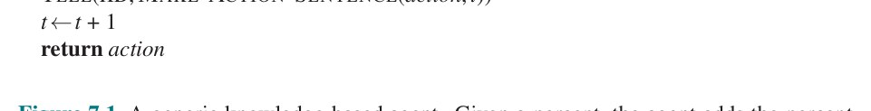
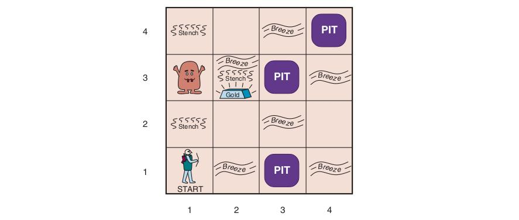
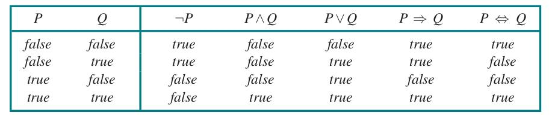
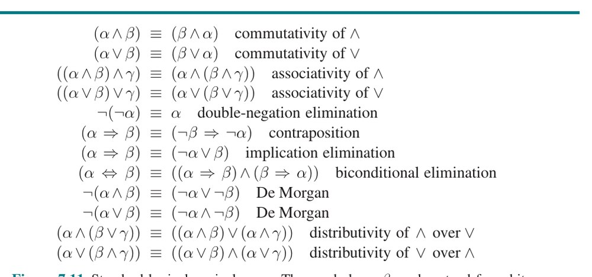
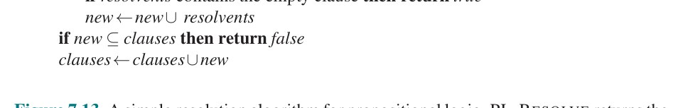
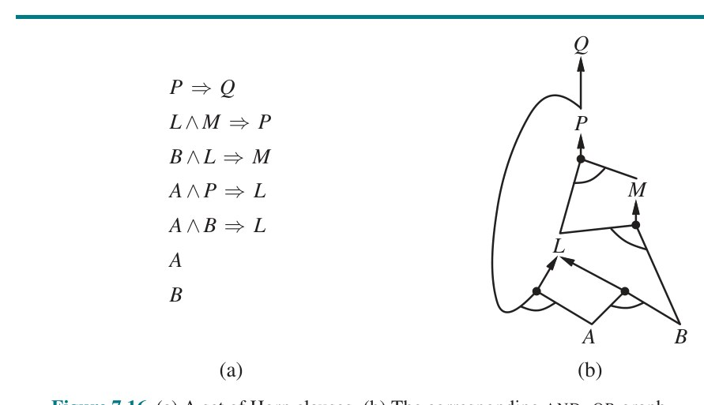
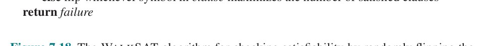
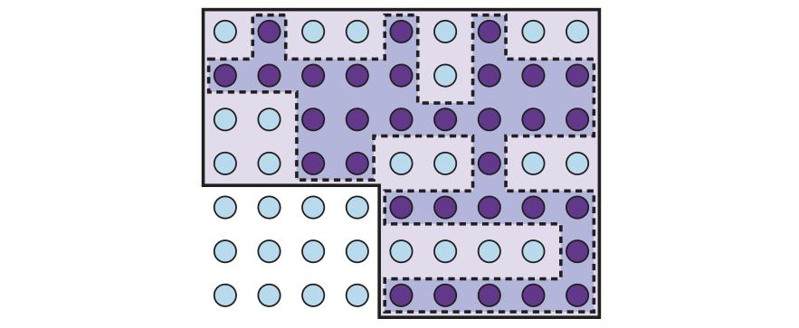

# فصل ۷ — عامل‌های منطقی

**فصل ۷: عامل‌های منطقی (Logical Agents)**

*در این فصل عامل‌هایی طراحی می‌کنیم که می‌توانند بازنمایی‌هایی از یک جهان پیچیده بسازند، از فرایند استنتاج برای استخراج بازنمایی‌های تازه دربارهٔ جهان استفاده کنند و از این بازنمایی‌های تازه برای استنتاج اینکه چه باید بکنند بهره بگیرند.*

به نظر می‌رسد انسان‌ها چیزهایی می‌دانند؛ و آنچه می‌دانند به آن‌ها در انجام کارها کمک می‌کند. در هوش مصنوعی، عامل‌های مبتنی بر دانش (Knowledge-Based Agents) از فرایند استدلال (Reasoning) روی بازنمایی درونی دانش برای تصمیم‌گیری دربارهٔ کنش‌هایی که باید انجام دهند استفاده می‌کنند.

عامل‌های حل‌کنندهٔ مسئلهٔ فصل‌های ۳ و ۴ چیزهایی می‌دانند، اما فقط به معنایی بسیار محدود و انعطاف‌ناپذیر. آن‌ها می‌دانند چه کنش‌هایی در دسترس است و نتیجهٔ انجام کنش خاصی از حالت خاصی چه خواهد بود، اما واقعیت‌های عمومی را نمی‌دانند. عامل مسیریاب نمی‌داند ممکن نیست جاده‌ای طولش تعداد منفی کیلومتر باشد. عامل معمای ۸ نمی‌داند دو کاشی نمی‌توانند یک فضا را اشغال کنند. دانشی که دارند برای یافتن مسیری از آغاز تا هدف بسیار مفید است، اما برای هیچ چیز دیگر.

بازنمایی‌های اتمیِ به‌کاررفته توسط عامل‌های حل‌کنندهٔ مسئله نیز بسیار محدودکننده‌اند. در محیط تا حدی قابل مشاهده، برای نمونه، تنها انتخاب عامل حل‌کنندهٔ مسئله برای بازنمایی آنچه دربارهٔ حالت کنونی می‌داند، فهرست‌کردن همهٔ حالت‌های عینی ممکن است. می‌توانم به انسانی هدفِ رانندگی به شهری در آمریکا با جمعیت کمتر از ۱۰٬۰۰۰ بدهم، اما برای گفتن آن به عامل حل‌کنندهٔ مسئله، فقط می‌توانم هدف را به‌صورت صوری به‌عنوان مجموعهٔ صریحی از حدود ۱۶٬۰۰۰ شهری که توصیف را برآورده می‌کنند توصیف کنم.

فصل ۶ نخستین بازنمایی عاملی ما را معرفی کرد، که در آن حالت‌ها به‌صورت تخصیص مقادیر به متغیرها بازنمایی می‌شوند؛ این گامی در جهت درست است، بخش‌هایی از عامل را قادر می‌کند به‌صورت مستقل از حوزه کار کنند و الگوریتم‌های کارآمدتری را ممکن می‌کند. در این فصل، این گام را به نتیجهٔ منطقی‌اش می‌بریم — منطق را به‌عنوان رده‌ای عمومی از بازنمایی‌ها برای پشتیبانی از عامل‌های مبتنی بر دانش توسعه می‌دهیم. این عامل‌ها می‌توانند اطلاعات را برای اهداف بی‌شمار ترکیب و بازترکیب کنند. این می‌تواند بسیار دور از نیازهای لحظه باشد — مانند زمانی که ریاضی‌دانی قضیه‌ای را اثبات می‌کند یا اخترشناسی امید به حیات زمین را محاسبه می‌کند. عامل‌های مبتنی بر دانش می‌توانند تکلیف‌های تازه را در قالب هدف‌های صریحاً توصیف‌شده بپذیرند؛ می‌توانند با گفته‌شدن یا یادگیری دانش تازه دربارهٔ محیط به‌سرعت به شایستگی برسند؛ و می‌توانند با به‌روزرسانی دانش مرتبط با تغییرات محیط سازگار شوند.

در بخش 7.1 با طراحی کلی عامل آغاز می‌کنیم. بخش 7.2 محیط سادهٔ تازه‌ای به نام «جهان وومپوس» معرفی می‌کند و عملکرد عامل مبتنی بر دانش را بدون ورود به جزئیات فنی نشان می‌دهد. سپس اصول عمومی منطق را در بخش 7.3 و مشخصات منطق گزاره‌ای را در بخش 7.4 توضیح می‌دهیم. منطق گزاره‌ای بازنمایی عاملی است؛ هرچند از منطق مرتبهٔ اول (فصل ۸) که بازنمایی ساختاریافتهٔ شاخص است کم‌بیان‌تر است، منطق گزاره‌ای همهٔ مفاهیم پایهٔ منطق را نشان می‌دهد. همچنین با فناوری‌های استنتاجی خوب‌توسعه‌یافته‌ای همراه است که در بخش‌های 7.5 و 7.6 توصیف می‌کنیم. سرانجام، بخش 7.7 مفهوم عامل‌های مبتنی بر دانش را با فناوری منطق گزاره‌ای ترکیب می‌کند تا عامل‌های ساده‌ای برای جهان وومپوس بسازد.

## 7.1 عامل‌های مبتنی بر دانش

مؤلفهٔ مرکزی عامل مبتنی بر دانش، «پایگاه دانش» (Knowledge Base) یا KB آن است. پایگاه دانش مجموعه‌ای از «جمله»ها (Sentences) است. (در این‌جا «جمله» اصطلاحی فنی است. با جمله‌های انگلیسی و دیگر زبان‌های طبیعی مرتبط است اما یکسان نیست.) هر جمله به زبانی به نام «زبان بازنمایی دانش» (Knowledge Representation Language) بیان می‌شود و ادعایی (Assertion) دربارهٔ جهان را بازنمایی می‌کند. وقتی جمله را داده‌شده بدانیم بدون آنکه از جمله‌های دیگر مشتق شده باشد، آن را «اصل‌موضوعه» (Axiom) می‌نامیم.

باید راهی برای افزودن جمله‌های تازه به پایگاه دانش و راهی برای پرس‌وجو از آنچه شناخته شده باشد. نام‌های استاندارد این عملیات به‌ترتیب TELL و ASK است. هر دو عملیات ممکن است شامل استنتاج (Inference) باشند — یعنی مشتق‌کردن جمله‌های تازه از جمله‌های قدیمی. استنتاج باید این الزام را رعایت کند که وقتی از پایگاه دانش پرسشی ASK می‌شود، پاسخ باید از آنچه قبلاً به پایگاه دانش TELL شده «برآید». بعداً در این فصل دربارهٔ واژهٔ حیاتی «برآمدن» دقیق‌تر خواهیم بود. فعلاً آن را به این معنا بگیرید که فرایند استنتاج نباید هنگام پیش‌رفتن چیزهایی از خودش بسازد.

شکل 7.1 نمای کلی برنامهٔ عامل مبتنی بر دانش را نشان می‌دهد. مانند همهٔ عامل‌های ما، ادراک حسی را به‌عنوان ورودی می‌گیرد و کنشی بازمی‌گرداند. عامل پایگاه دانشی به نام KB نگه می‌دارد که در آغاز ممکن است مقداری «دانش زمینه‌ای» (Background Knowledge) داشته باشد.



**شکل 7.1 — عامل مبتنی بر دانش عمومی.** با دریافت ادراک حسی، عامل ادراک را به پایگاه دانشش می‌افزاید، از پایگاه دانش بهترین کنش را می‌پرسد و به پایگاه دانش می‌گوید که در واقع آن کنش را انجام داده.

```
function KB-AGENT(percept) returns an action
  persistent: KB، یک پایگاه دانش
              t، یک شمارنده، در آغاز 0، نشان‌دهندهٔ زمان
  TELL(KB, MAKE-PERCEPT-SENTENCE(percept, t))
  action ← ASK(KB, MAKE-ACTION-QUERY(t))
  TELL(KB, MAKE-ACTION-SENTENCE(action, t))
  t ← t + 1
  return action
```

هر بار که برنامهٔ عامل فراخوانی می‌شود، سه کار می‌کند. نخست، آنچه را ادراک می‌کند به پایگاه دانش TELL می‌کند. دوم، از پایگاه دانش ASK می‌کند چه کنشی باید انجام دهد. در فرایند پاسخ به این پرس‌وجو، ممکن است استدلال گسترده‌ای دربارهٔ حالت کنونی جهان، دربارهٔ پیامدهای توالی‌های کنشِ ممکن، و مانند آن انجام شود. سوم، برنامهٔ عامل به پایگاه دانش می‌گوید کدام کنش برگزیده شده و کنش را بازمی‌گرداند تا اجرا شود.

جزئیات زبان بازنمایی درون سه تابع پنهان است که واسط میان حسگرها و عملگرها از یک سو و سامانهٔ مرکزی بازنمایی و استدلال از سوی دیگر را پیاده می‌کنند. MAKE-PERCEPT-SENTENCE جمله‌ای می‌سازد که ادعا می‌کند عامل ادراکِ داده‌شده را در زمانِ داده‌شده ادراک کرده. MAKE-ACTION-QUERY جمله‌ای می‌سازد که می‌پرسد در زمان کنونی چه کنشی باید انجام شود. سرانجام، MAKE-ACTION-SENTENCE جمله‌ای می‌سازد که ادعا می‌کند کنشِ برگزیده‌شده اجرا شده. جزئیات سازوکارهای استنتاج درون TELL و ASK پنهان است. بخش‌های بعدی این جزئیات را آشکار خواهند کرد.

عامل شکل 7.1 به عامل‌های با حالت درونیِ توصیف‌شده در فصل ۲ کاملاً شبیه می‌نماید. اما به‌سبب تعریف‌های TELL و ASK، عامل مبتنی بر دانش برنامهٔ دلخواهی برای محاسبهٔ کنش‌ها نیست. این عامل با توصیف در «سطح دانش» (Knowledge Level) سازگار است، جایی که برای تعیین رفتارش فقط باید مشخص کنیم عامل چه می‌داند و هدف‌هایش چیست.

برای نمونه، تاکسی خودکار ممکن است هدف بردن مسافری از سانفرانسیسکو به شهرستان مارین را داشته باشد و بداند پل گلدن گیت تنها پیوند میان دو مکان است. آنگاه می‌توانیم انتظار داشته باشیم از پل گلدن گیت بگذرد، زیرا می‌داند آن کار هدفش را محقق می‌کند. توجه کنید این تحلیل مستقل از نحوهٔ کار تاکسی در «سطح پیاده‌سازی» (Implementation Level) است. فرقی نمی‌کند دانش جغرافیایی‌اش با فهرست‌های پیوندی پیاده شود یا نقشه‌های پیکسلی، یا با دست‌کاری رشته‌های نمادِ ذخیره‌شده در ثبات‌ها استدلال کند یا با انتشار سیگنال‌های پرسروصدا در شبکه‌ای از نورون‌ها.

عامل مبتنی بر دانش را می‌توان به‌سادگی با TELL کردن آنچه باید بداند ساخت. با شروع از پایگاه دانش خالی، طراح عامل می‌تواند جمله‌ها را یکی‌یکی TELL کند تا عامل بداند چگونه در محیطش عمل کند. این «رویکرد اعلانی» (Declarative Approach) به ساخت سامانه نامیده می‌شود. در برابر، «رویکرد رویه‌ای» (Procedural Approach) رفتارهای مطلوب را مستقیماً به‌صورت کد برنامه رمزگذاری می‌کند. در دهه‌های ۱۹۷۰ و ۱۹۸۰، طرفداران دو رویکرد بحث‌های داغی کردند. اکنون می‌دانیم عامل موفق اغلب عناصر اعلانی و رویه‌ای را در طراحی‌اش ترکیب می‌کند و دانش اعلانی را اغلب می‌توان به کد رویه‌ای کارآمدتری ترجمه (Compile) کرد.

همچنین می‌توانیم به عامل مبتنی بر دانش سازوکارهایی بدهیم که به آن امکان می‌دهد خودش یاد بگیرد. این سازوکارها، که در فصل ۱۹ بحث می‌شوند، از سلسله‌ای ادراک حسی، دانش عمومی دربارهٔ محیط ایجاد می‌کنند. عامل یادگیرنده می‌تواند کاملاً خودمختار باشد.

## 7.2 جهان وومپوس

در این بخش محیطی را توصیف می‌کنیم که عامل‌های مبتنی بر دانش می‌توانند ارزششان را نشان دهند. «جهان وومپوس» (Wumpus World) غاری است شامل اتاق‌هایی که با راهروها به هم متصل‌اند. جایی در غار وومپوسِ وحشتناک کمین کرده؛ جانوری که هر کسی را که وارد اتاقش شود می‌خورد. وومپوس را می‌توان با تیر زد، اما عامل فقط یک تیر دارد. برخی اتاق‌ها گودال‌های بی‌پایان دارند که هر کسی را که به آن اتاق‌ها سرگردان شود به دام می‌اندازند (به‌جز وومپوس که برای افتادن زیادی بزرگ است). تنها ویژگی جبران‌کنندهٔ این محیط تاریک، امکان یافتن توده‌ای طلاست. هرچند جهان وومپوس با معیارهای بازی‌های رایانه‌ای مدرن نسبتاً بی‌آزار است، نکته‌های مهمی دربارهٔ هوش نشان می‌دهد.

نمونه‌ای از جهان وومپوس در شکل 7.2 نشان داده شده. تعریف دقیق محیط تکلیف، چنان‌که در بخش 2.3 پیشنهاد شد، با توصیف PEAS داده می‌شود:

- **معیار عملکرد:** ۱۰۰۰+ برای بیرون‌آمدن از غار با طلا، ۱۰۰۰− برای افتادن در گودال یا خورده‌شدن توسط وومپوس، ۱− برای هر کنش انجام‌شده، و ۱۰− برای مصرف تیر. بازی یا وقتی عامل می‌میرد پایان می‌یابد یا وقتی عامل از غار بیرون می‌آید.



**شکل 7.2 — جهان وومپوس نمونه.** عامل در گوشهٔ پایین-چپ، رو به شرق (راست) است. (نمادها: PIT = گودال، Stench = بوی گند، Breeze = نسیم، Gold = طلا، START = آغاز)

- **محیط:** شبکهٔ 4×4 از اتاق‌ها، با دیوارهایی دور شبکه. عامل همیشه در خانهٔ [1,1] آغاز می‌کند، رو به شرق. مکان‌های طلا و وومپوس به‌صورت تصادفی، با توزیع یکنواخت، از میان خانه‌های غیر از خانهٔ آغاز برگزیده می‌شوند. افزون بر این، هر خانهٔ غیر از آغاز می‌تواند گودال باشد، با احتمال ۰٫۲.
- **عملگرها:** عامل می‌تواند Forward (به جلو)، TurnLeft با ۹۰ درجه یا TurnRight با ۹۰ درجه حرکت کند. اگر وارد خانه‌ای شود که گودال یا وومپوس زنده دارد، مرگی بد می‌میرد. (واردشدن به خانه‌ای با وومپوس مرده ایمن است، هرچند بدبو.) اگر عامل بخواهد به جلو حرکت کند و به دیوار بخورد، حرکت نمی‌کند. کنش Grab (برداشتن) برای برداشتن طلا اگر در همان خانهٔ عامل باشد استفاده می‌شود. کنش Shoot (تیراندازی) برای شلیک تیری در خط مستقیم در جهتی که عامل رو به آن است استفاده می‌شود. تیر ادامه می‌یابد تا آنکه یا به وومپوس بخورد (و او را بکشد) یا به دیوار بخورد. عامل فقط یک تیر دارد، پس فقط نخستین کنش Shoot اثری دارد. سرانجام، کنش Climb (بالارفتن) برای بیرون‌آمدن از غار استفاده می‌شود، اما فقط از خانهٔ [1,1].
- **حسگرها:** عامل پنج حسگر دارد که هر یک یک بیت اطلاعات می‌دهد:
  - در خانه‌های مستقیماً (نه مورب) مجاور وومپوس، عامل «بوی گند» (Stench) ادراک می‌کند.¹
  - در خانه‌های مستقیماً مجاور گودال، عامل «نسیم» (Breeze) ادراک می‌کند.
  - در خانه‌ای که طلاست، عامل «درخشش» (Glitter) ادراک می‌کند.
  - وقتی عامل به دیوار می‌خورد، «برخورد» (Bump) ادراک می‌کند.
  - وقتی وومپوس کشته می‌شود، «فریاد» (Scream) اندوهگینی برمی‌آورد که در هر جای غار قابل ادراک است.

ادراک‌ها به برنامهٔ عامل در قالب فهرستی از پنج نماد داده می‌شوند؛ برای نمونه، اگر بوی گند و نسیم هست اما درخشش، برخورد یا فریاد نیست، برنامهٔ عامل [Stench, Breeze, None, None, None] دریافت می‌کند.

می‌توانیم محیط وومپوس را در امتداد ابعاد گوناگون فصل ۲ مشخص کنیم. بدیهی است جبرگرایانه، گسسته، ایستا و تک‌عاملی است. (وومپوس حرکت نمی‌کند، خوشبختانه.) توالی‌دار است، زیرا پاداش‌ها ممکن است فقط پس از کنش‌های فراوان بیایند. تا حدی قابل مشاهده است، زیرا برخی جنبه‌های حالت مستقیماً قابل ادراک نیستند: مکان عامل، وضعیت سلامتی وومپوس و در دسترس‌بودن تیر. دربارهٔ مکان‌های گودال‌ها و وومپوس: می‌توانیم آن‌ها را بخش‌های مشاهده‌نشدهٔ حالت بدانیم — در آن صورت، مدل گذار محیط کاملاً شناخته‌شده است و یافتن مکان‌های گودال‌ها دانش عامل از حالت را کامل می‌کند. از سوی دیگر، می‌توانیم بگوییم خودِ مدل گذار ناشناخته است، زیرا عامل نمی‌داند کدام کنش‌های Forward کشنده‌اند — در آن صورت، کشف مکان‌های گودال‌ها و وومپوس دانش عامل از مدل گذار را کامل می‌کند.

برای عامل در محیط، چالش اصلی نادانی آغازین‌اش از پیکربندی محیط است؛ غلبه بر این نادانی به نظر می‌رسد به استدلال منطقی نیاز دارد. در بیشتر نمونه‌های جهان وومپوس، ممکن است عامل با خیال راحت طلا را به دست آورد. گاهی، عامل باید میان رفتن به خانه دست‌خالی و به خطر انداختن جان برای یافتن طلا یکی را برگزیند. حدود ۲۱٪ از محیط‌ها کاملاً ناعادلانه‌اند، زیرا طلا در گودالی است یا با گودال‌ها احاطه شده.

بگذارید عامل وومپوس مبتنی بر دانش را هنگام کاوش محیطِ نشان‌داده‌شده در شکل 7.2 تماشا کنیم. از زبان بازنمایی دانش غیررسمی استفاده می‌کنیم که شامل نوشتن نمادها در شبکه است (مانند شکل‌های 7.3 و 7.4).

پایگاه دانش آغازین عامل شامل قواعد محیط است، چنان‌که پیش‌تر توصیف شد؛ به‌ویژه، می‌داند در [1,1] است و [1,1] خانهٔ امنی است؛ آن را به‌ترتیب با «A» و «OK» در خانهٔ [1,1] نشان می‌دهیم.

نخستین ادراک [None,None,None,None,None] است که از آن عامل می‌تواند نتیجه بگیرد خانه‌های همسایه‌اش، [1,2] و [2,1]، عاری از خطرند — آن‌ها OK هستند. شکل 7.3(الف) وضعیت دانش عامل را در این نقطه نشان می‌دهد.

عامل محتاط فقط به خانه‌ای حرکت می‌کند که می‌داند OK است. فرض کنیم عامل تصمیم می‌گیرد به جلو به [2,1] حرکت کند. عامل در [2,1] نسیمی ادراک می‌کند (با «B» نشان داده شده)، پس باید گودالی در خانهٔ همسایه باشد. گودال نمی‌تواند در [1,1] باشد، طبق قواعد بازی، پس باید گودالی در [2,2] یا [3,1] یا هر دو باشد. نماد «P?» در شکل 7.3(ب) گودالِ ممکن را در آن خانه‌ها نشان می‌دهد. در این نقطه، فقط یک خانهٔ شناخته‌شده هست که OK است و هنوز بازدید نشده. پس عامل عاقل برمی‌گردد، به [1,1] بازمی‌گردد و سپس به [1,2] می‌رود.

عامل در [1,2] بوی گند ادراک می‌کند و به وضعیت دانشِ نشان‌داده‌شده در شکل 7.4(الف) می‌رسد. بوی گند در [1,2] بدان معناست که وومپوسی باید نزدیک باشد. اما وومپوس نمی‌تواند در [1,1] باشد، طبق قواعد بازی، و نمی‌تواند در [2,2] باشد (یا عامل وقتی در [2,1] بود بوی گند تشخیص می‌داد). پس عامل می‌تواند استنتاج کند وومپوس در [1,3] است. نماد W! این استنتاج را نشان می‌دهد. وانگهی، نبودِ نسیم در [1,2] دلالت دارد هیچ گودالی در [2,2] نیست. اما عامل قبلاً استنتاج کرده باید گودالی در [2,2] یا [3,1] باشد، پس این بدان معناست باید در [3,1] باشد. این استنتاج نسبتاً دشواری است، زیرا دانشِ به‌دست‌آمده در زمان‌های مختلف و مکان‌های مختلف را ترکیب می‌کند و برای یک گام حیاتی به نبودِ ادراک تکیه می‌کند.

عامل اکنون به خودش اثبات کرده در [2,2] نه گودالی هست نه وومپوسی، پس حرکت به آن‌جا OK است. وضعیت دانش عامل را در [2,2] نشان نمی‌دهیم؛ فقط فرض می‌کنیم عامل می‌چرخد و به [2,3] حرکت می‌کند و شکل 7.4(ب) را به ما می‌دهد. در [2,3]، عامل درخششی تشخیص می‌دهد، پس باید طلا را بردارد و سپس به خانه برگردد.

توجه کنید در هر موردی که عامل از اطلاعات در دسترس نتیجه‌ای می‌گیرد، اگر اطلاعات در دسترس درست باشند، آن نتیجه تضمین‌شده درست است. این ویژگی بنیادین استدلال منطقی است. در بقیهٔ این فصل توصیف می‌کنیم چگونه عامل‌های منطقی بسازیم که بتوانند اطلاعات را بازنمایی کنند و نتیجه‌هایی مانند آنچه در بندهای پیشین توصیف شد بگیرند.

![**شکل 7.3 — نخستین گام برداشته‌شده توسط عامل در جهان وومپوس.** (الف) وضعیت آغازین، پس از ادراک [None,None,None,None,None]. (ب) پس از حرکت به [2,1] و ادراک [None,Breeze,None,None,None]. (نمادها: OK = خانهٔ امن، V = بازدیدشده، B = نسیم، P? = گودال احتمالی، A = عامل)](../figures/ch07/fig-7-3.jpg)

**شکل 7.3 — نخستین گام برداشته‌شده توسط عامل در جهان وومپوس.** (الف) وضعیت آغازین، پس از ادراک [None,None,None,None,None]. (ب) پس از حرکت به [2,1] و ادراک [None,Breeze,None,None,None]. (نمادها: OK = خانهٔ امن، V = بازدیدشده، B = نسیم، P? = گودال احتمالی، A = عامل)

![**شکل 7.4 — دو مرحلهٔ بعدی در پیشرفت عامل.** (الف) پس از حرکت به [1,1] و سپس [1,2]، و ادراک [Stench,None,None,None,None]. (ب) پس از حرکت به [2,2] و سپس [2,3]، و ادراک [Stench,Breeze,Glitter,None,None]. (نمادها: S = بوی گند، W! = وومپوس استنتاج‌شده، G = درخشش/طلا، P! = گودال استنتاج‌شده)](../figures/ch07/fig-7-4.jpg)

**شکل 7.4 — دو مرحلهٔ بعدی در پیشرفت عامل.** (الف) پس از حرکت به [1,1] و سپس [1,2]، و ادراک [Stench,None,None,None,None]. (ب) پس از حرکت به [2,2] و سپس [2,3]، و ادراک [Stench,Breeze,Glitter,None,None]. (نمادها: S = بوی گند، W! = وومپوس استنتاج‌شده، G = درخشش/طلا، P! = گودال استنتاج‌شده)

## 7.3 منطق

این بخش مفاهیم بنیادین بازنمایی و استدلال منطقی را خلاصه می‌کند. این ایده‌های زیبا مستقل از شکل‌های خاص منطق‌اند. پس جزئیات فنی آن شکل‌ها را به بخش بعد موکول می‌کنیم و در عوض از مثال آشناي حساب معمولی استفاده می‌کنیم.

در بخش 7.1 گفتیم پایگاه‌های دانش از جمله‌ها تشکیل شده‌اند. این جمله‌ها بر اساس «نحو» (Syntax) زبان بازنمایی بیان می‌شوند که همهٔ جمله‌های خوش‌ساخت را مشخص می‌کند. مفهوم نحو در حساب معمولی به اندازهٔ کافی روشن است: «x+y = 4» جملهٔ خوش‌ساختی است، حال آنکه «x4y+ =» نیست.

منطق همچنین باید «معناشناسی» (Semantics) یا معنای جمله‌ها را تعریف کند. معناشناسی «صدق» (Truth) هر جمله را نسبت به هر «جهان ممکن» (Possible World) تعریف می‌کند. برای نمونه، معناشناسی حساب مشخص می‌کند جملهٔ «x+y=4» در جهانی که x برابر ۲ و y برابر ۲ است صادق است، اما در جهانی که x برابر ۱ و y برابر ۱ است کاذب. در منطق‌های استاندارد، هر جمله باید در هر جهان ممکن یا صادق باشد یا کاذب — هیچ «وسطی» نیست.²

وقتی دقیق باشیم، به‌جای «جهان ممکن» از اصطلاح «مدل» (Model) استفاده می‌کنیم. در حالی که جهان‌های ممکن را می‌توان محیط‌های واقعی (بالقوه) دانست که عامل ممکن است در آن‌ها باشد یا نباشد، مدل‌ها انتزاع‌های ریاضی‌اند که هر یک برای هر جملهٔ مرتبط مقدار صدق ثابتی (صادق یا کاذب) دارند. به‌صورت غیررسمی، می‌توانیم جهان ممکن را مثلاً دارای x مرد و y زنِ نشسته‌برسر میزی که بریج بازی می‌کنند بدانیم، و جملهٔ x + y = 4 وقتی چهار نفر در مجموع هستند صادق است. به‌صورت صوری، مدل‌های ممکن فقط همهٔ تخصیص‌های ممکن اعداد صحیح نامنفی به متغیرهای x و y هستند. هر چنین تخصیصی صدق هر جملهٔ حسابی را که متغیرهایش x و y هستند تعیین می‌کند. اگر جملهٔ α در مدل m صادق باشد، می‌گوییم m «α را ارضا می‌کند» (Satisfaction) یا گاهی m مدلی از α است. از نماد M(α) برای مجموعهٔ همهٔ مدل‌های α استفاده می‌کنیم.

حال که مفهوم صدق را داریم، آماده‌ایم دربارهٔ استدلال منطقی صحبت کنیم. این شامل رابطهٔ «لازمهٔ منطقی» (Entailment) میان جمله‌هاست — این ایده که جمله‌ای به‌صورت منطقی از جمله‌ای دیگر برمی‌آید. در نماد ریاضی می‌نویسیم:

α ⊨ β

به این معنا که جملهٔ α مستلزم جملهٔ β است. تعریف صوری لازمه چنین است: α ⊨ β اگر و فقط اگر در هر مدلی که α در آن صادق است، β نیز صادق باشد. با نمادی که تازه معرفی کردیم می‌توانیم بنویسیم:

α ⊨ β اگر و فقط اگر M(α) ⊆ M(β)

(به جهت ⊆ توجه کنید: اگر α ⊨ β، آنگاه α ادعایی قوی‌تر از β است: جهان‌های ممکن بیشتری را کنار می‌گذارد.) رابطهٔ لازمه از حساب آشناست؛ با این ایده راحتیم که جملهٔ x = 0 مستلزم جملهٔ xy = 0 است. بدیهی است در هر مدلی که x صفر است، xy صفر است (صرف‌نظر از مقدار y).

می‌توانیم همان نوع تحلیل را بر مثال استدلال جهان وومپوسِ بخش پیشین اعمال کنیم. وضعیت شکل 7.3(ب) را در نظر بگیرید: عامل در [1,1] هیچ‌چیز و در [2,1] نسیم تشخیص داده. این ادراک‌ها، همراه با دانش عامل از قواعد جهان وومپوس، KB را تشکیل می‌دهند. عامل علاقه‌مند است آیا خانه‌های مجاور [1,2]، [2,2] و [3,1] گودال دارند یا نه. هر یک از سه خانه ممکن است گودال داشته باشد یا نه، پس (فعلاً با نادیده‌گرفتن دیگر جنبه‌های جهان) 2³ = ۸ مدل ممکن هست. این هشت مدل در شکل 7.5 نشان داده شده.³

![**شکل 7.5 — مدل‌های ممکن برای حضور گودال‌ها در خانه‌های [1,2]، [2,2] و [3,1].** KB متناظر با مشاهده‌های «هیچ‌چیز در [1,1]» و «نسیم در [2,1]» با خط توپر نشان داده شده. (الف) خط نقطه‌چین مدل‌های α1 (هیچ گودالی در [1,2]) را نشان می‌دهد. (ب) خط نقطه‌چین مدل‌های α2 (هیچ گودالی در [2,2]) را نشان می‌دهد.](../figures/ch07/fig-7-5.jpg)

**شکل 7.5 — مدل‌های ممکن برای حضور گودال‌ها در خانه‌های [1,2]، [2,2] و [3,1].** KB متناظر با مشاهده‌های «هیچ‌چیز در [1,1]» و «نسیم در [2,1]» با خط توپر نشان داده شده. (الف) خط نقطه‌چین مدل‌های α1 (هیچ گودالی در [1,2]) را نشان می‌دهد. (ب) خط نقطه‌چین مدل‌های α2 (هیچ گودالی در [2,2]) را نشان می‌دهد.

KB را می‌توان مجموعه‌ای از جمله‌ها یا جملهٔ تکی‌ای دانست که همهٔ جمله‌های فردی را ادعا می‌کند. KB در مدل‌هایی که با آنچه عامل می‌داند تناقض دارند کاذب است — برای نمونه، KB در هر مدلی که [1,2] گودال دارد کاذب است، زیرا در [1,1] نسیمی نیست. در واقع فقط سه مدل هست که KB در آن‌ها صادق است و این‌ها با خط توپر در شکل 7.5 محاصره شده‌اند. حال دو نتیجهٔ ممکن را در نظر بگیریم:

α1 = «در [1,2] گودالی نیست.»
α2 = «در [2,2] گودالی نیست.»

مدل‌های α1 و α2 را به‌ترتیب در شکل‌های 7.5(الف) و 7.5(ب) با خط نقطه‌چین محاصره کرده‌ایم. با بازرسی، موارد زیر را می‌بینیم:

در هر مدلی که KB در آن صادق است، α1 نیز صادق است.

از این رو، KB ⊨ α1: در [1,2] گودالی نیست. همچنین می‌بینیم:

در برخی مدل‌هایی که KB در آن‌ها صادق است، α2 کاذب است.

از این رو، KB مستلزم α2 نیست: عامل نمی‌تواند نتیجه بگیرد در [2,2] گودالی نیست. (و نه می‌تواند نتیجه بگیرد در [2,2] گودالی هست.)⁴

مثال پیشین نه فقط لازمه را نشان می‌دهد، بلکه نشان می‌دهد چگونه تعریف لازمه را می‌توان برای استخراج نتیجه‌ها — یعنی انجام «استنتاج منطقی» (Logical Inference) — اعمال کرد. الگوریتم استنتاجِ نشان‌داده‌شده در شکل 7.5 «بررسی مدل» (Model Checking) نامیده می‌شود، زیرا همهٔ مدل‌های ممکن را برمی‌شمارد تا بررسی کند α در همهٔ مدل‌هایی که KB در آن‌ها صادق است صادق است، یعنی M(KB) ⊆ M(α).

در فهم لازمه و استنتاج، کمک می‌کند مجموعهٔ همهٔ پیامدهای KB را کوه یونجه و α را سوزنی بدانیم. لازمه مانند بودنِ سوزن در کوه یونجه است؛ استنتاج مانند یافتن آن. این تمایز در نماد صوری تجسم یافته: اگر الگوریتم استنتاج i بتواند α را از KB مشتق کند، می‌نویسیم:

KB ⊢ᵢ α

که تلفظ می‌شود «α از KB توسط i مشتق شده» یا «i α را از KB مشتق می‌کند».

الگوریتم استنتاجی که فقط جمله‌های مستلزم را مشتق می‌کند «درست» (Sound) یا «حافظ صدق» (Truth-Preserving) نامیده می‌شود. درستی ویژگی بسیار مطلوبی است. رویهٔ استنتاج نادرست اساساً هنگام پیش‌رفتن چیزهایی از خودش می‌سازد — یافتن سوزن‌های ناموجود را اعلام می‌کند. به‌راحتی دیده می‌شود بررسی مدل، وقتی کاربردپذیر باشد،⁵ رویهٔ درستی است.

ویژگی «کامل بودن» (Completeness) نیز مطلوب است: الگوریتم استنتاج کامل است اگر بتواند هر جمله‌ای را که مستلزم است مشتق کند. برای کوه‌های یونجه واقعی، که در گستره متناهی‌اند، بدیهی می‌نماید بررسی نظام‌مند همیشه می‌تواند تصمیم بگیرد آیا سوزن در کوه یونجه هست یا نه. اما برای بسیاری از پایگاه‌های دانش، کوه یونجهٔ پیامدها نامتناهی است و کامل بودن مسئلهٔ مهمی می‌شود.⁶ خوشبختانه، رویه‌های استنتاج کاملی برای منطق‌هایی هست که به اندازهٔ کافی بیانی‌اند که بسیاری از پایگاه‌های دانش را مدیریت کنند.

فرایند استدلالی را توصیف کرده‌ایم که نتیجه‌هایش در هر جهانی که مقدمه‌ها در آن صادق‌اند تضمین‌شده صادق‌اند؛ به‌ویژه، اگر KB در جهان واقعی صادق باشد، هر جملهٔ α که از KB توسط رویهٔ استنتاج درست مشتق شود نیز در جهان واقعی صادق است. پس، در حالی که فرایند استنتاج روی «نحو» — پیکربندی‌های فیزیکی درونی مانند بیت‌های ثبات‌ها یا الگوهای برق‌های مغز — عمل می‌کند، این فرایند با رابطهٔ جهان واقعی متناظر است که بر اساس آن برخی جنبه‌های جهان واقعی به‌واسطهٔ صادق‌بودن جنبه‌های دیگر جهان واقعی صادق‌اند.⁷ این مطابقت میان جهان و بازنمایی در شکل 7.6 نشان داده شده.


**شکل 7.6 — جمله‌ها پیکربندی‌های فیزیکی عامل‌اند و استدلال فرایند ساختن پیکربندی‌های فیزیکی تازه از پیکربندی‌های قدیمی است. استدلال منطقی باید اطمینان دهد پیکربندی‌های تازه جنبه‌هایی از جهان را بازنمایی می‌کنند که واقعاً از جنبه‌هایی که پیکربندی‌های قدیمی بازنمایی می‌کنند برمی‌آیند.**

آخرین مسئله برای بررسی «زمینه‌سازی» (Grounding) است — پیوند میان فرایندهای استدلال منطقی و محیط واقعی که عامل در آن وجود دارد. به‌ویژه، چگونه می‌دانیم KB در جهان واقعی صادق است؟ (بالاخره KB فقط «نحو» درون سر عامل است.) این پرسش فلسفی‌ای است که کتاب‌های بسیار زیادی درباره‌اش نوشته شده. (فصل ۲۷ را ببینید.) پاسخ ساده آن است که حسگرهای عامل پیوند را ایجاد می‌کنند. برای نمونه، عامل جهان وومپوس ما حسگر بو دارد. برنامهٔ عامل هرگاه بویی هست جملهٔ مناسبی می‌سازد. سپس، هرگاه آن جمله در پایگاه دانش است، در جهان واقعی صادق است. پس معنا و صدق جمله‌های ادراکی با فرایندهای حس‌کردن و ساخت جمله‌ای که آن‌ها را تولید می‌کنند تعریف می‌شود. دربارهٔ بقیهٔ دانش عامل، مانند باورش به اینکه وومپوس‌ها بوی گند را در خانه‌های مجاور ایجاد می‌کنند، چه؟ این بازنمایی مستقیم یک ادراک تکی نیست، بلکه قاعده‌ای عمومی است — شاید از تجربهٔ ادراکی مشتق شده، اما با گزاره‌ای از آن تجربه یکسان نیست. قواعد عمومی مانند این توسط فرایند ساخت جمله‌ای به نام یادگیری تولید می‌شوند که موضوع بخش پنجم است. یادگیری خطاپذیر است. ممکن است چنین باشد که وومپوس‌ها بوی گند ایجاد می‌کنند به‌جز ۲۹ فوریه در سال‌های کبیسه، که روز حمام‌گرفتن آن‌هاست. پس KB ممکن است در جهان واقعی صادق نباشد، اما با رویه‌های یادگیری خوب، دلیلی برای خوش‌بینی هست.

## 7.4 منطق گزاره‌ای: منطقی بسیار ساده

اکنون منطق گزاره‌ای (Propositional Logic) را ارائه می‌کنیم. نحو آن (ساختار جمله‌ها) و معناشناسی‌اش (شیوهٔ تعیین صدق جمله‌ها) را توصیف می‌کنیم. از این‌ها، الگوریتم نحوی ساده‌ای برای استنتاج منطقی مشتق می‌کنیم که مفهوم معنایی لازمه را پیاده می‌کند. همه‌چیز، البته، در جهان وومپوس رخ می‌دهد.

### 7.4.1 نحو

نحو منطق گزاره‌ای جمله‌های مجاز را تعریف می‌کند. «جمله‌های اتمی» (Atomic Sentences) از یک «نماد گزاره» (Proposition Symbol) تکی تشکیل شده‌اند. هر چنین نمادی نشان‌دهندهٔ گزاره‌ای است که می‌تواند صادق یا کاذب باشد. از نمادهایی استفاده می‌کنیم که با حرف بزرگ آغاز می‌شوند و ممکن است حروف یا زیرنویس‌های دیگر داشته باشند؛ برای نمونه: P، Q، R، W1,3 و FacingEast. نام‌ها دلبخواهی‌اند اما اغلب طوری برگزیده می‌شوند که ارزش یادآورانه داشته باشند — از W1,3 برای گزارهٔ «وومپوس در [1,3] است» استفاده می‌کنیم. (به یاد آورید نمادهایی مانند W1,3 اتمی‌اند، یعنی W، 1 و 3 بخش‌های معنادار نماد نیستند.) دو نماد گزاره با معانی ثابت هست: True گزارهٔ همیشه‌صادق و False گزارهٔ همیشه‌کاذب است.

«جمله‌های پیچیده» (Complex Sentences) از جمله‌های ساده‌تر، با پرانتزها و عملگرهایی به نام «عوامل ربط منطقی» (Logical Connectives) ساخته می‌شوند. پنج عامل ربط رایج‌اند:

- **¬ (نقیض).** جمله‌ای مانند ¬W1,3 «نقیض» (Negation) W1,3 نامیده می‌شود. «لیتِرال» (Literal) یا جملهٔ اتمی است (لیتِرال مثبت) یا جملهٔ اتمیِ نقیض‌شده (لیتِرال منفی).
- **∧ (و).** جمله‌ای که عامل ربط اصلی‌اش ∧ است، مانند W1,3 ∧ P3,1، «عطف» (Conjunction) نامیده می‌شود؛ بخش‌هایش «عطف‌شونده»ها (Conjuncts) هستند. (∧ شبیه «A» برای «And» است.)
- **∨ (یا).** جمله‌ای که عامل ربط اصلی‌اش ∨ است، مانند (W1,3 ∧ P3,1) ∨ W2,2، «فصل» (Disjunction) است؛ بخش‌هایش «فصل‌شونده»ها (Disjuncts) هستند — در این مثال، (W1,3 ∧ P3,1) و W2,2.
- **⇒ (دلالت).** جمله‌ای مانند (W1,3 ∧ P3,1) ⇒ ¬W2,2 «دلالت» (Implication) (یا شرطی) نامیده می‌شود. «مقدم» (Premise) یا «سابق» (Antecedent) آن (W1,3 ∧ P3,1) است و «تالی» (Conclusion) یا «لاحق» (Consequent) آن ¬W2,2. دلالت‌ها همچنین به‌عنوان «قواعد» (Rules) یا گزاره‌های اگر-آنگاه شناخته می‌شوند. نماد دلالت گاهی در کتاب‌های دیگر ⊃ یا → نوشته می‌شود.
- **⇔ (اگر و فقط اگر).** جملهٔ W1,3 ⇔ ¬W2,2 «دوسویه» (Biconditional) است.


**شکل 7.7 — دستور زبان BNF (بکوس–نائور) جمله‌های منطق گزاره‌ای، همراه با تقدم عملگرها، از بالاترین به پایین‌ترین.** (نحو: جمله ← جملهٔ اتمی | جملهٔ پیچیده؛ جملهٔ اتمی ← True | False | P | Q | R | ...؛ جملهٔ پیچیده ← ( جمله ) | ¬ جمله | جمله ∧ جمله | جمله ∨ جمله | جمله ⇒ جمله | جمله ⇔ جمله؛ تقدم عملگرها: ¬, ∧, ∨, ⇒, ⇔)

شکل 7.7 دستور زبان صوری منطق گزاره‌ای را می‌دهد. (نماد BNF در صفحهٔ ۱۰۳۰ توضیح داده شده.) دستور زبان BNF با فهرست تقدم عملگرها تقویت شده تا ابهام هنگام استفاده از چند عملگر حذف شود. عملگر «نقیض» (¬) بالاترین تقدم را دارد، یعنی در جملهٔ ¬A ∧ B، ¬ محکم‌ترین چسبندگی را دارد و هم‌ارز (¬A) ∧ B را به ما می‌دهد نه ¬(A ∧ B). (نماد حساب معمولی هم همین است: −2+4 برابر ۲ است، نه ۶−.) هنگام مقتضی، از پرانتزها و کروشه‌ها نیز برای روشن‌کردن ساختار جملهٔ مورد نظر و بهبود خوانایی استفاده می‌کنیم.

### 7.4.2 معناشناسی

پس از مشخص‌کردن نحو منطق گزاره‌ای، اکنون معناشناسی‌اش را مشخص می‌کنیم. معناشناسی قواعد تعیین صدق جمله را نسبت به مدل خاصی تعریف می‌کند. در منطق گزاره‌ای، مدل صرفاً مقدار صدق — صادق یا کاذب — را برای هر نماد گزاره تنظیم می‌کند. برای نمونه، اگر جمله‌های پایگاه دانش از نمادهای گزاره‌ای P1,2، P2,2 و P3,1 استفاده کنند، یکی از مدل‌های ممکن است:

m1 = {P1,2 = false, P2,2 = false, P3,1 = true}

با سه نماد گزاره، 2³ = ۸ مدل ممکن هست — دقیقاً همان‌هایی که در شکل 7.5 تصویر شده‌اند. توجه کنید مدل‌ها اشیای صرفاً ریاضی‌اند و پیوند ضروری با جهان‌های وومپوس ندارند. P1,2 فقط نمادی است؛ ممکن است «در [1,2] گودالی هست» معنا دهد یا «من امروز و فردا در پاریس‌ام».

معناشناسی منطق گزاره‌ای باید مشخص کند چگونه مقدار صدق هر جمله را با توجه به مدلی محاسبه کنیم. این به‌صورت بازگشتی انجام می‌شود. همهٔ جمله‌ها از جمله‌های اتمی و پنج عامل ربط ساخته می‌شوند؛ پس باید مشخص کنیم چگونه صدق جمله‌های اتمی و چگونه صدق جمله‌های ساخته‌شده با هر یک از پنج عامل ربط را محاسبه کنیم. جمله‌های اتمی آسان‌اند:

- True در هر مدل صادق و False در هر مدل کاذب است.
- مقدار صدق هر نماد گزارهٔ دیگر باید مستقیماً در مدل مشخص شود. برای نمونه، در مدل m1 که پیش‌تر داده شد، P1,2 کاذب است.

برای جمله‌های پیچیده، پنج قاعده داریم که برای هر زیرجملهٔ P و Q (اتمی یا پیچیده) در هر مدل m برقرارند (در این‌جا «iff» یعنی «اگر و فقط اگر»):

- ¬P صادق است iff P در m کاذب است.
- P ∧ Q صادق است iff هر دو P و Q در m صادق‌اند.
- P ∨ Q صادق است iff یا P یا Q در m صادق است.
- P ⇒ Q صادق است مگر آنکه P در m صادق و Q کاذب باشد.
- P ⇔ Q صادق است iff P و Q هر دو صادق یا هر دو کاذب باشند در m.

قواعد را همچنین می‌توان با «جدول‌های صدق» (Truth Tables) بیان کرد که مقدار صدق جملهٔ پیچیده را برای هر تخصیص ممکن مقادیر صدق به مؤلفه‌هایش مشخص می‌کنند. جدول‌های صدق پنج عامل ربط در شکل 7.8 داده شده. از این جدول‌ها، مقدار صدق هر جملهٔ s را می‌توان نسبت به هر مدل m با ارزیابی بازگشتی ساده محاسبه کرد. برای نمونه، جملهٔ ¬P1,2 ∧ (P2,2 ∨ P3,1)، ارزیابی‌شده در m1، true ∧ (false ∨ true) = true ∧ true = true می‌دهد. تمرین 7.TRUV از شما می‌خواهد الگوریتم PL-TRUE?(s, m) را بنویسید که مقدار صدق جملهٔ منطق گزاره‌ای s را در مدل m محاسبه می‌کند.



**شکل 7.8 — جدول‌های صدق برای پنج عامل ربط منطقی.** برای استفاده از جدول برای محاسبهٔ مثلاً مقدار P ∨ Q وقتی P صادق و Q کاذب است، نخست در چپ به دنبال ردیفی بگردید که P صادق و Q کاذب است (ردیف سوم). سپس در آن ردیف زیر ستون P ∨ Q به نتیجه نگاه کنید: true.

| P | Q | ¬P | P∧Q | P∨Q | P⇒Q | P⇔Q |
|---|---|---|---|---|---|---|
| false | false | true | false | false | true | true |
| false | true | true | false | true | true | false |
| true | false | false | false | true | false | false |
| true | true | false | true | true | true | true |

جدول‌های صدق برای «و»، «یا» و «نقیض» با شهودهای ما دربارهٔ واژه‌های انگلیسی هم‌خوانی نزدیک دارند. نکتهٔ اصلی سردرگمی احتمالی آن است که P ∨ Q وقتی صادق است که P صادق باشد یا Q صادق یا هر دو. عامل ربط متفاوتی به نام «یا-انحصاری» («xor» به اختصار) هست که وقتی هر دو فصل‌شونده صادق‌اند کاذب می‌دهد.⁸ اجماعی بر نماد یا-انحصاری نیست؛ برخی انتخاب‌ها ˙∨ یا ≠ یا ⊕ است.

جدول صدق ⇒ ممکن است کاملاً با فهم شهودی «P دلالت بر Q دارد» یا «اگر P پس Q» هم‌خوان نباشد. برای یکی، منطق گزاره‌ای هیچ رابطهٔ علیت یا ارتباطی میان P و Q لازم نمی‌داند. جملهٔ «۵ فرد است دلالت بر این دارد که توکیو پایتخت ژاپن است» جملهٔ صادقی از منطق گزاره‌ای است (تحت تفسیر عادی)، حتی با آنکه جملهٔ انگلیسیِ قطعاً عجیبی است. نکتهٔ سردرگمی دیگر آن است که هر دلالتی وقتی سابقش کاذب است صادق است. برای نمونه، «۵ زوج است دلالت بر این دارد که سم باهوش است» صادق است، صرف‌نظر از اینکه سم باهوش باشد یا نه. این عجیب می‌نماید، اما اگر «P ⇒ Q» را چنین بیندیشید معنا می‌دهد: «اگر P صادق است، پس ادعا می‌کنم Q صادق است؛ وگرنه هیچ ادعایی نمی‌کنم.» تنها راه کاذب‌بودن این جمله آن است که P صادق اما Q کاذب باشد.

دوسویه، P ⇔ Q، هرگاه هر دو P ⇒ Q و Q ⇒ P صادق‌اند صادق است. در انگلیسی، این اغلب «P اگر و فقط اگر Q» نوشته می‌شود. بسیاری از قواعد جهان وومپوس بهتر است با ⇔ نوشته شوند. برای نمونه، خانه‌ای نسیم‌دار است اگر خانهٔ همسایه‌ای گودال داشته باشد، و خانه‌ای نسیم‌دار است فقط اگر خانهٔ همسایه‌ای گودال داشته باشد. پس به دوسویه نیاز داریم:

B1,1 ⇔ (P1,2 ∨ P2,1)

که B1,1 یعنی در [1,1] نسیمی هست.

### 7.4.3 پایگاه دانش ساده

حال که معناشناسی منطق گزاره‌ای را تعریف کرده‌ایم، می‌توانیم پایگاه دانشی برای جهان وومپوس بسازیم. نخست بر جنبه‌های تغییرناپذیر جهان وومپوس تمرکز می‌کنیم و جنبه‌های متغیر را به بخش بعد می‌گذاریم. فعلاً به نمادهای زیر برای هر مکان [x,y] نیاز داریم:

- Px,y صادق است اگر در [x,y] گودالی هست.
- Wx,y صادق است اگر در [x,y] وومپوسی هست، مرده یا زنده.
- Bx,y صادق است اگر در [x,y] نسیمی هست.
- Sx,y صادق است اگر در [x,y] بوی گندی هست.
- Lx,y صادق است اگر عامل در مکان [x,y] است.

جمله‌هایی که می‌نویسیم برای مشتق‌کردن ¬P1,2 (در [1,2] گودالی نیست)، چنان‌که در بخش 7.3 به‌صورت غیررسمی انجام شد، کافی خواهند بود. هر جمله را Ri برچسب می‌زنیم تا بتوانیم به آن‌ها ارجاع دهیم:

- در [1,1] گودالی نیست:
  R1: ¬P1,1
- خانه‌ای نسیم‌دار است اگر و فقط اگر در خانهٔ همسایه‌ای گودالی باشد. این باید برای هر خانه گفته شود؛ فعلاً فقط خانه‌های مرتبط را شامل می‌شویم:
  R2: B1,1 ⇔ (P1,2 ∨ P2,1)
  R3: B2,1 ⇔ (P1,1 ∨ P2,2 ∨ P3,1)
- جمله‌های پیشین در همهٔ جهان‌های وومپوس صادق‌اند. حال ادراک‌های نسیم را برای دو خانهٔ نخستِ بازدیدشده در جهانِ خاصی که عامل در آن است شامل می‌شویم، و به وضعیت شکل 7.3(ب) می‌رسیم.
  R4: ¬B1,1
  R5: B2,1

### 7.4.4 رویهٔ استنتاج ساده

هدف ما اکنون تصمیم‌گیری دربارهٔ اینکه آیا KB ⊨ α برای جملهٔ α است. برای نمونه، آیا ¬P1,2 از KB ما مستلزم است؟ نخستین الگوریتم استنتاج ما رویکرد بررسی-مدلی است که پیاده‌سازی مستقیم تعریف لازمه است: مدل‌ها را برشمار و بررسی کن α در هر مدلی که KB در آن صادق است صادق است. مدل‌ها تخصیص‌های صادق یا کاذب به هر نماد گزاره هستند. به مثال جهان وومپوس‌مان بازگردیم، نمادهای گزاره‌ای مرتبط عبارت‌اند از B1,1، B2,1، P1,1، P1,2، P2,1، P2,2 و P3,1. با هفت نماد، 2⁷ = ۱۲۸ مدل ممکن هست؛ در سه تای آن‌ها KB صادق است (شکل 7.9). در آن سه مدل، ¬P1,2 صادق است، پس در [1,2] گودالی نیست. از سوی دیگر، P2,2 در دو تا از سه مدل صادق و در یکی کاذب است، پس هنوز نمی‌توانیم بگوییم آیا در [2,2] گودالی هست.

![**شکل 7.9 — جدول صدقی که برای پایگاه دانشِ داده‌شده در متن ساخته شده.** KB صادق است اگر R1 تا R5 صادق باشند، که فقط در ۳ تا از ۱۲۸ ردیف رخ می‌دهد (آن‌هایی که در ستون راست زیرخط دارند). در هر ۳ ردیف، P1,2 کاذب است، پس در [1,2] گودالی نیست. از سوی دیگر، ممکن است در [2,2] گودالی باشد (یا نباشد).](../figures/ch07/fig-7-9.jpg)

**شکل 7.9 — جدول صدقی که برای پایگاه دانشِ داده‌شده در متن ساخته شده.** KB صادق است اگر R1 تا R5 صادق باشند، که فقط در ۳ تا از ۱۲۸ ردیف رخ می‌دهد (آن‌هایی که در ستون راست زیرخط دارند). در هر ۳ ردیف، P1,2 کاذب است، پس در [1,2] گودالی نیست. از سوی دیگر، ممکن است در [2,2] گودالی باشد (یا نباشد).

شکل 7.9 به شکل دقیق‌تری استدلالِ نشان‌داده‌شده در شکل 7.5 را بازتولید می‌کند. الگوریتم عمومی برای تصمیم‌گیری دربارهٔ لازمه در منطق گزاره‌ای در شکل 7.10 نشان داده شده. مانند الگوریتم BACKTRACKING-SEARCH در صفحهٔ ۱۹۲، TT-ENTAILS? شمارش بازگشتی فضای متناهی تخصیص‌ها به نمادها را انجام می‌دهد. الگوریتم درست است، زیرا مستقیماً تعریف لازمه را پیاده می‌کند، و کامل است، زیرا برای هر KB و α کار می‌کند و همیشه پایان می‌یابد — فقط مدل‌های متناهی برای بررسی هست.

البته «متناهی» همیشه همان «اندک» نیست. اگر KB و α در مجموع n نماد داشته باشند، 2ⁿ مدل هست. پس پیچیدگی زمانی الگوریتم O(2ⁿ) است. (پیچیدگی فضایی فقط O(n) است، زیرا شمارش عمق-اول است.) بعداً در این فصل الگوریتم‌هایی نشان می‌دهیم که در بسیاری از موارد بسیار کارآمدترند. متأسفانه، لازمهٔ گزاره‌ای هم‌NP-کامل است (یعنی احتمالاً آسان‌تر از NP-کامل نیست — پیوست الف را ببینید)، پس هر الگوریتم استنتاج شناخته‌شده برای منطق گزاره‌ای پیچیدگی بدترین حالتی ◮ دارد که در اندازهٔ ورودی نمایی است.


**شکل 7.10 — الگوریتم شمارش جدول-صدق برای تصمیم‌گیری دربارهٔ لازمهٔ گزاره‌ای.** (TT مخفف جدول صدق است.) PL-TRUE? true بازمی‌گرداند اگر جمله‌ای درون مدلی برقرار باشد. متغیر model مدل جزئی را بازنمایی می‌کند — تخصیصی به برخی از نمادها. کلیدواژهٔ and در این‌جا نماد تابع میانی در زبان شبه‌کد برنامه‌نویسی است، نه عملگری در منطق گزاره‌ای؛ دو آرگومان می‌گیرد و true یا false بازمی‌گرداند.

```
function TT-ENTAILS?(KB, α) returns true or false
  inputs: KB، پایگاه دانش، جمله‌ای در منطق گزاره‌ای
          α، پرس‌وجو، جمله‌ای در منطق گزاره‌ای
  symbols ← فهرستی از نمادهای گزاره‌ای در KB و α
  return TT-CHECK-ALL(KB, α, symbols, {})

function TT-CHECK-ALL(KB, α, symbols, model) returns true or false
  if EMPTY?(symbols) then
    if PL-TRUE?(KB, model) then return PL-TRUE?(α, model)
    else return true    // وقتی KB کاذب است، همیشه true بازگردان
  else
    P ← FIRST(symbols)
    rest ← REST(symbols)
    return (TT-CHECK-ALL(KB, α, rest, model ∪ {P = true})
            and
            TT-CHECK-ALL(KB, α, rest, model ∪ {P = false}))
```

## 7.5 اثبات قضیهٔ گزاره‌ای

تاکنون نشان داده‌ایم چگونه لازمه را با بررسی مدل تعیین کنیم: برشمردن مدل‌ها و نشان‌دادن اینکه جمله باید در همهٔ مدل‌ها برقرار باشد. در این بخش نشان می‌دهیم چگونه لازمه را با «اثبات قضیه» (Theorem Proving) انجام دهیم — اعمال قواعد استنتاج مستقیماً بر جمله‌های پایگاه دانش برای ساختن برهانی از جملهٔ مورد نظر بدون مراجعه به مدل‌ها. اگر شمار مدل‌ها زیاد اما طول برهان کوتاه باشد، اثبات قضیه می‌تواند از بررسی مدل کارآمدتر باشد.

پیش از شیرجه در جزئیات الگوریتم‌های اثبات قضیه، به چند مفهوم اضافی مرتبط با لازمه نیاز خواهیم داشت. نخستین مفهوم «هم‌ارزی منطقی» (Logical Equivalence) است: دو جملهٔ α و β هم‌ارز منطقی‌اند اگر در همان مجموعه مدل‌ها صادق باشند. این را α ≡ β می‌نویسیم. (توجه کنید ≡ برای ادعا دربارهٔ جمله‌ها استفاده می‌شود، در حالی که ⇔ به‌عنوان بخشی از جمله استفاده می‌شود.) برای نمونه، به‌راحتی می‌توانیم (با جدول‌های صدق) نشان دهیم P ∧ Q و Q ∧ P هم‌ارز منطقی‌اند؛ هم‌ارزی‌های دیگر در شکل 7.11 نشان داده شده. این هم‌ارزی‌ها در منطق همان نقشی را بازی می‌کنند که اتحادهای حسابی در ریاضیات معمولی. تعریف جایگزین هم‌ارزی چنین است: هر دو جملهٔ α و β هم‌ارزند اگر و فقط اگر هر یک مستلزم دیگری باشد:

α ≡ β اگر و فقط اگر α ⊨ β و β ⊨ α

دومین مفهومی که نیاز داریم «اعتبار» (Validity) است. جمله‌ای معتبر است اگر در همهٔ مدل‌ها صادق باشد. برای نمونه، جملهٔ P ∨ ¬P معتبر است. جمله‌های معتبر همچنین به‌عنوان «تاتولوژی» (Tautologies) شناخته می‌شوند — آن‌ها لزوماً صادق‌اند. چون جملهٔ True در همهٔ مدل‌ها صادق است، هر جملهٔ معتبری با True هم‌ارز منطقی است. جمله‌های معتبر به چه درد می‌خورند؟ از تعریف لازمه، می‌توانیم «قضیهٔ استنتاج» (Deduction Theorem) را مشتق کنیم که یونانیان باستان می‌شناختند: ◮ برای هر جملهٔ α و β، α ⊨ β اگر و فقط اگر جملهٔ (α ⇒ β) معتبر باشد. (تمرین 7.DEDU برهان می‌خواهد.) از این رو، می‌توانیم تصمیم بگیریم α ⊨ β با بررسی اینکه (α ⇒ β) در هر مدل صادق است — که اساساً همان کاری است که الگوریتم استنتاج شکل 7.10 می‌کند — یا با اثبات اینکه (α ⇒ β) با True هم‌ارز است. برعکس، قضیهٔ استنتاج بیان می‌کند هر جملهٔ دلالتیِ معتبر، استنتاجی مشروع را توصیف می‌کند.

آخرین مفهومی که نیاز داریم «ارضاپذیری» (Satisfiability) است. جمله‌ای ارضاپذیر است اگر در مدلی صادق باشد، یا توسط مدلی ارضا شود. برای نمونه، پایگاه دانشِ پیش‌ترداده‌شده، (R1 ∧ R2 ∧ R3 ∧ R4 ∧ R5)، ارضاپذیر است، زیرا سه مدل هست که در آن‌ها صادق است، چنان‌که در شکل 7.9. ارضاپذیری را می‌توان با برشمردن مدل‌های ممکن تا یافتن مدلی که جمله را ارضا می‌کند بررسی کرد. مسئلهٔ تعیین ارضاپذیری جمله‌های منطق گزاره‌ای — مسئلهٔ SAT — نخستین مسئله‌ای بود که NP-کامل اثبات شد. بسیاری از مسائل علوم رایانه واقعاً مسائل ارضاپذیری‌اند. برای نمونه، همهٔ مسئله‌های ارضای قیود فصل ۶ می‌پرسند آیا قیدها توسط تخصیصی ارضا می‌شوند.

اعتبار و ارضاپذیری البته به هم متصل‌اند: α معتبر است iff ¬α ارضاپذیر نیست؛ برعکس، α ارضاپذیر است iff ¬α معتبر نیست. همچنین نتیجهٔ مفید زیر را داریم: ◭

α ⊨ β اگر و فقط اگر جملهٔ (α ∧ ¬β) ارضاپذیر نباشد.

اثبات β از α با بررسی ارضاپذیرنبودن (α ∧ ¬β) دقیقاً با فن استاندارد اثبات ریاضیِ «برهان خلف» (Reductio ad Absurdum، لفظاً «تقلیل به امر محال») مطابقت دارد. همچنین «اثبات به‌وسیلهٔ ابطال» (Refutation) یا «اثبات به‌وسیلهٔ تناقض» (Contradiction) نامیده می‌شود. فرض می‌کنیم جملهٔ β کاذب است و نشان می‌دهیم این به تناقض با اصل‌های شناخته‌شدهٔ α می‌انجامد. این تناقض دقیقاً همان چیزی است که با گفتن اینکه جملهٔ (α ∧ ¬β) ارضاپذیر نیست مراد است.

### 7.5.1 استنتاج و برهان‌ها

این بخش قواعد استنتاجی را پوشش می‌دهد که می‌توان برای مشتق‌کردن «برهان» (Proof) اعمال کرد — زنجیره‌ای از نتیجه‌ها که به هدف مطلوب می‌انجامد. شناخته‌شده‌ترین قاعده «مُدوس پوننس» (Modus Ponens، لاتین برای «حالت تأییدکننده») نامیده می‌شود و چنین نوشته می‌شود:

```
α ⇒ β,   α
──────────
    β
```

نماد بدان معناست که هرگاه جمله‌هایی به شکل α ⇒ β و α داده شوند، آنگاه جملهٔ β قابل استنتاج است. برای نمونه، اگر (WumpusAhead ∧ WumpusAlive) ⇒ Shoot و (WumpusAhead ∧ WumpusAlive) داده شوند، آنگاه Shoot قابل استنتاج است.

قاعدهٔ استنتاج مفید دیگر «حذف-عطف» (And-Elimination) است که می‌گوید از یک عطف، هر یک از عطف‌شونده‌ها قابل استنتاج است:

```
α ∧ β
─────
  α
```

برای نمونه، از (WumpusAhead ∧ WumpusAlive)، WumpusAlive قابل استنتاج است.

با در نظر گرفتن مقادیر صدق ممکن α و β، به‌راحتی می‌توان یک‌بار برای همیشه نشان داد مدوس پوننس و حذف-عطف درست‌اند. این قواعد را سپس می‌توان در هر نمونهٔ خاصی که کاربردپذیرند استفاده کرد و استنتاج‌های درستی تولید کرد بدون نیاز به برشمردن مدل‌ها.

همهٔ هم‌ارزی‌های منطقی شکل 7.11 را می‌توان به‌عنوان قواعد استنتاج استفاده کرد. برای نمونه، هم‌ارزی برای حذف دوسویه دو قاعدهٔ استنتاج زیر را می‌دهد:

```
α ⇔ β                       (α ⇒ β) ∧ (β ⇒ α)
───────────────             ───────────────
(α ⇒ β) ∧ (β ⇒ α)                α ⇔ β
```

همهٔ قواعد استنتاج مثل این در هر دو جهت کار نمی‌کنند. برای نمونه، نمی‌توانیم مدوس پوننس را در جهت مخالف اجرا کنیم تا از β، α ⇒ β و α به دست آوریم.

بگذارید ببینیم این قواعد و هم‌ارزی‌های استنتاج چگونه در جهان وومپوس استفاده می‌شوند. با پایگاه دانشِ شامل R1 تا R5 آغاز می‌کنیم و نشان می‌دهیم چگونه ¬P1,2 را اثبات کنیم، یعنی در [1,2] گودالی نیست:

۱. حذف دوسویه را بر R2 اعمال کن تا به دست آید:
   R6: (B1,1 ⇒ (P1,2 ∨ P2,1)) ∧ ((P1,2 ∨ P2,1) ⇒ B1,1)
۲. حذف-عطف را بر R6 اعمال کن تا به دست آید:
   R7: ((P1,2 ∨ P2,1) ⇒ B1,1)
۳. هم‌ارزی منطقی برای عکس‌نقیض می‌دهد:
   R8: (¬B1,1 ⇒ ¬(P1,2 ∨ P2,1))
۴. مدوس پوننس را با R8 و ادراک R4 (یعنی ¬B1,1) اعمال کن تا به دست آید:
   R9: ¬(P1,2 ∨ P2,1)
۵. قاعدهٔ دمورگان را اعمال کن و نتیجه را بده:
   R10: ¬P1,2 ∧ ¬P2,1

یعنی نه [1,2] و نه [2,1] گودال دارد.

هر یک از الگوریتم‌های جستجوی فصل ۳ را می‌توان برای یافتن توالی گامی که برهانی مانند این می‌سازد استفاده کرد. فقط باید مسئلهٔ برهان را چنین تعریف کنیم:

- حالت آغازین: پایگاه دانش آغازین.
- کنش‌ها: مجموعهٔ کنش‌ها شامل همهٔ قواعد استنتاجِ اعمال‌شده بر همهٔ جمله‌هایی است که با نیمهٔ بالایی قاعدهٔ استنتاج همخوانی دارند.
- نتیجه: نتیجهٔ کنش، افزودن جملهٔ نیمهٔ پایینی قاعدهٔ استنتاج است.
- هدف: هدف حالتی است که شامل جمله‌ای است که می‌کوشیم اثبات کنیم.

پس جستجو برای برهان‌ها جایگزینی برای برشمردن مدل‌هاست. در بسیاری از موارد عملی، یافتن برهان می‌تواند کارآمدتر باشد، زیرا برهان می‌تواند گزاره‌های بی‌ربط را نادیده بگیرد، ◮ مهم نیست چقدر از آن‌ها باشد. برای نمونه، برهانِ تازه‌داده‌شده که به ¬P1,2 ∧ ¬P2,1 می‌انجامد به گزاره‌های B2,1، P1,1، P2,2 یا P3,1 اشاره نمی‌کند. آن‌ها را می‌توان نادیده گرفت، زیرا گزارهٔ هدف، P1,2، فقط در جملهٔ R2 ظاهر می‌شود؛ دیگر گزاره‌های R2 فقط در R4 و R2 ظاهر می‌شوند؛ پس R1، R3 و R5 هیچ ارتباطی با برهان ندارند. همین حتی اگر یک میلیون جملهٔ دیگر به پایگاه دانش اضافه می‌کردیم برقرار می‌بود؛ الگوریتم سادهٔ جدول-صدق اما توسط انفجار نمایی مدل‌ها مغلوب می‌شد.



**شکل 7.11 — هم‌ارزی‌های منطقی استاندارد.** نمادهای α، β و γ جمله‌های دلخواه منطق گزاره‌ای‌اند.

| هم‌ارزی | نام |
|---|---|
| (α∧β) ≡ (β∧α) | جابه‌جایی ∧ |
| (α∨β) ≡ (β∨α) | جابه‌جایی ∨ |
| ((α∧β)∧γ) ≡ (α∧(β∧γ)) | شرکت‌پذیری ∧ |
| ((α∨β)∨γ) ≡ (α∨(β∨γ)) | شرکت‌پذیری ∨ |
| ¬(¬α) ≡ α | حذف نقیض دوگانه |
| (α ⇒ β) ≡ (¬β ⇒ ¬α) | عکس‌نقیض |
| (α ⇒ β) ≡ (¬α ∨ β) | حذف دلالت |
| (α ⇔ β) ≡ ((α ⇒ β)∧(β ⇒ α)) | حذف دوسویه |
| ¬(α∧β) ≡ (¬α ∨ ¬β) | دمورگان |
| ¬(α∨β) ≡ (¬α ∧ ¬β) | دمورگان |
| (α∧(β ∨ γ)) ≡ ((α∧β) ∨ (α∧γ)) | توزیع‌پذیری ∧ بر ∨ |
| (α∨(β ∧ γ)) ≡ ((α∨β) ∧ (α∨γ)) | توزیع‌پذیری ∨ بر ∧ |

یکی از ویژگی‌های پایانی سامانه‌های منطقی «یکنواختی» (Monotonicity) است که می‌گوید مجموعهٔ جمله‌های مستلزم با افزودن اطلاعات به پایگاه دانش فقط می‌تواند افزایش یابد.⁹ برای هر جملهٔ α و β:

اگر KB ⊨ α آنگاه KB ∧ β ⊨ α

برای نمونه، فرض کنیم پایگاه دانش ادعای اضافی β را در بر دارد که می‌گوید دقیقاً هشت گودال در جهان هست. این دانش ممکن است به عامل در نتیجه‌گیری‌های اضافی کمک کند، اما نمی‌تواند نتیجهٔ αِ از‌پیش‌استنتاج‌شده را باطل کند — مانند نتیجهٔ اینکه در [1,2] گودالی نیست. یکنواختی بدان معناست قواعد استنتاج را می‌توان هرگاه مقدمه‌های مناسبی در پایگاه دانش یافت شد اعمال کرد — نتیجهٔ قاعده باید صرف‌نظر از آنچه دیگر در پایگاه دانش هست برآید.

### 7.5.2 برهان با حل

استدلال کرده‌ایم قواعد استنتاجِ تاکنون‌پوشش‌داده‌شده درست‌اند، اما دربارهٔ مسئلهٔ کامل بودن برای الگوریتم‌های استنتاجی که از آن‌ها استفاده می‌کنند بحث نکرده‌ایم. الگوریتم‌های جستجو مانند جستجوی تعمیق تکراری (صفحهٔ ۸۱) به این معنا کامل‌اند که هر هدف قابل دسترسی را خواهند یافت، اما اگر قواعد استنتاجِ در دسترس ناکافی باشند، هدف قابل دسترسی نیست — هیچ برهانی وجود ندارد که فقط از آن قواعد استنتاج استفاده کند. برای نمونه، اگر قاعدهٔ حذف دوسویه را حذف می‌کردیم، برهان بخش پیشین به نتیجه نمی‌رسید. بخش کنونی قاعدهٔ استنتاج تکی‌ای معرفی می‌کند، «حل» (Resolution)، که با هر الگوریتم جستجوی کاملی، الگوریتم استنتاج کاملی به دست می‌دهد.

با نسخهٔ ساده‌ای از قاعدهٔ حل در جهان وومپوس آغاز می‌کنیم. گام‌های منتهی به شکل 7.4(الف) را در نظر بگیرید: عامل از [2,1] به [1,1] بازمی‌گردد و سپس به [1,2] می‌رود، جایی که بوی گند ادراک می‌کند، اما نسیمی نه. واقعیت‌های زیر را به پایگاه دانش می‌افزاییم:

R11: ¬B1,2
R12: B1,2 ⇔ (P1,1 ∨ P2,2 ∨ P1,3)

با همان فرایندی که پیش‌تر به R10 انجامید، اکنون می‌توانیم نبود گودال‌ها در [2,2] و [1,3] را مشتق کنیم (به یاد آورید [1,1] از قبل بی‌گودال شناخته شده):

R13: ¬P2,2
R14: ¬P1,3

همچنین می‌توانیم حذف دوسویه را بر R3 اعمال کنیم، سپس مدوس پوننس با R5، تا این واقعیت را به دست آوریم که در [1,1]، [2,2] یا [3,1] گودالی هست:

R15: P1,1 ∨ P2,2 ∨ P3,1

حال نخستین کاربرد قاعدهٔ حل فرا می‌رسد: لیتِرال ¬P2,2 در R13 با لیتِرال P2,2 در R15 حل می‌شود و «حاصل‌حل» (Resolvent) را می‌دهد:

R16: P1,1 ∨ P3,1

به انگلیسی: اگر در یکی از [1,1]، [2,2] و [3,1] گودالی هست و در [2,2] نیست، پس در [1,1] یا [3,1] است. به همین ترتیب، لیتِرال ¬P1,1 در R1 با لیتِرال P1,1 در R16 حل می‌شود و می‌دهد:

R17: P3,1

به انگلیسی: اگر در [1,1] یا [3,1] گودالی هست و در [1,1] نیست، پس در [3,1] است. این دو گام استنتاج آخر نمونه‌هایی از قاعدهٔ استنتاج «حل واحد» (Unit Resolution) هستند:

```
ℓ1 ∨ ··· ∨ ℓk,   m
─────────────────────
ℓ1 ∨ ··· ∨ ℓi−1 ∨ ℓi+1 ∨ ··· ∨ ℓk
```

که هر ℓ لیتِرال است و ℓi و m «لیتِرال‌های مکمل» (Complementary Literals)‌اند (یعنی یکی نقیض دیگری است). پس قاعدهٔ حل واحد یک «بند» (Clause) — فصلی از لیتِرال‌ها — و یک لیتِرال می‌گیرد و بند تازه‌ای تولید می‌کند. توجه کنید لیتِرال تکی را می‌توان فصلی از یک لیتِرال دید، که «بند واحد» (Unit Clause) نیز نامیده می‌شود.

قاعدهٔ حل واحد را می‌توان به قاعدهٔ کامل «حل» (Resolution) تعمیم داد:

```
ℓ1 ∨ ··· ∨ ℓk,   m1 ∨ ··· ∨ mn
─────────────────────────────────────
ℓ1 ∨ ··· ∨ ℓi−1 ∨ ℓi+1 ∨ ··· ∨ ℓk ∨ m1 ∨ ··· ∨ mj−1 ∨ mj+1 ∨ ··· ∨ mn
```

که ℓi و mj لیتِرال‌های مکمل‌اند. این می‌گوید حل دو بند می‌گیرد و بند تازه‌ای تولید می‌کند شامل همهٔ لیتِرال‌های دو بند اصلی به‌جز دو لیتِرال مکمل. برای نمونه:

```
P1,1 ∨ P3,1,   ¬P1,1 ∨ ¬P2,2
─────────────────────────────
      P3,1 ∨ ¬P2,2
```

فقط می‌توانید یک جفت لیتِرال مکمل را در هر بار حل کنید. برای نمونه، می‌توانیم P و ¬P را حل کنیم تا استنتاج کنیم:

```
P ∨ ¬Q ∨ R,   ¬P ∨ Q
─────────────────────
    ¬Q ∨ Q ∨ R
```

اما نمی‌توانید هم‌زمان روی P و Q حل کنید تا R استنتاج شود. یک جنبهٔ فنی دیگر قاعدهٔ حل هست: بند حاصل باید فقط یک نسخه از هر لیتِرال داشته باشد.¹⁰ حذف نسخه‌های چندگانهٔ لیتِرال‌ها «عامل‌گیری» (Factoring) نامیده می‌شود. برای نمونه، اگر (A ∨ B) را با (A ∨ ¬B) حل کنیم، (A ∨ A) به دست می‌آید که با عامل‌گیری فقط به A کاهش می‌یابد.

درستی قاعدهٔ حل را می‌توان به‌راحتی با در نظر گرفتن لیتِرال ℓi که مکمل لیتِرال mj در بند دیگر است دید. اگر ℓi صادق باشد، mj کاذب است و از این رو m1 ∨ ... ∨ mj−1 ∨ mj+1 ∨ ... ∨ mn باید صادق باشد، زیرا m1 ∨ ... ∨ mn داده شده. اگر ℓi کاذب باشد، آنگاه ℓ1 ∨ ... ∨ ℓi−1 ∨ ℓi+1 ∨ ... ∨ ℓk باید صادق باشد، زیرا ℓ1 ∨ ... ∨ ℓk داده شده. حال ℓi یا صادق است یا کاذب، پس یکی یا دیگری از این نتیجه‌ها برقرار است — دقیقاً چنان‌که قاعدهٔ حل بیان می‌کند.

چیزی که دربارهٔ قاعدهٔ حل شگفت‌آورتر است آن است که پایهٔ خانواده‌ای از رویه‌های استنتاج کامل را تشکیل می‌دهد. اثبات‌کنندهٔ قضیهٔ مبتنی بر حل می‌تواند برای هر جملهٔ α و β در منطق گزاره‌ای تصمیم بگیرد آیا α ⊨ β. دو زیربخش بعد توضیح می‌دهند حل چگونه این کار را انجام می‌دهد.

**شکل صوری عادی عطفی (CNF).** قاعدهٔ حل فقط بر بندها (یعنی فصل‌های لیتِرال‌ها) اعمال می‌شود، پس به نظر می‌رسد فقط به پایگاه‌های دانش و پرس‌وجوهای متشکل از بندها مربوط باشد. پس چگونه می‌تواند به رویهٔ استنتاج کاملی برای کل منطق گزاره‌ای بینجامد؟ پاسخ آن است که هر ◮ جملهٔ منطق گزاره‌ای با عطفی از بندها هم‌ارز منطقی است.

جمله‌ای که به‌صورت عطفی از بندها بیان شده در «شکل صوری عادی عطفی» (Conjunctive Normal Form) یا CNF است (شکل 7.12 را ببینید). اکنون رویه‌ای برای تبدیل به CNF توصیف می‌کنیم. رویه را با تبدیل جملهٔ B1,1 ⇔ (P1,2 ∨ P2,1) به CNF نشان می‌دهیم. گام‌ها چنین‌اند:

۱. ⇔ را حذف کن، α ⇔ β را با (α ⇒ β) ∧ (β ⇒ α) جایگزین کن:
   (B1,1 ⇒ (P1,2 ∨ P2,1)) ∧ ((P1,2 ∨ P2,1) ⇒ B1,1)
۲. ⇒ را حذف کن، α ⇒ β را با ¬α ∨ β جایگزین کن:
   (¬B1,1 ∨ P1,2 ∨ P2,1) ∧ (¬(P1,2 ∨ P2,1) ∨ B1,1)
۳. CNF ایجاب می‌کند ¬ فقط در لیتِرال‌ها ظاهر شود، پس با اعمال مکرر هم‌ارزی‌های زیر از شکل 7.11 «¬ را به درون می‌بریم»:
   ¬(¬α) ≡ α (حذف نقیض دوگانه)
   ¬(α∧β) ≡ (¬α ∨ ¬β) (دمورگان)
   ¬(α∨β) ≡ (¬α ∧ ¬β) (دمورگان)
   در مثال، فقط به یک بار اعمال قاعدهٔ آخر نیاز داریم:
   (¬B1,1 ∨ P1,2 ∨ P2,1) ∧ ((¬P1,2 ∧ ¬P2,1) ∨ B1,1)
۴. حال جمله‌ای داریم شامل عملگرهای ∧ و ∨ تودرتو اعمال‌شده بر لیتِرال‌ها. قانون توزیع‌پذیری شکل 7.11 را اعمال می‌کنیم و هرجا ممکن است ∨ را بر ∧ توزیع می‌کنیم:
   (¬B1,1 ∨ P1,2 ∨ P2,1) ∧ (¬P1,2 ∨ B1,1) ∧ (¬P2,1 ∨ B1,1)

جملهٔ اصلی اکنون در CNF است، به‌صورت عطفی از سه بند. خواندنش بسیار دشوارتر است، اما می‌تواند به‌عنوان ورودی رویهٔ حل استفاده شود.


**شکل 7.12 — دستور زبان برای شکل عادی عطفی، بندهای هورن و بندهای معین.** بند CNF مانند ¬A ∨ ¬B ∨ C را می‌توان در شکل بند معین به‌صورت A ∧ B ⇒ C نوشت. (CNFSentence ← Clause1 ∧ ... ∧ Clausen؛ Clause ← Literal1 ∨ ... ∨ Literalm؛ Fact ← Symbol؛ Literal ← Symbol | ¬Symbol؛ Symbol ← P | Q | R | ...؛ HornClauseForm ← DefiniteClauseForm | GoalClauseForm؛ DefiniteClauseForm ← Fact | (Symbol1 ∧ ... ∧ Symboll) ⇒ Symbol؛ GoalClauseForm ← (Symbol1 ∧ ... ∧ Symboll) ⇒ False)

**الگوریتم حل.** رویه‌های استنتاج مبتنی بر حل با استفاده از اصل اثبات به‌وسیلهٔ تناقض که در صفحهٔ ۲۲۳ معرفی شد کار می‌کنند. یعنی برای نشان‌دادن KB ⊨ α، نشان می‌دهیم (KB ∧ ¬α) ارضاپذیر نیست. این کار را با اثبات تناقض انجام می‌دهیم.

الگوریتم حل در شکل 7.13 نشان داده شده. نخست، (KB ∧ ¬α) به CNF تبدیل می‌شود. سپس، قاعدهٔ حل بر بندهای حاصل اعمال می‌شود. هر جفتی که لیتِرال‌های مکمل دارد حل می‌شود تا بند تازه‌ای تولید شود که اگر از قبل حاضر نباشد به مجموعه افزوده می‌شود. فرایند ادامه می‌یابد تا یکی از دو اتفاق رخ دهد:

- بند تازه‌ای برای افزودن نیست، که در آن صورت KB مستلزم α نیست؛ یا،
- دو بند حل می‌شوند و بند خالی تولید می‌کنند، که در آن صورت KB مستلزم α است.



**شکل 7.13 — الگوریتم حل ساده برای منطق گزاره‌ای.** PL-RESOLVE مجموعهٔ همهٔ بندهای ممکنِ حاصل از حل دو ورودی‌اش را بازمی‌گرداند.

```
function PL-RESOLUTION(KB, α) returns true or false
  inputs: KB، پایگاه دانش، جمله‌ای در منطق گزاره‌ای
          α، پرس‌وجو، جمله‌ای در منطق گزاره‌ای
  clauses ← مجموعهٔ بندها در بازنمایی CNF از KB ∧ ¬α
  new ← {}
  while true do
    for each جفت بند Ci, Cj در clauses do
      resolvents ← PL-RESOLVE(Ci, Cj)
      if resolvents شامل بند خالی است then return true
      new ← new ∪ resolvents
    if new ⊆ clauses then return false
    clauses ← clauses ∪ new
```

بند خالی — فصلی از هیچ فصل‌شونده‌ای — با False هم‌ارز است، زیرا فصل فقط اگر دست‌کم یکی از فصل‌شونده‌هایش صادق باشد صادق است. وانگهی، بند خالی فقط از حل دو بند واحد متناقض مانند P و ¬P پدید می‌آید.

می‌توانیم رویهٔ حل را بر استنتاج بسیار ساده‌ای در جهان وومپوس اعمال کنیم. وقتی عامل در [1,1] است، نسیمی نیست، پس نمی‌تواند گودال‌هایی در خانه‌های همسایه باشد. پایگاه دانش مرتبط چنین است:

KB = R2 ∧ R4 = (B1,1 ⇔ (P1,2 ∨ P2,1)) ∧ ¬B1,1

و می‌خواهیم α را اثبات کنیم که مثلاً ¬P1,2 است. وقتی (KB ∧ ¬α) را به CNF تبدیل می‌کنیم، بندهای نشان‌داده‌شده در بالای شکل 7.14 را به دست می‌آوریم. ردیف دوم شکل بندهایی را نشان می‌دهد که با حل جفت‌های ردیف اول به دست آمده‌اند. سپس، وقتی P1,2 با ¬P1,2 حل می‌شود، بند خالی را به دست می‌آوریم که به‌صورت مربع کوچکی نشان داده شده. بازرسی شکل 7.14 آشکار می‌کند بسیاری از گام‌های حل بی‌فایده‌اند. برای نمونه، بند B1,1 ∨ ¬B1,1 ∨ P1,2 با True ∨ P1,2 هم‌ارز است که با True هم‌ارز است. استنتاج اینکه True صادق است چندان کمکی نمی‌کند. پس هر بندی که دو لیتِرال مکمل در آن ظاهر شوند را می‌توان دور ریخت.


**شکل 7.14 — کاربرد جزئی PL-RESOLUTION بر استنتاج ساده‌ای در جهان وومپوس برای اثبات پرس‌وجوی ¬P1,2.** هر یک از چهار بند چپ‌ترین ردیف بالا با هر یک از سه بند دیگر جفت می‌شود و قاعدهٔ حل برای تولید بندهای ردیف پایین اعمال می‌شود. می‌بینیم بندهای سوم و چهارم ردیف بالا ترکیب می‌شوند و بند ¬P1,2 را تولید می‌کنند که سپس با P1,2 حل می‌شود و بند خالی را تولید می‌کند، یعنی پرس‌وجو اثبات شده.

**کامل بودن حل.** برای پایان‌دادن بحث‌مان دربارهٔ حل، اکنون نشان می‌دهیم چرا PL-RESOLUTION کامل است. برای این کار، «بستار حل» (Resolution Closure) RC(S) مجموعه‌بندهای S را معرفی می‌کنیم که مجموعهٔ همهٔ بندهای قابل اشتقاق با اعمال مکرر قاعدهٔ حل بر بندهای S یا مشتق‌هایشان است. بستار حل همان چیزی است که PL-RESOLUTION به‌عنوان مقدار نهایی متغیر clauses محاسبه می‌کند. به‌راحتی دیده می‌شود RC(S) باید متناهی باشد: به لطف گام عامل‌گیری، فقط بندهای متمایزِ متناهی‌ای هست که می‌توان از نمادهای P1,...,Pk حاضر در S ساخت. از این رو، PL-RESOLUTION همیشه پایان می‌یابد.

قضیهٔ کامل بودن حل در منطق گزاره‌ای «قضیهٔ حل زمینی» (Ground Resolution Theorem) نامیده می‌شود:

اگر مجموعه‌بندی ارضاپذیر نباشد، آنگاه بستار حل آن بندها شامل بند خالی است.

این قضیه با نشان‌دادن عکس نقیضش اثبات می‌شود: اگر بستار RC(S) شامل بند خالی نباشد، آنگاه S ارضاپذیر است. در واقع، می‌توانیم مدلی برای S با مقادیر صدق مناسب برای P1,...,Pk بسازیم. رویهٔ ساخت چنین است:

برای i از ۱ تا k:
- اگر بندی در RC(S) شامل لیتِرال ¬Pi باشد و همهٔ لیتِرال‌های دیگرش تحت تخصیصِ برگزیده‌شده برای P1,...,Pi−1 کاذب باشند، آنگاه false را به Pi تخصیص بده.
- وگرنه، true را به Pi تخصیص بده.

این تخصیص به P1,...,Pk مدلی از S است. برای دیدن این، خلافش را فرض کنید — که در مرحله‌ای i از توالی، تخصیص نماد Pi باعث کاذب‌شدن بندی C می‌شود. برای وقوع این، باید چنین باشد که همهٔ لیتِرال‌های دیگر C از قبل توسط تخصیص‌های به P1,...,Pi−1 کاذب شده‌اند. پس C اکنون باید شبیه (false ∨ false ∨ ... ∨ false ∨ Pi) یا (false ∨ false ∨ ... ∨ false ∨ ¬Pi) باشد. اگر فقط یکی از این دو در RC(S) باشد، الگوریتم مقدار صدق مناسبی به Pi تخصیص می‌دهد تا C صادق شود، پس C فقط اگر هر دو بند در RC(S) باشند می‌تواند کاذب شود.

حال، چون RC(S) تحت حل بسته است، شامل حاصل‌حل این دو بند خواهد بود و آن حاصل‌حل همهٔ لیتِرال‌هایش را از قبل توسط تخصیص‌های به P1,...,Pi−1 کاذب خواهد داشت. این با فرض ما که نخستین بند کاذب‌شده در مرحلهٔ i ظاهر می‌شود تناقض دارد. از این رو، اثبات کرده‌ایم ساخت هرگز بندی در RC(S) را کاذب نمی‌کند؛ یعنی مدلی از RC(S) تولید می‌کند. سرانجام، چون S در RC(S) موجود است، هر مدل RC(S) مدلی از خودِ S است.

### 7.5.3 بندهای هورن و بندهای معین

کامل بودن حل آن را به روش استنتاج بسیار مهمی تبدیل می‌کند. در بسیاری از موقعیت‌های عملی اما، قدرت کامل حل لازم نیست. برخی پایگاه‌های دانش جهان واقعی قیدهای خاصی بر شکل جمله‌هایی که شامل می‌شوند برآورده می‌کنند که آن‌ها را قادر می‌سازد از الگوریتم استنتاج محدودتر و کارآمدتری استفاده کنند.

یکی از این شکل‌های محدود «بند معین» (Definite Clause) است که فصلی از لیتِرال‌هاست که دقیقاً یکی از آن‌ها مثبت است. برای نمونه، بند (¬L1,1 ∨ ¬Breeze ∨ B1,1) بند معینی است، حال آنکه (¬B1,1 ∨ P1,2 ∨ P2,1) نیست، زیرا دو بند مثبت دارد.

کمی کلی‌تر «بند هورن» (Horn Clause) است که فصلی از لیتِرال‌هاست که حداکثر یکی از آن‌ها مثبت است. پس همهٔ بندهای معین بندهای هورن‌اند، و نیز بندهای بدون لیتِرال مثبت؛ این‌ها «بندهای هدف» (Goal Clauses) نامیده می‌شوند. بندهای هورن تحت حل بسته‌اند: اگر دو بند هورن را حل کنید، بند هورنی بازمی‌گیرید. ردهٔ دیگری «جملهٔ k-CNF» است که جملهٔ CNF است که هر بندش حداکثر k لیتِرال دارد.

پایگاه‌های دانشی که فقط بندهای معین دارند به سه دلیل جالب‌اند:

۱. هر بند معین را می‌توان به‌صورت دلالتی نوشت که مقدمش عطفی از لیتِرال‌های مثبت و تالی‌اش لیتِرال مثبت تکی است. (تمرین 7.DISJ را ببینید.) برای نمونه، بند معین (¬L1,1 ∨ ¬Breeze ∨ B1,1) را می‌توان به‌صورت دلالت (L1,1 ∧ Breeze) ⇒ B1,1 نوشت. در شکل دلالت، جمله آسان‌تر فهمیده می‌شود: می‌گوید اگر عامل در [1,1] است و ادراک نسیم هست، پس [1,1] نسیم‌دار است. در شکل هورن، مقدم «بدنه» (Body) و تالی «سر» (Head) نامیده می‌شود. جمله‌ای شامل لیتِرال مثبت تکی، مانند L1,1، «واقعیت» (Fact) نامیده می‌شود. آن را نیز می‌توان در شکل دلالت به‌صورت True ⇒ L1,1 نوشت، اما ساده‌تر است فقط L1,1 نوشته شود.
۲. استنتاج با بندهای هورن را می‌توان با الگوریتم‌های «زنجیره‌سازی پیشرو» (Forward Chaining) و «زنجیره‌سازی پسرو» (Backward Chaining) انجام داد که در ادامه توضیح می‌دهیم. هر دو الگوریتم طبیعی‌اند، به این معنا که گام‌های استنتاج واضح و آسان برای دنبال‌کردن انسان‌هاست. این نوع استنتاج پایهٔ برنامه‌نویسی منطقی است که در فصل ۹ بحث می‌شود.
۳. تصمیم‌گیری دربارهٔ لازمه با بندهای هورن را می‌توان در زمانی انجام داد که در اندازهٔ پایگاه دانش خطی است — شگفتی خوشایندی.

### 7.5.4 زنجیره‌سازی پیشرو و پسرو

الگوریتم زنجیره‌سازی پیشرو PL-FC-ENTAILS?(KB, q) تعیین می‌کند آیا نماد گزاره‌ای تکی q — پرس‌وجو — توسط پایگاه دانشی از بندهای معین مستلزم است. از واقعیت‌های شناخته‌شده (لیتِرال‌های مثبت) در پایگاه دانش آغاز می‌کند. اگر همهٔ مقدمه‌های دلالتی شناخته شوند، نتیجه‌اش به مجموعهٔ واقعیت‌های شناخته‌شده افزوده می‌شود. برای نمونه، اگر L1,1 و Breeze شناخته شوند و (L1,1 ∧ Breeze) ⇒ B1,1 در پایگاه دانش باشد، آنگاه B1,1 را می‌توان افزود. این فرایند ادامه می‌یابد تا پرس‌وجوی q افزوده شود یا تا آنکه دیگر استنتاجی ممکن نباشد. الگوریتم در شکل 7.15 نشان داده شده؛ نکتهٔ اصلی برای به خاطر سپردن آن است که در زمان خطی اجرا می‌شود.

بهترین راه فهم الگوریتم از طریق مثال و تصویر است. شکل 7.16(الف) پایگاه دانش ساده‌ای از بندهای هورن با A و B به‌عنوان واقعیت‌های شناخته‌شده نشان می‌دهد. شکل 7.16(ب) همان پایگاه دانش را به‌صورت گراف AND–OR (فصل 4 را ببینید) ترسیم‌شده نشان می‌دهد. در گراف‌های AND–OR، یال‌های چندگانهٔ پیوسته با کمان، عطف را نشان می‌دهند — هر یال باید اثبات شود — در حالی که یال‌های چندگانه بدون کمان، فصل را نشان می‌دهند — هر یالی قابل اثبات است. به‌راحتی دیده می‌شود زنجیره‌سازی پیشرو در گراف چگونه کار می‌کند. برگ‌های شناخته‌شده (اینجا، A و B) تنظیم می‌شوند و استنتاج تا حد ممکن در گراف به بالا منتشر می‌شود. هرجا عطفی ظاهر شود، انتشار صبر می‌کند تا همهٔ عطف‌شونده‌ها شناخته شوند قبل از ادامه. خواننده تشویق می‌شود مثال را با جزئیات کار کند.

به‌راحتی دیده می‌شود زنجیره‌سازی پیشرو درست است: هر استنتاج اساساً کاربردی از مدوس پوننس است. زنجیره‌سازی پیشرو همچنین کامل است: هر جملهٔ اتمیِ مستلزم مشتق خواهد شد. ساده‌ترین راه دیدن این، در نظر گرفتن حالت نهایی جدول inferred (پس از آنکه الگوریتم به نقطهٔ ثابتی رسید که در آن استنتاج تازه‌ای ممکن نیست) است. جدول برای هر نمادِ استنتاج‌شده در طول فرایند true و برای همهٔ نمادهای دیگر false دارد. می‌توانیم جدول را مدلی منطقی ببینیم؛ وانگهی، هر بند معین در KB اصلی در این مدل صادق است. ◮

![**شکل 7.15 — الگوریتم زنجیره‌سازی پیشرو برای منطق گزاره‌ای.** دستور کار (agenda) نمادهای شناخته‌شده‌صادق اما هنوز «پردازش‌نشده» را پیگیری می‌کند. جدول count پیگیری می‌کند چند مقدمه از هر دلالت هنوز اثبات نشده. هرگاه نماد تازه‌ای p از دستور کار پردازش شود، برای هر دلالتی که p در مقدمش ظاهر می‌شود count یک واحد کم می‌شود (با فهرست‌بندی مناسب در زمان ثابت به‌راحتی شناسایی می‌شود). اگر count به صفر برسد، همهٔ مقدمه‌های دلالت شناخته‌شده‌اند، پس نتیجه‌اش را می‌توان به دستور کار افزود. سرانجام، باید پیگیری کنیم کدام نمادها پردازش شده‌اند؛ نمادی که از قبل در مجموعهٔ نمادهای استنتاج‌شده است لازم نیست دوباره به دستور کار افزوده شود. این از کار زائد جلوگیری می‌کند و از حلقه‌های ناشی از دلالت‌هایی مانند P ⇒ Q و Q ⇒ P جلوگیری می‌کند.](../figures/ch07/fig-7-15.jpg)

**شکل 7.15 — الگوریتم زنجیره‌سازی پیشرو برای منطق گزاره‌ای.** دستور کار (agenda) نمادهای شناخته‌شده‌صادق اما هنوز «پردازش‌نشده» را پیگیری می‌کند. جدول count پیگیری می‌کند چند مقدمه از هر دلالت هنوز اثبات نشده. هرگاه نماد تازه‌ای p از دستور کار پردازش شود، برای هر دلالتی که p در مقدمش ظاهر می‌شود count یک واحد کم می‌شود (با فهرست‌بندی مناسب در زمان ثابت به‌راحتی شناسایی می‌شود). اگر count به صفر برسد، همهٔ مقدمه‌های دلالت شناخته‌شده‌اند، پس نتیجه‌اش را می‌توان به دستور کار افزود. سرانجام، باید پیگیری کنیم کدام نمادها پردازش شده‌اند؛ نمادی که از قبل در مجموعهٔ نمادهای استنتاج‌شده است لازم نیست دوباره به دستور کار افزوده شود. این از کار زائد جلوگیری می‌کند و از حلقه‌های ناشی از دلالت‌هایی مانند P ⇒ Q و Q ⇒ P جلوگیری می‌کند.

```
function PL-FC-ENTAILS?(KB, q) returns true or false
  inputs: KB، پایگاه دانش، مجموعه‌ای از بندهای معین گزاره‌ای
          q، پرس‌وجو، یک نماد گزاره‌ای
  count ← جدولی که در آن count[c] در آغاز شمار نمادهای مقدم بند c است
  inferred ← جدولی که در آن inferred[s] در آغاز برای همهٔ نمادها false است
  queue ← صفی از نمادها، در آغاز نمادهای شناخته‌شده‌صادق در KB
  while queue خالی نیست do
    p ← POP(queue)
    if p = q then return true
    if inferred[p] = false then
      inferred[p] ← true
      for each بند c در KB که p در c.PREMISE است do
        decrement count[c]
        if count[c] = 0 then add c.CONCLUSION to queue
  return false
```

برای دیدن این، خلافش را فرض کنید، یعنی بندی مانند a1 ∧ ... ∧ ak ⇒ b در مدل کاذب است. آنگاه a1 ∧ ... ∧ ak باید در مدل صادق و b در مدل کاذب باشد. اما این با فرض‌مان که الگوریتم به نقطهٔ ثابت رسیده تناقض دارد، زیرا اکنون مجاز می‌شدیم b را به KB بیفزاییم. پس می‌توانیم نتیجه بگیریم مجموعهٔ جمله‌های اتمیِ استنتاج‌شده در نقطهٔ ثابت، مدلی از KB اصلی تعریف می‌کند. وانگهی، هر جملهٔ اتمی q که توسط KB مستلزم است باید در همهٔ مدل‌هایش و به‌ویژه در این مدل صادق باشد. از این رو، هر جملهٔ اتمیِ مستلزم q باید توسط الگوریتم استنتاج شود.

زنجیره‌سازی پیشرو نمونه‌ای از مفهوم عمومی «استدلال داده‌محور» (Data-Driven Reasoning) است — یعنی استدلالی که کانون توجه در آن از داده‌های شناخته‌شده آغاز می‌شود. می‌توان آن را درون عامل برای مشتق‌کردن نتیجه‌ها از ادراک‌های ورودی استفاده کرد، اغلب بدون پرس‌وجوی خاصی در ذهن. برای نمونه، عامل وومپوس ممکن است ادراک‌هایش را با الگوریتم زنجیره‌سازی پیشروِ افزایشی به پایگاه دانش TELL کند که در آن واقعیت‌های تازه می‌توانند به دستور کار افزوده شوند تا استنتاج‌های تازه آغاز شوند. در انسان‌ها، مقدار معینی استدلال داده‌محور هنگام رسیدن اطلاعات تازه رخ می‌دهد. برای نمونه، اگر داخل خانه باشم و بشنوم باران شروع به باریدن می‌کند، ممکن است به ذهنم برسد پیک‌نیک لغو خواهد شد. اما احتمالاً به ذهنم نخواهد رسید هفدهمین گلبرگ بزرگ‌ترین رز باغ همسایه خیس خواهد شد؛ انسان‌ها زنجیره‌سازی پیشرو را تحت کنترل دقیق نگه می‌دارند، مبادا با پیامدهای بی‌ربط غرق شوند.

الگوریتم زنجیره‌سازی پسرو (Backward Chaining)، چنان‌که نامش می‌گوید، از پرس‌وجو به عقب کار می‌کند. اگر پرس‌وجوی q شناخته‌شده‌صادق باشد، هیچ کاری لازم نیست. وگرنه، الگوریتم آن دلالت‌هایی را در پایگاه دانش می‌یابد که نتیجه‌شان q است. اگر همهٔ مقدمه‌های یکی از آن دلالت‌ها (با زنجیره‌سازی پسرو) قابل اثبات باشد، آنگاه q صادق است. وقتی بر پرس‌وجوی Q در شکل 7.16 اعمال شود، در گراف به پایین کار می‌کند تا به مجموعه‌ای از واقعیت‌های شناخته‌شده، A و B، برسد که پایهٔ برهان را تشکیل می‌دهند. الگوریتم اساساً با الگوریتم AND-OR-GRAPH-SEARCH در شکل 4.11 یکسان است. مانند زنجیره‌سازی پیشرو، پیاده‌سازی کارآمد در زمان خطی اجرا می‌شود.

زنجیره‌سازی پسرو شکلی از «استدلال هدف‌محور» (Goal-Directed Reasoning) است. برای پاسخ به پرسش‌های خاص مانند «حالا چه کنم؟» و «کلیدهایم کجاست؟» مفید است. اغلب، هزینهٔ زنجیره‌سازی پسرو بسیار کمتر از خطی نسبت به اندازهٔ پایگاه دانش است، زیرا فرایند فقط واقعیت‌های مرتبط را لمس می‌کند.



**شکل 7.16 — (الف) مجموعه‌ای از بندهای هورن. (ب) گراف AND–OR متناظر.** (بندها: P ⇒ Q؛ L ∧ M ⇒ P؛ B ∧ L ⇒ M؛ A ∧ P ⇒ L؛ A ∧ B ⇒ L؛ A؛ B)

## 7.6 بررسی مدل گزاره‌ای مؤثر

در این بخش دو خانواده از الگوریتم‌های کارآمد برای استنتاج گزاره‌ای عمومی بر اساس بررسی مدل توصیف می‌کنیم: رویکردی مبتنی بر جستجوی عقبگرد و رویکردی مبتنی بر جستجوی محلی تپه‌نوردی. این الگوریتم‌ها بخشی از «فناوری» منطق گزاره‌ای‌اند. این بخش را می‌توان در خوانش نخست فصل مرور کرد.

الگوریتم‌هایی که توصیف می‌کنیم برای بررسی ارضاپذیری‌اند: مسئلهٔ SAT. (چنان‌که در بخش 7.5 یاد شد، آزمودن لازمه، α ⊨ β، با آزمودن ارضاپذیرنبودن α ∧ ¬β انجام می‌شود.) در صفحهٔ ۲۲۳ به پیوند میان یافتن مدل ارضاکننده برای جملهٔ منطقی و یافتن راه‌حل برای مسئلهٔ ارضای قیود اشاره کردیم، پس شاید تعجب‌آور نباشد که دو خانواده از الگوریتم‌های ارضاپذیری گزاره‌ای شباهت نزدیکی به الگوریتم‌های عقبگرد بخش 6.3 و الگوریتم‌های جستجوی محلی بخش 6.4 دارند. آن‌ها اما به خودی خود بسیار مهم‌اند، زیرا بسیاری از مسائل ترکیبیاتی علوم رایانه را می‌توان به بررسی ارضاپذیری جملهٔ گزاره‌ای تقلیل داد. هر بهبودی در الگوریتم‌های ارضاپذیری پیامدهای عظیمی برای توانایی ما در مدیریت پیچیدگی در حالت کلی دارد.

### 7.6.1 الگوریتم عقبگرد کامل

نخستین الگوریتمی که در نظر می‌گیریم اغلب «الگوریتم دیویس–پاتنم» نامیده می‌شود، به نام مقالهٔ بنیادین مارتین دیویس و هیلاری پاتنم (۱۹۶۰). الگوریتم در واقع نسخه‌ای است که دیویس، لوگمن و لولند (۱۹۶۲) توصیف کردند، پس آن را DPLL به حروف اول هر چهار نویسنده می‌نامیم. DPLL جمله‌ای در شکل عادی عطفی — مجموعه‌ای از بندها — را به‌عنوان ورودی می‌گیرد. مانند BACKTRACKING-SEARCH و TT-ENTAILS?، اساساً شمارش بازگشتی و عمق-اول مدل‌های ممکن است. سه بهبود بر طرح سادهٔ TT-ENTAILS? تجسم می‌بخشد:

- **خاتمهٔ زودهنگام (Early Termination):** الگوریتم تشخیص می‌دهد آیا جمله باید صادق یا کاذب باشد، حتی با مدل نیمه‌کامل. بندی صادق است اگر هر لیتِرالی صادق باشد، حتی اگر دیگر لیتِرال‌ها هنوز مقدار صدق نداشته باشند؛ از این رو، کل جمله را می‌توان حتی پیش از کامل‌شدن مدل صادق داوری کرد. برای نمونه، جملهٔ (A ∨ B) ∧ (A ∨ C) اگر A صادق باشد صادق است، صرف‌نظر از مقادیر B و C. به همین ترتیب، جمله‌ای کاذب است اگر بندی کاذب باشد، که وقتی رخ می‌دهد که هر یک از لیتِرال‌هایش کاذب باشد. باز هم، این می‌تواند مدت‌ها پیش از کامل‌شدن مدل رخ دهد. خاتمهٔ زودهنگام از بررسی کل زیردرخت‌ها در فضای جستجو اجتناب می‌کند.
- **اکتشافی نماد ناب (Pure Symbol Heuristic):** «نماد ناب» (Pure Symbol) نمادی است که همیشه با همان «علامت» در همهٔ بندها ظاهر می‌شود. برای نمونه، در سه بند (A ∨ ¬B)، (¬B ∨ ¬C) و (C ∨ A)، نماد A ناب است، زیرا فقط لیتِرال مثبت ظاهر می‌شود، B ناب است، زیرا فقط لیتِرال منفی ظاهر می‌شود، و C ناب نیست. به‌راحتی دیده می‌شود اگر جمله‌ای مدلی داشته باشد، مدلی با نمادهای نابِ تخصیص‌یافته چنان دارد که لیتِرال‌هایشان صادق شوند، زیرا انجام این هرگز نمی‌تواند بندی را کاذب کند. توجه کنید در تعیین نابی نماد، الگوریتم می‌تواند بندهایی را که از قبل در مدلِ ساخته‌شده تاکنون صادق‌اند نادیده بگیرد. برای نمونه، اگر مدل شامل B=false باشد، بند (¬B ∨ ¬C) از قبل صادق است و در بندهای باقی‌مانده C فقط به‌صورت لیتِرال مثبت ظاهر می‌شود؛ پس C ناب می‌شود.
- **اکتشافی بند واحد (Unit Clause Heuristic):** بند واحد پیش‌تر به‌عنوان بندی با فقط یک لیتِرال تعریف شد. در بافت DPLL، همچنین به بندهایی اشاره دارد که همهٔ لیتِرال‌هایشان به‌جز یکی از قبل توسط مدل کاذب تخصیص داده شده‌اند. برای نمونه، اگر مدل شامل B=true باشد، (¬B ∨ ¬C) به ¬C ساده می‌شود که بند واحد است. بدیهی است برای صادق‌بودن این بند، C باید false تخصیص یابد. اکتشافی بند واحد همهٔ چنین نمادهایی را پیش از انشعاب بر بقیه تخصیص می‌دهد. یکی از پیامدهای مهم اکتشافی آن است که هر تلاشی برای اثبات (با ابطال) لیتِرالی که از قبل در پایگاه دانش است بلافاصله موفق خواهد شد (تمرین 7.KNOW). همچنین توجه کنید تخصیص یک بند واحد می‌تواند بند واحد دیگری ایجاد کند — برای نمونه، وقتی C برابر false تخصیص یابد، (C ∨ A) بند واحد می‌شود و باعث می‌شود true به A تخصیص یابد. این «آبشار» از تخصیص‌های اجباری «انتشار واحد» (Unit Propagation) نامیده می‌شود. شبیه فرایند زنجیره‌سازی پیشرو با بندهای معین است و در واقع، اگر عبارت CNF فقط بندهای معین داشته باشد، DPLL اساساً زنجیره‌سازی پیشرو را بازتولید می‌کند. (تمرین 7.DPLL را ببینید.)

الگوریتم DPLL در شکل 7.17 نشان داده شده، که اسکلت ضروری فرایند جستجو را بدون جزئیات پیاده‌سازی می‌دهد.


**شکل 7.17 — الگوریتم DPLL برای بررسی ارضاپذیری جمله‌ای در منطق گزاره‌ای.** ایده‌های پشت FIND-PURE-SYMBOL و FIND-UNIT-CLAUSE در متن توصیف شده؛ هر یک نمادی (یا null) و مقدار صدقی برای تخصیص به آن نماد بازمی‌گرداند. مانند TT-ENTAILS?، DPLL روی مدل‌های جزئی عمل می‌کند.

```
function DPLL-SATISFIABLE?(s) returns true or false
  inputs: s، جمله‌ای در منطق گزاره‌ای
  clauses ← مجموعهٔ بندها در بازنمایی CNF از s
  symbols ← فهرستی از نمادهای گزاره‌ای در s
  return DPLL(clauses, symbols, {})

function DPLL(clauses, symbols, model) returns true or false
  if هر بند در clauses در model صادق است then return true
  if برخی بندها در clauses در model کاذب است then return false
  P, value ← FIND-PURE-SYMBOL(symbols, clauses, model)
  if P null نیست then return DPLL(clauses, symbols – P, model ∪ {P=value})
  P, value ← FIND-UNIT-CLAUSE(clauses, model)
  if P null نیست then return DPLL(clauses, symbols – P, model ∪ {P=value})
  P ← FIRST(symbols); rest ← REST(symbols)
  return DPLL(clauses, rest, model ∪ {P=true}) or
         DPLL(clauses, rest, model ∪ {P=false})
```

آنچه شکل 7.17 نشان نمی‌دهد حربه‌هایی است که حل‌کننده‌های SAT را قادر می‌سازند به مسائل بزرگ مقیاس برسند. جالب است که بیشتر این حربه‌ها در واقع نسبتاً عمومی‌اند و قبلاً در لباس‌های دیگر دیده‌ایم:

۱. **تحلیل مؤلفه** (چنان‌که با تاسمانی در CSPها دیدیم): وقتی DPLL مقادیر صدق را به متغیرها تخصیص می‌دهد، مجموعهٔ بندها ممکن است به زیرمجموعه‌های ناهم‌پوشی جدا شود، که «مؤلفه» نامیده می‌شوند و متغیر تخصیص‌نیافته‌ای مشترک ندارند. با راهی کارآمد برای تشخیص وقوع این، حل‌کننده می‌تواند با کار روی هر مؤلفه به‌طور جداگانه سرعت قابل توجهی به دست آورد.
۲. **ترتیب متغیر و مقدار** (چنان‌که در بخش 6.3.1 برای CSPها دیدیم): پیاده‌سازی سادهٔ ما از DPLL از ترتیب متغیر دلخواه استفاده می‌کند و همیشه مقدار true را پیش از false می‌آزماید. اکتشافی درجه (صفحهٔ ۱۹۳ را ببینید) انتخاب متغیری را پیشنهاد می‌کند که بیشتر از همه در همهٔ بندهای باقی‌مانده ظاهر می‌شود.
۳. **عقبگرد هوشمند** (چنان‌که در بخش 6.3.3 برای CSPها دیدیم): بسیاری از مسائل که با عقبگرد زمانی در ساعت‌ها زمان اجرا قابل حل نیستند، با عقبگرد هوشمندی که تمام‌راه تا نقطهٔ تعارضِ مرتبط عقب می‌رود در چند ثانیه حل می‌شوند. همهٔ حل‌کننده‌های SAT که عقبگرد هوشمند انجام می‌دهند از نوعی یادگیری بند تعارض برای ثبت تعارض‌ها استفاده می‌کنند تا بعداً در جستجو تکرار نشوند. معمولاً مجموعه‌ای با اندازهٔ محدود از تعارض‌ها نگه داشته می‌شود و موارد کم‌استفاده کنار گذاشته می‌شوند.
۴. **راه‌اندازی مجدد تصادفی** (چنان‌که در صفحهٔ ۱۱۳ برای تپه‌نوردی دیدیم): گاهی به نظر می‌رسد اجرایی پیشرفتی نمی‌کند. در این صورت، می‌توانیم از بالای درخت جستجو از نو شروع کنیم، به‌جای تلاش برای ادامه. پس از راه‌اندازی مجدد، انتخاب‌های تصادفی متفاوتی (در انتخاب متغیر و مقدار) انجام می‌شود. بندهای آموخته‌شده در اجرای نخست پس از راه‌اندازی مجدد حفظ می‌شوند و می‌توانند به هرس فضای جستجو کمک کنند. راه‌اندازی مجدد تضمین نمی‌کند راه‌حل سریع‌تر یافت شود، اما واریانس زمان تا راه‌حل را کاهش می‌دهد.
۵. **فهرست‌بندی هوشمند** (چنان‌که در بسیاری الگوریتم‌ها دیدیم): روش‌های سرعتبخشی که در خودِ DPLL استفاده می‌شوند، و نیز حربه‌های به‌کاررفته در حل‌کننده‌های مدرن، به فهرست‌بندی سریع چیزهایی مانند «مجموعهٔ بندهایی که متغیر Xi در آن‌ها به‌صورت لیتِرال مثبت ظاهر می‌شود» نیاز دارند. این تکلیف با این واقعیت پیچیده می‌شود که الگوریتم‌ها فقط به بندهایی علاقه‌مندند که هنوز توسط تخصیص‌های قبلی به متغیرها ارضا نشده‌اند، پس ساختارهای فهرست‌بندی باید هنگام پیش‌رفتن محاسبه به‌صورت پویا به‌روز شوند.

با این بهبودها، حل‌کننده‌های مدرن می‌توانند مسائل با ده‌ها میلیون متغیر را مدیریت کنند. آن‌ها حوزه‌هایی مانند تأیید سخت‌افزار و تأیید پروتکل‌های امنیتی را متحول کرده‌اند که قبلاً به برهان‌های پرزحمت و دستی هدایت‌شده نیاز داشتند.

### 7.6.2 الگوریتم‌های جستجوی محلی

تاکنون چند الگوریتم جستجوی محلی در این کتاب دیده‌ایم، از جمله HILL-CLIMBING (صفحهٔ ۱۱۱) و SIMULATED-ANNEALING (صفحهٔ ۱۱۵). این الگوریتم‌ها را می‌توان مستقیماً بر مسائل ارضاپذیری اعمال کرد، به شرط آنکه تابع ارزیابی درستی برگزینیم. چون هدف یافتن تخصیصی است که هر بند را ارضا می‌کند، تابع ارزیابی که شمار بندهای ارضا‌نشده را می‌شمارد کار را انجام می‌دهد. در واقع، این دقیقاً معیاری است که الگوریتم MIN-CONFLICTS برای CSPها استفاده می‌کند (صفحهٔ ۱۹۸). همهٔ این الگوریتم‌ها در فضای تخصیص‌های کامل گام برمی‌دارند و مقدار صدق یک نماد را در هر بار وارونه می‌کنند. فضا معمولاً شامل کمینه‌های محلی بسیاری است که برای گریز از آن‌ها اشکال گوناگون تصادفی بودن لازم است. در سال‌های اخیر، آزمایش‌های فراوانی برای یافتن تعادل خوب میان حرص و تصادفی بودن انجام شده.

یکی از ساده‌ترین و مؤثرترین الگوریتم‌های برآمده از همهٔ این کارها WALKSAT نامیده می‌شود (شکل 7.18). در هر تکرار، الگوریتم بند ارضا‌نشده‌ای برمی‌گزیند و نمادی در بند برای وارون‌کردن برمی‌گزیند. بین دو راه انتخاب نماد برای وارون‌کردن تصادفی یکی را برمی‌گزیند: (۱) گام «کمترین-تعارض» که شمار بندهای ارضا‌نشده در حالت تازه را کمینه می‌کند و (۲) گام «گام تصادفی» که نماد را تصادفی برمی‌گزیند.



**شکل 7.18 — الگوریتم WALKSAT برای بررسی ارضاپذیری با وارون‌کردن تصادفی مقادیر متغیرها.** نسخه‌های بسیاری از الگوریتم وجود دارد.

```
function WALKSAT(clauses, p, max flips) returns a satisfying model or failure
  inputs: clauses، مجموعه‌ای از بندها در منطق گزاره‌ای
          p، احتمال انتخاب انجام حرکت «گام تصادفی»، معمولاً حدود 0.5
          max flips، شمار وارون‌های مقدار مجاز پیش از دست‌کشیدن
  model ← تخصیص تصادفی true/false به نمادهای clauses
  for each i = 1 to max flips do
    if model بندها را ارضا می‌کند then return model
    clause ← بند تصادفی‌برگزیده از clauses که در model کاذب است
    if RANDOM(0, 1) ≤ p then
      مقدار نماد تصادفی‌برگزیده از clause را در model وارون کن
    else وارون کن هر نمادی در clause که شمار بندهای ارضا‌شده را بیشینه می‌کند
  return failure
```

وقتی WALKSAT مدلی بازمی‌گرداند، جملهٔ ورودی واقعاً ارضاپذیر است، اما وقتی شکست بازمی‌گرداند، دو علت ممکن هست: یا جمله ارضاپذیر نیست یا باید به الگوریتم زمان بیشتری بدهیم. اگر max flips = ∞ و p > 0 تنظیم کنیم، WALKSAT سرانجام مدلی بازخواهد گرداند (اگر وجود داشته باشد)، زیرا گام‌های تصادفی سرانجام به راه‌حل خواهند خورد. افسوس، اگر max flips بی‌نهایت باشد و جمله ارضاپذیر نباشد، الگوریتم هرگز پایان نمی‌یابد!

به همین دلیل، WALKSAT وقتی مفیدتر است که انتظار داریم راه‌حلی وجود داشته باشد — برای نمونه، مسائل بحث‌شده در فصل‌های ۳ و ۶ معمولاً راه‌حل دارند. از سوی دیگر، WALKSAT نمی‌تواند همیشه ارضاپذیرنبودن را تشخیص دهد، که برای تصمیم‌گیری دربارهٔ لازمه لازم است. برای نمونه، عامل نمی‌تواند به‌طور قابل اعتمادی از WALKSAT برای اثبات امن‌بودن خانه‌ای در جهان وومپوس استفاده کند. در عوض، می‌تواند بگوید: «یک ساعت فکر کردم و نتوانستم جهان ممکنی درآورم که در آن خانه امن نباشد.» این ممکن است نشانگر تجربی خوبی باشد که خانه امن است، اما قطعاً برهان نیست.

### 7.6.3 چشم‌انداز مسائل SAT تصادفی

برخی مسائل SAT از برخی دیگر سخت‌ترند. مسائل آسان را هر الگوریتمی می‌تواند حل کند، اما چون می‌دانیم SAT NP-کامل است، دست‌کم برخی نمونه‌های مسئله باید زمان اجرای نمایی لازم داشته باشند. در فصل ۶ کشفیات شگفت‌آوری دربارهٔ انواع خاصی از مسائل دیدیم. برای نمونه، مسئلهٔ n-وزیر — که برای الگوریتم‌های جستجوی عقبگرد بسیار دشوار پنداشته می‌شد — برای روش‌های جستجوی محلی مانند کمترین-تعارض به‌طرز پیش‌پاافتاده‌ای آسان از آب درآمد. این به‌سبب آن است که راه‌حل‌ها بسیار چگال در فضای تخصیص‌ها توزیع شده‌اند و هر تخصیص آغازینی تضمین‌شده راه‌حلی نزدیک دارد. پس n-وزیر آسان است، زیرا «کم‌قید» (Underconstrained) است.

وقتی به مسائل ارضاپذیری در شکل عادی عطفی نگاه می‌کنیم، مسئلهٔ کم‌قید مسئله‌ای است با بندهای نسبتاً اندکی که متغیرها را قید می‌کنند. برای نمونه، اینجا جملهٔ 3-CNF تصادفی‌تولیدشده با پنج نماد و پنج بند است:

(¬D ∨ ¬B ∨ C) ∧ (B ∨ ¬A ∨ ¬C) ∧ (¬C ∨ ¬B ∨ E) ∧ (E ∨ ¬D ∨ B) ∧ (B ∨ E ∨ ¬C)

شانزده تا از ۳۲ تخصیص ممکن مدل‌های این جمله‌اند، پس به‌طور میانگین فقط دو حدس تصادفی برای یافتن مدلی لازم است. این مسئلهٔ ارضاپذیری آسانی است، مانند بیشتر چنین مسائل کم‌قیدی. از سوی دیگر، مسئلهٔ «پر‌قید» (Overconstrained) بندهای زیادی نسبت به شمار متغیرها دارد و به احتمال زیاد هیچ راه‌حلی ندارد. مسائل پر‌قید اغلب حل‌شان آسان است، زیرا قیدها به‌سرعت یا به راه‌حل می‌انجامند یا به بن‌بستی که گریزی از آن نیست.

برای فراتر رفتن از این شهودهای پایه، باید دقیقاً تعریف کنیم جمله‌های تصادفی چگونه تولید می‌شوند. نماد CNFk(m,n) جملهٔ k-CNF با m بند و n نماد را نشان می‌دهد، که در آن بندها به‌صورت یکنواخت، مستقل و بدون جای‌گذاری از میان همهٔ بندهای با k لیتِرال متفاوت، که تصادفی مثبت یا منفی‌اند، برگزیده می‌شوند. (نمادی نمی‌تواند دو بار در بندی ظاهر شود، و بندی نمی‌تواند دو بار در جمله‌ای ظاهر شود.)

با منبعی از جمله‌های تصادفی، می‌توانیم احتمال ارضاپذیری را اندازه بگیریم. شکل 7.19(الف) احتمال را برای CNF3(m,50) — یعنی جمله‌های با ۵۰ متغیر و ۳ لیتِرال در هر بند — به‌عنوان تابعی از نسبت بند/نماد، m/n، رسم می‌کند. چنان‌که انتظار داریم، برای m/n کوچک احتمال ارضاپذیری نزدیک ۱ است و در m/n بزرگ احتمال نزدیک ۰ است. احتمال در حدود m/n = 4.3 نسبتاً تند افت می‌کند. به‌صورت تجربی می‌یابیم «پرتگاه» تقریباً در همان جا می‌ماند (برای k=3) و با افزایش n تیزتر و تیزتر می‌شود.

به‌صورت نظری، «حدس آستانهٔ ارضاپذیری» (Satisfiability Threshold Conjecture) می‌گوید برای هر k ≥ 3، نسبت آستانه‌ای rk هست چنان‌که با رفتن n به بی‌نهایت، احتمال ارضاپذیربودن CNFk(rn,n) برای همهٔ مقادیر r زیر آستانه ۱ و برای همهٔ مقادیر بالای آن ۰ می‌شود. این حدس حتی برای حالت‌های خاص مانند k = 3 اثبات‌نشده باقی مانده. قضیه باشد یا نه، این نوع اثر آستانه‌ای قطعاً رایج است، هم برای مسائل ارضاپذیری و هم برای انواع دیگر مسائل NP-سخت.

حال که ایدهٔ خوبی داریم مسائل ارضاپذیر و ارضاپذیرنبودن کجا هستند، پرسش بعدی این است: مسائل سخت کجا هستند؟ معلوم می‌شود آن‌ها نیز اغلب در مقدار آستانه‌اند. شکل 7.19(ب) نشان می‌دهد مسائل ۵۰-نمادی در مقدار آستانهٔ 4.3 حدود ۲۰ برابر دشوارتر از مسائل با نسبت 3.3 هستند. مسائل کم‌قید آسان‌ترین‌اند (زیرا حدس زدن راه‌حل بسیار آسان است)؛ مسائل پر‌قید به اندازهٔ کم‌قید آسان نیستند، اما همچنان بسیار آسان‌تر از مسائل دقیقاً در آستانه‌اند.


**شکل 7.19 — (الف) نمودار نشان‌دهندهٔ احتمال ارضاپذیربودن جملهٔ 3-CNF تصادفی با n=50 نماد، به‌عنوان تابعی از نسبت بند/نماد m/n. (ب) نمودار میانهٔ زمان اجرا (اندازه‌گیری‌شده بر حسب شمار تکرارها) برای هر دو DPLL و WALKSAT روی جمله‌های 3-CNF تصادفی. دشوارترین مسائل نسبت بند/نماد حدود 4.3 دارند.**

## 7.7 عامل‌های مبتنی بر منطق گزاره‌ای

در این بخش، آنچه تاکنون آموخته‌ایم را گرد هم می‌آوریم تا عامل‌های جهان وومپوس بسازیم که از منطق گزاره‌ای استفاده می‌کنند. نخستین گام، توانمندکردن عامل برای استنتاج، تا حد ممکن، حالت جهان با توجه به تاریخچهٔ ادراک‌هایش است. این مستلزم نوشتن مدل منطقی کاملی از اثرات کنش‌هاست. سپس نشان می‌دهیم چگونه استنتاج منطقی را می‌توان توسط عامل در جهان وومپوس استفاده کرد. همچنین نشان می‌دهیم عامل چگونه می‌تواند جهان را کارآمد پیگیری کند بدون آنکه برای هر استنتاج به تاریخچهٔ ادراک برگردد. سرانجام، نشان می‌دهیم عامل چگونه می‌تواند از استنتاج منطقی برای ساختن برنامه‌هایی استفاده کند که تضمین‌شده به هدف‌هایش می‌رسند، به شرط آنکه پایگاه دانشش در جهان واقعی صادق باشد.

### 7.7.1 حالت کنونی جهان

چنان‌که در آغاز فصل گفته شد، عامل منطقی با استنتاج اینکه چه کند از پایگاه دانشی از جمله‌ها دربارهٔ جهان عمل می‌کند. پایگاه دانش از اصل‌موضوعه‌ها — دانش عمومی دربارهٔ چگونگی کارکرد جهان — و جمله‌های ادراکیِ به‌دست‌آمده از تجربهٔ عامل در جهان خاصی تشکیل شده. در این بخش، بر مسئلهٔ استنتاج حالت کنونی جهان وومپوس تمرکز می‌کنیم — من کجا هستم، آن خانه امن است، و مانند آن.

جمع‌آوری اصل‌موضوعه‌ها را در بخش 7.4.3 آغاز کردیم. عامل می‌داند خانهٔ آغازین گودالی ندارد (¬P1,1) و وومپوسی ندارد (¬W1,1). وانگهی، برای هر خانه می‌داند خانه نسیم‌دار است اگر و فقط اگر خانهٔ همسایه‌ای گودال داشته باشد؛ و خانه بدبو است اگر و فقط اگر خانهٔ همسایه‌ای وومپوس داشته باشد. پس مجموعهٔ بزرگی از جمله‌های شکل زیر را شامل می‌شویم:

B1,1 ⇔ (P1,2 ∨ P2,1)
S1,1 ⇔ (W1,2 ∨ W2,1)
...

عامل همچنین می‌داند دقیقاً یک وومپوس هست. این در دو بخش بیان می‌شود. نخست، باید بگوییم دست‌کم یک وومپوس هست:

W1,1 ∨ W1,2 ∨ ... ∨ W4,3 ∨ W4,4

سپس باید بگوییم حداکثر یک وومپوس هست. برای هر جفت مکان، جمله‌ای می‌افزاییم که می‌گوید دست‌کم یکی از آن‌ها باید بی‌وومپوس باشد:

¬W1,1 ∨ ¬W1,2
¬W1,1 ∨ ¬W1,3
...
¬W4,3 ∨ ¬W4,4

تا این‌جا خوب است. حال ادراک‌های عامل را در نظر بگیریم. از S1,1 برای معنای «در [1,1] بوی گند هست» استفاده می‌کنیم؛ آیا می‌توانیم از گزارهٔ تکی Stench برای معنای «عامل بوی گند ادراک می‌کند» استفاده کنیم؟ متأسفانه نمی‌توانیم: اگر در گام زمانی قبلی بوی گندی نبود، ¬Stench از قبل ادعا شده بود و ادعای تازه صرفاً به تناقض می‌انجامید. مسئله وقتی حل می‌شود که دریابیم ادراک فقط چیزی را دربارهٔ زمان کنونی ادعا می‌کند. پس اگر گام زمانی (چنان‌که به MAKE-PERCEPT-SENTENCE در شکل 7.1 داده می‌شود) ۴ باشد، به‌جای Stench، Stench4 را به پایگاه دانش می‌افزاییم — و به‌طور مرتب از هر تناقضی با ¬Stench3 اجتناب می‌کنیم. همین برای ادراک‌های نسیم، برخورد، درخشش و فریاد صادق است.

ایدهٔ مرتبط‌کردن گزاره‌ها با گام‌های زمانی به هر جنبه‌ای از جهان که در طول زمان تغییر می‌کند بسط می‌یابد. برای نمونه، پایگاه دانش آغازین شامل L⁰1,1 — عامل در زمان ۰ در خانهٔ [1,1] است — و نیز FacingEast⁰، HaveArrow⁰ و WumpusAlive⁰ است. از اسم «روان» (Fluent) (از لاتین fluens، جاری) برای اشاره به جنبه‌ای از جهان که تغییر می‌کند استفاده می‌کنیم. «روان» مترادف «متغیر حالت» است، به معنای توصیف‌شده در بحث بازنمایی‌های عاملی در بخش 2.4.7 در صفحهٔ ۵۸. نمادهای مرتبط با جنبه‌های دائمی جهان به زیرنویس زمانی نیاز ندارند و گاهی «متغیرهای بی‌زمان» (Atemporal Variables) نامیده می‌شوند.

می‌توانیم ادراک‌های بوی گند و نسیم را مستقیماً به ویژگی‌های خانه‌هایی که در آن‌ها تجربه می‌شوند چنین پیوند دهیم.¹¹ برای هر گام زمانی t و هر خانهٔ [x,y]، ادعا می‌کنیم:

Lᵗx,y ⇒ (Breezeᵗ ⇔ Bx,y)
Lᵗx,y ⇒ (Stenchᵗ ⇔ Sx,y)

حال، البته، به اصل‌موضوعه‌هایی نیاز داریم که به عامل امکان دهند روان‌هایی مانند Lᵗx,y را پیگیری کند. این روان‌ها در نتیجهٔ کنش‌های عامل تغییر می‌کنند، پس به زبان فصل ۳، باید مدل گذار جهان وومپوس را به‌صورت مجموعه‌ای از جمله‌های منطقی بنویسیم.

نخست به نمادهای گزاره‌ای برای رخداد کنش‌ها نیاز داریم. مانند ادراک‌ها، این نمادها با زمان فهرست‌بندی می‌شوند؛ پس Forward⁰ یعنی عامل کنش Forward را در زمان ۰ اجرا می‌کند. طبق قرارداد، ادراک برای گام زمانیِ داده‌شده نخست رخ می‌دهد، سپس کنش آن گام زمانی، سپس گذار به گام زمانی بعد.

برای توصیف چگونگی تغییر جهان، می‌توانیم «اصل‌موضوعه‌های اثر» (Effect Axioms) بنویسیم که پیامد کنش را در گام زمانی بعد مشخص می‌کنند. برای نمونه، اگر عامل در زمان ۰ در مکان [1,1] رو به شرق باشد و Forward برود، نتیجه آن است که عامل در خانهٔ [2,1] است و دیگر در [1,1] نیست:

L⁰1,1 ∧ FacingEast⁰ ∧ Forward⁰ ⇒ (L¹2,1 ∧ ¬L¹1,1)  (7.1)

برای هر گام زمانی ممکن، برای هر یک از ۱۶ خانه و هر یک از چهار جهت، به یکی از این جمله‌ها نیاز داریم. همچنین برای کنش‌های دیگر به جمله‌های مشابهی نیاز داریم: Grab، Shoot، Climb، TurnLeft و TurnRight.

فرض کنیم عامل تصمیم می‌گیرد در زمان ۰ Forward حرکت کند و این واقعیت را به پایگاه دانشش ادعا می‌کند. با اصل‌موضوعهٔ اثر معادلهٔ (7.1)، همراه با ادعاهای آغازین دربارهٔ حالت در زمان ۰، عامل اکنون می‌تواند استنتاج کند در [2,1] است. یعنی ASK(KB, L¹2,1) = true. تا این‌جا خوب است. متأسفانه، اگر ASK(KB, HaveArrow¹) بپرسیم، پاسخ false است، یعنی عامل نمی‌تواند اثبات کند هنوز تیر را دارد؛ و نه می‌تواند اثبات کند ندارد! اطلاعات از دست رفته، زیرا اصل‌موضوعهٔ اثر از بیان آنچه در نتیجهٔ کنش تغییرنکرده باقی می‌ماند ناتوان است. نیاز به انجام این کار «مسئلهٔ قاب» (Frame Problem)¹² را پدید می‌آورد.

یکی از راه‌حل‌های ممکن برای مسئلهٔ قاب، افزودن «اصل‌موضوعه‌های قاب» (Frame Axioms) است که صریحاً همهٔ گزاره‌هایی را ادعا می‌کنند که یکسان می‌مانند. برای نمونه، برای هر زمان t خواهیم داشت:

Forwardᵗ ⇒ (HaveArrowᵗ ⇔ HaveArrowᵗ⁺¹)
Forwardᵗ ⇒ (WumpusAliveᵗ ⇔ WumpusAliveᵗ⁺¹)
...

که در آن هر گزاره‌ای را که از زمان t تا t+1 تحت کنش Forward بدون تغییر می‌ماند صریحاً ذکر می‌کنیم. هرچند عامل اکنون می‌داند پس از حرکت به جلو همچنان تیر را دارد و وومپوس نمرده یا زنده نشده، تکثیر اصل‌موضوعه‌های قاب به‌طرز چشمگیری ناکارآمد می‌نماید. در جهانی با m کنش متفاوت و n روان، مجموعهٔ اصل‌موضوعه‌های قاب به اندازهٔ O(mn) خواهد بود. این تجلی خاص مسئلهٔ قاب گاهی «مسئلهٔ قاب بازنمایشی» (Representational Frame Problem) نامیده می‌شود. این مسئله نقش مهمی در تاریخ هوش مصنوعی بازی کرد؛ آن را بیشتر در یادداشت‌های پایان فصل کاوش می‌کنیم.

مسئلهٔ قاب بازنمایشی مهم است، زیرا جهان واقعی روان‌های بسیار زیادی دارد، به‌بیان ملایم. خوشبختانه برای ما انسان‌ها، هر کنش معمولاً حداکثر شمار کوچکی k از آن روان‌ها را تغییر می‌دهد — جهان «محلی‌بودن» (Locality) نشان می‌دهد. حل مسئلهٔ قاب بازنمایشی مستلزم تعریف مدل گذار با مجموعه‌ای از اصل‌موضوعه‌ها به اندازهٔ O(mk) است نه O(mn). همچنین «مسئلهٔ قاب استنتاجی» (Inferential Frame Problem) هست: مسئلهٔ پیش‌افکنی نتایج برنامهٔ کنش t-گامی در زمان O(kt) نه O(nt).

راه‌حل مسئله شامل تغییر کانون توجه از نوشتن اصل‌موضوعه دربارهٔ کنش‌ها به نوشتن اصل‌موضوعه دربارهٔ روان‌هاست. پس برای هر روان F، اصل‌موضوعه‌ای خواهیم داشت که مقدار صدق Fᵗ⁺¹ را بر حسب روان‌ها (شامل خودِ F) در زمان t و کنش‌هایی که ممکن است در زمان t رخ داده باشند تعریف می‌کند. حال، مقدار صدق Fᵗ⁺¹ را می‌توان از دو راه تنظیم کرد: یا کنش در زمان t باعث صادق‌شدن F در t+1 می‌شود، یا F از قبل در زمان t صادق بود و کنش در زمان t باعث کاذب‌شدنش نمی‌شود. اصل‌موضوعه‌ای از این شکل «اصل‌موضوعهٔ حالت-جانشین» (Successor-State Axiom) نامیده می‌شود و این شکل را دارد:

Fᵗ⁺¹ ⇔ ActionCausesFᵗ ∨ (Fᵗ ∧ ¬ActionCausesNotFᵗ)

یکی از ساده‌ترین اصل‌موضوعه‌های حالت-جانشین، مربوط به HaveArrow است. چون کنش بارگذاری دوباره‌ای نیست، بخش ActionCausesFᵗ حذف می‌شود و باقی می‌ماند:

HaveArrowᵗ⁺¹ ⇔ (HaveArrowᵗ ∧ ¬Shootᵗ)  (7.2)

برای مکان عامل، اصل‌موضوعه‌های حالت-جانشین مفصل‌ترند. برای نمونه، Lᵗ⁺¹1,1 صادق است اگر یا (الف) عامل از [1,2] هنگام رو به جنوب، یا از [2,1] هنگام رو به غرب، Forward حرکت کرده باشد؛ یا (ب) Lᵗ1,1 از قبل صادق بوده و کنش باعث حرکت نشده باشد (یا به‌سبب آنکه کنش Forward نبوده یا به‌سبب آنکه کنش به دیوار خورده). به‌صورت نوشته‌شده در منطق گزاره‌ای، این می‌شود:

Lᵗ⁺¹1,1 ⇔ (Lᵗ1,1 ∧ (¬Forwardᵗ ∨ Bumpᵗ⁺¹)) ∨ (Lᵗ1,2 ∧ (FacingSouthᵗ ∧ Forwardᵗ)) ∨ (Lᵗ2,1 ∧ (FacingWestᵗ ∧ Forwardᵗ))  (7.3)

تمرین 7.SSAX از شما می‌خواهد اصل‌موضوعه‌ها را برای روان‌های باقی‌ماندهٔ جهان وومپوس بنویسید.

با مجموعهٔ کاملی از اصل‌موضوعه‌های حالت-جانشین و دیگر اصل‌موضوعه‌های فهرست‌شده در آغاز این بخش، عامل قادر خواهد بود ASK کند و به هر پرسش قابل‌پاسخی دربارهٔ حالت کنونی جهان پاسخ دهد. برای نمونه، در بخش 7.2 توالی آغازین ادراک‌ها و کنش‌ها چنین است:

¬Stench⁰ ∧ ¬Breeze⁰ ∧ ¬Glitter⁰ ∧ ¬Bump⁰ ∧ ¬Scream⁰; Forward⁰
¬Stench¹ ∧ Breeze¹ ∧ ¬Glitter¹ ∧ ¬Bump¹ ∧ ¬Scream¹; TurnRight¹
¬Stench² ∧ Breeze² ∧ ¬Glitter² ∧ ¬Bump² ∧ ¬Scream²; TurnRight²
¬Stench³ ∧ Breeze³ ∧ ¬Glitter³ ∧ ¬Bump³ ∧ ¬Scream³; Forward³
¬Stench⁴ ∧ ¬Breeze⁴ ∧ ¬Glitter⁴ ∧ ¬Bump⁴ ∧ ¬Scream⁴; TurnRight⁴
¬Stench⁵ ∧ ¬Breeze⁵ ∧ ¬Glitter⁵ ∧ ¬Bump⁵ ∧ ¬Scream⁵; Forward⁵
Stench⁶ ∧ ¬Breeze⁶ ∧ ¬Glitter⁶ ∧ ¬Bump⁶ ∧ ¬Scream⁶

در این نقطه، ASK(KB, L⁶1,2) = true داریم، پس عامل می‌داند کجاست. وانگهی، ASK(KB, W1,3) = true و ASK(KB, P3,1) = true، پس عامل وومپوس و یکی از گودال‌ها را یافته. مهم‌ترین پرسش برای عامل آن است که آیا خانه‌ای OK برای حرکت به آن است — یعنی آیا خانه از گودال یا وومپوس زنده آزاد است. افزودن اصل‌موضوعه‌هایی برای این راحت است و شکل زیر را دارند:

OKᵗx,y ⇔ ¬Px,y ∧ ¬(Wx,y ∧ WumpusAliveᵗ)

سرانجام، ASK(KB, OK⁶2,2) = true، پس خانهٔ [2,2] OK برای حرکت به آن است. در واقع، با الگوریتم استنتاج درست و کاملی مانند DPLL، عامل می‌تواند به هر پرسش قابل‌پاسخی دربارهٔ اینکه کدام خانه‌ها OK هستند پاسخ دهد — و این کار را فقط در چند میلی‌ثانیه برای جهان‌های وومپوس کوچک‌تا-متوسط انجام دهد.

حل مسئله‌های قاب بازنمایشی و استنتاجی گام بزرگی به جلوست، اما مسئلهٔ موذیانه‌ای باقی می‌ماند: باید تأیید کنیم همهٔ پیش‌شرط‌های لازم یک کنش برای اثر موردنظرش برقرارند. گفتیم کنش Forward عامل را به جلو می‌برد مگر آنکه دیواری سر راه باشد، اما استثناهای غیرعادی فراوان دیگری هست که می‌تواند باعث شکست کنش شود: عامل ممکن است زمین بخورد، سکتهٔ قلبی کند، توسط خفاش‌های غول‌پیکر برده شود و... مشخص‌کردن همهٔ این استثناها «مسئلهٔ شرایط‌مندی» (Qualification Problem) نامیده می‌شود. هیچ راه‌حل کاملی درون منطق نیست؛ طراحان سامانه باید از قضاوت خوب در تصمیم‌گیری دربارهٔ اینکه چقدر جزئی می‌خواهند در مشخص‌کردن مدل‌شان باشند و چه جزئیاتی را می‌خواهند بیرون بگذارند استفاده کنند. در فصل ۱۲ خواهیم دید نظریهٔ احتمال به ما امکان می‌دهد همهٔ استثناها را بدون نام‌بردن صریح از آن‌ها خلاصه کنیم.

### 7.7.2 عامل ترکیبی

توانایی استنتاج جنبه‌های گوناگون حالت جهان را می‌توان نسبتاً سرراست با قواعد شرط–کنش (بخش 2.4.2 را ببینید) و با الگوریتم‌های حل مسئلهٔ فصل‌های ۳ و ۴ ترکیب کرد تا «عامل ترکیبی» (Hybrid Agent) برای جهان وومپوس تولید شود. شکل 7.20 یکی از راه‌های ممکن این کار را نشان می‌دهد. برنامهٔ عامل پایگاه دانش و نیز برنامهٔ کنونی را نگه می‌دارد و به‌روز می‌کند. پایگاه دانش آغازین شامل اصل‌موضوعه‌های بی‌زمان است — آن‌هایی که به t وابسته نیستند، مانند اصل‌موضوعهٔ مربوط‌کنندهٔ نسیم‌داری خانه‌ها به حضور گودال‌ها. در هر گام زمانی، جملهٔ ادراک تازه همراه با همهٔ اصل‌موضوعه‌های وابسته به t، مانند اصل‌موضوعه‌های حالت-جانشین، افزوده می‌شود. (بخش بعد توضیح می‌دهد چرا عامل به اصل‌موضوعه‌هایی برای گام‌های زمانی آینده نیاز ندارد.) سپس، عامل با استنتاج منطقی، با ASK کردن پرسش‌ها از پایگاه دانش، تعیین می‌کند کدام خانه‌ها امن‌اند و کدام‌ها هنوز بازدید نشده‌اند.

بدنهٔ اصلی برنامهٔ عامل برنامه‌ای بر اساس اولویت نزولی هدف‌ها می‌سازد. نخست، اگر درخششی هست، برنامه برنامه‌ای برای برداشتن طلا، دنبال‌کردن مسیری بازگشت به مکان آغازین و بیرون‌آمدن از غار می‌سازد. وگرنه، اگر برنامهٔ کنونی‌ای نیست، برنامه مسیری به نزدیک‌ترین خانهٔ امنی برنامه‌ریزی می‌کند که هنوز بازدید نکرده، و مطمئن می‌شود مسیر فقط از خانه‌های امن می‌گذرد.

برنامه‌ریزی مسیر با جستجوی A∗ انجام می‌شود، نه با ASK. اگر خانه‌های امنی برای کاوش نمانده باشد، گام بعدی — اگر عامل هنوز تیر دارد — تلاش برای امن‌کردن خانه‌ای با تیراندازی به یکی از مکان‌های احتمالی وومپوس است. این‌ها با پرسیدن اینکه کجا ASK(KB, ¬Wx,y) کاذب است — یعنی کجا معلوم نیست وومپوسی نیست — تعیین می‌شوند. تابع PLAN-SHOT (نشان داده نشده) از PLAN-ROUTE برای برنامه‌ریزی توالی کنشی استفاده می‌کند که این شلیک را هم‌راستا کند. اگر این شکست بخورد، برنامه به‌دنبال خانه‌ای برای کاوش می‌گردد که به‌شکل اثبات‌پذیر ناامن نباشد — یعنی خانه‌ای که ASK(KB, ¬OKᵗx,y) برایش false بازمی‌گرداند. اگر چنین خانه‌ای نباشد، مأموریت ناممکن است و عامل به [1,1] عقب‌نشینی می‌کند و از غار بیرون می‌آید.


**شکل 7.20 — برنامهٔ عامل ترکیبی برای جهان وومپوس.** از پایگاه دانش گزاره‌ای برای استنتاج حالت جهان و ترکیبی از جستجوی حل مسئله و کد حوزه‌ویژه برای انتخاب کنش‌ها استفاده می‌کند. هر بار که HYBRID-WUMPUS-AGENT فراخوانی می‌شود، ادراک را به پایگاه دانش می‌افزاید و سپس یا به برنامهٔ قبلی تکیه می‌کند یا برنامهٔ تازه‌ای می‌سازد، و نخستین گام برنامه را به‌عنوان کنش بعدی برمی‌دارد.

```
function HYBRID-WUMPUS-AGENT(percept) returns an action
  inputs: percept، فهرستی، [stench, breeze, glitter, bump, scream]
  persistent: KB، پایگاه دانش، در آغاز «فیزیک وومپوس» بی‌زمان
              t، شمارنده، در آغاز 0، نشان‌دهندهٔ زمان
              plan، توالی کنش، در آغاز خالی
  TELL(KB, MAKE-PERCEPT-SENTENCE(percept, t))
  جمله‌های «فیزیک» زمانی را برای زمان t به KB اضافه کن
  safe ← {[x,y] : ASK(KB, OKᵗx,y) = true}
  if ASK(KB, Glitterᵗ) = true then
    plan ← [Grab] + PLAN-ROUTE(current, {[1,1]}, safe) + [Climb]
  if plan خالی است then
    unvisited ← {[x,y] : ASK(KB, Lᵗ′x,y) = false برای همهٔ t′ ≤ t}
    plan ← PLAN-ROUTE(current, unvisited ∩ safe, safe)
  if plan خالی است and ASK(KB, HaveArrowᵗ) = true then
    possible wumpus ← {[x,y] : ASK(KB, ¬Wx,y) = false}
    plan ← PLAN-SHOT(current, possible wumpus, safe)
  if plan خالی است then
    // چاره‌ای جز ریسک‌کردن نیست
    not unsafe ← {[x,y] : ASK(KB, ¬OKᵗx,y) = false}
    plan ← PLAN-ROUTE(current, unvisited ∩ not unsafe, safe)
  if plan خالی است then
    plan ← PLAN-ROUTE(current, {[1,1]}, safe) + [Climb]
  action ← POP(plan)
  TELL(KB, MAKE-ACTION-SENTENCE(action, t))
  t ← t + 1
  return action

function PLAN-ROUTE(current, goals, allowed) returns an action sequence
  inputs: current، موقعیت کنونی عامل
          goals، مجموعه‌ای از خانه‌ها؛ تلاش برای برنامه‌ریزی مسیری به یکی از آن‌ها
          allowed، مجموعه‌ای از خانه‌ها که می‌توانند بخشی از مسیر باشند
  problem ← ROUTE-PROBLEM(current, goals, allowed)
  return SEARCH(problem)   // هر الگوریتم جستجو از فصل ۳
```

### 7.7.3 تخمین حالت منطقی

برنامهٔ عامل شکل 7.20 کاملاً خوب کار می‌کند، اما یک ضعف عمده دارد: با گذشت زمان، هزینهٔ محاسباتی درگیر در فراخوانی‌های ASK بیشتر و بیشتر می‌شود. این عمدتاً به‌سبب آن است که استنتاج‌های لازم باید در زمان بیشتر و بیشتر به عقب بروند و نمادهای گزارهٔ بیشتری را درگیر کنند. بدیهی است این پایدار نیست — نمی‌توانیم عاملی داشته باشیم که زمان پردازش هر ادراکش متناسب با طول عمرش رشد کند! آنچه واقعاً نیاز داریم زمان به‌روزرسانی ثابت است — یعنی مستقل از t. پاسخ بدیهی آن است که نتایج استنتاج را ذخیره یا «کش» (Cache) کنیم، تا فرایند استنتاج در گام زمانی بعد بتواند بر نتایج گام‌های قبلی بنا کند به‌جای آنکه مجبور باشد از صفر از نو آغاز کند.

چنان‌که در بخش 4.4 دیدیم، تاریخچهٔ ادراک‌ها و همهٔ پیامدهایش را می‌توان با حالت باور جایگزین کرد — یعنی بازنمایی‌ای از مجموعهٔ همهٔ حالت‌های کنونی ممکن جهان.¹³ فرایند به‌روزرسانی حالت باور هنگام رسیدن ادراک‌های تازه «تخمین حالت» (State Estimation) نامیده می‌شود (صفحهٔ ۱۳۲ را ببینید). در حالی که در بخش 4.4 حالت باور فهرست صریحی از حالت‌ها بود، این‌جا می‌توانیم از جملهٔ منطقی شامل نمادهای گزاره‌ای مرتبط با گام زمانی کنونی و نیز نمادهای بی‌زمان استفاده کنیم. برای نمونه، جملهٔ منطقی

WumpusAlive¹ ∧ L¹2,1 ∧ B2,1 ∧ (P3,1 ∨ P2,2)  (7.4)

مجموعهٔ همهٔ حالت‌های زمان ۱ را بازنمایی می‌کند که در آن‌ها وومپوس زنده است، عامل در [2,1] است، آن خانه نسیم‌دار است و در [3,1] یا [2,2] یا هر دو گودالی هست.

نگه‌داشتن حالت باور دقیق به‌صورت فرمول منطقی آسان از آب درنمی‌آید. اگر n نماد روان برای زمان t باشد، 2ⁿ حالت ممکن هست — یعنی تخصیص مقادیر صدق به آن نمادها. حال، مجموعهٔ حالت‌های باور، مجموعهٔ توانی (مجموعهٔ همهٔ زیرمجموعه‌ها) مجموعهٔ حالت‌های فیزیکی است. 2ⁿ حالت فیزیکی هست، از این رو 2^(2ⁿ) حالت باور. حتی اگر از فشرده‌ترین رمزگذاری ممکن فرمول‌های منطقی استفاده می‌کردیم، با نمایش هر حالت باور با عدد دودویی یکتا، به اعدادی با log2(2^(2ⁿ)) = 2ⁿ بیت برای برچسب‌زدن حالت باور کنونی نیاز داشتیم. یعنی تخمین حالت دقیق ممکن است به فرمول‌های منطقی نیاز داشته باشد که اندازه‌شان در شمار نمادها نمایی است.

یکی از طرح‌های بسیار رایج و طبیعی برای تخمین حالت تقریبی، بازنمایی حالت‌های باور به‌صورت عطف‌هایی از لیتِرال‌هاست، یعنی فرمول‌های 1-CNF. برای این کار، برنامهٔ عامل صرفاً می‌کوشد Xᵗ و ¬Xᵗ را برای هر نماد Xᵗ (و نیز هر نماد بی‌زمانی که مقدار صدقش هنوز معلوم نیست) اثبات کند، با توجه به حالت باور در t−1. عطف لیتِرال‌های قابل اثبات حالت باور تازه می‌شود و حالت باور قبلی دور ریخته می‌شود.

مهم است بفهمیم این طرح ممکن است با گذشت زمان اطلاعاتی را از دست بدهد. برای نمونه، اگر جملهٔ معادلهٔ (7.4) حالت باور واقعی بود، نه P3,1 و نه P2,2 به‌صورت فردی قابل اثبات نبودند و هیچ‌کدام در حالت باور 1-CNF ظاهر نمی‌شدند. (تمرین 7.HYBR یکی از راه‌حل‌های ممکن این مسئله را کاوش می‌کند.) از سوی دیگر، چون هر لیتِرال در حالت باور 1-CNF از حالت باور قبلی اثبات می‌شود و حالت باور آغازین ادعای صادقی است، می‌دانیم کل حالت باور 1-CNF باید صادق باشد. پس مجموعهٔ حالت‌های ممکنِ بازنمایی‌شده توسط حالت باور 1-CNF همهٔ حالت‌هایی را شامل می‌شود که در واقع با توجه به تاریخچهٔ کامل ادراک ممکن‌اند. ◭ چنان‌که در شکل 7.21 نشان داده شده، حالت باور 1-CNF به‌عنوان پوشش بیرونی ساده، یا «تقریب محافظه‌کارانه» (Conservative Approximation)، دور حالت باور دقیق عمل می‌کند. این ایدهٔ تقریب‌های محافظه‌کارانه برای مجموعه‌های پیچیده را مضمونی تکرارشونده در بسیاری از حوزه‌های هوش مصنوعی می‌بینیم.



**شکل 7.21 — تصویر حالت باور 1-CNF (خط ضخیم) به‌عنوان تقریب محافظه‌کارانهٔ ساده‌بازنمایی از حالت باور دقیق (ناحیهٔ سایه‌خورده با خط‌چین). هر جهان ممکن به‌صورت دایره نشان داده شده؛ دایره‌های سایه‌خورده با همهٔ ادراک‌ها سازگارند.**

### 7.7.4 ساختن برنامه‌ها با استنتاج گزاره‌ای

عامل شکل 7.20 از استنتاج منطقی برای تعیین کدام خانه‌ها امن استفاده می‌کند، اما برای ساختن برنامه‌ها از جستجوی A∗ استفاده می‌کند. در این بخش نشان می‌دهیم چگونه با استنتاج منطقی برنامه بسازیم. ایدهٔ پایه بسیار ساده است:

۱. جمله‌ای بسازید که شامل:
   (الف) Init⁰، مجموعه‌ای از ادعاها دربارهٔ حالت آغازین؛
   (ب) Transition¹,...,Transitionᵗ، اصل‌موضوعه‌های حالت-جانشین برای همهٔ کنش‌های ممکن در هر زمان تا بیشینهٔ زمان t؛
   (ج) ادعای اینکه هدف در زمان t محقق شده: HaveGoldᵗ ∧ ClimbedOutᵗ.
۲. کل جمله را به حل‌کنندهٔ SAT ارائه دهید. اگر حل‌کننده مدل ارضاکننده‌ای بیابد، هدف دست‌یافتنی است؛ اگر جمله ارضاپذیر نباشد، مسئله حل‌نشدنی است.
۳. با فرض یافتن مدل، از مدل آن متغیرهایی را استخراج کنید که کنش‌ها را بازنمایی می‌کنند و true تخصیص یافته‌اند. آن‌ها با هم برنامه‌ای برای رسیدن به هدف‌ها بازنمایی می‌کنند.

رویهٔ برنامه‌ریزی گزاره‌ای، SATPLAN، در شکل 7.22 نشان داده شده. ایدهٔ پایهٔ تازه‌داده‌شده را با یک پیچش پیاده می‌کند. چون عامل نمی‌داند چند گام برای رسیدن به هدف لازم است، الگوریتم هر شمار ممکن گام‌ها t را تا بیشینهٔ طول برنامهٔ قابل تصور Tmax امتحان می‌کند. بدین ترتیب، تضمین‌شده کوتاه‌ترین برنامه را اگر وجود داشته باشد می‌یابد. به‌سبب شیوهٔ جستجوی SATPLAN برای راه‌حل، این رویکرد را نمی‌توان در محیط تا حدی قابل مشاهده استفاده کرد؛ SATPLAN متغیرهای مشاهده‌ناپذیر را به مقادیری که برای ایجاد راه‌حل نیاز دارد تنظیم می‌کرد.


**شکل 7.22 — الگوریتم SATPLAN.** مسئلهٔ برنامه‌ریزی به جملهٔ CNF ترجمه می‌شود که در آن ادعا می‌شود هدف در گام زمانی ثابت t برقرار است و اصل‌موضوعه‌هایی برای هر گام زمانی تا t شامل می‌شود. اگر الگوریتم ارضاپذیری مدلی بیابد، برنامه‌ای با نگاه‌کردن به آن نمادهای گزاره‌ای که به کنش‌ها اشاره دارند و در مدل true تخصیص یافته‌اند استخراج می‌شود. اگر مدلی نباشد، فرایند با جابه‌جاکردن هدف یک گام بعدتر تکرار می‌شود.

```
function SATPLAN(init, transition, goal, T max) returns solution or failure
  inputs: init, transition, goal، توصیفی از مسئله را تشکیل می‌دهند
          T max، حد بالایی برای طول برنامه
  for t = 0 to T max do
    cnf ← TRANSLATE-TO-SAT(init, transition, goal, t)
    model ← SAT-SOLVER(cnf)
    if model null نیست then
      return EXTRACT-SOLUTION(model)
  return failure
```

گام کلیدی در استفاده از SATPLAN، ساخت پایگاه دانش است. ممکن است در بازرسی گذرا به نظر برسد اصل‌موضوعه‌های جهان وومپوس در بخش 7.7.1 برای گام‌های 1(الف) و 1(ب) بالا کافی‌اند. اما تفاوت معناداری میان الزام‌های لازمه (چنان‌که با ASK آزموده می‌شود) و ارضاپذیری هست.

برای نمونه، مکان عامل را در نظر بگیرید، در آغاز [1,1]، و فرض کنیم هدف بی‌جاه‌طلبیِ بودن در [2,1] در زمان ۱ است. پایگاه دانش آغازین شامل L⁰1,1 است و هدف L¹2,1. با ASK، می‌توانیم L¹2,1 را اثبات کنیم اگر Forward⁰ ادعا شود، و اطمینان‌بخش، نمی‌توانیم L¹2,1 را اثبات کنیم اگر مثلاً Shoot⁰ به‌جایش ادعا شود. حال، SATPLAN برنامهٔ [Forward⁰] را خواهد یافت؛ تا این‌جا خوب است.

متأسفانه، SATPLAN همچنین برنامهٔ [Shoot⁰] را می‌یابد. این چگونه ممکن است؟ برای فهمیدن، مدلی را که SATPLAN می‌سازد بازرسی می‌کنیم: شامل تخصیص L⁰2,1 است، یعنی عامل می‌تواند در زمان ۱ در [2,1] باشد با آنکه در زمان ۰ آن‌جاست و شلیک می‌کند. ممکن است بپرسید: «مگر نگفتیم عامل در زمان ۰ در [1,1] است؟» بله، گفتیم، اما به عامل نگفتیم نمی‌تواند هم‌زمان در دو مکان باشد! برای لازمه، L⁰2,1 ناشناخته است و بنابراین نمی‌توان در برهان استفاده کرد؛ برای ارضاپذیری، از سوی دیگر، L⁰2,1 ناشناخته است و بنابراین می‌توان آن را به هر مقداری که به صادق‌کردن هدف کمک می‌کند تنظیم کرد.

SATPLAN ابزار اشکال‌زدایی خوبی برای پایگاه‌های دانش است، زیرا جاهایی را آشکار می‌کند که دانش گم شده. در این مورد خاص، می‌توانیم پایگاه دانش را با ادعای اینکه در هر گام زمانی، عامل دقیقاً در یک مکان است، با مجموعه‌ای از جمله‌های مشابه آن‌هایی که برای ادعای وجود دقیقاً یک وومپوس استفاده شد، اصلاح کنیم. از سوی دیگر، می‌توانیم ¬L⁰x,y را برای همهٔ مکان‌های غیر از [1,1] ادعا کنیم؛ اصل‌موضوعهٔ حالت-جانشین برای مکان از گام‌های زمانی بعدی مراقبت می‌کند. همان اصلاحات برای اطمینان از اینکه عامل در هر زمان یک و تنها یک جهت دارد نیز کار می‌کند.

SATPLAN شگفتی‌های بیشتری در آستین دارد. نخستین آنکه مدل‌هایی با کنش‌های ناممکن می‌یابد، مانند شلیک بدون تیر. برای فهم چرایی، باید دقیق‌تر نگاه کنیم اصل‌موضوعه‌های حالت-جانشین (مانند معادلهٔ (7.3)) دربارهٔ کنش‌هایی که پیش‌شرط‌هایشان برآورده نیست چه می‌گویند. اصل‌موضوعه‌ها درست پیش‌بینی می‌کنند وقتی چنین کنشی اجرا شود هیچ اتفاقی نخواهد افتاد (تمرین 7.SATP را ببینید)، اما نمی‌گویند کنش قابل اجرا نیست! برای پرهیز از تولید برنامه‌های با کنش‌های غیرقانونی، باید «اصل‌موضوعه‌های پیش‌شرط» (Precondition Axioms) اضافه کنیم که می‌گویند رخداد کنش مستلزم برآورده‌شدن پیش‌شرط‌هاست.¹⁴ برای نمونه، باید برای هر زمان t بگوییم:

Shootᵗ ⇒ HaveArrowᵗ

این تضمین می‌کند اگر برنامه‌ای کنش Shoot را در هر زمانی انتخاب کند، باید عامل در آن زمان تیر داشته باشد.

شگفتی دوم SATPLAN، ایجاد برنامه‌های با چند کنش هم‌زمان است. برای نمونه، ممکن است مدلی درآورد که در آن هم Forward⁰ و هم Shoot⁰ صادق‌اند، که مجاز نیست. برای حذف این مسئله، «اصل‌موضوعه‌های طرد کنش» (Action Exclusion Axioms) را معرفی می‌کنیم: برای هر جفت کنش Aᵗi و Aᵗj اصل‌موضوعه را می‌افزاییم:

¬Aᵗi ∨ ¬Aᵗj

ممکن است اشاره شود راه‌رفتن به جلو و شلیک‌کردن هم‌زمان چندان سخت نیست، در حالی که مثلاً شلیک و برداشتن هم‌زمان نسبتاً غیرعملی است. با اعمال اصل‌موضوعه‌های طرد کنش فقط بر جفت‌کنش‌هایی که واقعاً با هم تداخل می‌کنند، می‌توانیم برنامه‌هایی شامل چند کنش هم‌زمان را مجاز کنیم — و چون SATPLAN کوتاه‌ترین برنامهٔ قانونی را می‌یابد، می‌توانیم مطمئن باشیم از این قابلیت بهره خواهد برد.

برای جمع‌بندی، SATPLAN مدل‌هایی برای جمله‌ای شامل حالت آغازین، هدف، اصل‌موضوعه‌های حالت-جانشین، اصل‌موضوعه‌های پیش‌شرط و اصل‌موضوعه‌های طرد کنش می‌یابد. می‌توان نشان داد این مجموعه‌اصل‌موضوعه کافی است، به این معنا که دیگر «راه‌حل»های جعلی نیست. هر مدلی که جملهٔ گزاره‌ای را ارضا کند، برنامهٔ معتبری برای مسئلهٔ اصلی خواهد بود. فناوری مدرن حل SAT رویکرد را کاملاً عملی می‌کند. برای نمونه، حل‌کنندهٔ سبک DPLL در تولید راه‌حل برای نمونهٔ جهان وومپوسِ نشان‌داده‌شده در شکل 7.2 هیچ دشواری‌ای ندارد.

این بخش رویکردی اعلانی به ساخت عامل توصیف کرده: عامل با ترکیبی از ادعای جمله‌ها در پایگاه دانش و انجام استنتاج منطقی کار می‌کند. این رویکرد ضعف‌هایی دارد که در عبارت‌هایی مانند «برای هر زمان t» و «برای هر خانهٔ [x,y]» پنهان‌اند. برای هر عامل عملی، این عبارت‌ها باید با کدی پیاده شوند که نمونه‌های طرح جملهٔ عمومی را به‌صورت خودکار برای درج در پایگاه دانش تولید می‌کند. برای جهان وومپوس با اندازهٔ معقول — اندازه‌ای قابل مقایسه با بازی رایانه‌ای نسبتاً کوچک — ممکن است به تختهٔ 100×100 و ۱۰۰۰ گام زمانی نیاز داشته باشیم که به پایگاه‌های دانش با ده‌ها یا صدها میلیون جمله می‌انجامد.

نه فقط این نسبتاً غیرعملی می‌شود، بلکه مسئلهٔ عمیق‌تری را نیز نشان می‌دهد: ما چیزی دربارهٔ جهان وومپوس می‌دانیم — namely اینکه «فیزیک» در همهٔ خانه‌ها و همهٔ گام‌های زمانی یکسان کار می‌کند — که نمی‌توانیم مستقیماً در زبان منطق گزاره‌ای بیان کنیم. برای حل این مسئله، به زبان بیانی‌تری نیاز داریم، زبانی که در آن عبارت‌هایی مانند «برای هر زمان t» و «برای هر خانهٔ [x,y]» به‌صورت طبیعی نوشته شوند. منطق مرتبهٔ اول، توصیف‌شده در فصل ۸، چنین زبانی است؛ در منطق مرتبهٔ اول، جهان وومپوس با هر اندازه و مدتی را می‌توان در حدود ده جملهٔ منطقی توصیف کرد نه ده میلیون یا ده تریلیون.

## خلاصهٔ فصل

عامل‌های مبتنی بر دانش را معرفی کرده‌ایم و نشان داده‌ایم چگونه منطقی تعریف کنیم که با آن چنین عامل‌هایی بتوانند دربارهٔ جهان استدلال کنند. نکته‌های اصلی چنین‌اند:

- عامل‌های هوشمند برای رسیدن به تصمیم‌های خوب به دانش دربارهٔ جهان نیاز دارند.
- دانش در عامل‌ها در قالب جمله‌هایی در زبان بازنمایی دانش که در پایگاه دانش ذخیره می‌شوند موجود است.
- عامل مبتنی بر دانش از پایگاه دانش و سازوکار استنتاجی تشکیل شده. با ذخیرهٔ جمله‌هایی دربارهٔ جهان در پایگاه دانشش، استفاده از سازوکار استنتاج برای استنتاج جمله‌های تازه و استفاده از این جمله‌ها برای تصمیم‌گیری دربارهٔ کنش عمل می‌کند.
- زبان بازنمایی با نحو‌اش تعریف می‌شود که ساختار جمله‌ها را مشخص می‌کند، و معناشناسی‌اش که صدق هر جمله را در هر جهان ممکن یا مدل تعریف می‌کند.
- رابطهٔ لازمه میان جمله‌ها برای فهم ما از استدلال حیاتی است. جملهٔ α مستلزم جملهٔ β است اگر β در همهٔ جهان‌هایی که α در آن‌ها صادق است صادق باشد. تعریف‌های هم‌ارز شامل اعتبار جملهٔ α ⇒ β و ارضاپذیرنبودن جملهٔ α ∧ ¬β است.
- استنتاج فرایند مشتق‌کردن جمله‌های تازه از جمله‌های قدیمی است. الگوریتم‌های استنتاج درست فقط جمله‌های مستلزم را مشتق می‌کنند؛ الگوریتم‌های کامل همهٔ جمله‌های مستلزم را مشتق می‌کنند.
- منطق گزاره‌ای زبان ساده‌ای است شامل نمادهای گزاره و عوامل ربط منطقی. می‌تواند گزاره‌هایی را مدیریت کند که شناخته‌شده‌صادق، شناخته‌شده‌کاذب یا کاملاً ناشناخته‌اند.
- مجموعهٔ مدل‌های ممکن، با واژگان گزاره‌ای ثابت، متناهی است، پس لازمه را می‌توان با برشمردن مدل‌ها بررسی کرد. الگوریتم‌های استنتاج بررسی-مدل کارآمد برای منطق گزاره‌ای شامل روش‌های عقبگرد و جستجوی محلی‌اند و اغلب می‌توانند مسائل بزرگ را سریع حل کنند.
- قواعد استنتاج الگوهایی از استنتاج درست‌اند که می‌توان برای یافتن برهان‌ها استفاده کرد. قاعدهٔ حل الگوریتم استنتاج کاملی برای پایگاه‌های دانشِ بیان‌شده در شکل عادی عطفی به دست می‌دهد. زنجیره‌سازی پیشرو و پسرو الگوریتم‌های استدلال بسیار طبیعی برای پایگاه‌های دانش در شکل هورن‌اند.
- روش‌های جستجوی محلی مانند WALKSAT را می‌توان برای یافتن راه‌حل‌ها استفاده کرد. چنین الگوریتم‌هایی درست‌اند اما کامل نیستند.
- تخمین حالت منطقی شامل نگه‌داشتن جملهٔ منطقی است که مجموعهٔ حالت‌های ممکنِ سازگار با تاریخچهٔ مشاهده را توصیف می‌کند. هر گام به‌روزرسانی مستلزم استنتاج با استفاده از مدل گذار محیط است که از اصل‌موضوعه‌های حالت-جانشینِ مشخص‌کنندهٔ چگونگی تغییر هر روان ساخته می‌شود.
- تصمیم‌ها درون عامل منطقی را می‌توان با حل SAT انجام داد: یافتن مدل‌های ممکنِ مشخص‌کنندهٔ توالی‌های کنش آینده که به هدف می‌رسند. این رویکرد فقط برای محیط‌های کاملاً قابل مشاهده یا بی‌حسگر کار می‌کند.
- منطق گزاره‌ای به محیط‌های با اندازهٔ بی‌کران مقیاس نمی‌شود، زیرا قدرت بیانی کافی برای سروکار داشتن موجز با زمان، مکان و الگوهای همگانی روابط میان اشیا را ندارد.

## یادداشت‌های کتاب‌شناختی و تاریخی

مقالهٔ جان مک‌کارتی «برنامه‌هایی با فهم عقل سلیم» (مک‌کارتی، ۱۹۵۸، ۱۹۶۸) مفهوم عامل‌هایی را ترویج کرد که از استدلال منطقی برای میانجی‌گری میان ادراک‌ها و کنش‌ها استفاده می‌کنند. همچنین پرچم اعلانی‌گرایی را برافراشت و اشاره کرد گفتنِ آنچه عامل باید بداند راهی زیبا برای ساختن نرم‌افزار است. مقالهٔ آلن نیوول (۱۹۸۲) با عنوان «سطح دانش» استدلال می‌کند عامل‌های عقلایی را می‌توان در سطح انتزاعی‌ای توصیف و تحلیل کرد که با دانشی که دارند تعریف می‌شود نه برنامه‌هایی که اجرا می‌کنند.

خودِ منطق ریشه‌هایش در فلسفه و ریاضیات یونان باستان دارد. افلاطون دربارهٔ ساختار نحوی جمله‌ها، صدق و کذبشان، معنایشان و اعتبار استدلال‌های منطقی بحث کرد. نخستین مطالعهٔ نظام‌مند شناخته‌شدهٔ منطق، «ارغنون» ارسطو بود. قیاس‌های (Syllogism) او همان‌هایی بودند که ما اکنون قواعد استنتاج می‌نامیم، هرچند ترکیب‌پذیری قواعد کنونی ما را نداشتند.

مکتب‌های مگارایی و رواقی مطالعهٔ نظام‌مند عوامل ربط منطقی پایه را در سدهٔ پنجم پیش از میلاد آغاز کردند. جدول‌های صدق از فیلون مگارایی است. رواقیان پنج قاعدهٔ استنتاج پایه را بدون برهان معتبر دانستند، از جمله قاعده‌ای که اکنون مدوس پوننس می‌نامیم. آن‌ها شمار دیگری از قواعد را از این پنج قاعده مشتق کردند، با استفاده از، میان دیگر اصول، قضیهٔ استنتاج (صفحهٔ ۲۲۲)، و دربارهٔ برهان از ارسطو روشن‌تر بودند (میتس، ۱۹۵۳).

ایدهٔ تقلیل استنتاج منطقی به فرایندی صرفاً مکانیکی از ویلهلم لایب‌نیتس (۱۶۴۶–۱۷۱۶) است. جورج بول (۱۸۴۷) نخستین سامانهٔ جامع و کاراکنندهٔ منطق صوری را در کتابش «تحلیل ریاضی منطق» معرفی کرد. منطق بول از نزدیک بر جبر معمولی اعداد حقیقی مدل شده بود و از جانشینی عبارت‌های هم‌ارز منطقی به‌عنوان روش استنتاج اولیه‌اش استفاده می‌کرد. هرچند کل منطق گزاره‌ای را مدیریت نمی‌کرد، دیگر ریاضی‌دانان به‌زودی قطعات گم‌شده را پر کردند. شرودر (۱۸۷۷) شکل عادی عطفی را توصیف کرد، در حالی که شکل هورن بسیار بعدتر توسط آلفرد هورن (۱۹۵۱) معرفی شد. نخستین شرح جامع منطق گزاره‌ای مدرن (و منطق مرتبهٔ اول) در «نگارش مفهومی» (Begriffsschrift) گوتلوب فرگه (۱۸۷۹) یافت می‌شود.

نخستین دستگاه مکانیکی‌ای که استنتاج‌های منطقی انجام داد «نمایش‌گر استانهوپ» بود که توسط سومین ارل استانهوپ (۱۷۵۳–۱۸۱۶) ساخته شد. ویلیام استنلی جونز، یکی از ریاضی‌دانانی که کار بول را بسط دادند، «پیانوی منطقی» خود را در ۱۸۶۹ برای انجام استنتاج‌ها در منطق بولی ساخت. تاریخچهٔ سرگرم‌کننده‌ای از این دستگاه‌های استنتاج مکانیکی آغازین توسط مارتین گاردنر (۱۹۶۸) داده شده. نخستین برنامه‌های رایانه‌ای برای استنتاج منطقی، برنامهٔ ۱۹۵۴ مارتین دیویس برای برهان‌ها در حساب پرسبرگر (دیویس، ۱۹۵۷) و نظریه‌پرداز منطقی نیوول، شاو و سایمون (۱۹۵۷) بودند.

امیل پست (۱۹۲۱) و لودویگ ویتگنشتاین (۱۹۲۲) به‌طور مستقل از جدول‌های صدق به‌عنوان روش آزمودن اعتبار جمله‌های منطق گزاره‌ای استفاده کردند. الگوریتم دیویس–پاتنم (دیویس و پاتنم، ۱۹۶۰) نخستین الگوریتم حل گزاره‌ای بود و الگوریتم عقبگرد بهبودیافتهٔ DPLL (دیویس و همکاران، ۱۹۶۲) کارآمدتر از آب درآمد. قاعدهٔ حل و برهان کامل بودنش با کلیت کامل برای منطق مرتبهٔ اول توسط جی. ای. رابینسون (۱۹۶۵) توسعه یافت.

استفن کوک (۱۹۷۱) نشان داد تصمیم‌گیری دربارهٔ ارضاپذیری جمله‌ای در منطق گزاره‌ای (مسئلهٔ SAT) NP-کامل است. زیرمجموعه‌های بسیاری از منطق گزاره‌ای شناخته شده‌اند که مسئلهٔ ارضاپذیری برای آن‌ها به‌صورت چندجمله‌ای حل‌شدنی است؛ بندهای هورن یکی از این زیرمجموعه‌هاست. بررسی‌های آغازین نشان داد DPLL پیچیدگی میانگین چندجمله‌ای برای توزیع‌های طبیعی خاصی از مسائل دارد. حتی بهتر، فرانکو و پاول (۱۹۸۳) نشان دادند همان مسائل را می‌توان در زمان ثابت با صرفاً حدس‌زدن تخصیص‌های تصادفی حل کرد. با انگیزهٔ موفقیت تجربی جستجوی محلی، کوتسوپیاس و پاپادیمیتریو (۱۹۹۲) نشان دادند الگوریتم سادهٔ تپه‌نوردی می‌تواند تقریباً همهٔ نمونه‌های مسئلهٔ ارضاپذیری را خیلی سریع حل کند و پیشنهاد داد مسائل سخت نادرند. شونینگ (۱۹۹۹) الگوریتم تپه‌نوردی تصادفی‌ای نشان داد که زمان اجرای مورد انتظار بدترین حالتش بر مسائل 3-SAT O(1.333ⁿ) است — همچنان نمایی، اما به‌شکل چشمگیری از کران‌های بدترین حالت قبلی سریع‌تر. رکورد کنونی O(1.32216ⁿ) است (رولف، ۲۰۰۶).

دستاوردهای کارایی در حل‌کننده‌های گزاره‌ای سریع بوده. با ده دقیقه زمان محاسبه، الگوریتم اصلی DPLL روی سخت‌افزار ۱۹۶۲ فقط می‌توانست مسائل با ۱۰ یا ۱۵ متغیر را حل کند (روی لپ‌تاپ ۲۰۱۹ حدود ۳۰ متغیر). تا ۱۹۹۵ حل‌کنندهٔ SATZ (لی و آنبولگان، ۱۹۹۷) می‌توانست ۱۰۰۰ متغیر را مدیریت کند، به لطف ساختارهای دادهٔ بهینه‌شده برای فهرست‌بندی متغیرها. دو مشارکت حیاتی، فن فهرست‌بندی لیتِرال تماشاشده (Watched Literal) ژانگ و استیکل (۱۹۹۶) بود که انتشار واحد را بسیار کارآمد می‌کند، و معرفی فنون یادگیری بند (یعنی قید) از جامعهٔ CSP توسط بایاردو و شراگ (۱۹۹۷). با استفاده از این ایده‌ها، و با انگیزهٔ چشم‌انداز حل مسائل تأیید مدار مقیاس صنعتی، موسکویتز و همکاران (۲۰۰۱) حل‌کنندهٔ CHAFF را توسعه دادند که می‌توانست مسائل با میلیون‌ها متغیر را مدیریت کند. از ۲۰۰۲، رقابت‌های سالانهٔ SAT برگزار شده؛ بیشتر مدخل‌های برنده تغییرهایی از CHAFF بوده‌اند. چشم‌انداز حل‌کننده‌ها توسط گومز و همکاران (۲۰۰۸) مرور شده.

الگوریتم‌های جستجوی محلی برای ارضاپذیری توسط نویسندگان گوناگونی در سراسر دههٔ ۱۹۸۰ امتحان شد، بر اساس ایدهٔ کمینه‌کردن شمار بندهای ارضا‌نشده (هانسن و ژومار، ۱۹۹۰). الگوریتم به‌ویژه مؤثری توسط گو (۱۹۸۹) و مستقل از او توسط سلمن و همکاران (۱۹۹۲) توسعه یافت که آن را GSAT نامیدند و نشان دادند قادر است گسترهٔ وسیعی از مسائل بسیار سخت را خیلی سریع حل کند. الگوریتم WALKSATِ توصیف‌شده در این فصل از سلمن و همکاران (۱۹۹۶) است.

«گذار فاز» در ارضاپذیری مسائل k-SAT تصادفی نخستین بار توسط سیمون و دوبوا (۱۹۸۹) مشاهده شد و به پژوهش نظری و تجربی فراوانی انجامیده — تا حدی به‌سبب پیوند با پدیده‌های گذار فاز در فیزیک آماری. کرافورد و اوتون (۱۹۹۳) گذار 3-SAT را در نسبت بند/متغیر حدود 4.26 جای دادند و یادآور شدند این با قلهٔ تیزی در زمان اجرای حل‌کنندهٔ SAT آن‌ها هم‌زمان است. کوک و میچل (۱۹۹۷) خلاصهٔ عالی از ادبیات آغازین مسئله ارائه می‌دهند.

الگوریتم‌هایی مانند انتشار پیمایش (Survey Propagation) (پاریسی و زکینا، ۲۰۰۲؛ مانوا و همکاران، ۲۰۰۷) از ویژگی‌های خاص نمونه‌های SAT تصادفیِ نزدیک آستانهٔ ارضاپذیری بهره می‌گیرند و بر چنین نمونه‌هایی بسیار از حل‌کننده‌های SAT عمومی بهتر عمل می‌کنند. وضعیت کنونی فهم نظری توسط آخلپتاس (۲۰۰۹) خلاصه شده.

منابع خوب برای اطلاعات دربارهٔ ارضاپذیری، هم نظری هم عملی، شامل «راهنمای ارضاپذیری» (بیر و همکاران، ۲۰۰۹)، جزوهٔ دونالد کنوت (۲۰۱۵) دربارهٔ ارضاپذیری، و کنفرانس‌های بین‌المللی منظم نظریه و کاربردهای آزمون ارضاپذیری، که SAT نامیده می‌شوند، است.

ایدهٔ ساختن عامل‌ها با منطق گزاره‌ای به مقالهٔ بنیادین مک‌کالوک و پیتس (۱۹۴۳) بازمی‌گردد، که به‌خاطر آغاز حوزهٔ شبکه‌های عصبی شناخته شده، اما در واقع به پیاده‌سازی طراحی عامل مبتنی بر مدار بولی در مغز مربوط بود. استن روزن‌شاین (روزن‌شاین، ۱۹۸۵؛ کالب‌لینگ و روزن‌شاین، ۱۹۹۰) راه‌هایی برای ترجمهٔ عامل‌های مبتنی بر مدار از توصیف‌های اعلانی محیط تکلیف توسعه داد. راد بروکس (۱۹۸۶، ۱۹۸۹) اثربخشی طراحی‌های مبتنی بر مدار را برای کنترل ربات‌ها نشان می‌دهد (فصل ۲۶ را ببینید). بروکس (۱۹۹۱) استدلال می‌کند طراحی‌های مبتنی بر مدار تنها چیزی است که هوش مصنوعی لازم دارد — اینکه بازنمایی و استدلال دست‌وپاگیر، پرهزینه و غیرضروری‌اند. به نظر ما، هم استدلال و هم مدارها لازم‌اند. ویلیامز و همکاران (۲۰۰۳) عامل ترکیبی — نه چندان متفاوت از عامل وومپوس ما — توصیف می‌کنند که فضاپیماهای ناسا را کنترل می‌کند، توالی‌های کنش را برنامه‌ریزی و خطاها را تشخیص و بازیابی می‌کند.

مسئلهٔ عمومی پیگیری محیط تا حدی قابل مشاهده برای بازنمایی‌های حالت-محور در فصل ۴ معرفی شد. نمونه‌سازی‌اش برای بازنمایی‌های گزاره‌ای توسط امیر و راسل (۲۰۰۳) مطالعه شد که چند رده از محیط‌ها را شناسایی کردند که الگوریتم‌های تخمین حالت کارآمد می‌پذیرند و نشان دادند برای چند ردهٔ دیگر مسئله ناشدنی است. مسئلهٔ پیش‌افکنی زمانی (Temporal Projection) که شامل تعیین اینکه چه گزاره‌هایی پس از اجرای توالی کنشی صادق‌اند، را می‌توان حالت خاصی از تخمین حالت با ادراک‌های خالی دید. بسیاری از نویسندگان این مسئله را به‌سبب اهمیتش در برنامه‌ریزی مطالعه کرده‌اند؛ برخی نتایج سختی مهم توسط لیبراتوره (۱۹۹۷) برقرار شد. ایدهٔ بازنمایی حالت باور با گزاره‌ها به ویتگنشتاین (۱۹۲۲) بازمی‌گردد.

رویکرد تخمین حالت منطقی با استفاده از فهرست‌های زمانی روی متغیرهای گزاره‌ای توسط کاوتز و سلمن (۱۹۹۲) پیشنهاد شد. نسل‌های بعدی SATPLAN توانستند از پیشرفت‌های حل‌کننده‌های SAT بهره بگیرند و از مؤثرترین راه‌های حل مسائل برنامه‌ریزی دشوار باقی بمانند (کاوتز، ۲۰۰۶).

مسئلهٔ قاب نخستین بار توسط مک‌کارتی و هیس (۱۹۶۹) شناخته شد. بسیاری از پژوهشگران مسئله را درون منطق مرتبهٔ اول حل‌نشدنی دانستند و پژوهش فراوانی را در منطق‌های غیریکنواخت برانگیخت. فیلسوفانی از دریفوس (۱۹۷۲) تا کراکت...
(۱۹۹۴) مسئلهٔ قاب را یکی از نشانه‌های شکست اجتناب‌ناپذیر کل پروژهٔ هوش مصنوعی دانسته‌اند. راه‌حل مسئلهٔ قاب با اصل‌موضوعه‌های حالت-جانشین از رِی رایتر (۱۹۹۱) است. تیلشر (۱۹۹۹) مسئلهٔ قاب استنتاجی را ایدهٔ جدایی شناسایی و راه‌حلی برایش ارائه می‌کند. با نگاه به گذشته، می‌توان دید عامل‌های روزن‌شاین (۱۹۸۵) از مدارهایی استفاده می‌کردند که اصل‌موضوعه‌های حالت-جانشین را پیاده می‌کردند، اما روزن‌شاین متوجه نشد مسئلهٔ قاب بدین ترتیب تا حد زیادی حل شده.

حل‌کننده‌های گزاره‌ای مدرن بر گستره‌ای از کاربردهای صنعتی اعمال شده‌اند، مانند سنتز سخت‌افزار رایانه (نوویک و همکاران، ۱۹۹۳). بررسی‌کنندهٔ ارضاپذیری SATMC برای شناسایی آسیب‌پذیریِ پیش‌ترناشناخته‌ای در پروتکل ورود به وب‌مرورگر استفاده شد (آرماندو و همکاران، ۲۰۰۸).

جهان وومپوس به‌عنوان بازی توسط گرگوری یوب (۱۹۷۵) اختراع شد. به‌طرز طنزآمیزی، یوب آن را توسعه داد، زیرا از بازی‌های انجام‌شده روی شبکهٔ مستطیلی خسته شده بود: وومپوسش را روی دوازده‌وجهی گذاشت و ما آن را به شبکهٔ قدیمیِ خسته‌کننده برگرداندیم. مایکل جنزِرت پیشنهاد کرد جهان وومپوس به‌عنوان بستر آزمون عامل‌ها استفاده شود.
