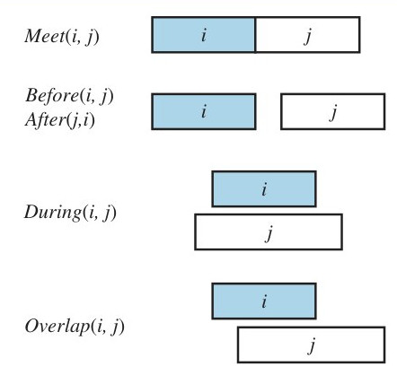
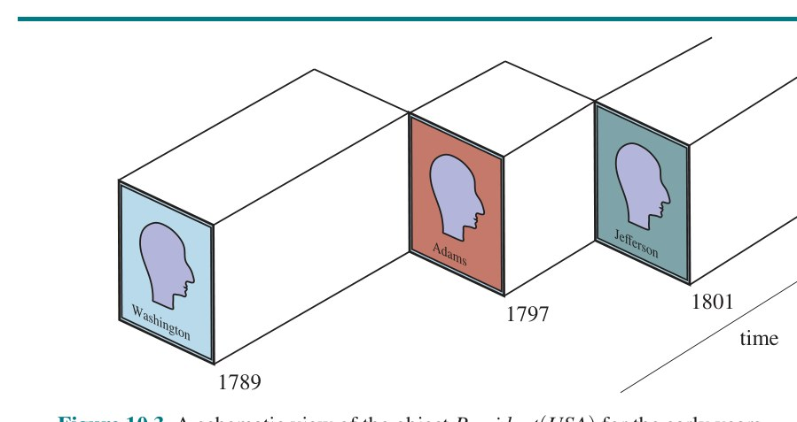
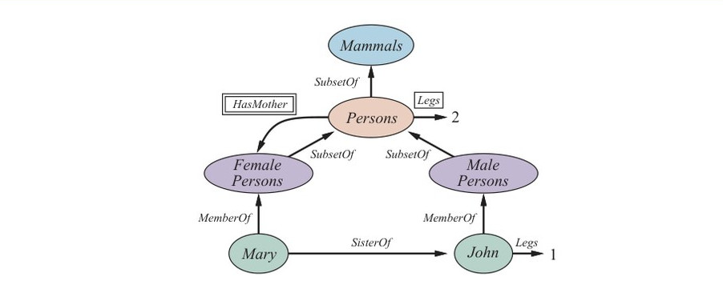
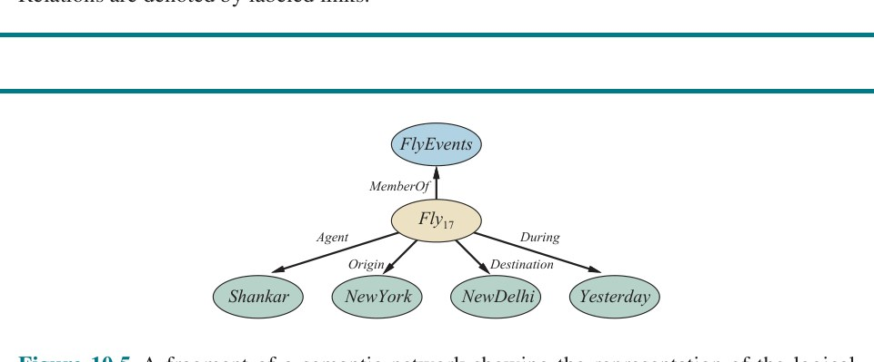
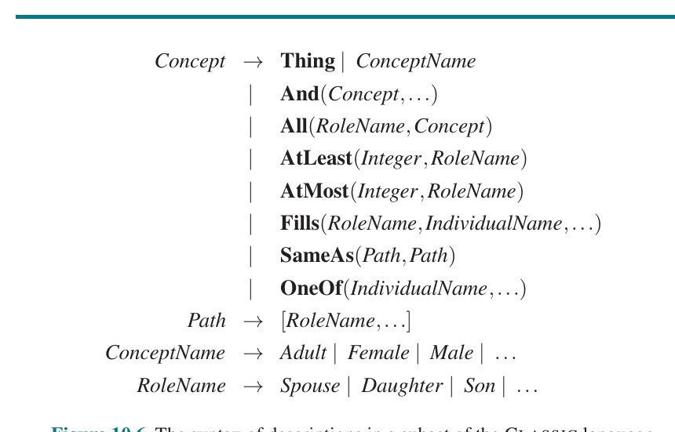

# فصل ۱۰ — بازنمایی دانش

**فصل ۱۰: بازنمایی دانش (Knowledge Representation)**

*در این فصل نشان می‌دهیم چگونه واقعیت‌های گوناگون دربارهٔ جهان واقعی را در قالبی بازنمایی کنیم که بتوان از آن برای استدلال و حل مسئله استفاده کرد.*

فصل‌های پیشین نشان دادند عامل دارای پایگاه دانش چگونه می‌تواند استنتاج‌هایی کند که آن را قادر می‌سازد به‌طور مناسب عمل کند. در این فصل به پرسش محتوایی می‌پردازیم که چه چیزی در پایگاه دانش چنین عاملی گذاشته شود — چگونه واقعیت‌ها دربارهٔ جهان بازنمایی شوند. از منطق مرتبهٔ اول به‌عنوان زبان بازنمایی استفاده خواهیم کرد، اما فصل‌های بعدی صورت‌های بازنمایی متفاوتی معرفی خواهند کرد، مانند شبکه‌های تکلیف سلسله‌مراتبی برای استدلال دربارهٔ برنامه‌ها (فصل ۱۱)، شبکه‌های بیزی برای استدلال با عدم قطعیت (فصل ۱۳)، مدل‌های مارکوف برای استدلال در طول زمان (فصل ۱۷)، و شبکه‌های عصبی عمیق برای استدلال دربارهٔ تصاویر، صداها و دیگر داده‌ها (فصل ۲۱). اما مهم نیست از چه بازنمایی استفاده کنید، واقعیت‌های جهان همچنان باید مدیریت شوند و این فصل به شما حسی از مسائل می‌دهد.

بخش ۱۰.۱ ایدهٔ هستی‌شناسی عمومی را معرفی می‌کند که همه‌چیز در جهان را در سلسله‌مراتبی از رده‌ها سازمان می‌دهد. بخش ۱۰.۲ رده‌های پایهٔ اشیا، مواد و اندازه‌ها را پوشش می‌دهد؛ بخش ۱۰.۳ رویدادها را؛ و بخش ۱۰.۴ دانش دربارهٔ باورها را بحث می‌کند. سپس به در نظر گرفتن فناوری استدلال با این محتوا بازمی‌گردیم: بخش ۱۰.۵ سامانه‌های استدلالی طراحی‌شده برای استنتاج کارآمد با رده‌ها را بحث می‌کند و بخش ۱۰.۶ استدلال با اطلاعات پیش‌فرض را.

## ۱۰.۱ مهندسی هستی‌شناسی

در حوزه‌های «اسباب‌بازی»، انتخاب بازنمایی چندان مهم نیست؛ بسیاری از انتخاب‌ها کار خواهند کرد. حوزه‌های پیچیده مانند خرید در اینترنت یا رانندگی با خودرو در ترافیک به بازنمایی‌های عمومی‌تر و انعطاف‌پذیرتری نیاز دارند. این فصل نشان می‌دهد چگونه این بازنمایی‌ها را بسازیم، با تمرکز بر مفاهیم عمومی — مانند رویدادها، زمان، اشیای فیزیکی و باورها — که در بسیاری از حوزه‌های متفاوت رخ می‌دهند. بازنمایی این مفاهیم انتزاعی گاهی «مهندسی هستی‌شناسی» (Ontological Engineering) نامیده می‌شود.

نمی‌توانیم امیدوار باشیم همه‌چیز در جهان را بازنمایی کنیم، حتی در کتاب درسی ۱۰۰۰ صفحه‌ای، اما جاگذاری‌هایی می‌گذاریم که دانش تازه برای هر حوزه‌ای بتواند در آن‌ها جا بگیرد. برای نمونه، تعریف می‌کنیم شیء فیزیکی بودن به چه معناست و جزئیات انواع متفاوت اشیا — ربات‌ها، تلویزیون‌ها، کتاب‌ها یا هر چیز دیگر — را می‌توان بعداً پر کرد. این مشابه شیوه‌ای است که طراحان چارچوب برنامه‌نویسی شئ‌گرا (مانند چارچوب گرافیکی جاوا سویینگ) مفاهیم عمومی مانند Window را تعریف می‌کنند و انتظار دارند کاربران از آن‌ها برای تعریف مفاهیم خاص‌تر مانند SpreadsheetWindow استفاده کنند. چارچوب عمومی مفاهیم «هستی‌شناسی بالایی» (Upper Ontology) نامیده می‌شود، به‌سبب قرارداد رسم گراف‌ها با مفاهیم عمومی در بالا و مفاهیم خاص‌تر در پایین، چنان‌که در شکل ۱۰.۱.

![**شکل ۱۰.۱ — هستی‌شناسی بالایی جهان، که موضوعات پوشش‌داده‌شده در ادامهٔ فصل را نشان می‌دهد.** هر پیوند نشان می‌دهد مفهومِ پایینی تخصیص (ویژه‌سازیِ) مفهومِ بالایی است. تخصیص‌ها لزوماً ناهم‌پوش نیستند — انسان هم جانور است و هم عامل. در بخش ۱۰.۳.۲ خواهیم دید چرا اشیای فیزیکی زیر رویدادهای تعمیم‌یافته می‌آیند. (ساختار: هرچیز ← اشیای انتزاعی [مجموعه‌ها، اعداد، اشیای بازنمایشی، مقوله‌ها، جمله‌ها، اندازه‌گیری‌ها، وزن‌ها، زمان‌ها] و اشیای فیزیکی [مکان‌ها، فرایندها، جانوران، عامل‌ها، انسان‌ها، مواد [جامد، مایع، گاز]] و رویدادهای تعمیم‌یافته [بازه‌ها، لحظه‌ها])](../figures/ch10/fig-10-1.jpg)

**شکل ۱۰.۱ — هستی‌شناسی بالایی جهان، که موضوعات پوشش‌داده‌شده در ادامهٔ فصل را نشان می‌دهد.** هر پیوند نشان می‌دهد مفهومِ پایینی تخصیص (ویژه‌سازیِ) مفهومِ بالایی است. تخصیص‌ها لزوماً ناهم‌پوش نیستند — انسان هم جانور است و هم عامل. در بخش ۱۰.۳.۲ خواهیم دید چرا اشیای فیزیکی زیر رویدادهای تعمیم‌یافته می‌آیند. (ساختار: هرچیز ← اشیای انتزاعی [مجموعه‌ها، اعداد، اشیای بازنمایشی، مقوله‌ها، جمله‌ها، اندازه‌گیری‌ها، وزن‌ها، زمان‌ها] و اشیای فیزیکی [مکان‌ها، فرایندها، جانوران، عامل‌ها، انسان‌ها، مواد [جامد، مایع، گاز]] و رویدادهای تعمیم‌یافته [بازه‌ها، لحظه‌ها])

پیش از بررسی بیشتر هستی‌شناسی، باید یک هشدار مهم بدهیم. ما انتخاب کرده‌ایم از منطق مرتبهٔ اول برای بحث دربارهٔ محتوا و سازمان دانش استفاده کنیم، هرچند جنبه‌های خاصی از جهان واقعی در FOL به‌سختی قابل درک‌اند. دشواری اصلی آن است که بیشتر تعمیم‌ها استثنا دارند یا فقط تا درجه‌ای برقرارند. برای نمونه، هرچند «گوجه‌فرنگی‌ها قرمزند» قاعدهٔ مفیدی است، برخی گوجه‌فرنگی‌ها سبز، زرد یا نارنجی‌اند. استثناهای مشابهی را می‌توان در تقریباً همهٔ قواعد این فصل یافت. توانایی مدیریت استثناها و عدم قطعیت بسیار مهم است، اما عمود بر تکلیف فهم هستی‌شناسی عمومی است. به همین دلیل، بحث استثناها را به بخش ۱۰.۵ این فصل و موضوع عمومی‌تر استدلال با عدم قطعیت را به فصل ۱۲ موکول می‌کنیم.

هستی‌شناسی بالایی به چه درد می‌خورد؟ هستی‌شناسی مدارها در بخش ۸.۴.۲ را در نظر بگیرید. فرض‌های ساده‌کنندهٔ فراوانی می‌کند: زمان کاملاً حذف شده؛ سیگنال‌ها ثابت‌اند و منتشر نمی‌شوند؛ ساختار مدار ثابت می‌ماند. هستی‌شناسی عمومی‌تر سیگنال‌ها را در زمان‌های خاص در نظر می‌گرفت و طول سیم‌ها و تأخیرهای انتشار را شامل می‌شد. این به ما امکان می‌داد ویژگی‌های زمانی مدار را شبیه‌سازی کنیم، و در واقع چنین شبیه‌سازی‌هایی اغلب توسط طراحان مدار انجام می‌شوند.

همچنین می‌توانستیم رده‌های جالب‌تری از گیت‌ها معرفی کنیم، برای نمونه، با توصیف فناوری (TTL، CMOS و مانند آن) به‌همراه مشخصات ورودی–خروجی. اگر می‌خواستیم دربارهٔ قابلیت اطمینان یا تشخیص بحث کنیم، امکان تغییر خودبه‌خودی ساختار مدار یا ویژگی‌های گیت‌ها را شامل می‌کردیم. برای حساب‌کردن ظرفیت‌های سرگردان، باید بازنمایی کنیم سیم‌ها روی برد کجا هستند.

اگر به جهان وومپوس نگاه کنیم، ملاحظات مشابهی اعمال می‌شود. هرچند زمان را بازنمایی می‌کنیم، ساختار ساده‌ای دارد: هیچ‌چیز اتفاق نمی‌افتد مگر وقتی عامل کنش کند، و همهٔ تغییرها آنی‌اند. هستی‌شناسی عمومی‌تر، مناسب‌تر برای جهان واقعی، امکان تغییرهای هم‌زمانِ گسترده‌درزمان را می‌داد. همچنین از گزارهٔ Pit برای گفتن اینکه کدام خانه‌ها گودال دارند استفاده کردیم. می‌توانستیم انواع متفاوت گودال‌ها را با داشتن چند فرد متعلق به ردهٔ گودال‌ها، هر یک با ویژگی‌های متفاوت، اجازه دهیم. به همین ترتیب، شاید بخواهیم جانوران دیگری غیر از وومپوس‌ها را اجازه دهیم. ممکن است نتوان از ادراک‌های در دسترس گونهٔ دقیق را مشخص کرد، پس باید رده‌بندی زیستی بسازیم تا به عامل در پیش‌بینی رفتار ساکنان غار از سرنخ‌های اندک کمک کند.

برای هر هستی‌شناسی ویژه‌منظوره، امکان ایجاد چنین تغییرهایی برای حرکت به سوی عمومیت بیشتر هست. پس پرسش بدیهی‌ای پدیدار می‌شود: آیا همهٔ این هستی‌شناسی‌ها به هستی‌شناسی عمومی‌منظوره‌ای همگرا می‌شوند؟ پس از قرن‌ها بررسی فلسفی و محاسباتی، پاسخ «شاید» است. در این بخش، یک هستی‌شناسی عمومی‌منظوره ارائه می‌کنیم که ایده‌های آن قرن‌ها را ترکیب می‌کند. دو ویژگی عمدهٔ هستی‌شناسی‌های عمومی‌منظوره آن‌ها را از مجموعه‌های هستی‌شناسی‌های ویژه‌منظوره متمایز می‌کند:

- هستی‌شناسی عمومی‌منظوره باید تقریباً در هر حوزهٔ ویژه‌منظوره‌ای کاربردپذیر باشد (با افزودن اصل‌موضوعه‌های حوزه‌ویژه). این بدان معناست هیچ مسئلهٔ بازنمایشی را نمی‌توان نرم کرد یا زیر فرش جارو کرد.
- در هر حوزهٔ به‌اندازهٔ کافی دشوار، حوزه‌های دانشِ متفاوت باید یکپارچه شوند، زیرا استدلال و حل مسئله می‌تواند هم‌زمان چند حوزه را درگیر کند. برای نمونه، سامانهٔ رباتیک تعمیر مدار باید دربارهٔ مدارها بر حسب اتصال الکتریکی و چیدمان فیزیکی استدلال کند، و دربارهٔ زمان، هم برای تحلیل زمانی مدار و هم برای تخمین هزینه‌های کار. جمله‌های توصیف‌کنندهٔ زمان پس باید قابل ترکیب‌شدن با جمله‌های توصیف‌کنندهٔ چیدمان فضایی باشند و باید به یک اندازه برای نانوثانیه‌ها و دقیقه‌ها و برای آنگستروم‌ها و مترها خوب کار کنند.

باید از همان ابتدا بگوییم پروژهٔ مهندسی هستی‌شناسی عمومی تاکنون فقط موفقیت محدودی داشته. هیچ‌یک از کاربردهای برتر هوش مصنوعی (چنان‌که در فصل ۱ فهرست شده) از هستی‌شناسی عمومی استفاده نمی‌کنند — همه از مهندسی دانش ویژه‌منظوره و یادگیری ماشین استفاده می‌کنند. ملاحظات اجتماعی/سیاسی می‌تواند توافق طرف‌های رقیب بر هستی‌شناسی را دشوار کند. چنان‌که تام گروبر (۲۰۰۴) می‌گوید: «هر هستی‌شناسی یک معاهده است — توافقی اجتماعی — میان مردمی با انگیزهٔ مشترکی در اشتراک‌گذاری.» وقتی دغدغه‌های رقیب بر انگیزهٔ اشتراک‌گذاری می‌چربد، هیچ هستی‌شناسی مشترکی نمی‌تواند وجود داشته باشد. هرچه شمار ذی‌نفعان کوچک‌تر باشد، ایجاد هستی‌شناسی آسان‌تر است، و بنابراین ایجاد هستی‌شناسی عمومی‌منظوره از هستی‌شناسی با هدف محدود، مانند هستی‌شناسی زیست‌پزشکی باز (اسمیت و همکاران، ۲۰۰۷)، دشوارتر است. آن هستی‌شناسی‌هایی که وجود دارند از چهار مسیر ایجاد شده‌اند:

۱. توسط تیمی از هستی‌شناسان یا منطق‌دانان آموزش‌دیده، که هستی‌شناسی را معماری و اصل‌موضوعه‌ها را می‌نویسند. سامانهٔ CYC بیشتر بدین روش ساخته شد (لنات و گوها، ۱۹۹۰).
۲. با واردکردن رده‌ها، ویژگی‌ها و مقادیر از پایگاه داده یا پایگاه‌های دادهٔ موجود. DBPEDIA با واردکردن واقعیت‌های ساخت‌یافته از ویکی‌پدیا ساخته شد (بیزر و همکاران، ۲۰۰۷).
۳. با تجزیهٔ اسناد متنی و استخراج اطلاعات از آن‌ها. TEXTRUNNER با خواندن پیکرهٔ بزرگی از صفحات وب ساخته شد (بانکو و اتزیونی، ۲۰۰۸).
۴. با وسوسه‌کردن آماتورهای ماهرنشده به واردکردن دانش عقل سلیم. سامانهٔ OPENMIND توسط داوطلبانی ساخته شد که واقعیت‌هایی به انگلیسی پیشنهاد می‌کردند (سینگ و همکاران، ۲۰۰۲؛ چکلوسکی و گیل، ۲۰۰۵).

به‌عنوان مثال، گراف دانش گوگل از محتوای نیمه‌ساخت‌یافتهٔ ویکی‌پدیا استفاده می‌کند و آن را با دیگر محتوای گردآوری‌شده از سراسر وب تحت نظارت انسانی ترکیب می‌کند. بیش از ۷۰ میلیارد واقعیت دارد و برای حدود یک‌سوم جستجوهای گوگل پاسخ فراهم می‌کند (دونگ و همکاران، ۲۰۱۴).

## ۱۰.۲ رده‌ها و اشیا

سازمان‌دهی اشیا در رده‌ها (Categories) بخش حیاتی بازنمایی دانش است. هرچند تعامل با جهان در سطح اشیای فردی رخ می‌دهد، بخش بزرگی از استدلال در سطح رده‌ها رخ می‌دهد. برای نمونه، خریدار معمولاً هدف خرید یک توپ بسکتبال را دارد، نه توپ بسکتبالِ خاصی مانند BB9. رده‌ها همچنین برای پیش‌بینی دربارهٔ اشیا پس از طبقه‌بندی‌شان خدمت می‌کنند. از ورودی ادراکی وجود اشیای خاصی را استنتاج می‌کنیم، عضویت رده را از ویژگی‌های ادراک‌شدهٔ اشیا استنتاج می‌کنیم، و سپس از اطلاعات رده برای پیش‌بینی دربارهٔ اشیا استفاده می‌کنیم. برای نمونه، از پوست خال‌دار سبزوزرد، قطر یک‌فوت، شکل تخم‌مرغی، گوشت قرمز، دانه‌های سیاه و حضور در راهروی میوه، می‌توان استنتاج کرد شیئی هندوانه است؛ از این، استنتاج می‌شود برای سالاد میوه مفید خواهد بود.

دو انتخاب برای بازنمایی رده‌ها در منطق مرتبهٔ اول هست: گزاره‌ها و اشیا. یعنی می‌توانیم از گزارهٔ Basketball(b) استفاده کنیم، یا می‌توانیم رده را «شیءسازی» (Reification)¹ کنیم، Basketballs. سپس می‌توانیم Member(b, Basketballs) بگوییم، که به اختصار b ∈ Basketballs می‌نویسیم، تا بگوییم b عضوی از ردهٔ توپ‌های بسکتبال است. Subset(Basketballs, Balls) می‌گوییم، که به اختصار Basketballs ⊂ Balls، تا بگوییم Basketballs زیرردهٔ Balls است. از «زیررده»، «زیرکلاس» و «زیرمجموعه» به‌جای یکدیگر استفاده خواهیم کرد.

رده‌ها دانش را از طریق «وراثت» (Inheritance) سازمان می‌دهند. اگر بگوییم همهٔ مصداق‌های ردهٔ Food خوراکی‌اند، و ادعا کنیم Fruit زیرکلاس Food و Apples زیرکلاس Fruit است، آنگاه می‌توانیم استنتاج کنیم هر سیبی خوراکی است. می‌گوییم سیب‌های فردی ویژگی خوراکی‌بودن را به ارث می‌برند، در این مورد از عضویتشان در ردهٔ Food.

روابط زیرکلاس رده‌ها را در «سلسله‌مراتب رده‌بندی» یا رده‌بندی (Taxonomy) سازمان می‌دهند. رده‌بندی‌ها برای قرن‌ها به‌صراحت در حوزه‌های فنی استفاده شده‌اند. بزرگ‌ترین چنین رده‌بندی‌ای حدود ۱۰ میلیون گونهٔ زنده و منقرض‌شده، بسیاری از آن‌ها سوسک،² را در سلسله‌مراتب تکی سازمان می‌دهد؛ علم کتابداری رده‌بندی همهٔ حوزه‌های دانش را توسعه داده که به‌صورت سامانهٔ دهدهی دیویی رمزگذاری شده؛ و مقام‌های مالیاتی و دیگر ادارات دولتی رده‌بندی‌های گسترده‌ای از مشاغل و محصولات تجاری توسعه داده‌اند.

منطق مرتبهٔ اول بیان واقعیت‌ها دربارهٔ رده‌ها را آسان می‌کند، یا با مرتبط‌کردن اشیا به رده‌ها یا با سورزدن روی اعضایشان. این‌جا چند واقعیت نمونه است:

- شیئی عضو رده‌ای است:
```
BB9 ∈ Basketballs
```
- رده‌ای زیرکلاس ردهٔ دیگر است:
```
Basketballs ⊂ Balls
```
- همهٔ اعضای رده‌ای برخی ویژگی‌ها را دارند:
```
(x ∈ Basketballs) ⇒ Spherical(x)
```
- اعضای رده‌ای را می‌توان با برخی ویژگی‌ها شناخت:
```
Orange(x) ∧ Round(x) ∧ Diameter(x) = 9.5″ ∧ x ∈ Balls ⇒ x ∈ Basketballs
```
- رده‌ای به‌عنوان کل برخی ویژگی‌ها را دارد:
```
Dogs ∈ DomesticatedSpecies
```

توجه کنید چون Dogs رده است و عضو DomesticatedSpecies است، دومی باید ردهٔ رده‌ها باشد. البته برای بسیاری از قواعد بالا استثناهایی هست (توپ‌های بسکتبال سوراخ‌شده کروی نیستند)؛ بعداً با این استثناها سروکار می‌دهیم.

هرچند روابط زیرکلاس و عضویت مهم‌ترین روابط برای رده‌ها هستند، همچنین می‌خواهیم بتوانیم روابط میان رده‌هایی که زیرکلاس یکدیگر نیستند بیان کنیم. برای نمونه، اگر فقط بگوییم Undergraduates و GraduateStudents زیرکلاس‌های Students هستند، نگفته‌ایم دانشجوی کارشناسی نمی‌تواند هم‌زمان دانشجوی تحصیلات تکمیلی باشد. می‌گوییم دو یا چند رده «ناهم‌پوش» (Disjoint) هستند اگر هیچ عضوی مشترک نداشته باشند. همچنین ممکن است بخواهیم بگوییم رده‌های «کارشناسی» و «تحصیلات تکمیلی» «تجزیهٔ جامع» (Exhaustive Decomposition) دانشجویان دانشگاه را تشکیل می‌دهند. تجزیهٔ جامعِ مجموعه‌های ناهم‌پوش «افراز» (Partition) نامیده می‌شود. چند مثال دیگر از این سه مفهوم:

```
Disjoint({Animals, Vegetables})
ExhaustiveDecomposition({Americans, Canadians, Mexicans}, NorthAmericans)
Partition({Animals, Plants, Fungi, Protista, Monera}, LivingThings)
```

(توجه کنید ExhaustiveDecomposition آمریکای شمالی‌ها افراز نیست، زیرا برخی مردم تابعیت دوگانه دارند.) سه گزاره چنین تعریف می‌شوند:

```
Disjoint(s) ⇔ (∀c1,c2 c1 ∈ s ∧ c2 ∈ s ∧ c1 ≠ c2 ⇒ Intersection(c1,c2) = {})
ExhaustiveDecomposition(s,c) ⇔ (∀i i ∈ c ⇔ ∃c2 c2 ∈ s ∧ i ∈ c2)
Partition(s,c) ⇔ Disjoint(s) ∧ ExhaustiveDecomposition(s,c)
```

رده‌ها را همچنین می‌توان با ارائهٔ شرایط لازم و کافی برای عضویت تعریف کرد. برای نمونه، مجرد، مرد بالغ ازدواج‌نکرده است:

```
x ∈ Bachelors ⇔ Unmarried(x) ∧ x ∈ Adults ∧ x ∈ Males
```

چنان‌که در حاشیهٔ «انواع طبیعی» در صفحهٔ ۳۲۰ بحث می‌کنیم، تعریف‌های منطقی صلب و دقیق برای رده‌ها معمولاً فقط برای مفاهیم صوری مصنوعی ممکن است، نه برای اشیای معمولی. اما تعریف‌ها همیشه لازم نیستند.

### ۱۰.۲.۱ ترکیب فیزیکی

ایدهٔ اینکه شیئی می‌تواند بخشی از شیء دیگر باشد آشناست. بینیِ انسان بخشی از سر اوست، رومانی بخشی از اروپاست، و این فصل بخشی از این کتاب است. از رابطهٔ عمومی PartOf برای گفتن اینکه چیزی بخشی از چیز دیگر است استفاده می‌کنیم. اشیا را می‌توان در سلسله‌مراتب‌های PartOf گروه‌بندی کرد، یادآور سلسله‌مراتب Subset:

```
PartOf(Bucharest, Romania)
PartOf(Romania, EasternEurope)
PartOf(EasternEurope, Europe)
PartOf(Europe, Earth)
```

رابطهٔ PartOf متعدی و بازتابی است؛ یعنی:

```
PartOf(x,y) ∧ PartOf(y,z) ⇒ PartOf(x,z)
PartOf(x,x)
```

بنابراین، می‌توانیم نتیجه بگیریم PartOf(Bucharest, Earth). رده‌های اشیای مرکب (Composite Objects) اغلب با روابط ساختاری میان اجزا مشخص می‌شوند. برای نمونه، دودَپا شیئی است با دقیقاً دو پا متصل به بدنی:

```
Biped(a) ⇒ ∃l1,l2,b Leg(l1) ∧ Leg(l2) ∧ Body(b) ∧ PartOf(l1,a) ∧ PartOf(l2,a) ∧ PartOf(b,a) ∧ Attached(l1,b) ∧ Attached(l2,b) ∧ l1 ≠ l2 ∧ [∀l3 Leg(l3) ∧ PartOf(l3,a) ⇒ (l3 = l1 ∨ l3 = l2)]
```

نماد «دقیقاً دو» کمی ناشیانه است؛ مجبوریم بگوییم دو پا هست، یکسان نیستند، و اگر کسی پای سومی پیشنهاد کند، باید با یکی از دو پای دیگر یکسان باشد. در بخش ۱۰.۵.۲، صورت‌بندی به نام «منطق توصیف» (Description Logic) توصیف می‌کنیم که بازنمایی قیدهایی مانند «دقیقاً دو» را آسان‌تر می‌کند.

می‌توانیم رابطهٔ PartPartition را مشابه رابطهٔ Partition برای رده‌ها تعریف کنیم. (تمرین ۱۰.DECM را ببینید.) شیئی از اجزای PartPartition خودش ترکیب شده و می‌توان آن را برگرفتن برخی ویژگی‌ها از آن اجزا دید. برای نمونه، جرم شیء مرکب، مجموع جرم‌های اجزاست. توجه کنید این برای رده‌ها صادق نیست، که جرم ندارند، حتی اگر عناصرشان داشته باشند.

همچنین مفید است اشیای مرکب با اجزای معین اما بدون ساختار خاص تعریف کنیم. برای نمونه، ممکن است بخواهیم بگوییم «سیب‌های این کیسه دو پوند وزن دارند.» وسوسه این است که این وزن را به مجموعهٔ سیب‌های کیسه نسبت دهیم، اما این اشتباه است، زیرا مجموعه مفهوم انتزاعی ریاضی‌ای است که عناصر دارد اما وزن ندارد. در عوض، به مفهوم تازه‌ای نیاز داریم که «دسته» (Bunch) می‌نامیم. برای نمونه، اگر سیب‌ها Apple1، Apple2 و Apple3 باشند، آنگاه:

```
BunchOf({Apple1, Apple2, Apple3})
```

شیء مرکبی را نشان می‌دهد که سه سیب اجزای آن‌اند (نه عناصر). سپس می‌توانیم از دسته به‌عنوان شیء عادی، هرچند بدون‌ساختار، استفاده کنیم. توجه کنید BunchOf({x}) = x. وانگهی، BunchOf(Apples) شیء مرکبی است شامل همهٔ سیب‌ها — که نباید با Apples، رده یا مجموعهٔ همهٔ سیب‌ها، اشتباه گرفته شود.

می‌توانیم BunchOf را بر حسب رابطهٔ PartOf تعریف کنیم. بدیهی است هر عنصر s بخشی از BunchOf(s) است:

```
∀x x ∈ s ⇒ PartOf(x, BunchOf(s))
```

وانگهی، BunchOf(s) کوچک‌ترین شیءِ ارضاکنندهٔ این شرط است. به بیان دیگر، BunchOf(s) باید بخشی از هر شیئی باشد که همهٔ عناصر s را به‌عنوان جزء دارد:

```
∀y [∀x x ∈ s ⇒ PartOf(x,y)] ⇒ PartOf(BunchOf(s), y)
```

این اصل‌موضوعه‌ها مثالی از فن عمومی به نام «کمینه‌سازی منطقی» (Logical Minimization) هستند، که یعنی تعریف شیء به‌عنوان کوچک‌ترین شیءِ ارضاکنندهٔ شرایط معین.

### ۱۰.۲.۲ اندازه‌گیری‌ها

در هر دو نظریهٔ علمی و عقل‌سلیمی جهان، اشیا ارتفاع، جرم، هزینه و مانند آن دارند. مقادیری که برای این ویژگی‌ها تخصیص می‌دهیم «اندازه»ها (Measures) نامیده می‌شوند. اندازه‌های کمی معمولی را به‌راحتی می‌توان بازنمایی کرد. تصور می‌کنیم جهان شامل «اشیای اندازه» انتزاعی است، مانند طولی که طول این پاره‌خط است. می‌توانیم این طول را ۱٫۵ اینچ یا ۳٫۸۱ سانتی‌متر بنامیم. پس، همان طول در زبان ما نام‌های متفاوتی دارد. طول را با «تابع واحد» (Units Function) بازنمایی می‌کنیم که عددی را آرگومان می‌گیرد. (بدیلی در تمرین ۱۰.ALTM کاوش شده.)

**حاشیه: انواع طبیعی**

برخی رده‌ها تعریف‌های صلب و دقیق دارند: شیئی مثلث است اگر و فقط اگر چندضلعی سه‌ضلعی باشد. از سوی دیگر، بیشتر رده‌های جهان واقعی تعریف روشنی ندارند؛ این‌ها «رده‌های نوع طبیعی» (Natural Kind Categories) نامیده می‌شوند. برای نمونه، گوجه‌فرنگی‌ها تمایل دارند قرمز تیره‌ی محو باشند؛ تقریباً کروی؛ با فرورفتگی در بالا جایی که ساقه بود؛ حدود دو تا چهار اینچ قطر؛ با پوستی نازک اما محکم؛ و با گوشت، دانه و آبمیوه درون. اما تغییر هست: برخی گوجه‌فرنگی‌ها زرد یا نارنجی‌اند، گوجه‌فرنگی‌های نارس سبزند، برخی کوچک‌تر یا بزرگ‌تر از میانگین‌اند و گوجه‌فرنگی‌های گیلاسی یکنواخت کوچک‌اند. به‌جای تعریف کامل گوجه‌فرنگی‌ها، مجموعه‌ای ویژگی داریم که برای شناسایی اشیایی که به‌وضوح گوجه‌فرنگی‌های نمونه‌اند خدمت می‌کند، اما ممکن است اشیای دیگر را قطعاً شناسایی نکند. (آیا می‌تواند گوجه‌فرنگی‌ای وجود داشته باشد که مانند هلو کرکی باشد؟)

این برای عامل منطقی مسئله ایجاد می‌کند. عامل نمی‌تواند مطمئن باشد شیئی که ادراک کرده گوجه‌فرنگی است، و حتی اگر مطمئن بود، نمی‌توانست مطمئن باشد این یکی کدام‌یک از ویژگی‌های گوجه‌فرنگی‌های نمونه را دارد. این مسئله پیامد اجتناب‌ناپذیر عمل در محیط‌های تا حدی قابل مشاهده است.

یک رویکرد مفید، جداکردن آنچه برای همهٔ مصداق‌های رده صادق است از آنچه فقط برای مصداق‌های نمونه صادق است. پس علاوه بر ردهٔ Tomatoes، ردهٔ Typical(Tomatoes) را نیز خواهیم داشت. در این‌جا، تابع Typical رده‌ای را به زیرکلاسی که فقط مصداق‌های نمونه را شامل می‌شود نگاشت می‌کند:

```
Typical(c) ⊆ c
```

بیشتر دانش دربارهٔ انواع طبیعی در واقع دربارهٔ مصداق‌های نمونه‌شان خواهد بود:

```
x ∈ Typical(Tomatoes) ⇒ Red(x) ∧ Round(x)
```

پس می‌توانیم واقعیت‌های مفیدی دربارهٔ رده‌ها بدون تعریف‌های دقیق بنویسیم. دشواری ارائهٔ تعریف‌های دقیق برای بیشتر رده‌های طبیعی با ژرفا توسط ویتگنشتاین (۱۹۵۳) توضیح داده شد. او از مثال بازی‌ها استفاده کرد تا نشان دهد اعضای یک رده «شباهت‌های خانوادگی» مشترک دارند نه ویژگی‌های لازم و کافی: چه تعریف صلبی شطرنج، قایم‌موشک، سولیتیر و توپ‌گیری را در بر می‌گیرد؟

سودمندی مفهوم تعریف صلب و دقیق همچنین توسط کواین (۱۹۵۳) به چالش کشیده شد. او اشاره کرد حتی تعریف «مجرد» به‌عنوان مرد بالغ ازدواج‌نکرده نیز مشکوک است؛ ممکن است کسی گزاره‌ای مانند «پاپ مجرد است» را زیر سؤال ببرد. هرچند به‌طور دقیق کاذب نیست، این کاربرد قطعاً ناخوشایند است، زیرا استنتاج‌های ناخواسته‌ای در شنونده برمی‌انگیزد. تنش را شاید بتوان با تمایز میان تعریف‌های منطقیِ مناسب برای بازنمایی دانش درونی و معیارهای دقیق‌ترِ کاربرد زبانیِ خوشایند حل کرد. دومی را شاید بتوان با «پالایش» ادعاهای مشتق‌شده از اولی به دست آورد. همچنین ممکن است شکست‌های کاربرد زبانی به‌عنوان بازخوردی برای اصلاح تعریف‌های درونی خدمت کنند، چنان‌که پالایش غیرضروری شود.

اگر پاره‌خط L1 نامیده شود، می‌توانیم بنویسیم:

```
Length(L1) = Inches(1.5) = Centimeters(3.81)
```

تبدیل میان واحدها با معادل‌کردن مضارب یک واحد با واحد دیگر انجام می‌شود:

```
Centimeters(2.54 × d) = Inches(d)
```

اصل‌موضوعه‌های مشابهی را می‌توان برای پوند و کیلوگرم، ثانیه و روز، و دلار و سنت نوشت. اندازه‌ها را می‌توان برای توصیف اشیا چنین استفاده کرد:

```
Diameter(Basketball12) = Inches(9.5)
ListPrice(Basketball12) = $(19)
Weight(BunchOf({Apple1, Apple2, Apple3})) = Pounds(2)
d ∈ Days ⇒ Duration(d) = Hours(24)
```

توجه کنید $(1) اسکناس دلار نیست — قیمت است. می‌توان دو اسکناس دلار داشت، اما فقط یک شیء به نام $(1) هست. همچنین توجه کنید، در حالی که Inches(0) و Centimeters(0) به همان طول صفر اشاره می‌کنند، با دیگر اندازه‌های صفر، مانند Seconds(0)، یکسان نیستند.

اندازه‌های کمی ساده به‌راحتی قابل بازنمایی‌اند. اندازه‌های دیگر مسئلهٔ بیشتری ایجاد می‌کنند، زیرا مقیاس توافقی مقادیر ندارند. تمرین‌ها دشواری دارند، دسرها خوشمزگی دارند و شعرها زیبایی، اما نمی‌توان اعداد را به این کیفیات تخصیص داد. ممکن است کسی، در لحظه‌ای حساب‌داری ناب، چنین ویژگی‌هایی را برای هدف استدلال منطقی بی‌کاربرد کنار بگذارد؛ یا بدتر، بکوشد مقیاس عددی بر زیبایی تحمیل کند. این اشتباه فاحشی می‌بود، زیرا غیرضروری است. مهم‌ترین جنبهٔ اندازه‌ها، مقادیر عددی خاص نیست، بلکه واقعیتِ قابل‌ترتیب‌بودنِ اندازه‌هاست.

هرچند اندازه‌ها عدد نیستند، باز هم می‌توانیم آن‌ها را مقایسه کنیم، با نماد ترتیبی مانند >. برای نمونه، شاید باور داشته باشیم تمرین‌های نورویگ از تمرین‌های راسل سخت‌ترند، و در تمرین‌های سخت‌تر امتیاز کمتری می‌گیریم:

```
e1 ∈ Exercises ∧ e2 ∈ Exercises ∧ Wrote(Norvig, e1) ∧ Wrote(Russell, e2) ⇒ Difficulty(e1) > Difficulty(e2)
e1 ∈ Exercises ∧ e2 ∈ Exercises ∧ Difficulty(e1) > Difficulty(e2) ⇒ ExpectedScore(e1) < ExpectedScore(e2)
```

این برای اجازه دادن به فرد در تصمیم‌گیری اینکه کدام تمرین‌ها را انجام دهد کافی است، حتی با آنکه هرگز از مقادیر عددی برای دشواری استفاده نشد. (البته باید کشف کرد چه کسی کدام تمرین‌ها را نوشته.) این نوع روابط یکنواخت میان اندازه‌ها مبنای حوزهٔ «فیزیک کیفی» را تشکیل می‌دهد، زیرحوزه‌ای از هوش مصنوعی که بررسی می‌کند چگونه دربارهٔ سامانه‌های فیزیکی بدون شیرجه در معادلات مفصل و شبیه‌سازی‌های عددی استدلال کنیم. فیزیک کیفی در یادداشت‌های تاریخی بحث شده.

### ۱۰.۲.۳ اشیا: چیزها و مواد

جهان واقعی را می‌توان شامل اشیای اولیه (مثلاً ذرات اتمی) و اشیای مرکبِ ساخته‌شده از آن‌ها دید. با استدلال در سطح اشیای بزرگ مانند سیب‌ها و خودروها، می‌توانیم بر پیچیدگیِ سروکار داشتن با شمار عظیم اشیای اولیه به‌صورت فردی غلبه کنیم. اما بخش قابل توجهی از واقعیت هست که به نظر می‌رسد هر فردسازیِ بدیهی — تقسیم به اشیای متمایز — را به چالش می‌کشد. به این بخش نام عمومی «ماده» (Stuff) می‌دهیم. برای نمونه، فرض کنیم جلوی من مقداری کره و یک مورچه‌خوار هست. می‌توانم بگویم یک مورچه‌خوار هست، اما هیچ شمار بدیهی‌ای از «شیء-کره»ها نیست، زیرا هر جزء از شیء-کره نیز شیء-کره است، دست‌کم تا وقتی به اجزای واقعاً بسیار کوچک برسیم. این تمایز عمده میان ماده و چیز است. اگر مورچه‌خوار را از وسط ببریم، دو مورچه‌خوار نمی‌گیریم (متأسفانه).

زبان انگلیسی به‌وضوح میان ماده و چیز تمایز می‌گذارد. می‌گوییم «a aardvark» (یک مورچه‌خوار)، اما، به‌جز در رستوران‌های متظاهر کالیفرنیا، نمی‌توان گفت «a butter» (یک کره). زبان‌شناسان میان «اسم‌های شمارشی» (Count Nouns)، مانند مورچه‌خوارها، حفره‌ها و قضیه‌ها، و «اسم‌های جرمی» (Mass Nouns)، مانند کره، آب و انرژی، تمایز می‌گذارند. چند هستی‌شناسی رقیب ادعای مدیریت این تمایز را دارند. در این‌جا فقط یکی را توصیف می‌کنیم؛ بقیه در یادداشت‌های تاریخی پوشش داده شده‌اند.

برای بازنمایی درست ماده، با امر بدیهی آغاز می‌کنیم. باید دست‌کم «توده»های درشت ماده‌ای که با آن‌ها تعامل می‌کنیم را به‌عنوان اشیا در هستی‌شناسی‌مان داشته باشیم. برای نمونه، ممکن است تودهٔ کره‌ای را بشناسیم که شب قبل روی میز مانده؛ ممکن است آن را برداریم، وزن کنیم، بفروشیم یا هر چه. در این معانی، شیئی است دقیقاً مانند مورچه‌خوار. آن را Butter3 بنامیم. همچنین ردهٔ Butter را تعریف می‌کنیم. به‌صورت غیررسمی، عناصر آن همهٔ چیزهایی خواهند بود که می‌توان درباره‌شان گفت «کره است»، شامل Butter3. با چند ملاحظه دربارهٔ اجزای بسیار کوچک که فعلاً حذف می‌کنیم، هر جزء از شیء-کره نیز شیء-کره است:

```
b ∈ Butter ∧ PartOf(p,b) ⇒ p ∈ Butter
```

حال می‌توانیم بگوییم کره حدود ۳۰ درجه سانتی‌گراد ذوب می‌شود:

```
b ∈ Butter ⇒ MeltingPoint(b, Centigrade(30))
```

می‌توانستیم ادامه دهیم و بگوییم کره زرد است، از آب کم‌چگالی‌تر است، در دمای اتاق نرم است، چربی بالایی دارد و الی آخر. از سوی دیگر، کره اندازه، شکل یا وزن خاصی ندارد. می‌توانیم رده‌های تخصصی‌تر کره مانند UnsaltedButter تعریف کنیم که آن نیز نوعی ماده است. توجه کنید ردهٔ PoundOfButter، که همهٔ شیء-کره‌های یک‌پوندی را به‌عنوان عضو شامل می‌شود، نوعی ماده نیست. اگر یک پوند کره را از وسط ببریم، افسوس، دو پوند کره نمی‌گیریم.

آنچه واقعاً رخ می‌دهد این است: برخی ویژگی‌ها «ذاتی» (Intrinsic) هستند: آن‌ها به خودِ جوهر شیء تعلق دارند، نه به شیء به‌عنوان کل. وقتی مصداقی از ماده را از وسط می‌برید، دو تکه ویژگی‌های ذاتی — چیزهایی مانند چگالی، نقطهٔ جوش، طعم، رنگ، مالکیت و مانند آن — را حفظ می‌کنند. از سوی دیگر، ویژگی‌های «عَرَضی» (Extrinsic) آن‌ها — وزن، طول، شکل و مانند آن — زیر تقسیم حفظ نمی‌شوند. رده‌ای از اشیا که در تعریفش فقط ویژگی‌های ذاتی را شامل شود، پس «ماده» یا اسم جرمی است؛ رده‌ای که هر ویژگی عَرَضی را در تعریفش شامل شود، اسم شمارشی است. Stuff و Thing به‌ترتیب عمومی‌ترین رده‌های ماده و شیء هستند.

## ۱۰.۳ رویدادها

در بخش ۷.۷.۱ دربارهٔ کنش‌ها بحث کردیم: چیزهایی که رخ می‌دهند، مانند Shoott؛ و روان‌ها: جنبه‌هایی از جهان که تغییر می‌کنند، مانند HaveArrowt. هر دو به‌صورت گزاره بازنمایی شدند و از اصل‌موضوعه‌های حالت-جانشین استفاده کردیم تا بگوییم روانی در زمان t+1 صادق خواهد بود اگر کنش در زمان t باعث صادق‌شدنش شده باشد، یا اگر از قبل در زمان t صادق بوده و کنش باعث کاذب‌شدنش نشده باشد. آن برای جهانی بود که در آن کنش‌ها گسسته، آنی، یکی‌دریک‌زمان و بدون تغییر در نحوهٔ اجراشان هستند (یعنی فقط یک نوع کنش Shoot هست، تمایزی میان سریع، آهسته، عصبی و... شلیک‌کردن نیست).

اما با حرکت از حوزه‌های ساده‌لوحانه به جهان واقعی، گسترهٔ بسیار غنی‌تری از کنش‌ها یا رویدادها³ برای سروکار داشتن هست. کنش پیوسته‌ای مانند پرکردن وان حمام را در نظر بگیرید. اصل‌موضوعهٔ حالت-جانشین می‌تواند بگوید وان پیش از کنش خالی و هنگام تمام‌شدن کنش پر است، اما نمی‌تواند دربارهٔ آنچه در طول کنش رخ می‌دهد صحبت کند. همچنین نمی‌تواند به‌راحتی دو کنشِ هم‌زمان را توصیف کند — مانند مسواک‌زدن در حالی که منتظر پرشدن وان هستید. برای مدیریت چنین مواردی، رویکردی به نام «حساب رویدادها» (Event Calculus) معرفی می‌کنیم.

اشیای حساب رویدادها رویدادها، روان‌ها و نقطه‌های زمانی‌اند. At(Shankar, Berkeley) روانی است: شیئی که به واقعیتِ بودنِ شانکار در برکلی اشاره می‌کند. رویداد E1ِ پرواز شانکار از سانفرانسیسکو به واشینگتن دی.سی. چنین توصیف می‌شود:

```
E1 ∈ Flyings ∧ Flyer(E1, Shankar) ∧ Origin(E1, SF) ∧ Destination(E1, DC)
```

که Flyings ردهٔ همهٔ رویدادهای پرواز است. با شیءسازی رویدادها، افزودن هر مقدار اطلاعات دلخواه دربارهٔ آن‌ها ممکن می‌شود. برای نمونه، می‌توانیم بگوییم پرواز شانکار پرتلاطم بود با Bumpy(E1). در هستی‌شناسی‌ای که رویدادها گزاره‌های n-تایی‌اند، هیچ راهی برای افزودن اطلاعات اضافی مانند این نیست؛ رفتن به گزارهٔ n+1-تایی راه‌حل مقیاس‌پذیری نیست.

برای ادعای اینکه روانی واقعاً از نقطهٔ زمانی t1 شروع و تا زمان t2 ادامه می‌یابد، از گزارهٔ T استفاده می‌کنیم، مانند T(At(Shankar,Berkeley), t1, t2). به همین ترتیب، از Happens(E1, t1, t2) استفاده می‌کنیم تا بگوییم رویداد E1 واقعاً رخ داد، از زمان t1 شروع و در زمان t2 پایان یافت. مجموعهٔ کامل گزاره‌ها برای یک نسخه از حساب رویدادها⁴ چنین است:

| گزاره | معنی |
|---|---|
| T(f, t1, t2) | روان f برای همهٔ زمان‌های بین t1 و t2 صادق است |
| Happens(e, t1, t2) | رویداد e در t1 شروع و در t2 پایان می‌یابد |
| Initiates(e, f, t) | رویداد e باعث صادق‌شدن روان f در زمان t می‌شود |
| Terminates(e, f, t) | رویداد e باعث ازبین‌رفتن صدق روان f در زمان t می‌شود |
| Initiated(f, t1, t2) | روان f در نقطه‌ای بین t1 و t2 صادق می‌شود |
| Terminated(f, t1, t2) | روان f در نقطه‌ای بین t1 و t2 از صدق می‌افتد |
| t1 < t2 | نقطهٔ زمانی t1 پیش از نقطهٔ زمانی t2 رخ می‌دهد |

می‌توانیم اثرات رویداد پرواز را توصیف کنیم:

```
E = Flyings(a, here, there) ∧ Happens(E, t1, t2) ⇒ Terminates(E, At(a, here), t1) ∧ Initiates(E, At(a, there), t2)
```

رویداد متمایزی به نام Start فرض می‌کنیم که حالت آغازین را با گفتن کدام روان‌ها صادق‌اند (با Initiates) یا کاذب‌اند (با Terminated) در زمان آغاز توصیف می‌کند. سپس می‌توانیم توصیف کنیم چه روان‌هایی در چه نقطه‌های زمانی صادق‌اند با جفت اصل‌موضوعه برای T و ¬T که همان قالب عمومی اصل‌موضوعه‌های حالت-جانشین را دنبال می‌کنند: فرض کن رویدادی بین زمان t1 و t3 رخ می‌دهد، و در t2 جایی در آن بازهٔ زمانی رویداد مقدار روان f را تغییر می‌دهد، یا آن را آغاز می‌کند (صادق می‌کند) یا خاتمه می‌دهد (کاذب می‌کند). آنگاه در زمان t4 در آینده، اگر هیچ رویداد مداخله‌گر دیگری روان را تغییر نداده باشد (به‌ترتیب خاتمه یا آغازش نکرده باشد)، روان مقدارش را حفظ کرده است. صوری، اصل‌موضوعه‌ها چنین‌اند:

```
Happens(e, t1, t3) ∧ Initiates(e, f, t2) ∧ ¬Terminated(f, t2, t4) ∧ t1 ≤ t2 ≤ t3 ≤ t4 ⇒ T(f, t2, t4)
Happens(e, t1, t3) ∧ Terminates(e, f, t2) ∧ ¬Initiated(f, t2, t4) ∧ t1 ≤ t2 ≤ t3 ≤ t4 ⇒ ¬T(f, t2, t4)
```

که Terminated و Initiated چنین تعریف می‌شوند:

```
Terminated(f, t1, t5) ⇔ ∃e,t2,t3,t4 Happens(e, t2, t4) ∧ Terminates(e, f, t3) ∧ t1 ≤ t2 ≤ t3 ≤ t4 ≤ t5
Initiated(f, t1, t5) ⇔ ∃e,t2,t3,t4 Happens(e, t2, t4) ∧ Initiates(e, f, t3) ∧ t1 ≤ t2 ≤ t3 ≤ t4 ≤ t5
```

می‌توانیم حساب رویدادها را برای بازنمایی رویدادهای هم‌زمان (مانند نیاز دو نفر به سوارشدن بر الاکلنگ)، رویدادهای برون‌زا (مانند حرکت‌دادن شیء توسط باد)، رویدادهای پیوسته (مانند بالا آمدن جزر)، رویدادهای ناجبرگرایانه (مانند انداختن سکه و روآمدن شیر یا خط)، و دیگر پیچیدگی‌ها بسط دهیم.

### ۱۰.۳.۱ زمان

حساب رویدادها ما را به امکان صحبت دربارهٔ نقطه‌های زمانی و بازه‌های زمانی باز می‌کند. دو نوع بازهٔ زمانی را در نظر خواهیم گرفت: لحظه‌ها و بازه‌های بسط‌یافته. تمایز آن است که فقط لحظه‌ها مدت صفر دارند:

```
Partition({Moments, ExtendedIntervals}, Intervals)
i ∈ Moments ⇔ Duration(i) = Seconds(0)
```

سپس مقیاس زمانی می‌سازیم و نقطه‌هایی روی آن مقیاس را با لحظه‌ها مرتبط می‌کنیم و زمان‌های مطلق به ما می‌دهد. مقیاس زمانی دلبخواهی است؛ آن را بر حسب ثانیه اندازه می‌گیریم و می‌گوییم لحظهٔ نیمه‌شب (GMT) اول ژانویهٔ ۱۹۰۰ زمان ۰ دارد. توابع Begin و End اولین و آخرین لحظه‌های یک بازه را برمی‌گزینند و تابع Time نقطهٔ روی مقیاس زمانی را برای یک لحظه تحویل می‌دهد. تابع Duration تفاوت میان زمان پایان و زمان آغاز را می‌دهد.

```
Interval(i) ⇒ Duration(i) = (Time(End(i)) − Time(Begin(i)))
Time(Begin(AD1900)) = Seconds(0)
Time(Begin(AD2001)) = Seconds(3187324800)
Time(End(AD2001)) = Seconds(3218860800)
Duration(AD2001) = Seconds(31536000)
```

برای خواندنی‌ترشدن این اعداد، تابع Date را نیز معرفی می‌کنیم که شش آرگومان می‌گیرد (ساعت، دقیقه، ثانیه، روز، ماه و سال) و نقطهٔ زمانی بازمی‌گرداند:

```
Time(Begin(AD2001)) = Date(0,0,0,1,Jan,2001)
Date(0,20,21,24,1,1995) = Seconds(3000000000)
```

دو بازه «به هم می‌رسند» (Meet) اگر زمان پایان اولی برابر زمان آغاز دومی باشد. مجموعهٔ کامل روابط بازه‌ای (آلن، ۱۹۸۳) در زیر و در شکل ۱۰.۲ نشان داده شده:

| رابطه | تعریف |
|---|---|
| Meet(i, j) | ⇔ End(i) = Begin(j) |
| Before(i, j) | ⇔ End(i) < Begin(j) |
| After(j, i) | ⇔ Before(i, j) |
| During(i, j) | ⇔ Begin(j) < Begin(i) < End(i) < End(j) |
| Overlap(i, j) | ⇔ Begin(i) < Begin(j) < End(i) < End(j) |
| Starts(i, j) | ⇔ Begin(i) = Begin(j) |
| Finishes(i, j) | ⇔ End(i) = End(j) |
| Equals(i, j) | ⇔ Begin(i) = Begin(j) ∧ End(i) = End(j) |

همهٔ این‌ها معنای شهودی خود را دارند، به‌جز Overlap: ما تمایل داریم هم‌پوشانی را متقارن بدانیم (اگر i با j هم‌پوشانی دارد پس j با i)، اما در این تعریف، Overlap(i, j) فقط اگر i پیش از j آغاز شود صادق است. تجربه نشان داده این تعریف برای نوشتن اصل‌موضوعه‌ها مفیدتر است. برای گفتن اینکه پادشاهی الیزابت دوم بلافاصله پس از پادشاهی جورج ششم آمد و پادشاهی الویس با دههٔ ۱۹۵۰ هم‌پوشانی داشت، می‌توانیم بنویسیم:

```
Meets(ReignOf(GeorgeVI), ReignOf(ElizabethII))
Overlap(Fifties, ReignOf(Elvis))
Begin(Fifties) = Begin(AD1950)
End(Fifties) = End(AD1959)
```



**شکل ۱۰.۲ — گزاره‌های روی بازه‌های زمانی.**

### ۱۰.۳.۲ روان‌ها و اشیا

اشیای فیزیکی را می‌توان رویدادهای تعمیم‌یافته دید، به این معنا که شیء فیزیکی تکه‌ای از فضا–زمان است. برای نمونه، USA را می‌توان رویدادی دانست که در ۱۷۷۶ به‌عنوان اتحاد ۱۳ ایالت آغاز شد و امروز به‌عنوان اتحاد ۵۰ ایالت هنوز در جریان است. می‌توانیم ویژگی‌های در حال تغییر USA را با روان‌های حالت، مانند Population(USA)، توصیف کنیم. ویژگی USA که هر چهار یا هشت سال، به‌جز مصیبت‌ها، تغییر می‌کند، رئیس‌جمهورش است. ممکن است پیشنهاد شود President(USA) عبارت منطقی‌ای است که در زمان‌های مختلف شیء متفاوتی را نشان می‌دهد. متأسفانه، این ممکن نیست، زیرا عبارت در ساختار مدلِ داده‌شده دقیقاً یک شیء را نشان می‌دهد. (عبارت President(USA,t) می‌تواند اشیای متفاوتی را نشان دهد، بسته به مقدار t، اما هستی‌شناسی ما شاخص‌های زمانی را از روان‌ها جدا نگه می‌دارد.) تنها امکان آن است که President(USA) شیء تکی‌ای را نشان دهد که در زمان‌های مختلف از افراد متفاوت تشکیل شده. این شیئی است که از ۱۷۸۹ تا ۱۷۹۷ جورج واشینگتن است، از ۱۷۹۷ تا ۱۸۰۱ جان آدامز، و الی آخر، چنان‌که در شکل ۱۰.۳. برای گفتن اینکه جورج واشینگتن در تمام ۱۷۹۰ رئیس‌جمهور بود، می‌توانیم بنویسیم:

```
T(Equals(President(USA), GeorgeWashington), Begin(AD1790), End(AD1790))
```

از نماد تابع Equals به‌جای گزارهٔ منطقی استاندارد = استفاده می‌کنیم، زیرا نمی‌توانیم گزاره‌ای به‌عنوان آرگومان T داشته باشیم، و به‌سبب آنکه تفسیر این نیست که GeorgeWashington و President(USA) در ۱۷۹۰ به‌صورت منطقی یکسان‌اند؛ هویت منطقی چیزی نیست که در طول زمان تغییر کند. هویت میان زیررویدادهای اشیای President(USA) و GeorgeWashington است که توسط دورهٔ ۱۷۹۰ تعریف می‌شوند.



**شکل ۱۰.۳ — نمای شماتیک شیء President(USA) برای سال‌های آغازین.**

## ۱۰.۴ اشیای ذهنی و منطق موجهات

عامل‌هایی که تاکنون ساخته‌ایم باورهایی دارند و می‌توانند باورهای تازه استنتاج کنند. اما هیچ‌کدام دانشی دربارهٔ باورها یا دربارهٔ استنتاج ندارد. دانش دربارهٔ دانش و فرایندهای استدلال خود برای کنترل استنتاج مفید است. برای نمونه، فرض کنیم آلیس می‌پرسد «جذر ۱۷۶۴ چیست» و باب پاسخ می‌دهد «نمی‌دانم.» اگر آلیس اصرار کند «بیشتر فکر کن»، باب باید دریابد با کمی فکر بیشتر، این پرسش در واقع قابل پاسخ است. از سوی دیگر، اگر پرسش «آیا رئیس‌جمهور الان نشسته است؟» بود، باب باید دریابد فکر بیشتر احتمالاً کمکی نمی‌کند. دانش دربارهٔ دانش عامل‌های دیگر نیز مهم است؛ باب باید دریابد رئیس‌جمهور می‌داند.

آنچه نیاز داریم مدلی از اشیای ذهنیِ درون سر کسی (یا پایگاه دانش چیزی) و فرایندهای ذهنیِ دست‌کاری‌کنندهٔ آن اشیای ذهنی است. مدل لازم نیست مفصل باشد. لازم نیست بتوانیم پیش‌بینی کنیم چند میلی‌ثانیه طول می‌کشد تا عاملِ خاصی استنتاجی انجام دهد. خوشحال خواهیم بود فقط بتوانیم نتیجه بگیریم مادر می‌داند نشسته است یا نه.

با «نگرش‌های گزاره‌ای» (Propositional Attitudes) آغاز می‌کنیم که عامل می‌تواند نسبت به اشیای ذهنی داشته باشد: نگرش‌هایی مانند Believes، Knows، Wants و Informs. دشواری آن است که این نگرش‌ها مانند گزاره‌های «عادی» رفتار نمی‌کنند. برای نمونه، فرض کنیم بکوشیم ادعا کنیم لوییز می‌داند سوپرمن می‌تواند پرواز کند:

```
Knows(Lois, CanFly(Superman))
```

یک مسئلهٔ جزئی این است که ما معمولاً CanFly(Superman) را جمله می‌دانیم، اما این‌جا به‌صورت عبارت ظاهر می‌شود. آن مسئله را می‌توان با شیءسازی CanFly(Superman) وصله کرد؛ آن را روان کردن. مسئلهٔ جدی‌تر این است که اگر صادق باشد سوپرمن همان کلارک کنت است، پس باید نتیجه بگیریم لوییز می‌داند کلارک می‌تواند پرواز کند، که نادرست است، زیرا (در بیشتر نسخه‌های داستان) لوییز نمی‌داند کلارک سوپرمن است.

```
(Superman = Clark) ∧ Knows(Lois, CanFly(Superman)) ⊨ Knows(Lois, CanFly(Clark))
```

این پیامد این واقعیت است که استدلال برابری در منطق ساخته شده. معمولاً این چیز خوبی است؛ اگر عامل ما بداند 2+2 = 4 و 4 < 5، می‌خواهیم عامل بداند 2+2 < 5. این ویژگی «شفافیت ارجاعی» (Referential Transparency) نامیده می‌شود — مهم نیست منطق برای اشاره به شیء از چه عبارتی استفاده می‌کند، مهم شیئی است که عبارت نام می‌برد. اما برای نگرش‌های گزاره‌ای مانند باور و دانستن، می‌خواهیم «تیرگی ارجاعی» (Referential Opacity) داشته باشیم — عبارت‌های استفاده‌شده مهم‌اند، زیرا همهٔ عامل‌ها نمی‌دانند کدام عبارت‌ها هم‌ارجاع‌اند.

می‌توانیم این را با شیءسازی بیشتر وصله کنیم: می‌توانستیم شیئی برای بازنمایی کلارک/سوپرمن داشته باشیم، شیء دیگری برای بازنمایی شخصی که لوییز به‌عنوان کلارک می‌شناسد، و سومی برای شخصی که لوییز به‌عنوان سوپرمن می‌شناسد. اما این تکثیر اشیا بدان معناست جمله‌هایی که می‌خواهیم بنویسیم به‌سرعت پرگویی و دست‌وپاگیر می‌شوند.

«منطق موجهات» (Modal Logic) برای پرداختن به این مسئله طراحی شده. منطق معمولی با «وجه» تکی، وجه صدق، سروکار دارد و به ما امکان می‌دهد «P صادق است» یا «P کاذب است» را بیان کنیم. منطق موجهات «عملگرهای موجهاتی» (Modal Operators) خاصی را شامل می‌شود که جمله‌ها (نه عبارت‌ها) را آرگومان می‌گیرند. برای نمونه، «A می‌داند P» با نماد K_A P بازنمایی می‌شود، که K عملگر موجهاتی دانستن است. دو آرگومان می‌گیرد، یک عامل (که زیرنویس نوشته می‌شود) و یک جمله. نحو منطق موجهات همان منطق مرتبهٔ اول است، به‌جز آنکه جمله‌ها را می‌توان با عملگرهای موجهاتی نیز ساخت.

معناشناسی منطق موجهات پیچیده‌تر است. در منطق مرتبهٔ اول مدل شامل مجموعه‌ای از اشیا و تفسیری است که هر نام را به شیء، رابطه یا تابع مناسب نگاشت می‌کند. در منطق موجهات می‌خواهیم هم امکان اینکه هویت پنهان سوپرمن کلارک است و هم امکان اینکه نیست را در نظر بگیریم.

پس به مدل پیچیده‌تری نیاز خواهیم داشت، مدلی که از مجموعه‌ای از «جهان‌های ممکن» (Possible Worlds) تشکیل شده نه فقط یک جهان صادق. جهان‌ها در گرافی با «روابط دسترسی‌پذیری» (Accessibility Relations) به هم متصل‌اند، برای هر عملگر موجهاتی یک رابطه. می‌گوییم جهان w1 از جهان w0 نسبت به عملگر موجهاتی K_A دسترسی‌پذیر است اگر همه‌چیز در w1 با آنچه A در w0 می‌داند سازگار باشد. به‌عنوان مثال، در جهان واقعی، بخارست پایتخت رومانی است، اما برای عاملی که آن را نمی‌دانست، جهانی که پایتخت رومانی در آن مثلاً صوفیه است دسترسی‌پذیر است. امیدواریم جهانی که 2+2 = 5 در آن صادق است برای هیچ عاملی دسترسی‌پذیر نباشد.

در حالت کلی، اتم دانش K_A P در جهان w صادق است اگر و فقط اگر P در هر جهانِ دسترسی‌پذیر از w صادق باشد. صدق جمله‌های پیچیده‌تر با اعمال بازگشتی این قاعده و قواعد معمول منطق مرتبهٔ اول مشتق می‌شود. این بدان معناست منطق موجهات را می‌توان برای استدلال دربارهٔ جمله‌های دانشِ تودرتو استفاده کرد: آنچه یک عامل دربارهٔ دانش عامل دیگر می‌داند. برای نمونه، می‌توانیم بگوییم هرچند لوییز نمی‌داند آیا هویت پنهان سوپرمن کلارک کنت است، می‌داند کلارک می‌داند:

```
K_Lois [K_Clark Identity(Superman, Clark) ∨ K_Clark ¬Identity(Superman, Clark)]
```

منطق موجهات برخی مسائل ظریفِ تعامل سورها و دانش را حل می‌کند. جملهٔ انگلیسی «باند می‌داند کسی جاسوس است» مبهم است. خوانش نخست آن است که شخص خاصی هست که باند می‌داند جاسوس است؛ می‌توانیم این را چنین بنویسیم:

```
∃x K_Bond Spy(x)
```

که در منطق موجهات بدان معناست xای هست که، در همهٔ جهان‌های دسترسی‌پذیر، باند می‌داند جاسوس است. خوانش دوم آن است که باند فقط می‌داند دست‌کم یک جاسوس هست:

```
K_Bond ∃x Spy(x)
```

تفسیر منطق موجهات آن است که در هر جهان دسترسی‌پذیر xای هست که جاسوس است، اما لازم نیست در هر جهان همان x باشد.

حال که عملگر موجهاتی دانش داریم، می‌توانیم اصل‌موضوعه‌هایی برایش بنویسیم. نخست، می‌توانیم بگوییم عامل‌ها قادر به نتیجه‌گیری‌اند؛ اگر عاملی P را بداند و بداند P دلالت بر Q دارد، آنگاه عامل Q را می‌داند:

```
(K_a P ∧ K_a(P ⇒ Q)) ⇒ K_a Q
```

از این (و چند قاعدهٔ دیگر دربارهٔ هویت‌های منطقی) می‌توانیم ثابت کنیم K_a(P ∨ ¬P) تاتولوژی است؛ هر عامل می‌داند هر گزارهٔ P یا صادق است یا کاذب. از سوی دیگر، (K_a P) ∨ (K_a ¬P) تاتولوژی نیست؛ در حالت کلی، گزاره‌های زیادی هست که عامل نمی‌داند صادق‌اند و نمی‌داند کاذب‌اند.

گفته می‌شود (به افلاطون بازمی‌گردد) دانش، باور صادق موجّه است. یعنی اگر صادق باشد، باورش داشته باشید، و دلیل غیرقابل‌خدشه‌ای داشته باشید، آنگاه آن را می‌دانید. این بدان معناست اگر چیزی را بدانید، باید صادق باشد، و اصل‌موضوعه را داریم:

```
K_a P ⇒ P
```

وانگهی، عامل‌های منطقی (اما نه همهٔ مردم) قادر به درون‌نگری دانش خودشان‌اند. اگر چیزی را بدانند، می‌دانند که می‌دانند:

```
K_a P ⇒ K_a(K_a P)
```

می‌توانیم اصل‌موضوعه‌های مشابهی برای باور (اغلب با B نشان داده می‌شود) و دیگر وجه‌ها تعریف کنیم. اما یکی از مشکلات رویکرد منطق موجهات آن است که «دانایی منطقی» (Logical Omniscience) را از جانب عامل‌ها فرض می‌کند. یعنی اگر عاملی مجموعه‌ای از اصل‌موضوعه‌ها را بداند، همهٔ پیامدهای آن اصل‌موضوعه‌ها را نیز می‌داند. این حتی برای مفهوم نسبتاً انتزاعی دانش بر پایه‌ای لرزان است، اما برای باور بدتر به نظر می‌رسد، زیرا باور مفهوم بیشتری از اشاره به چیزهایی دارد که به‌صورت فیزیکی در عامل بازنمایی شده‌اند، نه فقط بالقوه قابل اشتقاق.

تلاش‌هایی برای تعریف شکلی از عقلانیت محدود برای عامل‌ها شده — برای گفتن اینکه عامل‌ها فقط آن ادعاهایی را باور دارند که با اعمال حداکثر k گام استدلال، یا حداکثر s ثانیه محاسبه، قابل اشتقاق‌اند. این تلاش‌ها عموماً ناراضی‌کننده بوده‌اند.

### ۱۰.۴.۱ دیگر منطق‌های موجهاتی

منطق‌های موجهاتی فراوانی برای وجه‌های متفاوت غیر از دانش پیشنهاد شده. پیشنهادی افزودن عملگرهای موجهاتی برای امکان و ضرورت است: «ممکن است صادق باشد که یکی از نویسندگان این کتاب الان نشسته است» و «لزوماً صادق است که 2+2 = 4». چنان‌که در بخش ۸.۱.۲ یاد شد، برخی منطق‌دانان وجه‌های مرتبط با زمان را ترجیح می‌دهند. در «منطق زمانی خطی» (Linear Temporal Logic)، عملگرهای موجهاتی زیر را می‌افزاییم:

- **X** P: «P در گام زمانی بعد صادق خواهد بود» (Next)
- **F** P: «P سرانجام (Finally) در برخی گام‌های زمانی آینده صادق خواهد بود»
- **G** P: «P همیشه (Globally) صادق است»
- P **U** Q: «P تا رخ‌دادن Q صادق می‌ماند» (Until)

گاهی عملگرهای اضافی هست که از این‌ها قابل اشتقاق‌اند. افزودن این عملگرهای موجهاتی خودِ منطق را پیچیده‌تر می‌کند (و بنابراین یافتن برهان را برای الگوریتم استنتاج منطقی دشوارتر می‌کند). اما عملگرها همچنین به ما اجازه می‌دهند برخی واقعیت‌ها را به‌صورت موجزتری بیان کنیم (که استنتاج منطقی را سریع‌تر می‌کند). انتخاب منطقِ استفاده‌شده شبیه انتخاب زبان برنامه‌نویسی است: زبانی برگزینید که برای تکلیفتان مناسب است، با شما و دیگرانی که کارتان را به اشتراک می‌گذارند آشناست، و برای مقاصدتان به اندازهٔ کافی کارآمد است.

## ۱۰.۵ سامانه‌های استدلال برای رده‌ها

رده‌ها بلوک‌های ساختمانی اولیهٔ طرح‌های بازنمایی دانش بزرگ‌مقیاس‌اند. این بخش سامانه‌هایی را توصیف می‌کند که به‌طور خاص برای سازمان‌دهی و استدلال با رده‌ها طراحی شده‌اند. دو خانوادهٔ نزدیک‌به‌هم از سامانه‌ها هست: «شبکه‌های معنایی» (Semantic Networks) کمک‌های گرافیکی برای تجسم پایگاه دانش و الگوریتم‌های کارآمد برای استنتاج ویژگی‌های شیء بر اساس عضویت رده‌ای‌اش فراهم می‌کنند؛ و «منطق‌های توصیف» (Description Logics) زبان صوری برای ساخت و ترکیب تعریف‌های رده و الگوریتم‌های کارآمد برای تصمیم‌گیری دربارهٔ روابط زیرمجموعه و فوق‌مجموعه میان رده‌ها فراهم می‌کنند.

### ۱۰.۵.۱ شبکه‌های معنایی

در ۱۹۰۹، چارلز اس. پیرس نماد گرافیکی از گره‌ها و یال‌ها به نام «گراف‌های وجودی» (Existential Graphs) پیشنهاد کرد که آن را «منطق آینده» نامید. بدین ترتیب، مناظرهٔ دیرپایی میان طرفداران «منطق» و طرفداران «شبکه‌های معنایی» آغاز شد. متأسفانه، مناظره این واقعیت را پنهان کرد که شبکه‌های معنایی شکلی از منطق‌اند. نمادی که شبکه‌های معنایی برای انواع خاصی از جمله‌ها فراهم می‌کنند اغلب راحت‌تر است، اما اگر مسائل «واسط انسانی» را کنار بگذاریم، مفاهیم زیربنایی — اشیا، روابط، سورها و مانند آن — یکسان‌اند.

تغییرهای بسیاری از شبکه‌های معنایی هست، اما همه قادر به بازنمایی اشیای فردی، رده‌های اشیا و روابط میان اشیا هستند. نماد گرافیکی نمونه‌ای نام‌های اشیا یا رده‌ها را در بیضی‌ها یا جعبه‌ها نمایش می‌دهد و آن‌ها را با پیوندهای برچسب‌دار متصل می‌کند. برای نمونه، شکل ۱۰.۴ پیوند MemberOf میان Mary و FemalePersons دارد، متناظر با ادعای منطقی Mary ∈ FemalePersons؛ به همین ترتیب، پیوند SisterOf میان Mary و John با ادعای SisterOf(Mary, John) متناظر است. می‌توانیم رده‌ها را با پیوندهای SubsetOf متصل کنیم و الی آخر. کشیدن حباب و پیکان چنان سرگرم‌کننده است که می‌توان از آن غافل شد. برای نمونه، می‌دانیم اشخاص مادرانی زن دارند، پس آیا می‌توانیم پیوند HasMother از Persons به FemalePersons بکشیم؟ پاسخ نه است، زیرا HasMother رابطه‌ای میان شخص و مادرش است و رده‌ها مادر ندارند.⁵

به همین دلیل، در شکل ۱۰.۴ از نماد خاصی — پیوند دوجداره — استفاده کرده‌ایم. این پیوند ادعا می‌کند:

```
∀x x ∈ Persons ⇒ [∀y HasMother(x,y) ⇒ y ∈ FemalePersons]
```

همچنین ممکن است بخواهیم ادعا کنیم اشخاص دو پا دارند — یعنی:

```
∀x x ∈ Persons ⇒ Legs(x, 2)
```

مانند قبل، باید مراقب باشیم ادعا نکنیم رده‌ای پا دارد؛ پیوند تک‌جداره در شکل ۱۰.۴ برای ادعای ویژگی‌های هر عضو رده استفاده می‌شود.



**شکل ۱۰.۴ — شبکهٔ معنایی با چهار شیء (John، Mary، 1 و 2) و چهار رده.** روابط با پیوندهای برچسب‌دار نشان داده شده‌اند. (رده‌ها: Mammals، Persons، MalePersons، FemalePersons؛ پیوندها: SubsetOf، MemberOf، SisterOf، Legs، HasMother)

نماد شبکهٔ معنایی انجام «استدلال وراثت» از نوع معرفی‌شده در بخش ۱۰.۲ را راحت می‌کند. برای نمونه، به‌واسطهٔ شخص‌بودن، مری ویژگی دوپاداشتن را به ارث می‌برد. پس برای فهمیدن اینکه مری چند پا دارد، الگوریتم وراثت پیوند MemberOf را از مری به رده‌ای که به آن تعلق دارد دنبال می‌کند و سپس پیوندهای SubsetOf را در سلسله‌مراتب بالا دنبال می‌کند تا رده‌ای را بیابد که برایش پیوند جعبه‌دار Legs هست — در این مورد، ردهٔ Persons. سادگی و کارایی این سازوکار استنتاج، در مقایسه با اثبات قضیهٔ منطقی نیمه‌تصمیم‌پذیر، یکی از جاذبه‌های اصلی شبکه‌های معنایی بوده.

وراثت وقتی پیچیده می‌شود که شیئی بتواند به بیش از یک رده تعلق داشته باشد یا رده‌ای بتواند زیرمجموعهٔ بیش از یک ردهٔ دیگر باشد؛ این «وراثت چندگانه» (Multiple Inheritance) نامیده می‌شود. در چنین مواردی، الگوریتم وراثت ممکن است دو یا چند مقدار متعارض برای پاسخ به پرس‌وجو بیابد. به همین دلیل، وراثت چندگانه در برخی زبان‌های برنامه‌نویسی شئ‌گرا (OOP)، مانند جاوا، که از وراثت در سلسله‌مراتب کلاس استفاده می‌کنند، ممنوع است. در شبکه‌های معنایی معمولاً مجاز است، اما بحث آن را به بخش ۱۰.۶ موکول می‌کنیم.

خواننده احتمالاً متوجه نقطه‌ضعف بدیهی نماد شبکهٔ معنایی، در مقایسه با منطق مرتبهٔ اول، شده: واقعیت که پیوندهای میان حباب‌ها فقط روابط دوتایی را بازنمایی می‌کنند. برای نمونه، جملهٔ Fly(Shankar, NewYork, NewDelhi, Yesterday) را نمی‌توان مستقیماً در شبکهٔ معنایی ادعا کرد. با این حال، می‌توانیم اثر ادعاهای n-تایی را با شیءسازی خودِ گزاره به‌عنوان رویدادی متعلق به ردهٔ رویداد مناسب به دست آوریم. شکل ۱۰.۵ ساختار شبکهٔ معنایی را برای این رویداد خاص نشان می‌دهد. توجه کنید محدودیت به روابط دوتایی، ایجاد هستی‌شناسی غنی از مفاهیم شیءسازی‌شده را ایجاب می‌کند.



**شکل ۱۰.۵ — پاره‌ای از شبکهٔ معنایی نشان‌دهندهٔ بازنمایی ادعای منطقی Fly(Shankar, NewYork, NewDelhi, Yesterday).** (گره‌ها: FlyEvents، Fly17، Shankar، NewYork، NewDelhi، Yesterday؛ پیوندها: MemberOf، Agent، Origin، Destination، During)

شیءسازی گزاره‌ها بازنمایی هر جملهٔ اتمیِ بدون‌تابع و زمینی منطق مرتبهٔ اول را در نماد شبکهٔ معنایی ممکن می‌کند. انواع خاصی از جمله‌های همگانی‌سوردار را می‌توان با پیوندهای معکوس و پیکان‌های تک‌جداره و دوجدارهٔ اعمال‌شده بر رده‌ها ادعا کرد، اما آن همچنان ما را از منطق مرتبهٔ اول کامل فاصله می‌دهد. نقیض، فصل، نمادهای تابع تودرتو و سور وجودی همگی غایب‌اند. اکنون امکان بسط نماد برای هم‌ارزکردنش با منطق مرتبهٔ اول هست — مانند گراف‌های وجودی پیرس — اما انجام این یکی از مزیت‌های اصلی شبکه‌های معنایی، یعنی سادگی و شفافیت فرایندهای استنتاج، را نفی می‌کند. طراحان می‌توانند شبکهٔ بزرگی بسازند و همچنان ایدهٔ خوبی داشته باشند کدام پرس‌وجوها کارآمد خواهند بود، زیرا (الف) تجسم گام‌هایی که رویهٔ استنتاج طی خواهد کرد آسان است و (ب) در برخی موارد زبان پرس‌وجو چنان ساده است که پرس‌وجوهای دشوار قابل طرح نیستند.

در مواردی که قدرت بیانی بیش از حد محدودکننده ثابت شود، بسیاری از سامانه‌های شبکهٔ معنایی برای پرکردن شکاف‌ها «پیوست رویه‌ای» (Procedural Attachment) فراهم می‌کنند. پیوست رویه‌ای فنّی است که در آن پرس‌وجو دربارهٔ (و گاهی ادعای) رابطهٔ خاصی به فراخوانی رویهٔ خاصِ طراحی‌شده برای آن رابطه می‌انجامد، به‌جای الگوریتم استنتاج عمومی.

یکی از مهم‌ترین جنبه‌های شبکه‌های معنایی توانایی‌شان در بازنمایی «مقادیر پیش‌فرض» (Default Values) برای رده‌هاست. با بررسی دقیق شکل ۱۰.۴، متوجه می‌شویم جان یک پا دارد، با وجود اینکه شخص است و همهٔ اشخاص دو پا دارند. در KB صرفاً منطقی، این تناقض می‌بود، اما در شبکهٔ معنایی، ادعای اینکه همهٔ اشخاص دو پا دارند فقط وضعیت پیش‌فرض دارد؛ یعنی فرض می‌شود شخصی دو پا دارد مگر آنکه با اطلاعات خاص‌تر تناقض داده شود. معناشناسی پیش‌فرض به‌طور طبیعی توسط الگوریتم وراثت اعمال می‌شود، زیرا پیوندها را از خودِ شیء (در این مورد جان) به بالا دنبال می‌کند و به‌محض یافتن مقدار می‌ایستد. می‌گوییم پیش‌فرض با مقدار خاص‌تر «لغو» (Overriding) می‌شود. توجه کنید می‌توانستیم پیش‌فرض تعداد پاها را با ایجاد رده‌ای از OneLeggedPersons، زیرمجموعه‌ای از Persons که جان عضو آن است، نیز لغو کنیم.

می‌توانیم معناشناسی صرفاً منطقی را برای شبکه حفظ کنیم اگر بگوییم ادعای Legs برای Persons استثنایی برای جان شامل می‌شود:

```
∀x x ∈ Persons ∧ x ≠ John ⇒ Legs(x, 2)
```

برای شبکهٔ ثابت، این از نظر معنایی کافی است، اما اگر استثناهای فراوان باشند بسیار کم‌موجزتر از خودِ نماد شبکه خواهد بود. برای شبکه‌ای که با ادعاهای بیشتری به‌روز می‌شود، چنین رویکردی شکست می‌خورد — واقعاً می‌خواهیم بگوییم هر شخصِ تاکنون‌ناشناخته‌ای با یک پا نیز استثناست. بخش ۱۰.۶ با ژرفای بیشتری به این مسئله و به استدلال پیش‌فرض به‌طور کلی می‌پردازد.

### ۱۰.۵.۲ منطق‌های توصیف

نحو منطق مرتبهٔ اول برای آسان‌کردن گفتن چیزها دربارهٔ اشیا طراحی شده. منطق‌های توصیف نمادهایی هستند که برای آسان‌کردن توصیف تعریف‌ها و ویژگی‌های رده‌ها طراحی شده‌اند. سامانه‌های منطق توصیف از شبکه‌های معنایی در پاسخ به فشار برای صوری‌کردن معنای شبکه‌ها تکامل یافتند، در حالی که تأکید بر ساختار رده‌بندی به‌عنوان اصل سازمان‌دهنده حفظ شد.

تکلیف‌های استنتاج اصلی برای منطق‌های توصیف «زیرشمولی» (Subsumption) (بررسی اینکه آیا رده‌ای زیرمجموعهٔ ردهٔ دیگر است با مقایسهٔ تعریف‌هایشان) و «طبقه‌بندی» (Classification) (بررسی اینکه آیا شیئی به رده‌ای تعلق دارد) هستند. برخی سامانه‌ها همچنین «سازگاری» (Consistency) تعریف رده — اینکه آیا معیارهای عضویت به‌صورت منطقی ارضاپذیرند — را شامل می‌شوند.



**شکل ۱۰.۶ — نحو توصیف‌ها در زیرمجموعه‌ای از زبان CLASSIC.**

زبان CLASSIC (بورگیدا و همکاران، ۱۹۸۹) منطق توصیف نمونه‌ای است. نحو توصیف‌های CLASSIC در شکل ۱۰.۶ نشان داده شده.⁶ برای نمونه، برای گفتن اینکه مجردها مردان بالغ ازدواج‌نکرده‌اند می‌نویسیم:

```
Bachelor = And(Unmarried, Adult, Male)
```

معادل در منطق مرتبهٔ اول:

```
Bachelor(x) ⇔ Unmarried(x) ∧ Adult(x) ∧ Male(x)
```

توجه کنید منطق توصیف جبری از عملیات روی گزاره‌ها دارد، که البته در منطق مرتبهٔ اول نمی‌توانیم انجام دهیم. هر توصیفی در CLASSIC را می‌توان به جملهٔ مرتبهٔ اولِ هم‌ارزی ترجمه کرد، اما برخی توصیف‌ها در CLASSIC سرراست‌ترند. برای نمونه، برای توصیف مجموعهٔ مردانی با دست‌کم سه پسر که همگی بیکارند و با پزشکان ازدواج کرده‌اند، و حداکثر دو دختر که همگی استاد دپارتمان‌های فیزیک یا ریاضی‌اند، از این استفاده می‌کنیم:

```
And(Man, AtLeast(3,Son), AtMost(2,Daughter), All(Son, And(Unemployed, Married, All(Spouse, Doctor))), All(Daughter, And(Professor, Fills(Department, Physics, Math))))
```

ترجمهٔ این را به منطق مرتبهٔ اول به‌عنوان تمرین واگذار می‌کنیم.

شاید مهم‌ترین جنبهٔ منطق‌های توصیف تأکیدشان بر حل‌پذیری استنتاج باشد. نمونهٔ مسئله با توصیفش حل می‌شود و سپس پرسیده می‌شود آیا توسط یکی از چند ردهٔ راه‌حل ممکن زیرشمول می‌شود. در سامانه‌های منطق مرتبهٔ اول استاندارد، پیش‌بینی زمان راه‌حل اغلب ناممکن است. اغلب به کاربر واگذار می‌شود بازنمایی را چنان مهندسی کند که دور مجموعه‌جمله‌هایی که به نظر می‌رسد سامانه را هفته‌ها مشغول می‌کنند دور بزند. رویکرد و تمرکز اصلی در منطق‌های توصیف، از سوی دیگر، اطمینان از آن است که آزمون زیرشمولی در زمان چندجمله‌ای نسبت به اندازهٔ توصیف‌ها قابل حل باشد.⁷

این در اصل عالی به نظر می‌رسد، تا آنکه کسی دریابد فقط می‌تواند یکی از دو پیامد داشته باشد: یا مسائل سخت اصلاً قابل بیان نیستند، یا به توصیف‌های نمایی‌بزرگ نیاز دارند! اما نتایج حل‌پذیری بر این روشنایی می‌افکنند که چه نوع سازه‌هایی مشکل‌سازند و بدین ترتیب به کاربر کمک می‌کنند بفهمد بازنمایی‌های مختلف چگونه رفتار می‌کنند. برای نمونه، منطق‌های توصیف معمولاً نقیض و فصل ندارند. هر یک سامانه‌های منطق مرتبهٔ اول را مجبور می‌کند تحلیل حالتِ بالقوه نمایی‌ای را طی کنند تا کامل بودن تضمین شود. CLASSIC فقط شکل محدودی از فصل را در سازه‌های Fills و OneOf اجازه می‌دهد، که فصل را روی افرادِ صریحاً برشمرده‌شده اجازه می‌دهند اما نه روی توصیف‌ها. با توصیف‌های فصلی، تعریف‌های تودرتو به‌راحتی می‌توانند به شمار نمایی مسیرهای جایگزینی بیانجامند که رده‌ای به‌واسطهٔ آن‌ها ردهٔ دیگر را زیرشمول می‌کند.

## ۱۰.۶ استدلال با اطلاعات پیش‌فرض

در بخش پیشین، مثال ساده‌ای از ادعایی با وضعیت پیش‌فرض دیدیم: مردم دو پا دارند. این پیش‌فرض را می‌توان با اطلاعات خاص‌تر، مانند اینکه جان سیلورِ لنگ یک پا دارد، لغو کرد. دیدیم سازوکار وراثت در شبکه‌های معنایی لغو پیش‌فرض‌ها را به‌شیوه‌ای ساده و طبیعی پیاده می‌کند. در این بخش، پیش‌فرض‌ها را عمومی‌تر مطالعه می‌کنیم، با دید فهم معناشناسی پیش‌فرض‌ها نه صرفاً فراهم‌کردن سازوکار رویه‌ای.

### ۱۰.۶.۱ تحدید (Circumscription) و منطق پیش‌فرض

دو مثال از فرایندهای استدلالی دیده‌ایم که ویژگی «یکنواختی» (Monotonicity) منطقِ اثبات‌شده در فصل ۷ را نقض می‌کنند.⁸ در این فصل دیدیم ویژگیِ به‌ارث‌رفته توسط همهٔ اعضای رده‌ای در شبکهٔ معنایی را می‌توان با اطلاعات خاص‌تر برای زیررده‌ای لغو کرد. در بخش ۹.۴.۴ دیدیم که تحت فرض جهان بسته، اگر گزارهٔ α در KB ذکر نشده باشد، KB ⊨ ¬α، اما KB ∧ α ⊨ α.

درون‌نگری ساده پیشنهاد می‌کند این شکست‌های یکنواختی در استدلال عقل‌سلیمی فراگیرند. به نظر می‌رسد انسان‌ها اغلب «به نتیجه می‌پرند». برای نمونه، وقتی کسی خودرویی را پارک‌شده در خیابان می‌بیند، معمولاً مایل است باور کند چهار چرخ دارد، حتی با آنکه فقط سه تا نمایان است. حال، نظریهٔ احتمال قطعاً می‌تواند نتیجه‌ای فراهم کند که چرخ چهارم با احتمال بالا وجود دارد؛ اما برای بیشتر مردم، امکانِ چهارچرخ‌نداشتنِ خودرو مطرح نخواهد شد مگر آنکه شاهد تازه‌ای پدیدار شود. پس به نظر می‌رسد نتیجهٔ چهارچرخ به‌طور پیش‌فرض، در غیاب دلیلی برای تردید، گرفته می‌شود. اگر شاهد تازه‌ای برسد — برای نمونه، اگر کسی مالک را ببیند که چرخی حمل می‌کند و متوجه شود خودرو جک زده شده — آنگاه نتیجه را می‌توان پس گرفت. به این نوع استدلال گفته می‌شود «غیریکنواخت» (Nonmonotonic) است، زیرا مجموعهٔ باورها با رسیدن شواهد تازه به‌صورت یکنواخت رشد نمی‌کند. «منطق‌های غیریکنواخت» (Nonmonotonic Logics) با مفاهیم اصلاح‌شدهٔ صدق و لازمه برای درک چنین رفتاری ابداع شده‌اند. به دو چنین منطقی که به‌طور گسترده مطالعه شده‌اند نگاه خواهیم کرد: تحدید و منطق پیش‌فرض.

«تحدید» (Circumscription) را می‌توان نسخهٔ قدرتمندتر و دقیق‌تری از فرض جهان بسته دید. ایده آن است که گزاره‌های خاصی را مشخص کنیم که فرض می‌شود «تا حد ممکن کاذب» هستند — یعنی برای هر شیء به‌جز آن‌هایی که برایشان معلوم است صادق‌اند کاذب‌اند. برای نمونه، فرض کنیم می‌خواهیم قاعدهٔ پیش‌فرض «پرندگان پرواز می‌کنند» را ادعا کنیم. گزاره‌ای، مثلاً Abnormal1(x)، معرفی می‌کنیم و می‌نویسیم:

```
Bird(x) ∧ ¬Abnormal1(x) ⇒ Flies(x)
```

اگر بگوییم Abnormal1 قرار است تحدید شود، استدلال‌گر تحدیدی مجاز است ¬Abnormal1(x) را فرض کند مگر آنکه Abnormal1(x) معلوم‌الصدق باشد. این اجازه می‌دهد نتیجهٔ Flies(Tweety) از مقدمهٔ Bird(Tweety) گرفته شود، اما نتیجه دیگر برقرار نیست اگر Abnormal1(Tweety) ادعا شود.

تحدید را می‌توان مثالی از «منطق ترجیح مدل» (Model Preference Logic) دید. در چنین منطق‌هایی، جمله‌ای (با وضعیت پیش‌فرض) مستلزم است اگر در همهٔ مدل‌های ترجیحی KB صادق باشد، در برابر الزام صدق در همهٔ مدل‌ها در منطق کلاسیک. برای تحدید، مدلی بر مدل دیگر ترجیح دارد اگر اشیای نابهنجار کمتری داشته باشد.⁹ بگذارید ببینیم این ایده در بافت وراثت چندگانه در شبکه‌های معنایی چگونه کار می‌کند. مثال استانداردی که وراثت چندگانه برایش مشکل‌ساز است «الماس نیکسون» نامیده می‌شود. از این مشاهده ناشی می‌شود که ریچارد نیکسون هم کوییکر بود (و از این رو طبق پیش‌فرض صلح‌طلب) و هم جمهوری‌خواه (و از این رو طبق پیش‌فرض صلح‌طلب نبود). می‌توانیم این را چنین بنویسیم:

```
Republican(Nixon) ∧ Quaker(Nixon)
Republican(x) ∧ ¬Abnormal2(x) ⇒ ¬Pacifist(x)
Quaker(x) ∧ ¬Abnormal3(x) ⇒ Pacifist(x)
```

اگر Abnormal2 و Abnormal3 را تحدید کنیم، دو مدل ترجیحی هست: یکی که در آن Abnormal2(Nixon) و Pacifist(Nixon) صادق‌اند و یکی که در آن Abnormal3(Nixon) و ¬Pacifist(Nixon) صادق‌اند. پس استدلال‌گر تحدیدی به‌درستی دربارهٔ صلح‌طلب‌بودن یا نبودن نیکسون بی‌نظر می‌ماند. اگر بخواهیم، علاوه بر آن، ادعا کنیم باورهای مذهبی بر باورهای سیاسی اولویت دارند، می‌توانیم از صورت‌بندی به نام «تحدید اولویت‌دار» (Prioritized Circumscription) برای اولویت‌دادن به مدل‌هایی که Abnormal3 در آن‌ها کمینه شده استفاده کنیم.

«منطق پیش‌فرض» (Default Logic) صورت‌بندی‌ای است که در آن «قواعد پیش‌فرض» (Default Rules) را می‌توان برای تولید نتیجه‌های اقتضایی و غیریکنواخت نوشت. قاعدهٔ پیش‌فرض شبیه این است:

```
Bird(x) : Flies(x) / Flies(x)
```

این قاعده بدان معناست اگر Bird(x) صادق است، و اگر Flies(x) با پایگاه دانش سازگار است، آنگاه Flies(x) را می‌توان طبق پیش‌فرض نتیجه گرفت. در حالت کلی، قاعدهٔ پیش‌فرض شکل

```
P : J1, ..., Jn / C
```

را دارد که P «پیش‌نیاز»، C «نتیجه»، و Ji «توجیه»ها نامیده می‌شوند — اگر هر یک از آن‌ها به‌شکل اثبات‌پذیر کاذب باشد، نتیجه را نمی‌توان گرفت. هر متغیری که در Ji یا C ظاهر می‌شود باید در P نیز ظاهر شود. مثال الماس نیکسون را می‌توان در منطق پیش‌فرض با یک واقعیت و دو قاعدهٔ پیش‌فرض بازنمایی کرد:

```
Republican(Nixon) ∧ Quaker(Nixon)
Republican(x) : ¬Pacifist(x) / ¬Pacifist(x)
Quaker(x) : Pacifist(x) / Pacifist(x)
```

برای تفسیر معنای قواعد پیش‌فرض، مفهوم «بسط» (Extension) نظریهٔ پیش‌فرض را به‌عنوان مجموعهٔ بیشینهٔ پیامدهای نظریه تعریف می‌کنیم. یعنی بسط S شامل واقعیت‌های شناخته‌شدهٔ اصلی و مجموعه‌ای از نتیجه‌های قواعد پیش‌فرض است، چنان‌که هیچ نتیجهٔ اضافی‌ای از S قابل گرفتن نیست و توجیه‌های هر نتیجهٔ پیش‌فرضی در S با S سازگارند. مانند مورد مدل‌های ترجیحی در تحدید، دو بسط ممکن برای الماس نیکسون داریم: یکی که در آن صلح‌طلب است و یکی که در آن نیست. طرح‌های اولویت‌دار وجود دارند که در آن‌ها می‌توان به برخی قواعد پیش‌فرض بر دیگران اولویت داد و به برخی ابهام‌ها اجازه حل‌شدن می‌دهد.

از ۱۹۸۰، وقتی منطق‌های غیریکنواخت نخستین بار پیشنهاد شدند، پیشرفت فراوانی در فهم ویژگی‌های ریاضی‌شان حاصل شده. هنوز پرسش‌های حل‌نشده هست. برای نمونه، اگر «خودروها چهار چرخ دارند» کاذب است، داشتن آن در پایگاه دانش به چه معناست؟ مجموعهٔ خوبی از قواعد پیش‌فرض برای داشتن چیست؟ اگر نتوانیم برای هر قاعده به‌طور جداگانه تصمیم بگیریم آیا به پایگاه دانش‌مان تعلق دارد، مشکل جدی ناپیمانه‌ای (Nonmodularity) داریم. سرانجام، باورهای دارای وضعیت پیش‌فرض چگونه برای تصمیم‌گیری استفاده می‌شوند؟ این احتمالاً سخت‌ترین مسئله برای استدلال پیش‌فرض است.

تصمیم‌ها اغلب شامل داد‌وستد هستند و بنابراین باید قدرت باور به پیامدهای کنش‌های متفاوت و هزینه‌های تصمیم اشتباه را مقایسه کرد. در مواردی که همان نوع تصمیم‌ها مکرراً گرفته می‌شود، می‌توان قواعد پیش‌فرض را به‌صورت گزاره‌های «احتمال آستانه‌ای» تفسیر کرد. برای نمونه، قاعدهٔ پیش‌فرض «ترمزهای من همیشه خوب‌اند» واقعاً بدان معناست «احتمال خوب‌بودن ترمزهای من، با نبود اطلاعات دیگر، به‌اندازهٔ کافی بالاست که تصمیم بهینه برای من رانندگی بدون بررسی آن‌هاست.» وقتی بافت تصمیم تغییر می‌کند — برای نمونه، وقتی با کامیون سنگینی از جادهٔ کوهستانی شیب‌دار پایین می‌روید — قاعدهٔ پیش‌فرض ناگهان نامناسب می‌شود، حتی با آنکه شاهد تازه‌ای از ترمزهای معیوب نیست. این ملاحظات پژوهشگران را به این فکر انداخته که چگونه استدلال پیش‌فرض را درون نظریهٔ احتمال یا نظریهٔ مطلوبیت جاسازی کنند.

### ۱۰.۶.۲ سامانه‌های نگه‌داری صدق

دیده‌ایم بسیاری از استنتاج‌های گرفته‌شده توسط سامانهٔ بازنمایی دانش فقط وضعیت پیش‌فرض خواهند داشت، نه قطعیت مطلق. ناگزیر، برخی از این واقعیت‌های استنتاج‌شده نادرست از آب درخواهند آمد و باید در برابر اطلاعات تازه پس گرفته شوند. این فرایند «بازبینی باور» (Belief Revision) نامیده می‌شود.¹⁰ فرض کنیم پایگاه دانش KB شامل جملهٔ P است — شاید نتیجهٔ پیش‌فرضی که توسط الگوریتم زنجیره‌سازی پیشرو ثبت شده، یا شاید فقط ادعای نادرستی — و می‌خواهیم TELL(KB, ¬P) را اجرا کنیم. برای پرهیز از ایجاد تناقض، باید نخست RETRACT(KB, P) را اجرا کنیم. این به اندازهٔ کافی آسان به نظر می‌رسد. اما اگر جمله‌های اضافی از P استنتاج و در KB ادعا شده باشند، مسائل پیش می‌آیند. برای نمونه، ممکن است از دلالت P ⇒ Q برای افزودن Q استفاده شده باشد. «راه‌حل» بدیهی — پس‌گرفتن همهٔ جمله‌های استنتاج‌شده از P — شکست می‌خورد، زیرا چنین جمله‌هایی ممکن است توجیه‌های دیگری غیر از P داشته باشند. برای نمونه، اگر R و R ⇒ Q نیز در KB باشند، پس Q پس از همه لازم نیست حذف شود. «سامانه‌های نگه‌داری صدق» (Truth Maintenance Systems) یا TMSها دقیقاً برای مدیریت این نوع پیچیدگی‌ها طراحی شده‌اند.

یک رویکرد ساده به نگه‌داری صدق، پیگیری ترتیبی است که جمله‌ها به پایگاه دانش گفته می‌شوند، با شماره‌گذاری آن‌ها از P1 تا Pn. وقتی فراخوانی RETRACT(KB, Pi) انجام می‌شود، سامانه به حالت درست پیش از افزودن Pi بازمی‌گردد و بدین ترتیب هم Pi و هم هر استنتاجِ مشتق‌شده از Pi حذف می‌شوند. سپس جمله‌های Pi+1 تا Pn را می‌توان دوباره افزود. این ساده است و تضمین می‌کند پایگاه دانش سازگار خواهد بود، اما پس‌گرفتن Pi مستلزم پس‌گرفتن و دوباره‌ادعاکردن n−i جمله و نیز خنثی‌کردن و دوباره‌انجام‌دادن همهٔ استنتاج‌های گرفته‌شده از آن جمله‌هاست. برای سامانه‌هایی که واقعیت‌های فراوانی به آن‌ها افزوده می‌شود — مانند پایگاه‌های دادهٔ تجاری بزرگ — این غیرعملی است.

رویکرد کارآمدتر «سامانهٔ نگه‌داری صدق مبتنی بر توجیه» یا JTMS است. در JTMS، هر جمله در پایگاه دانش با «توجیه»ی (Justification) حاشیه‌نویسی می‌شود که شامل مجموعه‌جمله‌هایی است که از آن‌ها استنتاج شده. برای نمونه، اگر پایگاه دانش از قبل P ⇒ Q را شامل شود، TELL(P) باعث می‌شود Q با توجیه {P, P ⇒ Q} افزوده شود. در حالت کلی، جمله می‌تواند هر تعداد توجیه داشته باشد. توجیه‌ها پس‌گرفتن را کارآمد می‌کنند. با فراخوانی RETRACT(P)، JTMS دقیقاً آن جمله‌هایی را حذف می‌کند که P عضو هر توجیه‌شان است. پس اگر جملهٔ Q توجیه تکی {P, P ⇒ Q} داشت، حذف می‌شد؛ اگر توجیه اضافی {P, P ∨ R ⇒ Q} داشت، باز حذف می‌شد؛ اما اگر توجیه {R, P ∨ R ⇒ Q} را نیز داشت، نجات می‌یافت. بدین ترتیب، زمان لازم برای پس‌گرفتن P فقط به شمار جمله‌های مشتق‌شده از P بستگی دارد نه به شمار جمله‌های افزوده‌شده پس از P.

JTMS فرض می‌کند جمله‌هایی که یک بار در نظر گرفته شده‌اند احتمالاً دوباره در نظر گرفته خواهند شد، پس به‌جای حذف کامل جمله از پایگاه دانش وقتی همهٔ توجیه‌هایش را از دست می‌دهد، صرفاً جمله را به‌عنوان «بیرون» از پایگاه دانش علامت می‌زنیم. اگر ادعای بعدی یکی از توجیه‌ها را بازگرداند، جمله را به‌عنوان «داخل» علامت می‌زنیم. بدین ترتیب، JTMS همهٔ زنجیره‌های استنتاجی را که استفاده می‌کند حفظ می‌کند و وقتی توجیه‌ای دوباره معتبر می‌شود لازم نیست جمله‌ها را دوباره مشتق کند.

علاوه بر مدیریت پس‌گرفتن اطلاعات نادرست، TMSها را می‌توان برای سرعت‌بخشیدن به تحلیل چند وضعیت فرضی استفاده کرد. فرض کنیم، برای نمونه، کمیتهٔ المپیک رومانی در حال انتخاب مکان‌های رویدادهای شنا، دوومیدانی و سوارکاری برای بازی‌های ۲۰۴۸ است که قرار است در رومانی برگزار شود. برای نمونه، فرضیهٔ نخست Site(Swimming, Pitesti)، Site(Athletics, Bucharest) و Site(Equestrian, Arad) باشد. سپس باید استدلال فراوانی برای محاسبهٔ پیامدهای لجستیکی و در نتیجه مطلوبیت این انتخاب انجام شود. اگر بخواهیم به‌جایش Site(Athletics, Sibiu) را در نظر بگیریم، TMS از نیاز به شروع دوباره از صفر اجتناب می‌کند. در عوض، به‌سادگی Site(Athletics, Bucharest) را پس می‌گیریم و Site(Athletics, Sibiu) را ادعا می‌کنیم و TMS از بازبینی‌های لازم مراقبت می‌کند. زنجیره‌های استنتاجِ تولیدشده از انتخاب بخارست را می‌توان با سیبیو دوباره استفاده کرد، به شرط آنکه نتیجه‌ها یکسان باشند.

«سامانهٔ نگه‌داری صدق مبتنی بر فرض» یا ATMS این نوع سوئیچ بافت میان جهان‌های فرضی را به‌ویژه کارآمد می‌کند. در JTMS، نگه‌داری توجیه‌ها به شما امکان می‌دهد با چند پس‌گرفتن و ادعا به‌سرعت از حالتی به حالت دیگر بروید، اما در هر زمان فقط یک حالت بازنمایی می‌شود. ATMS همهٔ حالت‌هایی را که تاکنون در نظر گرفته شده‌اند هم‌زمان بازنمایی می‌کند. در حالی که JTMS صرفاً هر جمله را به‌عنوان داخل یا بیرون علامت می‌زند، ATMS برای هر جمله پیگیری می‌کند کدام فرض‌ها باعث صادق‌بودن جمله می‌شوند. به بیان دیگر، هر جمله برچسبی دارد که از مجموعه‌ای از مجموعه‌فرض‌ها تشکیل شده. جمله دقیقاً در آن مواردی صادق است که همهٔ فرض‌های یکی از مجموعه‌فرض‌ها صادق باشند.

سامانه‌های نگه‌داری صدق همچنین سازوکاری برای تولید «تبیین» (Explanation) فراهم می‌کنند. از نظر فنی، تبیین جملهٔ P مجموعه‌جمله‌ای E است چنان‌که E مستلزم P است. اگر جمله‌های E از قبل معلوم‌الصدق باشند، E صرفاً مبنای کافی برای اثبات اینکه P باید صادق باشد فراهم می‌کند. اما تبیین‌ها می‌توانند «فرض»ها (Assumptions) را نیز شامل شوند — جمله‌هایی که معلوم‌الصدق نیستند، اما اگر صادق بودند برای اثبات P کافی می‌بودند. برای نمونه، اگر خودروتان روشن نمی‌شود، احتمالاً اطلاعات کافی برای اثبات قطعی علت مشکل ندارید. اما تبیین معقولی ممکن است شامل فرضِ خراب‌بودن باتری باشد. این، همراه با دانش چگونگی کارکرد خودروها، رفتار ناکارِ مشاهده‌شده را تبیین می‌کند. در بیشتر موارد، تبیین E را ترجیح می‌دهیم که «کمینه» باشد، یعنی هیچ زیرمجموعهٔ سره‌ای از E تبیین نباشد. ATMS می‌تواند تبیین‌هایی برای مسئلهٔ «خودرو روشن نمی‌شود» با فرض‌کردن (مانند «بنزین در خودرو نیست» یا «باتری خراب است») به هر ترتیبی که بخواهیم تولید کند، حتی اگر برخی فرض‌ها متناقض باشند. سپس به برچسب جملهٔ «خودرو روشن نمی‌شود» نگاه می‌کنیم تا مجموعه‌فرض‌هایی را که جمله را توجیه می‌کنند بخوانیم.

الگوریتم‌های دقیق استفاده‌شده برای پیاده‌سازی سامانه‌های نگه‌داری صدق کمی پیچیده‌اند و این‌جا پوشش‌شان نمی‌دهیم. پیچیدگی محاسباتی مسئلهٔ نگه‌داری صدق دست‌کم به اندازهٔ پیچیدگی استنتاج گزاره‌ای است — یعنی NP-سخت. پس نباید انتظار داشته باشید نگه‌داری صدق نوشدارو باشد. اما وقتی با دقت استفاده شود، TMS می‌تواند افزایش چشمگیری در توانایی سامانهٔ منطقی برای مدیریت محیط‌ها و فرضیه‌های پیچیده فراهم کند.

## خلاصهٔ فصل

با شیرجه در جزئیات چگونگی بازنمایی انواع دانش، امیدواریم به خواننده حسی از چگونگی ساخت پایگاه‌های دانش واقعی و حسی از مسائل فلسفی جالبِ پیش‌آمده داده باشیم. نکته‌های اصلی چنین‌اند:

- بازنمایی دانش بزرگ‌مقیاس به هستی‌شناسی عمومی‌منظوره‌ای نیاز دارد تا حوزه‌های خاص گوناگون دانش را سازمان دهد و به هم پیوند دهد.
- هستی‌شناسی عمومی‌منظوره باید گسترهٔ وسیعی از دانش را پوشش دهد و باید در اصل قادر به مدیریت هر حوزه‌ای باشد.
- ساختن هستی‌شناسی بزرگ و عمومی‌منظوره چالش مهمی است که هنوز کاملاً محقق نشده، هرچند چارچوب‌های کنونی نسبتاً استوار به نظر می‌رسند.
- هستی‌شناسی بالایی بر اساس رده‌ها و حساب رویدادها ارائه کردیم. رده‌ها، زیررده‌ها، اجزا، اشیای ساخت‌یافته، اندازه‌گیری‌ها، مواد، رویدادها، زمان و مکان، تغییر و باورها را پوشش دادیم.
- انواع طبیعی را نمی‌توان به‌طور کامل در منطق تعریف کرد، اما ویژگی‌های انواع طبیعی قابل بازنمایی‌اند.
- کنش‌ها، رویدادها و زمان را می‌توان با حساب رویدادها بازنمایی کرد. چنین بازنمایی‌هایی عامل را قادر می‌سازند توالی‌های کنش بسازد و استنتاج‌های منطقی دربارهٔ آنچه هنگام رخ‌دادن این کنش‌ها صادق خواهد بود انجام دهد.
- سامانه‌های بازنمایی ویژه‌منظوره، مانند شبکه‌های معنایی و منطق‌های توصیف، برای کمک به سازمان‌دهی سلسله‌مراتب رده‌ها ابداع شده‌اند. وراثت شکل مهمی از استنتاج است که به ویژگی‌های اشیا اجازه می‌دهد از عضویت‌شان در رده‌ها استنتاج شود.
- فرض جهان بسته، چنان‌که در برنامه‌های منطقی پیاده شده، راه ساده‌ای برای پرهیز از مشخص‌کردن حجم زیادی اطلاعات منفی فراهم می‌کند. بهتر است به‌عنوان پیش‌فرضی تفسیر شود که می‌توان با اطلاعات اضافی لغوش کرد.
- منطق‌های غیریکنواخت، مانند تحدید و منطق پیش‌فرض، برای درک استدلال پیش‌فرض در حالت کلی در نظر گرفته شده‌اند.
- سامانه‌های نگه‌داری صدق به‌روزرسانی و بازبینی دانش را کارآمد مدیریت می‌کنند.
- ساخت هستی‌شناسی‌های بزرگ با دست دشوار است؛ استخراج دانش از متن کار را آسان‌تر می‌کند.

## یادداشت‌های کتاب‌شناختی و تاریخی

بریگز (۱۹۸۵) ادعا می‌کند پژوهش بازنمایی دانش با نظریه‌پردازی هندی‌های هزارهٔ اول پیش از میلاد دربارهٔ دستور زبان سانسکریت شاستریک آغاز شد. فیلسوفان غربی کارشان در این موضوع را به حدود ۳۰۰ پیش از میلاد در «متافیزیک» ارسطو بازمی‌گردانند (لفظاً، آنچه پس از کتاب فیزیک می‌آید). توسعهٔ اصطلاحات فنی در هر حوزه‌ای را می‌توان شکلی از بازنمایی دانش دانست.

بحث‌های آغازین بازنمایی در هوش مصنوعی تمایل داشتند بر «بازنمایی مسئله» تمرکز کنند نه «بازنمایی دانش». (برای نمونه، بحث آمارل (۱۹۶۸) دربارهٔ مسئلهٔ «مبلغان و آدم‌خواران» را ببینید.) در دههٔ ۱۹۷۰، هوش مصنوعی بر توسعهٔ «سامانه‌های خبره» (که «سامانه‌های مبتنی بر دانش» نیز نامیده می‌شوند) تأکید کرد که اگر دانش حوزهٔ مناسب داده شود، می‌توانستند با عملکرد متخصصان انسانی در تکلیف‌های محدود برابری کنند یا از آن فراتر روند. برای نمونه، نخستین سامانهٔ خبره، DENDRAL (فایگنباوم و همکاران، ۱۹۷۱؛ لیندزی و همکاران، ۱۹۸۰)، خروجی طیف‌سنج جرمی (نوعی ابزار مورد استفاده برای تحلیل ساختار ترکیبات شیمیایی آلی) را به همان دقت شیمی‌دانان خبره تفسیر می‌کرد. هرچند موفقیت DENDRAL در قانع‌کردن جامعهٔ پژوهش هوش مصنوعی به اهمیت بازنمایی دانش نقش‌آفرین بود، صورت‌های بازنمایی مورد استفاده در DENDRAL به‌شدت خاص حوزهٔ شیمی‌اند.

با گذشت زمان، پژوهشگران به صورت‌های بازنمایی دانش استانداردشده و هستی‌شناسی‌هایی علاقه‌مند شدند که می‌توانستند در ایجاد سامانه‌های خبرهٔ تازه کمک کنند. این آن‌ها را به قلمرویی کشاند که پیش‌تر توسط فیلسوفان علم و زبان کاوش شده بود. انضباط تحمیل‌شده در هوش مصنوعی توسط نیاز به «کارکردن» نظریه‌ها به پیشرفت سریع‌تر و عمیق‌تری انجامیده تا زمانی که این مسائل قلمرو انحصاری فلسفه بودند (هرچند در مواردی به اختراع مکرر چرخ نیز انجامیده).

اما تا چه حد می‌توان به دانش خبره اعتماد کرد؟ در ۱۹۵۵، پل میل (نیز گروو و میل، ۱۹۹۶ را ببینید) فرایندهای تصمیم‌گیری متخصصان آموزش‌دیده را در تکلیف‌های ذهنی مانند پیش‌بینی موفقیت دانشجو در برنامهٔ آموزشی یا بازگشت به جرم جنایتکار مطالعه کرد. در ۱۹ از ۲۰ مطالعه‌ای که بررسی کرد، میل یافت الگوریتم‌های یادگیری آماری ساده (مانند رگرسیون خطی یا بیز ساده‌لوح) بهتر از متخصصان پیش‌بینی می‌کنند. تتلاک (۲۰۱۷) نیز دانش خبره را مطالعه می‌کند و در موارد دشوار آن را ناکافی می‌یابد. سرویس آزمون آموزشی از ۱۹۹۹ برای نمره‌دهی به میلیون‌ها سؤال انشایی در آزمون GMAT از برنامهٔ خودکار استفاده کرده. برنامه در ۹۷٪ موارد با نمره‌دهندگان انسانی موافق است، تقریباً همان سطحی که دو نمره‌دهندهٔ انسانی با هم توافق دارند (بورشتاین و همکاران، ۲۰۰۱). (این بدان معنا نیست برنامه مقاله‌ها را می‌فهمد، فقط اینکه می‌تواند خوب‌ها را از بدها تقریباً به خوبی نمره‌دهندگان انسانی تشخیص دهد.)

ایجاد رده‌بندی‌ها یا طبقه‌بندی‌های جامع به دوران باستان بازمی‌گردد. ارسطو (۳۸۴–۳۲۲ پیش از میلاد) به‌شدت بر طرح‌های طبقه‌بندی و رده‌بندی تأکید کرد. «ارغنون» او، مجموعه‌آثاری دربارهٔ منطق که پس از مرگش توسط شاگردانش گردآوری شد، رساله‌ای به نام «مقوله‌ها» شامل می‌شد که در آن می‌کوشید آنچه را اکنون هستی‌شناسی بالایی می‌نامیم بسازد. او همچنین مفاهیم جنس و گونه را برای طبقه‌بندی سطح‌پایین‌تر معرفی کرد. سامانهٔ کنونی طبقه‌بندی زیستی ما، شامل استفاده از «نام‌گذاری دوجمله‌ای» (طبقه‌بندی از طریق جنس و گونه به معنای فنی)، توسط زیست‌شناس سوئدی کارلوس لینه، یا کارل فون لینه (۱۷۰۷–۱۷۷۸)، اختراع شد. مسائل مرتبط با انواع طبیعی و مرزهای رده‌ای نادقیق توسط ویتگنشتاین (۱۹۵۳)، کواین (۱۹۵۳)، لیکاف (۱۹۸۷) و شوارتز (۱۹۷۷)، میان دیگران، پرداخته شده.

برای بحث دربارهٔ بازنمایی‌های شبکه عصبی عمیق واژه‌ها و مفاهیم که از برخی مشکلات هستی‌شناسی صلب و انعطاف‌ناپذیر می‌گریزند اما دقت را نیز قربانی می‌کنند، فصل ۲۴ را ببینید. هنوز نمی‌دانیم بهترین راه ترکیب مزایای شبکه‌های عصبی و معناشناسی منطقی برای بازنمایی چیست.

علاقه به هستی‌شناسی‌های بزرگ‌مقیاس رو به افزایش است، چنان‌که «راهنمای هستی‌شناسی‌ها» (استاب، ۲۰۰۴) ثبت می‌کند. پروژهٔ OPENCYC (لنات و گوها، ۱۹۹۰؛ ماتوزک و همکاران، ۲۰۰۶) هستی‌شناسی ۱۵۰٬۰۰۰-مفهومی منتشر کرده، با هستی‌شناسی بالایی مشابه شکل ۱۰.۱ و نیز مفاهیم خاصی مانند «نمایشگر OLED» و «آی‌فون»، که نوعی «تلفن همراه» است، که به نوبهٔ خود نوعی «الکترونیک مصرفی»، «تلفن»، «دستگاه ارتباط بی‌سیم» و مفاهیم دیگر است. پروژهٔ NEXTKB منابع CYC و دیگر منابع شامل FrameNet و WordNet را در پایگاه دانشی با نزدیک به ۳ میلیون واقعیت بسط می‌دهد و موتور استدلالی به نام FIRE همراه آن فراهم می‌کند (فورباس و همکاران، ۲۰۱۰).

پروژهٔ DBPEDIA دادهٔ ساخت‌یافته را از ویکی‌پدیا، به‌ویژه از Infoboxها: جفت‌های ویژگی/مقدار که همراه بسیاری از مقاله‌های ویکی‌پدیا می‌آیند، استخراج می‌کند (وو و ولد، ۲۰۰۸؛ بیزر و همکاران، ۲۰۰۷). از ۲۰۱۵، DBPEDIA در نسخهٔ انگلیسی به تنهایی ۴۰۰ میلیون واقعیت دربارهٔ ۴ میلیون شیء شامل می‌شد؛ شمردن همهٔ ۱۱۰ زبان ۱٫۵ میلیارد واقعیت می‌دهد (من و همکاران، ۲۰۱۵).

گروه کاری IEEE با شمارهٔ P1600.1 SUMO، «هستی‌شناسی بالایی ادغام‌شدهٔ پیشنهادی» (نایلز و پیرس، ۲۰۰۱؛ پیرس و نایلز، ۲۰۰۲)، را با حدود ۱۰۰۰ اصطلاح در هستی‌شناسی بالایی و پیوندهایی به بیش از ۲۰٬۰۰۰ اصطلاح حوزه‌ویژه ایجاد کرد. استوفل و همکاران (۱۹۹۷) الگوریتم‌هایی برای مدیریت کارآمد هستی‌شناسی بسیار بزرگ توصیف می‌کنند. مروری بر فنون استخراج دانش از صفحات وب توسط اتزیونی و همکاران (۲۰۰۸) داده شده.

در وب، زبان‌های بازنمایی در حال پدیدارشدن‌اند. RDF (بریکلی و گوها، ۲۰۰۴) امکان ادعا در قالب سه‌گانه‌های رابطه‌ای را می‌دهد و ابزارهایی برای تکامل معنای نام‌ها در طول زمان فراهم می‌کند. OWL (اسمیت و همکاران، ۲۰۰۴) منطق توصیفی است که از استنتاج‌های روی این سه‌گانه‌ها پشتیبانی می‌کند. تاکنون، به نظر می‌رسد استفاده با پیچیدگی بازنمایشی نسبت معکوس دارد: قالب‌های سنتی HTML و CSS بیش از ۹۹٪ محتوای وب را تشکیل می‌دهند، پس از آن ساده‌ترین طرح‌های بازنمایی، مانند RDFa (آدیدا و بیربک، ۲۰۰۸) و ریزقالب‌ها (خاره، ۲۰۰۶؛ پاتل-شنایدر، ۲۰۱۴) که از نشانه‌گذاری HTML و XHTML برای افزودن ویژگی به متن صفحات وب استفاده می‌کنند. استفاده از هستی‌شناسی‌های پیچیدهٔ RDF و OWL هنوز گسترده نیست و چشم‌انداز کامل وب معنایی (برنرز-لی و همکاران، ۲۰۰۱) محقق نشده. کنفرانس‌های هستی‌شناسی صوری در سامانه‌های اطلاعاتی (FOIS) هم هستی‌شناسی‌های عمومی و هم حوزه‌ویژه را پوشش می‌دهند.

رده‌بندی استفاده‌شده در این فصل توسط نویسندگان توسعه یافته و تا حدی بر تجربهٔ آن‌ها در پروژهٔ CYC و تا حدی بر کار هوانگ و شوبرت (۱۹۹۳) و دیویس (۱۹۹۰، ۲۰۰۵) مبتنی است. بحث الهام‌بخش پروژهٔ عمومی بازنمایی دانش عقل سلیمی در «بیانیهٔ فیزیک ساده‌لوحانه» هیس (۱۹۷۸، ۱۹۸۵) آمده.

هستی‌شناسی‌های عمیق موفق در حوزهٔ خاص شامل پروژهٔ هستی‌شناسی ژن (کنسرسیوم هستی‌شناسی ژن، ۲۰۰۸) و زبان نشانه‌گذاری شیمیایی (موری-راست و همکاران، ۲۰۰۳) است. تردیدها دربارهٔ امکان‌پذیری هستی‌شناسی تکی برای همهٔ دانش توسط داکترو (۲۰۰۱)، گروبر (۲۰۰۴)، هالیوی و همکاران (۲۰۰۹) و اسمیت (۲۰۰۴) بیان شده.

حساب رویدادها توسط کوالسکی و سرگوت (۱۹۸۶) برای مدیریت زمان پیوسته معرفی شد و تغییرهای متعددی داشته (سدری و کوالسکی، ۱۹۹۵؛ شاناهان، ۱۹۹۷) و مرورهایی (شاناهان، ۱۹۹۹؛ مولر، ۲۰۰۶). جیمز آلن بازه‌های زمانی را به همان دلیل معرفی کرد (آلن، ۱۹۸۴) و استدلال کرد بازه‌ها برای استدلال دربارهٔ رویدادهای بسط‌یافته و هم‌زمان بسیار طبیعی‌تر از وضعیت‌ها هستند. در فان لامبالگن و هام (۲۰۰۵) می‌بینیم منطق رویدادها چگونه بر زبانی که برای صحبت دربارهٔ رویدادها استفاده می‌کنیم نگاشت می‌شود. بدیلی برای حساب‌های رویداد و وضعیت، «حساب روان» (Thielscher، 1999) است که واقعیت‌هایی را که حالت‌ها از آن‌ها ترکیب می‌شوند شیءسازی می‌کند.

پیتر لادکین (۱۹۸۶) بازه‌های زمانی «مقعر» (بازه‌های با شکاف — اساساً اتحاد بازه‌های زمانی «محدب» معمولی) را معرفی کرد و فنون جبر مجرد ریاضی را بر بازنمایی زمان اعمال کرد. آلن (۱۹۹۱) به‌صورت نظام‌مند گسترهٔ وسیعی از فنون موجود برای بازنمایی زمان را بررسی می‌کند؛ فان بیک و مانچاک (۱۹۹۶) الگوریتم‌های استدلال زمانی را تحلیل می‌کنند. هم‌گونی‌های معناداری میان هستی‌شناسی رویدادمحورِ داده‌شده در این فصل و تحلیلی از رویدادها از فیلسوف دونالد دیویدسون (۱۹۸۰) هست. تاریخ‌های موجود در هستی‌شناسی مایعات پت هیس (۱۹۸۵) و وقایع‌نگاری‌های نظریهٔ برنامه‌های مک‌درموت (۱۹۸۵) نیز تأثیرات مهمی بر حوزه و بر این فصل بودند.

پرسش دربارهٔ وضعیت هستی‌شناختی مواد تاریخچهٔ بلندی دارد. افلاطون پیشنهاد کرد مواد موجودیت‌های انتزاعیِ کاملاً متمایز از اشیای فیزیکی‌اند؛ او می‌گفت MadeOf(Butter3, Butter) به‌جای Butter3 ∈ Butter. این به سلسله‌مراتب ماده‌ای می‌انجامد که در آن، برای نمونه، UnsaltedButter ماده‌ای خاص‌تر از Butter است. موضع اتخاذشده در این فصل، که در آن مواد رده‌هایی از اشیا هستند، توسط ریچارد مونتاگو (۱۹۷۳) دفاع شد. در پروژهٔ CYC نیز اتخاذ شده. کوپلند (۱۹۹۳) حملهٔ جدی، اما نه شکست‌ناپذیر، برپا می‌کند.

رویکرد جایگزینِ ذکرشده در فصل، که در آن کره شیئی واحد شامل همهٔ اشیای کرانه‌ای جهان است، در اصل توسط منطق‌دان لهستانی لِشنفسکی (۱۹۱۶) پیشنهاد شد. «مره‌شناسی» او (این نام از واژهٔ یونانی «جزء» گرفته شده) از رابطهٔ جزء–کل به‌عنوان جانشین نظریهٔ مجموعه‌های ریاضی استفاده می‌کرد، با هدف حذف موجودیت‌های انتزاعی مانند مجموعه‌ها. شرح خواندنی‌تری از این ایده‌ها توسط لئونارد و گودمن (۱۹۴۰) داده شده و «ساختار ظاهر» گودمن (۱۹۷۷) ایده‌ها را بر مسائل گوناگون بازنمایی دانش اعمال می‌کند.

هرچند برخی جنبه‌های رویکرد مره‌شناختی ناشیانه‌اند — برای نمونه، نیاز به سازوکار وراثت جداگانه بر اساس روابط جزء–کل — این رویکرد حمایت کواین (۱۹۶۰) را جلب کرد. هری بانت (۱۹۸۵) تحلیل گسترده‌ای از استفاده‌اش در بازنمایی دانش ارائه داده. کاساتی و وارزی (۱۹۹۹) اجزا، کل‌ها و نظریهٔ عمومی مکان‌های فضایی را پوشش می‌دهند.

سه رویکرد اصلی برای مطالعهٔ اشیای ذهنی هست. رویکرد اتخاذشده در این فصل، مبتنی بر منطق موجهات و جهان‌های ممکن، رویکرد کلاسیک از فلسفه است (هینتیکا، ۱۹۶۲؛ کریپکه، ۱۹۶۳؛ هیوز و کرسول، ۱۹۹۶). کتاب «استدلال دربارهٔ دانش» (فاگین و همکاران، ۱۹۹۵) مقدمهٔ کاملی فراهم می‌کند و گوردون و هابز (۲۰۱۷) «نظریهٔ صوری روان‌شناسی عقل سلیمی» ارائه می‌دهند.

رویکرد دوم نظریهٔ مرتبهٔ اولی است که در آن اشیای ذهنی روان‌اند. دیویس (۲۰۰۵) و دیویس و مورگنسترن (۲۰۰۵) این رویکرد را توصیف می‌کنند. بر صورت‌بندی جهان‌های ممکن تکیه دارد و بر کار رابرت مور (۱۹۸۰، ۱۹۸۵) بنا می‌شود.

رویکرد سوم نظریهٔ نحوی است، که در آن اشیای ذهنی با رشته‌های نویسه‌ای بازنمایی می‌شوند. رشته فقط عبارت پیچیده‌ای است که فهرستی از نمادها را نشان می‌دهد، پس CanFly(Clark) را می‌توان با فهرست نمادهای [C,a,n,F,l,y,(,C,l,a,r,k,)] بازنمایی کرد. نظریهٔ نحوی اشیای ذهنی نخستین بار با ژرفا توسط کاپلان و مونتاگو (۱۹۶۰) مطالعه شد، که نشان دادند اگر با دقت مدیریت نشود به پارادوکس‌ها می‌انجامد. ارنی دیویس (۱۹۹۰) مقایسهٔ عالی نظریه‌های نحوی و موجهاتی دانش ارائه می‌دهد. پنوئلی (۱۹۷۷) منطق زمانی‌ای توصیف می‌کند که برای استدلال دربارهٔ برنامه‌ها استفاده می‌شود؛ کاری که جایزهٔ تورینگ برایش گرفت و وردی (۱۹۹۶) آن را بسط داد. لیتمن و همکاران (۲۰۱۷) نشان می‌دهند منطق زمانی می‌تواند زبان خوبی برای مشخص‌کردن هدف‌ها برای ربات یادگیری تقویتی باشد، به‌شیوه‌ای که برای انسان آسان‌قابل‌مشخص‌کردن است و به محیط‌های متفاوت خوب تعمیم می‌یابد.

فیلسوف یونانی پورفیری (حدود ۲۳۴–۳۰۵ میلادی)، در تفسیر «مقوله‌ها»ی ارسطو، آنچه را شاید نخستین شبکهٔ معنایی باشد رسم کرد. چارلز اس. پیرس (۱۹۰۹) گراف‌های وجودی را به‌عنوان نخستین صورت‌بندی شبکهٔ معنایی با استفاده از منطق مدرن توسعه داد. راس کویلیان (۱۹۶۱)، با انگیزهٔ علاقه به حافظهٔ انسانی و پردازش زبان، کار شبکه‌های معنایی را در هوش مصنوعی آغاز کرد. مقالهٔ تأثیرگذار ماروین مینسکی (۱۹۷۵) نسخه‌ای از شبکه‌های معنایی به نام «قاب»ها (Frames) ارائه کرد؛ قاب بازنمایی شیء یا رده‌ای بود، با ویژگی‌ها و روابط با اشیا یا رده‌های دیگر.

پرسش معناشناسی به‌طور حاد دربارهٔ شبکه‌های معنایی کویلیان (و دیگرانی که رویکردش را دنبال کردند) با «پیوندهای IS-A» فراگیر و بسیار مبهم‌شان پیش آمد. مقالهٔ نامدار بیل وودز (۱۹۷۵) با عنوان «در یک پیوند چیست؟» توجه پژوهشگران هوش مصنوعی را به نیاز به معناشناسی دقیق در صورت‌های بازنمایی دانش جلب کرد. ران براچمن (۱۹۷۹) این نکته را بسط داد و راه‌حل‌هایی پیشنهاد کرد. «منطق قاب‌ها» پاتریک هیس (۱۹۷۹) حتی عمیق‌تر برید و ادعا کرد «بیشترِ "قاب‌ها" فقط نحو تازه‌ای برای بخش‌هایی از منطق مرتبهٔ اول است.» «معناشناسی تارسکی، یا، بدون دلالت هیچ نمادی نیست!» درو مک‌درموت (۱۹۷۸) استدلال کرد رویکرد نظریه‌مدل به معناشناسیِ استفاده‌شده در منطق مرتبهٔ اول باید بر همهٔ صورت‌های بازنمایی دانش اعمال شود. این همچنان ایده‌ای جنجالی است؛ قابل توجه است که خودِ مک‌درموت در «نقد عقل ناب» (مک‌درموت، ۱۹۸۷) موضعش را معکوس کرده. سلمن و لوسک (۱۹۹۳) پیچیدگی وراثت با استثناها را بحث می‌کنند و نشان می‌دهند در بیشتر صورت‌بندی‌ها NP-کامل است.

منطق‌های توصیف به‌عنوان زیرمجموعهٔ مفیدی از منطق مرتبهٔ اول توسعه یافتند که استنتاج برایشان از نظر محاسباتی حل‌پذیر است. هکتور لوسک و ران براچمن (۱۹۸۷) نشان دادند برخی کاربردهای فصل و نقیض عمدتاً مسئول ناحل‌پذیری استنتاج منطقی‌اند. این به فهم بهتر تعامل میان پیچیدگی و بیانگری در سامانه‌های استدلالی انجامید. کالوانزه و همکاران (۱۹۹۹) وضعیت هنر را خلاصه می‌کنند و بادر و همکاران (۲۰۰۷) راهنمای جامع منطق توصیف ارائه می‌دهند.

سه صورت‌بندی اصلی برای مدیریت استنتاج غیریکنواخت — تحدید (مک‌کارتی، ۱۹۸۰)، منطق پیش‌فرض (رایتر، ۱۹۸۰) و منطق غیریکنواخت موجهاتی (مک‌درموت و دویل، ۱۹۸۰) — همگی در یک شمارهٔ ویژه از ژورنال هوش مصنوعی معرفی شدند. دلگراند و شاوب (۲۰۰۳) شایستگی تغییرها را با ۲۵ سال نگاه به گذشته بحث می‌کنند. برنامه‌نویسی مجموعه‌پاسخ را می‌توان بسط نقیض-به‌مثابه-شکست یا پالایشی از تحدید دید؛ نظریهٔ زیربنایی معناشناسی مدل پایدار توسط گلفوند و لیفشیتز (۱۹۸۸) معرفی شد و سامانه‌های پیشرو برنامه‌نویسی مجموعه‌پاسخ DLV (ایتر و همکاران، ۱۹۹۸) و SMODELS (نیملا و همکاران، ۲۰۰۰) هستند. لیفشیتز (۲۰۰۱) استفاده از برنامه‌نویسی مجموعه‌پاسخ برای برنامه‌ریزی را بحث می‌کند. بروکا و همکاران (۱۹۹۷) مرور خوبی از رویکردهای گوناگون منطق غیریکنواخت می‌دهند. کلارک (۱۹۷۸) رویکرد نقیض-به‌مثابه-شکست به برنامه‌نویسی منطقی و تکمیل کلارک را پوشش می‌دهد. انواع سامانه‌های استدلال غیریکنواخت مبتنی بر برنامه‌نویسی منطقی در مجموعه‌مقاله‌های کنفرانس‌های برنامه‌نویسی منطقی و استدلال غیریکنواخت (LPNMR) ثبت شده‌اند.

مطالعهٔ سامانه‌های نگه‌داری صدق با سامانه‌های TMS (دویل، ۱۹۷۹) و RUP (مک‌آلیستر، ۱۹۸۰) آغاز شد که هر دو اساساً JTMS بودند. فورباس و د کلیر (۱۹۹۳) با ژرفا توضیح می‌دهند چگونه TMSها را می‌توان در کاربردهای هوش مصنوعی استفاده کرد. نایاک و ویلیامز (۱۹۹۷) نشان می‌دهند چگونه TMS افزایشی کارآمدی به نام ITMS برنامه‌ریزی عملیات فضاپیمای ناسا را در زمان واقعی ممکن می‌کند.

این فصل نمی‌توانست هر حوزهٔ بازنمایی دانش را با ژرفا پوشش دهد. سه موضوع اصلی حذف‌شده چنین‌اند:

**فیزیک کیفی (Qualitative Physics):** فیزیک کیفی زیرحوزه‌ای از بازنمایی دانش است که به‌طور خاص به ساختن نظریهٔ منطقی و غیرعددی اشیای فیزیکی و فرایندها مربوط است. این اصطلاح توسط یوهان د کلیر (۱۹۷۵) ابداع شد، هرچند می‌توان گفت این پروژه در BUILD فاهلمن (۱۹۷۴)، برنامه‌ریز پیچیده‌ای برای ساخت برج‌های پیچیده از بلوک‌ها، آغاز شد. فاهلمن در فرایند طراحی‌اش کشف کرد بیشتر تلاش (۸۰٪، طبق تخمین او) صرف مدل‌کردن فیزیک جهان بلوک‌ها برای محاسبهٔ پایداری زیرمجموعه‌های گوناگون بلوک‌ها می‌شد، نه برنامه‌ریزی به خودی خود. او فرایند فرضیِ فیزیک-ساده‌لوحانه‌ای ترسیم می‌کند تا توضیح دهد چرا کودکان خردسال می‌توانند مسائل شبیه BUILD را بدون دسترسی به حساب ممیز شناور پرسرعتِ استفاده‌شده در مدل‌سازی فیزیکی BUILD حل کنند. هیس (۱۹۸۵) از «تاریخ»ها — برش‌های چهاربعدی فضا-زمان مشابه رویدادهای دیویدسون — برای ساختن فیزیک ساده‌لوحانهٔ نسبتاً پیچیده‌ای از مایعات استفاده می‌کند. دیویس (۲۰۰۸) به‌روزرسانی هستی‌شناسی مایعات می‌دهد که ریختن مایعات در ظرف‌ها را توصیف می‌کند.

د کلیر و براون (۱۹۸۵)، کن فورباس (۱۹۸۵) و بنجامین کویپرس (۱۹۸۵) به‌طور مستقل و تقریباً هم‌زمان سامانه‌هایی توسعه دادند که می‌توانند دربارهٔ سامانهٔ فیزیکی بر اساس انتزاع‌های کیفی معادلات زیربنایی استدلال کنند. فیزیک کیفی به‌زودی تا جایی توسعه یافت که تحلیل مجموعه‌ای چشمگیر از سامانه‌های فیزیکی پیچیده ممکن شد (ییپ، ۱۹۹۱). فنون کیفی برای ساخت طرح‌های نوآورانه برای ساعت‌ها، برف‌پاک‌کن‌ها و راه‌روهای شش‌پا استفاده شده (سوبرامانیان و وانگ، ۱۹۹۴). مجموعهٔ «خواندنی‌هایی در استدلال کیفی دربارهٔ سامانه‌های فیزیکی» (ولد و د کلیر، ۱۹۹۰)، مقالهٔ دایرةالمعارفی کویپرس (۲۰۰۱) و مقالهٔ راهنمای دیویس (۲۰۰۷) مقدمه‌های خوبی برای حوزه فراهم می‌کنند.

**استدلال فضایی (Spatial Reasoning):** استدلال لازم برای ناوبری در جهان وومپوس در مقایسه با ساختار فضایی غنی جهان واقعی پیش‌پاافتاده است. نخستین تلاش جدی برای درک استدلال عقل‌سلیمی دربارهٔ فضا در کار ارنست دیویس (۱۹۸۶، ۱۹۹۰) ظاهر می‌شود. حساب اتصال ناحیهٔ کوهن و همکاران (۱۹۹۷) شکلی از استدلال فضایی کیفی را پشتیبانی می‌کند و به انواع تازه‌ای از سامانه‌های اطلاعات جغرافیایی انجامیده؛ نیز (دیویس، ۲۰۰۶) را ببینید. مانند فیزیک کیفی، عامل می‌تواند، به اصطلاح، راه درازی برود بدون توسل به بازنمایی متریک کامل.

**استدلال روان‌شناختی (Psychological Reasoning):** استدلال روان‌شناختی شامل توسعهٔ روان‌شناسی کاری برای عامل‌های مصنوعی است که در استدلال دربارهٔ خودشان و عامل‌های دیگر استفاده می‌شود. این اغلب بر اصطلاحاً «روان‌شناسی عامیانه» مبتنی است، نظریه‌ای که باور می‌رود انسان‌ها به‌طور کلی در استدلال دربارهٔ خودشان و دیگر انسان‌ها استفاده می‌کنند. وقتی پژوهشگران هوش مصنوعی عامل‌های مصنوعی‌شان را با نظریه‌های روان‌شناختی برای استدلال دربارهٔ عامل‌های دیگر فراهم می‌کنند، نظریه‌ها اغلب بر توصیف پژوهشگران از طراحی خودِ عامل‌های منطقی مبتنی‌اند. استدلال روان‌شناختی در حال حاضر در بافت فهم زبان طبیعی مفیدترین است، جایی که دریافتن نیات گوینده اهمیتی فوق‌العاده دارد.

مینکر (۲۰۰۱) مقاله‌های پژوهشگران برجسته بازنمایی دانش را گردآوری می‌کند و ۴۰ سال کار در حوزه را خلاصه می‌کند. مجموعه‌مقاله‌های کنفرانس‌های بین‌المللی اصول بازنمایی دانش و استدلال (مشهور به KR)، همایش برتر در این حوزه است.

---

**پانوشت‌ها:**

¹ تبدیل گزاره به شیء «شیءسازی» (Reification) نامیده می‌شود، از واژهٔ لاتین res، یا چیز. جان مک‌کارتی اصطلاح «thingification» را پیشنهاد کرد، اما هرگز جا نیفتاد.
² وقتی از زیست‌شناس جی. بی. اس. هالدین پرسیده شد از مطالعهٔ طبیعت دربارهٔ خالق چه می‌توان استنتاج کرد، گفت «علاقهٔ بی‌اندازه به سوسک‌ها».
³ اصطلاح‌های «رویداد» و «کنش» را می‌توان به‌جای یکدیگر استفاده کرد — هر دو یعنی «چیزی که می‌تواند رخ دهد».
⁴ نسخهٔ ما بر شاناهان (۱۹۹۹) مبتنی است، اما با برخی تغییرها.
⁵ چند سامانهٔ اولیه در تمایز میان ویژگی‌های اعضای رده و ویژگی‌های خودِ رده شکست خوردند. این می‌تواند مستقیماً به ناسازگاری‌ها انجامد، چنان‌که درو مک‌درموت (۱۹۷۶) در مقاله‌اش «هوش مصنوعی با حماقت طبیعی ملاقات می‌کند» اشاره کرد. مشکل رایج دیگر استفاده از پیوندهای IsA هم برای روابط زیرمجموعه و هم عضویت، در مطابقت با کاربرد انگلیسی بود: «گربه پستاندار است» و «فیفی گربه است». برای این مسائل تمرین ۱۰.NATS را ببینید.
⁶ توجه کنید زبان اجازه نمی‌دهد صرفاً بیان کنیم مفهومی یا رده‌ای زیرمجموعهٔ مفهوم دیگری است. این سیاست عمدی است: زیرشمولی میان رده‌ها باید از برخی جنبه‌های توصیف‌های رده‌ها قابل اشتقاق باشد. اگر نه، چیزی از توصیف‌ها گم شده.
⁷ CLASSIC آزمون زیرشمولی کارآمدی در عمل فراهم می‌کند، اما زمان اجرای بدترین حالت نمایی است.
⁸ به یاد آورید یکنواختی ایجاب می‌کند همهٔ جمله‌های مستلزم پس از افزودن جمله‌های تازه به KB مستلزم بمانند. یعنی اگر KB ⊨ α آنگاه KB ∧ β ⊨ α.
⁹ برای فرض جهان بسته، مدلی بر مدل دیگر ترجیح دارد اگر اتم‌های صادق کمتری داشته باشد — یعنی مدل‌های ترجیحی مدل‌های کمینه‌اند. پیوند طبیعی میان فرض جهان بسته و KBهای بند معین هست، زیرا نقطهٔ ثابتِ رسیده‌شده توسط زنجیره‌سازی پیشرو روی KBهای بند معین مدل کمینهٔ یکتاست. برای این نکته صفحهٔ ۲۳۱ را ببینید.
¹⁰ بازبینی باور اغلب با به‌روزرسانی باور مقایسه می‌شود، که وقتی رخ می‌دهد پایگاه دانش برای بازتاب تغییری در جهان بازبینی می‌شود نه اطلاعات تازه‌ای دربارهٔ جهان ثابت. به‌روزرسانی باور بازبینی باور را با استدلال دربارهٔ زمان و تغییر ترکیب می‌کند؛ همچنین با فرایند پالایشِ توصیف‌شده در فصل ۱۴ مرتبط است.
