# فصل ۱۳ — استدلال احتمالاتی

**فصل ۱۳: استدلال احتمالاتی (Probabilistic Reasoning)**

*در این فصل توضیح می‌دهیم چگونه مدل‌های شبکه‌ای کارآمد برای استدلال در شرایط عدم قطعیت، مطابق با قوانین نظریهٔ احتمال، بسازیم، و چگونه میان همبستگی و علّیت تمایز بگذاریم.*

فصل ۱۲ عناصر پایهٔ نظریهٔ احتمال را معرفی کرد و به اهمیت روابط استقلال و استقلال شرطی در ساده‌سازی بازنمایی‌های احتمالاتی جهان اشاره کرد. این فصل راهی نظام‌مند برای بازنمایی صریح چنین روابطی در قالب «شبکه‌های بیزی» (Bayesian Networks) معرفی می‌کند. نحو و معناشناسی این شبکه‌ها را تعریف می‌کنیم و نشان می‌دهیم چگونه می‌توان از آن‌ها برای ثبت دانش نامطمئن به‌شیوه‌ای طبیعی و کارآمد استفاده کرد. سپس نشان می‌دهیم استنتاج احتمالاتی، اگرچه در بدترین حالت از نظر محاسباتی ناشدنی است، در بسیاری از موقعیت‌های عملی می‌تواند کارآمد انجام شود. همچنین انواعی از الگوریتم‌های استنتاج تقریبی را توصیف می‌کنیم که اغلب وقتی استنتاج دقیق شدنی نیست قابل اعمال‌اند. فصل ۱۵ ایده‌های پایهٔ شبکه‌های بیزی را به زبان‌های صوری بیانی‌تری برای تعریف مدل‌های احتمال بسط می‌دهد.

## ۱۳.۱ بازنمایی دانش در حوزه‌ای نامطمئن

در فصل ۱۲ دیدیم توزیع احتمال مشترک کامل می‌تواند به هر پرسشی دربارهٔ حوزه پاسخ دهد، اما با رشد شمار متغیرها می‌تواند به‌صورت ناشدنی بزرگ شود. افزون بر این، مشخص‌کردن احتمال‌ها برای جهان‌های ممکن یک‌به‌یک غیرطبیعی و ملال‌آور است.

همچنین دیدیم روابط استقلال و استقلال شرطی میان متغیرها می‌توانند شمار احتمال‌های لازم برای تعریف توزیع مشترک کامل را بسیار کاهش دهند. این بخش ساختار داده‌ای به نام «شبکهٔ بیزی»¹ معرفی می‌کند تا وابستگی‌های میان متغیرها را بازنمایی کند. شبکه‌های بیزی می‌توانند اساساً هر توزیع احتمال مشترک کاملی را بازنمایی کنند و در بسیاری از موارد این کار را بسیار موجز انجام می‌دهند.

شبکهٔ بیزی گرافی جهت‌دار است که در آن هر گره با اطلاعات احتمالاتی کمی برچسب‌گذاری شده. مشخصات کامل به‌صورت زیر است:

۱. هر گره با یک متغیر تصادفی متناظر است، که ممکن است گسسته یا پیوسته باشد.
۲. پیوندها یا پیکان‌های جهت‌دار جفت‌هایی از گره‌ها را به هم متصل می‌کنند. اگر پیکانی از گرهٔ X به گرهٔ Y باشد، می‌گوییم X «والد» (Parent) Y است. گراف هیچ دور جهتداری ندارد و از این رو «گراف جهتداری بدون دور» (Directed Acyclic Graph) یا DAG است.
۳. هر گرهٔ Xi اطلاعات احتمالی θ(Xi | Parents(Xi)) دارد که اثر والدها را روی گره با شمار متناهی پارامتر کمی می‌کند.¹

شبکه‌های بیزی که اغلب به‌اختصار «شبکهٔ بیز» (Bayes Net) نامیده می‌شوند، در دهه‌های ۱۹۸۰ و ۱۹۹۰ «شبکهٔ باور» (Belief Network) نامیده می‌شدند. «شبکهٔ علّی» (Causal Network) شبکهٔ بیزی با قیدهای اضافی روی معنای پیکان‌هاست (بخش ۱۳.۵ را ببینید). اصطلاح «مدل گرافیکی» (Graphical Model) به ردهٔ گسترده‌تری اشاره دارد که شبکه‌های بیزی را نیز شامل می‌شود.

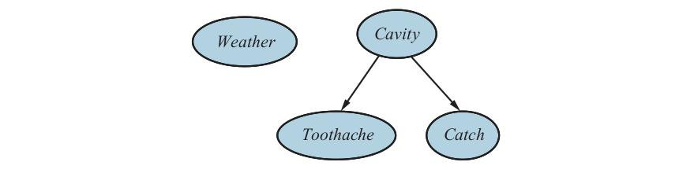

**شکل ۱۳.۱ — شبکهٔ بیزی ساده‌ای که در آن Weather از سه متغیر دیگر مستقل است و Toothache و Catch با توجه به Cavity به‌صورت شرطی مستقل‌اند.**

«توپولوژی» شبکه—مجموعهٔ گره‌ها و پیوندها—روابط استقلال شرطی برقرار در حوزه را مشخص می‌کند، به‌شیوه‌ای که به‌زودی دقیق خواهد شد. معنای شهودی پیکان معمولاً این است که X تأثیر مستقیمی روی Y دارد، که پیشنهاد می‌کند علت‌ها باید والد اثرها باشند. معمولاً برای کارشناس حوزه آسان است تصمیم بگیرد چه تأثیرهای مستقیمی در حوزه وجود دارند—در واقع بسیار آسان‌تر از مشخص‌کردن خود احتمال‌ها. پس از چیدن توپولوژی شبکهٔ بیز، فقط باید اطلاعات احتمالاتی محلی را برای هر متغیر، در قالب توزیع شرطی به‌شرط والدهایش، مشخص کنیم. توزیع مشترک کامل همهٔ متغیرها توسط توپولوژی و اطلاعات احتمالاتی محلی تعریف می‌شود. جهان سادهٔ توصیف‌شده در فصل ۱۲ را به یاد آورید، متشکل از متغیرهای Toothache، Cavity، Catch و Weather. استدلال کردیم Weather از متغیرهای دیگر مستقل است؛ علاوه بر آن، استدلال کردیم Toothache و Catch با توجه به Cavity به‌صورت شرطی مستقل‌اند. این روابط با ساختار شبکهٔ بیز نشان‌داده‌شده در شکل ۱۳.۱ بازنمایی می‌شوند.

به‌صورت صوری، استقلال شرطی Toothache و Catch با توجه به Cavity با نبود پیوند میان Toothache و Catch نشان داده می‌شود. به‌صورت شهودی، شبکه این واقعیت را بازنمایی می‌کند که Cavity علت مستقیم Toothache و Catch است، در حالی که هیچ رابطهٔ علّی مستقیمی میان Toothache و Catch وجود ندارد.

حالا مثال زیر را در نظر بگیرید که فقط کمی پیچیده‌تر است. شما دزدگیری تازه‌ای در خانه نصب کرده‌اید. در تشخیص سرقت نسبتاً قابل اعتماد است، اما گاهی با زلزله‌های کوچک به صدا در می‌آید. (این مثال از جودیا پرل است، ساکن لس‌آنجلس زلزله‌خیز.) همچنین دو همسایه دارید، جان و مری، که قول داده‌اند وقتی صدای آژیر را بشنوند در محل کار با شما تماس بگیرند. جان تقریباً همیشه وقتی صدای آژیر را می‌شنود تماس می‌گیرد، اما گاهی زنگ تلفن را با آژیر اشتباه می‌گیرد و آن‌موقع هم تماس می‌گیرد. مری، از سوی دیگر، موسیقی بلندی را دوست دارد و اغلب آژیر را کلاً از دست می‌دهد. با توجه به شواهد اینکه چه کسی تماس گرفته یا نگرفته، می‌خواهیم احتمال وقوع سرقت را برآورد کنیم.

شبکهٔ بیز این حوزه در شکل ۱۳.۲ آمده. ساختار شبکه نشان می‌دهد سرقت و زلزله مستقیماً بر احتمال به‌صدا درآمدن آژیر اثر می‌گذارند، اما اینکه جان و مری تماس بگیرند فقط به آژیر بستگی دارد. شبکه بدین ترتیب مفروضات ما را بازنمایی می‌کند: آن‌ها سرقت‌ها را مستقیماً درک نمی‌کنند، متوجه زلزله‌های کوچک نمی‌شوند، و پیش از تماس با یکدیگر مشورت نمی‌کنند. اطلاعات احتمالاتی محلی متصل به هر گره در شکل ۱۳.۲ شکل «جدول احتمال شرطی» (Conditional Probability Table یا CPT) دارد. (CPTها فقط برای متغیرهای گسسته استفاده می‌شوند؛ بازنمایی‌های دیگر، از جمله بازنمایی‌های مناسب متغیرهای پیوسته، در بخش ۱۳.۲ توصیف شده‌اند.)

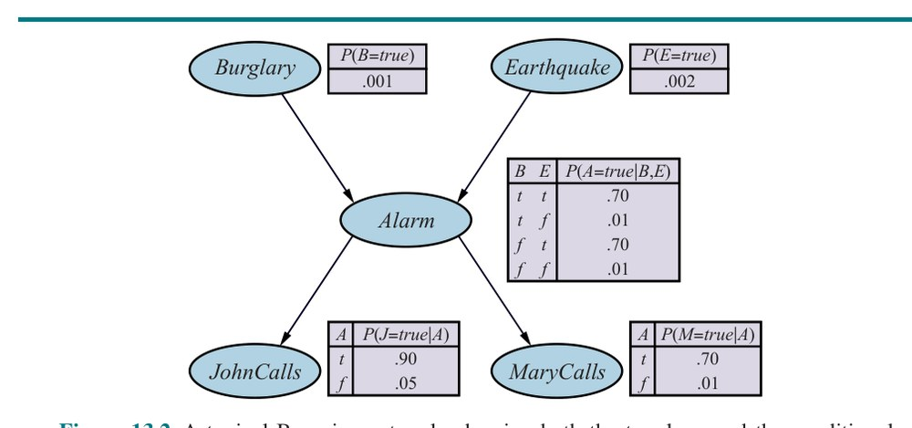

**شکل ۱۳.۲ — شبکهٔ بیزی نمونه‌ای که هم توپولوژی و هم جدول‌های احتمال شرطی (CPT) را نشان می‌دهد. در CPTها، حروف B، E، A، J و M به‌ترتیب مخفف سرقت (Burglary)، زلزله (Earthquake)، آژیر (Alarm)، تماس جان (JohnCalls) و تماس مری (MaryCalls) هستند.**

هر ردیف در یک CPT شامل احتمال شرطی هر مقدار گره برای یک «حالت شرطی» (Conditioning Case) است. حالت شرطی فقط ترکیبی ممکن از مقادیر گره‌های والد است—در واقع جهان ممکن کوچکی، اگر دوست داشته باشید. هر ردیف باید به ۱ جمع شود، زیرا درایه‌ها مجموعه‌ای استیفاگر از حالت‌ها را برای متغیر بازنمایی می‌کنند. برای متغیرهای بولی، کافی است بدانیم احتمال مقدار صادق p است؛ احتمال کاذب باید 1−p باشد، پس اغلب عدد دوم را حذف می‌کنیم، همان‌گونه که در شکل ۱۳.۲. به‌طور کلی، جدول متغیر بولی با k والد بولی شامل 2^k احتمال قابل‌مشخص‌کردن مستقل است. گرهٔ بدون والد فقط یک ردیف دارد، که احتمال‌های پیشینی هر مقدار ممکن متغیر را بازنمایی می‌کند.

توجه کنید شبکه گره‌هایی متناظر با گوش‌دادن فعلی مری به موسیقی بلند یا زنگ‌خوردن تلفن و اشتباه جان ندارد. این عوامل در عدم قطعیت مرتبط با پیوندهای Alarm به JohnCalls و MaryCalls خلاصه شده‌اند. این هر دو تنبلی و نادانی را در عمل نشان می‌دهد، چنان‌که در صفحهٔ ۳۸۶ توضیح داده شد: کار زیادی می‌برد تا بفهمیم چرا آن عوامل در هر مورد خاص کم‌وبیش محتمل‌اند، و به هر حال راه معقولی برای به‌دست‌آوردن اطلاعات مربوط نداریم.

احتمال‌ها در واقع مجموعه‌ای بالقوه نامتناهی از شرایط را خلاصه می‌کنند که در آن آژیر ممکن است به صدا درنیاید (رطوبت زیاد، قطع برق، باتری خالی، سیم‌های بریده، موش مرده‌ای گیرکرده در زنگ، و...) یا جان و مری ممکن است تماس نگیرند و گزارش ندهند (رفته‌اند ناهار، در مسافرت‌اند، موقتاً ناشنوا شده‌اند، هلیکوپتری در حال عبور است، و...). بدین ترتیب، عامل کوچک می‌تواند با جهان بسیار بزرگی کنار بیاید، دست‌کم به‌صورت تقریبی.

## ۱۳.۲ معناشناسی شبکه‌های بیزی

نحو شبکهٔ بیز شامل گراف جهتداری بدون دور با اطلاعات احتمالاتی محلی متصل به هر گره است. معناشناسی تعریف می‌کند نحو چگونه با توزیع مشترکی روی متغیرهای شبکه متناظر می‌شود.

فرض کنید شبکهٔ بیز شامل n متغیر X1,...,Xn باشد. درایه‌ای عام در توزیع مشترک سپس P(X1=x1 ∧ ... ∧ Xn=xn) است، یا به‌اختصار P(x1,...,xn). معناشناسی شبکه‌های بیز هر درایهٔ توزیع مشترک را چنین تعریف می‌کند:

```
P(x1,...,xn) = ∏ θ(xi | parents(Xi))        (13.1)
               i=1..n
```

که در آن parents(Xi) مقادیر Parents(Xi) را نشان می‌دهد که در x1,...,xn ظاهر می‌شوند. بدین‌ترتیب، هر درایه از توزیع مشترک با حاصل‌ضرب عناصر مناسب توزیع‌های شرطی محلی در شبکهٔ بیز بازنمایی می‌شود.

برای نشان‌دادن این، می‌توانیم احتمال اینکه آژیر به صدا درآمده، اما نه سرقتی رخ داده و نه زلزله‌ای، و هر دو جان و مری تماس بگیرند را محاسبه کنیم. به‌سادگی درایه‌های مربوط را از توزیع‌های شرطی محلی ضرب می‌کنیم (نام متغیرها را مخفف می‌کنیم):

```
P(j, m, a, ¬b, ¬e) = P(j|a) P(m|a) P(a|¬b ∧ ¬e) P(¬b) P(¬e)
                   = 0.90 × 0.70 × 0.01 × 0.999 × 0.998 = 0.00628
```

بخش ۱۲.۳ توضیح داد توزیع مشترک کامل می‌تواند برای پاسخ به هر پرس‌وجویی دربارهٔ حوزه استفاده شود. اگر شبکهٔ بیز بازنمایی توزیع مشترک باشد، آن‌گاه آن نیز می‌تواند برای پاسخ به هر پرس‌وجویی استفاده شود، با جمع‌زدن همهٔ مقادیر احتمال مشترک مربوط، که هر یک با ضرب احتمال‌های توزیع‌های شرطی محلی محاسبه می‌شود. بخش ۱۳.۳ این را با جزئیات بیشتر توضیح می‌دهد، اما روش‌هایی را نیز توصیف می‌کند که بسیار کارآمدترند.

تا این‌جا یک نکتهٔ مهم را از نظر انداخته‌ایم: معنای اعدادی که به توزیع‌های شرطی محلی θ(xi | parents(Xi)) می‌روند چیست؟ معلوم می‌شود از معادلهٔ (13.1) می‌توانیم اثبات کنیم پارامترهای θ(xi | parents(Xi)) دقیقاً همان احتمال‌های شرطی P(xi | parents(Xi)) هستند که توزیع مشترک دلالت می‌کند. به یاد آورید احتمال‌های شرطی را می‌توان از توزیع مشترک چنین محاسبه کرد:

```
P(xi | parents(Xi)) ≡ P(xi, parents(Xi)) / P(parents(Xi))
                   = ∑y P(xi, parents(Xi), y) / ∑x'i,y P(x'i, parents(Xi), y)
```

که در آن y مقادیر همهٔ متغیرهای به‌جز Xi و والدهایش را بازنمایی می‌کند. از این خط آخر می‌توان اثبات کرد P(xi | parents(Xi)) = θ(xi | parents(Xi)) (تمرین ۱۳.CPTE). از این رو، می‌توانیم معادلهٔ (13.1) را چنین بازنویسی کنیم:

```
P(x1,...,xn) = ∏ P(xi | parents(Xi))        (13.2)
               i=1..n
```

این بدان معناست وقتی برای توزیع‌های شرطی محلی مقادیری برآورد می‌کنیم، آن‌ها باید احتمال‌های شرطی واقعی متغیر به‌شرط والدهایش باشند. پس، برای نمونه، وقتی مشخص می‌کنیم P(JohnCalls=true | Alarm=true) = 0.90، باید چنین باشد که در حدود ۹۰٪ مواقع به‌صدا‌درآمدن آژیر، جان تماس می‌گیرد. این واقعیت که هر پارامتر شبکه معنایی دقیق بر حسب فقط مجموعه‌ای کوچک از متغیرها دارد، برای استحکام و سهولت مشخص‌کردن مدل اهمیت حیاتی دارد.

راه ساختن شبکهٔ بیز برای حوزه‌ای معین را می‌توان با یک روش کلی توصیف کرد. فرض کنید باید گره‌ها را به‌ترتیب X1,...,Xn بسازیم. معادلهٔ (13.2) می‌تواند چنین بازنویسی شود تا این ساختار خاص را بازتاب دهد:

```
P(x1,...,xn) = ∏ P(xi | parents(Xi))        (13.3)
               i=1..n
```

آنچه معادلهٔ (13.3) می‌گوید این است که شبکهٔ بیزی بازنمایی درستی از حوزه است فقط اگر هر گره با توجه به والدهایش به‌صورت شرطی مستقل از دیگر پیشینیانش در ترتیب گره‌ها باشد. می‌توانیم این شرط را با این روش برآورده کنیم:

۱. **گره‌ها:** نخست مجموعهٔ متغیرهای لازم برای مدل‌کردن حوزه را تعیین کن. حالا آن‌ها را مرتب کن، {X1,...,Xn}. هر ترتیبی کار می‌کند، اما شبکهٔ حاصل فشرده‌تر خواهد بود اگر متغیرها طوری مرتب شوند که علت‌ها بر اثرها مقدم باشند.
۲. **پیوندها:** برای i از 1 تا n: مجموعه‌ای کمینه از والدها برای Xi از میان X1,...,Xi−1 برگزین، به‌گونه‌ای که معادلهٔ (13.3) برآورده شود. برای هر والد، پیوندی از والد به Xi درج کن.
۳. **CPTها:** جدول احتمال شرطی P(Xi | Parents(Xi)) را بنویس.

به‌صورت شهودی، والدهای گرهٔ Xi باید شامل همهٔ آن گره‌های X1,...,Xi−1 باشند که مستقیماً بر Xi اثر می‌گذارند. برای نمونه، فرض کنید شبکهٔ شکل ۱۳.۲ را به‌جز انتخاب والدها برای MaryCalls کامل کرده‌ایم. MaryCalls قطعاً از وجود سرقت یا زلزله متأثر است، اما نه به‌صورت مستقیم. به‌صورت شهودی، دانش ما از حوزه می‌گوید این رخدادها فقط از طریق اثرشان بر آژیر بر رفتار تماس مری اثر می‌گذارند. همچنین، با توجه به حالت آژیر، اینکه جان تماس بگیرد هیچ تأثیری بر تماس مری ندارد. به‌صورت صوری، باور داریم اظهار استقلال شرطی زیر برقرار است:

```
P(MaryCalls | JohnCalls, Alarm, Earthquake, Burglary) = P(MaryCalls | Alarm)
```

بدین‌ترتیب، Alarm تنها گرهٔ والد MaryCalls خواهد بود.

چون هر گره فقط به گره‌های پیشین متصل است، این روش ساخت تضمین می‌کند شبکه بدون دور است. ویژگی مهم دیگر شبکه‌های بیز این است که هیچ مقدار احتمال زائدی ندارند. اگر زائدی نباشد، جایی برای ناسازگاری نیست: ناممکن است مهندس دانش یا کارشناس حوزه شبکهٔ بیزی بسازد که اصل‌های احتمال را نقض کند.

**فشردگی و ترتیب گره‌ها.** جدا از بازنمایی کامل و بدون زائد حوزه، شبکهٔ بیز اغلب می‌تواند بسیار فشرده‌تر از توزیع مشترک کامل باشد. این ویژگی است که مدیریت حوزه‌های با متغیرهای بسیار را شدنی می‌کند. فشردگی شبکه‌های بیزی نمونه‌ای از ویژگی عمومی سامانه‌های «ساختار-محلی» (Locally Structured، که «پراکنده» یا Sparse نیز نامیده می‌شوند) است. در سامانهٔ ساختار-محلی، هر زیرمؤلفه مستقیماً فقط با شمار کران‌داری از مؤلفه‌های دیگر تعامل می‌کند، صرف‌نظر از شمار کل مؤلفه‌ها. ساختار محلی معمولاً با رشد خطی به‌جای نمایی در پیچیدگی همراه است.

در مورد شبکه‌های بیز، معقول است فرض کنیم در بیشتر حوزه‌ها هر متغیر تصادفی مستقیماً حداکثر توسط k متغیر دیگر اثر می‌پذیرد، برای ثابت kای. اگر برای سادگی n متغیر بولی فرض کنیم، آنگاه میزان اطلاعات لازم برای مشخص‌کردن هر جدول احتمال شرطی حداکثر 2^k عدد خواهد بود، و کل شبکه را می‌توان با 2^k × n عدد مشخص کرد. در مقابل، توزیع مشترک شامل 2^n عدد است. برای عینیت، فرض کنیم n=30 گره داریم، هر یک با پنج والد (k=5). آنگاه شبکهٔ بیزی ۹۶۰ عدد لازم دارد، اما توزیع مشترک کامل بیش از یک میلیارد لازم دارد.

مشخص‌کردن جدول‌های احتمال شرطی برای شبکهٔ کاملاً متصل، که در آن هر متغیر همهٔ پیشینیانش را والد دارد، همان میزان اطلاعات مشخص‌کردن توزیع مشترک در شکل جدولی را لازم دارد. به همین دلیل، اغلب پیوندها را حذف می‌کنیم حتی اگر وابستگی جزیی وجود داشته باشد، زیرا افزایش جزیی دقت ارزش پیچیدگی اضافی شبکه را ندارد. برای نمونه، ممکن است کسی به شبکهٔ سرقت ما اعتراض کند که اگر زلزلهٔ بزرگی رخ دهد، جان و مری حتی اگر صدای آژیر را بشنوند تماس نخواهند گرفت، زیرا فرض می‌کنند زلزله علت است. اینکه پیوندی از Earthquake به JohnCalls و MaryCalls بیفزاییم (و بدین‌ترتیب جدول‌ها را بزرگ کنیم) بستگی به اهمیت گرفتن احتمال‌های دقیق‌تر در مقایسه با هزینهٔ مشخص‌کردن اطلاعات اضافی دارد.

حتی در حوزهٔ ساختار-محلی، فقط اگر ترتیب گره‌ها را خوب انتخاب کنیم شبکهٔ بیز فشرده‌ای خواهیم گرفت. اگر اتفاقاً ترتیب اشتباهی انتخاب کنیم چه می‌شود؟ مثال سرقت را باز در نظر بگیرید. فرض کنیم تصمیم می‌گیریم گره‌ها را به‌ترتیب MaryCalls، JohnCalls، Alarm، Burglary، Earthquake بیفزاییم. سپس شبکهٔ تا حدی پیچیده‌تر نشان‌داده‌شده در شکل ۱۳.۳(الف) را می‌گیریم. فرایند به‌صورت زیر است:

- **افزودن MaryCalls:** بدون والد.
- **افزودن JohnCalls:** اگر مری تماس بگیرد، احتمالاً آژیر به صدا درآمده، که احتمال تماس جان را بیشتر می‌کند. بنابراین، JohnCalls به MaryCalls به‌عنوان والد نیاز دارد.
- **افزودن Alarm:** بدیهی است، اگر هر دو تماس بگیرند، محتمل‌تر است آژیر به صدا درآمده باشد تا وقتی فقط یکی یا هیچ‌کدام تماس بگیرند، پس به هر دو MaryCalls و JohnCalls به‌عنوان والد نیاز داریم.
- **افزودن Burglary:** اگر حالت آژیر را بدانیم، تماس جان یا مری ممکن است به ما اطلاعاتی دربارهٔ زنگ‌خوردن تلفن‌مان یا موسیقی مری بدهد، اما نه دربارهٔ سرقت:

```
P(Burglary | Alarm, JohnCalls, MaryCalls) = P(Burglary | Alarm)
```

از این رو، فقط به Alarm به‌عنوان والد نیاز داریم.

- **افزودن Earthquake:** اگر آژیر روشن باشد، محتمل‌تر است زلزله‌ای رخ داده. (آژیر نوعی آشکارساز زلزله است.) اما اگر بدانیم سرقتی رخ داده، آن‌گاه این آژیر را تبیین می‌کند، و احتمال زلزله فقط اندکی بالاتر از حالت عادی خواهد بود. از این رو، به هر دو Alarm و Burglary به‌عنوان والد نیاز داریم.


**شکل ۱۳.۳ — ساختار شبکه و شمار پارامترها به ترتیب معرفی بستگی دارد. (الف) ساختار حاصل با ترتیب M,J,A,B,E. (ب) ساختار حاصل با ترتیب M,J,E,B,A. هر گره با شمار پارامترهای لازم برچسب‌گذاری شده؛ در مجموع ۱۳ برای (الف) و ۳۱ برای (ب). در شکل ۱۳.۲ فقط ۱۰ پارامتر لازم بود.**

شبکهٔ حاصل دو پیوند بیشتر از شبکهٔ اصلی در شکل ۱۳.۲ دارد و به ۱۳ احتمال شرطی به‌جای ۱۰ نیاز دارد. بدتر از آن، برخی پیوندها روابط سستی را بازنمایی می‌کنند که به قضاوت‌های احتمالاتی دشوار و غیرطبیعی نیاز دارند، مانند ارزیابی احتمال زلزله به‌شرط سرقت و آژیر. این پدیده کاملاً عمومی است و به تمایز میان مدل‌های علّی و تشخیصی معرفی‌شده در بخش ۱۲.۵.۱ مربوط است (همچنین تمرین ۱۳.WUMD را ببینید). اگر به مدل علّی بچسبیم، در نهایت مجبوریم اعداد کمتری مشخص کنیم، و اعداد اغلب آسان‌تر به دست می‌آیند. برای نمونه، در حوزهٔ پزشکی، تورسکی و کانمن (1982) نشان داده‌اند پزشکان متخصص ترجیح می‌دهند قضاوت احتمالاتی برای قاعده‌های علّی بدهند تا تشخیصی. بخش ۱۳.۵ ایدهٔ مدل‌های علّی را عمیق‌تر بررسی می‌کند.

شکل ۱۳.۳(ب) ترتیب گره‌ای بسیار بدی را نشان می‌دهد: MaryCalls، JohnCalls، Earthquake، Burglary، Alarm. این شبکه به ۳۱ احتمال متمایز برای مشخص‌شدن نیاز دارد—دقیقاً همان شمار توزیع مشترک کامل. اما درک این نکته مهم است که هر سه شبکه می‌توانند دقیقاً همان توزیع مشترک را بازنمایی کنند. دو نسخهٔ شکل ۱۳.۳ صرفاً در بازنمایی همهٔ روابط استقلال شرطی شکست می‌خورند و از این رو به مشخص‌کردن شمار زیادی عدد غیرضروری می‌انجامند.

### ۱۳.۲.۱ روابط استقلال شرطی در شبکه‌های بیزی

از معناشناسی شبکه‌های بیز، چنان‌که در معادلهٔ (13.2) تعریف شد، می‌توانیم شماری از ویژگی‌های استقلال شرطی را استخراج کنیم. قبلاً این ویژگی را دیده‌ایم که متغیر با توجه به والدهایش به‌صورت شرطی مستقل از دیگر پیشینیانش است. همچنین می‌توان ویژگی عمومی‌تر «غیرفرزندان» را اثبات کرد که:

**هر متغیر با توجه به والدهایش به‌صورت شرطی مستقل از «غیرفرزندان» (Non-Descendants) خود است.**


**شکل ۱۳.۴ — (الف) گرهٔ X با توجه به والدهایش (Uiهای نشان‌داده‌شده در ناحیهٔ خاکستری) به‌صورت شرطی مستقل از غیرفرزندانش (مانند Zijها) است. (ب) گرهٔ X با توجه به «پوشش مارکوف» (Markov Blanket) خود (ناحیهٔ خاکستری) به‌صورت شرطی مستقل از همهٔ گره‌های دیگر شبکه است.**

برای نمونه، در شکل ۱۳.۲، متغیر JohnCalls با توجه به مقدار Alarm مستقل از Burglary، Earthquake و MaryCalls است. تعریف در شکل ۱۳.۴(الف) نشان داده شده.

معلوم می‌شود ویژگی غیرفرزندان، همراه با تفسیر پارامترهای شبکهٔ θ(Xi | Parents(Xi)) به‌عنوان احتمال‌های شرطی P(Xi | Parents(Xi))، برای بازسازی توزیع مشترک کامل داده‌شده در معادلهٔ (13.2) کافی است. به بیان دیگر، می‌توان معناشناسی شبکه‌های بیز را به‌گونه‌ای دیگر دید: به‌جای تعریف توزیع مشترک کامل به‌عنوان حاصل‌ضرب توزیع‌های شرطی، شبکه مجموعه‌ای از ویژگی‌های استقلال شرطی را تعریف می‌کند. توزیع مشترک کامل را می‌توان از آن ویژگی‌ها استخراج کرد.

ویژگی استقلال مهم دیگری از ویژگی غیرفرزندان دلالت می‌شود:

**متغیر با توجه به والدها، فرزندان و والدهای فرزندانش—یعنی با توجه به «پوشش مارکوف» (Markov Blanket) خود—به‌صورت شرطی مستقل از همهٔ گره‌های دیگر شبکه است.**

(تمرین ۱۳.MARB از شما می‌خواهد این را اثبات کنید.) برای نمونه، متغیر Burglary با توجه به Alarm و Earthquake مستقل از JohnCalls و MaryCalls است. این ویژگی در شکل ۱۳.۴(ب) نشان داده شده. ویژگی پوشش مارکوف الگوریتم‌های استنتاجی را ممکن می‌کند که از فرایندهای نمونه‌برداری تصادفی کاملاً محلی و توزیع‌شده استفاده می‌کنند، چنان‌که در بخش ۱۳.۴.۲ توضیح داده می‌شود.

عمومی‌ترین پرسش استقلال شرطی که ممکن است در شبکهٔ بیز پرسیده شود این است که آیا مجموعه‌ای از گره‌های X با توجه به مجموعهٔ سومی از Z به‌صورت شرطی مستقل از مجموعه‌ای دیگر از Y است؟ این را می‌توان با بررسی شبکهٔ بیز برای دیدن اینکه آیا Z بین X و Y «جداسازی-d» (D-Separation) انجام می‌دهد، کارآمد تعیین کرد. فرایند به‌صورت زیر است:

۱. فقط «زیرگراف نیایی» (Ancestral Subgraph) متشکل از X، Y، Z و نیاکانشان را در نظر بگیر.
۲. بین هر جفت گرهٔ بدون پیوند که فرزند مشترکی دارند پیوند بیفزا؛ حالا «گراف اخلاقی» (Moral Graph) موسوم را داریم.
۳. همهٔ پیوندهای جهت‌دار را با پیوندهای بدون جهت جایگزین کن.
۴. اگر Z همهٔ مسیرهای میان X و Y را در گراف حاصل مسدود کند، آنگاه Z بین X و Y جداسازی-d انجام می‌دهد. در آن صورت، X با توجه به Z به‌صورت شرطی مستقل از Y است. در غیر این صورت، شبکهٔ بیز اصلی استقلال شرطی را اقتضا نمی‌کند.

به‌طور خلاصه، جداسازی-d یعنی جداسازی در زیرگراف نیایی اخلاقی‌شدهٔ بدون جهت.

با اعمال تعریف بر شبکهٔ سرقت در شکل ۱۳.۲، می‌توانیم نتیجه بگیریم Burglary و Earthquake با توجه به مجموعهٔ خالی مستقل‌اند (یعنی به‌صورت مطلق مستقل‌اند)؛ با توجه به Alarm لزوماً به‌صورت شرطی مستقل نیستند؛ و JohnCalls و MaryCalls با توجه به Alarm به‌صورت شرطی مستقل‌اند. همچنین توجه کنید ویژگی پوشش مارکوف مستقیماً از ویژگی جداسازی-d نتیجه می‌شود، زیرا پوشش مارکوف یک متغیر آن را از همهٔ متغیرهای دیگر جداسازی-d می‌کند.

### ۱۳.۲.۲ بازنمایی کارآمد توزیع‌های شرطی

حتی اگر شمار بیشینهٔ والدها k نسبتاً کوچک باشد، پرکردن CPT برای یک گره تا O(2^k) عدد و شاید تجربهٔ زیادی با همهٔ حالت‌های شرطی ممکن لازم دارد. در واقع، این یک سناریوی بدترین حالت است که در آن رابطهٔ میان والدها و فرزند کاملاً دلبخواه است. معمولاً چنین روابطی با «توزیع متعارف» (Canonical Distribution) توصیف‌شدنی‌اند که الگوی استانداردی را برازش می‌کند. در چنین مواردی، جدول کامل را می‌توان فقط با نامیدن الگو و شاید فراهم‌کردن چند پارامتر مشخص کرد.

ساده‌ترین مثال توسط «گره‌های قطعی» (Deterministic Nodes) فراهم می‌شود. گرهٔ قطعی مقدارش را دقیقاً با مقادیر والدهایش دارد، بدون هیچ عدم قطعیتی. رابطه می‌تواند منطقی باشد: برای نمونه، رابطهٔ میان گره‌های والد Canadian، US، Mexican و گرهٔ فرزند NorthAmerican صرفاً این است که فرزند فصلی از والدهاست. رابطه همچنین می‌تواند عددی باشد: برای نمونه، «بهترین قیمت» (BestPrice) برای خودرو کمینهٔ قیمت‌ها در هر نمایندگی منطقه است؛ و «آب ذخیره‌شده» (WaterStored) در مخزن در پایان سال، جمع مقدار اولیه، به‌علاوهٔ ورودی‌ها (رودها، رواناب، بارش) و منهای خروجی‌ها (رهاسازی، تبخیر، تراوش) است.

بسیاری از سامانه‌های شبکهٔ بیز به کاربر اجازه می‌دهند توابع قطعی را با زبان برنامه‌نویسی همه‌منظوره مشخص کند؛ این امکان را می‌دهد عناصر پیچیده‌ای مانند مدل‌های اقلیم جهانی یا شبیه‌سازهای شبکهٔ برق درون مدل احتمالاتی گنجانده شوند.

الگوی مهم دیگری که اغلب در عمل رخ می‌دهد «استقلال وابسته به بافت» (Context-Specific Independence) یا CSI است. توزیع شرطی اگر متغیری با توجه به مقادیر معینی از برخی والدها، به‌صورت شرطی مستقل از برخی دیگر والدهایش باشد، CSI نشان می‌دهد. برای نمونه، فرض کنیم «خسارت» (Damage) خودروی شما در دورهٔ زمانی معینی به «استحکام» (Ruggedness) خودرو و وقوع یا عدم وقوع «تصادف» (Accident) در آن دوره بستگی دارد. بدیهی است، اگر Accident کاذب باشد، آنگاه Damage، اگر باشد، به استحکام خودروی شما بستگی ندارد. (ممکن است خسارت خرابکاری به رنگ یا شیشه‌های خودرو وارد شود، اما فرض می‌کنیم همهٔ خودروها به‌یکسان در معرض چنین خسارتی‌اند.) می‌گوییم Damage به‌صورت وابسته به بافت مستقل از Ruggedness با توجه به Accident=false است. سامانه‌های شبکهٔ بیز اغلب CSI را با نحو if-then-else برای مشخص‌کردن توزیع‌های شرطی پیاده‌سازی می‌کنند؛ برای نمونه، ممکن است بنویسیم:

```
P(Damage | Ruggedness, Accident) = if (Accident = false) then d1 else d2(Ruggedness)
```

که در آن d1 و d2 توزیع‌های دلبخواه را بازنمایی می‌کنند. همانند قطعیت، وجود CSI در شبکه ممکن است استنتاج کارآمد را تسهیل کند. همهٔ الگوریتم‌های استنتاج دقیق ذکرشده در بخش ۱۳.۳ را می‌توان برای بهره‌گیری از CSI برای سرعت‌بخشیدن به محاسبه اصلاح کرد.

روابط نامطمئن اغلب با «روابط منطقی نویزی» (Noisy Logical Relationships) موسوم قابل مشخصه‌سازی‌اند. مثال استاندارد رابطهٔ «نویزی-OR» است، که تعمیمی از OR منطقی است. در منطق گزاره‌ای، ممکن است بگوییم تب (Fever) صادق است اگر و فقط اگر سرما‌خوردگی (Cold)، آنفولانزا (Flu) یا مالاریا (Malaria) صادق باشد. مدل نویزی-OR برای عدم قطعیت دربارهٔ توانایی هر والد در صادق‌شدن فرزند جا می‌گذارد—رابطهٔ علّی میان والد و فرزند ممکن است بازداشته شود، و بنابراین بیمار ممکن است سرما‌خوردگی داشته باشد اما تب نشان ندهد.

مدل دو فرض می‌کند. نخست، فرض می‌کند همهٔ علت‌های ممکن فهرست شده‌اند. (اگر برخی غایب‌اند، همیشه می‌توانیم «گرهٔ نشتی» (Leak Node) موسوم را بیفزاییم که «علت‌های متفرقه» را پوشش می‌دهد.) دوم، فرض می‌کند بازداری هر والد مستقل از بازداری هر والد دیگر است: برای نمونه، هرچه مالاریا را از ایجاد تب بازمی‌دارد مستقل از آن چیزی است که آنفولانزا را از ایجاد تب بازمی‌دارد. با این فرض‌ها، Fever کاذب است اگر و فقط اگر همهٔ والدهای صادقش بازداشته شده باشند، و احتمال این برابر حاصل‌ضرب احتمال‌های بازداری qj برای هر والد است. فرض کنیم این احتمال‌های بازداری فردی به‌صورت زیر باشند:

```
qcold = P(¬fever | cold, ¬flu, ¬malaria) = 0.6
qflu = P(¬fever | ¬cold, flu, ¬malaria) = 0.2
qmalaria = P(¬fever | ¬cold, ¬flu, malaria) = 0.1
```

سپس، از این اطلاعات و فرض‌های نویزی-OR، کل CPT قابل ساخت است. قاعدهٔ عمومی این است که:

```
P(xi | parents(Xi)) = 1 − ∏ qj        (حاصل‌ضرب روی والدهای صادق آن ردیف CPT)
                       {j: Xj = true}
```

شکل ۱۳.۵ این محاسبه را نشان می‌دهد:

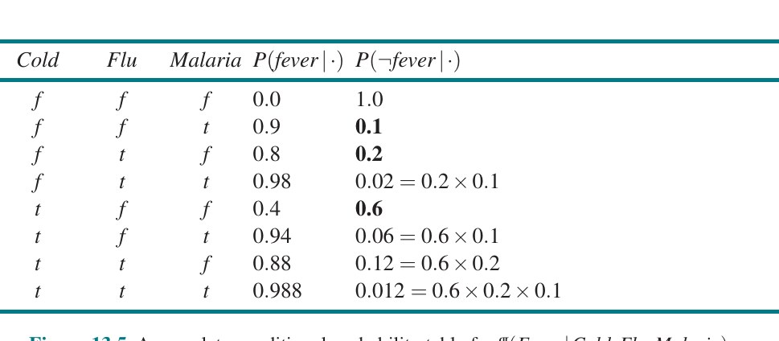

**شکل ۱۳.۵ — جدول احتمال شرطی کامل برای P(Fever|Cold,Flu,Malaria)، با فرض مدل نویزی-OR با سه مقدار q نشان‌داده‌شده به‌صورت پررنگ.**

به‌طور کلی، روابط منطقی نویزی که در آن متغیری به k والد بستگی دارد، با O(k) پارامتر به‌جای O(2^k) برای جدول احتمال شرطی کامل توصیف می‌شوند. این ارزیابی و یادگیری را بسیار آسان‌تر می‌کند. برای نمونه، شبکهٔ CPCS (پرادهان و همکاران، 1994) از توزیع‌های نویزی-OR و نویزی-MAX برای مدل‌کردن روابط میان بیماری‌ها و نشانه‌ها در طب داخلی استفاده می‌کند. با ۴۴۸ گره و ۹۰۶ پیوند، فقط به ۸٬۲۵۴ پارامتر نیاز دارد به‌جای ۱۳۳٬۹۳۱٬۴۳۰ برای شبکه‌ای با CPTهای کامل.

### ۱۳.۲.۳ شبکه‌های بیزی با متغیرهای پیوسته

بسیاری از مسائل دنیای واقعی شامل کمیت‌های پیوسته‌اند، مانند قد، جرم، دما و پول. طبق تعریف، متغیرهای پیوسته شمار نامتناهی مقدار ممکن دارند، پس مشخص‌کردن صریح احتمال‌های شرطی برای هر مقدار ناممکن است. یک راه برای مدیریت متغیرهای پیوسته «گسسته‌سازی» (Discretization) است—یعنی تقسیم مقادیر ممکن به مجموعه‌ای ثابت از بازه‌ها. برای نمونه، دماها را می‌توان به سه رده تقسیم کرد: (<0°C)، (0°C تا 100°C) و (>100°C). در انتخاب شمار رده‌ها، میان ازدست‌دادن دقت و CPTهای بزرگ که می‌توانند به زمان‌های اجرای کند بینجامند، معاوضه‌ای هست.

رویکرد دیگر تعریف متغیر پیوسته با یکی از خانواده‌های استاندارد توابع چگالی احتمال است (پیوست الف را ببینید). برای نمونه، توزیع گاوسی (یا نرمال) N(x; µ, σ²) فقط با دو پارامتر، میانگین µ و واریانس σ²، مشخص می‌شود. راه حل دیگر—که گاهی «بازنمایی ناپارامتری» (Nonparametric Representation) نامیده می‌شود—تعریف ضمنی توزیع شرطی با مجموعه‌ای از نمونه‌هاست که هر یک مقادیر خاص متغیرهای والد و فرزند را دارد. این رویکرد را بیشتر در فصل ۱۹ بررسی می‌کنیم.

شبکه‌ای با هر دو متغیر گسسته و پیوسته «شبکهٔ بیزی ترکیبی» (Hybrid Bayesian Network) نامیده می‌شود. برای مشخص‌کردن شبکهٔ ترکیبی، باید دو نوع توزیع تازه مشخص کنیم: توزیع شرطی برای متغیر پیوسته با توجه به والدهای گسسته یا پیوسته؛ و توزیع شرطی برای متغیر گسسته با توجه به والدهای پیوسته. مثال سادهٔ شکل ۱۳.۶ را در نظر بگیرید، که در آن مشتری میوه‌ای می‌خرد بسته به هزینه‌اش، که به‌نوبهٔ خود به اندازهٔ برداشت و فعال‌بودن طرح یارانهٔ دولت بستگی دارد. متغیر Cost پیوسته است و والدهای پیوسته و گسسته دارد؛ متغیر Buys گسسته است و والد پیوسته دارد.

برای متغیر Cost، باید P(Cost | Harvest, Subsidy) را مشخص کنیم. والد گسسته با شمارش مدیریت می‌شود—یعنی با مشخص‌کردن هر دو P(Cost | Harvest, subsidy) و P(Cost | Harvest, ¬subsidy). برای مدیریت Harvest، مشخص می‌کنیم توزیع روی هزینهٔ c چگونه به مقدار پیوستهٔ h از Harvest بستگی دارد. به بیان دیگر، پارامترهای توزیع هزینه را به‌عنوان تابعی از h مشخص می‌کنیم. رایج‌ترین انتخاب «توزیع شرطی خطی–گاوسی» (Linear–Gaussian) است، که در آن فرزند توزیع گاوسی دارد که میانگین µ آن با مقدار والد به‌صورت خطی تغییر می‌کند و انحراف معیار σ آن ثابت است. به دو توزیع نیاز داریم، یکی برای subsidy و یکی برای ¬subsidy، با پارامترهای متفاوت:

```
P(c | h, subsidy)    = N(c; at·h + bt, σt²)  = 1/(σt√2π) · e^(−(1/2)((c−(at·h+bt))/σt)²)
P(c | h, ¬subsidy)   = N(c; af·h + bf, σf²)  = 1/(σf√2π) · e^(−(1/2)((c−(af·h+bf))/σf)²)
```

پس برای این مثال، توزیع شرطی Cost با نامیدن توزیع خطی–گاوسی و فراهم‌کردن پارامترهای at، bt، σt، af، bf و σf مشخص می‌شود. شکل‌های ۱۳.۷(الف) و (ب) این دو رابطه را نشان می‌دهند. توجه کنید در هر مورد شیب c بر حسب h منفی است، زیرا با بزرگ‌شدن برداشت هزینه کاهش می‌یابد. (البته، فرض خطی بودن دلالت دارد هزینه در نقطه‌ای منفی می‌شود؛ مدل خطی فقط اگر اندازهٔ برداشت به بازه‌ای باریک محدود باشد معقول است.) شکل ۱۳.۷(ج) توزیع P(c|h) را نشان می‌دهد، با میانگین‌گیری روی دو مقدار ممکن Subsidy و فرض اینکه هر یک احتمال پیشینی 0.5 دارد. این نشان می‌دهد حتی با مدل‌های بسیار ساده، توزیع‌های کاملاً جالبی قابل بازنمایی‌اند.

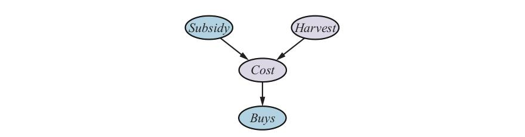

**شکل ۱۳.۶ — شبکهٔ ساده‌ای با متغیرهای گسسته (Subsidy و Buys) و متغیرهای پیوسته (Harvest و Cost).**

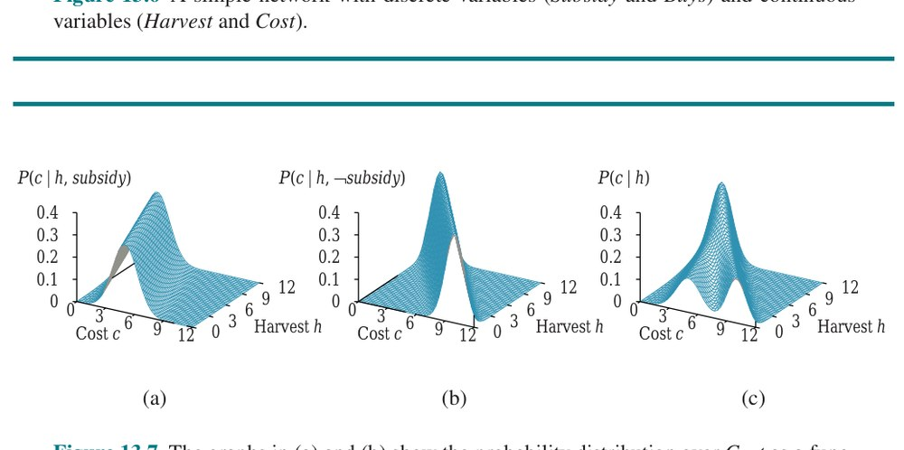

**شکل ۱۳.۷ — نمودارهای (الف) و (ب) توزیع احتمال روی Cost را به‌عنوان تابعی از اندازهٔ Harvest نشان می‌دهند، با Subsidy به‌ترتیب صادق و کاذب. نمودار (ج) توزیع P(Cost|Harvest) را نشان می‌دهد، که با جمع‌زدن روی دو حالت یارانه به دست آمده.**

توزیع شرطی خطی–گاوسی ویژگی‌های خاصی دارد. شبکه‌ای که فقط متغیرهای پیوسته با توزیع‌های خطی–گاوسی دارد، توزیع مشترکی دارد که «توزیع گاوسی چندمتغیره» (Multivariate Gaussian) روی همهٔ متغیرهاست (پیوست الف را ببینید؛ تمرین ۱۳.LGEX). علاوه بر این، توزیع پسینی با توجه به هر شواهدی نیز این ویژگی را دارد.² وقتی متغیرهای گسسته به‌عنوان والد (نه فرزند) متغیرهای پیوسته افزوده می‌شوند، شبکه توزیع «گاوسی شرطی» (Conditional Gaussian) یا CG تعریف می‌کند: با توجه به هر تخصیصی به متغیرهای گسسته، توزیع روی متغیرهای پیوسته گاوسی چندمتغیره است.

حالا به توزیع‌های متغیرهای گسسته با والدهای پیوسته می‌پردازیم. گرهٔ Buys در شکل ۱۳.۶ را در نظر بگیرید. معقول به نظر می‌رسد فرض کنیم مشتری اگر هزینه کم باشد می‌خرد و اگر زیاد باشد نمی‌خرد و احتمال خرید در منطقه‌ای میانی به‌صورت هموار تغییر می‌کند. به بیان دیگر، توزیع شرطی مانند تابع «آستانهٔ نرم» (Soft Threshold) است. یکی از راه‌های ساخت آستانهٔ نرم استفاده از انتگرال توزیع نرمال استاندارد است:

```
Φ(x) = ∫₋∞ˣ N(s; 0, 1) ds
```

از این نتیجه می‌شود استنتاج در شبکه‌های خطی–گاوسی در بدترین حالت فقط O(n³) زمان می‌برد، صرف‌نظر از توپولوژی شبکه. در بخش ۱۳.۳ می‌بینیم استنتاج برای شبکه‌های متغیر گسسته NP-سخت است.

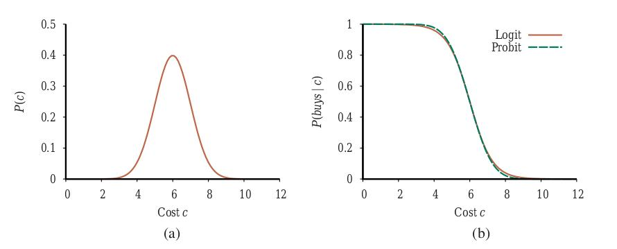

**شکل ۱۳.۸ — (الف) توزیع نرمال (گاوسی) برای آستانهٔ هزینه، متمرکز بر µ=6.0 با انحراف معیار σ=1.0. (ب) مدل‌های اکسپیت و پروبیت برای احتمال خرید به‌شرط هزینه، برای پارامترهای µ=6.0 و σ=1.0.**

Φ(x) تابعی صعودی از x است، در حالی که احتمال خرید با هزینه کاهش می‌یابد، پس در این‌جا تابع را برمی‌گردانیم:

```
P(buys | Cost=c) = 1 − Φ((c − µ)/σ)
```

که بدان معناست آستانهٔ هزینه حدود µ رخ می‌دهد، پهنای ناحیهٔ آستانه متناسب با σ است، و احتمال خرید با افزایش هزینه کاهش می‌یابد. این «مدل پروبیت» (Probit؛ تلفظ «پرو-بیت»، مخفف «واحد احتمال») در شکل ۱۳.۸(الف) نشان داده شده. شکل را می‌توان چنین توجیه کرد که فرایند تصمیم زیربنایی آستانه‌ای سخت دارد، اما مکان دقیق آستانه در معرض نویز تصادفی گاوسی است.

جایگزین مدل پروبیت «مدل اکسپیت» (Expit) یا «لاجیت معکوس» (Inverse Logit) است. از «تابع لجستیک» (Logistic Function) 1/(1+e^(−x)) برای تولید آستانهٔ نرم استفاده می‌کند—هر x را به مقداری بین ۰ و ۱ نگاشت می‌کند. باز، برای مثال ما، آن را برمی‌گردانیم تا تابعی نزولی بسازیم؛ همچنین توان را در 4/√(2π) مقیاس می‌کنیم تا با شیب پروبیت در میانگین هم‌خوان شود:

```
P(buys | Cost=c) = 1 − 1/(1 + exp(−(4/√(2π)) · (c − µ)/σ))
```

این در شکل ۱۳.۸(ب) نشان داده شده. دو توزیع مشابه به نظر می‌رسند، اما لاجیت در واقع «دنباله‌های» بسیار بلندتری دارد. پروبیت اغلب برازش بهتری برای موقعیت‌های واقعی است، اما تابع لجستیک گاهی از نظر ریاضی آسان‌تر است. در یادگیری ماشین به‌طور گسترده استفاده می‌شود. هر دو مدل را می‌توان با گرفتن ترکیب خطی مقادیر والدها برای مدیریت چند والد پیوسته تعمیم داد. این برای والدهای گسسته نیز کار می‌کند اگر مقادیرشان اعداد صحیح باشند؛ برای نمونه، با k والد بولی، که هر یک مقادیر 0 یا 1 دارد، ورودی توزیع اکسپیت یا پروبیت ترکیب خطی وزندار با k پارامتر خواهد بود، که مدلی کاملاً مشابه مدل نویزی-OR بحث‌شدهٔ پیشین به دست می‌دهد.

### ۱۳.۲.۴ مطالعهٔ موردی: بیمهٔ خودرو

شرکت بیمهٔ خودرو درخواستی از فردی برای بیمه‌کردن خودرویی خاص دریافت می‌کند و باید دربارهٔ حق بیمهٔ سالانهٔ مناسب تصمیم بگیرد، بر اساس خسارت‌های موردانتظاری که برای این متقاضی پرداخت خواهد کرد. تکلیف ساخت شبکهٔ بیزی است که ساختار علّی حوزه را در بر بگیرد و توزیعی دقیق و به‌خوبی کالیبره‌شده روی متغیرهای خروجی با توجه به شواهد موجود در فرم درخواست ارائه دهد.³ شبکهٔ بیزی شامل متغیرهای پنهان خواهد بود که نه متغیر ورودی‌اند و نه متغیر خروجی، اما برای ساختاردهی به شبکه به‌گونه‌ای که به‌طور معقولی تنک و با تعداد پارامترهای قابل‌مدیریت باشد ضروری‌اند. متغیرهای پنهان در شکل ۱۳.۹ با رنگ قهوه‌ای سایه‌زده شده‌اند.

خسارت‌هایی که باید پرداخت شوند—در شکل ۱۳.۹ با رنگ یاسی سایه‌زده شده‌اند—از سه نوع‌اند: هزینهٔ پزشکی (MedicalCost) برای هرگونه جراحت دیده‌شده توسط متقاضی؛ هزینهٔ مسئولیت (LiabilityCost) برای دعاوی اقامه‌شده توسط دیگران علیه متقاضی و شرکت بیمه؛ و هزینهٔ اموال (PropertyCost) برای خسارت وارد به خودروی هر یک از طرفین و از دست رفتن خودرو در اثر سرقت. فرم درخواست اطلاعات ورودی زیر را می‌پرسد (گره‌های آبی روشن در شکل ۱۳.۹):

• **دربارهٔ متقاضی:** سن (Age)؛ سال‌های دارای گواهینامه (YearsLicensed)—مدت‌زمانی که از نخستین دریافت گواهینامهٔ رانندگی می‌گذرد؛ سابقهٔ رانندگی (DrivingRecord)—خلاصه‌ای، احتمالاً بر پایهٔ «امتیاز منفی»، از تصادف‌ها و تخلف‌های رانندگی اخیر؛ و (برای دانشجویان و دانش‌آموزان) شاخص دانش‌آموز ممتاز (GoodStudent) برای معدل ۳.۰ (B) در مقیاس ۴ نمره‌ای.
• **دربارهٔ خودرو:** مدل و سازنده (MakeModel) و سال ساخت (VehicleYear)؛ اینکه آیا کیسهٔ هوا (Airbag) دارد؛ و خلاصه‌ای از ویژگی‌های ایمنی (SafetyFeatures) مانند ترمز ضدقفل و هشدار برخورد.
• **دربارهٔ وضعیت رانندگی:** مسافت طی‌شدهٔ سالانه (Mileage) و اینکه خودرو با چه میزان امنیت در پارکینگ یا گاراژ پارک می‌شود (Garaged)، اگر اصلاً پارکینگی باشد؛ و خودروی اضافه (ExtraCar)—اینکه آیا متقاضی وسیلهٔ نقلیهٔ دیگری برای رفت‌وآمد روزمره دارد یا خیر.

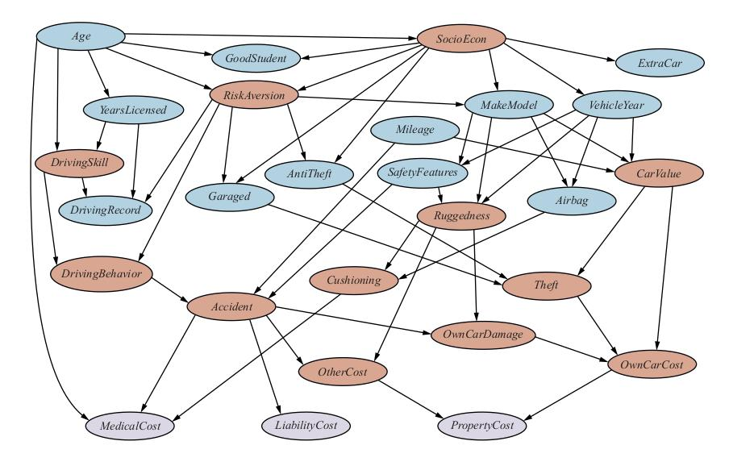

**شکل ۱۳.۹ — شبکهٔ بیزی برای ارزیابی درخواست‌های بیمهٔ خودرو.**

اکنون باید بیاندیشیم چگونه این متغیرها را در یک ساختار علّی سازمان‌دهی کنیم. متغیرهای پنهان کلیدی این هستند که آیا سرقت (Theft) یا تصادفی (Accident) در دورهٔ زمانی بعد رخ خواهد داد یا خیر. بدیهی است نمی‌توان از متقاضی خواست این‌ها را پیش‌بینی کند؛ بلکه باید از اطلاعات موجود و تجربهٔ پیشین بیمه‌گر استنباط شوند.

عوامل علّی منتهی به سرقت (Theft) کدام‌اند؟ قطعاً MakeModel مهم است—برخی مدل‌ها بسیار بیشتر از بقیه سرقت می‌شوند زیرا بازار فروش مجدد کارآمدی برای خودروها و قطعات یدکی دارند؛ CarValue (ارزش خودرو) نیز مهم است، زیرا خودروی فرسوده، کهنه یا با کارکرد بالا ارزش فروش مجدد کمتری دارد. افزون بر این، خودرویی که در گاراژ پارک می‌شود (Garaged) و دستگاه ضدسرقت (AntiTheft) دارد، سرقتش دشوارتر است. متغیر پنهان CarValue به‌نوبهٔ خود به MakeModel، سال ساخت (VehicleYear) و کارکرد (Mileage) بستگی دارد. همچنین CarValue میزان خسارت وارده را هنگام وقوع سرقت دیکته می‌کند، پس یکی از عوامل تشکیل‌دهندهٔ OwnCarCost (هزینهٔ خودروی خود) است (عامل دیگر تصادف است که اندکی بعد به آن خواهیم پرداخت).

در مدل‌هایی از این دست متداول است که متغیر پنهان دیگری به نام SocioEcon (طبقهٔ اجتماعی-اقتصادی متقاضی) معرفی شود. پنداشته می‌شود که این متغیر بر دامنهٔ گسترده‌ای از رفتارها و ویژگی‌ها اثر می‌گذارد. در مدل ما، هیچ شاهد مستقیمی در قالب متغیرهای مشاهده‌شدهٔ درآمد و شغل وجود ندارد؛⁴ اما SocioEcon بر MakeModel و VehicleYear اثر می‌گذارد؛ همچنین بر ExtraCar و GoodStudent تأثیر دارد، و تا حدی به سن (Age) وابسته است.

برای هر شرکت بیمه‌ای، شاید مهم‌ترین متغیر پنهان RiskAversion (ریسک‌گریزی) باشد: افرادی که ریسک‌گریزند ریسک بیمه‌ای خوبی‌اند! Age و SocioEcon بر RiskAversion اثر می‌گذارند، و «نشانه‌های» آن شامل انتخاب متقاضی است که آیا خودرو در گاراژ پارک می‌شود (Garaged) و آیا دستگاه‌های ضدسرقت (AntiTheft) و ویژگی‌های ایمنی (SafetyFeatures) دارد.

در پیش‌بینی تصادف‌های آینده، کلید، «رفتار رانندگی» (DrivingBehavior) آیندهٔ متقاضی است، که هم از RiskAversion و هم از «مهارت رانندگی» (DrivingSkill) متأثر است؛ دومی به‌نوبهٔ خود به Age و «سال‌های گواهینامه» (YearsLicensed) بستگی دارد. رفتار رانندگی گذشتهٔ متقاضی در «سابقهٔ رانندگی» (DrivingRecord) بازتاب می‌یابد، که همچنین به RiskAversion و DrivingSkill و نیز YearsLicensed بستگی دارد (زیرا کسی که تازه رانندگی را شروع کرده ممکن است فرصت انباشتن فهرست بلندی از تصادف‌ها و تخلف‌ها را نداشته باشد). بدین‌ترتیب، DrivingRecord شواهدی دربارهٔ RiskAversion و DrivingSkill فراهم می‌کند، که به‌نوبهٔ خود به پیش‌بینی DrivingBehavior آینده کمک می‌کنند.

می‌توانیم DrivingBehavior را گرایش سرانهٔ هر کیلومتر به رانندگی مستعد تصادف بدانیم؛ اینکه آیا در دورهٔ زمانی ثابتی واقعاً «تصادفی» (Accident) رخ می‌دهد نیز به «مسافت سالانه» (Mileage) و «ویژگی‌های ایمنی» (SafetyFeatures) خودرو بستگی دارد. اگر تصادفی رخ دهد، سه نوع هزینه هست: «هزینهٔ پزشکی» (MedicalCost) برای متقاضی به Age و «محافظت» (Cushioning) بستگی دارد، که به‌نوبهٔ خود به «استحکام» (Ruggedness) خودرو و داشتن «کیسهٔ هوا» (Airbag) بستگی دارد؛ «هزینهٔ مسئولیت» (LiabilityCost) (پزشکی، درد و رنج، ازدست‌رفتن درآمد و...) برای رانندهٔ دیگر؛ و «هزینهٔ اموال» (PropertyCost) برای متقاضی و رانندهٔ دیگر، که هر دو (به‌شیوه‌های متفاوت) به استحکام خودرو و «ارزش خودروی» (CarValue) متقاضی بستگی دارند.

نوع استدلالی را نشان داده‌ایم که به توسعهٔ توپولوژی و متغیرهای پنهان در شبکهٔ بیز می‌رود. همچنین باید بردها و توزیع‌های شرطی را برای هر متغیر مشخص کنیم. برای بردها، تصمیم اصلی اغلب این است که متغیر را گسسته کنیم یا پیوسته. برای نمونه، استحکام خودرو می‌تواند متغیر پیوسته‌ای بین ۰ و ۱ باشد، یا متغیر گسسته‌ای با برد {TinCan, Normal, Tank} (قوطی‌حلبی، معمولی، تانک).

برخی شرکت‌های بیمه همچنین سابقهٔ اعتباری متقاضی را برای کمک به ارزیابی ریسک به دست می‌آورند؛ این اطلاعات بسیار بیشتری دربارهٔ ردهٔ اقتصادی-اجتماعی فراهم می‌کند. هرگاه از این نوع متغیرهای پنهان استفاده می‌کنیم، باید مراقب باشیم ناخواسته به جانشین متغیرهایی مانند نژاد تبدیل نشوند که ممکن است در تصمیم‌های بیمه استفاده نشوند. فنون اجتناب از این نوع سوگیری‌ها در فصل ۱۹ توصیف شده‌اند.

متغیرهای پیوسته دقت بیشتری فراهم می‌کنند، اما استنتاج دقیق را به‌جز در چند مورد خاص ناممکن می‌کنند. متغیر گسسته با مقادیر ممکن بسیار می‌تواند پرکردن جدول‌های احتمال شرطی متناظر بزرگ را ملال‌آور کند و استنتاج دقیق را گران‌تر کند، مگر اینکه مقدار متغیر همیشه مشاهده شود. برای نمونه، MakeModel در سامانهٔ واقعی هزاران مقدار ممکن خواهد داشت، و این باعث می‌شود فرزندش CarValue CPT عظیمی داشته باشد که باید از پایگاه‌داده‌های صنعت پر شود؛ اما، چون MakeModel همیشه مشاهده می‌شود، این به پیچیدگی استنتاج نمی‌افزاید: در واقع، مقادیر مشاهده‌شدهٔ سه والد دقیقاً یک ردیف مربوط از CPT CarValue را برمی‌گزینند. توزیع‌های شرطی مدل در مخزن کد کتاب داده شده‌اند؛ نسخه‌ای فقط با متغیرهای گسسته فراهم می‌کنیم که استنتاج دقیق برایش قابل انجام است. در عمل، بسیاری از متغیرها پیوسته خواهند بود و توزیع‌های شرطی از داده‌های تاریخی متقاضیان و خسارت‌های بیمه‌شان یاد گرفته می‌شوند. خواهیم دید چگونه مدل‌های شبکهٔ بیز را از داده‌ها در فصل ۲۰ یاد بگیریم.

پرسش نهایی، البته، این است که چگونه در شبکه برای پیش‌بینی استنتاج کنیم. حالا به این پرسش می‌پردازیم. برای هر روش استنتاجی که توصیف می‌کنیم، روش را روی شبکهٔ بیمه ارزیابی می‌کنیم تا نیازهای زمانی و فضایی روش را بسنجیم.

## ۱۳.۳ استنتاج دقیق در شبکه‌های بیزی

تکلیف پایهٔ هر سامانهٔ استنتاج احتمالاتی محاسبهٔ توزیع احتمال پسینی برای مجموعه‌ای از متغیرهای پرس‌وجو، با توجه به «رخداد» (Event) مشاهده‌شده‌ای—معمولاً تخصیصی از مقادیر به مجموعه‌ای از متغیرهای شاهد—است.⁵ برای ساده‌کردن ارائه، فقط یک متغیر پرس‌وجو را در هر زمان در نظر می‌گیریم؛ الگوریتم‌ها را می‌توان به‌آسانی به پرس‌وجوهای چندمتغیره بسط داد. (برای نمونه، می‌توانیم پرس‌وجوی P(U,V|e) را با ضرب P(V|e) در P(U|V,e) حل کنیم.) از نماد فصل ۱۲ استفاده می‌کنیم: X متغیر پرس‌وجو را نشان می‌دهد؛ E مجموعهٔ متغیرهای شاهد E1,...,Em را نشان می‌دهد و e رخداد مشاهده‌شدهٔ خاصی است؛ Y متغیرهای پنهان (غیرشاهد، غیرپرس‌وجو) Y1,...,Yℓ را نشان می‌دهد. بدین‌ترتیب، مجموعهٔ کامل متغیرها {X}∪E∪Y است. پرس‌وجوی نمونه‌ای توزیع احتمال پسینی P(X|e) را می‌پرسد.

در شبکهٔ سرقت، ممکن است رخدادی را مشاهده کنیم که در آن JohnCalls=true و MaryCalls=true. سپس می‌توانیم مثلاً بپرسیم احتمال وقوع سرقت چقدر است:

```
P(Burglary | JohnCalls=true, MaryCalls=true) = ⟨0.284, 0.716⟩
```

در این بخش الگوریتم‌های دقیق محاسبهٔ احتمال‌های پسینی و نیز پیچیدگی این تکلیف را بحث می‌کنیم. معلوم می‌شود حالت عمومی ناشدنی است، پس بخش ۱۳.۴ روش‌های استنتاج تقریبی را پوشش می‌دهد.

### ۱۳.۳.۱ استنتاج با شمارش

فصل ۱۲ توضیح داد هر احتمال شرطی را می‌توان با جمع‌زدن جمله‌ها از توزیع مشترک کامل محاسبه کرد. به‌طور خاص‌تر، پرس‌وجوی P(X|e) را می‌توان با معادلهٔ (12.9) پاسخ داد، که برای راحتی این‌جا تکرار می‌کنیم:

```
P(X|e) = α P(X, e) = α ∑y P(X, e, y)
```

حالا، شبکهٔ بیز بازنمایی کاملی از توزیع مشترک کامل می‌دهد. به‌طور خاص‌تر، معادلهٔ (13.2) در صفحهٔ ۴۱۵ نشان می‌دهد جمله‌های P(x,e,y) در توزیع مشترک را می‌توان به‌صورت حاصل‌ضرب احتمال‌های شرطی شبکه نوشت. بنابراین، پرس‌وجو را می‌توان با شبکهٔ بیز با محاسبهٔ جمع حاصل‌ضرب‌های احتمال‌های شرطی شبکه پاسخ داد. پرس‌وجوی P(Burglary | JohnCalls=true, MaryCalls=true) را در نظر بگیرید. متغیرهای پنهان این پرس‌وجو Earthquake و Alarm هستند. از معادلهٔ (12.9)، با استفاده از حرف نخست متغیرها برای کوتاه‌کردن عبارت‌ها:

```
P(B|j, m) = α P(B, j, m) = α ∑e ∑a P(B, j, m, e, a)
```

معناشناسی شبکه‌های بیز (معادلهٔ (13.2)) سپس عبارتی بر حسب درایه‌های CPT به ما می‌دهد. برای سادگی، این را فقط برای Burglary=true انجام می‌دهیم:

```
P(b|j, m) = α ∑e ∑a P(b) P(e) P(a|b, e) P(j|a) P(m|a)        (13.4)
```

برای محاسبهٔ این عبارت، باید چهار جمله بیفزاییم، که هر یک با ضرب پنج عدد محاسبه می‌شود. در بدترین حالت، که در آن باید تقریباً همهٔ متغیرها را حذف کنیم، O(2ⁿ) جمله در جمع خواهد بود، که هر یک حاصل‌ضرب O(n) مقدار احتمال است. پیاده‌سازی اولیه بنابراین پیچیدگی O(n2ⁿ) خواهد داشت.

این را می‌توان با بهره‌گیری از ساختار تودرتو محاسبه به O(2ⁿ) کاهش داد. در بیان نمادین، این یعنی جابه‌جا کردن جمع‌ها به درون، تا آن‌جا که ممکن است، در عبارت‌هایی مانند معادلهٔ (13.4). می‌توانیم این کار را بکنیم، زیرا همهٔ عامل‌های حاصل‌ضرب احتمال‌ها به همهٔ متغیرها وابسته نیستند. بدین‌ترتیب:

```
P(b|j, m) = α P(b) ∑e P(e) ∑a P(a|b, e) P(j|a) P(m|a)        (13.5)
```

این عبارت را می‌توان با حلقه‌زدن روی متغیرها به‌ترتیب و ضرب درایه‌های CPT در طول مسیر ارزیابی کرد. برای هر جمع، همچنین باید روی مقادیر ممکن متغیر حلقه بزنیم. ساختار این محاسبه در شکل ۱۳.۱۰ به‌صورت درخت نشان داده شده. با اعداد شکل ۱۳.۲، P(b|j,m) = α × 0.00059224 به دست می‌آوریم. محاسبهٔ متناظر برای ¬b مقدار α × 0.0014919 می‌دهد؛ از این رو:

```
P(B|j, m) = α ⟨0.00059224, 0.0014919⟩ ≈ ⟨0.284, 0.716⟩
```

یعنی شانس سرقت، با توجه به تماس هر دو همسایه، حدود ۲۸٪ است.

الگوریتم ENUMERATION-ASK در شکل ۱۳.۱۱ این درخت‌های عبارت را با بازگشت عمق-اول چپ-به-راست ارزیابی می‌کند. الگوریتم از نظر ساختار بسیار شبیه الگوریتم پس‌گرد برای حل CSPها (شکل ۶.۵) و الگوریتم DPLL برای ارضاپذیری (شکل ۷.۱۷) است. پیچیدگی فضایی‌اش فقط در شمار متغیرها خطی است: الگوریتم روی توزیع مشترک کامل جمع می‌زند بدون آنکه هرگز آن را صریحاً بسازد. متأسفانه، پیچیدگی زمانی‌اش برای شبکه‌ای با n متغیر بولی (بدون شمردن متغیرهای شاهد) همیشه O(2ⁿ) است—بهتر از O(n2ⁿ) رویکرد سادهٔ توصیف‌شدهٔ پیشین، اما همچنان نسبتاً ناخوشایند. برای شبکهٔ بیمه در شکل ۱۳.۹، که نسبتاً کوچک است، استنتاج دقیق با شمارش برای پرس‌وجوی نمونه‌ای روی متغیرهای هزینه حدود ۲۲۷ میلیون عملیات حسابی لازم دارد. اگر به درخت شکل ۱۳.۱۰ با دقت نگاه کنید، با این حال، خواهید دید شامل زیرعبارت‌های تکراری است. حاصل‌ضرب‌های P(j|a)P(m|a) و P(j|¬a)P(m|¬a) دو بار محاسبه می‌شوند، یک بار برای هر مقدار E. کلید استنتاج کارآمد در شبکه‌های بیز پرهیز از چنین محاسبه‌های هدررفته‌ای است. بخش بعد روشی عمومی برای این کار توصیف می‌کند.

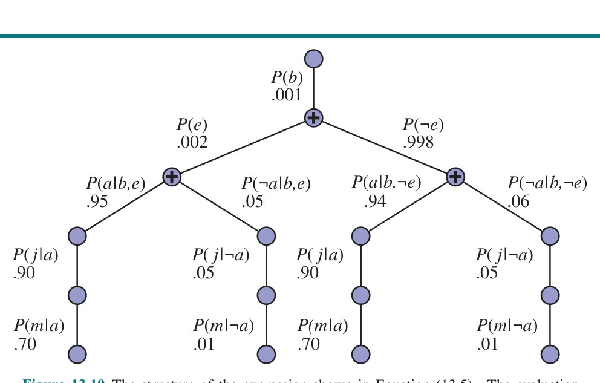

**شکل ۱۳.۱۰ — ساختار عبارت نشان‌داده‌شده در معادلهٔ (13.5). ارزیابی از بالا به پایین پیش می‌رود، مقادیر را در طول هر مسیر ضرب می‌کند و در گره‌های «+» جمع می‌زند. تکرار مسیرهای j و m را توجه کنید.**

```
function ENUMERATION-ASK(X, e, bn) returns a distribution over X
  inputs: X, the query variable
          e, observed values for the variables E
          bn, a Bayesian network with variables vars
  Q(X) ← a distribution over X, initially empty
  for each value xi of X:
      Q(xi) ← ENUMERATE-ALL(vars, exi)     where exi is the same as e with X = xi added
  return NORMALIZE(Q(X))

function ENUMERATE-ALL(vars, e) returns a real number
  if EMPTY?(vars) then return 1.0
  V ← FIRST(vars)
  if V is an evidence variable with value v in e
      then return P(v | parents(V)) × ENUMERATE-ALL(REST(vars), e)
      else return ∑v P(v | parents(V)) × ENUMERATE-ALL(REST(vars), ev)
           where ev is the same as e with V = v added
```

**شکل ۱۳.۱۱ — الگوریتم شمارش برای استنتاج دقیق در شبکه‌های بیز.**

### ۱۳.۳.۲ الگوریتم حذف متغیر

الگوریتم شمارش را می‌توان با حذف محاسبه‌های تکراری از نوع نشان‌داده‌شده در شکل ۱۳.۱۰ به‌طور قابل‌ملاحظه‌ای بهبود داد. ایده ساده است: محاسبه را یک بار انجام بده و نتایج را برای استفادهٔ بعدی ذخیره کن. این نوعی «برنامه‌نویسی پویا» (Dynamic Programming) است. چند نسخه از این رویکرد هست؛ ما «الگوریتم حذف متغیر» (Variable Elimination) را ارائه می‌کنیم که ساده‌ترین است. حذف متغیر با ارزیابی عبارت‌هایی مانند معادلهٔ (13.5) در ترتیب راست-به-چپ (یعنی از پایین به بالا در شکل ۱۳.۱۰) کار می‌کند. نتایج میانی ذخیره می‌شوند و جمع‌زدن روی هر متغیر فقط برای آن بخش‌هایی از عبارت انجام می‌شود که به متغیر وابسته‌اند. این فرایند را برای شبکهٔ سرقت نشان می‌دهیم. عبارت P(B|j,m) را ارزیابی می‌کنیم:

```
P(B|j,m) = α P(B) ∑e P(e) ∑a P(a|B,e) P(j|a) P(m|a)
              ─f1(B)─  ─f2(E)─  ───f3(A,B,E)───  ─f4(A)─  ─f5(A)─
```

توجه کنید هر بخش از عبارت را با نام «عامل» (Factor) متناظرش برچسب‌گذاری کرده‌ایم؛ هر عامل ماتریسی است که با مقادیر متغیرهای آرگومانش نمایه می‌شود. برای نمونه، عامل‌های f4(A) و f5(A) متناظر با P(j|a) و P(m|a) فقط به A وابسته‌اند، زیرا J و M توسط پرس‌وجو ثابت شده‌اند. آن‌ها بنابراین بردارهای دوعنصری‌اند:

```
f4(A) = ⟨P(j|a), P(j|¬a)⟩ = ⟨0.90, 0.05⟩
f5(A) = ⟨P(m|a), P(m|¬a)⟩ = ⟨0.70, 0.01⟩
```

f3(A,B,E) ماتریس 2×2×2 خواهد بود، که نشان‌دادنش در صفحهٔ چاپی دشوار است. (عنصر «نخست» با P(a|b,e)=0.95 و «آخرین» با P(¬a|¬b,¬e)=0.999 داده می‌شود.) بر حسب عامل‌ها، عبارت پرس‌وجو چنین نوشته می‌شود:

```
P(B|j,m) = α f1(B) × ∑e f2(E) × ∑a f3(A,B,E) × f4(A) × f5(A)
```

در این‌جا عملگر «×» ضرب معمولی ماتریسی نیست، بلکه عمل «ضرب نقطه‌ای» (Pointwise Product) است، که به‌زودی توصیف خواهد شد.

فرایند ارزیابی متغیرها را (راست به چپ) از حاصل‌ضرب‌های نقطه‌ای عامل‌ها خارج می‌کند تا عامل‌های تازه تولید شوند، و سرانجام عاملی به دست می‌آید که راه‌حل را می‌سازد—یعنی توزیع پسینی روی متغیر پرس‌وجو. گام‌ها به‌صورت زیرند:

- نخست، A را از حاصل‌ضرب f3، f4 و f5 خارج می‌کنیم. این عامل تازهٔ 2×2 به نام f6(B,E) می‌دهد که نمایه‌هایش فقط روی B و E می‌روند:

```
f6(B,E) = ∑a f3(A,B,E) × f4(A) × f5(A)
        = (f3(a,B,E) × f4(a) × f5(a)) + (f3(¬a,B,E) × f4(¬a) × f5(¬a))
```

حالا با عبارت P(B|j,m) = α f1(B) × ∑e f2(E) × f6(B,E) رها شده‌ایم.

- بعد، E را از حاصل‌ضرب f2 و f6 خارج می‌کنیم:

```
f7(B) = ∑e f2(E) × f6(B,E) = f2(e) × f6(B,e) + f2(¬e) × f6(B,¬e)
```

این عبارت P(B|j,m) = α f1(B) × f7(B) را باقی می‌گذارد، که می‌توان با گرفتن ضرب نقطه‌ای و نرمال‌سازی نتیجه ارزیابی کرد.

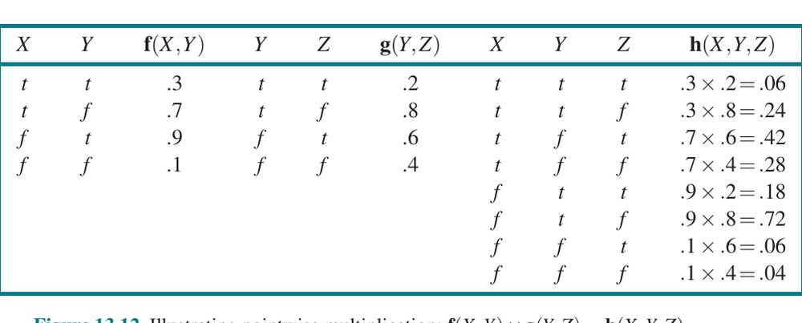

**شکل ۱۳.۱۲ — نشان‌دادن ضرب نقطه‌ای: f(X,Y) × g(Y,Z) = h(X,Y,Z). (جدول: برای هر ترکیب از مقادیر X, Y, Z، h = f × g؛ برای نمونه h(t,t,t) = 0.3 × 0.2 = 0.06.)**

با بررسی این توالی، می‌بینیم دو عملیات محاسباتی پایه لازم است: ضرب نقطه‌ای جفت عامل‌ها، و خارج‌کردن متغیر از حاصل‌ضرب عامل‌ها. بخش بعد هر یک از این عملیات‌ها را توصیف می‌کند.

توجه کنید ماتریس‌ها ضرب نمی‌شوند تا وقتی لازم شود متغیری از حاصل‌ضرب انباشته خارج کنیم. در آن نقطه، فقط آن ماتریس‌هایی را ضرب می‌کنیم که شامل متغیر مورد خارج‌کردن‌اند. با توابع ضرب نقطه‌ای و خارج‌کردن، خود الگوریتم حذف متغیر را می‌توان بسیار ساده نوشت، چنان‌که در شکل ۱۳.۱۳ نشان داده شده.

**ترتیب متغیر و مربوط‌بودن متغیر.** الگوریتم شکل ۱۳.۱۳ شامل تابع مشخص‌نشدهٔ ORDER برای انتخاب ترتیب متغیرهاست. هر انتخاب ترتیبی الگوریتم معتبری می‌دهد، اما ترتیب‌های متفاوت باعث تولید عامل‌های میانی متفاوتی در طول محاسبه می‌شوند. برای نمونه، در محاسبهٔ نشان‌داده‌شدهٔ پیشین، A را قبل از E حذف کردیم؛ اگر به‌صورت معکوس انجامش دهیم، محاسبه به‌صورت P(B|j,m) = α f1(B) ∑a f4(A) × f5(A) ∑e f2(E) × f3(A,B,E) می‌شود، که در طول آن عامل تازهٔ f6(A,B) تولید خواهد شد.

به‌طور کلی، نیازهای زمانی و فضایی حذف متغیر تحت سیطرهٔ اندازهٔ بزرگ‌ترین عاملی است که در طول عملکرد الگوریتم ساخته می‌شود. این به‌نوبهٔ خود با ترتیب حذف متغیرها و ساختار شبکه تعیین می‌شود. معلوم می‌شود تعیین ترتیب بهینه ناشدنی است، اما چند اکتشافی خوب در دسترس‌اند. یکی از روش‌های نسبتاً مؤثر روش حریصانه است: متغیری را حذف کن که اندازهٔ عامل بعدی ساخته‌شده را کمینه می‌کند.

یک پرس‌وجوی دیگر را در نظر بگیریم: P(JohnCalls | Burglary=true). مثل همیشه (معادلهٔ (13.5) را ببینید)، گام نخست نوشتن جمع تودرتو است:

```
P(J|b) = α P(b) ∑e P(e) ∑a P(a|b,e) P(J|a) ∑m P(m|a)
```

با ارزیابی این عبارت از راست به چپ، نکتهٔ جالبی می‌بینیم: ∑m P(m|a) طبق تعریف برابر ۱ است! از این رو، اصلاً نیازی به گنجاندنش نبود؛ متغیر M برای این پرس‌وجو نامربوط است. راه دیگر گفتن این اینکه نتیجهٔ پرس‌وجوی P(JohnCalls | Burglary=true) اگر MaryCalls را کلاً از شبکه حذف کنیم تغییر نمی‌کند. به‌طور کلی، می‌توانیم هر گرهٔ برگی را که متغیر پرس‌وجو یا شاهد نیست حذف کنیم. پس از حذف آن، ممکن است گره‌های برگی بیشتری باشند، و آن‌ها نیز ممکن است نامربوط باشند. با ادامهٔ این فرایند، سرانجام درمی‌یابیم هر متغیری که نیای متغیر پرس‌وجو یا شاهد نیست برای پرس‌وجو نامربوط است. الگوریتم حذف متغیر بنابراین می‌تواند همهٔ این متغیرها را قبل از ارزیابی پرس‌وجو حذف کند.

وقتی روی شبکهٔ بیمهٔ نشان‌داده‌شده در شکل ۱۳.۹ اعمال شود، حذف متغیر بهبود قابل‌ملاحظه‌ای بر الگوریتم شمارش اولیه نشان می‌دهد. با استفاده از ترتیب توپولوژیک معکوس برای متغیرها، استنتاج دقیق با حذف حدود ۱٬۰۰۰ برابر سریع‌تر از الگوریتم شمارش است.

```
function ELIMINATION-ASK(X, e, bn) returns a distribution over X
  inputs: X, the query variable
          e, the observed event (an assignment of values to evidence variables)
          bn, a Bayesian network with variables vars and CPTs
  factors ← []
  for each variable V in ORDER(vars):
      factors ← [MAKE-FACTOR(V, e) | factors]
      if V is a hidden variable:
          factors ← SUM-OUT(V, factors)
  return NORMALIZE(POINTWISE-PRODUCT(factors))
```

**شکل ۱۳.۱۳ — الگوریتم حذف متغیر برای استنتاج دقیق در شبکه‌های بیز.**

### ۱۳.۳.۳ پیچیدگی استنتاج دقیق

پیچیدگی استنتاج دقیق در شبکه‌های بیز به‌شدت به ساختار شبکه بستگی دارد. شبکهٔ سرقت شکل ۱۳.۲ به خانواده‌ای از شبکه‌ها تعلق دارد که در آن‌ها حداکثر یک مسیر بدون جهت (یعنی با نادیده‌گرفتن جهت پیکان‌ها) بین هر دو گره وجود دارد. این‌ها «شبکه‌های تک‌متصل» (Singly Connected Networks) یا «پلی‌درخت» (Polytrees) نامیده می‌شوند و ویژگی خاصاً خوبی دارند:

**پیچیدگی زمانی و فضایی استنتاج دقیق در پلی‌درخت‌ها در اندازهٔ شبکه خطی است.**

در این‌جا، اندازه به‌صورت شمار درایه‌های CPT تعریف می‌شود؛ اگر شمار والدهای هر گره با ثابتی کران‌دار باشد، پیچیدگی نیز در شمار گره‌ها خطی خواهد بود. این نتایج برای هر ترتیبی که با ترتیب توپولوژیک شبکه سازگار باشد برقرارند (تمرین ۱۳.VEEX).

برای «شبکه‌های چندمتصل» (Multiply Connected Networks)، مانند شبکهٔ بیمه در شکل ۱۳.۹، حذف متغیر می‌تواند در بدترین حالت پیچیدگی زمانی و فضایی نمایی داشته باشد، حتی وقتی شمار والدهای هر گره کران‌دار است. این شگفت‌آور نیست وقتی در نظر بگیریم که چون شامل استنتاج در منطق گزاره‌ای به‌عنوان حالت خاص است، استنتاج در شبکه‌های بیز NP-سخت است. برای اثبات این، باید دریابیم چگونه مسئلهٔ ارضاپذیری گزاره‌ای را به‌صورت شبکهٔ بیز رمزگذاری کنیم، به‌گونه‌ای که اجرای استنتاج روی این شبکه به ما بگوید جمله‌های گزاره‌ای اصلی ارضاشدنی‌اند یا نه. (در زبان نظریهٔ پیچیدگی، مسائل ارضاپذیری را به مسائل استنتاج شبکهٔ بیز «تقلیل» می‌دهیم.) معلوم می‌شود این کاملاً سرراست است. شکل ۱۳.۱۴ نشان می‌دهد چگونه مسئلهٔ 3-SAT خاصی را رمزگذاری کنیم. متغیرهای گزاره‌ای متغیرهای ریشهٔ شبکه می‌شوند، هر یک با احتمال پیشینی 0.5.

لایهٔ بعدی گره‌ها متناظر با عبارت‌ها (کلاوزها)ست، با هر متغیر عبارت Cj که به متغیرهای مناسب به‌عنوان والد متصل است. توزیع شرطی برای متغیر عبارت، فصلی قطعی است، با نقیض‌گذاری لازم، به‌گونه‌ای که هر متغیر عبارت صادق است اگر و فقط اگر تخصیص به والدهایش آن عبارت را ارضا کند. سرانجام، S عطف متغیرهای عبارت است. برای تعیین ارضاشدنی‌بودن جملهٔ اصلی، به‌سادگی P(S=true) را ارزیابی می‌کنیم. اگر جمله ارضاشدنی باشد، آنگاه تخصیص ممکنی به متغیرهای منطقی هست که S را صادق می‌کند؛ در شبکهٔ بیز، این بدان معناست جهان ممکنی با احتمال غیرصفر هست که در آن متغیرهای ریشه آن تخصیص را دارند، متغیرهای عبارت مقدار صادق دارند و S مقدار صادق دارد. بنابراین، برای جملهٔ ارضاشدنی P(S=true) > 0. برعکس، P(S=true) = 0 برای جملهٔ غیرارضاشدنی: همهٔ جهان‌های با S=true احتمال ۰ دارند.

از این رو، می‌توانیم از استنتاج شبکهٔ بیز برای حل مسائل 3-SAT استفاده کنیم؛ از این، نتیجه می‌گیریم استنتاج شبکهٔ بیز NP-سخت است.

در واقع، می‌توانیم بیش از این‌ها انجام دهیم. توجه کنید احتمال هر تخصیص ارضاکننده 2^(−n) برای مسئله‌ای با n متغیر است. از این رو، شمار تخصیص‌های ارضاکننده برابر P(S=true) / 2^(−n) است. چون محاسبهٔ شمار تخصیص‌های ارضاکننده برای مسئلهٔ 3-SAT «#P-کامل» است («شمار-P کامل»)، این بدان معناست استنتاج شبکهٔ بیز «#P-سخت» است—یعنی اکیداً سخت‌تر از مسائل NP-کامل.

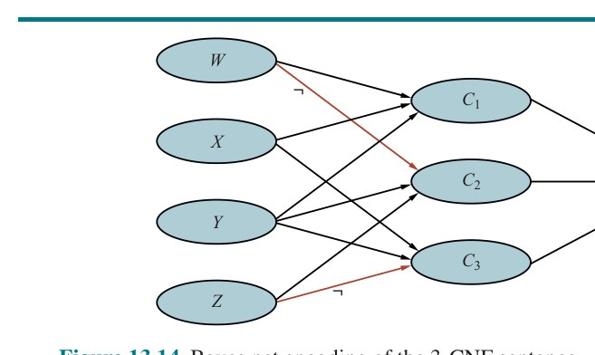

**شکل ۱۳.۱۴ — رمزگذاری شبکهٔ بیز جملهٔ 3-CNF: (W ∨ X ∨ Y) ∧ (¬W ∨ Y ∨ Z) ∧ (X ∨ Y ∨ ¬Z).**

ارتباطی نزدیک میان پیچیدگی استنتاج شبکهٔ بیز و پیچیدگی مسائل ارضای قید (CSP) هست. چنان‌که در فصل ۶ بحث کردیم، دشواری حل CSP گسسته به اینکه گراف قیدش چقدر «درخت‌مانند» است مربوط می‌شود. معیارهایی مانند «پهنای درختی» (Tree Width)، که پیچیدگی حل CSP را کران‌دار می‌کنند، می‌توانند مستقیماً روی شبکه‌های بیز نیز اعمال شوند. علاوه بر این، الگوریتم حذف متغیر را می‌توان به حل CSPها نیز تعمیم داد. جدا از تقلیل مسائل ارضاپذیری به استنتاج شبکهٔ بیز، می‌توانیم استنتاج شبکهٔ بیز را به ارضاپذیری تقلیل دهیم، که به ما اجازه می‌دهد از ماشین‌آلات قدرتمند توسعه‌یافته برای حل SAT بهره بگیریم (فصل ۷ را ببینید). در این مورد، تقلیل به شکل خاصی از حل SAT به نام «شمارش مدل وزندار» (Weighted Model Counting یا WMC) است. شمارش مدل معمولی شمار تخصیص‌های ارضاکننده را برای عبارت SAT می‌شمارد؛ WMC وزن کل آن تخصیص‌های ارضاکننده را جمع می‌زند—که در این کاربرد، وزن اساساً حاصل‌ضرب احتمال‌های شرطی برای هر تخصیص متغیر به‌شرط والدهایش است. (جزئیات در تمرین ۱۳.WMCX.) تا حدی به این دلیل که فناوری حل SAT برای کاربردهای بزرگ‌مقیاس به‌خوبی بهینه‌سازی شده، استنتاج شبکهٔ بیز از طریق WMC با دیگر الگوریتم‌های دقیق روی شبکه‌های با پهنای درختی بزرگ رقابتی و گاهی برتر است.

### ۱۳.۳.۴ الگوریتم‌های خوشه‌بندی

الگوریتم حذف متغیر برای پاسخ‌دادن به پرس‌وجوهای فردی ساده و کارآمد است. اما اگر بخواهیم احتمال‌های پسینی را برای همهٔ متغیرهای شبکه محاسبه کنیم، می‌تواند کم‌کارآمدتر باشد. برای نمونه، در شبکهٔ پلی‌درخت، باید O(n) پرس‌وجو صادر شود که هر یک O(n) هزینه دارد، در مجموع O(n²) زمان. با «الگوریتم‌های خوشه‌بندی» (Clustering Algorithms، که «الگوریتم‌های درخت اتصال» (Join Tree Algorithms) نیز نامیده می‌شوند)، زمان را می‌توان به O(n) کاهش داد. به همین دلیل، این الگوریتم‌ها در ابزارهای تجاری شبکهٔ بیز به‌طور گسترده استفاده می‌شوند.

ایدهٔ پایهٔ خوشه‌بندی پیوستن گره‌های فردی شبکه برای تشکیل «گره‌های خوشه‌ای» (Cluster Nodes) است، به‌گونه‌ای که شبکهٔ حاصل پلی‌درخت باشد. برای نمونه، شبکهٔ چندمتصل نشان‌داده‌شده در شکل ۱۳.۱۵(الف) را می‌توان با ترکیب گره‌های Sprinkler و Rain در گرهٔ خوشه‌ای «Sprinkler+Rain» به پلی‌درخت تبدیل کرد، چنان‌که در شکل ۱۳.۱۵(ب) نشان داده شده. دو گرهٔ بولی با «کلان‌گره» (Meganode)ای جایگزین می‌شوند که چهار مقدار ممکن می‌گیرد: tt، tf، ft و ff. کلان‌گره فقط یک والد دارد، متغیر بولی Cloudy، پس دو حالت شرطی هست. اگرچه این مثال نشان نمی‌دهد، فرایند خوشه‌بندی اغلب کلان‌گره‌هایی تولید می‌کند که برخی متغیرها را شریک‌اند.


**شکل ۱۳.۱۵ — (الف) شبکهٔ چندمتصل توصیف‌کنندهٔ روال روزانهٔ چمن مری: هر صبح، او آب‌وهوا را بررسی می‌کند؛ اگر ابری باشد، معمولاً آب‌پاش را روشن نمی‌کند؛ اگر آب‌پاش روشن باشد، یا اگر در طول روز باران ببارد، چمن خیس خواهد بود. بدین‌ترتیب، Cloudy از دو مسیر علّی متفاوت بر WetGrass اثر می‌گذارد. (ب) معادل خوشه‌بندی‌شدهٔ شبکهٔ چندمتصل.**

پس از اینکه شبکه به شکل پلی‌درخت درآمد، الگوریتم استنتاج ویژه‌ای لازم است، زیرا روش‌های استنتاج معمولی نمی‌توانند کلان‌گره‌هایی را که متغیرها را با یکدیگر شریک‌اند مدیریت کنند. اساساً، الگوریتم نوعی «انتشار قید» (Constraint Propagation) است (فصل ۶ را ببینید) که در آن قیدها تضمین می‌کنند کلان‌گره‌های همسایه بر احتمال پسینی هر متغیری که مشترک دارند توافق کنند. با دفترداری دقیق، این الگوریتم قادر است احتمال‌های پسینی را برای همهٔ گره‌های غیرشاهد شبکه در زمانی خطی در اندازهٔ شبکهٔ خوشه‌بندی‌شده محاسبه کند. با این حال، NP-سختی مسئله ناپدید نشده است: اگر شبکه‌ای با حذف متغیر زمان و فضای نمایی لازم داشته باشد، آنگاه CPTهای شبکهٔ خوشه‌بندی‌شده لزوماً به‌صورت نمایی بزرگ خواهند بود.

## ۱۳.۴ استنتاج تقریبی برای شبکه‌های بیزی

با توجه به ناشدنی‌بودن استنتاج دقیق در شبکه‌های بزرگ، حالا روش‌های استنتاج تقریبی را در نظر می‌گیریم. این بخش الگوریتم‌های «نمونه‌برداری تصادفی» (Randomized Sampling) را توصیف می‌کند، که «الگوریتم‌های مونت‌کارلو» (Monte Carlo) نیز نامیده می‌شوند و پاسخ‌های تقریبی می‌دهند که دقت‌شان به شمار نمونه‌های تولیدشده بستگی دارد. آن‌ها با تولید رخدادهای تصادفی بر اساس احتمال‌های شبکهٔ بیز و شمردن پاسخ‌های متفاوت یافت‌شده در آن رخدادهای تصادفی کار می‌کنند. با نمونه‌های کافی، می‌توانیم خودسرانه به بازیابی توزیع احتمال واقعی نزدیک شویم—مشروط بر اینکه شبکهٔ بیز توزیع‌های شرطی قطعی نداشته باشد.

الگوریتم‌های مونت‌کارلو، که «بازپخت شبیه‌سازی‌شده» (صفحهٔ ۱۱۵) نمونه‌ای از آن است، در شاخه‌های بسیاری از علوم برای برآورد کمیت‌هایی استفاده می‌شوند که محاسبهٔ دقیقشان دشوار است. در این بخش، به نمونه‌برداری اعمال‌شده بر محاسبهٔ احتمال‌های پسینی در شبکه‌های بیز علاقه‌مندیم. دو خانواده از الگوریتم‌ها را توصیف می‌کنیم: نمونه‌برداری مستقیم و نمونه‌برداری زنجیرهٔ مارکوف. چند رویکرد دیگر برای استنتاج تقریبی در یادداشت‌های پایان فصل ذکر شده‌اند.

### ۱۳.۴.۱ روش‌های نمونه‌برداری مستقیم

عنصر اولیه در هر الگوریتم نمونه‌برداری، تولید نمونه‌ها از توزیع احتمال شناخته‌شده است. برای نمونه، سکهٔ بدون سوگیری را می‌توان متغیر تصادفی Coin با مقادیر ⟨heads, tails⟩ و توزیع پیشینی P(Coin) = ⟨0.5, 0.5⟩ در نظر گرفت. نمونه‌برداری از این توزیع دقیقاً مانند انداختن سکه است: با احتمال 0.5 رو برمی‌گرداند و با احتمال 0.5 پشت. با منبعی از اعداد تصادفی r که به‌صورت یکنواخت در بازهٔ [0,1] توزیع شده‌اند، نمونه‌برداری از هر توزیعی روی متغیر تکی، خواه گسسته خواه پیوسته، کاری ساده است. این کار با ساختن «توزیع تجمعی» (Cumulative Distribution) برای متغیر و بازگرداندن نخستین مقداری که احتمال تجمعی‌اش از r فراتر می‌رود انجام می‌شود (تمرین ۱۳.PRSA). با یک فرایند نمونه‌برداری تصادفی برای شبکهٔ بیزی شروع می‌کنیم که شاهد مرتبطی ندارد. ایده این است که هر متغیر را به‌نوبت، در ترتیب توپولوژیک، نمونه‌برداری کنیم. توزیع احتمالی که مقدار از آن نمونه‌برداری می‌شود بر مقادیر ازپیش‌تخصیص‌یافته به والدهای متغیر شرطی است. (چون در ترتیب توپولوژیک نمونه‌برداری می‌کنیم، والدها تضمین‌شده مقادیر دارند.) این الگوریتم در شکل ۱۳.۱۶ نشان داده شده. با اعمال آن بر شبکهٔ شکل ۱۳.۱۵(الف) با ترتیب Cloudy, Sprinkler, Rain, WetGrass، ممکن است رخداد تصادفی زیر تولید شود:

۱. نمونه‌برداری از P(Cloudy) = ⟨0.5, 0.5⟩، مقدار true است.
۲. نمونه‌برداری از P(Sprinkler | Cloudy=true) = ⟨0.1, 0.9⟩، مقدار false است.
۳. نمونه‌برداری از P(Rain | Cloudy=true) = ⟨0.8, 0.2⟩، مقدار true است.
۴. نمونه‌برداری از P(WetGrass | Sprinkler=false, Rain=true) = ⟨0.9, 0.1⟩، مقدار true است.

در این مورد، PRIOR-SAMPLE رخداد [true, false, true, true] را برمی‌گرداند.

```
function PRIOR-SAMPLE(bn) returns a sampled event from the prior specified by bn
  inputs: bn، a Bayesian network specifying the joint distribution P(X1,...,Xn)
  x ← an event with n elements
  for each variable Xi in X1,...,Xn:
      x[i] ← a random sample from P(Xi | parents(Xi))
  return x
```

**شکل ۱۳.۱۶ — الگوریتم نمونه‌برداری که رخدادهایی از شبکهٔ بیزی تولید می‌کند. هر متغیر بر اساس توزیع شرطی به‌شرط مقادیر ازپیش‌نمونه‌برداری‌شدهٔ والدهایش نمونه‌برداری می‌شود.**

به‌آسانی دیده می‌شود PRIOR-SAMPLE نمونه‌ها را از توزیع مشترک پیشینی مشخص‌شده توسط شبکه تولید می‌کند. نخست، فرض کنیم SPS(x1,...,xn) احتمال تولید رخداد خاص x1,...,xn توسط الگوریتم PRIOR-SAMPLE باشد. فقط با نگاه‌کردن به فرایند نمونه‌برداری:

```
SPS(x1,...,xn) = ∏ P(xi | parents(Xi))
                 i=1..n
```

زیرا هر گام نمونه‌برداری فقط به مقادیر والد بستگی دارد. این عبارت باید آشنا به نظر برسد، زیرا همچنین احتمال رخداد بر اساس بازنمایی شبکهٔ بیز از توزیع مشترک است، چنان‌که در معادلهٔ (13.2) بیان شد. یعنی SPS(x1,...,xn) = P(x1,...,xn) داریم. این واقعیت ساده پاسخ‌دادن به پرسش‌ها با استفاده از نمونه‌ها را آسان می‌کند.

در هر الگوریتم نمونه‌برداری، پاسخ‌ها با شمردن نمونه‌های واقعی تولیدشده محاسبه می‌شوند. فرض کنیم در مجموع N نمونه توسط الگوریتم PRIOR-SAMPLE تولید شده، و NPS(x1,...,xn) شمار دفعات وقوع رخداد خاص x1,...,xn در مجموعهٔ نمونه‌ها باشد. انتظار داریم این عدد، به‌عنوان کسری از کل، در حد نهایی به مقدار موردانتظارش طبق احتمال نمونه‌برداری همگرا شود:

```
lim(N→∞) NPS(x1,...,xn) / N = SPS(x1,...,xn) = P(x1,...,xn)        (13.6)
```

برای نمونه، رخداد تولیدشدهٔ پیشین را در نظر بگیرید: [true, false, true, true]. احتمال نمونه‌برداری این رخداد SPS(true, false, true, true) = 0.5 × 0.9 × 0.8 × 0.9 = 0.324 است. از این رو، در حد N بزرگ، انتظار داریم ۳۲.۴٪ نمونه‌ها از این رخداد باشند.

هرگاه در ادامه از تساوی تقریبی («≈») استفاده می‌کنیم، دقیقاً به همین معناست—که احتمال برآوردشده در حد نمونهٔ بزرگ دقیق می‌شود. چنین برآوردی «سازگار» (Consistent) نامیده می‌شود. برای نمونه، می‌توان برآورد سازگاری از احتمال هر رخداد تا حدی مشخص‌شدهٔ x1,...,xm تولید کرد، که در آن m ≤ n:

```
P(x1,...,xm) ≈ NPS(x1,...,xm) / N        (13.7)
```

یعنی احتمال رخداد را می‌توان به‌صورت کسری از همهٔ رخدادهای کامل تولیدشده توسط فرایند نمونه‌برداری که با رخداد تا حدی مشخص‌شده همخوانی دارند برآورد کرد. از P̂ (تلفظ «پی-هت») برای نشان‌دادن احتمال برآوردشده استفاده می‌کنیم. پس، اگر ۱٬۰۰۰ نمونه از شبکهٔ آب‌پاش تولید کنیم و ۵۱۱ تایشان Rain=true داشته باشند، آنگاه احتمال برآوردشدهٔ باران P̂(Rain=true) = 0.511 است.

**نمونه‌برداری ردی در شبکه‌های بیزی.** «نمونه‌برداری ردی» (Rejection Sampling) روشی عمومی برای تولید نمونه‌ها از توزیعی است که نمونه‌برداری از آن دشوار است، با توجه به توزیعی که نمونه‌برداری از آن آسان است. در ساده‌ترین شکل آن، می‌توان برای محاسبهٔ احتمال‌های شرطی—یعنی تعیین P(X|e)—استفاده کرد. الگوریتم REJECTION-SAMPLING در شکل ۱۳.۱۷ نشان داده شده. نخست، نمونه‌ها را از توزیع پیشینی مشخص‌شده توسط شبکه تولید می‌کند. سپس، همهٔ آن‌هایی را که با شاهد همخوانی ندارند رد می‌کند. سرانجام، برآورد P̂(X=x|e) با شمردن اینکه X=x چند بار در نمونه‌های باقی‌مانده رخ می‌دهد به دست می‌آید.

فرض کنیم P̂(X|e) توزیع برآوردشده‌ای باشد که الگوریتم برمی‌گرداند؛ این توزیع با نرمال‌سازی NPS(X,e)، بردار شمارش نمونه‌ها برای هر مقدار X در جایی که نمونه با شاهد e موافق است، محاسبه می‌شود:

```
P̂(X|e) = α NPS(X, e) = NPS(X, e) / NPS(e)
```

از معادلهٔ (13.7)، این می‌شود P̂(X|e) ≈ P(X,e)/P(e) = P(X|e). یعنی نمونه‌برداری ردی به پاسخ درست همگرا می‌شود.

```
function REJECTION-SAMPLING(X, e, bn, N) returns an estimate of P(X|e)
  inputs: X, the query variable
          e, observed values for the variables E
          bn, a Bayesian network
          N, the total number of samples to generate
  local variables: C, a count vector for each value of X, initially zero
  for j = 1 to N:
      x ← PRIOR-SAMPLE(bn)
      if x is consistent with e then C[j] ← C[j] + 1     where xj is the value of X in x
  return NORMALIZE(C)
```

**شکل ۱۳.۱۷ — الگوریتم نمونه‌برداری ردی برای پاسخ‌دادن به پرس‌وجوها با توجه به شواهد در شبکهٔ بیزی.**

حالا که می‌دانیم نمونه‌برداری ردی به پاسخ درست همگرا می‌شود، پرسش بعدی این است که این همگرایی چقدر سریع رخ می‌دهد؟ دقیق‌تر، چند نمونه لازم است قبل از اینکه بدانیم برآوردهای حاصل با احتمال زیاد به پاسخ‌های درست نزدیک‌اند؟

در حالی که پیچیدگی الگوریتم‌های دقیق تا حد زیادی به توپولوژی شبکه بستگی دارد—درخت‌ها آسان‌اند، شبکه‌های پرپیوند سخت‌اند—پیچیدگی نمونه‌برداری ردی عمدتاً به کسری از نمونه‌هایی بستگی دارد که پذیرفته می‌شوند. این کسر دقیقاً برابر احتمال پیشینی شاهد، P(e) است. متأسفانه، برای مسائل پیچیده با متغیرهای شاهد بسیار، این کسر به‌نحو ناچیزی کوچک است. وقتی روی نسخهٔ گسستهٔ شبکهٔ بیمهٔ خودرو در شکل ۱۳.۹ اعمال شود، کسر نمونه‌های سازگار با حالت شاهد نمونه‌ای نمونه‌برداری‌شده از خود شبکه معمولاً بین یک‌درهزار و یک‌در۱۰٬۰۰۰ است. همگرایی بسیار کند است (شکل ۱۳.۱۹ زیر را ببینید).

انتظار داریم کسر نمونه‌های سازگار با شاهد e با رشد شمار متغیرهای شاهد به‌صورت نمایی کاهش یابد، پس رویه برای مسائل پیچیده غیرقابل‌استفاده است. همچنین با متغیرهای شاهد پیوسته‌مقدار دشواری دارد، زیرا احتمال تولید نمونه‌ای سازگار با چنین شاهدی صفر است (اگر واقعاً پیوسته‌مقدار باشد) یا بی‌نهایت‌کوچک (اگر فقط عدد ممیز شناور با دقت متناهی باشد).

توجه کنید نمونه‌برداری ردی بسیار شبیه برآورد احتمال‌های شرطی در دنیای واقعی است. برای نمونه، برای برآورد احتمال شرطی زنده‌ماندن انسان‌ها پس از برخورد سیارکی با قطر ۱ کیلومتر به زمین، می‌توان به‌سادگی شمرد هر چند وقت یک‌بار انسان‌ها پس از برخورد سیارکی با قطر ۱ کیلومتر به زمین زنده می‌مانند، و همهٔ روزهایی را که چنین رویدادی رخ نمی‌دهد نادیده گرفت. (در این‌جا، خود جهان نقش الگوریتم تولید نمونه را بازی می‌کند.) برای گرفتن برآورد مناسبی، ممکن است لازم باشد منتظر وقوع ۱۰۰ رویداد چنین ماند. بدیهی است، این ممکن است زمان زیادی ببرد، و این ضعف نمونه‌برداری ردی است.

**نمونه‌برداری اهمیت.** فن آماری عمومی «نمونه‌برداری اهمیت» (Importance Sampling) قصد دارد اثر نمونه‌برداری از توزیع P را با استفاده از نمونه‌هایی از توزیع دیگری مانند Q شبیه‌سازی کند. تضمین می‌کنیم پاسخ‌ها در حد نهایی درست‌اند با اعمال «عامل تصحیح» P(x)/Q(x)، که «وزن» (Weight) نیز نامیده می‌شود، به هر نمونهٔ x هنگام شمردن نمونه‌ها.

دلیل استفاده از نمونه‌برداری اهمیت در شبکه‌های بیز ساده است: می‌خواهیم از توزیع پسینی واقعی شرطی‌شده بر همهٔ شواهد نمونه‌برداری کنیم، اما معمولاً این خیلی دشوار است؛⁶ پس در عوض، از توزیعی آسان نمونه‌برداری می‌کنیم و تصحیح‌های لازم را اعمال می‌کنیم.

دلیل کارکردن نمونه‌برداری اهمیت نیز ساده است. فرض کنیم متغیرهای غیرشاهد Z باشند. اگر می‌توانستیم مستقیماً از P(z|e) نمونه‌برداری کنیم، می‌توانستیم برآوردهایی مانند این بسازیم:

```
P̂(z|e) = NP(z) / N ≈ P(z|e)
```

که در آن NP(z) شمار نمونه‌های با Z=z هنگام نمونه‌برداری از P است. حالا فرض کنیم در عوض از Q(z) نمونه‌برداری می‌کنیم. برآورد در این مورد شامل عامل‌های تصحیح است:

```
P̂(z|e) = (NQ(z) / N) × (P(z|e) / Q(z)) ≈ Q(z) × P(z|e) / Q(z) = P(z|e)
```

بدین‌ترتیب، برآورد بدون توجه به اینکه کدام توزیع نمونه‌برداری Q استفاده شود به مقدار درست همگرا می‌شود. (تنها الزام فنی این است که Q(z) برای هیچ zای که P(z|e) در آن غیرصفر است صفر نباشد.) به‌صورت شهودی، عامل تصحیح برای بیش‌نمونه‌برداری یا کم‌نمونه‌برداری جبران می‌کند. برای نمونه، اگر برای zای Q(z) بسیار بزرگ‌تر از P(z|e) باشد، آنگاه نمونه‌های بسیار بیشتری از آن z نسبت به آنچه باید باشد وجود خواهد داشت، اما هر یک وزن کوچکی خواهد داشت، پس درست همان‌گونه عمل می‌کند که گویی شمار درست وجود دارد.

در مورد اینکه کدام Q را استفاده کنیم، یکی می‌خواهیم که نمونه‌برداری از آن آسان و تا آن‌جا که ممکن است به پسین واقعی P(z|e) نزدیک باشد. رایج‌ترین رویکرد «وزن‌گذاری درستنمایی» (Likelihood Weighting) نامیده می‌شود (به دلایلی که به‌زودی خواهیم دید). چنان‌که در تابع WEIGHTED-SAMPLE در شکل ۱۳.۱۸ نشان داده شده، الگوریتم مقادیر متغیرهای شاهد E را ثابت می‌کند و همهٔ متغیرهای غیرشاهد را در ترتیب توپولوژیک نمونه‌برداری می‌کند، هر یک به‌شرط والدهایش. این تضمین می‌کند هر رخداد تولیدشده با شاهد سازگار است.

توزیع نمونه‌برداری تولیدشده توسط این الگوریتم را QWS بنامیم. اگر متغیرهای غیرشاهد Z={Z1,...,Zl} باشند، آنگاه داریم:

```
QWS(z) = ∏ P(zi | parents(Zi))        (13.8)
         i=1..l
```

زیرا هر متغیر به‌شرط والدهایش نمونه‌برداری می‌شود. برای کامل‌کردن الگوریتم، باید بدانیم چگونه وزن هر نمونهٔ تولیدشده از QWS را محاسبه کنیم.

طبق طرح عمومی نمونه‌برداری اهمیت، وزن باید w(z) = P(z|e)/QWS(z) = αP(z,e)/QWS(z) باشد، که در آن عامل نرمال‌سازی α = 1/P(e) برای همهٔ نمونه‌ها یکسان است. حالا z و e با هم همهٔ متغیرهای شبکهٔ بیز را پوشش می‌دهند، پس P(z,e) فقط حاصل‌ضرب همهٔ احتمال‌های شرطی است (معادلهٔ (13.2) صفحهٔ ۴۱۵)؛ و می‌توانیم آن را به‌صورت حاصل‌ضرب احتمال‌های شرطی متغیرهای غیرشاهد ضرب‌در حاصل‌ضرب احتمال‌های شرطی متغیرهای شاهد بنویسیم:

```
w(z) = α P(z,e) / QWS(z)
     = α (∏i P(zi | parents(Zi)) × ∏i P(ei | parents(Ei))) / (∏i P(zi | parents(Zi)))
     = α ∏i P(ei | parents(Ei))        (13.9)
```

بدین‌ترتیب وزن، حاصل‌ضرب احتمال‌های شرطی متغیرهای شاهد به‌شرط والدهایشان است. (احتمال‌های شاهد عموماً «درستنمایی» (Likelihood) نامیده می‌شوند، از این رو نام.) محاسبهٔ وزن در WEIGHTED-SAMPLE به‌صورت افزایشی پیاده‌سازی می‌شود، و هر بار با متغیر شاهد مواجه‌شده در احتمال شرطی ضرب می‌شود. نرمال‌سازی در پایان، قبل از بازگرداندن نتیجهٔ پرس‌وجو، انجام می‌شود.

```
function LIKELIHOOD-WEIGHTING(X, e, bn, N) returns an estimate of P(X|e)
  inputs: X, the query variable
          e, observed values for the variables E
          bn, a Bayesian network specifying the joint distribution P(X1,...,Xn)
          N, the total number of samples to generate
  local variables: W, a weighted count vector for each value of X, initially zero
  for j = 1 to N:
      x, w ← WEIGHTED-SAMPLE(bn, e)
      W[j] ← W[j] + w     where xj is the value of X in x
  return NORMALIZE(W)

function WEIGHTED-SAMPLE(bn, e) returns an event and a weight
  w ← 1; x ← an event with n elements, with values fixed by e
  for i = 1 to n:
      if Xi is an evidence variable with value xij in e
          then w ← w × P(Xi = xij | parents(Xi))
          else x[i] ← a random sample from P(Xi | parents(Xi))
  return x, w
```

**شکل ۱۳.۱۸ — الگوریتم وزن‌گذاری درستنمایی برای استنتاج در شبکه‌های بیزی. در WEIGHTED-SAMPLE، هر متغیر غیرشاهد بر اساس توزیع شرطی به‌شرط مقادیر ازپیش‌نمونه‌برداری‌شدهٔ والدهایش نمونه‌برداری می‌شود، در حالی که وزنی بر اساس درستنمایی هر متغیر شاهد انباشته می‌شود.**

الگوریتم را روی شبکهٔ نشان‌داده‌شده در شکل ۱۳.۱۵(الف) اعمال کنیم، با پرس‌وجوی P(Rain | Cloudy=true, WetGrass=true) و ترتیب Cloudy, Sprinkler, Rain, WetGrass. (هر ترتیب توپولوژیکی کار می‌کند.) فرایند به‌صورت زیر است: نخست، وزن w برابر 1.0 گذاشته می‌شود. سپس رخدادی تولید می‌شود:

۱. Cloudy متغیر شاهد با مقدار true است. بنابراین، w ← w × P(Cloudy=true) = 0.5 می‌گذاریم.
۲. Sprinkler متغیر شاهد نیست، پس از P(Sprinkler | Cloudy=true) = ⟨0.1, 0.9⟩ نمونه‌برداری کن؛ فرض کنیم false برمی‌گرداند.
۳. Rain متغیر شاهد نیست، پس از P(Rain | Cloudy=true) = ⟨0.8, 0.2⟩ نمونه‌برداری کن؛ فرض کنیم true برمی‌گرداند.
۴. WetGrass متغیر شاهد با مقدار true است. بنابراین، w ← w × P(WetGrass=true | Sprinkler=false, Rain=true) = 0.5 × 0.9 = 0.45 می‌گذاریم.

در این‌جا WEIGHTED-SAMPLE رخداد [true, false, true, true] را با وزن 0.45 برمی‌گرداند، و این زیر Rain=true ثبت می‌شود. توجه کنید Parents(Zi) می‌تواند هم متغیرهای غیرشاهد و هم متغیرهای شاهد را شامل شود.

برخلاف توزیع پیشینی P(z)، توزیع QWS تا حدی به شاهد توجه می‌کند: مقادیر نمونه‌برداری‌شدهٔ هر Zi تحت تأثیر شاهد در میان نیاکان Zi خواهند بود. برای نمونه، هنگام نمونه‌برداری از Sprinkler الگوریتم به شاهد Cloudy=true در متغیر والدش توجه می‌کند. از سوی دیگر، QWS کمتر از توزیع پسینی واقعی P(z|e) به شاهد توجه می‌کند، زیرا مقادیر نمونه‌برداری‌شدهٔ هر Zi شاهد میان غیرنیاکان Zi را نادیده می‌گیرند. برای نمونه، هنگام نمونه‌برداری از Sprinkler و Rain الگوریتم شاهد موجود در متغیر فرزند WetGrass=true را نادیده می‌گیرد؛ این بدان معناست نمونه‌های بسیاری با Sprinkler=false و Rain=false تولید خواهد کرد، با وجود اینکه شاهد در واقع این حالت را رد می‌کند. آن نمونه‌ها وزن صفر خواهند داشت.

چون وزن‌گذاری درستنمایی از همهٔ نمونه‌های تولیدشده استفاده می‌کند، می‌تواند بسیار کارآمدتر از نمونه‌برداری ردی باشد. با این حال، با افزایش شمار متغیرهای شاهد دچار افت عملکرد خواهد شد. این به این دلیل است که بیشتر نمونه‌ها وزن‌های بسیار پایینی خواهند داشت و از این رو برآورد وزندار توسط کسر ریزی از نمونه‌ها مسلط خواهد شد که بیش از درستنمایی بی‌نهایت‌کوچک به شاهد می‌دهند. اگر متغیرهای شاهد «پایین‌دست» رخ دهند—یعنی دیر در ترتیب متغیرها—مسئله تشدید می‌شود، زیرا آن‌گاه متغیرهای غیرشاهد هیچ شاهدی در والدها و نیاکانشان برای هدایت تولید نمونه‌ها نخواهند داشت. این بدان معناست نمونه‌ها صرفاً «توهماتی» خواهند بود—شبیه‌سازی‌هایی که شباهت اندکی به واقعیت پیشنهادشده توسط شاهد دارند.

وقتی روی نسخهٔ گسستهٔ شبکهٔ بیمهٔ خودرو در شکل ۱۳.۹ اعمال شود، وزن‌گذاری درستنمایی به‌طور قابل‌ملاحظه‌ای کارآمدتر از نمونه‌برداری ردی است (شکل ۱۳.۱۹ را ببینید). شبکهٔ بیمه برای وزن‌گذاری درستنمایی حالت نسبتاً خوش‌خیم است، زیرا بسیاری از شواهد «بالادست»اند و متغیرهای پرس‌وجو گره‌های برگ شبکه‌اند.

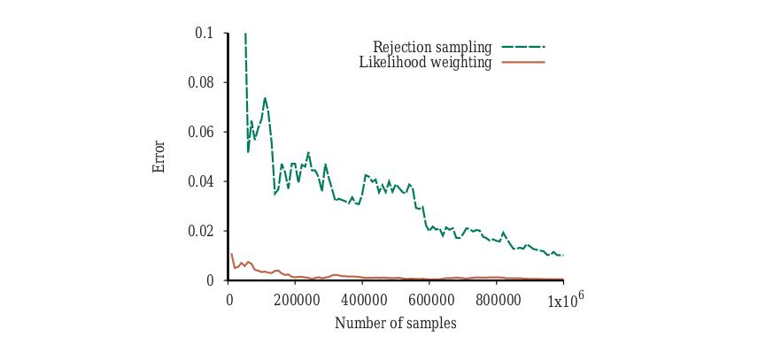

**شکل ۱۳.۱۹ — عملکرد نمونه‌برداری ردی و وزن‌گذاری درستنمایی روی شبکهٔ بیمه. محور x شمار نمونه‌های تولیدشده و محور y بیشینهٔ خطای مطلق در هر یک از مقادیر احتمال برای پرس‌وجویی روی PropertyCost را نشان می‌دهد.**

### ۱۳.۴.۲ استنتاج با شبیه‌سازی زنجیرهٔ مارکوف

الگوریتم‌های «مونت‌کارلوی زنجیرهٔ مارکوف» (Markov Chain Monte Carlo یا MCMC) متفاوت از نمونه‌برداری ردی و وزن‌گذاری درستنمایی کار می‌کنند. به‌جای تولید هر نمونه از صفر، الگوریتم‌های MCMC نمونه‌ای را با ایجاد تغییر تصادفی در نمونهٔ قبلی تولید می‌کنند. الگوریتم MCMC را عاملی در «حالت کنونی» خاصی در نظر بگیرید که برای هر متغیر مقداری مشخص می‌کند و با ایجاد تغییرهای تصادفی در حالت کنونی حالت بعدی را تولید می‌کند.

اصطلاح «زنجیرهٔ مارکوف» (Markov Chain) به فرایند تصادفی تولیدکنندهٔ توالی از حالت‌ها اشاره دارد. (زنجیره‌های مارکوف در فصل‌های ۱۴ و ۱۷ نیز برجسته‌اند؛ الگوریتم بازپخت شبیه‌سازی‌شده در فصل ۴ و الگوریتم WALKSAT در فصل ۷ نیز اعضای خانوادهٔ MCMC هستند.) با توصیف شکل خاصی از MCMC به نام «نمونه‌برداری گیبس» (Gibbs Sampling) شروع می‌کنیم، که خاصاً برای شبکه‌های بیزی مناسب است. سپس الگوریتم عمومی‌تر «متروپلیس–هستینگز» (Metropolis–Hastings) را توصیف می‌کنیم، که انعطاف بسیار بیشتری در تولید نمونه‌ها اجازه می‌دهد.

**نمونه‌برداری گیبس در شبکه‌های بیزی.** الگوریتم نمونه‌برداری گیبس برای شبکه‌های بیزی با حالت دلخواهی شروع می‌شود (با متغیرهای شاهد ثابت‌شده در مقادیر مشاهده‌شده‌شان) و با نمونه‌برداری تصادفی مقداری برای یکی از متغیرهای غیرشاهد Xi حالت بعدی را تولید می‌کند. از صفحهٔ ۴۱۹ به یاد آورید Xi با توجه به «پوشش مارکوف»‌اش (والدها، فرزندان و دیگر والدهای فرزندان) مستقل از همهٔ متغیرهای دیگر است؛ بنابراین، نمونه‌برداری گیبس برای Xi یعنی نمونه‌برداری شرطی بر مقادیر کنونی متغیرهای در پوشش مارکوفش. الگوریتم به‌صورت تصادفی در فضای حالت—فضای تخصیص‌های کامل ممکن—پرسه می‌زند، هر بار یک متغیر را برمی‌گرداند، اما متغیرهای شاهد را ثابت نگه می‌دارد. الگوریتم کامل در شکل ۱۳.۲۰ نشان داده شده.

پرس‌وجوی P(Rain | Sprinkler=true, WetGrass=true) را برای شبکهٔ شکل ۱۳.۱۵(الف) در نظر بگیرید. متغیرهای شاهد Sprinkler و WetGrass در مقادیر مشاهده‌شده‌شان ثابت‌اند (هر دو true)، و متغیرهای غیرشاهد Cloudy و Rain به‌صورت تصادفی مقداردهی اولیه می‌شوند، مثلاً به‌ترتیب true و false. بدین‌ترتیب، حالت اولیه [true, true, false, true] است، که در آن مقادیر شاهد ثابت را پررنگ علامت زده‌ایم. حالا متغیرهای غیرشاهد Zi به‌طور مکرر در ترتیبی تصادفی، طبق توزیع احتمال ρ(i) برای انتخاب متغیرها، نمونه‌برداری می‌شوند. برای نمونه:

۱. Cloudy انتخاب و سپس، با توجه به مقادیر کنونی پوشش مارکوفش، نمونه‌برداری می‌شود: در این مورد، از P(Cloudy | Sprinkler=true, Rain=false) نمونه‌برداری می‌کنیم. فرض کنیم نتیجه Cloudy=false باشد. سپس حالت کنونی تازه [false, true, false, true] است.

```
function GIBBS-ASK(X, e, bn, N) returns an estimate of P(X|e)
  local variables: C, a count vector for each value of X, initially zero
                 Z, the non-evidence variables in bn
                 x, the current state of the network, initialized from e
  initialize x with random values for the variables in Z
  for k = 1 to N:
      select each variable Zi in Z according to distribution ρ(i)
      set the value of Zi in x by sampling from P(Zi | mb(Zi))
      C[j] ← C[j] + 1     where xj is the value of X in x
  return NORMALIZE(C)
```

**شکل ۱۳.۲۰ — الگوریتم نمونه‌برداری گیبس برای استنتاج تقریبی در شبکه‌های بیز.**

خوشبختانه، محاسبهٔ توزیع پوشش مارکوف P(Xi | mb(Xi))، که در آن mb(Xi) مقادیر متغیرهای در پوشش مارکوف Xi یعنی MB(Xi) را نشان می‌دهد، هیچ استنتاج پیچیده‌ای در بر ندارد. چنان‌که در تمرین ۱۳.MARB نشان داده شده، توزیع به‌صورت زیر است:

```
P(xi | mb(Xi)) = α P(xi | parents(Xi)) × ∏ P(yj | parents(Yj))        (13.10)
                                          Yj ∈ Children(Xi)
```

به بیان دیگر، برای هر مقدار xi، احتمال با ضرب احتمال‌ها از CPTهای Xi و فرزندانش داده می‌شود. برای نمونه، در نخستین گام نمونه‌برداری نشان‌داده‌شدهٔ بالا، از P(Cloudy | Sprinkler=true, Rain=false) نمونه‌برداری کردیم. با معادلهٔ (13.10)، و با مخفف‌کردن نام متغیرها:

```
P(c|s, ¬r) = α P(c) P(s|c) P(¬r|c) = α 0.5 · 0.1 · 0.2
P(¬c|s, ¬r) = α P(¬c) P(s|¬c) P(¬r|¬c) = α 0.5 · 0.5 · 0.8
```

پس توزیع نمونه‌برداری α⟨0.001, 0.020⟩ ≈ ⟨0.048, 0.952⟩ است.

شکل ۱۳.۲۱(الف) زنجیرهٔ مارکوف کامل را برای حالتی نشان می‌دهد که متغیرها یکنواخت انتخاب می‌شوند، یعنی ρ(Cloudy) = ρ(Rain) = 0.5. الگوریتم به‌سادگی در این گراف پرسه می‌زند، با احتمال‌های بیان‌شده از پیوندها پیروی می‌کند. هر حالتی که در این فرایند بازدید می‌شود نمونه‌ای است که به برآورد متغیر پرس‌وجوی Rain کمک می‌کند. اگر فرایند از ۲۰ حالت با Rain=true و ۶۰ حالت با Rain=false بازدید کند، آنگاه پاسخ پرس‌وجو NORMALIZE(⟨20, 60⟩) = ⟨0.25, 0.75⟩ است.


**شکل ۱۳.۲۱ — (الف) حالت‌ها و احتمال‌های انتقال زنجیرهٔ مارکوف برای پرس‌وجوی P(Rain | Sprinkler=true, WetGrass=true). به حلقه‌های خودی توجه کنید: حالت یکسان می‌ماند وقتی هر متغیر انتخاب و سپس همان مقداری را که از قبل دارد دوباره نمونه‌برداری می‌کند. (ب) احتمال‌های انتقال وقتی CPT برای Rain آن را مقید می‌کند همان مقدار Cloudy را داشته باشد.**

**تحلیل زنجیره‌های مارکوف.** گفته‌ایم نمونه‌برداری گیبس با پرسه‌زدن تصادفی در فضای حالت برای تولید نمونه‌ها کار می‌کند. برای توضیح اینکه چرا نمونه‌برداری گیبس درست کار می‌کند—یعنی چرا برآوردهایش در حد نهایی به مقادیر درست همگرا می‌شوند—به تحلیل دقیقی نیاز خواهیم داشت. (این بخش تا حدی ریاضی است و در خواندن نخست قابل رد شدن است.)

با برخی از مفاهیم پایه برای تحلیل زنجیره‌های مارکوف به‌طور کلی شروع می‌کنیم. هر چنین زنجیره‌ای با حالت اولیه‌اش و «هستهٔ انتقال» (Transition Kernel) k(x→x′)—احتمال انتقال به حالت x′ با شروع از حالت x—تعریف می‌شود. حالا فرض کنیم زنجیرهٔ مارکوف را برای t گام اجرا می‌کنیم، و πt(x) احتمال قرارداشتن سامانه در حالت x در زمان t باشد. به‌طور مشابه، πt+1(x′) احتمال بودن در حالت x′ در زمان t+1 باشد. با توجه به πt(x)، می‌توانیم πt+1(x′) را با جمع‌زدن، برای همهٔ حالت‌های x که سامانه می‌توانست در زمان t در آن باشد، احتمال بودن در x ضرب‌در احتمال انتقال به x′ محاسبه کنیم:

```
πt+1(x′) = ∑x πt(x) k(x → x′)
```

می‌گوییم زنجیره به «توزیع مانای» (Stationary Distribution) خود رسیده اگر πt = πt+1. این توزیع مانا را π بنامیم؛ معادلهٔ تعریف‌کننده‌اش بنابراین چنین است:

```
π(x′) = ∑x π(x) k(x → x′)   برای همهٔ x′        (13.11)
```

مشروط بر اینکه هستهٔ انتقال k «ارگودیک» (Ergodic) باشد—یعنی هر حالت از هر حالت دیگر قابل‌دسترس باشد و هیچ دور اکیداً متناوبی نباشد—دقیقاً یک توزیع π هست که این معادله را برای هر k معین ارضا می‌کند. معادلهٔ (13.11) را می‌توان چنین خواند که «خروجی» موردانتظار از هر حالت (یعنی «جمعیت» کنونی‌اش) با «ورودی» موردانتظار از همهٔ حالت‌ها برابر است. یکی از راه‌های بدیهی ارضای این رابطه این است که جریان موردانتظار میان هر جفت حالت در هر دو جهت یکسان باشد؛ یعنی:

```
π(x) k(x → x′) = π(x′) k(x′ → x)   برای همهٔ x، x′        (13.12)
```

وقتی این معادله‌ها برقرارند، می‌گوییم k(x→x′) با π(x) در «توازن تفصیلی» (Detailed Balance) است. حالت خاص، حلقهٔ خودی x = x′ است، یعنی انتقال از حالتی به خودش. در آن صورت، شرط توازن تفصیلی به π(x)k(x→x) = π(x)k(x→x) تبدیل می‌شود که البته برای هر توزیع مانای π و هر هستهٔ انتقال k به‌طور پیش‌پاافتاده صادق است.

می‌توانیم نشان دهیم توازن تفصیلی دلالت بر مانایی دارد، صرفاً با جمع‌زدن روی x در معادلهٔ (13.12):

```
∑x π(x) k(x → x′) = ∑x π(x′) k(x′ → x) = π(x′) ∑x k(x′ → x) = π(x′)
```

که گام آخر به این دلیل است که انتقال از x′ تضمین‌شده رخ می‌دهد.

**چرا نمونه‌برداری گیبس کار می‌کند.** حالا نشان می‌دهیم نمونه‌برداری گیبس برآوردهای سازگاری برای احتمال‌های پسینی برمی‌گرداند. ادعای پایه سرراست است: «توزیع مانای» فرایند نمونه‌برداری گیبس دقیقاً توزیع پسینی متغیرهای غیرشاهد شرطی‌شده بر شاهد است. این ویژگی قابل‌توجه از شیوهٔ خاص حرکت فرایند نمونه‌برداری گیبس از حالتی به حالت دیگر نتیجه می‌شود.

تعریف عمومی نمونه‌برداری گیبس این است که متغیری مانند Xi انتخاب و سپس به‌صورت شرطی بر مقادیر کنونی همهٔ متغیرهای دیگر نمونه‌برداری می‌شود. (وقتی به‌طور خاص روی شبکه‌های بیز اعمال شود، صرفاً از این واقعیت اضافی استفاده می‌کنیم که نمونه‌برداری شرطی بر همهٔ متغیرها معادل نمونه‌برداری شرطی بر پوشش مارکوف متغیر است، چنان‌که در صفحهٔ ۴۱۹ نشان داده شد.) برای این متغیرهای دیگر (به‌جز متغیرهای شاهد) از نماد X̄i استفاده می‌کنیم؛ مقادیرشان در حالت کنونی x̄i است.

برای نوشتن هستهٔ انتقال k(x→x′) برای نمونه‌برداری گیبس، سه حالت باید در نظر گرفته شود:

۱. حالت‌های x و x′ در دو یا چند متغیر تفاوت دارند. در آن صورت، k(x→x′) = 0، زیرا نمونه‌برداری گیبس فقط یک متغیر را تغییر می‌دهد.
۲. حالت‌ها دقیقاً در یک متغیر Xi تفاوت دارند که مقدارش از xi به x′i تغییر می‌کند. احتمال چنین وقوعی:

```
k(x → x′) = k((xi, x̄i) → (x′i, x̄i)) = ρ(i) P(x′i | x̄i)        (13.13)
```

۳. حالت‌ها یکسان‌اند: x = x′. در آن صورت، هر متغیری می‌تواند انتخاب شود اما سپس فرایند نمونه‌برداری همان مقداری را تولید می‌کند که متغیر از قبل دارد. احتمال چنین وقوعی:

```
k(x → x) = ∑i ρ(i) k((xi, x̄i) → (xi, x̄i)) = ∑i ρ(i) P(xi | x̄i)
```

حالا نشان می‌دهیم این تعریف عمومی نمونه‌برداری گیبس معادلهٔ توازن تفصیلی را با توزیع مانایی برابر P(x|e)—توزیع پسینی واقعی روی متغیرهای غیرشاهد—ارضای می‌کند. یعنی نشان می‌دهیم π(x)k(x→x′) = π(x′)k(x′→x) که در آن π(x) = P(x|e)، برای همهٔ حالت‌های x و x′.

برای حالت‌های نخست و سوم داده‌شدهٔ بالا، توازن تفصیلی همیشه ارضا می‌شود: اگر دو حالت در دو یا چند متغیر تفاوت داشته باشند، احتمال انتقال در هر دو جهت صفر است. اگر x ≠ x′، آنگاه از معادلهٔ (13.13):

```
π(x) k(x → x′) = P(x|e) ρ(i) P(x′i | x̄i, e)
               = ρ(i) P(xi, x̄i | e) P(x′i | x̄i, e)
               = ρ(i) P(x̄i | xi, e) P(xi | e) P(x′i | x̄i, e)      (با قاعدهٔ زنجیره‌ای روی جملهٔ نخست)
               = ρ(i) P(x̄i | xi, e) P(x′i, x̄i | e)                (قاعدهٔ زنجیره‌ای معکوس روی دو جملهٔ آخر)
               = π(x′) k(x′ → x)
```

قطعهٔ پایانی پازل ارگودیک‌بودن زنجیره است—یعنی هر حالت باید از هر حالت دیگر قابل‌دسترس باشد و هیچ دور دوره‌ای‌ای نباشد. هر دو شرط برآورده می‌شوند مشروط بر اینکه CPTها احتمال‌های 0 یا 1 نداشته باشند. قابلیت دسترسی از این واقعیت می‌آید که می‌توانیم یک حالت را با تغییر یک‌به‌یک متغیرها به حالت دیگر تبدیل کنیم، و نبود دورهای دوره‌ای از این واقعیت می‌آید که هر حالت حلقهٔ خودی با احتمال غیرصفر دارد. از این رو، تحت شرایط بیان‌شده، k ارگودیک است، بدان معنا که نمونه‌های تولیدشده توسط نمونه‌برداری گیبس سرانجام از توزیع پسینی واقعی گرفته خواهند شد.

**پیچیدگی نمونه‌برداری گیبس.** نخست، خبر خوب: هر گام نمونه‌برداری گیبس شامل محاسبهٔ توزیع پوشش مارکوف برای متغیر انتخاب‌شدهٔ Xi است، که به شمار ضرب‌هایی متناسب با شمار فرزندان Xi و اندازهٔ برد Xi نیاز دارد. این مهم است، زیرا بدان معناست کار لازم برای تولید هر نمونه مستقل از اندازهٔ شبکه است.

حالا، خبری که لزوماً بد نیست: پیچیدگی نمونه‌برداری گیبس بسیار دشوارتر از نمونه‌برداری ردی و وزن‌گذاری درستنمایی تحلیل می‌شود. نخستین چیزی که باید توجه کرد این است که نمونه‌برداری گیبس، برخلاف وزن‌گذاری درستنمایی، به شواهد پایین‌دست توجه می‌کند. اطلاعات از گره‌های شاهد در همهٔ جهت‌ها منتشر می‌شود: نخست، هر همسایهٔ گره‌های شاهد مقادیری نمونه‌برداری می‌کند که شاهد در آن گره‌ها را بازتاب می‌دهند؛ سپس همسایه‌هایشان، و به همین ترتیب. بدین‌ترتیب، انتظار داریم نمونه‌برداری گیبس وقتی شواهد عمدتاً پایین‌دست‌اند از وزن‌گذاری درستنمایی بهتر عمل کند؛ و در واقع، این در شکل ۱۳.۲۲ تأیید می‌شود.

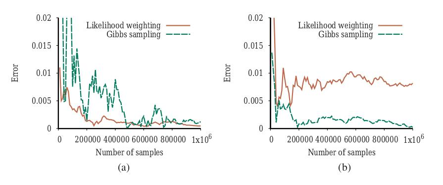

**شکل ۱۳.۲۲ — عملکرد نمونه‌برداری گیبس در مقایسه با وزن‌گذاری درستنمایی روی شبکهٔ بیمهٔ خودرو: (الف) برای پرس‌وجوی استاندارد روی PropertyCost، و (ب) برای حالتی که متغیرهای خروجی مشاهده شده‌اند و Age متغیر پرس‌وجوست.**

نرخ همگرایی نمونه‌برداری گیبس—«نرخ آمیختن» (Mixing Rate) زنجیرهٔ مارکوف تعریف‌شده توسط الگوریتم—به‌شدت به ویژگی‌های کمی توزیع‌های شرطی شبکه بستگی دارد. برای دیدن این، در نظر بگیرید در شکل ۱۳.۱۵(الف) چه اتفاقی می‌افتد وقتی CPT برای Rain قطعی می‌شود: باران می‌بارد اگر و فقط اگر ابری باشد. در آن صورت، توزیع پسینی واقعی برای پرس‌وجوی P(Rain | sprinkler, wetGrass) تقریباً ⟨0.18, 0.82⟩ است، اما نمونه‌برداری گیبس هرگز به این مقدار نخواهد رسید. مسئله این است که تنها دو حالت مشترک Cloudy و Rain با احتمال غیرصفر [true, true] و [false, false] هستند. با شروع از [true, true]، زنجیره هرگز نمی‌تواند به [false, false] برسد، زیرا انتقال‌ها به حالت‌های میانی احتمال صفر دارند (شکل ۱۳.۲۱(ب) را ببینید). پس، اگر فرایند از [true, true] شروع شود، همیشه احتمال پسینی ⟨1.0, 0.0⟩ را برای پرس‌وجو گزارش می‌کند؛ اگر از [false, false] شروع شود، همیشه ⟨0.0, 1.0⟩ گزارش می‌کند.

نمونه‌برداری گیبس در این مورد شکست می‌خورد، زیرا رابطهٔ قطعی میان Cloudy و Rain ویژگی ارگودیک لازم برای همگرایی را می‌شکند. اما اگر رابطه را تقریباً قطعی کنیم، همگرایی بازمی‌گردد، اما به‌صورت خودسرانه‌ای کند رخ می‌دهد. چندین اصلاح هست که به الگوریتم‌های MCMC کمک می‌کنند سریع‌تر آمیخته شوند.

یکی «نمونه‌برداری بلوکی» (Block Sampling) است: نمونه‌برداری هم‌زمان چند متغیر. در این مورد، می‌توانیم Cloudy و Rain را با هم، شرطی بر پوشش مارکوف ترکیبی‌شان، نمونه‌برداری کنیم. دیگری تولید هوشمندانه‌تر حالت‌های بعدی است، چنان‌که در بخش بعد خواهیم دید.

**نمونه‌برداری متروپلیس–هستینگز.** روش «متروپلیس–هستینگز» یا MH شاید پرکاربردترین الگوریتم MCMC باشد. مانند نمونه‌برداری گیبس، MH طراحی شده تا نمونه‌های x را (سرانجام) طبق احتمال‌های هدف π(x) تولید کند؛ در مورد استنتاج در شبکه‌های بیزی، π(x) = P(x|e) می‌خواهیم. مانند بازپخت شبیه‌سازی‌شده (صفحهٔ ۱۱۵)، MH در هر تکرار فرایند نمونه‌برداری دو مرحله دارد:

۱. حالت تازهٔ x′ را از «توزیع پیشنهادی» (Proposal Distribution) q(x′|x)، با توجه به حالت کنونی x، نمونه‌برداری کن.
۲. x′ را به‌صورت احتمالاتی بپذیر یا رد کن، طبق «احتمال پذیرش» (Acceptance Probability):

```
a(x′ | x) = min(1, π(x′) q(x | x′) / (π(x) q(x′ | x)))
```

اگر پیشنهاد رد شود، حالت در x باقی می‌ماند.

هستهٔ انتقال MH از این فرایند دوقسمتی تشکیل شده. توجه کنید اگر پیشنهاد رد شود، زنجیره در همان حالت می‌ماند.

توزیع پیشنهادی مسئول پیشنهاد حالت بعدی x′ است، چنان‌که نامش می‌گوید. برای نمونه، q(x′|x) را می‌توان چنین تعریف کرد:

- با احتمال 0.95، یک گام نمونه‌برداری گیبس برای تولید x′ انجام بده.
- در غیر این صورت، x′ را با اجرای الگوریتم WEIGHTED-SAMPLE از صفحهٔ ۴۴۰ تولید کن.

این توزیع پیشنهادی باعث می‌شود MH حدود ۲۰ گام گیبس انجام دهد و سپس فرایند را از حالت تازه‌ای (با فرض پذیرش) که از صفر تولید شده «راه‌اندازی دوباره» کند. با این حیله، از مسئلهٔ گیرکردن نمونه‌برداری گیبس در بخشی از فضای حالت و ناتوانی‌اش در رسیدن به بخش‌های دیگر دور می‌زند.

ممکن است بپرسید ما از کجا می‌دانیم MH با چنین پیشنهاد عجیبی در واقع به پاسخ درست همگرا می‌شود. نکتهٔ قابل‌توجه دربارهٔ MH این است که همگرایی به توزیع مانای درست برای هر توزیع پیشنهادی تضمین شده، مشروط بر اینکه هستهٔ انتقال حاصل ارگودیک باشد. این ویژگی از شیوهٔ تعریف احتمال پذیرش نتیجه می‌شود. همانند نمونه‌برداری گیبس، حلقهٔ خودی x = x′ به‌طور خودکار توازن تفصیلی را ارضا می‌کند، پس روی حالت x ≠ x′ تمرکز می‌کنیم. این فقط در صورتی رخ می‌دهد که پیشنهاد پذیرفته شود. احتمال وقوع چنین انتقالی:

```
k(x → x′) = q(x′ | x) a(x′ | x)
```

همانند نمونه‌برداری گیبس، اثبات توازن تفصیلی یعنی نشان‌دادن جریان x به x′، یعنی π(x)k(x→x′)، با جریان x′ به x، یعنی π(x′)k(x′→x)، هم‌خوان است. پس از جای‌گذاری عبارت بالا برای k(x→x′)، اثبات کاملاً سرراست است:

```
π(x) q(x′|x) a(x′|x)
  = π(x) q(x′|x) min(1, π(x′)q(x|x′) / (π(x)q(x′|x)))         (تعریف a(·|·))
  = min(π(x)q(x′|x), π(x′)q(x|x′))                              (ضرب‌کردن به درون)
  = π(x′) q(x|x′) min(π(x)q(x′|x) / (π(x′)q(x|x′)), 1)          (تقسیم‌کردن به درون)
  = π(x′) q(x|x′) a(x|x′)
```

جدا از ویژگی‌های ریاضی، بخش مهم MH که باید رویش تمرکز کرد نسبت π(x′)/π(x) در احتمال پذیرش است. این می‌گوید اگر حالت بعدی پیشنهادشده محتمل‌تر از حالت کنونی باشد، قطعاً پذیرفته خواهد شد. (فعلاً جملهٔ q(x|x′)/q(x′|x) را نادیده می‌گیریم، که برای تضمین توازن تفصیلی آن‌جاست و در بسیاری از فضاهای حالت به دلیل تقارن برابر ۱ است.) اگر حالت پیشنهادی از حالت کنونی کم‌محتمل‌تر باشد، احتمال پذیرشش متناسباً افت می‌کند.

بدین‌ترتیب، یکی از رهنمودها برای طراحی توزیع‌های پیشنهادی این است که مطمئن شویم حالت‌های تازهٔ پیشنهادشده به‌صورت معقولی محتمل‌اند. نمونه‌برداری گیبس این را به‌طور خودکار انجام می‌دهد: از توزیع گیبس P(Xi | x̄i) پیشنهاد می‌دهد، بدان معنا که احتمال تولید هر مقدار تازهٔ خاص برای Xi مستقیماً متناسب با احتمال آن است. (تمرین ۱۳.GIBM از شما می‌خواهد نشان دهید گیبس حالت خاص MH با احتمال پذیرش ۱ است.) رهنمود دیگر این است که مطمئن شویم زنجیره خوب آمیخته می‌شود، که یعنی گاهی پیشنهاد حرکت‌های بزرگ به بخش‌های دور فضای حالت. در مثال داده‌شدهٔ بالا، استفادهٔ گاه‌به‌گاه از WEIGHTED-SAMPLE برای راه‌اندازی دوبارهٔ زنجیره در حالت تازه همین هدف را برآورده می‌کند.

جدا از آزادی تقریباً کامل در طراحی توزیع‌های پیشنهادی، MH دو ویژگی اضافی دارد که آن را عملی می‌کند. نخست، احتمال پسینی π(x) = P(x|e) در محاسبهٔ پذیرش فقط به شکل نسبت π(x′)/π(x) ظاهر می‌شود، که بسیار خوش‌شانسانه است. محاسبهٔ مستقیم P(x|e) دقیقاً همان محاسبه‌ای است که می‌خواهیم با MH تقریب بزنیم، پس معنا نداشت آن را برای هر نمونه انجام دهیم! در عوض، از حقهٔ زیر استفاده می‌کنیم:

```
π(x′) / π(x) = P(x′|e) / P(x|e) = (P(x′, e) / P(e)) × (P(e) / P(x, e)) = P(x′, e) / P(x, e)
```

جمله‌های این نسبت احتمال‌های مشترک کامل‌اند، یعنی حاصل‌ضرب‌های احتمال‌های شرطی شبکهٔ بیز. دومین ویژگی مفید این نسبت این است که تا وقتی توزیع پیشنهادی فقط تغییرهای محلی در x برای تولید x′ انجام می‌دهد، فقط شمار کمی از جمله‌های حاصل‌ضرب احتمال‌های شرطی متفاوت خواهند بود. همهٔ احتمال‌های شرطی شامل متغیرهایی که مقادیرشان تغییر نکرده در نسبت حذف می‌شوند. پس، همانند نمونه‌برداری گیبس، کار لازم برای تولید هر نمونه مستقل از اندازهٔ شبکه است، تا زمانی که تغییرهای حالت محلی باشند.

### ۱۳.۴.۳ کامپایل استنتاج تقریبی

الگوریتم‌های نمونه‌برداری در شکل‌های ۱۳.۱۷، ۱۳.۱۸ و ۱۳.۲۰ ویژگی مشترکی دارند: آن‌ها روی شبکهٔ بیزی که به‌صورت ساختار داده بازنمایی شده عمل می‌کنند. این کاملاً طبیعی به نظر می‌رسد: بالاخره، شبکهٔ بیز گراف جهت‌داری بدون دور است، پس چگونه دیگر می‌شد آن را بازنمایی کرد؟ مسئلهٔ این رویکرد این است که عملیات لازم برای دسترسی به ساختار داده—برای نمونه، یافتن والدهای یک گره—هزاران یا میلیون‌ها بار در طول اجرای الگوریتم نمونه‌برداری تکرار می‌شوند، و همهٔ این محاسبه‌ها کاملاً غیرضروری‌اند.

ساختار شبکه و احتمال‌های شرطی‌اش در طول محاسبه ثابت می‌مانند، پس فرصتی هست شبکه را به کد استنتاج مخصوص مدل کامپایل کنیم که فقط محاسبه‌های استنتاجی لازم برای آن شبکهٔ خاص را انجام دهد. (اگر این آشنا به نظر می‌رسد، همان ایده‌ای است که در کامپایل برنامه‌های منطقی در فصل ۹ استفاده شد.) برای نمونه، فرض کنیم می‌خواهیم متغیر Earthquake را در شبکهٔ سرقت شکل ۱۳.۲ گیبس-نمونه‌برداری کنیم. طبق الگوریتم GIBBS-ASK در شکل ۱۳.۲۰، باید محاسبهٔ زیر را انجام دهیم:

```
مقدار Earthquake در x را با نمونه‌برداری از P(Earthquake | mb(Earthquake)) بگذار
```

که در آن توزیع اخیر طبق معادلهٔ (13.10) محاسبه می‌شود. این محاسبه، به‌نوبهٔ خود، مستلزم جستجو برای والدها و فرزندان Earthquake در ساختار شبکهٔ بیز است؛ جستجو برای مقادیر کنونی‌شان؛ استفاده از آن مقادیر برای نمایه‌زدن در CPTهای متناظر (که آن‌ها نیز باید از شبکهٔ بیز پیدا شوند)؛ و ضرب همهٔ ردیف‌های مناسب از آن CPTها برای تشکیل توزیع تازه‌ای که از آن نمونه‌برداری کنیم. سرانجام، چنان‌که در صفحهٔ ۴۳۶ ذکر شد، خود گام نمونه‌برداری باید نسخهٔ تجمعی توزیع گسسته را بسازد و سپس مقدار موجود در آن را که با عدد تصادفی نمونه‌برداری‌شده از [0,1] متناظر است بیابد.

اگر در عوض شبکه را کامپایل کنیم، کد نمونه‌برداری مخصوص مدل برای متغیر Earthquake به‌دست می‌آوریم که به‌صورت زیر است:

```
r ← نمونهٔ تصادفی یکنواخت از [0,1]
اگر Alarm = true
   پس اگر Burglary = true
         پس بازگرداندن [r < 0.0020212]
         وگرنه بازگرداندن [r < 0.36755]
   وگرنه اگر Burglary = true
         پس بازگرداندن [r < 0.0016672]
         وگرنه بازگرداندن [r < 0.0014222]
```

در این‌جا، متغیرهای شبکهٔ بیز Alarm، Burglary و مانند آن متغیرهای برنامهٔ معمولی با مقادیری می‌شوند که حالت کنونی زنجیرهٔ مارکوف را می‌سازند. عبارت‌های عددی آستانه به‌صورت true یا false ارزیابی می‌شوند و توزیع‌های گیبس ازپیش‌محاسبه‌شده را برای هر ترکیب از مقادیر در پوشش مارکوف Earthquake بازنمایی می‌کنند. کد چندان زیبا نیست—معمولاً تقریباً به اندازهٔ خود شبکهٔ بیز بزرگ خواهد بود—اما به‌طور باورنکردنی کارآمد است. در مقایسه با GIBBS-ASK، کد کامپایل‌شده معمولاً ۲ تا ۳ مرتبهٔ بزرگی سریع‌تر خواهد بود. می‌تواند ده‌ها میلیون گام نمونه‌برداری در ثانیه روی لپ‌تاپ معمولی انجام دهد، و سرعتش عمدتاً با هزینهٔ تولید اعداد تصادفی محدود می‌شود.

## ۱۳.۵ شبکه‌های علّی

دربارهٔ چند مزیت هم‌خوان‌نگه‌داشتن ترتیب گره‌ها در شبکه‌های بیز با جهت علّیت بحث کرده‌ایم. به‌طور خاص، به سهولت ارزیابی احتمال‌های شرطی اگر چنین ترتیبی حفظ شود، و نیز فشردگی ساختار شبکهٔ حاصل، اشاره کردیم. اما اشاره کردیم که اصولاً هر ترتیب گره‌ای ساخت سازگاری از شبکه را برای بازنمایی تابع توزیع مشترک مجاز می‌کند. این در شکل ۱۳.۳ نشان داده شد، که در آن تغییر ترتیب گره‌ها شبکه‌هایی تولید کرد پرپشت‌تر و بسیار کم‌طبیعی‌تر از شبکهٔ اصلی در شکل ۱۳.۲، اما با این وجود ما را قادر می‌کرد همان توزیع را روی همهٔ متغیرها بازنمایی کنیم.

این بخش «شبکه‌های علّی» (Causal Networks) را توصیف می‌کند، ردهٔ مقیدی از شبکه‌های بیزی که همهٔ ترتیب‌های به‌جز ترتیب‌های سازگار علّی را منع می‌کند. بررسی می‌کنیم چگونه چنین شبکه‌هایی بسازیم، با چنین ساخت‌هایی چه به دست می‌آید، و چگونه این سود را در تکلیف‌های تصمیم‌گیری به کار بگیریم.

ساده‌ترین شبکهٔ بیزی قابل‌تصور را در نظر بگیرید، پیکان تکی Fire → Smoke. به ما می‌گوید متغیرهای Fire و Smoke ممکن است وابسته باشند، پس برای مشخص‌کردن توزیع مشترک P(Fire, Smoke) باید پیشین P(Fire) و احتمال شرطی P(Smoke | Fire) را مشخص کنیم. اما این توزیع را می‌توان به‌خوبی با پیکان معکوس Fire ← Smoke بازنمایی کرد، با استفاده از P(Smoke) و P(Fire | Smoke) مناسب محاسبه‌شده از قاعدهٔ بیز. این ایده که این دو شبکه معادل‌اند، از این رو اطلاعات یکسانی منتقل می‌کنند، در بیشتر مردم ناراحتی و حتی مقاومت برمی‌انگیزد. چگونه می‌توانند اطلاعات یکسانی منتقل کنند وقتی می‌دانیم Fire موجب Smoke می‌شود و نه برعکس؟ به بیان دیگر، از تجربه و فهم علمی‌مان می‌دانیم پاک‌کردن دود آتش را متوقف نمی‌کند و خاموش‌کردن آتش دود را متوقف می‌کند. بنابراین انتظار داریم این عدم تقارن را از طریق جهت‌داری پیکان میان‌شان بازنمایی کنیم. اما اگر برگرداندن پیکان فقط چیزها را معادل کند، چگونه می‌توانیم امیدوار باشیم این اطلاعات مهم را به‌صورت صوری بازنمایی کنیم.

«شبکه‌های بیزی علّی»، که گاهی «نمودارهای علّی» (Causal Diagrams) نامیده می‌شوند، طراحی شده‌اند تا به ما اجازه دهند عدم تقارن‌های علّی را بازنمایی کنیم و از عدم تقارن‌ها برای استدلال با اطلاعات علّی بهره بگیریم. ایده این است که دربارهٔ جهت‌داری پیکان‌ها با ملاحظاتی تصمیم بگیریم که فراتر از وابستگی احتمالاتی‌اند و نوع کاملاً متفاوتی از قضاوت را فرا می‌خوانند. به‌جای پرسیدن از کارشناس که آیا Smoke و Fire به‌صورت احتمالاتی وابسته‌اند، چنان‌که در شبکه‌های بیزی معمولی می‌کنیم، حالا می‌پرسیم کدام به کدام پاسخ می‌دهد، Smoke به Fire یا Fire به Smoke؟

این ممکن است تا حدی عرفانی به نظر برسد، اما می‌توان از طریق مفهوم «تخصیص» (Assignment) دقیقش کرد، مشابه عملگر تخصیص در زبان‌های برنامه‌نویسی. اگر طبیعت مقداری را به Smoke بر اساس آنچه طبیعت دربارهٔ Fire می‌آموزد تخصیص دهد، پیکانی از Smoke به Fire رسم می‌کنیم. مهم‌تر، اگر قضاوت کنیم طبیعت به Fire مقدار صدقی تخصیص می‌دهد که به متغیرهای دیگر بستگی دارد، نه Smoke، از رسم پیکان Fire ← Smoke خودداری می‌کنیم. به بیان دیگر، مقدار xi هر متغیر Xi توسط معادله‌ای به‌صورت xi = fi(OtherVariables) تعیین می‌شود، و پیکان Xj → Xi رسم می‌شود اگر و فقط اگر Xj یکی از آرگومان‌های fi باشد.

معادلهٔ xi = fi(·) «معادلهٔ ساختاری» (Structural Equation) نامیده می‌شود، زیرا سازوکار پایداری در طبیعت را توصیف می‌کند که برخلاف احتمال‌های کمی‌کنندهٔ شبکهٔ بیزی، نسبت به اندازه‌گیری‌ها و تغییرهای محلی محیط ناوردا می‌ماند.

برای درک این پایداری نسبت به تغییرهای محلی، شکل ۱۳.۲۳(الف) را در نظر بگیرید، که نسخهٔ کمی تغییر یافتهٔ داستان آب‌پاش چمن شکل ۱۳.۱۵ را به تصویر می‌کشد. برای بازنمایی آب‌پاش ازکارافتاده، برای نمونه، به‌سادگی همهٔ پیوندهای واقعه بر گرهٔ Sprinkler را از شبکه حذف می‌کنیم. برای بازنمایی چمن پوشیده‌شده با چادر، به‌سادگی پیکان Rain → WetGrass را حذف می‌کنیم.

هر پیکربندی محلی دوبارهٔ سازوکارهای محیط بدین‌ترتیب می‌تواند، با اصلاح جزیی، به پیکربندی دوبارهٔ هم‌ریختی از توپولوژی شبکه ترجمه شود. اگر شبکه برخلاف ترتیب علّی ساخته شده بود، تبدیل بسیار پرکارتری لازم می‌شد. این پایداری محلی به‌طور خاص برای بازنمایی کنش‌ها یا مداخله‌ها مهم است، موضوع بعدی بحث ما.

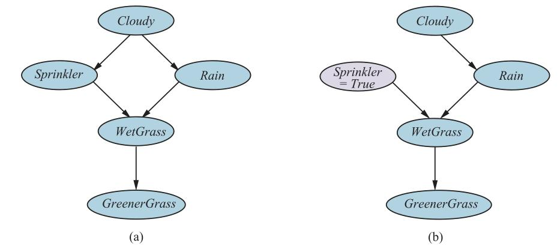

**شکل ۱۳.۲۳ — (الف) شبکهٔ بیزی علّی که روابط علت–اثر را میان پنج متغیر (ابر، باران، آب‌پاش، چمن خیس، چمن سبزتر) بازنمایی می‌کند. (ب) شبکه پس از انجام کنش «آب‌پاش را روشن کن».**

### ۱۳.۵.۱ بازنمایی کنش‌ها: عملگر do

داستان آب‌پاش شکل ۱۳.۲۳(الف) را باز در نظر بگیرید. طبق معناشناسی استاندارد شبکه‌های بیز، توزیع مشترک پنج متغیر با حاصل‌ضرب پنج توزیع شرطی داده می‌شود:

```
P(c, r, s, w, g) = P(c) P(r|c) P(s|c) P(w|r, s) P(g|w)        (13.14)
```

که در آن نام هر متغیر را با حرف نخستش مخفف کرده‌ایم. به‌عنوان سامانه‌ای از معادله‌های ساختاری، مدل به‌صورت زیر است:

```
C = fC(UC)
R = fR(C, UR)
S = fS(C, US)        (13.15)
W = fW(R, S, UW)
G = fG(W, UG)
```

که در آن، بدون ازدست‌دادن عمومیت، fC می‌تواند تابع همانی باشد. متغیرهای U در این معادله‌ها «متغیرهای مدل‌نشده» (Unmodeled Variables) را بازنمایی می‌کنند، که «جمله‌های خطا» (Error Terms) یا «اغتشاش‌ها» (Disturbances) نیز نامیده می‌شوند و رابطهٔ تابعی میان هر متغیر و والدهایش را بر هم می‌زنند. برای نمونه، UW ممکن است منبع بالقوهٔ دیگری از خیسی را بازنمایی کند، علاوه بر Sprinkler و Rain—شاید «شبنم صبحگاهی» (MorningDew) یا «هلیکوپتر آتش‌نشان».

اگر همهٔ متغیرهای U متغیرهای تصادفی متقابلاً مستقل با پیشین‌های مناسب‌الانتخاب باشند، توزیع مشترک معادلهٔ (13.14) را می‌توان دقیقاً با معادله‌های ساختاری معادلهٔ (13.15) بازنمایی کرد. بدین‌ترتیب، سامانه‌ای از روابط تصادفی را می‌توان با سامانه‌ای از روابط قطعی در بر گرفت، که هر یک از اغتشاشی برون‌زا متأثر است. اما سامانهٔ معادله‌های ساختاری بیش از این به ما می‌دهد: به ما اجازه می‌دهد پیش‌بینی کنیم مداخله‌ها چگونه بر عملکرد سامانه و از این رو بر پیامدهای قابل‌مشاهدهٔ آن مداخله‌ها اثر خواهند گذاشت. این فقط با توزیع مشترک ممکن نیست.

برای نمونه، فرض کنیم آب‌پاش را روشن می‌کنیم—یعنی اگر ما (که طبق تعریف، بخشی از فرایندهای علّی توصیف‌شده توسط مدل نیستیم) برای تحمیل شرط Sprinkler=true مداخله کنیم. در نماد «حساب do» (Do-Calculus)، که بخش کلیدی نظریهٔ شبکه‌های علّی است، این به‌صورت do(Sprinkler=true) نوشته می‌شود. پس از انجام، این بدان معناست متغیر آب‌پاش دیگر به ابری‌بودن هوا وابسته نیست. بنابراین معادلهٔ S = fS(C, US) را از سامانهٔ معادله‌های ساختاری حذف و آن را با S = true جایگزین می‌کنیم:

```
C = fC(UC)
R = fR(C, UR)
S = true        (13.16)
W = fW(R, S, UW)
G = fG(W, UG)
```

از این معادله‌ها، توزیع مشترک تازه را برای متغیرهای باقی‌مانده، شرطی بر do(Sprinkler=true)، به دست می‌آوریم:

```
P(c, r, w, g | do(S=true)) = P(c) P(r|c) P(w|r, s=true) P(g|w)        (13.17)
```

این با شبکهٔ «مثله‌شده» در شکل ۱۳.۲۳(ب) متناظر است. از معادلهٔ (13.17)، می‌بینیم تنها متغیرهایی که احتمال‌هایشان تغییر می‌کند WetGrass و GreenerGrass هستند، یعنی فرزندان متغیر دستکاری‌شدهٔ Sprinkler.

تفاوت میان شرطی‌کردن بر کنش do(Sprinkler=true) در شبکهٔ اصلی و شرطی‌کردن بر مشاهدهٔ Sprinkler=true را توجه کنید. شبکهٔ اصلی به ما می‌گوید وقتی هوا ابری است آب‌پاش کم‌محتمل‌تر روشن است، پس اگر مشاهده کنیم آب‌پاش روشن است، این احتمال ابری‌بودن هوا را کاهش می‌دهد. اما عقل سلیم به ما می‌گوید اگر ما (به بیان دیگر، از بیرون جهان عمل می‌کنیم) دست دراز کنیم و آب‌پاش را روشن کنیم، این بر آب‌وهوا اثر نمی‌گذارد یا اطلاعات تازه‌ای دربارهٔ اینکه هوای آن روز چگونه است فراهم نمی‌کند. چنان‌که در شکل ۱۳.۲۳(ب) نشان داده شده، مداخله پیوند علّی عادی میان آب‌وهوا و آب‌پاش را می‌شکند. این از جریان‌یافتن هر تأثیری به‌صورت عقب‌گرد از Sprinkler به Cloudy جلوگیری می‌کند. بدین‌ترتیب، شرطی‌کردن بر do(Sprinkler=true) در گراف اصلی معادل شرطی‌کردن بر Sprinkler=true در گراف مثله‌شده است.

رویکرد مشابهی را می‌توان برای تحلیل اثر do(Xj = xjk) در شبکهٔ علّی عمومی با متغیرهای X1,...,Xn به کار گرفت. شبکه با توزیع مشترکی متناظر است که به‌صورت معمول تعریف می‌شود (معادلهٔ (13.2) را ببینید):

```
P(x1,...,xn) = ∏ P(xi | parents(Xi))        (13.18)
               i=1..n
```

پس از اعمال do(Xj = xjk)، توزیع مشترک تازهٔ Pxjk صرفاً عامل Xj را حذف می‌کند:

```
Pxjk(x1,...,xn) = ∏ P(xi | parents(Xi))        اگر xj = xjk        (13.19)
                  i≠j
                = 0                              اگر xj ≠ xjk
```

یعنی Pxjk(x1,...,xn) = P(x1,...,xn) / P(xj | parents(Xj)) برای xj = xjk. این از این واقعیت نتیجه می‌شود که گذاشتن Xj روی مقدار خاص xjk متناظر با حذف معادلهٔ Xj = fj(Parents(Xj), Uj) از سامانهٔ معادله‌های ساختاری و جایگزینی آن با Xj = xjk است. با کمی دستکاری جبری بیشتر، می‌توان فرمولی برای اثر گذاشتن متغیر Xj روی هر متغیر دیگر Xi استخراج کرد:

```
P(Xi = xi | do(Xj = xjk)) = Pxjk(Xi = xi)
                          = ∑ P(xi | xjk, parents(Xj)) P(parents(Xj))        (13.20)
                            parents(Xj)
```

جمله‌های احتمال در جمع با محاسبه روی شبکهٔ اصلی، با هر یک از الگوریتم‌های استنتاج استاندارد، به دست می‌آیند. این معادله به‌عنوان «فرمول تعدیل» (Adjustment Formula) شناخته می‌شود؛ میانگین احتمال-وزن‌دار اثر Xj و والدهایش بر Xi است، که در آن وزن‌ها پیشین‌های مقادیر والدند. اثرهای مداخله بر چند متغیر را می‌توان با تصور اینکه مداخله‌های فردی به‌ترتیب رخ می‌دهند محاسبه کرد، و هر یک به‌نوبت تأثیرهای علّی روی متغیری را حذف و مدل تازهٔ مثله‌شده‌ای می‌دهد.

### ۱۳.۵.۲ معیار در پشتی

توانایی پیش‌بینی اثر هر مداخله‌ای نتیجه‌ای قابل‌توجه است، اما به دانش دقیق توزیع‌های شرطی لازم در مدل نیاز دارد، به‌طور خاص P(xj | parents(Xj)). اما در بسیاری از محیط‌های دنیای واقعی، این توقعی بیش از حد است. برای نمونه، می‌دانیم «عوامل ژنتیکی» در چاقی نقش دارند، اما نمی‌دانیم کدام ژن‌ها نقش دارند یا ماهیت دقیق اثرهایشان چیست. حتی در داستان سادهٔ تصمیم‌های آب‌پاش مری (شکل ۱۳.۱۵، که در شکل ۱۳.۲۳(الف) نیز صدق می‌کند)، ممکن است بدانیم او قبل از تصمیم‌گیری دربارهٔ روشن‌کردن آب‌پاش آب‌وهوا را بررسی می‌کند، اما ممکن است ندانیم چگونه تصمیم می‌گیرد. دلیل خاص مشکل‌بودن این در این مورد آن است که می‌خواهیم اثر روشن‌کردن آب‌پاش را روی متغیر پایین‌دستی مانند GreenerGrass پیش‌بینی کنیم، اما فرمول تعدیل (معادلهٔ (13.20)) باید نه فقط مسیر مستقیم از Sprinkler، بلکه «در پشتی» مسیر عبوری از Cloudy و Rain را نیز در نظر بگیرد. اگر مقدار Rain را می‌دانستیم، این مسیر در پشتی مسدود می‌شد—که پیشنهاد می‌کند شاید راهی برای نوشتن فرمول تعدیل هست که به‌جای Cloudy بر Rain شرطی شود. و در واقع این ممکن است:

```
P(g | do(S=true)) = ∑r P(g | S=true, r) P(r)        (13.21)
```

به‌طور کلی، اگر بخواهیم اثر do(Xj = xjk) را روی متغیر Xi بیابیم، «معیار در پشتی» (Back-Door Criterion) به ما اجازه می‌دهد فرمول تعدیلی بنویسیم که بر هر مجموعهٔ متغیر Z شرطی می‌شود که در پشتی را، به بیان دیگر، می‌بندد. در زبان فنی‌تر، مجموعهٔ Z را می‌خواهیم به‌گونه‌ای که Xi با توجه به Xj و Z به‌صورت شرطی مستقل از Parents(Xj) باشد. این کاربرد سرراست جداسازی-d است (صفحهٔ ۴۱۹ را ببینید).

معیار در پشتی بلوک ساختمانی پایه‌ای برای نظریه‌ای از استدلال علّی است که در دو دههٔ گذشته پدید آمده. راهی برای استدلال برضد یک قرن جزم آماری فراهم می‌کند که ادعا می‌کرد فقط «کارآزمایی تصادفی‌شده با کنترل» (Randomized Controlled Trial) می‌تواند اطلاعات علّی فراهم کند. این نظریه ابزارهای مفهومی و الگوریتم‌هایی برای تحلیل علّی در گسترهٔ وسیعی از محیط‌های غیرآزمایشی و شبه‌آزمایشی فراهم کرده؛ برای محاسبهٔ احتمال‌های روی گزاره‌های «خلاف واقع» (Counterfactual) («اگر به‌جایش این اتفاق افتاده بود، احتمال چه بود؟»)؛ برای تعیین اینکه یافته‌ها در جمعیتی چه زمانی می‌توانند به جمعیت دیگر منتقل شوند؛ و برای مدیریت همهٔ شکل‌های دادهٔ مفقود هنگام یادگیری مدل‌های احتمال.

## خلاصهٔ فصل

این فصل شبکه‌های بیزی را توصیف کرده، بازنمایی توسعه‌یافته‌ای برای دانش نامطمئن. شبکه‌های بیزی نقشی تقریباً مشابه نقش منطق گزاره‌ای برای دانش قطعی بازی می‌کنند.

- شبکهٔ بیزی گراف جهتداری بدون دور است که گره‌هایش با متغیرهای تصادفی متناظرند؛ هر گره توزیع شرطی برای گره، به‌شرط والدهایش، دارد.
- شبکه‌های بیزی راهی موجز برای بازنمایی روابط استقلال شرطی در حوزه فراهم می‌کنند.
- شبکهٔ بیزی توزیع احتمال مشترکی روی متغیرهایش مشخص می‌کند. احتمال هر تخصیص معین به همهٔ متغیرها به‌صورت حاصل‌ضرب درایه‌های متناظر در توزیع‌های شرطی محلی تعریف می‌شود. شبکهٔ بیزی اغلب به‌صورت نمایی کوچک‌تر از توزیع مشترک صریحاً شمرده‌شده است.
- بسیاری از توزیع‌های شرطی را می‌توان با خانواده‌های متعارف توزیع‌ها به‌صورت فشرده بازنمایی کرد. شبکه‌های بیزی ترکیبی، که شامل هر دو متغیر گسسته و پیوسته‌اند، از انواع توزیع‌های متعارف استفاده می‌کنند.
- استنتاج در شبکه‌های بیزی یعنی محاسبهٔ توزیع احتمال مجموعه‌ای از متغیرهای پرس‌وجو، با توجه به مجموعه‌ای از متغیرهای شاهد. الگوریتم‌های استنتاج دقیق، مانند حذف متغیر، جمع حاصل‌ضرب‌های احتمال‌های شرطی را تا آن‌جا که ممکن است کارآمد ارزیابی می‌کنند.
- در پلی‌درخت‌ها (شبکه‌های تک‌متصل)، استنتاج دقیق زمانی خطی در اندازهٔ شبکه می‌گیرد. در حالت عمومی، مسئله ناشدنی است.
- فنون نمونه‌برداری تصادفی مانند وزن‌گذاری درستنمایی و مونت‌کارلوی زنجیرهٔ مارکوف می‌توانند برآوردهای معقولی از احتمال‌های پسینی واقعی در شبکه بدهند و با شبکه‌های بسیار بزرگ‌تری از الگوریتم‌های دقیق کنار بیایند.
- در حالی که شبکه‌های بیز تأثیرهای احتمالاتی را در بر می‌گیرند، شبکه‌های علّی روابط علّی را در بر می‌گیرند و پیش‌بینی اثر مداخله‌ها و نیز مشاهده‌ها را اجازه می‌دهند.

## یادداشت‌های کتاب‌شناختی و تاریخی

استفاده از شبکه‌ها برای بازنمایی اطلاعات احتمالاتی در اوایل قرن بیستم آغاز شد، با کار سول رایت روی تحلیل احتمالاتی وراثت ژنتیکی و عوامل رشد جانوران (رایت، 1921، 1934). ای. جی. گود (1961)، در همکاری با آلن تورینگ، بازنمایی‌های احتمالاتی و روش‌های استنتاج بیزی را توسعه داد که می‌توانست پیش‌رو شبکه‌های بیزی مدرن دانسته شود—هرچند مقاله اغلب در این زمینه نقل نمی‌شود.⁷ همان مقاله منبع اصلی مدل نویزی-OR است.

بازنمایی «نمودار تأثیر» (Influence Diagram) برای مسائل تصمیم، که بازنمایی DAG را برای متغیرهای تصادفی در بر می‌گرفت، در اواخر دههٔ ۱۹۷۰ در تحلیل تصمیم استفاده شد (فصل ۱۶ را ببینید)، اما فقط شمارش برای ارزیابی استفاده می‌شد. جودیا پرل روش «انتقال پیام» (Message Passing) را برای استنتاج در شبکه‌های درختی (پرل، 1982a) و شبکه‌های پلی‌درخت (کیم و پرل، 1983) توسعه داد و اهمیت مدل‌های احتمال علّی به‌جای تشخیصی را توضیح داد. نخستین سامانهٔ خبرهٔ استفاده‌کننده از شبکه‌های بیزی CONVINCE (کیم، 1983) بود.

چنان‌که در فصل ۱ ثبت شده، اواسط دههٔ ۱۹۸۰ شاهد رونق سامانه‌های خبرهٔ قاعده‌محور بود، که روش‌های موردی برای مدیریت عدم قطعیت در بر می‌گرفتند. احتمال هم «غیرعملی» و هم «از نظر شناختی نامحتمل» به‌عنوان مبنایی برای استدلال دانسته می‌شد. مقالهٔ ستیزه‌جویانهٔ پیتر چیزمن (1985) با عنوان «در دفاع از احتمال» و مقالهٔ بعدی‌اش «پژوهشی در فهم رایانه‌ای» (چیزمن، 1988، با تفسیرها) به چرخاندن میز کمک کرد.

با این حال، احیای احتمال عمدتاً به توسعهٔ شبکه‌های بیزی توسط پرل و توسعهٔ گستردهٔ رویکرد احتمالاتی به هوش مصنوعی بستگی داشت، چنان‌که در کتابش «استدلال احتمالاتی در سامانه‌های هوشمند» (پرل، 1988) ترسیم شده. این کتاب هم مسائل بازنمایی، از جمله روابط استقلال شرطی و معیار جداسازی-d، و هم رویکردهای الگوریتمی را پوشش می‌داد. گایگر و همکاران (1990a) و تیان و همکاران (1998) نتایج محاسباتی کلیدی در شناسایی کارآمد جداسازی-d را ارائه دادند.

یوجین چارنیاک با نگارش مقالهٔ پرطرفدار «شبکه‌های بیزی بدون اشک»⁸ (1991) و کتابی در همین زمینه (1993)، به معرفی ایده‌های پرل به پژوهشگران هوش مصنوعی کمک شایانی کرد. کتاب دین و ول‌من (1991) نیز در شناساندن شبکه‌های بیزی به جامعهٔ هوش مصنوعی نقش مؤثری داشت. شاکتر (1998) روشی ساده‌شده برای تعیین جداسازی-d موسوم به الگوریتم «توپ بیز» (Bayes-ball) ارائه کرد.

با توسعهٔ کاربردهای شبکه‌های بیزی، پژوهشگران دریافتند که لازم است فراتر از مدل پایهٔ متغیرهای گسسته با CPTها حرکت کنند. برای نمونه، سامانهٔ CPCS (پرادهان و همکاران، 1994)—یک شبکهٔ بیزی برای پزشکی داخلی با ۴۴۸ گره و ۹۰۶ پیوند—استفادهٔ گسترده‌ای از عملگرهای منطقی نویزی ارائه‌شده توسط گود (1961) به عمل آورد. بوتیلیه و همکاران (1996) مزایای الگوریتمی استقلال وابسته به بافت را تحلیل کردند. گنجاندن متغیرهای تصادفی پیوسته در شبکه‌های بیزی توسط پرل (1988) و شاکتر و کنلی (1989) مورد بررسی قرار گرفت؛ این مقاله‌ها شبکه‌هایی را بررسی کردند که تنها شامل متغیرهای پیوسته با توزیع‌های خطی-گاوسی بودند.

شبکه‌های ترکیبی (Hybrid Networks) با هر دو نوع متغیر گسسته و پیوسته توسط لوریتزن و ورموث (1989) بررسی شدند و در سامانهٔ cHUGIN پیاده‌سازی گشتند (اولسن، 1993). تحلیل‌های بیشتر در مورد مدل‌های خطی-گاوسی، همراه با پیوندهایی به بسیاری از مدل‌های دیگر در آمار، در مقالهٔ روویس و قهرامانی (1999) آمده است؛ لرنر (2002) بحثی بسیار جامع از کاربرد آن‌ها در شبکه‌های بیزی ترکیبی ارائه می‌دهد. توزیع پروبیت معمولاً به گادوم (1933) و بلیس (1934) نسبت داده می‌شود، اگرچه چندین بار در قرن نوزدهم نیز کشف شده بود. کار بلیس توسط فینی (1947) به‌طور قابل‌توجهی گسترش یافت. پروبیت به‌طور گسترده برای مدل‌سازی پدیده‌های انتخاب گسسته به کار رفته و می‌تواند برای مدیریت بیش از دو انتخاب تعمیم یابد (داگانزو، 1979). مدل اکسپیت (لوجیت معکوس) توسط برکسون (1944) معرفی شد؛ در ابتدا بسیار مورد تمسخر قرار گرفت، اما در نهایت از مدل پروبیت محبوب‌تر شد. بیشاپ (1995) توجیه ساده‌ای برای استفاده از آن ارائه می‌دهد.

کاربردهای اولیهٔ شبکه‌های بیزی در پزشکی شامل سامانهٔ MUNIN برای تشخیص اختلالات عصبی-عضلانی (آندرسن و همکاران، 1989) و سامانهٔ PATHFINDER برای آسیب‌شناسی (هکرمن، 1991) بود. کاربردها در مهندسی شامل کار مؤسسهٔ تحقیقات انرژی الکتریکی (EPRI) روی پایش ژنراتورهای برق (مورجاریا و همکاران، 1995)، کار ناسا روی نمایش اطلاعات حساس به زمان در مرکز کنترل مأموریت در هیوستون (هوروتز و بری، 1995)، و حوزهٔ کلی «توموگرافی شبکه» است که هدف آن استنباط ویژگی‌های محلی مشاهده‌نشدهٔ گره‌ها و پیوندها در اینترنت از طریق مشاهدات عملکرد پیام سرتاسری است (کاسترو و همکاران، 2004). شاید پرکاربردترین سامانه‌های شبکهٔ بیزی، ماژول‌های تشخیص و تعمیر (مانند ویزارد چاپگر) در مایکروسافت ویندوز (بریز و هکرمن، 1996) و دستیار آفیس (Office Assistant) در مایکروسافت آفیس (هوروتز و همکاران، 1998) بوده‌اند.

یکی دیگر از حوزه‌های مهم کاربردی، زیست‌شناسی است: مدل‌های ریاضی مورد استفاده برای تحلیل توارث ژنتیکی در شجره‌نامه‌ها (به‌اصطلاح «تحلیل دودمان» یا Pedigree Analysis) در واقع شکل خاصی از شبکه‌های بیزی هستند. الگوریتم‌های استنتاج دقیق برای تحلیل دودمان، شبیه به الگوریتم حذف متغیر، در اوایل سال 1971 توسط الستون و استوارت توسعه یافتند؛ کانینگز و همکاران (1978) این رویکرد را به الگوریتم‌هایی شبیه به خوشه‌بندی درختی گسترش دادند. بسته‌های نرم‌افزاری تحلیل پیوستگی ژنتیکی LIPED (اوت، 1974) و LINKAGE (لاتروپ و لالوئل، 1984) از پرکاربردترین بسته‌ها در ژنتیک بودند و برای موفقیت‌های اولیه در نقشه‌برداری مکان ژن‌ها در ژنوم انسان نقش حیاتی داشتند.

جودیا پرل (1985)، در نخستین مقاله‌ای که از اصطلاح «شبکه‌های بیزی» استفاده کرد، به‌طور مختصر الگوریتم استنتاجی برای شبکه‌های عمومی را بر اساس ایدهٔ «شرطی‌سازی برش‌مجموعه» (Cutset Conditioning) که در فصل ۶ معرفی شد توصیف کرد. به‌طور مستقل، راس شاکتر (1986)، که در جامعهٔ نمودارهای تأثیر کار می‌کرد، الگوریتم کاملی بر اساس کاهش هدف‌گرای شبکه با استفاده از تبدیل‌های حفظ‌کنندهٔ پسین توسعه داد.

پرل (1986) الگوریتم خوشه‌بندی را برای استنتاج دقیق در شبکه‌های بیزی عمومی توسعه داد، با استفاده از تبدیل به پلی‌درخت جهت‌داری از خوشه‌ها که در آن انتقال پیام برای دستیابی به سازگاری بر متغیرهای مشترک میان خوشه‌ها استفاده می‌شد. رویکرد مشابهی، که توسط آماردانان دیوید اشپیگلهالتر و استفن لوریتزن توسعه یافت (لوریتزن و اشپیگلهالتر، 1988)، بر اساس تبدیل به شکل بدون جهت مدل گرافیکی به نام «شبکهٔ مارکوف» (Markov Network) است. این رویکرد در سامانهٔ HUGIN پیاده‌سازی شده، ابزار کارآمد و پرکاربردی برای استدلال نامطمئن (آندرسن و همکاران، 1989).

ایدهٔ پایهٔ حذف متغیر—که محاسبه‌های تکراری درون عبارت جمع حاصل‌ضرب کلی را می‌توان با کش‌کردن اجتناب کرد—در الگوریتم «استنتاج احتمالاتی نمادین» (Symbolic Probabilistic Inference یا SPI) ظاهر شد (شاکتر و همکاران، 1990). الگوریتم حذفی که ما توصیف می‌کنیم نزدیک‌ترین به الگوریتم توسعه‌یافته توسط ژانگ و پول (1994) است. معیارهای هرس متغیرهای نامربوط توسط گایگر و همکاران (1990b) و توسط لوریتزن و همکاران (1990) توسعه یافت؛ معیاری که ما می‌دهیم حالت خاص ساده‌ای از این‌هاست. دچتر (1999) نشان می‌دهد ایدهٔ حذف متغیر اساساً یکسان با «برنامه‌نویسی پویای غیرمتوالی» (Nonserial Dynamic Programming) (برتله و بریوشی، 1972) است. این الگوریتم‌های شبکهٔ بیزی را به روش‌های مرتبط برای حل CSPها متصل می‌کند و اندازهٔ مستقیمی از پیچیدگی استنتاج دقیق بر حسب پهنای درختی شبکه می‌دهد. جلوگیری از رشد نمایی در اندازهٔ عامل‌ها در حذف متغیر را می‌توان با حذف متغیرها از عامل‌های بزرگ انجام داد (دچتر و ریش، 2003)؛ همچنین می‌توان خطای بدین‌وسیله واردشده را کران‌دار کرد (وکسلر و میک، 2009). از طرف دیگر، عامل‌ها را می‌توان با بازنمایی آن‌ها با «نمودارهای تصمیم جبری» (Algebraic Decision Diagrams) به‌جای جدول‌ها فشرده کرد (گوگیت و دومینگوس، 2011).

روش‌های دقیق مبتنی بر شمارش بازگشتی (شکل ۱۳.۱۱ را ببینید) همراه با کش‌کردن شامل الگوریتم «شرطی‌سازی بازگشتی» (Recursive Conditioning) (دارویچ، 2001)، الگوریتم «حذف مقدار» (Value Elimination) (بیکوس و همکاران، 2003) و جستجوی AND–OR (دچتر و ماتسکو، 2007) می‌شوند. روش «شمارش مدل وزندار» (سانگ و همکاران، 2005؛ شاویرا و دارویچ، 2008) معمولاً بر حل‌کنندهٔ SAT به سبک DPLL مبتنی است (شکل ۷.۱۷ صفحهٔ ۲۳۴ را ببینید). به‌این‌ترتیب، آن نیز شمارش بازگشتی تخصیص‌های متغیر را با کش‌کردن انجام می‌دهد، پس رویکرد در واقع کاملاً مشابه است. هر سه این الگوریتم‌ها می‌توانند دامنهٔ کاملی از معاوضه‌های فضا/زمان را پیاده‌سازی کنند.

چون تخصیص‌های متغیر را در نظر می‌گیرند، الگوریتم‌ها می‌توانند به‌آسانی از قطعیت و استقلال وابسته به بافت در مدل بهره بگیرند. آن‌ها همچنین می‌توانند برای استفاده از الگوریتم کارآمد خطی‌زمان اصلاح شوند، هرگاه تخصیص جزئی شبکهٔ باقی‌مانده را پلی‌درخت کند. (این نسخه‌ای از روش شرطی‌سازی برش‌مجموعه است که برای CSPها در فصل ۶ توصیف شد.) برای استنتاج دقیق در مدل‌های بزرگ، که نیازهای فضایی خوشه‌بندی و حذف متغیر عظیم می‌شود، این الگوریتم‌های بازگشتی اغلب عملی‌ترین رویکردند.

تکلیف‌های مهم استنتاجی دیگری در شبکه‌های بیز هست، جدا از محاسبهٔ احتمال‌های حاشیه‌ای. «محتمل‌ترین تبیین» (Most Probable Explanation یا MPE) محتمل‌ترین تخصیص به متغیرهای غیرشاهد با توجه به شواهد است. (MPE حالت خاصی از استنتاج «بیشینهٔ پسین» (Maximum A Posteriori یا MAP) است، که محتمل‌ترین تخصیص به زیرمجموعه‌ای از متغیرهای غیرشاهد را با توجه به شواهد می‌پرسد.) برای چنین مسائلی، الگوریتم‌های متفاوت بسیاری توسعه یافته، برخی مربوط به الگوریتم‌های کوتاه‌ترین‌مسیر یا جستجوی AND–OR؛ برای خلاصه، مارینسکو و دچتر (2009) را ببینید. نخستین نتیجه دربارهٔ پیچیدگی استنتاج در شبکه‌های بیز از کوپر (1990) است، که نشان داد مسئلهٔ عمومی محاسبهٔ حاشیه‌ها در شبکه‌های بیزی NP-سخت است؛ چنان‌که در فصل ذکر شد، این را می‌توان از طریق تقلیل از شمارش تخصیص‌های ارضاکننده به #P-سختی تقویت کرد (روت، 1996). این همچنین دلالت بر NP-سختی استنتاج تقریبی دارد (داگوم و لوبی، 1993)؛ با این حال، برای حالتی که احتمال‌ها را بتوان از 0 و 1 دور نگه داشت، شکلی از وزن‌گذاری درستنمایی در زمان (تصادفی) چندجمله‌ای همگرا می‌شود (داگوم و لوبی، 1997). شیمونی (1994) نشان داد یافتن محتمل‌ترین تبیین NP-کامل است—ناشدنی، اما تا حدی آسان‌تر از محاسبهٔ حاشیه‌ها—در حالی که پارک و دارویچ (2004) تحلیل پیچیدگی کاملی از محاسبهٔ MAP فراهم می‌کنند، نشان می‌دهند در ردهٔ مسائل NPPP-کامل قرار می‌گیرد—یعنی تا حدی سخت‌تر از محاسبهٔ حاشیه‌ها.

توسعهٔ الگوریتم‌های تقریب سریع برای استنتاج شبکهٔ بیزی حوزه‌ای بسیار فعال است، با مشارکت‌هایی از آمار، علوم رایانه و فیزیک. روش نمونه‌برداری ردی فن عمومی‌ای است که دست‌کم به «سوزن بوفون» (1777) بازمی‌گردد؛ نخستین بار توسط ماکس هنریون (1988) روی شبکه‌های بیزی اعمال شد، که آن را «نمونه‌برداری منطقی» (Logic Sampling) نامید. نمونه‌برداری اهمیت در اصل برای کاربردهایی در فیزیک اختراع شد (کان، 1950a، 1950b) و توسط فونگ و چانگ (1989) (که الگوریتم را «وزن‌گذاری شاهد» (Evidence Weighting) نامیدند) و توسط شاکتر و پئوت (1989) روی استنتاج شبکهٔ بیز اعمال شد.

در آمار، نمونه‌برداری تطبیقی برای انواع الگوریتم‌های مونت‌کارلو برای سرعت‌بخشیدن به همگرایی اعمال شده. ایدهٔ پایه تطبیق توزیعی است که نمونه‌ها از آن تولید می‌شوند، بر اساس پیامد نمونه‌های قبلی. گیلکس و وایلد (1992) نمونه‌برداری ردی تطبیقی را توسعه دادند، در حالی که نمونه‌برداری اهمیت تطبیقی ظاهراً به‌طور مستقل در فیزیک (لپاژ، 1978)، مهندسی عمران (کارامچاندانی و همکاران، 1989)، آمار (اوه و برگر، 1992) و گرافیک رایانه‌ای (ویچ و گیباس، 1995) سرچشمه گرفته. چنگ و دروزدزل (2000) نسخهٔ تطبیقی نمونه‌برداری اهمیت اعمال‌شده بر استنتاج شبکهٔ بیز را توصیف می‌کنند. اخیرتر، له و همکاران (2017) استفاده از سامانه‌های یادگیری عمیق برای تولید توزیع‌های پیشنهادی را نشان داده‌اند که نمونه‌برداری اهمیت را چند مرتبهٔ بزرگی سریع‌تر می‌کند. الگوریتم‌های مونت‌کارلوی زنجیرهٔ مارکوف (MCMC) با الگوریتم متروپلیس آغاز شدند، که از متروپلیس و همکاران (1953) است و همچنین منبع الگوریتم بازپخت شبیه‌سازی‌شدهٔ توصیف‌شده در فصل ۴ بود. هستینگز (1970) گام پذیرش/رد را معرفی کرد که بخش جدایی‌ناپذیر چیزی است که امروز الگوریتم متروپلیس–هستینگز می‌نامیم. نمونه‌بردار گیبس توسط گمن و گمن (1984) برای استنتاج در شبکه‌های مارکوف بدون جهت ابداع شد. کاربرد نمونه‌برداری گیبس در شبکه‌های بیزی از پرل (1987) است. مقاله‌های گردآوری‌شده توسط گیلکس و همکاران (1996) هم نظریه و هم کاربردهای MCMC را پوشش می‌دهند.

از اواسط دههٔ ۱۹۹۰، MCMC اسب بارکش آمار بیزی و محاسبهٔ آماری در بسیاری از رشته‌های دیگر از جمله فیزیک و زیست‌شناسی شده. «راهنمای مونت‌کارلوی زنجیرهٔ مارکوف» (بروکس و همکاران، 2011) بسیاری از جنبه‌های این ادبیات را پوشش می‌دهد. بستهٔ BUGS (گیلکس و همکاران، 1994) سامانهٔ اولیه و تأثیرگذاری برای مدل‌سازی و استنتاج شبکهٔ بیز با استفاده از نمونه‌برداری گیبس بود. STAN (به نام استانیسلاو اولام، یکی از پدیدآورندگان روش‌های مونت‌کارلو در فیزیک) سامانهٔ جدیدتری است که از استنتاج مونت‌کارلوی همیلتونی استفاده می‌کند (کارپنتر و همکاران، 2017).

دو خانوادهٔ بسیار مهم روش‌های تقریبی هست که در فصل پوشش ندادیم. نخستین، خانوادهٔ «روش‌های تقریب تغییراتی» (Variational Approximation Methods) است، که می‌تواند برای ساده‌سازی محاسبات پیچیدهٔ همه‌گونه استفاده شود. ایدهٔ پایه پیشنهاد نسخهٔ کاهش‌یافته‌ای از مسئلهٔ اصلی است که کار با آن ساده اما تا آن‌جا که ممکن است شبیه مسئلهٔ اصلی است. مسئلهٔ کاهش‌یافته با پارامترهای تغییراتی λ توصیف می‌شود که برای کمینه‌کردن تابع فاصلهٔ D میان مسئلهٔ اصلی و کاهش‌یافته تنظیم می‌شوند، اغلب با حل دستگاه معادلات ∂D/∂λ = 0. در بسیاری از موارد، کران‌های بالا و پایین اکید قابل‌دستیابی‌اند. روش‌های تغییراتی مدت‌ها در آمار استفاده شده‌اند (روستاگی، 1976). در فیزیک آماری، «روش میدان میانگین» (Mean-Field Method) تقریب تغییراتی خاصی است که در آن متغیرهای فردی سازندهٔ مدل کاملاً مستقل فرض می‌شوند. این ایده برای حل شبکه‌های مارکوف بدون جهت بزرگ اعمال شد (پترسون و اندرسون، 1987؛ پاریسی، 1988). ساول و همکاران (1996) شالوده‌های ریاضی اعمال روش‌های تغییراتی بر شبکه‌های بیزی را توسعه دادند و تقریب‌های کران پایین دقیقی برای شبکه‌های سیگموئیدی با استفاده از روش‌های میدان میانگین به دست آوردند. یاکولا و جوردن (1996) روش‌شناسی را برای به‌دست‌آوردن هر دو کران پایین و بالا بسط دادند. از این مقاله‌های اولیه، روش‌های تغییراتی به بسیاری از خانواده‌های خاص مدل‌ها اعمال شده‌اند. مقالهٔ قابل‌توجه واین‌رایت و جوردن (2008) تحلیل نظری یکپارچه‌ای از ادبیات روش‌های تغییراتی فراهم می‌کند.

دومین خانوادهٔ مهم الگوریتم‌های تقریبی بر الگوریتم انتقال پیام پلی‌درخت پرل (1982a) مبتنی است. این الگوریتم را می‌توان برای شبکه‌های «حلقه‌دار» عمومی اعمال کرد، چنان‌که پرل (1988) پیشنهاد کرد. نتایج ممکن است نادرست باشند، یا الگوریتم ممکن است در خاتمه‌یافتن شکست بخورد، اما در بسیاری از موارد، مقادیر به‌دست‌آمده نزدیک مقادیر واقعی‌اند. توجه اندکی به این «انتشار باور حلقه‌دار» (Loopy Belief Propagation) موسوم معطوف شد تا اینکه مک‌الیس و همکاران (1998) مشاهده کردند این دقیقاً محاسبه‌ای است که «الگوریتم رمزگشایی توربو» (Turbo Decoding) (برو و همکاران، 1993) انجام می‌دهد، که پیشرفت بزرگی در طراحی کدهای تصحیح خطای کارآمد فراهم کرد. دلالت این مشاهده‌ها این است که اگر BP حلقه‌دار هم سریع و هم دقیق روی شبکه‌های بسیار بزرگ و بسیار پرپیوند استفاده‌شده برای رمزگشایی است، پس ممکن است به‌طور کلی‌تر مفید باشد. پشتیبانی نظری برای این یافته‌ها، شامل اثبات‌های همگرایی برای برخی حالت‌های خاص، توسط وایس (2000b)، وایس و فریمن (2001) و یدیدیا و همکاران (2005) فراهم شد، با تکیه بر ارتباط‌هایی با ایده‌های فیزیک آماری.

نظریه‌های استنتاج علّی فراتر از کارآزمایی‌های تصادفی‌شده با کنترل توسط روبین (1974) و رابینز (1986) پیشنهاد شد، اما این ایده‌ها هم مبهم و هم بحث‌برانگیز ماندند تا اینکه جودیا پرل نظریهٔ کاملاً بیان‌شده‌ای از علّیت را بر اساس شبکه‌های علّی توسعه و ارائه کرد (پرل، 2000). پیترز و همکاران (2017) نظریه را بیشتر توسعه می‌دهند، با تأکید بر یادگیری. اثری جدیدتر، «کتاب چرا» (The Book of Why؛ پرل و مک‌کنزی، 2018)، مقدمه‌ای کم‌ریاضی‌تر اما خواناتر و گسترده‌تر فراهم می‌کند.

استدلال نامطمئن در هوش مصنوعی همیشه بر نظریهٔ احتمال مبتنی نبوده. چنان‌که در فصل ۱۲ ذکر شد، سامانه‌های احتمالاتی اولیه در اوایل دههٔ ۱۹۷۰ از رواج افتادند و خلأی جزئی باقی گذاشتند که با روش‌های جایگزین پر شود. این‌ها شامل سامانه‌های خبرهٔ قاعده‌محور، نظریهٔ دمپستر–شیفر و (تا حدی) منطق فازی بودند.⁹ رویکردهای قاعده‌محور به عدم قطعیت امیدوار بودند بر موفقیت سامانه‌های قاعده‌محور منطقی بنا شوند، اما نوعی «عامل جبران» (Fudge Factor)—مؤدبانه‌تر «ضریب قطعیت» (Certainty Factor) نامیده می‌شود—به هر قاعده بیفزایند تا عدم قطعیت را در خود جای دهند. نخستین چنین سامانه‌ای MYCIN بود (شورتلیف، 1976)، سامانهٔ خبرهٔ پزشکی برای عفونت‌های باکتریایی. مجموعهٔ «سامانه‌های خبرهٔ قاعده‌محور» (بوکانان و شورتلیف، 1984) مرور کاملی از MYCIN و فرزندانش فراهم می‌کند (همچنین استفیک، 1995 را ببینید).

دیوید هکرمن (1986) نشان داد نسخهٔ کمی اصلاح‌شدهٔ محاسبات ضریب قطعیت در برخی موارد نتایج احتمالاتی درستی می‌دهد، اما در موارد دیگر به بیش‌شماری جدی شواهد می‌انجامد. با بزرگ‌ترشدن مجموعه‌های قاعده، تعامل‌های نامطلوب میان قاعده‌ها رایج‌تر می‌شد، و دست‌اندرکاران دریافتند ضریب‌های قطعیت بسیاری از قاعده‌های دیگر باید وقتی قاعده‌های تازه افزوده می‌شوند «تنظیم» شوند. ویژگی‌های ریاضی پایه‌ای که زنجیره‌های استدلال در منطق را ممکن می‌کنند به‌سادگی برای احتمال برقرار نیستند.

نظریهٔ دمپستر–شیفر از مقاله‌ای از آرتور دمپستر (1968) سرچشمه می‌گیرد که تعمیمی از احتمال به مقادیر بازه‌ای و قاعدهٔ ترکیبی برای استفاده از آن‌ها پیشنهاد می‌کرد. چنین رویکردی ممکن است دشواری مشخص‌کردن دقیق احتمال‌ها را تسکین دهد. کار بعدی گلن شیفر (1976) به این انجامید که نظریهٔ دمپستر–شیفر رویکردی رقیب برای احتمال دیده شود. پرل (1988) و روسپینی و همکاران (1992) رابطهٔ میان نظریهٔ دمپستر–شیفر و نظریهٔ احتمال استاندارد را تحلیل می‌کنند. در بسیاری از موارد، نظریهٔ احتمال الزام نمی‌کند احتمال‌ها دقیقاً مشخص شوند: می‌توانیم عدم قطعیت دربارهٔ مقادیر احتمال را به‌صورت توزیع‌های احتمال (مرتبهٔ دوم) بیان کنیم، چنان‌که در فصل ۲۰ توضیح داده شده.

مجموعه‌های فازی توسط لطفی زاده (1965) در پاسخ به دشواری درک‌شدهٔ فراهم‌کردن ورودی‌های دقیق برای سامانه‌های هوشمند توسعه یافت. مجموعهٔ فازی مجموعه‌ای است که در آن عضویت امری درجه‌ای است. منطق فازی روشی برای استدلال با عبارت‌های منطقی توصیف‌کنندهٔ عضویت در مجموعه‌های فازی است. کنترل فازی روش‌شناسی‌ای برای ساخت سامانه‌های کنترلی است که در آن نگاشت میان پارامترهای ورودی و خروجی حقیقی‌مقدار با قاعده‌های فازی بازنمایی می‌شود. کنترل فازی در محصولات تجاری مانند گیربکس‌های اتوماتیک، دوربین‌های ویدیویی و ریش‌تراش‌های برقی بسیار موفق بوده. متن زیمرمان (2001) مقدمهٔ کاملی بر نظریهٔ مجموعهٔ فازی فراهم می‌کند؛ مقاله‌های کاربردهای فازی در زیمرمان (1999) گردآوری شده‌اند. منطق فازی اغلب به‌اشتباه رقیب مستقیم نظریهٔ احتمال درک شده، در حالی که در واقع به مجموعهٔ متفاوتی از مسائل می‌پردازد: به‌جای درنظرگرفتن عدم قطعیت دربارهٔ صدق گزاره‌های خوش‌تعریف، منطق فازی با ابهام در نگاشت از عبارت‌های نظریهٔ نمادین به جهان واقعی سروکار دارد. ابهام مسئلهٔ واقعی در هر کاربرد منطق، احتمال یا حتی مدل‌های ریاضی استاندارد بر واقعیت است. حتی متغیری به‌تمیزی جرم زمین، با بازرسی، معلوم می‌شود با زمان تغییر می‌کند، چنان‌که شهاب‌سنگ‌ها و مولکول‌ها می‌آیند و می‌روند. همچنین نادقیق است—آیا جو را شامل می‌شود؟ اگر بله، تا چه ارتفاعی؟ در برخی موارد، بسط بیشتر مدل می‌تواند ابهام را کاهش دهد، اما منطق فازی ابهام را امری داده‌شده می‌گیرد و نظریه‌ای پیرامونش توسعه می‌دهد.

«نظریهٔ امکان» (Possibility Theory؛ زاده، 1978) برای مدیریت عدم قطعیت در سامانه‌های فازی معرفی شد و اشتراکات بسیاری با احتمال دارد (دوبوا و پراد، 1994).

بسیاری از پژوهشگران هوش مصنوعی در دههٔ ۱۹۷۰ احتمال را رد کردند، زیرا محاسبات عددی که تصور می‌شد نظریهٔ احتمال به آن‌ها نیاز دارد برای درون‌نگری آشکار نبود و سطح غیرواقع‌گرایانه‌ای از دقت در دانش نامطمئن ما را پیش‌فرض می‌گرفت. توسعهٔ «شبکه‌های احتمالاتی کیفی» (Qualitative Probabilistic Networks؛ ولمن، 1990a) انتزاع صرفاً کیفی شبکه‌های بیزی را فراهم کرد، با استفاده از مفهوم تأثیرهای مثبت و منفی میان متغیرها. ولمن نشان می‌دهد در بسیاری از موارد چنین اطلاعاتی برای تصمیم‌گیری بهینه بدون نیاز به مشخص‌سازی دقیق مقادیر احتمال کافی است. گلدشمیت و پرل (1996) رویکرد مشابهی دارند. کار دارویچ و گینزبرگ (1992) ویژگی‌های پایهٔ شرطی‌کردن و ترکیب شواهد را از نظریهٔ احتمال بیرون می‌کشد و نشان می‌دهد می‌توان آن‌ها را در استدلال منطقی و پیش‌فرض نیز اعمال کرد.

چندین متن عالی (جنسن، 2007؛ دارویچ، 2009؛ کولر و فریدمن، 2009؛ کورب و نیکلسون، 2010؛ دچتر، 2019) برخوردهای کاملی از موضوعات پوشش‌داده‌شده در این فصل فراهم می‌کنند. پژوهش تازه دربارهٔ استدلال احتمالاتی هم در ژورنال‌های اصلی هوش مصنوعی، مانند «هوش مصنوعی» (Artificial Intelligence) و «ژورنال پژوهش هوش مصنوعی» (Journal of AI Research)، و هم در ژورنال‌های تخصصی‌تر، مانند «ژورنال بین‌المللی استدلال تقریبی» (International Journal of Approximate Reasoning)، ظاهر می‌شود. مقاله‌های بسیاری دربارهٔ مدل‌های گرافیکی، که شبکه‌های بیزی را شامل می‌شوند، در ژورنال‌های آماری ظاهر می‌شوند. مجموعه‌مقالات کنفرانس‌های «عدم قطعیت در هوش مصنوعی» (UAI)، «سامانه‌های پردازش اطلاعات عصبی» (NeurIPS) و «هوش مصنوعی و آمار» (AISTATS) منابع خوبی برای پژوهش جاری‌اند.

---

**پانوشت‌ها:**

¹ شبکه‌های بیزی، که اغلب به‌اختصار «شبکهٔ بیز» نامیده می‌شوند، در دهه‌های ۱۹۸۰ و ۱۹۹۰ «شبکهٔ باور» نامیده می‌شدند. شبکهٔ علّی شبکهٔ بیزی با قیدهای اضافی روی معنای پیکان‌هاست (بخش ۱۳.۵ را ببینید). اصطلاح «مدل گرافیکی» به ردهٔ گسترده‌تری اشاره دارد که شبکه‌های بیزی را شامل می‌شود.
² از این نتیجه می‌شود استنتاج در شبکه‌های خطی–گاوسی در بدترین حالت فقط O(n³) زمان می‌برد، صرف‌نظر از توپولوژی شبکه. در بخش ۱۳.۳ می‌بینیم استنتاج برای شبکه‌های متغیر گسسته NP-سخت است.
³ شبکهٔ نشان‌داده‌شده در شکل ۱۳.۹ در واقع استفاده نمی‌شود، اما ساختارش با متخصصان بیمه بازبینی شده. در عمل، اطلاعات خواسته‌شده در فرم‌های درخواست با شرکت و حوزهٔ قضایی متفاوت است—برای نمونه، برخی جنسیت می‌پرسند—و مدل قطعاً می‌تواند جزئی‌تر و ظریف‌تر ساخته شود.
⁴ برخی شرکت‌های بیمه همچنین سابقهٔ اعتباری متقاضی را برای کمک به ارزیابی ریسک به دست می‌آورند؛ این اطلاعات بسیار بیشتری دربارهٔ ردهٔ اقتصادی-اجتماعی فراهم می‌کند. هرگاه از این نوع متغیرهای پنهان استفاده می‌کنیم، باید مراقب باشیم ناخواسته به جانشین متغیرهایی مانند نژاد تبدیل نشوند که ممکن است در تصمیم‌های بیمه استفاده نشوند. فنون اجتناب از این نوع سوگیری‌ها در فصل ۱۹ توصیف شده‌اند.
⁵ تکلیف بسیار مطالعه‌شدهٔ دیگر یافتن محتمل‌ترین تبیین برای برخی شواهد مشاهده‌شده است. این و دیگر تکلیف‌ها در یادداشت‌های پایان فصل بحث شده‌اند.
⁶ اگر آسان بود، آنگاه می‌توانستیم احتمال موردنظر را با تعداد چندجمله‌ای از نمونه‌ها با دقت دلخواه تقریب بزنیم. می‌توان نشان داد چنین طرح تقریب چندجمله‌ای‌زمانی نمی‌تواند وجود داشته باشد.
⁷ ای. جی. گود آماردان ارشد تیم شکستن رمز تورینگ در جنگ جهانی دوم بود. در «۲۰۰۱: ادیسهٔ فضایی» (کلارک، 1968)، گود و مینسکی با انجام پیشرفت منجر به توسعهٔ رایانهٔ HAL 9000 اعتبار یافته‌اند.
⁸ عنوان نسخهٔ اصلی مقاله «پرل برای خوک» (Pearl for swine) بود.
⁹ رویکرد چهارم، استدلال پیش‌فرض (Default Reasoning)، نتیجه‌ها را نه «باورشده تا درجهٔ معینی»، بلکه «باورشده تا وقتی دلیل بهتری برای باور چیز دیگر یافت شود» تلقی می‌کند. در فصل ۱۰ پوشش داده شده است.
