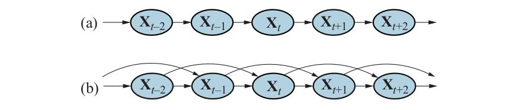
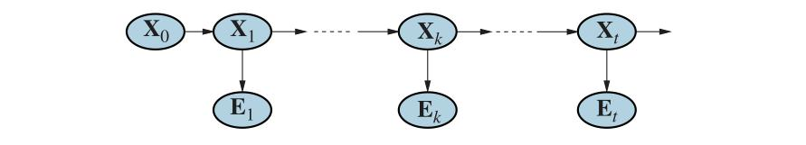
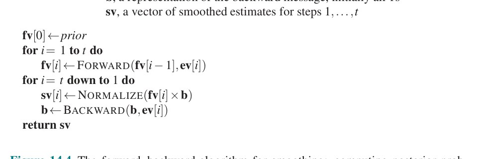
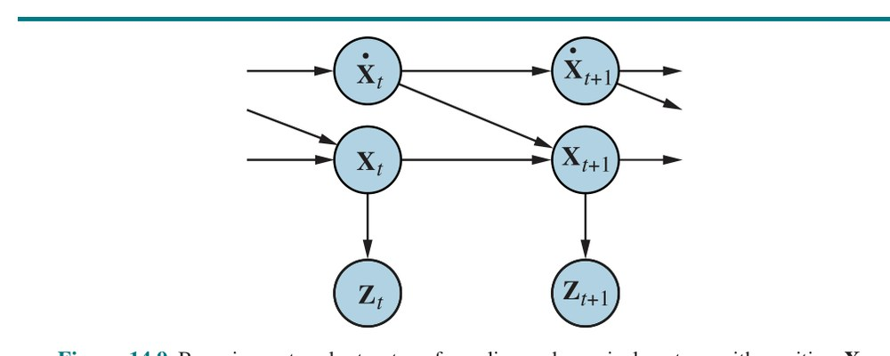
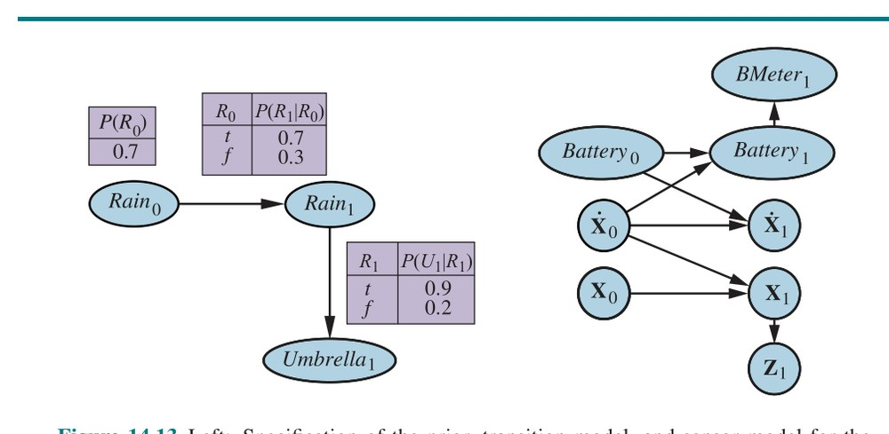
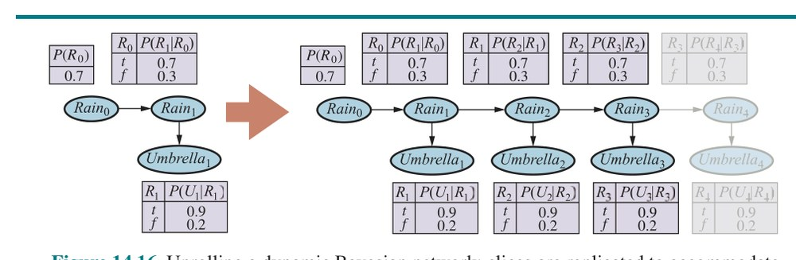
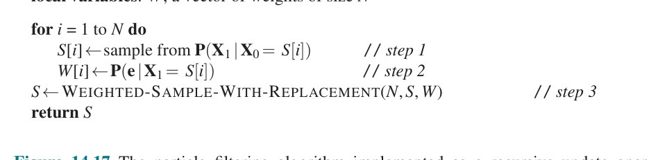
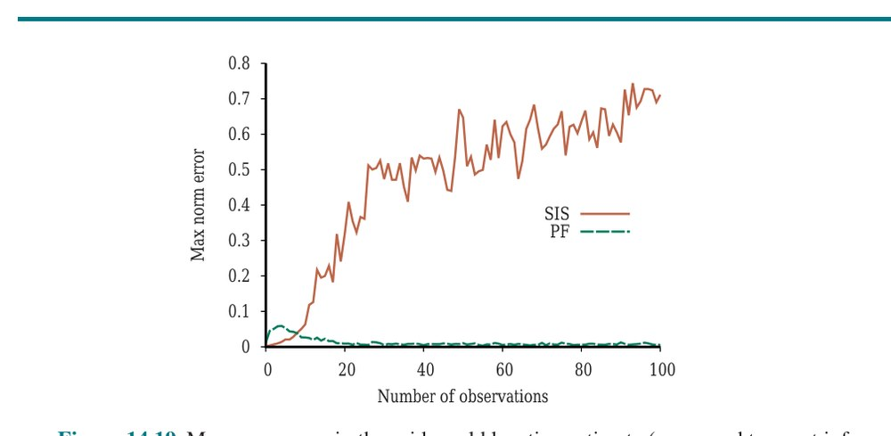

# فصل ۱۴ — استدلال احتمالاتی در طول زمان

**فصل ۱۴: استدلال احتمالاتی در طول زمان (Probabilistic Reasoning over Time)**

*در این فصل می‌کوشیم حال را تفسیر کنیم، گذشته را بفهمیم و شاید آینده را پیش‌بینی کنیم، حتی وقتی چیزِ بسیار کمی روشن و واضح است.*

عامل‌ها در محیط‌های تا حدی قابل مشاهده باید بتوانند حالتِ کنونی را، تا آن‌جا که حسگرهایشان اجازه می‌دهد، پیگیری کنند. در بخش ۴.۴ روشی برای این کار نشان دادیم: عامل «حالت باور» (Belief State) را نگه می‌دارد که بازنمایی می‌کند کدام حالت‌های جهان در حالِ حاضر ممکن‌اند.

عامل با حالت باور و «مدل انتقال» (Transition Model) می‌تواند پیش‌بینی کند جهان ممکن است در گامِ زمانیِ بعد چگونه تکامل یابد. با حس‌گذارِه‌های مشاهده‌شده و «مدل حسگر» (Sensor Model)، عامل می‌تواند حالت باور را به‌روزرسانی کند. این ایده‌ای فراگیر است: در فصل ۴ حالت‌های باور با مجموعه‌هایی از حالت‌های صریحاً شمرده‌شده بازنمایی می‌شدند، در حالی که در فصل‌های ۷ و ۱۱ با فرمول‌های منطقی بازنمایی می‌شدند. آن رویکردها حالت‌های باور را بر حسبِ اینکه کدام حالت‌های جهان ممکن‌اند تعریف می‌کردند، اما نمی‌توانستند چیزی دربارهٔ اینکه کدام حالت‌ها محتمل یا نامحتمل‌اند بگویند. در این فصل، از نظریهٔ احتمال برای کمّی‌کردنِ درجهٔ باور به عناصرِ حالت باور استفاده می‌کنیم.

چنان‌که در بخش ۱۴.۱ نشان می‌دهیم، خودِ زمان به همان شیوهٔ فصل ۷ مدیریت می‌شود: جهانِ متغیر با متغیری برای هر جنبه از حالتِ جهان در هر نقطه از زمان مدل می‌شود. مدل‌های انتقال و حسگر ممکن است نامطمئن باشند: مدلِ انتقال توزیعِ احتمالِ متغیرها را در زمانِ t، با توجه به حالتِ جهان در زمان‌های گذشته، توصیف می‌کند، در حالی که مدلِ حسگر احتمالِ هر حس‌گذارِه را در زمانِ t، با توجه به حالتِ کنونیِ جهان، توصیف می‌کند. بخش ۱۴.۲ تکلیف‌های استنتاجیِ پایه را تعریف و ساختارِ عمومیِ الگوریتم‌های استنتاج برای مدل‌های زمانی را توصیف می‌کند. سپس سه نوع خاصِ مدل را توصیف می‌کنیم: «مدل‌های مارکوفِ پنهان» (Hidden Markov Models)، «فیلترهای کالمن» (Kalman Filters) و «شبکه‌های بیزیِ پویا» (Dynamic Bayesian Networks؛ که مدل‌های مارکوفِ پنهان و فیلترهای کالمن را به‌عنوانِ حالت‌های خاص شامل می‌شوند).

## ۱۴.۱ زمان و عدم قطعیت

فنونِ خود را برای استدلالِ احتمالاتی در بافتِ جهان‌های ایستا توسعه داده‌ایم، که در آن هر متغیرِ تصادفی یک مقدارِ ثابتِ تکی دارد. برای نمونه، هنگام تعمیرِ خودرو فرض می‌کنیم هرچه خراب است در طولِ فرایندِ تشخیص خراب می‌ماند؛ کارِ ما استنتاجِ حالتِ خودرو از شواهدِ مشاهده‌شده است، که آن نیز ثابت می‌ماند.

حالا مسئله‌ای کمی متفاوت را در نظر بگیرید: درمانِ بیمارِ دیابتی. همانندِ تعمیرِ خودرو، شواهدی مانند دوزهای اخیرِ انسولین، دریافتِ غذا، اندازه‌گیری‌های قند خون و دیگر نشانه‌های فیزیکی داریم. تکلیف، ارزیابیِ حالتِ کنونیِ بیمار است، شاملِ سطحِ واقعیِ قند خون و سطحِ انسولین. با این اطلاعات، می‌توانیم دربارهٔ دریافتِ غذای بیمار و دوزِ انسولین تصمیم بگیریم. برخلافِ موردِ تعمیرِ خودرو، در این‌جا جنبه‌های پویای مسئله ضروری‌اند. سطحِ قند خون و اندازه‌گیری‌های آن می‌توانند به‌سرعت در طولِ زمان تغییر کنند، بسته به دریافتِ اخیرِ غذا و دوزهای انسولین، فعالیتِ متابولیک، ساعتِ روز و مانندِ آن. برای ارزیابیِ حالتِ کنونی از تاریخچهٔ شواهد و پیش‌بینیِ پیامدهای کنش‌های درمانی، باید این تغییرها را مدل کنیم.

همین ملاحظات در بافت‌های بسیاری دیگر پیش می‌آید، مانند ردیابیِ مکانِ ربات، ردیابیِ فعالیتِ اقتصادیِ یک ملت، و فهمِ توالیِ گفتاری یا نوشتاریِ واژه‌ها. چگونه می‌توان وضعیت‌های پویایی مانند این‌ها را مدل کرد؟

### ۱۴.۱.۱ حالت‌ها و مشاهده‌ها

این فصل «مدل‌های زمانِ گسسته» (Discrete-Time Models) را بحث می‌کند، که در آن جهان به‌صورتِ مجموعه‌ای از «عکس‌های لحظه‌ای» یا «برش‌های زمانی» (Time Slices) دیده می‌شود.¹ فقط برش‌های زمانی را 0، 1، 2 و... شماره‌گذاری می‌کنیم، به‌جای تخصیصِ زمان‌های خاص به آن‌ها. معمولاً فرض می‌شود بازهٔ زمانیِ Δ میان برش‌ها برای هر بازه یکسان است. برای هر کاربردِ خاص، مقدارِ خاصی از Δ باید انتخاب شود. گاهی این توسط حسگر دیکته می‌شود؛ برای نمونه، دوربینِ ویدیویی ممکن است تصاویر را در بازه‌های 1/30 ثانیه تأمین کند. در مواردِ دیگر، بازه توسط نرخ‌های تغییرِ معمولِ متغیرهای مربوط دیکته می‌شود؛ برای نمونه، در موردِ پایشِ گلوکزِ خون، چیزها می‌توانند در طولِ ده دقیقه به‌طورِ قابلِ‌توجهی تغییر کنند، پس بازهٔ یک‌دقیقه‌ای ممکن است مناسب باشد. از سوی دیگر، در مدل‌کردنِ رانشِ قاره‌ها در مقیاسِ زمین‌شناختی، بازه‌ای یک‌میلیون‌ساله ممکن است خوب باشد.

هر برشِ زمانی در مدلِ احتمالِ زمانِ گسسته شاملِ مجموعه‌ای از متغیرهای تصادفی است، برخی قابلِ مشاهده و برخی نه. برای سادگی، فرض می‌کنیم همان زیرمجموعهٔ متغیرها در هر برشِ زمانی قابلِ مشاهده است (هرچند در هیچ‌کدام از آنچه در ادامه می‌آید این به‌صورتِ سخت‌گیرانه ضروری نیست). از Xt برای نشان‌دادنِ مجموعهٔ متغیرهای حالت در زمانِ t استفاده می‌کنیم، که فرض می‌شود قابلِ مشاهده نیستند، و از Et برای نشان‌دادنِ مجموعهٔ متغیرهای شاهدِ قابلِ مشاهده. مشاهده در زمانِ t برابر Et = et است، برای مجموعه‌ای از مقادیرِ et.

مثالِ زیر را در نظر بگیرید: شما نگهبانِ امنیتیِ مستقر در تأسیساتِ زیرزمینیِ محرمانه‌ای هستید. می‌خواهید بدانید آیا امروز باران می‌بارد، اما تنها دسترسی‌تان به دنیای بیرون هر صبح رخ می‌دهد، وقتی می‌بینید مدیر با چتر وارد می‌شود یا بدونِ چتر. برای هر روزِ t، مجموعهٔ Et بنابراین شاملِ متغیرِ شاهدِ تکیِ Umbrellat یا به‌اختصار Ut (آیا چتر ظاهر می‌شود) است، و مجموعهٔ Xt شاملِ متغیرِ حالتِ تکیِ Raint یا به‌اختصار Rt (آیا باران می‌بارد). مسائلِ دیگر می‌توانند مجموعه‌های بزرگ‌تری از متغیرها را شامل شوند. در مثالِ دیابت، متغیرهای شاهد ممکن است MeasuredBloodSugart و PulseRatet باشند، در حالی که متغیرهای حالت ممکن است شاملِ BloodSugart و StomachContentst باشند. (توجه کنید BloodSugart و MeasuredBloodSugart متغیرِ یکسانی نیستند؛ این‌گونه با اندازه‌گیری‌های نویزیِ کمیت‌های واقعی سروکار داریم.) فرض می‌کنیم توالیِ حالت از t=0 شروع می‌شود و شواهد از t=1 شروع به رسیدن می‌کنند.

از این رو، جهانِ چترِ ما با متغیرهای حالتِ R0, R1, R2,... و متغیرهای شاهدِ U1, U2,... بازنمایی می‌شود. از نمادِ a:b برای نشان‌دادنِ توالیِ اعدادِ صحیح از a تا b به‌صورتِ شامل، و از نمادِ Xa:b برای نشان‌دادنِ مجموعهٔ متغیرها از Xa تا Xb به‌صورتِ شامل استفاده می‌کنیم. برای نمونه، U1:3 با U1, U2, U3 متناظر است. (توجه کنید این با نمادِ استفاده‌شده در زبان‌های برنامه‌نویسی مانند پایتون و گو متفاوت است، که در آن‌ها U[1:3] شاملِ U[3] نمی‌شود.) عدم قطعیت بر روی زمانِ پیوسته را می‌توان با «معادله‌های دیفرانسیلِ تصادفی» (Stochastic Differential Equations یا SDE) مدل کرد. مدل‌های مطالعه‌شده در این فصل را می‌توان تقریب‌های زمانِ گسستهٔ SDEها دانست.



**شکل ۱۴.۱ — (الف) ساختارِ شبکهٔ بیزیِ متناظر با فرایندِ مارکوفِ مرتبهٔ اول با حالتی که توسط متغیرهای Xt تعریف می‌شود. (ب) فرایندِ مارکوفِ مرتبهٔ دوم.**

### ۱۴.۱.۲ مدل‌های انتقال و حسگر

با تصمیم‌گیری دربارهٔ مجموعهٔ متغیرهای حالت و شاهد برای مسئله‌ای معین، گامِ بعد مشخص‌کردنِ چگونگیِ تکاملِ جهان (مدلِ انتقال) و چگونگیِ گرفتنِ مقادیر توسط متغیرهای شاهد (مدلِ حسگر) است.

مدلِ انتقال توزیعِ احتمال روی جدیدترین متغیرهای حالت را، با توجه به مقادیرِ قبلی، یعنی P(Xt | X0:t−1) را مشخص می‌کند. حالا با مسئله‌ای روبه‌روییم: مجموعهٔ X0:t−1 با افزایشِ t در اندازه نامحدود است. مسئله را با «فرضِ مارکوف» (Markov Assumption) حل می‌کنیم—که حالتِ کنونی فقط به شمارِ متناهی و ثابتی از حالت‌های قبلی بستگی دارد. فرایندهای ارضاکنندهٔ این فرض نخستین بار توسط آماردانِ آندری مارکوف (۱۹۲۲–۱۸۵۶) عمیقاً مطالعه شدند و «فرایندهای مارکوف» (Markov Processes) یا «زنجیره‌های مارکوف» (Markov Chains) نامیده می‌شوند. آن‌ها در طعم‌های گوناگونی می‌آیند؛ ساده‌ترین «فرایندِ مارکوفِ مرتبهٔ اول» (First-Order Markov Process) است، که در آن حالتِ کنونی فقط به حالتِ قبلی بستگی دارد و به هیچ حالتِ زودتری. به بیانِ دیگر، حالت به‌اندازه‌ای اطلاعات فراهم می‌کند که آینده را به‌صورتِ شرطی مستقل از گذشته کند، و داریم:

```
P(Xt | X0:t−1) = P(Xt | Xt−1)        (14.1)
```

از این رو، در فرایندِ مارکوفِ مرتبهٔ اول، مدلِ انتقال توزیعِ شرطیِ P(Xt | Xt−1) است. مدلِ انتقال برای فرایندِ مارکوفِ مرتبهٔ دوم توزیعِ شرطیِ P(Xt | Xt−2, Xt−1) است. شکل ۱۴.۱ ساختارهای شبکهٔ بیزیِ متناظر با فرایندهای مارکوفِ مرتبهٔ اول و دوم را نشان می‌دهد.

حتی با فرضِ مارکوف هنوز مسئله‌ای هست: بی‌نهایت مقدارِ ممکن برای t وجود دارد. آیا باید توزیعِ متفاوتی برای هر گامِ زمانی مشخص کنیم؟ از این مسئله با فرضِ اینکه تغییرهای حالتِ جهان توسط فرایندی «همگن در زمان» (Time-Homogeneous) ایجاد می‌شوند—یعنی فرایندِ تغییری که توسط قوانینی اداره می‌شود که خود در طولِ زمان تغییر نمی‌کنند—اجتناب می‌کنیم. در جهانِ چتر، پس احتمالِ شرطیِ باران، P(Rt | Rt−1)، برای همهٔ t یکسان است و فقط به مشخص‌کردنِ یک جدولِ احتمالِ شرطی نیاز داریم.

حالا نوبتِ مدلِ حسگر است. متغیرهای شاهدِ Et می‌توانند به متغیرهای قبلی و نیز متغیرهای حالتِ کنونی بستگی داشته باشند، اما هر حالتی که به‌اندازهٔ کافی خوب باشد باید برای تولیدِ مقادیرِ حسگرِ کنونی کافی باشد. بدین‌ترتیب، فرضِ مارکوفِ حسگر را به‌صورتِ زیر می‌سازیم:

```
P(Et | X0:t, E1:t−1) = P(Et | Xt)        (14.2)
```

بدین‌ترتیب، P(Et | Xt) مدلِ حسگرِ ماست (که گاهی «مدلِ مشاهده» (Observation Model) نامیده می‌شود). شکل ۱۴.۲ هم مدلِ انتقال و هم مدلِ حسگر را برای مثالِ چتر نشان می‌دهد. جهتِ وابستگی میان حالت و حسگرها را توجه کنید: پیکان‌ها از حالتِ واقعیِ جهان به مقادیرِ حسگر می‌روند، زیرا حالتِ جهان باعث می‌شود حسگرها مقادیرِ خاصی بگیرند: باران باعث می‌شود چتر ظاهر شود. (فرایندِ استنتاج، البته، در جهتِ دیگر می‌رود؛ تمایز میان جهتِ وابستگی‌های مدل‌شده و جهتِ استنتاج یکی از مزیت‌های اصلیِ شبکه‌های بیزی است.) علاوه بر مشخص‌کردنِ مدل‌های انتقال و حسگر، باید بگوییم همه‌چیز چگونه شروع می‌شود—توزیعِ احتمالِ پیشینی در زمانِ 0، یعنی P(X0). با آن، مشخصاتِ کاملی از توزیعِ مشترکِ کلِ متغیرها داریم، با استفاده از معادلهٔ (13.2). برای هر گامِ زمانیِ t:

```
P(X0:t, E1:t) = P(X0) ∏ P(Xi | Xi−1) P(Ei | Xi)        (14.3)
                    i=1..t
```

سه جملهٔ سمتِ راست عبارت‌اند از مدلِ حالتِ اولیهٔ P(X0)، مدلِ انتقالِ P(Xi | Xi−1) و مدلِ حسگرِ P(Ei | Xi). این معادله معناشناسیِ خانوادهٔ مدل‌های زمانیِ بازنمایی‌شده توسط سه جمله را تعریف می‌کند. توجه کنید شبکه‌های بیزیِ استاندارد نمی‌توانند چنین مدل‌هایی را بازنمایی کنند، زیرا به مجموعهٔ متناهی از متغیرها نیاز دارند. تواناییِ مدیریتِ مجموعهٔ نامتناهی از متغیرها از دو چیز می‌آید: نخست، تعریفِ مجموعهٔ نامتناهی با نمایه‌های عددِ صحیح؛ و دوم، استفاده از «سورِ عمومیِ ضمنی» (بخش ۸.۲ را ببینید) برای تعریفِ مدل‌های حسگر و انتقال برای هر گامِ زمانی.

ساختارِ شکل ۱۴.۲ فرایندِ مارکوفِ مرتبهٔ اول است—فرض می‌شود احتمالِ باران فقط به باریدن یا نباریدنِ باران در روزِ قبل بستگی دارد. اینکه چنین فرضی معقول است یا نه به خودِ حوزه بستگی دارد. فرضِ مارکوفِ مرتبهٔ اول می‌گوید متغیرهای حالت شاملِ همهٔ اطلاعاتِ لازم برای مشخصه‌سازیِ توزیعِ احتمالِ برشِ زمانیِ بعد هستند. گاهی فرض دقیقاً صادق است—برای نمونه، اگر ذره‌ای در حالِ اجرایِ «پیاده‌رویِ تصادفی» (Random Walk) روی محورِ x باشد و در هر گامِ زمانی موقعیتش را به‌اندازهٔ ±1 تغییر دهد، آنگاه استفاده از مختصهٔ x به‌عنوانِ حالت، فرایندِ مارکوفِ مرتبهٔ اول می‌دهد. گاهی فرض فقط تقریبی است، مانندِ موردِ پیش‌بینیِ باران فقط بر اساسِ باریدن یا نباریدنِ باران در روزِ قبل. دو راه برای بهبودِ دقتِ تقریب هست:

۱. افزایشِ مرتبهٔ مدلِ فرایندِ مارکوف. برای نمونه، می‌توانیم مدلِ مرتبهٔ دوم بسازیم با افزودنِ Raint−2 به‌عنوانِ والدِ Raint، که ممکن است دقتِ پیش‌بینی را بهبود دهد. (با این حال، افزایشِ مرتبه هزینه دارد: افزودنِ والدها پیچیدگیِ CPTها را افزایش می‌دهد و در نتیجه زمانِ استنتاج را.)
۲. افزایشِ مجموعهٔ متغیرهای حالت. برای نمونه، می‌توانیم Raint−1 را به‌عنوانِ متغیرِ اضافی در Xt بگنجانیم، تا مدلِ مرتبهٔ اولِ Xt شاملِ اطلاعاتِ بارانِ دیروز شود.

تمرین ۱۴.MARK از شما می‌خواهد این دو گزینه را بررسی کنید. در هر مورد، فرضِ مارکوفِ سخت‌گیرانه صادق نیست (و در بیشترِ موارد هرگز صادق نیست). اما، چنان‌که خواهیم دید، فرضِ مارکوف چیزی است که الگوریتم‌های استنتاجِ کارآمد را ممکن می‌کند، پس به‌سادگی نمی‌توانیم آن را رها کنیم.

با توجه به مدلِ کاملِ زمانی، وظیفهٔ عامل این است که بر اساسِ توالیٔ مشاهده‌ها تا زمانِ کنونی، به‌روزرسانی‌ها را انجام دهد. به این الگوریتم‌ها در بخش ۱۴.۲ می‌پردازیم. اما پیش از آن، یک نکتهٔ مهم: مدلِ انتقالِ P(Xt | Xt−1) توزیعی مشترک را روی حالتِ کنونی و قبلی تعریف می‌کند. برای اینکه یک «فرایندِ مارکوف» واقعاً خوب تعریف شود، باید «توزیعِ مشترکِ نامتناهی» را مشخص کنیم. توزیعِ مشترکِ محدود برای هر بازهٔ زمانی را می‌توان از توزیعِ مشترکِ نامتناهی با «حاشیه‌ای‌سازی» به دست آورد. این رابطهٔ سازگاری به‌طورِ خودکار توسط معادلهٔ (14.3) برقرار می‌شود، به شرطِ اینکه مدلِ انتقال و مدلِ حسگر با هم سازگار باشند—یعنی اینکه P(Xt+1 | Xt) توزیعِ مشترکِ یکسانی را برای همهٔ برش‌ها تعریف کند.²

## ۱۴.۲ استنتاج در مدل‌های زمانی

با برپاییِ ساختارِ مدلِ زمانیِ عام، می‌توانیم تکلیف‌های استنتاجیِ پایه‌ای را که باید حل شوند صورت‌بندی کنیم:

- «فیلترکردن» (Filtering)² یا «برآوردِ حالت» (State Estimation) تکلیفِ محاسبهٔ حالتِ باورِ P(Xt | e1:t)—توزیعِ پسینی روی جدیدترین حالت، با توجه به همهٔ شواهدِ تاکنون—است. در مثالِ چتر، این به معنای محاسبهٔ احتمالِ باریدنِ بارانِ امروز، با توجه به همهٔ مشاهده‌های چترِ انجام‌شده تاکنون، است. فیلترکردن کاری است که عاملِ عقلایی برای پیگیریِ حالتِ کنونی انجام می‌دهد تا تصمیم‌های عقلایی گرفته شوند. معلوم می‌شود محاسبه‌ای تقریباً یکسان، درستنماییِ توالیِ شواهد، P(e1:t) را فراهم می‌کند.
- «پیش‌بینی» (Prediction): این تکلیفِ محاسبهٔ توزیعِ پسینی روی حالتِ آینده، با توجه به همهٔ شواهدِ تاکنون، است. یعنی می‌خواهیم P(Xt+k | e1:t) را برای k>0 محاسبه کنیم. در مثالِ چتر، این ممکن است به معنای محاسبهٔ احتمالِ باران سه روزِ دیگر، با توجه به همهٔ مشاهده‌های تاکنون، باشد. پیش‌بینی برای ارزیابیِ دوره‌های کنشِ ممکن بر اساسِ پیامدهای موردانتظارشان مفید است.
- «هموارسازی» (Smoothing)³: این تکلیفِ محاسبهٔ توزیعِ پسینی روی حالتِ گذشته، با توجه به همهٔ شواهدِ تا حال، است. یعنی می‌خواهیم P(Xk | e1:t) را برای 0 ≤ k < t محاسبه کنیم. در مثالِ چتر، ممکن است به معنای محاسبهٔ احتمالِ اینکه چهارشنبهٔ گذشته باران باریده باشد، با توجه به همهٔ مشاهده‌های چتربَردارِ انجام‌شده تا امروز، باشد. هموارسازی برآوردِ بهتری از حالت در زمانِ k می‌دهد تا آنچه در آن زمان در دسترس بود، زیرا شواهدِ بیشتری را در بر می‌گیرد.⁴
- «محتمل‌ترین تبیین» (Most Likely Explanation): با توجه به توالی‌ای از مشاهده‌ها، ممکن است بخواهیم توالیِ حالت‌هایی را بیابیم که به‌احتمالِ زیاد آن مشاهده‌ها را تولید کرده‌اند. یعنی می‌خواهیم argmax_{x1:t} P(x1:t | e1:t) را محاسبه کنیم. برای نمونه، اگر چتر در هر یک از سه روزِ نخست ظاهر شود و در روزِ چهارم غایب باشد، آنگاه محتمل‌ترین تبیین این است که در سه روزِ نخست باران باریده و در روزِ چهارم نباریده. الگوریتم‌های این تکلیف در بسیاری از کاربردها مفیدند، از جملهِ بازشناسیِ گفتار—که در آن هدف یافتنِ محتمل‌ترین توالیِ واژه‌ها، با توجه به مجموعه‌ای از اصوات، است—و بازسازیِ رشته‌های بیتیِ ارسالی از کانالِ نویزی.

علاوه بر این تکلیف‌های استنتاجی، همچنین داریم:

- «یادگیری» (Learning): مدل‌های انتقال و حسگر، اگر هنوز شناخته نشده باشند، می‌توانند از مشاهده‌ها یاد گرفته شوند. همانندِ شبکه‌های بیزیِ ایستا، یادگیریِ شبکهٔ بیزِ پویا می‌تواند به‌عنوانِ محصولِ جانبیِ استنتاج انجام شود. استنتاج برآوردی از اینکه واقعاً چه انتقال‌هایی رخ داده‌اند و چه حالت‌هایی خوانش‌های حسگر را تولید کرده‌اند فراهم می‌کند، و این برآوردها را می‌توان برای یادگیریِ مدل‌ها استفاده کرد. فرایندِ یادگیری می‌تواند از طریقِ الگوریتمِ به‌روزرسانیِ تکرارشونده‌ای به نام «بیشینه‌سازیِ انتظار» (Expectation–Maximization یا EM) عمل کند، یا می‌تواند از به‌روزرسانیِ بیزیِ پارامترهای مدل با توجه به شواهد نتیجه شود. جزئیاتِ بیشتر در فصل ۲۰.

بقیهٔ این بخش الگوریتم‌های عام را برای چهار تکلیفِ استنتاجی توصیف می‌کند، مستقل از نوعِ خاصِ مدلِ به‌کاررفته. بهبودهای خاصِ هر مدل در بخش‌های بعدی توصیف شده‌اند.

### ۱۴.۲.۱ فیلترکردن و پیش‌بینی

چنان‌که در بخش ۷.۷.۳ اشاره کردیم، الگوریتمِ فیلترکردنِ مفید باید برآوردِ حالتِ کنونی را نگه دارد و آن را به‌روزرسانی کند، نه اینکه برای هر به‌روزرسانی به کلِ تاریخچهٔ حس‌گذارِه‌ها بازگردد. (در غیرِ این صورت، هزینهٔ هر به‌روزرسانی با گذشتِ زمان افزایش می‌یابد.) به بیانِ دیگر، با توجه به نتیجهٔ فیلترکردن تا زمانِ t، عامل باید نتیجه را برای t+1 از شاهدِ تازهٔ et+1 محاسبه کند. پس P(Xt+1 | e1:t+1) = f(et+1, P(Xt | e1:t)) برای تابعی مانند f. این فرایند «برآوردِ بازگشتی» (Recursive Estimation) نامیده می‌شود. (همچنین بخش‌های ۴.۴ و ۷.۷.۳ را ببینید.) می‌توانیم محاسبه را متشکل از دو بخش ببینیم: نخست، توزیعِ حالتِ کنونی از t به t+1 به جلو پرتاب می‌شود؛ سپس با شاهدِ تازهٔ et+1 به‌روزرسانی می‌شود. این فرایندِ دوبخشی به‌سادگی وقتی فرمول بازآرایی می‌شود ظاهر می‌گردد:

```
P(Xt+1 | e1:t+1) = P(Xt+1 | e1:t, et+1)                          (تقسیمِ شواهد)
                = α P(et+1 | Xt+1, e1:t) P(Xt+1 | e1:t)          (با قاعدهٔ بیز، به‌شرطِ e1:t)
                = α P(et+1 | Xt+1) · P(Xt+1 | e1:t)              (با فرضِ مارکوفِ حسگر)
                       └── به‌روزرسانی ──┘  └── پیش‌بینی ──┘        (14.4)
```

در این‌جا و در سراسرِ این فصل، α ثابتِ نرمال‌سازی برای جمع‌شدنِ احتمال‌ها به ۱ است. حالا عبارتی برای پیش‌بینیِ تک‌گامیِ P(Xt+1 | e1:t) جای می‌کنیم، که با شرطی‌کردن بر حالتِ کنونیِ Xt به دست می‌آید. معادلهٔ حاصل برای برآوردِ حالتِ تازه، نتیجهٔ مرکزیِ این فصل است:

```
P(Xt+1 | e1:t+1) = α P(et+1 | Xt+1) ∑ P(Xt+1 | xt, e1:t) P(xt | e1:t)
                                 xt
                = α P(et+1 | Xt+1) ∑ P(Xt+1 | xt) P(xt | e1:t)        (فرضِ مارکوف)
                       └─ مدل حسگر ─┘  xt └─ مدل انتقال ─┘ └─ بازگشت ─┘   (14.5)
```

در این عبارت، همهٔ جمله‌ها یا از مدل می‌آیند یا از برآوردِ حالتِ قبلی. از این رو، صورت‌بندیِ بازگشتیِ موردنظر را داریم. می‌توانیم برآوردِ فیلترشدهٔ P(Xt | e1:t) را «پیامِ» f1:t بدانیم که در طولِ توالی به جلو منتشر می‌شود، با هر انتقال اصلاح و با هر مشاهدهٔ تازه به‌روزرسانی می‌شود. فرایند به‌صورتِ f1:t+1 = FORWARD(f1:t, et+1) است، که در آن FORWARD به‌روزرسانیِ توصیف‌شده در معادلهٔ (14.5) را پیاده‌سازی می‌کند و فرایند با f1:0 = P(X0) آغاز می‌شود. وقتی همهٔ متغیرهای حالت گسسته‌اند، زمانِ هر به‌روزرسانی ثابت است (یعنی مستقل از t) و فضای لازم نیز ثابت است. (ثابت‌ها، البته، به اندازهٔ فضایِ حالت و نوعِ خاصِ مدلِ زمانیِ موردنظر بستگی دارند.) زمان و فضای لازم برای به‌روزرسانی باید ثابت باشند تا عاملِ متناهی بتواند به‌صورتِ نامحدود توزیعِ حالتِ کنونی را پیگیری کند.

فرایندِ فیلترکردن را برای دو گام در مثالِ پایهٔ چتر (شکل ۱۴.۲) نشان دهیم. یعنی P(R2 | u1:2) را چنین محاسبه می‌کنیم:

- در روزِ 0، مشاهده‌ای نداریم، فقط باورهای پیشینیِ نگهبان؛ فرض کنیم آن شاملِ P(R0) = ⟨0.5, 0.5⟩ است.
- در روزِ 1، چتر ظاهر می‌شود، پس U1 = true. پیش‌بینی از t=0 به t=1:

```
P(R1) = ∑ P(R1 | r0) P(r0) = ⟨0.7, 0.3⟩ × 0.5 + ⟨0.3, 0.7⟩ × 0.5 = ⟨0.5, 0.5⟩
        r0
```

سپس گامِ به‌روزرسانی صرفاً در احتمالِ شاهد برای t=1 ضرب و نرمال‌سازی می‌کند، چنان‌که در معادلهٔ (14.4) نشان داده شده:

```
P(R1 | u1) = α P(u1 | R1) P(R1) = α ⟨0.9, 0.2⟩ ⟨0.5, 0.5⟩ = α ⟨0.45, 0.1⟩ ≈ ⟨0.818, 0.182⟩
```

- در روزِ 2، چتر ظاهر می‌شود، پس U2 = true. پیش‌بینی از t=1 به t=2:

```
P(R2 | u1) = ∑ P(R2 | r1) P(r1 | u1) = ⟨0.7, 0.3⟩ × 0.818 + ⟨0.3, 0.7⟩ × 0.182 ≈ ⟨0.627, 0.373⟩
             r1
```

و به‌روزرسانیِ آن با شاهدِ t=2 می‌دهد:

```
P(R2 | u1, u2) = α P(u2 | R2) P(R2 | u1) = α ⟨0.9, 0.2⟩ ⟨0.627, 0.373⟩ = α ⟨0.565, 0.075⟩ ≈ ⟨0.883, 0.117⟩
```

به‌صورتِ شهودی، احتمالِ باران از روزِ 1 به روزِ 2 افزایش می‌یابد، زیرا باران پایدار است. تمرین ۱۴.CONV(الف) از شما می‌خواهد این گرایش را بیشتر بررسی کنید.

تکلیفِ پیش‌بینی را می‌توان صرفاً فیلترکردن بدونِ افزودنِ شاهدِ تازه دید. در واقع، فرایندِ فیلترکردن قبلاً پیش‌بینیِ تک‌گامی را در بر دارد، و استخراجِ محاسبهٔ بازگشتیِ زیر برای پیش‌بینیِ حالت در t+k+1 از پیش‌بینی برای t+k آسان است:

```
P(Xt+k+1 | e1:t) = ∑ P(Xt+k+1 | xt+k) P(xt+k | e1:t)        (14.6)
                   xt+k   └─ مدل انتقال ─┘  └─ بازگشت ─┘
```

طبیعتاً، این محاسبه فقط مدلِ انتقال را شامل می‌شود، نه مدلِ حسگر را.

جالب است در نظر بگیریم هنگامِ تلاش برای پیش‌بینیِ دورتر و دورتر در آینده چه اتفاقی می‌افتد. چنان‌که تمرین ۱۴.CONV(ب) نشان می‌دهد، توزیعِ پیش‌بینی‌شده برای باران به نقطهٔ ثابتی ⟨0.5, 0.5⟩ همگرا می‌شود، پس از آن برای همهٔ زمان‌ها ثابت می‌ماند.⁵ این «توزیعِ مانا» (Stationary Distribution) فرایندِ مارکوفِ تعریف‌شده توسط مدلِ انتقال است. (همچنین صفحهٔ ۴۴۴ را ببینید.) دربارهٔ ویژگی‌های چنین توزیع‌هایی و دربارهٔ «زمانِ آمیختن» (Mixing Time)—تقریباً، زمانِ لازم برای رسیدن به نقطهٔ ثابت—دانسته‌های بسیاری هست. از نظرِ عملی، این هر تلاشی برای پیش‌بینیِ حالتِ واقعی برای شماری از گام‌ها که بیش از کسری کوچک از زمانِ آمیختن است را محکوم به شکست می‌کند، مگر اینکه خودِ توزیعِ مانا در ناحیه‌ای کوچک از فضایِ حالت به‌شدت قله‌دار باشد. هرچه عدم قطعیت در مدلِ انتقال بیشتر باشد، زمانِ آمیختن کوتاه‌تر و آینده بیشتر مبهم خواهد بود.

علاوه بر فیلترکردن و پیش‌بینی، می‌توانیم از بازگشتِ پیشرو برای محاسبهٔ درستنماییِ توالیِ شواهد، P(e1:t)، استفاده کنیم. این کمیتِ مفیدی است اگر بخواهیم مدل‌های زمانیِ متفاوتی را که ممکن است همان توالیِ شواهد را تولید کرده باشند مقایسه کنیم (مثلاً دو مدلِ متفاوت برای پایداریِ باران). برای این بازگشت، از «پیامِ درستنماییِ» ℓ1:t(Xt) = P(Xt, e1:t) استفاده می‌کنیم. نشان‌دادنِ اینکه محاسبهٔ پیام یکسان با فیلترکردن است آسان است (تمرین ۱۴.LIKL):

```
ℓ1:t+1 = FORWARD(ℓ1:t, et+1)
```

پس از محاسبهٔ ℓ1:t، درستنماییِ واقعی را با خارج‌کردنِ Xt از جمع به دست می‌آوریم:

```
L1:t = P(e1:t) = ∑ ℓ1:t(xt)        (14.7)
                 xt
```

توجه کنید پیامِ درستنمایی با گذشتِ زمان احتمال‌های توالی‌های شاهدِ بلندتر و بلندتر را بازنمایی می‌کند و بنابراین از نظرِ عددی کوچک‌تر و کوچک‌تر می‌شود، که به مسائلِ «زیرریز» (Underflow) با حسابِ ممیزِ شناور می‌انجامد. این در عمل مسئلهٔ مهمی است، اما در این‌جا به راه‌حل‌ها نمی‌پردازیم.

### ۱۴.۲.۲ هموارسازی

چنان‌که قبلاً گفتیم، هموارسازی فرایندِ محاسبهٔ توزیع روی حالت‌های گذشته با توجه به شواهدِ تا حال است—یعنی P(Xk | e1:t) برای 0 ≤ k < t. (شکل ۱۴.۳ را ببینید.) در انتظارِ رویکردِ دیگری از انتقالِ پیامِ بازگشتی، می‌توانیم محاسبه را به دو بخش تقسیم کنیم—شواهدِ تا k و شواهدِ از k+1 تا t:

```
P(Xk | e1:t) = P(Xk | e1:k, ek+1:t)
             = α P(Xk | e1:k) P(ek+1:t | Xk, e1:k)      (با قاعدهٔ بیز، به‌شرطِ e1:k)
             = α P(Xk | e1:k) P(ek+1:t | Xk)            (با استقلالِ شرطی)
             = α f1:k × bk+1:t        (14.8)
```

که در آن «×» ضربِ نقطه‌ایِ بردارهاست. در این‌جا «پیامِ عقب‌روِ» bk+1:t = P(ek+1:t | Xk) تعریف کرده‌ایم، مشابهِ پیامِ پیشروِ f1:k. پیامِ پیشروِ f1:k را می‌توان با فیلترکردنِ پیشرو از 1 تا k محاسبه کرد، چنان‌که معادلهٔ (14.5) می‌دهد. معلوم می‌شود پیامِ عقب‌روِ bk+1:t را می‌توان با فرایندِ بازگشتی‌ای محاسبه کرد که از t به عقب می‌رود:

```
P(ek+1:t | Xk) = ∑ P(ek+1:t | Xk, xk+1) P(xk+1 | Xk)          (شرطی‌کردن بر Xk+1)
                  xk+1
               = ∑ P(ek+1:t | xk+1) P(xk+1 | Xk)              (با استقلالِ شرطی)
                  xk+1
               = ∑ P(ek+1, ek+2:t | xk+1) P(xk+1 | Xk)
                  xk+1
               = ∑ P(ek+1 | xk+1) P(ek+2:t | xk+1) P(xk+1 | Xk)        (14.9)
                  xk+1  └ مدل حسگر ┘  └ بازگشت ┘  └ مدل انتقال ┘
```

که گامِ آخر با استقلالِ شرطیِ ek+1 و ek+2:t، به‌شرطِ xk+1، نتیجه می‌شود.

در این عبارت، همهٔ جمله‌ها یا از مدل می‌آیند یا از پیامِ عقب‌رویِ قبلی. از این رو، صورت‌بندیِ بازگشتیِ موردنظر را داریم. در شکلِ پیام، bk+1:t = BACKWARD(bk+2:t, ek+1) داریم، که در آن BACKWARD به‌روزرسانیِ توصیف‌شده در معادلهٔ (14.9) را پیاده‌سازی می‌کند. مانندِ بازگشتِ پیشرو، زمان و فضای لازم برای هر به‌روزرسانی ثابت و بنابراین مستقل از t است.



**شکل ۱۴.۳ — هموارسازی P(Xk | e1:t) را محاسبه می‌کند، توزیعِ پسینیِ حالت در زمانِ گذشتهٔ k با توجه به توالیِ کاملِ مشاهده‌ها از 1 تا t.**

حالا می‌توانیم ببینیم دو جملهٔ معادلهٔ (14.8) هر دو با بازگشت‌هایی در طولِ زمان قابلِ محاسبه‌اند، یکی پیشرو از 1 تا k با استفاده از معادلهٔ فیلترکردنِ (14.5) و دیگری عقب‌رو از t تا k+1 با استفاده از معادلهٔ (14.9).

برای مقداردهیِ اولیهٔ فازِ عقب‌رو، bt+1:t = P(et+1:t | Xt) = P( | Xt) = 1 داریم، که در آن 1 بردارِ 1هاست. دلیلش این است که et+1:t توالیِ خالی است، پس احتمالِ مشاهدهٔ آن ۱ است.

حالا این الگوریتم را روی مثالِ چتر اعمال کنیم، برآوردِ هموارشدهٔ احتمالِ باران را در زمانِ k=1، با توجه به مشاهده‌های چتر در روزهای 1 و 2، محاسبه می‌کنیم. از معادلهٔ (14.8)، این چنین داده می‌شود:

```
P(R1 | u1, u2) = α P(R1 | u1) P(u2 | R1)        (14.10)
```

جملهٔ نخست را قبلاً می‌دانیم ⟨.818, .182⟩ است، از فرایندِ فیلترکردنِ پیشرویِ توصیف‌شدهٔ پیشین. جملهٔ دوم را می‌توان با اعمالِ بازگشتِ عقب‌رو در معادلهٔ (14.9) محاسبه کرد:

```
P(u2 | R1) = ∑ P(u2 | r2) P( | r2) P(r2 | R1)
             r2
           = (0.9 × 1 × ⟨0.7, 0.3⟩) + (0.2 × 1 × ⟨0.3, 0.7⟩) = ⟨0.69, 0.41⟩
```

با جای‌گذاریِ این در معادلهٔ (14.10)، درمی‌یابیم برآوردِ هموارشدهٔ باران در روزِ 1:

```
P(R1 | u1, u2) = α ⟨0.818, 0.182⟩ × ⟨0.69, 0.41⟩ ≈ ⟨0.883, 0.117⟩
```

بدین‌ترتیب، برآوردِ هموارشدهٔ باران در روزِ 1 در این مورد از برآوردِ فیلترشده (0.818) بالاتر است. این به این دلیل است که چتر در روزِ 2 محتمل‌تر می‌کند در روزِ 2 باران باریده باشد؛ به‌نوبهٔ خود، چون باران گرایش به پایداری دارد، این محتمل‌تر می‌کند در روزِ 1 باران باریده باشد.

هر دو بازگشتِ پیشرو و عقب‌رو مقدارِ زمانیِ ثابتی در هر گام می‌گیرند؛ از این رو، پیچیدگیِ زمانیِ هموارسازی نسبت به شاهدِ e1:t برابر O(t) است. این پیچیدگیِ هموارسازی در گامِ زمانیِ خاصِ k است. اگر بخواهیم کلِ توالی را هموار کنیم، یکی از روش‌های بدیهی صرفاً اجرایِ کلِ فرایندِ هموارسازی یک بار برای هر گامِ زمانیِ موردِ هموارسازی است. این به پیچیدگیِ زمانیِ O(t²) می‌انجامد.

رویکردِ بهتر از کاربردِ ساده‌ای از برنامه‌نویسیِ پویا برای کاهشِ پیچیدگی به O(t) استفاده می‌کند. سرنخی در تحلیلِ پیشینِ مثالِ چتر ظاهر می‌شود، که در آن قادر بودیم نتایجِ فازِ فیلترکردنِ پیشرو را دوباره استفاده کنیم. کلیدِ الگوریتمِ خطی‌زمان ثبتِ نتایجِ فیلترکردنِ پیشرو روی کلِ توالی است. سپس بازگشتِ عقب‌رو را از t تا 1 اجرا می‌کنیم و برآوردِ هموارشده را در هر گامِ k از پیامِ عقب‌رویِ محاسبه‌شدهٔ bk+1:t و پیامِ پیشرویِ ذخیره‌شدهٔ f1:k محاسبه می‌کنیم. الگوریتم، که به‌درستی «الگوریتمِ پیشرو–عقب‌رو» (Forward–Backward Algorithm) نامیده می‌شود، در شکل ۱۴.۴ نشان داده شده.

```
function FORWARD-BACKWARD(ev, prior) returns a vector of probability distributions
  inputs: ev, a vector of evidence values for steps 1,...,t
          prior, the prior distribution over the initial state, P(X0)
  local variables: fv, a vector of forward messages for steps 0,...,t
                 b, the backward message representation, initially all 1
                 sv, a vector of smoothed estimates for steps 1,...,t
  fv[0] ← prior
  for i = 1 to t:
      fv[i] ← FORWARD(fv[i−1], ev[i])
  for i = t down to 1:
      sv[i] ← NORMALIZE(fv[i] × b)
      b ← BACKWARD(b, ev[i])
  return sv
```



**شکل ۱۴.۴ — الگوریتمِ پیشرو–عقب‌رو برای هموارسازی: محاسبهٔ احتمال‌های پسینیِ توالی‌ای از حالت‌ها با توجه به توالی‌ای از مشاهده‌ها. عملگرهای FORWARD و BACKWARD به‌ترتیب توسط معادله‌های (14.5) و (14.9) تعریف می‌شوند.**

خوانندهٔ هوشیار خواهد دید ساختارِ شبکهٔ بیزیِ نشان‌داده‌شده در شکل ۱۴.۳ پلیدرختِ تعریف‌شده در صفحهٔ ۴۳۳ است. این بدان معناست کاربردِ سرراستِ الگوریتمِ خوشه‌بندی نیز الگوریتمِ خطی‌زمانی می‌دهد که برآوردهای هموارشده را برای کلِ توالی محاسبه می‌کند. اکنون فهمیده شده الگوریتمِ پیشرو–عقب‌رو در واقع حالتِ خاصِ الگوریتمِ انتشارِ پلیدرختِ استفاده‌شده با روش‌های خوشه‌بندی است (هرچند این دو به‌طورِ مستقل توسعه یافتند).

الگوریتمِ پیشرو–عقب‌رو ستونِ فقراتِ محاسباتیِ بسیاری از کاربردهایی است که با توالی‌های مشاهدهٔ نویزی سروکار دارند. چنان‌که تاکنون توصیف شده، دو عیبِ عملی دارد. نخست، پیچیدگیِ فضایی‌اش می‌تواند وقتی فضایِ حالت بزرگ و توالی‌ها بلندند بیش از حد زیاد شود. از O(|f|·t) فضا استفاده می‌کند، که در آن |f| اندازهٔ بازنماییِ پیامِ پیشرو است. نیازِ فضایی را می‌توان با افزایشِ هم‌زمانِ پیچیدگیِ زمانی به‌وسیلهٔ عاملِ log t به O(|f|·log t) کاهش داد، چنان‌که در تمرین ۱۴.ISLE نشان داده شده. در برخی موارد (بخش ۱۴.۳ را ببینید)، می‌توان از الگوریتمِ فضایِ ثابت استفاده کرد.

عیبِ دومِ الگوریتمِ پایه این است که باید برای کار در محیطِ برخط اصلاح شود، جایی که برآوردهای هموارشده باید برای برش‌های زمانیِ زودتر محاسبه شوند، چون مشاهده‌های تازه به‌طورِ پیوسته به انتهایِ توالی افزوده می‌شوند. رایج‌ترین نیاز «هموارسازیِ با تأخیرِ ثابت» (Fixed-Lag Smoothing) است، که محاسبهٔ برآوردِ هموارشدهٔ P(Xt−d | e1:t) را برای d ثابت لازم دارد. یعنی هموارسازی برای برشِ زمانیِ d گامِ پشتِ زمانِ کنونیِ t انجام می‌شود؛ با افزایشِ t، هموارسازی باید هم‌گام بماند. بدیهی است، می‌توانیم الگوریتمِ پیشرو–عقب‌رو را روی «پنجرهٔ» d-گامی با افزوده‌شدنِ هر مشاهدهٔ تازه اجرا کنیم، اما این ناکارآمد به نظر می‌رسد. در بخش ۱۴.۳ خواهیم دید هموارسازیِ با تأخیرِ ثابت در برخی موارد می‌تواند در زمانِ ثابتِ هر به‌روزرسانی، مستقل از تأخیرِ d، انجام شود.

### ۱۴.۲.۳ یافتنِ محتمل‌ترین توالی

فرض کنیم [true, true, false, true, true] توالیِ چترِ مشاهده‌شده برای پنج روزِ نخستِ کارِ نگهبانِ امنیتی باشد. کدام توالیِ آب‌وهوا به‌احتمالِ زیاد این را تبیین می‌کند؟ آیا غیبتِ چتر در روزِ 3 بدان معناست باران نباریده، یا مدیر فراموش کرده آن را بیاورد؟ اگر در روزِ 3 باران نباریده، شاید (زیرا آب‌وهوا گرایش به پایداری دارد) در روزِ 4 نیز نباریده، اما مدیر چتر را احتیاطاً آورده. در مجموع، 2⁵ = 32 توالیِ آب‌وهوایِ ممکن هست که می‌توانیم برگزینیم. آیا راهی برای یافتنِ محتمل‌ترین توالی هست، بدونِ شمردنِ همهٔ آن‌ها و محاسبهٔ درستنمایی‌شان؟

می‌توانیم این رویهٔ خطی‌زمان را امتحان کنیم: از هموارسازی برای یافتنِ توزیعِ پسینیِ آب‌وهوا در هر گامِ زمانی استفاده کن؛ سپس توالی را بساز، با استفاده از آب‌وهوایی که طبقِ پسین در هر گام محتمل‌ترین است. چنین رویکردی باید در سرِ خواننده زنگِ خطر به صدا درآورد، زیرا توزیع‌های پسینیِ محاسبه‌شده توسط هموارسازی توزیع‌هایی روی گام‌های زمانیِ تکی‌اند، در حالی که برای یافتنِ محتمل‌ترین توالی باید احتمال‌های مشترکِ همهٔ گام‌های زمانی را در نظر بگیریم. نتایج در واقع می‌توانند کاملاً متفاوت باشند. (تمرین ۱۴.VITE را ببینید.) الگوریتمِ خطی‌زمانی برای یافتنِ محتمل‌ترین توالی هست، اما تفکرِ بیشتری لازم دارد. به همان ویژگیِ مارکوف تکیه می‌کند که الگوریتم‌های کارآمدِ فیلترکردن و هموارسازی را به دست داد. ایده این است که هر توالی را مسیری از میانِ گرافی ببینیم که گره‌هایش حالت‌های ممکن در هر گامِ زمانی‌اند. چنین گرافی برای جهانِ چتر در شکل ۱۴.۵(الف) نشان داده شده. حالا تکلیفِ یافتنِ محتمل‌ترین مسیر را از میانِ این گراف در نظر بگیرید، که در آن درستنماییِ هر مسیر حاصلِ‌ضربِ احتمال‌های انتقالِ طولِ مسیر و احتمال‌های مشاهده‌های معین در هر حالت است.

به‌طورِ خاص روی مسیرهایی تمرکز کنیم که به حالتِ Rain5 = true می‌رسند. به دلیلِ ویژگیِ مارکوف، نتیجه می‌شود محتمل‌ترین مسیر به حالتِ Rain5 = true از محتمل‌ترین مسیر به حالتی در زمانِ 4 و سپس انتقالی به Rain5 = true تشکیل می‌شود؛ و حالتی که در زمانِ 4 بخشی از مسیرِ به Rain5 = true خواهد شد، حالتی است که درستنماییِ آن مسیر را بیشینه می‌کند. به بیانِ دیگر، رابطهٔ بازگشتی میان محتمل‌ترین مسیرها به هر حالتِ xt+1 و محتمل‌ترین مسیرها به هر حالتِ xt هست.

می‌توانیم این ویژگی را مستقیماً برای ساختِ الگوریتمِ بازگشتیِ محاسبهٔ محتمل‌ترین مسیر با توجه به شواهد به کار ببریم. از پیامِ بازگشتیِ m1:t استفاده می‌کنیم، مانندِ پیامِ پیشروِ f1:t در الگوریتمِ فیلترکردن. پیام چنین تعریف می‌شود:⁶

```
m1:t = max_{x1:t−1} P(x1:t−1, Xt, e1:t)
```

برای به‌دست‌آوردنِ رابطهٔ بازگشتی میان m1:t+1 و m1:t، می‌توانیم تقریباً همان گام‌هایی را که برای معادلهٔ (14.5) استفاده کردیم تکرار کنیم:

```
m1:t+1 = max_{x1:t} P(x1:t, Xt+1, e1:t+1)
       = max_{x1:t} P(x1:t, Xt+1, e1:t, et+1)
       = max_{x1:t} P(et+1 | x1:t, Xt+1, e1:t) P(x1:t, Xt+1, e1:t)
       = P(et+1 | Xt+1) max_{x1:t} P(Xt+1 | xt) P(x1:t, e1:t)
       = P(et+1 | Xt+1) max_{xt} P(Xt+1 | xt) max_{x1:t−1} P(x1:t−1, xt, e1:t)        (14.11)
```

که در آن جملهٔ نهاییِ max_{x1:t−1} P(x1:t−1, xt, e1:t) دقیقاً درایهٔ حالتِ خاصِ xt در بردارِ پیامِ m1:t است. معادلهٔ (14.11) اساساً یکسان با معادلهٔ فیلترکردنِ (14.5) است، به‌جز اینکه جمع روی xt در معادلهٔ (14.5) با بیشینه‌سازی روی xt در معادلهٔ (14.11) جایگزین شده و ثابتِ نرمال‌سازیِ α در معادلهٔ (14.11) وجود ندارد.

بدین‌ترتیب، الگوریتمِ محاسبهٔ محتمل‌ترین توالی شبیهِ فیلترکردن است: در زمانِ 0 با پیشینِ m1:0 = P(X0) شروع می‌شود و سپس در طولِ توالی به جلو می‌رود و پیام را در هر گامِ زمانی با معادلهٔ (14.11) محاسبه می‌کند. پیشرفتِ این محاسبه در شکل ۱۴.۵(ب) نشان داده شده. در پایانِ توالیِ مشاهده، m1:t احتمالِ محتمل‌ترین توالیِ رسیده به هر یک از حالت‌های نهایی را خواهد داشت. بنابراین می‌توان به‌آسانی حالتِ نهاییِ محتمل‌ترین توالی را در کل انتخاب کرد (حالتی که در گامِ 5 پررنگ دور کشیده شده). برای شناساییِ خودِ توالی، نه صرفاً محاسبهٔ احتمالِ آن، الگوریتم همچنین باید برای هر حالت، بهترین حالتی را که به آن می‌انجامد ثبت کند؛ این‌ها با پیکان‌های پررنگ در شکل ۱۴.۵(ب) نشان داده شده‌اند. توالیِ بهینه با دنبال‌کردنِ این پیکان‌های پررنگ به عقب از بهترین حالتِ نهایی شناسایی می‌شود. الگوریتمی که توصیف کردیم «الگوریتمِ ویتربی» (Viterbi Algorithm) نامیده می‌شود، به نامِ مخترعش اندرو ویتربی. مانندِ الگوریتمِ فیلترکردن، پیچیدگیِ زمانی‌اش در t، طولِ توالی، خطی است. برخلافِ فیلترکردن که از فضایِ ثابت استفاده می‌کند، نیازِ فضایی‌اش نیز در t خطی است. این به این دلیل است که الگوریتمِ ویتربی باید اشاره‌گرهایی را نگه دارد که بهترین توالیِ رسیده به هر حالت را شناسایی می‌کنند.

![**شکل ۱۴.۵ — (الف) توالی‌های حالتِ ممکن برای Raint را می‌توان مسیرهایی از میانِ گرافی از حالت‌های ممکن در هر گامِ زمانی دانست. (حالت‌ها به‌صورتِ مستطیل نشان داده شده‌اند تا با گره‌های شبکهٔ بیز اشتباه نشوند.) (ب) عملکردِ الگوریتمِ ویتربی برای توالیِ مشاهدهٔ چترِ [true, true, false, true, true]، که در آن شواهد از زمانِ 1 شروع می‌شود. برای هر t، مقادیرِ پیامِ m1:t را نشان داده‌ایم، که احتمالِ بهترین توالیِ رسیده به هر حالت در زمانِ t را می‌دهد. همچنین، برای هر حالت، پیکانِ پررنگِ واردشونده بهترین پیشینِ آن را نشان می‌دهد، چنان‌که با حاصلِ‌ضربِ احتمالِ توالیِ قبلی و احتمالِ انتقال سنجیده می‌شود. دنبال‌کردنِ پیکان‌های پررنگ به عقب از محتمل‌ترین حالت در m1:5 محتمل‌ترین توالی را می‌دهد، که با دورهای پررنگ و سایهٔ تیره‌تر نشان داده شده.**](../figures/ch14/fig-14-5.jpg)

**شکل ۱۴.۵ — (الف) توالی‌های حالتِ ممکن برای Raint را می‌توان مسیرهایی از میانِ گرافی از حالت‌های ممکن در هر گامِ زمانی دانست. (حالت‌ها به‌صورتِ مستطیل نشان داده شده‌اند تا با گره‌های شبکهٔ بیز اشتباه نشوند.) (ب) عملکردِ الگوریتمِ ویتربی برای توالیِ مشاهدهٔ چترِ [true, true, false, true, true]، که در آن شواهد از زمانِ 1 شروع می‌شود. برای هر t، مقادیرِ پیامِ m1:t را نشان داده‌ایم، که احتمالِ بهترین توالیِ رسیده به هر حالت در زمانِ t را می‌دهد. همچنین، برای هر حالت، پیکانِ پررنگِ واردشونده بهترین پیشینِ آن را نشان می‌دهد، چنان‌که با حاصلِ‌ضربِ احتمالِ توالیِ قبلی و احتمالِ انتقال سنجیده می‌شود. دنبال‌کردنِ پیکان‌های پررنگ به عقب از محتمل‌ترین حالت در m1:5 محتمل‌ترین توالی را می‌دهد، که با دورهای پررنگ و سایهٔ تیره‌تر نشان داده شده.**

یک نکتهٔ عملیِ نهایی: «زیرریزِ» عددی مسئلهٔ قابلِ‌توجهی برای الگوریتمِ ویتربی است. در شکل ۱۴.۵(ب)، احتمال‌ها کوچک‌تر و کوچک‌تر می‌شوند—و این فقط یک مثالِ اسباب‌بازی است. کاربردهای واقعی در تحلیلِ DNA یا رمزگشاییِ پیام ممکن است هزاران یا میلیون‌ها گام داشته باشند. یک راه‌حلِ ممکن صرفاً نرمال‌سازیِ m در هر گام است؛ این بازمقیاس‌گذاری درستی را تحتِ تأثیر قرار نمی‌دهد، زیرا max(cx, cy) = c·max(x, y). راه‌حلِ دوم استفاده از احتمال‌های لگاریتمی در همه‌جا و جایگزینیِ ضرب با جمع است. باز، درستی تحتِ تأثیر قرار نمی‌گیرد، زیرا تابعِ لگاریتم یکنواست، پس max(log x, log y) = log max(x, y).

## ۱۴.۳ مدل‌های مارکوفِ پنهان

بخشِ قبلی الگوریتم‌هایی برای استدلالِ احتمالاتیِ زمانی با چارچوبی عمومی توسعه داد که مستقل از شکلِ خاصِ مدل‌های انتقال و حسگر و مستقل از ماهیتِ متغیرهای حالت و شاهد بود. در این بخش و دو بخشِ بعد، مدل‌ها و کاربردهای عینی‌تری بحث می‌کنیم که قدرتِ الگوریتم‌های پایه را نشان می‌دهند و در برخی موارد بهبودهای بیشتری را اجازه می‌دهند.

با «مدلِ مارکوفِ پنهان» (Hidden Markov Model) یا HMM شروع می‌کنیم. HMM مدلِ زمانیِ احتمالاتی است که در آن حالتِ فرایند با متغیرِ تصادفیِ گسستهٔ تکی توصیف می‌شود. مقادیرِ ممکنِ متغیر، حالت‌های ممکنِ جهان‌اند. مثالِ چترِ توصیف‌شده در بخشِ قبلی بنابراین HMM است، زیرا فقط یک متغیرِ حالت دارد: Raint. اگر مدلی با دو یا چند متغیرِ حالت داشته باشید چه اتفاقی می‌افتد؟ باز هم می‌توانید آن را در چارچوبِ HMM جای دهید، با ترکیبِ متغیرها در «کلان‌متغیرِ» تکی که مقادیرش همهٔ چندتایی‌های ممکنِ مقادیرِ متغیرهای حالتِ فردی‌اند. خواهیم دید ساختارِ مقیدِ HMMها پیاده‌سازیِ ماتریسیِ ساده و زیبایی برای همهٔ الگوریتم‌های پایه اجازه می‌دهد.⁷ اگرچه HMMها اقتضا می‌کنند حالت متغیرِ گسستهٔ تکی باشد، قیدِ متناظری برای متغیرهای شاهد وجود ندارد. این به این دلیل است که متغیرهای شاهد همیشه مشاهده می‌شوند، بدان معنا که نیازی به پیگیریِ هیچ توزیعی روی مقادیرشان نیست. (اگر متغیری مشاهده نشود، به‌سادگی می‌توان آن را برای آن گامِ زمانی از مدل حذف کرد.) متغیرهای شاهدِ بسیاری می‌توانند باشند، هم گسسته هم پیوسته.

خواننده‌ای که با عملیاتِ پایهٔ بردارها و ماتریس‌ها آشنایی ندارد شاید مایل باشد پیش از ادامهٔ این بخش به پیوستِ الف مراجعه کند.

### ۱۴.۳.۱ الگوریتم‌های ماتریسیِ ساده‌شده

با متغیرِ حالتِ گسستهٔ تکیِ Xt، می‌توانیم شکلِ عینی به بازنمایی‌های مدلِ انتقال، مدلِ حسگر و پیام‌های پیشرو و عقب‌رو بدهیم. فرض کنیم متغیرِ حالتِ Xt مقادیری دارد که با اعدادِ صحیحِ 1,...,S نشان داده می‌شوند، که در آن S شمارِ حالت‌های ممکن است.

مدلِ انتقالِ P(Xt | Xt−1) ماتریسِ S×S به نام T می‌شود، که در آن Tij = P(Xt = j | Xt−1 = i). یعنی Tij احتمالِ انتقال از حالتِ i به حالتِ j است. برای نمونه، اگر حالت‌های Rain=true و Rain=false را به‌ترتیب 1 و 2 شماره‌گذاری کنیم، آنگاه ماتریسِ انتقال برای جهانِ چترِ تعریف‌شده در شکل ۱۴.۲ چنین است:

```
T = P(Xt | Xt−1) = [ 0.7  0.3 ]
                  [ 0.3  0.7 ]
```

مدلِ حسگر را نیز به شکلِ ماتریسی در می‌آوریم. در این مورد، چون مقدارِ متغیرِ شاهدِ Et در زمانِ t معلوم است (آن را et بنامید)، فقط باید برای هر حالت مشخص کنیم چقدر محتمل است حالتِ et را پدید آورد: برای هر حالتِ i به P(et | Xt = i) نیاز داریم. برای راحتیِ ریاضی، این مقادیر را در «ماتریسِ مشاهدهٔ» قطریِ (Observation Matrix) S×S به نام Ot، یکی برای هر گامِ زمانی، می‌گذاریم. درایهٔ i-امِ قطرِ Ot برابر P(et | Xt = i) و بقیهٔ درایه‌ها صفرند. برای نمونه، در روزِ 1 در جهانِ چترِ شکل ۱۴.۵، U1 = true، و در روزِ 3، U3 = false، پس داریم:

```
O1 = [ 0.9  0 ]        O3 = [ 0.1  0 ]
     [ 0   0.2 ]            [ 0   0.8 ]
```

حالا، اگر از بردارهای ستونی برای بازنماییِ پیام‌های پیشرو و عقب‌رو استفاده کنیم، همهٔ محاسبه‌ها عملیاتِ سادهٔ ماتریس–بردار می‌شوند. معادلهٔ پیشروِ (14.5) می‌شود:

```
f1:t+1 = α Ot+1 Tᵀ f1:t        (14.12)
```

و معادلهٔ عقب‌روِ (14.9) می‌شود:

```
bk+1:t = T Ok+1 bk+2:t        (14.13)
```

از این معادله‌ها می‌توانیم ببینیم پیچیدگیِ زمانیِ الگوریتمِ پیشرو–عقب‌رو (شکل ۱۴.۴) که روی توالی‌ای به طولِ t اعمال شود O(S²t) است، زیرا هر گام نیاز به ضربِ بردارِ S-عنصری در ماتریسِ S×S دارد. نیازِ فضایی O(St) است، زیرا گذرِ پیشرو t بردارِ اندازهٔ S را ذخیره می‌کند.

علاوه بر فراهم‌کردنِ توصیفی زیبا از الگوریتم‌های فیلترکردن و هموارسازی برای HMMها، صورت‌بندیِ ماتریسی فرصت‌هایی برای الگوریتم‌های بهبودیافته آشکار می‌کند. نخستین، تغییرِ ساده‌ای بر الگوریتمِ پیشرو–عقب‌رو است که اجازه می‌دهد هموارسازی در فضایِ ثابت، مستقل از طولِ توالی، انجام شود. ایده این است که هموارسازی برای هر برشِ زمانیِ خاصِ k به حضورِ هم‌زمانِ هر دو پیامِ پیشرو و عقب‌رو، f1:k و bk+1:t، طبقِ معادلهٔ (14.8) نیاز دارد. الگوریتمِ پیشرو–عقب‌رو این را با ذخیره‌کردنِ fهای محاسبه‌شده در گذرِ پیشرو به دست می‌آورد تا در طولِ گذرِ عقب‌رو در دسترس باشند. راهِ دیگرِ رسیدن به این، با گذرِ تکی است که هم f و هم b را در همان جهت منتشر می‌کند. برای نمونه، پیامِ «پیشروِ» f را می‌توان به عقب منتشر کرد اگر معادلهٔ (14.12) را طوری دست‌کاری کنیم که در جهتِ دیگر کار کند:

```
f1:t = α′ (Tᵀ)⁻¹ O⁻¹_{t+1} f1:t+1
```

الگوریتمِ هموارسازیِ اصلاح‌شده چنین کار می‌کند: نخست گذرِ استانداردِ پیشرو را برای محاسبهٔ ft:t اجرا می‌کند (با فراموش‌کردنِ پیام‌های ذخیره‌شده)؛ سپس گذرِ عقب‌رو را اجرا می‌کند و در هر گام پیامِ پیشروِ لازم را با «بازگشتِ پیشرو» محاسبه می‌کند. بدین‌ترتیب، هموارسازیِ فضایِ ثابت در O(S²t) زمان انجام می‌شود. (این الگوریتم در تمرین ۱۴.ISLE توضیح داده شده.) این الگوریتم دو قیدِ قابلِ‌توجه دارد: لازم است ماتریسِ انتقال وارون‌پذیر باشد و مدلِ حسگر هیچ صفری نداشته باشد—یعنی هر مشاهده‌ای در هر حالتی ممکن باشد. با این قیدها، نیازهای ذخیره‌سازی ثابت‌اند (یعنی مستقل از t، طولِ توالی).

حوزهٔ دومی که صورت‌بندیِ ماتریسی در آن بهبودی آشکار می‌کند، هموارسازیِ برخط با تأخیرِ ثابت است. این واقعیت که هموارسازی را می‌توان در فضایِ ثابت انجام داد پیشنهاد می‌کند الگوریتمِ بازگشتیِ کارآمدی برای هموارسازیِ برخط باید وجود داشته باشد—یعنی الگوریتمی که پیچیدگیِ زمانی‌اش مستقل از طولِ تأخیر باشد. فرض کنیم تأخیر d است؛ یعنی در برشِ زمانیِ t−d هموارسازی می‌کنیم، که در آن زمانِ کنونی t است. با معادلهٔ (14.8)، باید α·f1:t−d × bt−d+1:t را برای برشِ t−d محاسبه کنیم. سپس، وقتی مشاهدهٔ تازه‌ای می‌رسد، باید α·f1:t−d+1 × bt−d+2:t+1 را برای برشِ t−d+1 محاسبه کنیم. چگونه این را به‌صورتِ افزایشی انجام داد؟ نخست، می‌توانیم f1:t−d+1 را از f1:t−d با استفاده از فرایندِ استانداردِ فیلترکردن، معادلهٔ (14.5)، محاسبه کنیم.

محاسبهٔ افزایشیِ پیامِ عقب‌رو دشوارتر است، زیرا رابطهٔ ساده‌ای میان پیامِ عقب‌رویِ قدیمیِ bt−d+1:t و پیامِ عقب‌رویِ تازهٔ bt−d+2:t+1 نیست. در عوض، رابطهٔ میان پیامِ عقب‌رویِ قدیمیِ bt−d+1:t و پیامِ عقب‌رویِ جلویِ توالی، bt+1:t را بررسی می‌کنیم. برای این کار، معادلهٔ (14.13) را d بار اعمال می‌کنیم:

```
bt−d+1:t = (∏_{i=t−d+1..t} T·Oi) bt+1:t = B_{t−d+1:t} · 1        (14.14)
```

که در آن ماتریسِ B_{t−d+1:t} حاصلِ‌ضربِ توالیِ ماتریس‌های T و O است و 1 بردارِ 1هاست. B را می‌توان «عملگرِ تبدیل» دانست که پیامِ عقب‌رویِ دیرتر را به زودتر تبدیل می‌کند. معادلهٔ مشابهی برای پیام‌های عقب‌رویِ تازه پس از رسیدنِ مشاهدهٔ بعدی برقرار است:

```
bt−d+2:t+1 = (∏_{i=t−d+2..t+1} T·Oi) bt+2:t+1 = B_{t−d+2:t+1} · 1        (14.15)
```

با بررسیِ عبارت‌های حاصل‌ضرب در معادله‌های (14.14) و (14.15)، می‌بینیم رابطهٔ ساده‌ای دارند: برای به‌دست‌آوردنِ حاصلِ‌ضربِ دوم، حاصلِ‌ضربِ نخست را بر عنصرِ نخستِ T·O_{t−d+1} «تقسیم» کن و در عنصرِ آخرِ T·O_{t+1} ضرب کن. اگر این دو عنصر وارون‌پذیر باشند، پس رابطهٔ ساده‌ای میان ماتریس‌های B قدیمی و تازه هست:

```
B_{t−d+2:t+1} = O⁻¹_{t−d+1} T⁻¹ B_{t−d+1:t} T O_{t+1}        (14.16)
```

این معادله به‌روزرسانیِ افزایشی‌ای فراهم می‌کند و، همراه با معادلهٔ (14.5)، امکانِ هموارسازیِ برخط با زمانِ ثابتِ هر به‌روزرسانی، مستقل از تأخیرِ d را می‌دهد.

حالا به نمونهٔ کاربردیِ HMM می‌پردازیم: «بومی‌سازی» (Localization). بخشِ ۴.۴.۱ نسخه‌ای از مسئلهٔ بومی‌سازی را توصیف کرد: رباتِ جاروبرقی‌ای که در شبکهٔ ساده‌ای از مکان‌ها حرکت می‌کند. در آن نسخه، ربات کنشِ Moveیِ ناجبرگرایانهٔ تکی داشت و حسگرهایش به‌طورِ کامل گزارش می‌دادند آیا موانع بلافاصله در شمال، جنوب، شرق و غرب‌اند؛ حالتِ باورِ ربات مجموعهٔ مکان‌های ممکنی بود که می‌توانست در آن باشد.

### ۱۴.۳.۲ نمونهٔ مدلِ مارکوفِ پنهان: بومی‌سازی

در این‌جا مسئله را با اجازه‌دادن به نویز در حسگرها کمی واقع‌گرایانه‌تر می‌کنیم، و این ایده را صوری می‌کنیم که ربات به‌صورتِ تصادفی حرکت می‌کند—به‌طورِ مساوی محتمل است به هر مربعِ خالیِ مجاور برود. متغیرِ حالتِ Xt مکانِ ربات روی شبکهٔ گسسته را بازنمایی می‌کند؛ دامنهٔ این متغیر مجموعهٔ مربع‌های خالی است، که با اعدادِ صحیحِ {1,...,S} برچسب‌گذاری می‌کنیم. فرض کنیم NEIGHBORS(i) مجموعهٔ مربع‌های خالیِ مجاورِ i باشد و N(i) اندازهٔ آن مجموعه. سپس مدلِ انتقال برای کنشِ Move می‌گوید ربات به‌طورِ مساوی محتمل است به هر مربعِ همسایه برسد:

```
P(Xt+1 = j | Xt = i) = Tij = { 1/N(i)   اگر j ∈ NEIGHBORS(i)
                              { 0        در غیرِ این صورت
```

نمی‌دانیم ربات از کجا شروع می‌کند، پس توزیعِ یکنواختی روی همهٔ مربع‌ها فرض می‌کنیم؛ یعنی P(X0 = i) = 1/S. برای محیطِ خاصِ موردِ بررسی (شکل ۱۴.۷)، S=42 و ماتریسِ انتقالِ T دارای 42×42=1764 درایه است.

متغیرِ حسگرِ Et دارای 16 مقدارِ ممکن است، که هر یک توالیِ چهاربیتی است که حضور یا غیابِ مانع را در هر یک از جهت‌های قطبیِ NESW می‌دهد. برای نمونه، 1010 بدان معناست حسگرهای شمال و جنوب مانع گزارش می‌دهند و شرق و غرب نه. فرض کنیم نرخِ خطای هر حسگر ε است و خطاها برای چهار جهتِ حسگر به‌صورتِ مستقل رخ می‌دهند. در آن صورت، احتمالِ درست‌بودنِ هر چهار بیت (1−ε)⁴ و احتمالِ اشتباه‌بودنِ همهٔ آن‌ها ε⁴ است. علاوه بر این، اگر dit اختلاف—شمارِ بیت‌های متفاوت—میانِ مقادیرِ واقعیِ مربعِ i و خوانشِ واقعیِ et باشد، آنگاه احتمالِ اینکه ربات در مربعِ i خوانشِ حسگرِ et را دریافت کند چنین است:

```
P(Et = et | Xt = i) = (Ot)ii = (1−ε)^(4−dit) · ε^dit
```

برای نمونه، احتمالِ اینکه مربعی با موانع در شمال و جنوب خوانشِ حسگرِ 1110 تولید کند (1−ε)³·ε¹ است.

با ماتریس‌های T و Ot، ربات می‌تواند از معادلهٔ (14.12) برای محاسبهٔ توزیعِ پسینی روی مکان‌ها—یعنی برای فهمیدنِ جایی که هست—استفاده کند. شکل ۱۴.۷ توزیع‌های P(X1 | E1=1011) و P(X2 | E1=1011, E2=1010) را نشان می‌دهد. این همان هزارتویی است که قبلاً در شکل ۴.۱۸ (صفحهٔ ۱۳۴) دیدیم، اما آن‌جا از فیلترکردنِ منطقی برای یافتنِ مکان‌های ممکن، با فرضِ حسِ کامل، استفاده کردیم. همان مکان‌ها هنوز با حسِ نویزی محتمل‌ترین‌اند، اما حالا هر مکان مقداری احتمالِ غیرصفر دارد، زیرا هر مکانی می‌تواند هر مقادیرِ حسگری را تولید کند.


**شکل ۱۴.۷ — توزیعِ پسینی روی مکانِ ربات: (الف) پس از یک مشاهدهٔ E1=1011 (یعنی موانع در شمال، جنوب و غرب)؛ (ب) پس از یک حرکتِ تصادفی به مکانِ مجاور و مشاهدهٔ دومِ E2=1010 (یعنی موانع در شمال و جنوب). اندازهٔ هر دیسک با احتمالِ قرارداشتنِ ربات در آن مکان متناسب است. نرخِ خطایِ حسگر برای هر بیت ε=0.2 است.**

علاوه بر فیلترکردن برای برآوردِ مکانِ کنونی، ربات می‌تواند از هموارسازی (معادلهٔ (14.13)) برای فهمیدنِ جایی که در هر زمانِ گذشته بوده—برای نمونه، از کجا در زمانِ 0 شروع کرده—استفاده کند، و می‌تواند از الگوریتمِ ویتربی برای یافتنِ محتمل‌ترین مسیری که طی کرده تا به‌جایی که حالا هست برسد، استفاده کند. شکل ۱۴.۸ خطایِ بومی‌سازی و خطایِ مسیرِ ویتربی را برای مقادیرِ مختلفِ نرخِ خطایِ حسگرِ هر بیتِ ε نشان می‌دهد. حتی وقتی ε برابر 0.20 است—که بدان معناست خوانشِ کلیِ حسگر ۵۹٪ مواقع اشتباه است—ربات معمولاً قادر است پس از ۲۰ مشاهده مکانش را تا دو مربع تعیین کند. این به دلیلِ تواناییِ الگوریتم در یکپارچه‌کردنِ شواهد در طولِ زمان و در نظرگرفتنِ قیدهای احتمالاتیِ تحمیل‌شده بر توالیِ مکان توسط مدلِ انتقال است. وقتی ε برابر 0.10 یا کمتر است، ربات فقط به چند مشاهده نیاز دارد تا بفهمد کجاست و موقعیتش را دقیقاً ردیابی کند. وقتی ε برابر 0.40 است، هم خطایِ بومی‌سازی و هم خطایِ مسیرِ ویتربی بزرگ می‌مانند؛ به بیانِ دیگر، ربات گم شده. این به این دلیل است که حسگری با احتمالِ خطایِ 0.40 اطلاعاتِ بسیار کمی فراهم می‌کند تا از اطلاعاتِ ازدست‌رفته دربارهٔ موقعیتِ ربات که از حرکتِ تصادفیِ غیرقابلِ‌پیش‌بینی می‌آید بکاهد.


**شکل ۱۴.۸ — عملکردِ بومی‌سازیِ HMM به‌عنوانِ تابعی از طولِ توالیِ مشاهده برای مقادیرِ مختلفِ احتمالِ خطایِ حسگرِ ε؛ داده‌ها روی ۴۰۰ اجرا میانگین‌گیری شده‌اند. (الف) خطایِ بومی‌سازی، تعریف‌شده به‌عنوانِ فاصلهٔ منهتن از مکانِ واقعی. (ب) خطایِ مسیرِ ویتربی، تعریف‌شده به‌عنوانِ میانگینِ فاصلهٔ منهتنِ حالت‌های روی مسیرِ ویتربی از حالت‌های متناظر روی مسیرِ واقعی.**

متغیرِ حالت برای مثالی که در این بخش در نظر گرفتیم مکانِ فیزیکی در جهان است. مسائلِ دیگر، البته، می‌توانند جنبه‌های دیگرِ جهان را شامل شوند. تمرین ۱۴.ROOM از شما می‌خواهد نسخه‌ای از رباتِ جاروبرقی را در نظر بگیرید که سیاستِ رفتنِ مستقیم تا آن‌جا که می‌تواند را دارد؛ فقط وقتی به مانعی برخورد می‌کند، به سمتِ تازه‌ای تغییر جهت می‌دهد. برای مدل‌کردنِ این ربات، هر حالت در مدل از جفتِ (مکان، جهت) تشکیل می‌شود. برای محیطِ شکل ۱۴.۷، که ۴۲ مربعِ خالی دارد، این به ۱۶۸ حالت و ماتریسِ انتقالی با 168² = 28,224 درایه می‌انجامد—هنوز عددِ قابلِ‌مدیریتی است. اگر امکانِ کثیفی در هر یک از ۴۲ مربع را بیفزاییم، شمارِ حالت‌ها در 2⁴² ضرب می‌شود و ماتریسِ انتقال بیش از 10²⁹ درایه دارد—دیگر عددِ قابلِ‌مدیریتی نیست.

به‌طورِ کلی، اگر حالت از n متغیرِ گسسته تشکیل شود که هر یک حداکثر d مقدار دارد، ماتریسِ انتقالِ HMMِ متناظر اندازهٔ O(d²ⁿ) خواهد داشت و زمانِ محاسبهٔ هر به‌روزرسانی نیز O(d²ⁿ) خواهد بود. به این دلایل، اگرچه HMMها کاربردهای بسیاری در حوزه‌هایی از بازشناسیِ گفتار تا زیست‌شناسیِ مولکولی دارند، در تواناییِ بازنماییِ فرایندهای پیچیده اساساً محدودند. در اصطلاح‌شناسیِ معرفی‌شده در فصل ۲، HMMها بازنماییِ اتمی‌اند: حالت‌های جهان ساختارِ درونی ندارند و صرفاً با اعدادِ صحیح برچسب‌گذاری می‌شوند. بخش ۱۴.۵ نشان می‌دهد چگونه از شبکه‌های بیزیِ پویا—بازنماییِ عاملی—برای مدل‌کردنِ حوزه‌های با متغیرهای حالتِ بسیار استفاده کنیم. بخشِ بعد نشان می‌دهد چگونه حوزه‌های با متغیرهای حالتِ پیوسته، که البته به فضایِ حالتِ نامتناهی می‌انجامند، را مدیریت کنیم.

## ۱۴.۴ فیلترهای کالمن

تصور کنید پرندهٔ کوچکی را تماشا می‌کنید که در غروب از میانِ شاخ‌وبرگِ انبوهِ جنگل پرواز می‌کند: جرقه‌های کوتاه و ناپیوسته‌ای از حرکت می‌بینید؛ به‌سختی تلاش می‌کنید حدس بزنید پرنده کجاست و بعد کجا ظاهر خواهد شد تا گمش نکنید. یا تصور کنید اپراتورِ رادارِ جنگِ جهانیِ دومی هستید که به نقطهٔ نورانیِ محوِ سرگردانی خیره شده‌اید که هر ۱۰ ثانیه یک بار روی صفحه ظاهر می‌شود. یا، باز به عقب‌تر برویم، تصور کنید کپلر هستید که می‌کوشد حرکتِ سیاره‌ها را از مجموعه‌ای از مشاهده‌های زاویه‌ایِ بسیار نادقیق، که در بازه‌های نامنظم و با اندازه‌گیریِ نادقیق گرفته شده‌اند، بازسازی کند. در همهٔ این موارد، شما فیلترکردن انجام می‌دهید: برآوردِ متغیرهای حالت (در این‌جا، موقعیت و سرعتِ جسمِ متحرک) از مشاهده‌های نویزی در طولِ زمان. اگر متغیرها گسسته بودند، می‌توانستیم سامانه را با مدلِ مارکوفِ پنهان مدل کنیم. این بخش روش‌هایی برای مدیریتِ متغیرهای پیوسته بررسی می‌کند، با استفاده از الگوریتمی به نام «فیلترِ کالمن» (Kalman Filtering)، به نامِ یکی از مخترعانش رودولف کالمن.

پروازِ پرنده ممکن است با شش متغیرِ پیوسته در هر نقطهٔ زمانی مشخص شود؛ سه‌تا برای موقعیت (Xt, Yt, Zt) و سه‌تا برای سرعت (Ẋt, Ẏt, Żt). برای بازنماییِ مدل‌های انتقال و حسگر به چگالی‌های شرطیِ مناسبی نیاز خواهیم داشت؛ همانندِ فصل ۱۳، از توزیع‌های خطی–گاوسی استفاده می‌کنیم. این بدان معناست حالتِ بعدیِ Xt+1 باید تابعی خطی از حالتِ کنونیِ Xt باشد، به‌علاوهٔ نویزِ گاوسی، شرطی که در عمل کاملاً معقول از آب درمی‌آید. برای نمونه، مختصهٔ Xِ پرنده را در نظر بگیرید، و فعلاً سایر مختصه‌ها را نادیده بگیرید. فرض کنیم بازهٔ زمانی میان مشاهده‌ها Δ باشد و سرعت در طولِ بازه ثابت باشد؛ سپس به‌روزرسانیِ موقعیت به‌صورتِ Xt+Δ = Xt + Ẋ·Δ است. با افزودنِ نویزِ گاوسی (برای حسابِ تغییراتِ باد و...)، مدلِ انتقالِ خطی–گاوسی به دست می‌آوریم:

```
P(Xt+Δ = xt+Δ | Xt = xt, Ẋt = ẋt) = N(xt+Δ; xt + ẋt·Δ, σ²)
```

ساختارِ شبکهٔ بیزی برای سامانه‌ای با بردارِ موقعیتِ Xt و سرعتِ Ẋt در شکل ۱۴.۹ نشان داده شده. توجه کنید این شکلِ بسیار خاصی از مدلِ خطی–گاوسی است؛ شکلِ عمومی بعداً در این بخش توصیف خواهد شد و گسترهٔ عظیمی از کاربردها را فراتر از مثال‌های سادهٔ حرکتِ پاراگرافِ نخست پوشش می‌دهد. خواننده ممکن است بخواهد برای برخی از ویژگی‌های ریاضیِ توزیع‌های گاوسی به پیوستِ الف مراجعه کند؛ برای مقاصدِ فوریِ ما، مهم‌ترین ویژگی این است که توزیعِ گاوسیِ چندمتغیره برای d متغیر با میانگینِ d-عنصریِ µ و ماتریسِ کوواریانسِ d×d به نام Σ مشخص می‌شود.



**شکل ۱۴.۹ — ساختارِ شبکهٔ بیزی برای سامانهٔ پویای خطی با موقعیتِ Xt، سرعتِ Ẋt و اندازه‌گیریِ موقعیتِ Zt.**

### ۱۴.۴.۱ به‌روزرسانیِ توزیع‌های گاوسی

در فصل ۱۳ صفحهٔ ۴۲۳، به ویژگیِ کلیدیِ خانوادهٔ توزیع‌های خطی–گاوسی اشاره کردیم: تحتِ به‌روزرسانیِ بیزی بسته می‌ماند. (یعنی با هر شاهدی، پسین همچنان در خانوادهٔ خطی–گاوسی است.) در این‌جا این ادعا را در بافتِ فیلترکردن در مدلِ احتمالِ زمانی دقیق می‌کنیم. ویژگی‌های لازم با محاسبهٔ دوقسمتیِ فیلترکردن در معادلهٔ (14.5) متناظرند:

۱. اگر توزیعِ کنونیِ P(Xt | e1:t) گاوسی و مدلِ انتقالِ P(Xt+1 | xt) خطی–گاوسی باشد، آنگاه توزیعِ پیش‌بینی‌شدهٔ تک‌گامیِ داده‌شده توسط:

```
P(Xt+1 | e1:t) = ∫ P(Xt+1 | xt) P(xt | e1:t) dxt        (14.17)
                 xt
```

نیز توزیعِ گاوسی است.

۲. اگر پیش‌بینیِ P(Xt+1 | e1:t) گاوسی و مدلِ حسگرِ P(et+1 | Xt+1) خطی–گاوسی باشد، آنگاه، پس از شرطی‌کردن بر شاهدِ تازه، توزیعِ به‌روزرسانی‌شدهٔ:

```
P(Xt+1 | e1:t+1) = α P(et+1 | Xt+1) P(Xt+1 | e1:t)        (14.18)
```

نیز توزیعِ گاوسی است.

بدین‌ترتیب، عملگرِ FORWARD برای فیلترِ کالمن، پیامِ پیشرویِ گاوسیِ f1:t را، که با میانگینِ µt و کوواریانسِ Σt مشخص می‌شود، می‌گیرد و پیامِ پیشرویِ گاوسیِ چندمتغیرهٔ تازه‌ای f1:t+1 تولید می‌کند، که با میانگینِ µt+1 و کوواریانسِ Σt+1 مشخص می‌شود. پس اگر با پیشینِ گاوسیِ f1:0 = P(X0) = N(µ0, Σ0) شروع کنیم، فیلترکردن با مدلِ خطی–گاوسی برای همهٔ زمان‌ها توزیعِ حالتِ گاوسی تولید می‌کند.

این نتیجهٔ زیبا و ظریفی به نظر می‌رسد، اما چرا این‌قدر مهم است؟ دلیلش این است که به‌جزِ چند حالتِ خاص مانند این، فیلترکردن با شبکه‌های پیوسته یا ترکیبی (گسسته و پیوسته) توزیع‌های حالتی تولید می‌کند که بازنمایی‌شان در طولِ زمان بدونِ کران رشد می‌کند. این گزاره به‌طورِ کلی به‌آسانی اثبات‌پذیر نیست، اما تمرین ۱۴.KFSW نشان می‌دهد برای مثالِ ساده‌ای چه اتفاقی می‌افتد.

### ۱۴.۴.۲ مثالِ سادهٔ تک‌بعدی

گفته‌ایم عملگرِ FORWARD برای فیلترِ کالمن گاوسی را به گاوسیِ تازه نگاشت می‌کند. این به محاسبهٔ میانگین و کوواریانسِ تازه از میانگین و کوواریانسِ قبلی ترجمه می‌شود. استخراجِ قاعدهٔ به‌روزرسانی در حالتِ عمومی (چندمتغیره) به جبرِ خطیِ نسبتاً زیادی نیاز دارد، پس فعلاً به حالتِ تک‌متغیرهٔ بسیار ساده‌ای می‌چسبیم و بعداً نتایجِ حالتِ عمومی را می‌دهیم. حتی برای حالتِ تک‌متغیره، محاسبه‌ها تا حدی خسته‌کننده‌اند، اما احساس می‌کنیم ارزش دیدن دارند، زیرا سودمندیِ فیلترِ کالمن چنان با ویژگی‌های ریاضیِ توزیع‌های گاوسی پیوندِ نزدیک دارد.

مدلِ زمانی‌ای که در نظر می‌گیریم «پیاده‌رویِ تصادفیِ» متغیرِ حالتِ پیوستهٔ تکیِ Xt با مشاهدهٔ نویزیِ Zt را توصیف می‌کند. نمونه‌ای ممکن است شاخصِ «اعتمادِ مصرف‌کننده» باشد، که می‌توان مدل کرد هر ماه تغییرِ تصادفیِ گاوسیِ توزیع‌شده‌ای تجربه می‌کند و با نظرسنجیِ تصادفیِ مصرف‌کننده سنجیده می‌شود که آن نیز نویزِ نمونه‌برداریِ گاوسی وارد می‌کند.

توزیعِ پیشینی گاوسی با واریانسِ σ₀² فرض می‌شود:

```
P(x0) = α e^(−(1/2)·((x0 − µ0)² / σ₀²))
```

(برای سادگی، در این بخش از همان نمادِ α برای همهٔ ثابت‌های نرمال‌سازی استفاده می‌کنیم.) مدلِ انتقال، اغتشاشِ گاوسیِ با واریانسِ ثابتِ σx² به حالتِ کنونی می‌افزاید:

```
P(xt+1 | xt) = α e^(−(1/2)·((xt+1 − xt)² / σx²))
```

مدلِ حسگر نویزِ گاوسی با واریانسِ σz² را فرض می‌کند:

```
P(zt | xt) = α e^(−(1/2)·((zt − xt)² / σz²))
```

حالا، با توجه به پیشینِ P(X0)، توزیعِ پیش‌بینی‌شدهٔ تک‌گامی از معادلهٔ (14.17) می‌آید:

```
P(x1) = ∫ P(x1 | x0) P(x0) dx0
        = α ∫ e^(−(1/2)·((x1 − x0)² / σx²)) · e^(−(1/2)·((x0 − µ0)² / σ₀²)) dx0
        = α ∫ e^(−(1/2)·((σ₀²(x1−x0)² + σx²(x0−µ0)²) / (σ₀²σx²))) dx0
```

این انتگرال نسبتاً پیچیده به نظر می‌رسد. کلیدِ پیشرفت توجه به این است که توان، جمعِ دو عبارتِ درجهٔ دومی در x0 است و از این رو خودِ آن درجهٔ دومی در x0 است. حقهٔ ساده‌ای به نام «تکمیلِ مربع» (Completing the Square) اجازه می‌دهد هر درجهٔ دومیِ ax₀² + bx0 + c را به‌صورتِ جمعِ جملهٔ مربعیِ a(x0 − (−b/2a))² و جملهٔ باقی‌ماندهٔ c − b²/4a که مستقل از x0 است بازنویسی کنیم. در این مورد، داریم:

```
a = (σ₀² + σx²) / (σ₀²σx²)
b = −2(σ₀²x1 + σx²µ0) / (σ₀²σx²)
c = (σ₀²x1² + σx²µ0²) / (σ₀²σx²)
```

جملهٔ باقی‌مانده را می‌توان از انتگرال بیرون برد:

```
P(x1) = α e^(−(1/2)·(c − b²/4a)) ∫ e^(−(1/2)·a(x0 − (−b/2a))²) dx0
```

حالا انتگرال فقط انتگرالِ گاوسی روی کلِ دامنه‌اش است، که صرفاً ۱ است. بدین‌ترتیب، فقط با جملهٔ باقی‌ماندهٔ درجهٔ دومی رها می‌شویم. با جای‌گذاریِ دوبارهٔ عبارت‌های a، b و c و ساده‌سازی، به دست می‌آوریم:

```
P(x1) = α e^(−(1/2)·((x1 − µ0)² / (σ₀² + σx²)))
```

یعنی توزیعِ پیش‌بینی‌شدهٔ تک‌گامی گاوسی با همان میانگینِ µ0 و واریانسی برابرِ جمعِ واریانسِ اصلیِ σ₀² و واریانسِ انتقالِ σx² است. برای کامل‌کردنِ گامِ به‌روزرسانی، باید بر مشاهده در نخستین گامِ زمانی، یعنی z1، شرطی کنیم. از معادلهٔ (14.18)، این چنین داده می‌شود:

```
P(x1 | z1) = α P(z1 | x1) P(x1) = α e^(−(1/2)·((z1 − x1)² / σz²)) · e^(−(1/2)·((x1 − µ0)² / (σ₀² + σx²)))
```

باز، توان‌ها را ترکیب و مربع را تکمیل می‌کنیم (تمرین ۱۴.KALM) و عبارتِ زیر را برای پسین به دست می‌آوریم:

```
P(x1 | z1) = α e^( −(1/2) · (x1 − ((σ₀²+σx²)z1 + σz²µ0) / (σ₀²+σx²+σz²))² / ((σ₀²+σx²)σz² / (σ₀²+σx²+σz²)) )        (14.19)
```

بدین‌ترتیب، پس از یک چرخهٔ به‌روزرسانی، توزیعِ گاوسیِ تازه‌ای برای متغیرِ حالت داریم.

از فرمولِ گاوسی در معادلهٔ (14.19)، می‌بینیم میانگین و انحرافِ معیارِ تازه را می‌توان از میانگین و انحرافِ معیارِ قبلی چنین محاسبه کرد:

```
µt+1 = ((σt² + σx²)zt+1 + σz²µt) / (σt² + σx² + σz²)
σ²_{t+1} = ((σt² + σx²)σz²) / (σt² + σx² + σz²)        (14.20)
```


**شکل ۱۴.۱۰ — مراحلِ چرخهٔ به‌روزرسانیِ فیلترِ کالمن برای پیاده‌رویِ تصادفی با پیشینی که µ0=0.0 و σ0=1.5، نویزِ انتقالِ σx=2.0، نویزِ حسگرِ σz=1.0 و نخستین مشاهدهٔ z1=2.5 (روی محورِ x علامت‌گذاری شده) داده می‌شود. توجه کنید چگونه پیش‌بینیِ P(x1) نسبت به P(x0) توسط نویزِ انتقال پهن و تخت می‌شود. همچنین توجه کنید میانگینِ توزیعِ پسینیِ P(x1|z1) اندکی چپِ مشاهدهٔ z1 است، زیرا میانگین، میانگینِ وزنیِ پیش‌بینی و مشاهده است.**

شکل ۱۴.۱۰ نمودارهای P(x0)، پیش‌بینیِ P(x1) و پسینِ P(x1 | z1) را نشان می‌دهد. سه نکته در نمودارها قابلِ توجه است. نخست، پسینِ P(x1 | z1) میانگینی دارد که در جایی میانِ پیش‌بینیِ P(x1) و مشاهدهٔ z1 است، همان‌گونه که باید برای میانگینِ وزنی. دوم، توجه کنید به‌روزرسانیِ واریانسِ σ²_{t+1} مستقل از مشاهده است. بنابراین می‌توانیم از پیش محاسبه کنیم توالیِ مقادیرِ واریانس چه خواهد بود. سوم، توالیِ مقادیرِ واریانس به‌سرعت به مقدارِ ثابتی همگرا می‌شود که فقط به σx² و σz² بستگی دارد، و بدین‌ترتیب محاسباتِ بعدی را به‌طورِ قابلِ‌توجهی ساده می‌کند. (تمرین ۱۴.VARI را ببینید.)

### ۱۴.۴.۳ حالتِ عمومی

اشتقاقِ پیشین ویژگیِ کلیدیِ توزیع‌های گاوسی را نشان می‌دهد که فیلترِ کالمن را ممکن می‌کند: این واقعیت که توان «شکلِ درجهٔ دومی» (Quadratic Form) است. این فقط برای حالتِ تک‌متغیره صادق نیست؛ توزیعِ گاوسیِ چندمتغیرهٔ کامل شکلِ:

```
N(x; µ, Σ) = α e^(−(1/2)·(x − µ)ᵀ Σ⁻¹ (x − µ))
```

دارد. با ضربِ جمله‌های توان، می‌بینیم توان نیز تابعِ درجهٔ دومیِ مقادیرِ xi در x است. بدین‌ترتیب، فیلترکردن ماهیتِ گاوسیِ توزیعِ حالت را حفظ می‌کند.

نخست مدلِ زمانیِ عمومیِ استفاده‌شده با فیلترِ کالمن را تعریف کنیم. هم مدلِ انتقال و هم مدلِ حسگر باید تبدیلِ خطی با نویزِ گاوسیِ افزایشی باشند. بدین‌ترتیب:

```
P(xt+1 | xt) = N(xt+1; F·xt, Σx)
P(zt | xt) = N(zt; H·xt, Σz)        (14.21)
```

که در آن F و Σx ماتریس‌هایی‌اند که مدلِ انتقالِ خطی و کوواریانسِ نویزِ انتقال را توصیف می‌کنند، و H و Σz ماتریس‌های متناظر برای مدلِ حسگرند. حالا معادله‌های به‌روزرسانیِ میانگین و کوواریانس، در تمامِ شَستیِ وحشتناک‌شان:

```
µt+1 = Fµt + Kt+1(zt+1 − H·Fµt)
Σt+1 = (I − Kt+1H)(FΣtFᵀ + Σx)        (14.22)
```

که در آن:

```
Kt+1 = (FΣtFᵀ + Σx)Hᵀ (H(FΣtFᵀ + Σx)Hᵀ + Σz)⁻¹
```

«ماتریسِ بهرهٔ کالمن» (Kalman Gain Matrix) است. باور کنید یا نه، این معادله‌ها تا حدی معنیِ شهودی دارند. برای نمونه، به‌روزرسانیِ برآوردِ میانگینِ حالتِ µ را در نظر بگیرید. جملهٔ Fµt حالتِ پیش‌بینی‌شده در t+1 است، پس H·Fµt مشاهدهٔ پیش‌بینی‌شده است. بنابراین، جملهٔ zt+1 − H·Fµt خطایِ مشاهدهٔ پیش‌بینی‌شده را بازنمایی می‌کند. این در Kt+1 ضرب می‌شود تا حالتِ پیش‌بینی‌شده تصحیح شود؛ از این رو، Kt+1 اندازه‌ای است از اینکه مشاهدهٔ تازه را چقدر جدی نسبت به پیش‌بینی بگیریم. همانندِ معادلهٔ (14.20)، همچنین این ویژگی را داریم که به‌روزرسانیِ واریانس مستقل از مشاهده‌هاست. توالیِ مقادیرِ Σt و Kt را بنابراین می‌توان آفلاین محاسبه کرد، و محاسباتِ واقعیِ لازم در طولِ ردیابیِ برخط بسیار اندک‌اند.

برای نشان‌دادنِ این معادله‌ها در کار، آن‌ها را روی مسئلهٔ ردیابیِ جسمی که در صفحهٔ X–Y حرکت می‌کند اعمال کرده‌ایم. متغیرهای حالت X = (X, Y, Ẋ, Ẏ)ᵀ هستند، پس F، Σx، H و Σz ماتریس‌های 4×4اند. شکل ۱۴.۱۱(الف) مسیرِ واقعی، مجموعه‌ای از مشاهده‌های نویزی و مسیرِ برآوردشده توسط فیلترِ کالمن را نشان می‌دهد، همراه با کوواریانس‌هایی که با کانتورهای یک‌انحراف‌معیاری نشان داده شده‌اند. فرایندِ فیلترکردن کارِ خوبی در ردیابیِ حرکتِ واقعی انجام می‌دهد و، چنان‌که انتظار می‌رود، واریانس به‌سرعت به نقطهٔ ثابتی می‌رسد.

همچنین می‌توانیم معادله‌هایی برای هموارسازی و نیز فیلترکردن با مدل‌های خطی–گاوسی استخراج کنیم. نتایجِ هموارسازی در شکل ۱۴.۱۱(ب) نشان داده شده. توجه کنید واریانس در برآوردِ موقعیت چگونه به‌شدت کاهش می‌یابد، به‌جز در انتهایِ مسیر (چرا؟)، و مسیرِ برآوردشده بسیار نرم‌تر است.


**شکل ۱۴.۱۱ — (الف) نتایجِ فیلترِ کالمن برای جسمی که در صفحهٔ X–Y حرکت می‌کند، با نشان‌دادنِ مسیرِ واقعی (از چپ به راست)، مجموعه‌ای از مشاهده‌های نویزی و مسیرِ برآوردشده توسط فیلترِ کالمن. واریانس در برآوردِ موقعیت با بیضی‌ها نشان داده شده. (ب) نتایجِ هموارسازیِ کالمن برای همان توالیِ مشاهده.**

### ۱۴.۴.۴ کاربردپذیریِ فیلترِ کالمن

فیلترِ کالمن و بسط‌هایش در گسترهٔ عظیمی از کاربردها استفاده می‌شوند. کاربردِ «کلاسیک» ردیابیِ راداریِ هواپیماها و موشک‌هاست. کاربردهای مربوط شاملِ ردیابیِ صوتیِ زیردریایی‌ها و خودروهای زمینی و ردیابیِ دیداریِ خودروها و انسان‌هاست. در جهتی کمی عجیب‌تر، فیلترهای کالمن برای بازسازیِ مسیرِ ذرات از عکس‌های حباب‌خانه و جریان‌های اقیانوسی از اندازه‌گیری‌های سطحیِ ماهواره‌ای استفاده می‌شوند. گسترهٔ کاربرد بسیار بزرگ‌تر از صرفاً ردیابیِ حرکت است: هر سامانه‌ای که با متغیرهای حالتِ پیوسته و اندازه‌گیری‌های نویزی مشخص شود کار می‌کند. چنین سامانه‌هایی شاملِ کارخانه‌های خمیرکاغذ، کارخانه‌های شیمیایی، رآکتورهای هسته‌ای، بوم‌سازگان‌های گیاهی و اقتصادهای ملی‌اند.

این واقعیت که فیلترِ کالمن را می‌توان روی سامانه‌ای اعمال کرد به این معنا نیست که نتایج معتبر یا مفید خواهند بود. مفروضاتِ گرفته‌شده—مدل‌های انتقال و حسگرِ خطی–گاوسی—بسیار قوی‌اند. «فیلترِ کالمنِ بسط‌یافته» (Extended Kalman Filter یا EKF) می‌کوشد بر غیرخطی‌بودن‌های سامانهٔ درحالِ‌مدل‌شدن غلبه کند. سامانه غیرخطی (Nonlinear) است اگر مدلِ انتقال را نتوان به‌صورتِ ضربِ ماتریسیِ بردارِ حالت، مانندِ معادلهٔ (14.21)، توصیف کرد. EKF با مدل‌کردنِ سامانه به‌عنوانِ محلی خطی در xt در ناحیهٔ xt = µt، میانگینِ توزیعِ حالتِ کنونی، کار می‌کند. این برای سامانه‌های نرم و خوش‌رفتار خوب کار می‌کند و به ردیاب اجازه می‌دهد توزیعِ حالتِ گاوسیِ معقولی را که تقریبِ مناسبی از پسینِ واقعی است نگه دارد و به‌روزرسانی کند. مثالِ مفصلی در فصل ۲۶ داده شده.

معنای «نرم‌نبودن» یا «بدرفتاربودن» سامانه چیست؟ از نظرِ فنی، بدان معناست غیرخطی‌بودنِ قابلِ‌توجهی در پاسخِ سامانه درونِ ناحیه‌ای که طبقِ کوواریانسِ Σt به میانگینِ کنونیِ µt «نزدیک» است وجود دارد. برای فهمِ این ایده به زبانِ غیرفنی، مثالِ تلاش برای ردیابیِ پرنده‌ای را در نظر بگیرید که در جنگل پرواز می‌کند. به نظر می‌رسد پرنده با سرعتِ زیاد مستقیم به سمتِ تنهٔ درختی می‌رود. فیلترِ کالمن، خواه معمولی خواه بسط‌یافته، فقط می‌تواند پیش‌بینیِ گاوسی از مکانِ پرنده بکند، و میانگینِ این گاوسی بر تنه متمرکز خواهد بود، چنان‌که در شکل ۱۴.۱۲(الف) نشان داده شده.

از سوی دیگر، مدلِ معقولِ پرنده، کنشِ فرار به یک سمت یا سمتِ دیگر را پیش‌بینی می‌کند، چنان‌که در شکل ۱۴.۱۲(ب) نشان داده شده. چنین مدلی به‌شدت غیرخطی است، زیرا تصمیمِ پرنده بسته به مکانِ دقیقش نسبت به تنه به‌شدت تغییر می‌کند.


**شکل ۱۴.۱۲ — پرنده‌ای که به سمتِ درختی پرواز می‌کند (نمای از بالا). (الف) فیلترِ کالمن مکانِ پرنده را با گاوسیِ تکی متمرکز بر مانع پیش‌بینی می‌کند. (ب) مدلِ واقع‌گرایانه‌تر به کنشِ فرارِ پرنده اجازه می‌دهد، پیش‌بینی می‌کند به یک سمت یا سمتِ دیگر پرواز کند.**

برای مدیریتِ چنین مثال‌هایی، بدیهی است به زبانِ بیانیِ بیشتری برای بازنماییِ رفتارِ سامانهٔ درحالِ‌مدل‌شدن نیاز داریم. در جامعهٔ نظریهٔ کنترل، که مسائلی مانند مانورِ فراریِ هواپیماها همان نوع دشواری‌ها را برمی‌انگیزند، راه‌حلِ استاندارد «فیلترِ کالمنِ سوئیچ‌شونده» (Switching Kalman Filter) است. در این رویکرد، چند فیلترِ کالمن به‌صورتِ موازی اجرا می‌شوند، هر یک با مدلِ متفاوتی از سامانه—برای نمونه، یکی برای پروازِ مستقیم، یکی برای چرخش‌های تندِ چپ و یکی برای چرخش‌های تندِ راست. از جمعِ وزنیِ پیش‌بینی‌ها استفاده می‌شود، که در آن وزن بستگی به این دارد که هر فیلتر چقدر با داده‌های کنونی برازش دارد. در بخشِ بعد خواهیم دید این صرفاً حالتِ خاصِ مدلِ عمومیِ شبکهٔ بیزیِ پویاست، که با افزودنِ متغیرِ حالتِ گسستهٔ «مانور» به شبکهٔ نشان‌داده‌شده در شکل ۱۴.۹ به دست می‌آید. فیلترهای کالمنِ سوئیچ‌شونده بیشتر در تمرین ۱۴.KFSW بحث شده‌اند.

## ۱۴.۵ شبکه‌های بیزیِ پویا

شبکه‌های بیزیِ پویا (Dynamic Bayesian Networks یا DBN) معناشناسیِ شبکه‌های بیزیِ استاندارد را برای مدیریتِ مدل‌های احتمالِ زمانیِ از نوعِ توصیف‌شده در بخش ۱۴.۱ بسط می‌دهند. قبلاً نمونه‌هایی از DBNها دیده‌ایم: شبکهٔ چتر در شکل ۱۴.۲ و شبکهٔ فیلترِ کالمن در شکل ۱۴.۹. به‌طورِ کلی، هر برش از DBN می‌تواند هر شمارِ متغیرِ حالتِ Xt و متغیرِ شاهدِ Et داشته باشد. برای سادگی، فرض می‌کنیم متغیرها، پیوندهایشان و توزیع‌های شرطی‌شان از برشی به برشِ دیگر دقیقاً تکرار می‌شوند و DBN فرایندِ مارکوفِ مرتبهٔ اول را بازنمایی می‌کند، به‌گونه‌ای که هر متغیر فقط در برشِ خودش یا برشِ بلافاصلهٔ قبلی می‌تواند والد داشته باشد. بدین‌ترتیب، DBN با شبکهٔ بیزیِ با متغیرهای بی‌نهایت متناظر است. باید روشن باشد هر مدلِ مارکوفِ پنهانی را می‌توان به‌صورتِ DBN با یک متغیرِ حالت و یک متغیرِ شاهد بازنمایی کرد. همچنین این مورد است که هر DBN با متغیرِ گسسته را می‌توان به‌صورتِ HMM بازنمایی کرد؛ چنان‌که در بخش ۱۴.۳ توضیح داده شد، می‌توانیم همهٔ متغیرهای حالتِ DBN را در متغیرِ حالتِ تکی ترکیب کنیم که مقادیرش همهٔ چندتایی‌های ممکنِ مقادیرِ متغیرهای حالتِ فردی‌اند. حالا، اگر هر HMM یک DBN باشد و هر DBN به HMM ترجمه‌پذیر باشد، تفاوت چیست؟ تفاوت این است که با تجزیهٔ حالتِ سامانهٔ پیچیده به متغیرهای سازنده‌اش، می‌توانیم از پراکندگی (Sparseness) در مدلِ احتمالِ زمانی بهره بگیریم.

برای دیدنِ معنای این در عمل، به یاد آورید در بخش ۱۴.۳ گفتیم بازنماییِ HMM برای فرایندِ زمانی با n متغیرِ گسسته، هر یک با حداکثر d مقدار، به ماتریسِ انتقالی با اندازهٔ O(d²ⁿ) نیاز دارد. بازنماییِ DBN، از سوی دیگر، اندازهٔ O(n·dᵏ) دارد اگر شمارِ والدهای هر متغیر با k کران‌دار باشد. به بیانِ دیگر، بازنماییِ DBN در شمارِ متغیرها خطی است نه نمایی. برای رباتِ جاروبرقی با ۴۲ مکانِ احتمالیِ کثیف، شمارِ احتمال‌های لازم از 5×10²⁹ به چند هزار کاهش می‌یابد. قبلاً توضیح داده‌ایم هر مدلِ فیلترِ کالمنی را می‌توان در DBN با متغیرهای پیوسته و توزیع‌های شرطیِ خطی–گاوسی بازنمایی کرد (شکل ۱۴.۹). از بحثِ پایانِ بخشِ قبلی باید روشن باشد که هر DBN توسط مدلِ فیلترِ کالمن قابلِ بازنمایی نیست. در فیلترِ کالمن، توزیعِ حالتِ کنونی همیشه گاوسیِ چندمتغیرهٔ تکی است—یعنی «برآمدگیِ» تکی در مکانِ خاص. از سوی دیگر، DBNها می‌توانند توزیع‌های دلخواه را مدل کنند.

برای بسیاری از کاربردهای دنیایِ واقعی، این انعطاف ضروری است. برای نمونه، مکانِ کنونیِ کلیدهای من را در نظر بگیرید. ممکن است در جیبم باشند، روی میزِ کنارِ تخت، روی پیش‌خوانِ آشپزخانه، آویزان از درِ ورودی، یا قفل‌شده در ماشین. برآمدگیِ گاوسیِ تکی که همهٔ این مکان‌ها را شامل شود باید احتمالِ قابلِ‌توجهی به وسطِ هوا بالای باغچهٔ جلوییِ خانه اختصاص دهد. جنبه‌های دنیایِ واقعی مانندِ عامل‌های هدفمند، موانع و جیب‌ها «غیرخطی‌بودن‌هایی» وارد می‌کنند که برای گرفتنِ مدل‌های معقول به ترکیبِ متغیرهای گسسته و پیوسته نیاز دارند.

### ۱۴.۵.۱ ساختِ DBNها

برای ساختِ DBN باید سه نوع اطلاعات مشخص شود: توزیعِ پیشینی روی متغیرهای حالت، P(X0)؛ مدلِ انتقالِ P(Xt+1 | Xt)؛ و مدلِ حسگرِ P(Et | Xt).

برای مشخص‌کردنِ مدل‌های انتقال و حسگر، باید توپولوژیِ اتصال‌های میان برش‌های متوالی و میان متغیرهای حالت و شاهد را نیز مشخص کنیم. چون مدل‌های انتقال و حسگر همگن در زمان فرض می‌شوند—برای همهٔ t یکسان‌اند—راحت‌ترین کار آن است که صرفاً برای نخستین برش مشخص شوند. برای نمونه، مشخصاتِ کاملِ DBN برای جهانِ چتر با شبکهٔ سه‌گره‌ایِ نشان‌داده‌شده در شکل ۱۴.۱۳(الف) داده می‌شود. از این مشخصات، DBNِ کامل با شمارِ نامحدودِ برشِ زمانی را می‌توان در صورتِ نیاز با کپی‌کردنِ برشِ نخست ساخت.



**شکل ۱۴.۱۳ — چپ: مشخصاتِ پیشین، مدلِ انتقال و مدلِ حسگر برای DBNِ چتر. برش‌های بعدی کپی‌هایی از برشِ 1 هستند. راست: DBNِ ساده برای حرکتِ ربات در صفحهٔ X–Y.**

حالا مثالِ جالب‌تری را در نظر بگیریم: پایشِ رباتِ باتری‌دارِ در حالِ حرکت در صفحهٔ X–Y، چنان‌که در پایانِ بخش ۱۴.۱ معرفی شد. نخست، به متغیرهای حالت نیاز داریم، که شاملِ Xt = (Xt, Yt) برای موقعیت و Ẋt = (Ẋt, Ẏt) برای سرعت خواهد بود. فرض می‌کنیم روشی برای اندازه‌گیریِ موقعیت هست—شاید دوربینِ ثابت یا GPS (سامانهٔ موقعیت‌یابِ جهانی) روی‌برد—که اندازه‌گیری‌های Zt می‌دهد. موقعیت در گامِ زمانیِ بعد به موقعیت و سرعتِ کنونی بستگی دارد، مانندِ مدلِ استانداردِ فیلترِ کالمن. سرعت در گامِ بعد به سرعتِ کنونی و حالتِ باتری بستگی دارد. Batteryt را برای بازنماییِ سطحِ شارژِ واقعیِ باتری می‌افزاییم، که والدهایش سطحِ باتریِ قبلی و سرعت‌اند، و BMetert را می‌افزاییم که سطحِ شارژِ باتری را اندازه‌گیری می‌کند. این مدلِ پایهٔ نشان‌داده‌شده در شکل ۱۴.۱۳(ب) را می‌دهد.

ارزش دارد ماهیتِ مدلِ حسگرِ BMetert را عمیق‌تر بررسی کنیم. برای سادگی فرض کنیم هم Batteryt و هم BMetert می‌توانند مقادیرِ گسستهٔ 0 تا 5 بگیرند. (تمرین ۱۴.BATT از شما می‌خواهد این مدلِ گسسته را به مدلِ پیوستهٔ متناظر مرتبط کنید.) اگر کنتور همیشه دقیق باشد، آنگاه CPTِ P(BMetert | Batteryt) باید «روی قطر» احتمال‌های 1.0 و در جاهای دیگر 0.0 داشته باشد. در واقعیت، نویز همیشه به اندازه‌گیری‌ها می‌خزد. برای اندازه‌گیری‌های پیوسته، ممکن است توزیعِ گاوسی با واریانسِ کوچک استفاده شود.⁸ برای متغیرهای گسسته‌مان، می‌توانیم گاوسی را با توزیعی تقریب بزنیم که در آن احتمالِ خطا به‌شیوهٔ مناسب کاهش می‌یابد، به‌گونه‌ای که احتمالِ خطایِ بزرگ بسیار کوچک باشد. از اصطلاحِ «مدلِ خطایِ گاوسی» (Gaussian Error Model) برای پوششِ هر دو نسخهٔ پیوسته و گسسته استفاده می‌کنیم.

هر کسی که تجربهٔ عملی با رباتیک، کنترلِ فرایندِ رایانه‌ای یا دیگر شکل‌های حسِ خودکار داشته باشد به‌آسانی شهادت می‌دهد که مقدارهای کوچکِ نویزِ اندازه‌گیری اغلب کمترینِ مشکلاتِ آدم است. حسگرهای واقعی از کار می‌افتند. وقتی حسگری از کار می‌افتد، لزوماً سیگنالی نمی‌فرستد که بگوید «به هر حال، داده‌ای که می‌خواهم بفرستم مشتی مزخرف است.» در عوض، صرفاً مزخرف را می‌فرستد. ساده‌ترین نوعِ خرابی «خرابیِ گذرا» (Transient Failure) نامیده می‌شود، که در آن حسگر گاهی تصمیم می‌گیرد مزخرفی بفرستد. برای نمونه، حسگرِ سطحِ باتری ممکن است عادت داشته باشد وقتی کسی به ربات تنه می‌زند خوانشِ 0 بفرستد، حتی اگر باتری کاملاً شارژ باشد.

ببینیم وقتی خرابیِ گذرا با مدلِ خطایِ گاوسی که چنین خرابی‌هایی را در خود جای نمی‌دهد رخ می‌دهد چه اتفاقی می‌افتد. فرض کنیم، برای نمونه، ربات آرام نشسته و ۲۰ خوانشِ متوالیِ باتریِ 5 را مشاهده می‌کند. سپس کنتورِ باتری تشنجِ موقتی دارد و خوانشِ بعدی BMeter21 = 0 است. مدلِ خطایِ گاوسیِ ساده ما را به باورِ چه چیزی دربارهٔ Battery21 رهنمون خواهد شد؟ طبقِ قاعدهٔ بیز، پاسخ هم به مدلِ حسگرِ P(BMeter21 = 0 | Battery21) و هم به پیش‌بینیِ P(Battery21 | BMeter1:20) بستگی دارد. اگر احتمالِ خطایِ بزرگِ حسگر به‌طورِ قابلِ‌توجهی کمتر از احتمالِ پیش‌بینی‌شدهٔ کاهشِ واقعیِ ۵ واحدیِ باتری باشد، آنگاه نتیجه خواهیم گرفت باتری احتمالاً واقعاً مرده است—حتی اگر مدلِ واقعیِ خرابیِ گذرا را بدانیم و بدانیم خوانشِ 0 معنایِ کمی دارد. اگر مدلِ خرابیِ گذرا را در مدلِ حسگرِ خود بگنجانیم، نتیجه‌گیریِ درست انجام می‌شود: باتری به‌احتمالِ زیاد خوب است و خوانشِ 0 کنتور را نادیده می‌گیریم. تمرین ۱۴.BATT از شما می‌خواهد مدلِ حسگر را برای دربرگرفتنِ خرابی‌های گذرا اصلاح کنید.

ساده‌ترین نوعِ مدلِ خرابی برای حسگر احتمالِ معینی را اجازه می‌دهد که حسگر مقداری کاملاً نادرست برمی‌گرداند، صرف‌نظر از حالتِ واقعیِ جهان. برای نمونه، اگر کنتورِ باتری با برگرداندنِ 0 از کار بیفتد، ممکن است بگوییم:

```
P(BMeter_t = 0 | Battery_t = 5) = 0.03
```

که احتمالاً بسیار بزرگ‌تر از احتمالی است که مدلِ خطایِ گاوسیِ ساده تخصیص می‌دهد. این را «مدلِ خرابیِ گذرا» بنامیم. چگونه عمل می‌کند؟ شکل ۱۴.۱۴ دو آزمایش را با مدلِ خطایِ گاوسیِ ساده و مدلِ خرابیِ گذرا مقایسه می‌کند. منحنی‌های بالایی: مسیرِ مقدارِ موردانتظارِ Battery_t برای توالیِ مشاهده‌ای متشکل از همهٔ 5ها به‌جزِ 0ها در t=21 و t=22، با استفاده از مدلِ خطایِ گاوسیِ ساده (الف) و مدلِ خرابیِ گذرا (ب). منحنی‌های پایینی: مسیر وقتی مشاهده از t=21 به بعد در 0 می‌ماند. خرابیِ گذرا به‌خوبی مدیریت می‌شود، اما خرابیِ پایدار به بدبینیِ بیش از حد دربارهٔ شارژِ باتری می‌انجامد.


**شکل ۱۴.۱۴ — (الف) منحنیِ بالایی: مسیرِ مقدارِ موردانتظارِ Battery_t برای توالیِ مشاهده‌ای متشکل از همهٔ 5ها به‌جزِ 0ها در t=21 و t=22، با استفاده از مدلِ خطایِ گاوسیِ ساده. منحنیِ پایینی: مسیر وقتی مشاهده از t=21 به بعد در 0 می‌ماند. (ب) همان آزمایش با مدلِ خرابیِ گذرا اجرا شده. خرابیِ گذرا به‌خوبی مدیریت می‌شود، اما خرابیِ پایدار به بدبینیِ بیش از حد دربارهٔ شارژِ باتری می‌انجامد.**

حالا موردِ خرابیِ «پایدار» (Persistent) را در نظر بگیرید: حسگر از یک نقطهٔ خاص به بعد برای همیشه از کار می‌افتد. این وضعیتِ مشترکِ بسیاری از حسگرهای واقعی است و نیازمندِ متغیرِ حالتِ دیگری برای وضعیتِ حسگر است: BMBroken_t. این متغیرِ بولی را می‌توان به‌عنوانِ والدِ BMeter_t افزود. مدلِ خرابیِ پایدار برای حسگرِ باتری در شکل ۱۴.۱۵(الف) نشان داده شده. عملکردِ مشخصه‌اش از «کمانِ پایداریِ» (Persistence Arc) پیونددهندهٔ BMBroken0 به BMBroken1 می‌آید. این کمانِ پایداری CPT دارد که احتمالِ کوچکی از خرابی در هر گامِ زمانیِ معین، مثلاً 0.001، می‌دهد، اما مشخص می‌کند حسگر وقتی خراب شد خراب می‌ماند. وقتی حسگر خوب است، مدلِ حسگرِ BMeter یکسان با مدلِ خرابیِ گذراست؛ وقتی حسگر خراب است، خوانشِ کنتور از توزیعِ دیگری می‌آید.


**شکل ۱۴.۱۵ — (الف) قطعه‌ای از DBN که متغیرِ وضعیتِ حسگرِ لازم برای مدل‌کردنِ خرابیِ پایدارِ حسگرِ باتری را نشان می‌دهد. (ب) منحنی‌های بالایی: مسیرهای مقدارِ موردانتظارِ Battery_t برای توالی‌های مشاهدهٔ «خرابیِ گذرا» و «خرابیِ دائمی». منحنی‌های پایینی: مسیرهای احتمالِ BMBroken با توجه به دو توالیِ مشاهده.**

دو منحنیِ پایینی در شکل ۱۴.۱۵(ب) احتمالِ باورِ BMBroken را برای دو توالیِ مشاهده نشان می‌دهند. در حالتِ گذرا (0ها در t=21 و t=22 و سپس همه 5ها)، احتمالِ BMBroken پس از بازگشتِ خوانش‌ها به 5 به‌سرعت به صفر می‌رسد. در حالتِ پایدار (0ها از t=21 به بعد)، احتمالِ BMBroken به 1 همگرا می‌شود. این دقیقاً رفتاری است که می‌خواهیم.

مدلِ DBNِ حاصل به‌عنوانِ سامانهٔ پایشِ باتری که در شکل ۱۴.۱۴ نشان داده شده است: 

**شکل ۱۴.۱۴ — شبکهٔ بیزیِ پویا برای پایشِ باتریِ رباتِ متحرک در صفحهٔ X–Y. متغیرهای قابلِ مشاهده‌اند: Xt و Yt (موقعیت)، BMetert (خوانشِ کنتورِ باتری) و Zt (اندازه‌گیریِ موقعیت). متغیرهای حالتِ پنهان‌اند: Ẋt و Ẏt (سرعت) و Batteryt (سطحِ شارژِ واقعی).**

توزیع‌های شرطی برای این DBN را می‌توان با ترکیبِ مدل‌های معرفی‌شدهٔ پیشین مشخص کرد. با چنین مدلی، می‌توانیم استنتاج را با الگوریتم‌هایی که در بخش‌های ۱۴.۲ تا ۱۴.۴ توسعه دادیم انجام دهیم. با این حال، یک نکتهٔ مهم: با افزودنِ باتری به مدل، حالتِ DBN اکنون شاملِ چهار متغیر است (X، Y، Ẋ، Ẏ، Battery)، و استنتاجِ دقیقِ حاشیه‌ای روی Battery می‌تواند گران باشد. خوشبختانه، چون Battery فقط به Ẋ، Ẏ و Batteryِ قبلی بستگی دارد، می‌توانیم استنتاج را با استفاده از ساختارِ پراکندهٔ DBN بهینه کنیم. اما به‌طورِ کلی، استنتاجِ دقیق در DBNها می‌تواند غیرقابلِ‌مدیریت باشد؛ به همین دلیل است که الگوریتم‌های تقریبی مانندِ فیلترِ ذره‌ای اهمیت دارند.

### ۱۴.۵.۲ استنتاجِ دقیق در DBNها

پس از ترسیمِ ایده‌هایی برای بازنماییِ فرایندهای پیچیده به‌صورتِ DBN، حالا به پرسشِ استنتاج می‌پردازیم. از جهتی، این پرسش قبلاً پاسخ داده شده: شبکه‌های بیزیِ پویا شبکه‌های بیزی‌اند، و ما قبلاً الگوریتم‌هایی برای استنتاج در شبکه‌های بیزی داریم. با توجه به توالی‌ای از مشاهده‌ها، می‌توان بازنماییِ کاملِ شبکهٔ بیزیِ DBN را با تکثیرِ برش‌ها تا وقتی شبکه به‌اندازهٔ کافی بزرگ شود که مشاهده‌ها را در خود جای دهد ساخت، چنان‌که در شکل ۱۴.۱۶. این فن «بازکردن» (Unrolling) نامیده می‌شود. (از نظرِ فنی، DBN معادلِ شبکهٔ نیمه‌نامتناهیِ حاصل از بازکردنِ بی‌پایان است. برش‌های افزوده‌شده فراتر از آخرین مشاهده هیچ اثری بر استنتاج‌های درونِ دورهٔ مشاهده ندارند و می‌توانند حذف شوند.) پس از بازشدنِ DBN، می‌توان از هر یک از الگوریتم‌های استنتاج—حذفِ متغیر، روش‌های خوشه‌بندی و مانندِ آن—توصیف‌شده در فصل ۱۳ استفاده کرد.



**شکل ۱۴.۱۶ — بازکردنِ شبکهٔ بیزیِ پویا: برش‌ها تکثیر می‌شوند تا توالیِ مشاهدهٔ Umbrella1:3 را در خود جای دهند. برش‌های بیشتر هیچ اثری بر استنتاج‌های درونِ دورهٔ مشاهده ندارند.**

متأسفانه، کاربردِ ساده‌لوحانهٔ بازکردن چندان کارآمد نخواهد بود. اگر بخواهیم فیلترکردن یا هموارسازی را با توالیِ بلندی از مشاهده‌های e1:t انجام دهیم، شبکهٔ بازشده O(t) فضا لازم دارد و بدین‌ترتیب با افزوده‌شدنِ مشاهده‌های بیشتر بدونِ کران رشد می‌کرد. علاوه بر این، اگر صرفاً الگوریتمِ استنتاج را هر بار با افزوده‌شدنِ مشاهده‌ای دوباره اجرا کنیم، زمانِ استنتاجِ هر به‌روزرسانی نیز به‌صورتِ O(t) افزایش خواهد یافت.

با بازگشت به بخش ۱۴.۲.۱، می‌بینیم زمان و فضایِ ثابتِ هر به‌روزرسانیِ فیلترکردن قابلِ‌دستیابی است اگر محاسبه بتواند به‌صورتِ بازگشتی انجام شود. اساساً، به‌روزرسانیِ فیلترکردن در معادلهٔ (14.5) با خارج‌کردنِ متغیرهای حالتِ گامِ زمانیِ قبلی از جمع کار می‌کند تا توزیعِ گامِ زمانیِ تازه به دست آید. خارج‌کردنِ متغیرها از جمع دقیقاً همان کاری است که الگوریتمِ حذفِ متغیر (شکل ۱۳.۱۳) انجام می‌دهد، و معلوم می‌شود اجرایِ حذفِ متغیر با متغیرها در ترتیبِ زمانی دقیقاً عملکردِ به‌روزرسانیِ بازگشتیِ فیلترکردن در معادلهٔ (14.5) را شبیه‌سازی می‌کند. الگوریتمِ اصلاح‌شده حداکثر دو برش را در هر زمان در حافظه نگه می‌دارد: با برشِ 0 شروع می‌کنیم، برشِ 1 را می‌افزاییم، سپس برشِ 0 را خارج می‌کنیم، سپس برشِ 2 را می‌افزاییم، سپس برشِ 1 را خارج می‌کنیم، و همین‌طور ادامه می‌دهیم. بدین‌ترتیب، می‌توانیم به فضای و زمانِ ثابتِ هر به‌روزرسانیِ فیلترکردن برسیم. (همان عملکرد را می‌توان با اصلاحاتِ مناسبِ الگوریتمِ خوشه‌بندی به دست آورد.) تمرین ۱۴.DBNE از شما می‌خواهد این واقعیت را برای شبکهٔ چتر تأیید کنید.

خبرِ خوب همین‌قدر؛ حالا خبرِ بد: معلوم می‌شود «ثابتِ» پیچیدگیِ زمانی و فضاییِ هر به‌روزرسانی، در تقریباً همهٔ موارد، در شمارِ متغیرهای حالت نمایی است. اتفاقی که می‌افتد این است که با پیشرویِ حذفِ متغیر، عامل‌ها رشد می‌کنند تا همهٔ متغیرهای حالتِ قبلی را در بر گیرند. از نظرِ ریاضی، معلوم می‌شود هزینهٔ هر به‌روزرسانیِ استنتاجِ دقیق برای DBN با n متغیرِ حالت، بدترین حالتش O(2ⁿ) است، حتی اگر ساختارِ شبکه پراکنده باشد. البته، این بسیار کمتر از هزینهٔ به‌روزرسانیِ HMM است که O(d²ⁿ) است، اما برای شمارِ زیادِ متغیرها هنوز ناشدنی است. این واقعیتِ تلخ بدان معناست حتی اگر بتوانیم از DBNها برای بازنماییِ فرایندهای زمانیِ بسیار پیچیده با متغیرهای پراکندهٔ بسیار استفاده کنیم، نمی‌توانیم دربارهٔ آن فرایندها کارآمد و دقیق استدلال کنیم. خودِ مدلِ DBN، که توزیعِ مشترکِ پیشینیِ همهٔ متغیرها را بازنمایی می‌کند، به CPTهای سازنده‌اش قابلِ تجزیه است، اما توزیعِ مشترکِ پسینیِ شرطی‌شده بر توالیِ مشاهده—یعنی پیامِ پیشرو—به‌طورِ کلی قابلِ تجزیه نیست. مسئله در حالتِ عمومی ناشدنی است، پس باید به روش‌های تقریبی پناه ببریم.

### ۱۴.۵.۳ استنتاجِ تقریبی در DBNها

بخش ۱۳.۴ دو الگوریتمِ تقریبی را توصیف کرد: وزن‌گذاریِ درستنمایی (شکل ۱۳.۱۸) و مونت‌کارلویِ زنجیرهٔ مارکوف (MCMC، شکل ۱۳.۲۰). از میانِ این دو، نخستین به‌آسانی‌ترین با بافتِ DBN سازگار می‌شود. (الگوریتمِ فیلترکردنِ MCMC به‌طورِ مختصر در یادداشت‌های پایانِ این فصل توصیف شده.) اما خواهیم دید پیش از پیدایشِ روشی عملی، چند بهبود بر الگوریتمِ استانداردِ وزن‌گذاریِ درستنمایی لازم است.

به یاد آورید وزن‌گذاریِ درستنمایی با نمونه‌برداری از گره‌های غیرشاهدِ شبکه در ترتیبِ توپولوژیک کار می‌کند، و هر نمونه را با درستنمایی‌ای که به متغیرهای شاهدِ مشاهده‌شده می‌دهد وزن می‌کند. مانندِ الگوریتم‌های دقیق، می‌توانستیم وزن‌گذاریِ درستنمایی را مستقیماً روی DBNِ بازشده اعمال کنیم، اما این از همان مشکلاتِ افزایشِ زمان و فضایِ هر به‌روزرسانی با رشدِ توالیِ مشاهده رنج می‌برد. مسئله این است که الگوریتمِ استاندارد هر نمونه را به‌نوبت، تمامِ راهِ سراسرِ شبکه، اجرا می‌کند.

در عوض، می‌توانیم صرفاً همهٔ N نمونه را با هم، یک برش در هر بار، از میانِ DBN اجرا کنیم. الگوریتمِ اصلاح‌شده با الگویِ عمومیِ الگوریتم‌های فیلترکردن سازگار است، با مجموعهٔ N نمونه به‌عنوانِ پیامِ پیشرو. نخستین نوآوریِ کلیدی، پس، استفاده از خودِ نمونه‌ها به‌عنوانِ بازنماییِ تقریبیِ توزیعِ حالتِ کنونی است. این الزامِ «زمانِ ثابتِ» هر به‌روزرسانی را برآورده می‌کند، هرچند ثابت به شمارِ نمونه‌های لازم برای حفظِ تقریبِ دقیق بستگی دارد. همچنین نیازی به بازکردنِ DBN نیست، زیرا فقط باید برشِ کنونی و برشِ بعدی را در حافظه داشته باشیم. این رویکرد «نمونه‌برداریِ اهمیتِ ترتیبی» (Sequential Importance Sampling) یا SIS نامیده می‌شود.

در بحثِ وزن‌گذاریِ درستنمایی در فصل ۱۳، اشاره کردیم دقتِ الگوریتم آسیب می‌بیند اگر متغیرهای شاهد «پاییندستِ» متغیرهای درحالِ‌نمونه‌برداری باشند، زیرا در آن صورت نمونه‌ها بدونِ هیچ تأثیری از شواهد تولید می‌شوند و تقریباً همه وزن‌های بسیار پایینی خواهند داشت. حالا اگر به ساختارِ نمونهٔ DBN—مثلاً DBNِ چتر در شکل ۱۴.۱۶—نگاه کنیم، می‌بینیم در واقع متغیرهای حالتِ آغازین بدونِ بهره از شواهدِ بعدی نمونه‌برداری خواهند شد. در واقع، با نگاهِ دقیق‌تر، می‌بینیم هیچ‌کدام از متغیرهای حالت هیچ متغیرِ شاهدی در میانِ نیاکانشان ندارند! از این رو، اگرچه وزنِ هر نمونه به شواهد بستگی خواهد داشت، مجموعهٔ واقعیِ نمونه‌های تولیدشده کاملاً مستقل از شواهد خواهد بود. برای نمونه، حتی اگر رئیس هر روز چتر بیاورد، فرایندِ نمونه‌برداری می‌تواند روزهای بی‌پایانِ آفتابی را توهم کند.

معنای این در عمل این است که کسرِ نمونه‌هایی که به‌صورتِ معقولی نزدیکِ توالیِ واقعیِ رخدادها می‌مانند (و بنابراین وزن‌های غیرقابلِ‌صرف‌نظر دارند) با t، طولِ توالی، به‌صورتِ نمایی افت می‌کند. به بیانِ دیگر، برای حفظِ سطحِ معینی از دقت، باید شمارِ نمونه‌ها را با t به‌صورتِ نمایی افزایش دهیم. با توجه به اینکه الگوریتمِ فیلترکردنِ بلادرنگ فقط می‌تواند از شمارِ کران‌داری نمونه استفاده کند، آنچه در عمل رخ می‌دهد این است که خطا پس از شمارِ بسیار کمی از گام‌های به‌روزرسانی منفجر می‌شود. شکل ۱۴.۱۹ در صفحهٔ ۴۹۴ این اثر را برای SISِ اعمال‌شده بر مسئلهٔ بومی‌سازیِ شبکه‌ای از بخش ۱۴.۳ نشان می‌دهد: حتی با ۱۰۰٬۰۰۰ نمونه، تقریبِ SIS پس از حدود ۲۰ گام کاملاً شکست می‌خورد.

واضح است که به راه‌حلِ بهتری نیاز داریم. دومین نوآوریِ کلیدی، متمرکزکردنِ مجموعهٔ نمونه‌ها روی نواحیِ احتمالِ بالای فضایِ حالت است. این کار را می‌توان با دورانداختنِ نمونه‌هایی که وزنِ بسیار پایینی دارند، طبقِ مشاهده‌ها، در حالی که نمونه‌های با وزنِ بالا تکثیر می‌شوند، انجام داد. بدین‌ترتیب، جمعیتِ نمونه‌ها به‌صورتِ معقولی نزدیکِ واقعیت می‌ماند. اگر نمونه‌ها را منبعی برای مدل‌کردنِ توزیعِ پسینی بدانیم، منطقی است در نواحیِ فضایِ حالت که پسین بالاتر است از نمونه‌های بیشتری استفاده کنیم.

خانواده‌ای از الگوریتم‌ها به نام «فیلترِ ذره‌ای» (Particle Filtering) دقیقاً برای همین طراحی شده. (نامِ اولیهٔ دیگرش «نمونه‌برداریِ اهمیتِ ترتیبی با نمونه‌برداریِ مجدد» بود، اما به دلایلی جا نیفتاد.) فیلترِ ذره‌ای چنین کار می‌کند: نخست، جمعیتی از N نمونه از توزیعِ پیشینیِ P(X0) تولید می‌کنیم. سپس چرخهٔ به‌روزرسانی برای هر گامِ زمانی تکرار می‌شود:

۱. هر نمونه با نمونه‌برداری از مقدارِ حالتِ بعدیِ xt+1 به‌شرطِ مقدارِ کنونیِ xt برای نمونه، بر اساسِ مدلِ انتقالِ P(Xt+1 | xt)، به جلو منتشر می‌شود.
۲. هر نمونه با درستنمایی‌ای که به شاهدِ تازه، P(et+1 | xt+1)، تخصیص می‌دهد وزن‌گذاری می‌شود.
۳. جمعیت برای تولیدِ جمعیتِ تازه‌ای از N نمونه دوباره نمونه‌برداری می‌شود. هر نمونهٔ تازه از جمعیتِ کنونی انتخاب می‌شود؛ احتمالِ انتخابِ نمونهٔ خاصی متناسب با وزنِ آن است. نمونه‌های تازه وزن‌نخورده‌اند.



**شکل ۱۴.۱۷ — الگوریتمِ فیلترِ ذره‌ای که به‌صورتِ عملیاتِ به‌روزرسانیِ بازگشتی با حالت (مجموعهٔ نمونه‌ها) پیاده‌سازی شده.**

```
function PARTICLE-FILTERING(e, N, dbn) returns a set of samples for the next time step
  inputs: e, new incoming evidence
          N, the number of samples to retain
          dbn, a DBN defined by P(X0), P(X1|X0), and P(E1|X1)
  persistent: S, a vector of samples of size N, initially generated from P(X0)
  local variables: W, a vector of weights of size N
  for i = 1 to N:
      S[i] ← a sample from P(X1 | X0 = S[i])          // step 1
      W[i] ← P(e | X1 = S[i])                    // step 2
  S ← WEIGHTED-SAMPLE-WITH-REPLACEMENT(N, S, W)  // step 3
  return S
```

هر یک از عملیاتِ نمونه‌برداری شاملِ نمونه‌برداری از متغیرهای برشِ مربوط در ترتیبِ توپولوژیک است، بسیار شبیهِ PRIOR-SAMPLE. عملیاتِ WEIGHTED-SAMPLE-WITH-REPLACEMENT را می‌توان طوری پیاده‌سازی کرد که در زمانِ موردانتظارِ O(N) اجرا شود. شمارهٔ گام‌ها به توصیفِ متن اشاره دارند.

الگوریتم با جزئیات در شکل ۱۴.۱۷ نشان داده شده و عملکردش برای DBNِ چتر در شکل ۱۴.۱۸ نشان داده شده. می‌توانیم نشان دهیم این الگوریتم سازگار است—با گرایشِ N به بی‌نهایت احتمال‌های درست می‌دهد—با بررسیِ عملیات در یک چرخهٔ به‌روزرسانی. فرض می‌کنیم جمعیتِ نمونه با بازنماییِ درستی از پیامِ پیشرو شروع می‌شود—یعنی f1:t = P(Xt | e1:t) در زمانِ t. با نوشتنِ N(xt | e1:t) برای شمارِ نمونه‌های اشغال‌کنندهٔ حالتِ xt پس از پردازشِ مشاهده‌های e1:t، بنابراین برای N بزرگ داریم:

```
N(xt | e1:t) / N = P(xt | e1:t)        (14.23)
```

حالا هر نمونه را با نمونه‌برداری از متغیرهای حالت در t+1، به‌شرطِ مقادیرِ نمونه در t، به جلو منتشر می‌کنیم. شمارِ نمونه‌های رسیده به حالتِ xt+1 از هر xt، احتمالِ انتقال ضرب‌درِ جمعیتِ xt است؛ از این رو، شمارِ کلِ نمونه‌های رسیده به xt+1 برابر:

```
N(xt+1 | e1:t) = ∑ P(xt+1 | xt) N(xt | e1:t)
                 xt
```

حالا هر نمونه را با درستنمایی‌اش برای شاهدِ t+1 وزن می‌کنیم. نمونه‌ای در حالتِ xt+1 وزنِ P(et+1 | xt+1) دریافت می‌کند. وزنِ کلِ نمونه‌های در xt+1 پس از دیدنِ et+1 بنابراین:

```
W(xt+1 | e1:t+1) = P(et+1 | xt+1) N(xt+1 | e1:t)
```

حالا نوبتِ گامِ نمونه‌برداریِ مجدد است. چون هر نمونه با احتمالی متناسب با وزنش تکثیر می‌شود، شمارِ نمونه‌های در حالتِ xt+1 پس از نمونه‌برداریِ مجدد متناسب با وزنِ کلِ در xt+1 قبل از نمونه‌برداریِ مجدد است:

```
N(xt+1 | e1:t+1) / N = α W(xt+1 | e1:t+1)
                     = α P(et+1 | xt+1) N(xt+1 | e1:t)
                     = α P(et+1 | xt+1) ∑ P(xt+1 | xt) N(xt | e1:t)
                                       xt
                     = α N P(et+1 | xt+1) ∑ P(xt+1 | xt) P(xt | e1:t)     (با 14.23)
                                          xt
                     = α′ P(et+1 | xt+1) ∑ P(xt+1 | xt) P(xt | e1:t)     (با 14.5)
                                         xt
                     = P(xt+1 | e1:t+1)
```

بنابراین جمعیتِ نمونه پس از یک چرخهٔ به‌روزرسانی به‌درستی پیامِ پیشرو را در زمانِ t+1 بازنمایی می‌کند. فیلترِ ذره‌ای پس سازگار است، اما آیا کارآمد است؟ برای بسیاری از مواردِ عملی، به نظر می‌رسد پاسخ بله است: فیلترِ ذره‌ای به نظر می‌رسد با شمارِ ثابتی نمونه تقریبِ خوبی از پسینِ واقعی نگه می‌دارد. شکل ۱۴.۱۹ نشان می‌دهد فیلترِ ذره‌ای با فقط هزار نمونه کارِ خوبی روی مسئلهٔ بومی‌سازیِ شبکه‌ای انجام می‌دهد.

![**شکل ۱۴.۱۸ — چرخهٔ به‌روزرسانیِ فیلترِ ذره‌ای برای DBNِ چتر با N=10، که جمعیت‌های نمونهٔ هر حالت را نشان می‌دهد. (الف) در زمانِ t، ۸ نمونه باران و ۲ نمونه ¬باران را نشان می‌دهند. هر یک با نمونه‌برداری از حالتِ بعدی از طریقِ مدلِ انتقال به جلو منتشر می‌شود. در زمانِ t+1، ۶ نمونه باران و ۴ نمونه ¬باران را نشان می‌دهند. (ب) ¬چتر در t+1 مشاهده می‌شود. هر نمونه با درستنمایی‌اش برای مشاهده وزن‌گذاری می‌شود، چنان‌که با اندازهٔ دایره‌ها نشان داده شده. (ج) مجموعهٔ تازه‌ای از ۱۰ نمونه با انتخابِ تصادفیِ وزندار از مجموعهٔ کنونی تولید می‌شود، که به ۲ نمونهٔ باران و ۸ نمونهٔ ¬باران می‌انجامد.**](../figures/ch14/fig-14-18.jpg)

**شکل ۱۴.۱۸ — چرخهٔ به‌روزرسانیِ فیلترِ ذره‌ای برای DBNِ چتر با N=10، که جمعیت‌های نمونهٔ هر حالت را نشان می‌دهد. (الف) در زمانِ t، ۸ نمونه باران و ۲ نمونه ¬باران را نشان می‌دهند. هر یک با نمونه‌برداری از حالتِ بعدی از طریقِ مدلِ انتقال به جلو منتشر می‌شود. در زمانِ t+1، ۶ نمونه باران و ۴ نمونه ¬باران را نشان می‌دهند. (ب) ¬چتر در t+1 مشاهده می‌شود. هر نمونه با درستنمایی‌اش برای مشاهده وزن‌گذاری می‌شود، چنان‌که با اندازهٔ دایره‌ها نشان داده شده. (ج) مجموعهٔ تازه‌ای از ۱۰ نمونه با انتخابِ تصادفیِ وزندار از مجموعهٔ کنونی تولید می‌شود، که به ۲ نمونهٔ باران و ۸ نمونهٔ ¬باران می‌انجامد.**



**شکل ۱۴.۱۹ — خطایِ نرمِ بیشینه در برآوردِ مکانِ شبکه‌ای (در مقایسه با استنتاجِ دقیق) برای وزن‌گذاریِ درستنمایی (نمونه‌برداریِ اهمیتِ ترتیبی) با ۱۰۰٬۰۰۰ نمونه و فیلترِ ذره‌ای با ۱٬۰۰۰ نمونه؛ داده‌ها روی ۵۰ اجرا میانگین‌گیری شده‌اند.**

همچنین روی مسائلِ دنیایِ واقعی کار می‌کند: الگوریتم از هزاران کاربرد در علم و مهندسی پشتیبانی می‌کند. (برخی مراجع در پایانِ فصل داده شده‌اند.) ترکیب‌های متغیرهای گسسته و پیوسته و نیز مدل‌های غیرخطی و غیرگاوسی برای متغیرهای پیوسته را مدیریت می‌کند. تحتِ مفروضاتِ خاصی—به‌طورِ خاص، اینکه احتمال‌های مدل‌های انتقال و حسگر از 0 و 1 دور نگه داشته شوند—همچنین می‌توان اثبات کرد تقریب خطایِ کران‌داری با احتمالِ زیاد نگه می‌دارد، چنان‌که شکل پیشنهاد می‌کند.

الگوریتمِ فیلترِ ذره‌ای با این حال ضعف‌هایی دارد. ببینیم برای جهانِ جاروبرقیِ با کثیفیِ افزوده‌شده چگونه عمل می‌کند. از بخش ۱۴.۳.۲ به یاد آورید این اندازهٔ فضایِ حالت را با عاملِ 2⁴² افزایش می‌دهد و استنتاجِ دقیقِ HMM را ناشدنی می‌کند. می‌خواهیم ربات پرسه بزند و نقشه‌ای از جایی که کثیفی‌ها هستند بسازد. (این مثالِ ساده‌ای از «بومی‌سازی و نقشه‌سازیِ هم‌زمان» (Simultaneous Localization and Mapping) یا SLAM است، که در فصل ۲۶ عمیق‌تر پوشش می‌دهیم.) فرض کنیم Dirti,t یعنی مربعِ i در زمانِ t کثیف است و DirtSensort صادق است اگر و فقط اگر ربات در زمانِ t کثیفی را تشخیص دهد. فرض می‌کنیم در هر مربعِ معین، کثیفی با احتمالِ p باقی می‌ماند، در حالی که مربعِ تمیز با احتمالِ 1−p کثیف می‌شود (که بدان معناست هر مربع به‌طورِ میانگین نیمی از زمان کثیف است). ربات حسگرِ کثیفی برای مکانِ کنونی‌اش دارد؛ حسگر با احتمالِ 0.9 دقیق است. شکل ۱۴.۲۰ DBN را نشان می‌دهد.

برای سادگی، با فرض اینکه ربات حسگرِ مکانِ کامل دارد، به‌جای حسگرِ نویزیِ دیوار، شروع می‌کنیم. عملکردِ الگوریتم در شکل ۱۴.۲۱(الف) نشان داده شده، که در آن برآوردهایش برای کثیفی با نتایجِ استنتاجِ دقیق مقایسه شده‌اند. (به‌زودی خواهیم دید استنتاجِ دقیق چگونه ممکن است.) برای مقادیرِ پایینِ پایداریِ کثیفیِ p، خطا کوچک می‌ماند—اما این دستاوردِ بزرگی نیست، زیرا برای هر مربع، پسینِ واقعیِ کثیفی نزدیکِ 0.5 است اگر ربات اخیراً از آن مربع بازدید نکرده باشد. برای مقادیرِ بالاترِ p، کثیفی مدتِ طولانی‌تری می‌ماند، پس بازدید از مربعی اطلاعاتِ مفیدتری می‌دهد که در دورهٔ طولانی‌تری معتبر است.

شاید شگفت‌آورانه، فیلترِ ذره‌ای برای مقادیرِ بالاترِ p بدتر عمل می‌کند. وقتی p=1 کاملاً شکست می‌خورد، حتی اگرچه آسان‌ترین حالت به نظر می‌رسد: کثیفی در زمانِ 0 می‌آید و برای همیشه همان‌جا می‌ماند، پس پس از چند گشتِ جهان، ربات باید نقشهٔ کثیفیِ تقریباً کاملی داشته باشد. چرا فیلترِ ذره‌ای در این مورد شکست می‌خورد؟


**شکل ۱۴.۲۰ — شبکهٔ بیزِ پویا برای بومی‌سازی و نقشه‌سازیِ هم‌زمان در جهانِ جاروبرقیِ با کثیفیِ تصادفی. مربع‌های کثیف با احتمالِ p پایدار می‌مانند و مربع‌های تمیز با احتمالِ 1−p کثیف می‌شوند. حسگرِ کثیفیِ محلی برای مربعی که ربات در حالِ حاضر در آن است ۹۰٪ دقیق است.**

معلوم می‌شود شرطِ نظریِ الزام‌کنندهٔ «احتمال‌های مدل‌های انتقال و حسگر به‌صورتِ سخت‌گیرانه بزرگ‌تر از 0 و کوچک‌تر از 1 باشند» بیش از موشکافیِ ریاضیِ صرف است. اتفاقی که می‌افتد این است که نخست هر ذره در آغاز شاملِ ۴۲ حدس از P(X0) دربارهٔ اینکه کدام مربع‌ها کثیف‌اند و کدام نه است. سپس، حالتِ هر ذره با توجه به مدلِ انتقال در طولِ زمان به جلو پرتاب می‌شود. متأسفانه، مدلِ انتقال برای کثیفیِ قطعی قطعی است: کثیفی دقیقاً همان‌جا که هست می‌ماند. بدین‌ترتیب، حدس‌های اولیه در هر ذره هرگز توسط شواهد به‌روزرسانی نمی‌شوند. شانسِ درست‌بودنِ همهٔ حدس‌های اولیه 2⁻⁴² یا حدود 2×10⁻¹³ است، پس به‌طرزِ محوکننده‌ای نامحتمل است هزار ذره (یا حتی یک میلیون ذره) شاملِ ذره‌ای با نقشهٔ کثیفیِ درست باشند. معمولاً، بهترین ذره از میانِ هزار حدود ۳۲ مورد را درست و ۱۰ مورد را غلط می‌گیرد، و معمولاً فقط یکی از این بهترین ذره‌ها خواهد بود، یا شاید چندتایی. یکی از آن بهترین ذره‌ها با گذشتِ زمان بر درستنماییِ کل مسلط خواهد شد و تنوعِ جمعیتِ ذرات فرومی‌پاشد. سپس، چون همهٔ ذرات بر نقشه‌ای تقریباً یکسان توافق دارند، تخمینِ خروجیِ «باور» به‌صورتِ جعلیِ بیش‌ازحدِ مطمئن می‌شود: خروجیِ فیلترِ ذره‌ای برای کثیفیِ هر مربع یا نزدیکِ 0 است یا نزدیکِ 1، در حالی که حقیقتِ زمینی این است که تقریباً نیمی از مربع‌ها اشتباه برچسب خورده‌اند.


**شکل ۱۴.۲۱ — (الف) عملکردِ الگوریتمِ استانداردِ فیلترِ ذره‌ای با ۱٬۰۰۰ ذره، که خطایِ RMS در احتمال‌های حاشیه‌ایِ کثیفی را در مقایسه با استنتاجِ دقیق برای مقادیرِ مختلفِ پایداریِ کثیفیِ p نشان می‌دهد. (ب) عملکردِ فیلترِ ذره‌ایِ راو-بلک‌وِل‌شده (۱۰۰ ذره) در مقایسه با حقیقتِ زمینی، برای هم حسِ مکانِ دقیق و هم حسِ دیوارِ نویزی، و با کثیفیِ قطعی. داده‌ها روی ۲۰ اجرا میانگین‌گیری شده‌اند.**

راه‌حلِ این مشکلِ وابستگیِ طولانی‌مدت «فیلترِ ذره‌ایِ راو-بلک‌وِل‌شده» (Rao-Blackwellized Particle Filter) است، که در آن هر ذره درجاتی از استنتاجِ دقیق را در خود جای می‌دهد. در موردِ SLAM، می‌توانیم استنتاجِ دقیقِ حاشیه‌ایِ کثیفی را در هر ذره انجام دهیم، به‌شرطِ مسیرِ بومی‌سازیِ آن ذره. شکل ۱۴.۲۱(ب) نشان می‌دهد این رویکرد برای SLAM کار می‌کند: با فقط ۱۰۰ ذره، خطایِ RMS کوچک‌تر از فیلترِ ذره‌ایِ استاندارد با ۱٬۰۰۰ ذره است، و با فروریختنِ تنوعِ ذرات مشکل ندارد. (در فصل ۲۶ جزئیاتِ این الگوریتم را می‌دهیم.) اگر چه، فیلترِ راو-بلک‌وِل‌شده در حالتِ p=1 (کثیفیِ قطعی) با حسِ دیوارِ نویزی کمی بدتر عمل می‌کند، اما هنوز در همین حدوده است. به‌طورِ کلی، درسِ اصلی این است: الگوریتم‌های نمونه‌برداری وقتی متغیرهای «تقریباً ثابت» در مدل وجود دارند می‌توانند شکست بخورند، مگر اینکه طراح به‌طورِ صریح از ساختارِ مدل برای کمک به نمونه‌برداری بهره بگیرد.

## خلاصهٔ فصل

این فصل به مسئلهٔ عمومیِ بازنمایی و استدلال دربارهٔ فرایندهای زمانیِ احتمالاتی پرداخته. نکاتِ اصلی به‌صورتِ زیرند:

- حالتِ متغیرِ جهان با استفاده از مجموعه‌ای از متغیرهای تصادفی برای بازنماییِ حالت در هر نقطه از زمان مدیریت می‌شود.
- بازنمایی‌ها را می‌توان طوری طراحی کرد که (تقریباً) ویژگیِ مارکوف را ارضا کنند، به‌گونه‌ای که آینده با توجه به حال مستقل از گذشته باشد. همراه با فرضِ همگن‌بودنِ فرایند در زمان، این بازنمایی را بسیار ساده می‌کند.
- مدلِ احتمالِ زمانی را می‌توان شاملِ مدلِ انتقالی دانست که تکاملِ حالت را توصیف می‌کند و مدلِ حسگری که فرایندِ مشاهده را توصیف می‌کند.
- تکلیف‌های استنتاجیِ اصلی در مدل‌های زمانی عبارت‌اند از فیلترکردن (برآوردِ حالت)، پیش‌بینی، هموارسازی و محاسبهٔ محتمل‌ترین تبیین. هر یک از این تکلیف‌ها را می‌توان با الگوریتم‌های بازگشتیِ ساده‌ای به دست آورد که زمانِ اجراشان در طولِ توالی خطی است.
- سه خانواده از مدل‌های زمانی عمیق‌تر مطالعه شدند: مدل‌های مارکوفِ پنهان، فیلترهای کالمن و شبکه‌های بیزیِ پویا (که دو تای دیگر را به‌عنوانِ حالت‌های خاص شامل می‌شوند).
- مگر اینکه مفروضاتِ خاصی گرفته شود، مانندِ فیلترهای کالمن، استنتاجِ دقیق با متغیرهای حالتِ بسیار ناشدنی است. در عمل، الگوریتمِ فیلترِ ذره‌ای و فرزندانش خانواده‌ای مؤثر از الگوریتم‌های تقریبی‌اند.

## یادداشت‌های کتاب‌شناختی و تاریخی

بسیاری از ایده‌های پایه برای برآوردِ حالتِ سامانه‌های پویا از ریاضی‌دانِ کارل فریدریش گاوس (1809) آمد، که الگوریتمِ قطعیِ کمترین مربعات را برای مسئلهٔ برآوردِ مدارها از مشاهده‌های نجومی صورت‌بندی کرد. آ. آ. مارکوف (1913) آنچه بعداً فرضِ مارکوف نامیده شد را در تحلیلِ فرایندهای تصادفی‌اش توسعه داد؛ او یک زنجیرهٔ مارکوفِ مرتبهٔ اول روی حروفِ متنِ «یوگنی اونگین» برآورد کرد. نظریهٔ عمومیِ زنجیره‌های مارکوف و زمان‌های آمیختن‌شان توسط لوین و همکاران (2008) پوشش داده شده.

کارِ طبقه‌بندی‌شدهٔ قابلِ‌توجهی دربارهٔ فیلترکردن در طولِ جنگِ جهانیِ دوم توسط وینر (1942) برای فرایندهای زمانِ پیوسته و توسط کولموگوروف (1941) برای فرایندهای زمانِ گسسته انجام شد. اگرچه این کار در ۲۰ سالِ بعد به توسعه‌های فناورانهٔ مهمی انجامید، استفاده‌اش از بازنماییِ حوزهٔ بسامد بسیاری از محاسبات را بسیار دست‌وپاگیر می‌کرد. مدل‌سازیِ مستقیمِ فضایِ حالتِ فرایندِ تصادفی ساده‌تر از آب درآمد، چنان‌که پیتر سورلینگ (1959) و رودولف کالمن (1960) نشان دادند. مقالهٔ اخیر آنچه را امروز فیلترِ کالمن می‌نامیم برای استنتاجِ پیشرو در سامانه‌های خطی با نویزِ گاوسی توصیف کرد؛ با این حال، نتایجِ کالمن قبلاً توسط ستاره‌شناسِ دانمارکیِ توروالد تیله (1880) و فیزیکدانِ روسیِ روسلان استراتونوویچ (1959) به دست آمده بود. پس از بازدید از مرکزِ پژوهشیِ ناسا در ایمز در 1960، کالمن کاربردپذیریِ روش را برای ردیابیِ مسیرِ موشک‌ها دید، و فیلتر بعداً برای مأموریت‌های آپولو پیاده‌سازی شد.

نتایجِ کلیدی دربارهٔ هموارسازی توسط راوخ و همکاران (1965) استخراج شد، و هموارسازِ با نامِ چشمگیرِ «راوخ–تونگ–استریبل» (Rauch–Tung–Striebel) هنوز امروز فنِ استانداردی است. بسیاری از نتایجِ اولیه در گلب (1974) گردآوری شده‌اند. بار-شالوم و فورتمن (1988) برخوردِ مدرن‌تری با طعمِ بیزی و نیز مراجعِ بسیاری به ادبیاتِ وسیعِ موضوع می‌دهند. چتفیلد (1989) و باکس و همکاران (2016) رویکردِ نظریهٔ کنترل به تحلیلِ سری‌های زمانی را پوشش می‌دهند.

مدلِ مارکوفِ پنهان و الگوریتم‌های مرتبطِ استنتاج و یادگیری، شاملِ الگوریتمِ پیشرو–عقب‌رو، توسط باوم و پتری (1966) توسعه یافت. الگوریتمِ ویتربی نخستین بار در (ویتربی، 1967) ظاهر شد. ایده‌های مشابهی نیز به‌طورِ مستقل در جامعهٔ فیلترِ کالمن ظاهر شد (راوخ و همکاران، 1965).

الگوریتمِ پیشرو–عقب‌رو یکی از پیش‌سازهای اصلیِ صورت‌بندیِ عمومیِ الگوریتمِ EM بود (دمپستر و همکاران، 1977)؛ همچنین فصل ۲۰ را ببینید. هموارسازیِ فضایِ ثابت در بیندر و همکاران (1997b) ظاهر می‌شود، همان‌گونه که الگوریتمِ تقسیم‌وغلبهٔ توسعه‌یافته در تمرین ۱۴.ISLE. هموارسازیِ با تأخیرِ ثابتِ زمانِ ثابت برای HMMها نخستین بار در راسل و نورویگ (2003) ظاهر شد. HMMها کاربردهای بسیاری در پردازشِ زبان (چارنیاک، 1993)، بازشناسیِ گفتار (رابینر و جوانگ، 1993)، ترجمهٔ ماشینی (اوخ و نی، 2003)، زیست‌شناسیِ محاسباتی (کروگ و همکاران، 1994؛ بالدی و همکاران، 1994)، اقتصادِ مالی (بار و هاموری، 2004) و دیگر حوزه‌ها یافته‌اند. بسط‌های متعددی به مدلِ پایهٔ HMM بوده: برای نمونه، HMMِ سلسله‌مراتبی (فاین و همکاران، 1998) و HMMِ لایه‌ای (اولیور و همکاران، 2004) ساختار را به مدل بازمی‌گردانند و متغیرِ حالتِ تکیِ HMMها را جایگزین می‌کنند.

شبکه‌های بیزیِ پویا (DBN) را می‌توان رمزگذاریِ پراکندهٔ فرایندِ مارکوف دانست و نخستین بار در هوش مصنوعی توسط دین و کانازاوا (1989b)، نیکلسون و بردی (1992) و کیارولف (1992) استفاده شدند. کارِ اخیر سامانهٔ شبکهٔ بیزِ HUGIN را برای سازگاری با شبکه‌های بیزیِ پویا بسط می‌دهد. کتابِ دین و ولمن (1991) به رواجِ DBNها و رویکردِ احتمالاتی به برنامه‌ریزی و کنترل در هوش مصنوعی کمک کرد. مورفی (2002) تحلیلِ کاملی از DBNها فراهم می‌کند.

شبکه‌های بیزیِ پویا برای مدل‌کردنِ انواعِ فرایندهای حرکتِ پیچیده در بیناییِ رایانه‌ای محبوب شده‌اند (هوانگ و همکاران، 1994؛ اینتیل و بوبیک، 1999). مانندِ HMMها، در بازشناسیِ گفتار (زوایگ و راسل، 1998؛ لیوسکو و همکاران، 2003)، بومی‌سازیِ ربات (تئوکاروس و همکاران، 2004) و ژنومیکس (مورفی و میان، 1999؛ لی و همکاران، 2011) کاربرد یافته‌اند. حوزه‌های کاربردِ دیگر شاملِ تحلیلِ ژست (سوک و همکاران، 2010)، تشخیصِ خستگیِ راننده (یانگ و همکاران، 2010) و مدل‌سازیِ ترافیکِ شهری (هوفلایتنر و همکاران، 2012) می‌شوند.

پیوندِ میان HMMها و DBNها، و میانِ الگوریتمِ پیشرو–عقب‌رو و انتشارِ شبکهٔ بیزی، توسط اسمیت و همکاران (1997) تبیین شد. یکپارچه‌سازیِ بیشتری با فیلترهای کالمن (و دیگر مدل‌های آماری) در روئیز و غرامانی (1999) ظاهر می‌شود.

رویه‌هایی برای یادگیریِ پارامترها (بیندر و همکاران، 1997a؛ غرامانی، 1998) و ساختارها (فریدمن و همکاران، 1998) DBNها وجود دارد. شبکه‌های بیزیِ زمانِ پیوسته (نودلمن و همکاران، 2002) همتایِ حالتِ گسسته، زمانِ پیوستهٔ DBNها هستند، و از نیاز به انتخابِ مدتِ خاصی برای گام‌های زمانی اجتناب می‌کنند.

نخستین الگوریتم‌های نمونه‌برداری برای فیلترکردن (که «روش‌های مونت‌کارلویِ ترتیبی» (Sequential Monte Carlo) نیز نامیده می‌شوند) در جامعهٔ نظریهٔ کنترل توسط هندشین و مین (1969) توسعه یافت، و ایدهٔ نمونه‌برداریِ مجدد که هستهٔ فیلترِ ذره‌ای است در یک ژورنالِ کنترلِ روسی ظاهر شد (زاریتسکی و همکاران، 1975). بعداً در آمار به‌عنوانِ نمونه‌برداریِ اهمیتِ ترتیبی با نمونه‌برداریِ مجدد، یا SIR، دوباره اختراع شد (روبین، 1988؛ لیو و چن، 1998)، در نظریهٔ کنترل به‌عنوانِ فیلترِ ذره‌ای (گوردون و همکاران، 1993؛ گوردون، 1994)، در هوش مصنوعی به‌عنوانِ بقایِ شایسته‌ترین (کانازاوا و همکاران، 1995)، و در بیناییِ رایانه‌ای به‌عنوانِ چگالش (ایسارد و بلیک، 1996).

مقالهٔ کانازاوا و همکاران (1995) شاملِ بهبودی به نامِ «معکوس‌سازیِ شواهد» (Evidence Reversal) است که به موجبِ آن حالت در زمانِ t+1 هم بر حالتِ زمانِ t و هم بر شاهدِ زمانِ t+1 شرطی نمونه‌برداری می‌شود. این به شواهد اجازه می‌دهد مستقیماً بر تولیدِ نمونه اثر بگذارد و توسط دوسه (1997) و لیو و چن (1998) اثبات شد خطایِ تقریب را کاهش می‌دهد.

فیلترِ ذره‌ای در بسیاری از حوزه‌ها اعمال شده، از جملهِ ردیابیِ الگوهای حرکتِ پیچیده در ویدیو (ایسارد و بلیک، 1996)، پیش‌بینیِ بازارِ سهام (دِ فرایتاس و همکاران، 2000) و تشخیصِ عیب روی مریخ‌نوردهای سیاره‌ای (ورما و همکاران، 2004). از زمانِ اختراعش، ده‌ها هزار مقاله دربارهٔ کاربردها و انواعِ الگوریتم منتشر شده. پیاده‌سازی‌های مقیاس‌پذیر روی سخت‌افزارِ موازی مهم شده‌اند؛ هرچند ممکن است فکر کنیم توزیعِ N ذره روی تا N رشتهٔ پردازنده سرراست است، الگوریتمِ پایه به ارتباطِ هم‌زمانِ میانِ رشته‌ها برای گامِ نمونه‌برداریِ مجدد نیاز دارد (هندبی و همکاران، 2010). الگوریتمِ «آبشارِ ذره‌ای» (Particle Cascade؛ پیج و همکاران، 2015) الزامِ هم‌زمانی را حذف می‌کند و به محاسبهٔ موازیِ بسیار سریع‌تری می‌انجامد.

فیلترِ ذره‌ایِ راو-بلک‌وِل‌شده از دوسه و همکاران (2000) و مورفی و راسل (2001) است؛ کاربردش در مسائلِ عملیِ بومی‌سازی و نقشه‌سازی در رباتیک در فصل ۲۶ توصیف شده. الگوریتم‌های بسیار دیگری برای مدیریتِ مسائلِ فیلترکردنِ عمومی‌تر با متغیرهای ایستا یا تقریباً ایستا پیشنهاد شده‌اند، از جملهِ الگوریتمِ «نمونه‌برداریِ مجدد–حرکت» (Resample–Move؛ گیلکس و برزوینی، 2001)، الگوریتمِ لیو–وست (لیو و وست، 2001)، فیلترِ استورویک (استورویک، 2002)، فیلترِ پارامترِ بسط‌یافته (ارول و همکاران، 2013) و فیلترِ پارامترِ مفروض (ارول و همکاران، 2017). اخیرِ اخیر ترکیبی از فیلترِ ذره‌ای با ایدهٔ بسیار قدیمی‌تری به نامِ «فیلترِ چگالیِ مفروض» (Assumed-Density Filter) است. فیلترِ چگالیِ مفروض فرض می‌کند توزیعِ پسینیِ حالت‌ها در زمانِ t به خانوادهٔ خاصِ متناهی‌پارامتری تعلق دارد؛ اگر گام‌های طرح‌ریزی و به‌روزرسانی آن را از این خانواده بیرون ببرند، توزیع به عقب طرح‌ریزی می‌شود تا بهترین تقریب را درونِ خانواده بدهد. برای DBNها، الگوریتمِ بوین–کولر (بوین و همکاران، 1999) و الگوریتمِ «جبههٔ عاملی» (Factored Frontier؛ مورفی و وایس، 2001) فرض می‌کنند توزیعِ پسینی را می‌توان با حاصلِ‌ضربی از عامل‌های کوچک به‌خوبی تقریب زد.

روش‌های MCMC (بخش ۱۳.۴.۲ را ببینید) را می‌توان برای مسئلهٔ فیلترکردن اعمال کرد؛ برای نمونه، نمونه‌برداریِ گیبس را می‌توان مستقیماً روی DBNِ بازشده اعمال کرد. خانوادهٔ «ذره‌ایِ MCMC» (Particle MCMC؛ آندریو و همکاران، 2010؛ لیندستن و همکاران، 2014) MCMC روی مدلِ زمانیِ بازشده را با فیلترِ ذره‌ای برای تولیدِ پیشنهادهای MCMC ترکیب می‌کند؛ هرچند به‌طورِ اثبات‌پذیر در حالتِ عمومی (یعنی با هر دو متغیرِ ایستا و پویا) به توزیعِ پسینیِ درست همگرا می‌شود، الگوریتمی آفلاین است. برای اجتناب از مسئلهٔ افزایشِ زمانِ به‌روزرسانی با رشدِ شبکهٔ بازشده، فیلترِ «MCMCِ میراشونده» (Decayed MCMC؛ مارتی و همکاران، 2002) ترجیح می‌دهد متغیرهای حالتِ جدیدتر را نمونه‌برداری کند، با احتمالی که برای متغیرهای دورتر در گذشته کاهش می‌یابد. کتابِ دوسه و همکاران (2001) مقاله‌های مهمِ بسیاری را دربارهٔ الگوریتم‌های مونت‌کارلویِ ترتیبی (SMC) گردآوری می‌کند، که فیلترِ ذره‌ای مهم‌ترین نمونه‌اش است. آموزش‌های مفیدی از آرولامپالام و همکاران (2002) و دوسه و یوهانسن (2011) هست. همچنین چند نتیجهٔ نظری دربارهٔ شرایطی هست که تحتِ آن روش‌های SMC خطایِ کران‌داری را در مقایسه با پسینِ واقعی به‌صورتِ نامحدود حفظ می‌کنند (کریسان و دوسه، 2002؛ دل مورال، 2004؛ دل مورال و همکاران، 2006).

---

**پانوشت‌ها:**

¹ عدم قطعیت روی زمانِ پیوسته را می‌توان با معادله‌های دیفرانسیلِ تصادفی (SDE) مدل کرد. مدل‌های مطالعه‌شده در این فصل را می‌توان تقریب‌های زمانِ گسستهٔ SDEها دانست.
² اصطلاحِ «فیلترکردن» به ریشه‌های این مسئله در کارهای اولیهٔ پردازشِ سیگنال اشاره دارد، که در آن مسئله فیلترکردنِ نویزِ یک سیگنال با برآوردِ ویژگی‌های زیربنایی‌اش است.
³ به‌طورِ خاص، هنگام ردیابیِ جسمِ متحرکی با مشاهده‌های موقعیتِ نادقیق، هموارسازی مسیرِ برآوردشدهٔ نرم‌تری از فیلترکردن می‌دهد—از این رو نام.
⁴ اگر روزی دلبخواه به‌عنوانِ t=0 برگزیده شود، منطقی است پیشینِ P(Rain0) را طوری انتخاب کنیم که با توزیعِ مانا هم‌خوان باشد، به همین دلیل ⟨0.5, 0.5⟩ را به‌عنوانِ پیشین برگزیدیم. اگر پیشینِ متفاوتی انتخاب کرده بودیم، توزیعِ مانا همچنان ⟨0.5, 0.5⟩ از آب درمی‌آمد.
⁵ توجه کنید این‌ها دقیقاً احتمال‌های محتمل‌ترین مسیرهای رسیدن به حالت‌های Xt با توجه به شواهد نیستند، که می‌شد احتمال‌های شرطیِ max_{x1:t−1} P(x1:t−1, Xt | e1:t)؛ اما دو بردار با عاملِ ثابتِ P(e1:t) مرتبط‌اند. تفاوت بی‌اهمیت است، زیرا عملگرِ max به عامل‌های ثابت اهمیت نمی‌دهد. با تعریفِ m1:t بدین‌گونه بازگشتِ کمی ساده‌تری می‌گیریم.
⁶ با این تعریفِ m1:t بازگشتِ کمی ساده‌تری می‌گیریم.
⁷ خواننده‌ای که با عملیاتِ پایهٔ بردارها و ماتریس‌ها آشنایی ندارد شاید مایل باشد پیش از ادامهٔ این بخش به پیوستِ الف مراجعه کند.
⁸ به‌طورِ دقیق، توزیعِ گاوسی مسئله‌دار است، زیرا احتمالِ غیرصفر به سطح‌های شارژِ منفیِ بزرگ تخصیص می‌دهد. توزیعِ بتا گاهی انتخابِ بهتری برای متغیری است که بردِ محدودی دارد.
