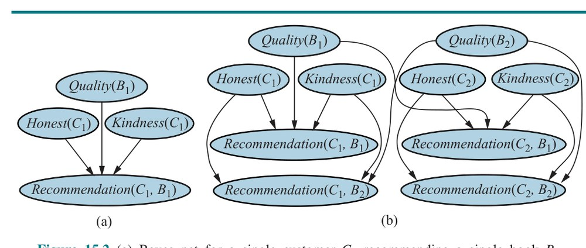
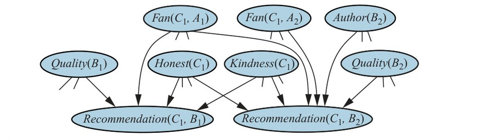
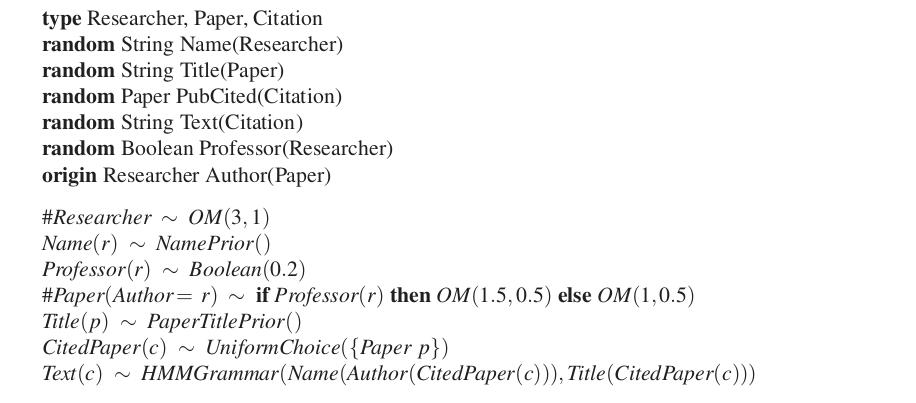
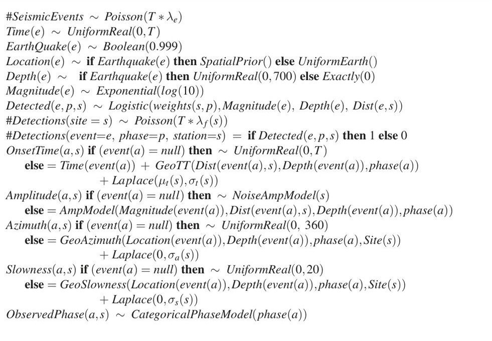
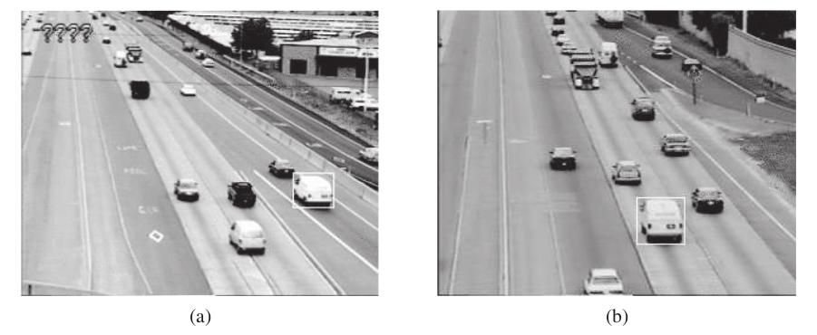
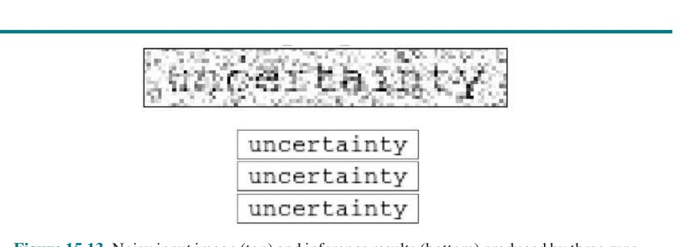

# فصل ۱۵ — برنامه‌نویسی احتمالاتی

**فصل ۱۵: برنامه‌نویسی احتمالاتی (Probabilistic Programming)**

*در این فصل ایدهٔ زبان‌های همگانی برای بازنماییِ دانشِ احتمالاتی و استنتاج در حوزه‌های نامطمئن را توضیح می‌دهیم.*

طیفِ بازنمایی‌ها—اتمی، عاملی و ساخت‌یافته—مضمونِ پایداری در هوش مصنوعی بوده. برای مدل‌های قطعی، الگوریتم‌های جستجو فقط بازنماییِ اتمی را فرض می‌کنند؛ CSPها و منطقِ گزاره‌ای بازنمایی‌های عاملی فراهم می‌کنند؛ و منطقِ مرتبهٔ اول و سامانه‌های برنامه‌ریزی از بازنمایی‌های ساخت‌یافته بهره می‌گیرند. قدرتِ بیانیِ فراهم‌شده توسط بازنمایی‌های ساخت‌یافته، مدل‌هایی بسیار موجزتر از توصیف‌های عاملی یا اتمیِ معادل می‌دهد.

برای مدل‌های احتمالاتی، شبکه‌های بیزیِ توصیف‌شده در فصل‌های ۱۳ و ۱۴ بازنمایی‌های عاملی‌اند: مجموعهٔ متغیرهای تصادفی ثابت و متناهی است و هر یک بردِ ثابتی از مقادیرِ ممکن دارد. این واقعیت کاربردپذیریِ شبکه‌های بیزی را محدود می‌کند، زیرا بازنماییِ شبکهٔ بیزی برای حوزهٔ پیچیده صرفاً بسیار بزرگ است. این ساختِ چنین بازنمایی‌هایی را با دست ناشدنی و یادگیریِ آن‌ها را از هر مقدارِ معقولی داده ناشدنی می‌کند. مسئلهٔ ایجادِ زبانِ صوریِ بیانی برای اطلاعاتِ احتمالاتی برخی از بزرگ‌ترین ذهن‌های تاریخ را به خود مشغول کرده، از جمله گوتفرید لایب‌نیتس (هم‌مخترعِ حسابان)، ژاکوب برنولی (کاشفِ e، حسابِ تغییرات و قانونِ اعدادِ بزرگ)، آگوستوس دی مورگان، جورج بول، چارلز سندرز پیرس (یکی از منطق‌دانانِ اصلیِ قرنِ نوزدهم)، جان مینارد کینز (اقتصاددانِ برجستهٔ قرنِ بیستم) و رودولف کارناپ (یکی از بزرگ‌ترین فیلسوفانِ تحلیلیِ قرنِ بیستم).

مسئله تا دههٔ ۱۹۹۰ در برابرِ این و بسیاری تلاش‌های دیگر مقاومت کرد.

تا حدی به لطفِ توسعهٔ شبکه‌های بیزی، اکنون زبان‌های صوریِ ریاضی‌وارِ زیبا و فوق‌العاده عملی وجود دارند که ایجادِ مدل‌های احتمالاتی برای حوزه‌های بسیار پیچیده را اجازه می‌دهند. این زبان‌ها به همان معنا همگانی‌اند که ماشین‌های تورینگ همگانی‌اند: می‌توانند هر مدلِ احتمالِ محاسبه‌پذیری را بازنمایی کنند، همان‌گونه که ماشین‌های تورینگ می‌توانند هر تابعِ محاسبه‌پذیری را بازنمایی کنند. علاوه بر این، این زبان‌ها با الگوریتم‌های استنتاجِ همه‌منظوره همراه‌اند، تقریباً مشابهِ الگوریتم‌های استنتاجِ منطقیِ صدا و کامل مانندِ قطع.

دو مسیر برای واردکردنِ قدرتِ بیانی به نظریهٔ احتمال هست. نخستین از طریقِ منطق است: طراحیِ زبانی که احتمال‌ها را روی جهان‌های ممکنِ مرتبهٔ اول تعریف می‌کند، به‌جای جهان‌های ممکنِ گزاره‌ایِ شبکه‌های بیز. این مسیر در بخش‌های ۱۵.۱ و ۱۵.۲ پوشش داده می‌شود، و بخش ۱۵.۳ حالتِ خاصِ استدلالِ زمانی را پوشش می‌دهد. مسیرِ دوم از طریقِ زبان‌های برنامه‌نویسیِ سنتی است: عناصرِ تصادفی—مثلاً انتخاب‌های تصادفی—را به چنین زبان‌هایی معرفی می‌کنیم، و برنامه‌ها را به‌عنوانِ تعریف‌کنندهٔ توزیع‌های احتمال روی دنباله‌های اجرایِ خودشان می‌بینیم. این رویکرد در بخش ۱۵.۴ پوشش داده شده.

هر دو مسیر به «زبانِ برنامه‌نویسیِ احتمالاتی» (Probabilistic Programming Language یا PPL) می‌انجامند. مسیرِ نخست به PPLهای اظهاری می‌انجامد، که تقریباً همان رابطه را با PPLهای عمومی دارند که برنامه‌نویسیِ منطقی (فصل ۹) با زبان‌های برنامه‌نویسیِ عمومی دارد.


**شکل ۱۵.۱ — بالا: برخی اعضای مجموعهٔ همهٔ جهان‌های ممکن برای زبانی با دو نمادِ ثابت، R و J، و یک نمادِ رابطهٔ دوتایی، تحتِ معناشناسیِ استانداردِ منطقِ مرتبهٔ اول. پایین: جهان‌های ممکن تحتِ معناشناسیِ پایگاه‌داده. تفسیرِ نمادهای ثابت ثابت است و برای هر نمادِ ثابت شیءِ متمایزی هست.**

## ۱۵.۱ مدل‌های احتمالِ رابطه‌ای

از فصل ۱۲ به یاد آورید مدلِ احتمال مجموعهٔ Ω از جهان‌های ممکن را با احتمالِ P(ω) برای هر جهانِ ω تعریف می‌کند. برای شبکه‌های بیزی، جهان‌های ممکن تخصیص‌های مقادیر به متغیرها هستند؛ برای حالتِ بولی به‌طورِ خاص، جهان‌های ممکن یکسان با جهان‌های منطقِ گزاره‌ای‌اند.

برای مدلِ احتمالِ مرتبهٔ اول، پس، به نظر می‌رسد به جهان‌های ممکنِ منطقِ مرتبهٔ اول نیاز داریم—یعنی مجموعه‌ای از اشیا با روابطی میان‌شان و تفسیری که نمادهای ثابت را به اشیا، نمادهای گزاره‌ای را به روابط و نمادهای تابع را به توابع روی آن اشیا نگاشت می‌کند. (بخش ۸.۲ را ببینید.) مدل همچنین باید برای هر چنین جهانِ ممکنی احتمالی تعریف کند، همان‌گونه که شبکهٔ بیزی برای هر تخصیصِ مقادیر به متغیرها احتمالی تعریف می‌کند. فرض کنیم، لحظه‌ای، دریافته‌ایم چگونه این کار را بکنیم. سپس، مثلِ همیشه (صفحهٔ ۳۸۹ را ببینید)، می‌توانیم احتمالِ هر جملهٔ منطقِ مرتبهٔ اولِ φ (فی) را به‌صورتِ جمعی روی جهان‌های ممکنی که در آن‌ها صادق است به دست آوریم:

```
P(φ) = ∑_{ω: φ در ω صادق است} P(ω)        (15.1)
```

احتمال‌های شرطیِ P(φ|e) را می‌توان به‌طورِ مشابه به دست آورد، پس اصولاً می‌توانیم هر پرسشی را که می‌خواهیم از مدل‌مان بپرسیم—و پاسخ بگیریم. تا این‌جا خوب است.

با این حال، مسئله‌ای هست: مجموعهٔ مدل‌های مرتبهٔ اول نامتناهی است. این را به‌صراحت در شکل ۸.۴ صفحهٔ ۲۵۹ دیدیم، که آن را دوباره در شکل ۱۵.۱ (بالا) نشان می‌دهیم. این بدان معناست (۱) جمع در معادلهٔ (15.1) می‌تواند ناشدنی باشد، و (۲) مشخص‌کردنِ توزیعِ کامل و سازگاری روی مجموعه‌ای نامتناهی از جهان‌ها می‌تواند بسیار دشوار باشد.

در این بخش، با درنظرگرفتنِ «معناشناسیِ پایگاه‌داده»ِ تعریف‌شده در بخش ۸.۲.۸ (صفحهٔ ۲۶۴) از این مسئله اجتناب می‌کنیم. معناشناسیِ پایگاه‌داده «فرضِ نام‌های یکتا» را می‌سازد—در این‌جا، آن را برای نمادهای ثابت اتخاذ می‌کنیم. همچنین «بستارِ دامنه» را فرض می‌کند—هیچ شیءِ دیگری فراتر از آن‌هایی که نام برده شده‌اند وجود ندارد. سپس می‌توانیم مجموعهٔ متناهی از جهان‌های ممکن را با این تضمین کنیم که مجموعهٔ اشیای هر جهان دقیقاً مجموعهٔ نمادهای ثابتِ استفاده‌شده باشد؛ چنان‌که در شکل ۱۵.۱ (پایین) نشان داده شده، هیچ عدم قطعیتی دربارهٔ نگاشتِ نمادها به اشیا یا دربارهٔ اشیای موجود نیست.

مدل‌هایی را که بدین‌گونه تعریف می‌شوند «مدل‌های احتمالِ رابطه‌ای» (Relational Probability Models) یا RPM می‌نامیم.¹ مهم‌ترین تفاوت میان معناشناسیِ RPMها و معناشناسیِ پایگاه‌دادهٔ معرفی‌شده در بخش ۸.۲.۸ این است که RPMها «فرضِ جهانِ بسته» را نمی‌سازند—در سامانهٔ استدلالِ احتمالاتی نمی‌توانیم صرفاً فرض کنیم هر واقعیتِ ناشناخته‌ای کاذب است.

### ۱۵.۱.۱ نحو و معناشناسی

با مثالِ ساده‌ای شروع کنیم: فرض کنیم خرده‌فروشِ آنلاینِ کتاب می‌خواهد ارزیابی‌های کلیِ محصولات را بر اساسِ توصیه‌هایی که از مشتریانش دریافت می‌کند فراهم کند. ارزیابی به شکلِ توزیعِ پسینی روی کیفیتِ کتاب، با توجه به شواهدِ موجود، خواهد بود. ساده‌ترین راه‌حل آن است که ارزیابی بر میانگینِ توصیه مبتنی باشد، شاید با واریانسی که توسط شمارِ توصیه‌ها تعیین می‌شود، اما این واقعیت را در نظر نمی‌گیرد که برخی مشتریان مهربان‌تر از دیگران‌اند و برخی کمتر از دیگران صادق‌اند. مشتریانِ مهربان تمایل دارند حتی به کتاب‌های نسبتاً متوسط هم توصیهٔ بالایی بدهند، در حالی که مشتریانِ ناصادق به دلایلی غیر از کیفیت توصیه‌های بسیار بالا یا بسیار پایین می‌دهند—ممکن است برای تبلیغِ کتاب‌های ناشری پول گرفته باشند.² برای مشتریِ تکیِ C1 که کتابِ تکیِ B1 را توصیه می‌کند، شبکهٔ بیز ممکن است شبیهِ شکل ۱۵.۲(الف) باشد. (درست همان‌گونه که در بخش ۹.۱، عبارت‌های با پرانتز مانند Honest(C1) نمادهای فانتزی‌اند—در این مورد، نام‌های فانتزی برای متغیرهای تصادفی.) با دو مشتری و دو کتاب، شبکهٔ بیز شبیهِ شکل ۱۵.۲(ب) می‌شود. برای شمارِ بزرگ‌ترِ کتاب‌ها و مشتریان، مشخص‌کردنِ شبکهٔ بیز با دست بسیار غیرعملی است.

خوشبختانه، شبکه ساختارِ تکراریِ زیادی دارد. هر متغیرِ Recommendation(c,b) والدهایش را متغیرهای Honest(c)، Kindness(c) و Quality(b) دارد. علاوه بر این، جدول‌های احتمالِ شرطی (CPT) برای همهٔ متغیرهای Recommendation(c,b) یکسان‌اند، همان‌گونه که برای همهٔ متغیرهای Honest(c) و مانندِ آن. وضعیت به‌نظرِ زبانِ مرتبهٔ اول دوخته شده است. می‌خواهیم چیزی مانندِ این بگوییم:

```
Recommendation(c,b) ∼ RecCPT(Honest(c), Kindness(c), Quality(b))
```

که بدان معناست توصیهٔ مشتری برای کتابی به‌صورتِ احتمالاتی به صداقت و مهربانیِ مشتری و کیفیتِ کتاب، طبقِ CPT ثابتی، بستگی دارد.

مانندِ منطقِ مرتبهٔ اول، RPMها نمادهای ثابت، تابع و گزاره‌ای دارند. همچنین برای هر تابع یک «امضای نوع» (Type Signature) فرض می‌کنیم—یعنی مشخصاتی از نوعِ هر آرگومان و مقدارِ تابع. (اگر نوعِ هر شیء معلوم باشد، بسیاری از جهان‌های ممکنِ جعلی توسط این سازوکار حذف می‌شوند؛ برای نمونه، لازم نیست نگرانِ مهربانیِ هر کتاب، یا توصیه‌کردنِ کتاب‌ها به مشتریان و مانندِ آن باشیم.) برای حوزهٔ توصیهٔ کتاب، نوع‌ها Customer و Book هستند و امضاهای نوع برای توابع و گزاره‌ها به‌صورتِ زیرند:

```
Honest : Customer → {true, false}
Kindness : Customer → {1, 2, 3, 4, 5}
Quality : Book → {1, 2, 3, 4, 5}
Recommendation : Customer × Book → {1, 2, 3, 4, 5}
```

نمادهای ثابت هر نامِ مشتری و کتابی خواهند بود که در مجموعهٔ دادهٔ خرده‌فروش ظاهر می‌شود. در مثالِ داده‌شده در شکل ۱۵.۲(ب)، این‌ها C1، C2 و B1، B2 بودند.

با توجه به ثابت‌ها و نوع‌هایشان، همراه با توابع و امضاهای نوعِشان، «متغیرهای تصادفیِ پایه» (Basic Random Variables) RPM با مصداق‌کردنِ هر تابع با هر ترکیبِ ممکنِ اشیا به دست می‌آیند. برای مدلِ توصیهٔ کتاب، متغیرهای تصادفیِ پایه شاملِ Honest(C1)، Quality(B2)، Recommendation(C1,B2) و مانندِ آن‌اند. این‌ها دقیقاً متغیرهای ظاهرشده در شکل ۱۵.۲(ب) هستند. چون هر نوع فقط شمارِ متناهی نمونه دارد (به لطفِ فرضِ بستارِ دامنه)، شمارِ متغیرهای تصادفیِ پایه نیز متناهی است. برای کامل‌کردنِ RPM، باید وابستگی‌هایی را بنویسیم که بر این متغیرهای تصادفی حکومت می‌کنند. برای هر تابع یک گزارهٔ وابستگی هست، که در آن هر آرگومانِ تابع متغیرِ منطقی است (یعنی متغیری که روی اشیا می‌رود، مانندِ منطقِ مرتبهٔ اول).



**شکل ۱۵.۲ — (الف) شبکهٔ بیز برای مشتریِ تکیِ C1 که کتابِ تکیِ B1 را توصیه می‌کند. Honest(C1) بولی است، در حالی که متغیرهای دیگر مقادیرِ صحیح از 1 تا 5 دارند. (ب) شبکهٔ بیز با دو مشتری و دو کتاب.**

برای نمونه، وابستگیِ زیر بیان می‌کند که برای هر مشتریِ c، احتمالِ پیشینیِ صداقت 0.99 صادق و 0.01 کاذب است:

```
Honest(c) ∼ ⟨0.99, 0.01⟩
```

به‌طورِ مشابه، می‌توانیم احتمال‌های پیشینی را برای مقدارِ مهربانیِ هر مشتری و کیفیتِ هر کتاب، هر یک در مقیاسِ 1–5، بیان کنیم:

```
Kindness(c) ∼ ⟨0.1, 0.1, 0.2, 0.3, 0.3⟩
Quality(b) ∼ ⟨0.05, 0.2, 0.4, 0.2, 0.15⟩
```

برای وابستگیِ Recommendation، ممکن است بنویسیم:

```
Recommendation(c,b) ∼ if Honest(c)
                      then HonestRecCPT(Kindness(c), Quality(b))
                      else ⟨0.4, 0.1, 0.0, 0.1, 0.4⟩
```

این نوع وابستگی ممکن است شبیهِ گزارهٔ if–then–else معمولی در زبانِ برنامه‌نویسی باشد، اما تفاوتِ کلیدی‌ای هست: موتورِ استنتاج لزوماً مقدارِ آزمونِ شرطی را نمی‌داند، زیرا Honest(c) متغیرِ تصادفی است.

می‌توانیم این مدل را به راه‌های بی‌پایانی برای واقع‌گرایانه‌ترشدن بسط دهیم. برای نمونه، فرض کنیم مشتریِ صادقی که طرفدارِ نویسندهٔ کتاب است همیشه به کتاب 5 می‌دهد، صرف‌نظر از کیفیت:

```
Recommendation(c,b) ∼ if Honest(c)
                      then if Fan(c, Author(b))
                           then Exactly(5)
                           else HonestRecCPT(Kindness(c), Quality(b))
                      else ⟨0.4, 0.1, 0.0, 0.1, 0.4⟩
```

باز، آزمونِ شرطیِ Fan(c, Author(b)) ناشناخته است، اما اگر مشتری فقط به کتاب‌های نویسندهٔ خاصی 5 بدهد و در غیرِ این صورت به‌طورِ خاص مهربان نباشد، آنگاه احتمالِ پسینیِ اینکه مشتری طرفدارِ آن نویسنده باشد بالا خواهد بود. علاوه بر این، توزیعِ پسینی تمایل خواهد داشت 5های مشتری را در ارزیابیِ کیفیتِ کتاب‌های آن نویسنده تخفیف دهد.

در این مثال، به‌صورتِ ضمنی فرض کردیم مقدارِ Author(b) برای هر b معلوم است، اما ممکن است چنین نباشد. سامانه چگونه می‌تواند دربارهٔ اینکه آیا، مثلاً، C1 طرفدارِ Author(B2) است استدلال کند وقتی Author(B2) ناشناخته است؟ پاسخ این است که سامانه ممکن است مجبور شود دربارهٔ همهٔ نویسنده‌های ممکن استدلال کند. فرض کنیم (برای سادگی) فقط دو نویسنده، A1 و A2 وجود دارند. سپس Author(B2) متغیرِ تصادفی با دو مقدارِ ممکنِ A1 و A2 است و والدِ Recommendation(C1,B2) است. متغیرهای Fan(C1,A1) و Fan(C1,A2) نیز والدند. توزیعِ شرطی برای Recommendation(C1,B2) سپس اساساً «چندگستر» (Multiplexer) است که در آن والدِ Author(B2) به‌عنوانِ انتخاب‌گر عمل می‌کند تا برگزیند کدام‌یک از Fan(C1,A1) و Fan(C1,A2) واقعاً اجازه دارد بر توصیه اثر بگذارد. قطعه‌ای از شبکهٔ بیزِ معادل در شکل ۱۵.۳ نشان داده شده. عدم قطعیت در مقدارِ Author(B2)، که بر ساختارِ وابستگیِ شبکه اثر می‌گذارد، نمونه‌ای از «عدم قطعیتِ رابطه‌ای» (Relational Uncertainty) است.³



**شکل ۱۵.۳ — قطعه‌ای از شبکهٔ بیزِ معادل برای RPMِ توصیهٔ کتاب وقتی Author(B2) ناشناخته است.**

اگر کنجکاوید سامانه چگونه می‌تواند بفهمد نویسندهٔ B2 کیست: امکانِ زیر را در نظر بگیرید که سه مشتریِ دیگر طرفدارِ A1 هستند (و هیچ نویسندهٔ محبوبِ مشترکِ دیگری ندارند) و هر سه به B2 امتیازِ 5 داده‌اند، حتی اگرچه بیشترِ مشتریانِ دیگر آن را بسیار افتضاح می‌یابند. در آن صورت، بسیار محتمل است A1 نویسندهٔ B2 باشد. ظهورِ استدلالِ پیچیده‌ای مانندِ این از مدلِ RPM ای با فقط چند خط، نمونهٔ جذابی از گسترشِ تأثیرهای احتمالاتی از میانِ تارِ به‌هم‌پیوستگی‌های اشیای مدل است. هرچه وابستگی‌ها و اشیای بیشتری افزوده شوند، تصویری که توزیعِ پسینی منتقل می‌کند اغلب واضح‌تر و واضح‌تر می‌شود.

### ۱۵.۱.۲ نمونه: رتبه‌بندیِ سطحِ مهارتِ بازیکنان

بسیاری از بازی‌های رقابتی معیارِ عددیِ سطحِ مهارتِ بازیکنان دارند، که گاهی «رتبه» (Rating) نامیده می‌شود. شاید شناخته‌شده‌ترین «رتبهٔ الو» (Elo Rating) برای شطرنج‌بازان باشد، که به یک مبتدیِ نمونه حدود ۸۰۰ و به قهرمانِ جهان معمولاً جایی بالای ۲۸۰۰ رتبه می‌دهد. اگرچه رتبه‌های الو پایهٔ آماری دارند، برخی عناصرِ موردی هم دارند. می‌توانیم طرحِ رتبه‌بندیِ بیزی را چنین توسعه دهیم: هر بازیکنِ i سطحِ مهارتِ زیربناییِ Skill(i) دارد؛ در هر بازیِ g، عملکردِ واقعیِ i برابر Performance(i,g) است، که ممکن است از سطحِ مهارتِ زیربنایی منحرف شود؛ و برندهٔ g بازیکنی است که عملکردش در g بهتر است. به‌عنوانِ RPM، مدل به‌صورتِ زیر است:

```
Skill(i) ∼ N(µ, σ²)
Performance(i,g) ∼ N(Skill(i), β²)
Win(i,j,g) = if Game(g,i,j) then (Performance(i,g) > Performance(j,g))
```

که در آن β² واریانسِ عملکردِ واقعیِ بازیکن در هر بازیِ خاص نسبت به سطحِ مهارتِ زیربناییِ اوست. با مجموعه‌ای از بازیکنان و بازی‌ها، و نیز پیامدهای برخی از بازی‌ها، موتورِ استنتاجِ RPM می‌تواند توزیعِ پسینی را روی مهارتِ هر بازیکن و پیامدِ احتمالیِ هر بازیِ اضافی که ممکن است انجام شود محاسبه کند.

برای بازی‌های تیمی، به‌عنوانِ تقریبِ نخست، فرض می‌کنیم عملکردِ کلیِ تیمِ t در بازیِ g جمعِ عملکردهای فردیِ بازیکنانِ t است:

```
TeamPerformance(t,g) = ∑_{i∈t} Performance(i,g)
```

حتی اگرچه عملکردهای فردی برای موتورِ رتبه‌بندی قابلِ مشاهده نیستند، سطح‌های مهارتِ بازیکنان را همچنان می‌توان از نتایجِ چند بازی برآورد کرد، تا زمانی که ترکیب‌های تیم در بازی‌ها متفاوت باشند. موتورِ رتبه‌بندیِ «TrueSkill» مایکروسافت از این مدل، همراه با الگوریتمِ استنتاجِ تقریبیِ کارآمدی، برای خدمت‌رسانی به صدها میلیون کاربر در هر روز استفاده می‌کند. این مدل را می‌توان به راه‌های متعددی بسط داد. برای نمونه، ممکن است فرض کنیم بازیکنانِ ضعیف‌تر واریانسِ بیشتری در عملکردشان دارند؛ ممکن است نقشِ بازیکن را در تیم بگنجانیم؛ و ممکن است انواعِ خاصِ عملکرد و مهارت—مثلاً دفاع و حمله—را برای بهبودِ ترکیبِ تیم و دقتِ پیش‌بینی در نظر بگیریم.

### ۱۵.۱.۳ استنتاج در مدل‌های احتمالِ رابطه‌ای

سرراست‌ترین رویکرد برای استنتاج در RPMها صرفاً ساختِ شبکهٔ بیزیِ معادل، با توجه به نمادهای ثابتِ شناخته‌شدهٔ متعلق به هر نوع، است. با B کتاب و C مشتری، مدلِ پایهٔ داده‌شدهٔ پیشین را می‌توان با حلقه‌های ساده ساخت:⁴

```
برای b از 1 تا B:
    گرهٔ Quality_b را بدون والد بیفزا، با پیشینِ ⟨0.05, 0.2, 0.4, 0.2, 0.15⟩
برای c از 1 تا C:
    گرهٔ Honest_c را بدون والد بیفزا، با پیشینِ ⟨0.99, 0.01⟩
    گرهٔ Kindness_c را بدون والد بیفزا، با پیشینِ ⟨0.1, 0.1, 0.2, 0.3, 0.3⟩
    برای b از 1 تا B:
        گرهٔ Recommendation_{c,b} را بیفزا، با والدهای Honest_c, Kindness_c, Quality_b
            و توزیعِ شرطیِ RecCPT(Honest_c, Kindness_c, Quality_b)
```

این فن «زمینه‌سازی» (Grounding) یا «بازکردن» (Unrolling) نامیده می‌شود؛ همتایِ دقیقِ گزاره‌سازی برای منطقِ مرتبهٔ اول است (صفحهٔ ۲۸۰). عیبِ آشکارش این است که شبکهٔ بیزیِ حاصل ممکن است بسیار بزرگ باشد. علاوه بر این، اگر اشیای نامزدِ بسیاری برای رابطه یا تابعِ ناشناخته‌ای وجود داشته باشد—برای نمونه، نویسندهٔ ناشناختهٔ B2—آنگاه برخی متغیرهای شبکه ممکن است والدهای بسیاری داشته باشند. خوشبختانه، اغلب می‌توان از تولیدِ کلِ شبکهٔ بیزِ ضمنی اجتناب کرد. چنان‌که در بحثِ الگوریتمِ حذفِ متغیر در صفحهٔ ۴۳۳ دیدیم، هر متغیری که نیای متغیرِ پرس‌وجو یا شاهد نیست برای پرس‌وجو نامربوط است. علاوه بر این، اگر پرس‌وجو با توجه به شواهد به‌صورتِ شرطی مستقل از متغیری باشد، آن متغیر نیز نامربوط است. پس، با زنجیره‌زدن در مدل با شروع از پرس‌وجو و شواهد، می‌توانیم فقط مجموعهٔ متغیرهای مربوط به پرس‌وجو را شناسایی کنیم. این‌ها تنها متغیرهایی هستند که برای ایجادِ قطعه‌ای بالقوه بسیار کوچک از شبکهٔ بیزِ ضمنی باید مصداق‌سازی شوند. استنتاج در این قطعه همان پاسخِ استنتاج در کلِ شبکهٔ بیزِ ضمنی را می‌دهد.

راهِ دیگری برای بهبودِ کاراییِ استنتاج از حضورِ زیرساختارِ تکراری در شبکهٔ بیزِ بازشده می‌آید. این بدان معناست بسیاری از عامل‌های ساخته‌شده در طولِ حذفِ متغیر (و انواعِ مشابهِ جدول‌های ساخته‌شده توسط الگوریتم‌های خوشه‌بندی) یکسان خواهند بود؛ طرح‌های کش‌کردنِ مؤثر سرعت‌هایی سه‌مرتبه‌ای برای شبکه‌های بزرگ داده‌اند. سوم، الگوریتم‌های استنتاجِ MCMC وقتی روی RPMها با عدم قطعیتِ رابطه‌ای اعمال می‌شوند ویژگی‌های جالبی دارند. MCMC با نمونه‌برداری از جهان‌های ممکنِ کامل کار می‌کند، پس در هر حالت ساختارِ رابطه‌ای کاملاً معلوم است. در مثالِ داده‌شدهٔ پیشین، هر حالتِ MCMC مقدارِ Author(B2) را مشخص می‌کرد و از این رو سایر نویسنده‌های بالقوه دیگر والدِ گره‌های توصیه برای B2 نیستند. برای MCMC، پس، عدم قطعیتِ رابطه‌ای هیچ افزایشی در پیچیدگیِ شبکه ایجاد نمی‌کند؛ در عوض، فرایندِ MCMC شاملِ انتقال‌هایی است که ساختارِ رابطه‌ای، و از این رو ساختارِ وابستگی، شبکهٔ بازشده را تغییر می‌دهند. سرانجام، در برخی موارد ممکن است بتوان کلاً از زمینه‌سازیِ مدل اجتناب کرد. اثبات‌کننده‌های قضیهٔ قطع و سامانه‌های برنامه‌نویسیِ منطقی با مصداق‌کردنِ متغیرهای منطقی فقط در حدِ لازم برای پیش‌بردنِ استنتاج از گزاره‌سازی اجتناب می‌کنند؛ یعنی فرایندِ استنتاج را بالاتر از سطحِ جمله‌های گزاره‌ایِ زمینی می‌برند و هر گامِ «برافراشته» (Lifted) کارِ بسیاری گامِ زمینی را انجام می‌دهد.

همین ایده را می‌توان در استنتاجِ احتمالاتی اعمال کرد. برای نمونه، در الگوریتمِ حذفِ متغیر، «عاملِ برافراشته» می‌تواند کلِ شبکه‌ای از عامل‌های زمینی را بازنمایی کند که احتمال‌ها را به متغیرهای تصادفیِ RPM تخصیص می‌دهند، جایی که آن متغیرهای تصادفی فقط در نمادهای ثابتِ استفاده‌شده برای ساختشان تفاوت دارند. جزئیاتِ این روش فراتر از حوصلهٔ این کتاب است، اما مراجع در پایانِ فصل داده شده‌اند.

## ۱۵.۲ مدل‌های احتمالِ جهانِ باز

قبلاً استدلال کردیم معناشناسیِ پایگاه‌داده برای وضعیت‌هایی مناسب است که دقیقاً مجموعهٔ اشیای مربوطِ موجود را می‌دانیم و می‌توانیم آن‌ها را بدونِ ابهام شناسایی کنیم. (به‌طورِ خاص، همهٔ مشاهده‌های مربوط به یک شیء به‌درستی با نمادِ ثابتی که نامش را می‌برد مرتبط می‌شوند.) اما در بسیاری از محیط‌های دنیایِ واقعی، این مفروضات صرفاً نامعتبرند.

برای نمونه، خرده‌فروشِ کتاب ممکن است از «شابک» (ISBN) به‌عنوانِ نمادِ ثابت برای نامیدنِ هر کتاب استفاده کند، حتی اگرچه «کتابِ» منطقیِ معینی (مثلاً «بر باد رفته») ممکن است چند شابکِ متناظر با جلدِ سخت، شومیز، حروفِ درشت، تجدیدچاپ‌ها و مانندِ آن داشته باشد. منطقی بود توصیه‌ها را روی چند شابک تجمیع کنیم، اما خرده‌فروش ممکن است مطمئن نباشد کدام شابک‌ها واقعاً همان کتاب‌اند. (توجه کنید نسخه‌های فردیِ کتاب را عینیت نمی‌بخشیم، که ممکن است برای فروشِ کتابِ دست دوم، فروشِ خودرو و مانندِ آن لازم باشد.) بدتر از آن، هر مشتری با شناسهٔ ورود شناسایی می‌شود، اما مشتریِ ناصادق ممکن است هزاران شناسه داشته باشد! در حوزهٔ امنیتِ رایانه، این شناسه‌های چندگانه «سیبیل» (Sybils) نامیده می‌شوند و استفاده از آن‌ها برای به‌هم‌ریختنِ سامانهٔ اعتبار «حملهٔ سیبیل» (Sybil Attack) نامیده می‌شود.⁵ بدین‌ترتیب، حتی کاربردِ ساده‌ای در حوزهٔ نسبتاً خوش‌تعریفِ برخط، هم «عدم قطعیتِ وجودی» (Existence Uncertainty) را در بر دارد (کتاب‌ها و مشتریانِ واقعیِ زیربناییِ داده‌های مشاهده‌شده چه‌اند) و هم «عدم قطعیتِ هویتی» (Identity Uncertainty) را (کدام عبارتِ منطقی واقعاً به همان شیء اشاره دارد).

پدیده‌های عدم قطعیتِ وجودی و هویتی بسیار فراتر از کتاب‌فروشی‌های برخط گسترش می‌یابند. در واقع فراگیرند:

- سامانهٔ بینایی نمی‌داند چه چیزی، اگر چیزی، پشتِ پیچِ بعدی وجود دارد، و ممکن است نداند شیئی که حالا می‌بیند همانی است که چند دقیقهٔ پیش دیده.
- سامانهٔ فهمِ متن از پیش نمی‌داند چه نهادهایی در متنی برجسته خواهند بود، و باید استدلال کند آیا عبارت‌هایی مانند «مریم»، «دکتر اسمیت»، «او»، «متخصصِ قلبش»، «مادرش» و مانندِ آن به همان شیء اشاره دارند.
- تحلیلگرِ اطلاعاتی که در جستجوی جاسوس‌هاست هرگز نمی‌داند واقعاً چند جاسوس هست و فقط می‌تواند حدس بزند آیا نام‌های مستعارِ گوناگون، شماره‌تلفن‌ها و مشاهده‌ها به همان فرد تعلق دارند.

در واقع، بخشِ بزرگی از شناختِ انسانی به نظر می‌رسد مستلزمِ یادگیریِ اینکه چه اشیایی وجود دارند و تواناییِ اتصالِ مشاهده‌ها—که تقریباً هرگز با شناسه‌های یکتای متصل نمی‌آیند—به اشیای فرضیِ جهان است.

بدین‌ترتیب، باید بتوانیم «مدلِ احتمالِ جهانِ باز» (Open Universe Probability Model یا OUPM) را بر اساسِ معناشناسیِ استانداردِ منطقِ مرتبهٔ اول تعریف کنیم، چنان‌که در بالای شکل ۱۵.۱ نشان داده شده. زبانِ OUPMها راهی برای نوشتنِ آسانِ چنین مدل‌هایی فراهم می‌کند و در عینِ حال توزیعِ احتمالِ یکتا و سازگاری را روی فضایِ نامتناهیِ جهان‌های ممکن تضمین می‌کند.

### ۱۵.۲.۱ نحو و معناشناسی

ایدهٔ پایه این است که بفهمیم شبکه‌های بیزیِ معمولی و RPMها چگونه مدلِ احتمالِ یکتایی را تعریف می‌کنند و آن بینش را به محیطِ مرتبهٔ اول منتقل کنیم. در اصل، شبکهٔ بیز هر جهانِ ممکن را، رخداد به رخداد، در ترتیبِ توپولوژیکِ تعریف‌شده توسط ساختارِ شبکه تولید می‌کند، که در آن هر رخداد تخصیصِ مقداری به متغیری است. RPM این را به مجموعه‌های کاملِ رخدادها بسط می‌دهد، که با مصداق‌های ممکنِ متغیرهای منطقی در گزاره یا تابعِ معینی تعریف می‌شوند. OUPMها فراتر می‌روند و گام‌های زایشی‌ای را اجازه می‌دهند که اشیا را به جهانِ ممکنِ درحالِ‌ساخت می‌افزایند، جایی که شمار و نوعِ اشیا ممکن است به اشیای ازپیش‌موجودِ آن جهان و ویژگی‌ها و روابطشان بستگی داشته باشد.

یعنی رخدادی که تولید می‌شود تخصیصِ مقداری به متغیری نیست، بلکه خودِ وجودِ اشیاست. یکی از راه‌های انجامِ این در OUPMها فراهم‌کردنِ «گزاره‌های شمارِ» (Number Statements) است که توزیع‌های شرطی روی شمارِ اشیای انواعِ گوناگون را مشخص می‌کنند. برای نمونه، در حوزهٔ توصیهٔ کتاب، ممکن است بخواهیم میان مشتریان (افرادِ واقعی) و شناسه‌های ورودشان تمایز بگذاریم. (در واقع شناسه‌های ورودند که توصیه می‌کنند، نه مشتریان!) فرض کنیم (برای سادگی) شمارِ مشتریان یکنواخت بین 1 و 3 و شمارِ کتاب‌ها یکنواخت بین 2 و 4 باشد:

```
#Customer ∼ UniformInt(1, 3)
#Book ∼ UniformInt(2, 4)        (15.2)
```

انتظار داریم مشتریانِ صادق فقط یک شناسه داشته باشند، در حالی که مشتریانِ ناصادق ممکن است هر جا بین 2 تا 5 شناسه داشته باشند:

```
#LoginID(Owner=c) ∼ if Honest(c) then Exactly(1) else UniformInt(2, 5)        (15.3)
```

این گزارهٔ شمار، توزیعِ شمارِ شناسه‌های ورودی را که مشتریِ c مالکِ آن‌هاست مشخص می‌کند. تابعِ Owner «تابعِ خاستگاه» (Origin Function) نامیده می‌شود، زیرا می‌گوید هر شیءِ تولیدشده توسط این گزارهٔ شمار از کجا آمده.

مثالِ پاراگرافِ پیشین از توزیعِ یکنواخت روی اعدادِ صحیحِ بین 2 و 5 برای مشخص‌کردنِ شمارِ ورودهای مشتریِ ناصادق استفاده می‌کند. این توزیعِ خاص کران‌دار است، اما به‌طورِ کلی ممکن است کرانِ پیشینی برای شمارِ اشیا نباشد. پرکاربردترین توزیع روی اعدادِ صحیحِ نامنفی «توزیعِ پواسون» (Poisson Distribution) است. پواسون یک پارامتر دارد، λ، که شمارِ موردانتظارِ اشیاست. توزیعِ پواسون به‌طورِ طبیعی برای شمارش‌ها به وجود می‌آید: اگر رویدادها در زمان به‌صورتِ مستقل با نرخِ ثابتِ λ رخ دهند، شمارِ رویدادها در بازه‌ای ثابت توزیعِ پواسونی دارد. توزیعِ پواسون به‌صورتِ مکرر در مدل‌های OUPM ظاهر می‌شود، و می‌تواند گامِ زایشیِ توضیح‌داده‌شده در بالا را پیاده‌سازی کند: شمارِ اشیایی با «خاستگاهِ» معین. برای نمونه، در مدلِ توصیهٔ کتاب ممکن است بنویسیم:

```
#LoginID(Owner=c) ∼ Poisson(3)
```

گزاره‌های شمار می‌توانند هر عبارتی باشند—می‌توانند به گزاره‌های شمارِ دیگر یا به ویژگی‌های اشیای موجود اشاره کنند. در یک OUPM، سپس «متغیرهای شمارِ» (Number Variables) تکی برای هر گزارهٔ شمار داریم. متغیرِ شمارِ #LoginID(Owner=⟨Customer,2⟩)(ω) = 4 بدان معناست در جهانِ ω، مشتریِ 2 مالکِ 4 شناسهٔ ورود است. همانندِ مدل‌های احتمالِ رابطه‌ای، متغیرهای تصادفیِ پایه مقادیرِ گزاره‌ها و توابع را برای همهٔ چندتایی‌های اشیا تعیین می‌کنند؛ بدین‌ترتیب، Honest(⟨Customer,2⟩)(ω) = true بدان معناست در جهانِ ω، مشتریِ 2 صادق است. جهانِ ممکن با مقادیرِ همهٔ متغیرهای شمار و متغیرهای تصادفیِ پایه تعریف می‌شود. جهانی را می‌توان از مدل با نمونه‌برداری در ترتیبِ توپولوژیک تولید کرد؛ شکل ۱۵.۴ نمونه‌ای را نشان می‌دهد. احتمالِ جهانی که بدین‌گونه ساخته شده، حاصلِ‌ضربِ احتمال‌های همهٔ مقادیرِ نمونه‌برداری‌شده است؛ در این مورد، 1.2672×10⁻¹¹. حالا روشن می‌شود چرا هر شیء خاستگاهِ خود را در بر دارد: این ویژگی تضمین می‌کند هر جهان را می‌توان با دقیقاً یک توالیِ زایش ساخت. اگر چنین نبود، احتمالِ جهان، جمعِ ترکیباتیِ دست‌وپاگیری روی همهٔ توالی‌های زایشِ ممکنِ سازندهٔ آن می‌بود.

مدل‌های جهانِ باز ممکن است بی‌نهایت متغیرِ تصادفی داشته باشند، پس نظریهٔ کامل ملاحظاتِ غیربدیهیِ نظریهٔ اندازه را در بر دارد. برای نمونه، گزاره‌های شمار با توزیع‌های پواسون یا مرتبه‌بزرگی شمارِ نامحدودِ اشیا را اجازه می‌دهند، که به شمارِ نامحدودِ متغیرهای تصادفی برای ویژگی‌ها و روابطِ آن اشیا می‌انجامد. علاوه بر این، OUPMها می‌توانند وابستگی‌های بازگشتی و نوع‌های نامتناهی (اعدادِ صحیح، رشته‌ها و...) داشته باشند. سرانجام، خوش‌ساخت‌بودن وابستگی‌های چرخه‌ای و زنجیره‌های نیاییِ بی‌نهایتِ پس‌رونده را منع می‌کند؛ این شرایط در حالتِ عمومی تصمیم‌ناپذیرند، اما شرایطِ نحویِ کافیِ خاصی را می‌توان به‌آسانی بررسی کرد.


**شکل ۱۵.۴ — جهانی خاص برای OUPMِ توصیهٔ کتاب. متغیرهای شمار و متغیرهای تصادفیِ پایه در ترتیبِ توپولوژیک، همراه با مقادیرِ انتخاب‌شده و احتمال‌های آن مقادیر نشان داده شده‌اند. (نمونه: #Customer با مقدارِ 2 و احتمالِ 0.3333؛ Honest(⟨Customer,1⟩) = true با 0.99؛ #LoginID(Owner=⟨Customer,1⟩) = 1 با 1.0؛ و همین‌طور برای بقیه تا Recommendation‌های گوناگون؛ احتمالِ کلِ جهان 1.2672×10⁻¹¹.)**

### ۱۵.۲.۲ استنتاج در مدل‌های احتمالِ جهانِ باز

به دلیلِ اندازهٔ بالقوهٔ عظیم و گاهی نامحدودِ شبکهٔ بیزِ ضمنیِ متناظر با OUPMِ نمونه‌ای، بازکردنِ کاملِ آن و انجامِ استنتاجِ دقیق بسیار غیرعملی است. در عوض، باید الگوریتم‌های استنتاجِ تقریبی مانندِ MCMC را در نظر بگیریم (بخش ۱۳.۴.۲ را ببینید). به‌طورِ تقریبی، الگوریتمِ MCMC برای OUPM فضایِ جهان‌های ممکنِ تعریف‌شده توسط مجموعه‌های اشیا و روابطِ میان‌شان را کاوش می‌کند، چنان‌که در شکل ۱۵.۱ (بالا) نشان داده شده.

حرکتِ میان حالت‌های مجاور در این فضا نه فقط می‌تواند روابط و توابع را تغییر دهد، بلکه می‌تواند اشیا را بیفزاید یا کم کند و تفسیرهای نمادهای ثابت را تغییر دهد. حتی اگرچه هر جهانِ ممکن ممکن است عظیم باشد، محاسبه‌های احتمالِ لازم برای هر گام—خواه در نمونه‌برداریِ گیبس خواه متروپلیس–هستینگز—کاملاً محلی‌اند و در بیشترِ موارد زمانِ ثابت می‌گیرند. این به این دلیل است که نسبتِ احتمال میان جهان‌های همسایه به زیرگرافی با اندازهٔ ثابت پیرامونِ متغیرهایی بستگی دارد که مقادیرشان تغییر کرده. علاوه بر این، پرس‌وجوی منطقی را می‌توان در هر جهانِ بازدیدشده به‌صورتِ افزایشی ارزیابی کرد، معمولاً در زمانِ ثابتِ هر جهان، به‌جای محاسبهٔ دوباره از صفر.

باید توجهِ ویژه‌ای به این واقعیت شود که OUPMِ نمونه‌ای ممکن است جهان‌های ممکنِ با اندازهٔ نامتناهی داشته باشد. به‌عنوانِ نمونه، مدلِ ردیابیِ چندهدف در شکل ۱۵.۹ را در نظر بگیرید: تابعِ X(a,t)، که حالتِ هواپیمای a در زمانِ t را نشان می‌دهد، با توالیِ نامتناهی از متغیرها برای شمارِ نامحدودِ هواپیما در هر گام متناظر است. به همین دلیل، MCMC برای OUPMها نه از جهان‌های ممکنِ کاملاً مشخص، بلکه از «جهان‌های جزئی» (Partial Worlds) نمونه‌برداری می‌کند، که هر یک با مجموعه‌ای مجزا از جهان‌های کامل متناظر است. جهانِ جزئی، مصداق‌سازیِ کمینهٔ خودپشتیبان⁶ از زیرمجموعه‌ای از متغیرهای مربوط—یعنی نیاکانِ متغیرهای شاهد و پرس‌وجو—است. برای نمونه، متغیرهای X(a,t) برای مقادیرِ t بزرگ‌تر از آخرین زمانِ مشاهده (یا زمانِ پرس‌وجو، هرکدام بزرگ‌تر است) نامربوط‌اند، پس الگوریتم می‌تواند فقط پیشوندِ متناهیِ توالیِ نامتناهی را در نظر بگیرد.

### ۱۵.۲.۳ نمونه‌ها

«موردِ کاربردیِ» استاندارد برای OUPM سه عنصر دارد: مدل، شواهد (واقعیت‌های شناخته‌شده در سناریوی معین) و پرس‌وجو، که ممکن است هر عبارتی باشد، احتمالاً با متغیرهای منطقیِ آزاد. پاسخ، احتمالِ مشترکِ پسینی برای هر مجموعهٔ ممکنِ جانشینی برای متغیرهای آزاد، با توجه به شواهد، طبقِ مدل است.⁷ هر مدل شاملِ اعلامیه‌های نوع، امضاهای نوع برای گزاره‌ها و توابع، یک یا چند گزارهٔ شمار برای هر نوع، و یک گزارهٔ وابستگی برای هر گزاره و تابع است. (در نمونه‌های زیر، اعلامیه‌ها و امضاها جایی که معنا روشن است حذف شده‌اند.) همانندِ RPMها، گزاره‌های وابستگی از نحوِ if-then-else برای مدیریتِ وابستگی‌های زمینه‌وابسته استفاده می‌کنند.

**تطبیقِ استناد.** میلیون‌ها مقالهٔ پژوهشیِ دانشگاهی و گزارشِ فنی به‌صورتِ برخط در قالبِ فایل‌های pdf یافت می‌شوند. چنین مقاله‌هایی معمولاً بخشی در نزدیکیِ پایان به نامِ «مراجع» یا «کتاب‌نامه» دارند، که در آن استنادها—رشته‌هایی از نویسه‌ها—برای آگاه‌کردنِ خواننده از کارهای مرتبط فراهم می‌شوند. این رشته‌ها را می‌توان با هدفِ ایجادِ بازنماییِ پایگاه‌داده‌مانندی که مقاله‌ها و پژوهشگران را با پیوندهای نویسندگی و استناد مرتبط می‌کند، مکان‌یابی و از فایل‌های pdf «خراشید» (Scrape). سامانه‌هایی مانندِ CiteSeer و Google Scholar چنین بازنمایی‌ای را به کاربرانشان ارائه می‌دهند؛ پشتِ صحنه، الگوریتم‌ها عمل می‌کنند تا مقاله‌ها را بیابند، رشته‌های استناد را استخراج کنند و مقاله‌های واقعی را که رشته‌های استناد به آن‌ها اشاره می‌کنند شناسایی کنند. این تکلیفِ دشواری است، زیرا این رشته‌ها هیچ شناسهٔ شیءای ندارند و شاملِ خطاهای نحو، املا، نقطه‌گذاری و محتوا هستند. برای نشان‌دادنِ این، دو نمونهٔ نسبتاً خوش‌خیم:

۱. [Lashkari et al 94] Collaborative Interface Agents, Yezdi Lashkari, Max Metral, and Pattie Maes, Proceedings of the Twelfth National Conference on Artificial Intelligence, MIT Press, Cambridge, MA, 1994.
۲. Metral M. Lashkari, Y. and P. Maes. Collaborative interface agents. In Conference of the American Association for Artificial Intelligence, Seattle, WA, August 1994.

پرسشِ کلیدی پرسشِ هویتی است: آیا این استنادها به همان مقاله اشاره می‌کنند یا به مقاله‌های متفاوت؟ وقتی این پرسش پرسیده می‌شود، حتی متخصصان هم اختلاف دارند یا مایل به تصمیم‌گیری نیستند، که نشان می‌دهد استدلالِ تحتِ عدم قطعیت بخشِ مهمی از حلِ این مسئله خواهد بود.⁸ رویکردهای موردی—مانندِ روش‌های مبتنی بر معیارِ شباهتِ متنی—اغلب به‌شکلِ فلاکت‌باری شکست می‌خورند. برای نمونه، در ۲۰۰۲، CiteSeer بیش از ۱۲۰ کتابِ متمایز نوشته‌شده توسط راسل و نورویگ گزارش کرد.

برای حلِ مسئله با رویکردِ احتمالاتی، به مدلِ زایشی برای حوزه نیاز داریم. یعنی می‌پرسیم این رشته‌های استناد چگونه در جهان پدید می‌آیند. فرایند با پژوهشگرانی شروع می‌شود که نام دارند. (لازم نیست نگرانِ چگونگیِ پیدایشِ پژوهشگران باشیم؛ فقط باید عدم قطعیتِ‌مان را دربارهٔ اینکه چندتایند بیان کنیم.) این پژوهشگران مقاله‌هایی می‌نویسند که عنوان دارند؛ مردم مقاله‌ها را استناد می‌کنند، و نامِ نویسندگان و عنوانِ مقاله را (با خطا) طبقِ گرامری در متنِ استناد ترکیب می‌کنند. عناصرِ پایهٔ این مدل در شکل ۱۵.۵ نشان داده شده، که حالتی را پوشش می‌دهد که مقاله‌ها فقط یک نویسنده دارند.⁹ با توجه به فقط رشته‌های استناد به‌عنوانِ شاهد، استنتاجِ احتمالاتی روی این مدل برای برگزیدنِ محتمل‌ترین تبیینِ داده‌ها نرخِ خطایی 2 تا 3 برابرِ کمتر از CiteSeer تولید می‌کند (پاسولا و همکاران، 2003). فرایندِ استنتاج همچنین شکلی از ابهام‌زداییِ جمعی و دانش‌محور را نشان می‌دهد: هرچه استنادهای یک مقالهٔ معین بیشتر باشند، هر یک با دقتِ بیشتری تجزیه می‌شوند، زیرا تجزیه‌ها باید بر واقعیت‌های مربوط به مقاله توافق کنند.



**شکل ۱۵.۵ — OUPM برای استخراجِ اطلاعاتِ استناد. برای سادگی، مدل فرض می‌کند هر مقاله یک نویسنده دارد و جزئیاتِ گرامر و مدل‌های خطا را حذف می‌کند.**

**پایشِ پیمانِ هسته‌ای.** راستی‌آزماییِ «پیمانِ جامعِ منعِ آزمایش‌های هسته‌ای» مستلزم یافتنِ همهٔ رخدادهای لرزه‌ایِ زمین بالای بزرگیِ کمینه است. سازمانِ CTBTO سازمانِ ملل شبکه‌ای از حسگرها را نگه می‌دارد، «سامانهٔ پایشِ بین‌المللی» (International Monitoring System یا IMS)؛ نرم‌افزارِ پردازشِ خودکارِ آن، که بر ۱۰۰ سال پژوهشِ لرزه‌شناسی مبتنی است، نرخِ شکستِ تشخیصی حدود ۳۰٪ دارد. سامانهٔ NET-VISA (آرورا و همکاران، 2013)، مبتنی بر OUPM، شکست‌های تشخیصی را به‌طورِ قابلِ‌توجهی کاهش می‌دهد.

مدلِ NET-VISA (شکل ۱۵.۶) ژئوفیزیکِ مربوط را مستقیماً بیان می‌کند. توزیع‌هایی روی شمارِ رخدادها در بازهٔ زمانیِ معین (بیشترشان طبیعی‌اند) و نیز روی زمان، بزرگی، عمق و مکان‌شان توصیف می‌کند. مکان‌های رخدادهای طبیعی طبقِ «پیشینِ مکانی» توزیع می‌شوند که (مانندِ دیگر بخش‌های مدل) از داده‌های تاریخی آموزش دیده؛ رخدادهای انسان‌ساخت، طبقِ قواعدِ پیمان، فرض می‌شوند به‌صورتِ یکنواخت روی سطحِ زمین رخ دهند. در هر ایستگاهِ s، هر «فازِ» (نوعِ موجِ لرزه‌ای) p از رخدادِ e یا 0 تشخیص تولید می‌کند یا 1 (سیگنالِ بالای آستانه)؛ احتمالِ تشخیص به بزرگی و عمقِ رخداد و فاصله‌اش از ایستگاه بستگی دارد. تشخیص‌های «هشدارِ کاذب» نیز طبقِ پارامترِ نرخِ خاصِ ایستگاه رخ می‌دهند. زمانِ رسیدن، دامنه و دیگر ویژگی‌های اندازه‌گیری‌شدهٔ تشخیصِ d از رخدادِ واقعی به ویژگی‌های رخدادِ مبدأ و فاصله‌اش از ایستگاه بستگی دارد.



**شکل ۱۵.۶ — نسخهٔ ساده‌شدهٔ مدلِ NET-VISA.**

![**شکل ۱۵.۷ — (الف) بالا: نمونهٔ شکلِ موجِ لرزه‌ایِ ثبت‌شده در آلیس‌اسپرینگز، استرالیا. پایین: شکلِ موج پس از پردازش برای تشخیصِ زمان‌های رسیدنِ امواجِ لرزه‌ای. خطوطِ آبی رسیدن‌های به‌طورِ خودکار تشخیص‌داده‌شده‌اند؛ خطوطِ قرمز رسیدن‌های واقعی‌اند. (ب) برآوردهای مکان برای آزمایشِ هسته‌ایِ کرهٔ شمالی در ۱۲ فوریهٔ ۲۰۱۳: بولتنِ رویدادِ دیرهنگامِ CTBTO سازمانِ ملل (مثلثِ سبز در بالا-چپ)؛ NET-VISA (مربعِ آبی در مرکز). ورودیِ تأسیساتِ آزمایشِ زیرزمینی («x» کوچک) 0.75 کیلومتر از برآوردِ NET-VISA فاصله دارد. کانتورها توزیعِ پسینیِ مکانِ NET-VISA را نشان می‌دهند. با اجازهٔ کمیسیونِ مقدماتیِ CTBTO.**](../figures/ch15/fig-15-7.jpg)

**شکل ۱۵.۷ — (الف) بالا: نمونهٔ شکلِ موجِ لرزه‌ایِ ثبت‌شده در آلیس‌اسپرینگز، استرالیا. پایین: شکلِ موج پس از پردازش برای تشخیصِ زمان‌های رسیدنِ امواجِ لرزه‌ای. خطوطِ آبی رسیدن‌های به‌طورِ خودکار تشخیص‌داده‌شده‌اند؛ خطوطِ قرمز رسیدن‌های واقعی‌اند. (ب) برآوردهای مکان برای آزمایشِ هسته‌ایِ کرهٔ شمالی در ۱۲ فوریهٔ ۲۰۱۳: بولتنِ رویدادِ دیرهنگامِ CTBTO سازمانِ ملل (مثلثِ سبز در بالا-چپ)؛ NET-VISA (مربعِ آبی در مرکز). ورودیِ تأسیساتِ آزمایشِ زیرزمینی («x» کوچک) 0.75 کیلومتر از برآوردِ NET-VISA فاصله دارد. کانتورها توزیعِ پسینیِ مکانِ NET-VISA را نشان می‌دهند. با اجازهٔ کمیسیونِ مقدماتیِ CTBTO.**

پس از آموزش، مدل به‌صورتِ پیوسته اجرا می‌شود. شواهد شاملِ تشخیص‌هایی (۹۰٪ آن‌ها هشدارِ کاذب‌اند) است که از داده‌های شکلِ موجِ خامِ IMS استخراج می‌شوند، و پرس‌وجو معمولاً محتمل‌ترین تاریخچهٔ رخداد، یا «بولتن»، را با توجه به داده‌ها می‌پرسد. نتایج تاکنون دلگرم‌کننده‌اند؛ برای نمونه، در ۲۰۰۹ بولتنِ خودکارِ SEL3 سازمانِ ملل ۲۷.۴٪ از ۲۷٬۲۹۴ رخداد در محدودهٔ بزرگیِ 3–4 را از دست داد، در حالی که NET-VISA ۱۱.۱٪ را از دست داد. علاوه بر این، مقایسه‌ها با شبکه‌های منطقه‌ایِ متراکم نشان می‌دهد NET-VISA تا ۵۰٪ رخدادِ واقعیِ بیشتر از بولتن‌های نهاییِ تولیدشده توسط تحلیلگرانِ لرزه‌شناسِ خبرهٔ سازمانِ ملل می‌یابد. NET-VISA همچنین تمایل دارد تشخیص‌های بیشتری را با رخدادِ معینی مرتبط کند، که به برآوردهای مکانِ دقیق‌تر می‌انجامد (شکل ۱۵.۷ را ببینید). از ۱ ژانویهٔ ۲۰۱۸، NET-VISA به‌عنوانِ بخشی از خطِ لولهٔ پایشِ CTBTO مستقر شده. با وجودِ تفاوت‌های سطحی، این دو نمونه از نظرِ ساختاری مشابه‌اند: اشیای ناشناخته‌ای (مقاله‌ها، زلزله‌ها) وجود دارند که طبقِ قوانینِ فیزیکیِ معین، ادراک‌هایی تولید می‌کنند؛ ادراک‌های مشاهده‌شده اطلاعاتِ ناقصی دربارهٔ اشیای مولدشان فراهم می‌کنند؛ و مدل باید وجودِ اشیای تشخیص‌داده‌نشده و تشخیص‌های بدونِ شیءِ مولد (هشدارهای کاذب) را در نظر بگیرد.

## ۱۵.۳ پیگیریِ جهانِ پیچیده

فصل ۱۴ مسئلهٔ پیگیریِ حالتِ جهان را در نظر گرفت، اما فقط حالتِ بازنمایی‌های اتمی (HMMها) و بازنمایی‌های عاملی (DBNها و فیلترهای کالمن) را پوشش داد. این برای جهان‌های با شیءِ تکی منطقی است—شاید بیمارِ تکی در بخشِ مراقبت‌های ویژه یا پرندهٔ تکی که در جنگل پرواز می‌کند. در این بخش، می‌بینیم وقتی دو یا چند شیء مشاهده‌ها را تولید می‌کنند چه اتفاقی می‌افتد. آنچه این حالت را از برآوردِ حالتِ سادهٔ قدیمی متفاوت می‌کند این است که اکنون امکانِ عدم قطعیت دربارهٔ اینکه کدام شیء کدام مشاهده را تولید کرده هست. این مسئلهٔ عدم قطعیتِ هویتیِ بخش ۱۵.۲ (صفحهٔ ۵۰۷) است، که حالا در بافتِ زمانی دیده می‌شود. در ادبیاتِ نظریهٔ کنترل، این «مسئلهٔ ارتباطِ داده‌ها» (Data Association) است—یعنی مسئلهٔ مرتبط‌کردنِ داده‌های مشاهده با اشیایی که آن‌ها را تولید کرده‌اند. اگرچه می‌توانیم این را نمونهٔ دیگری از مدل‌سازیِ احتمالاتیِ جهانِ باز ببینیم، در عمل به‌اندازهٔ کافی مهم است که بخشِ خودش را سزاوار باشد.

### ۱۵.۳.۱ نمونه: ردیابیِ چندهدف

مسئلهٔ ارتباطِ داده‌ها در بخشِ ۴.۴.۱ معرفی شد. نسخه‌ای از مسئله که در آن‌جا بررسی شد، جهانِ «گودال-وومپوس» نبود، بلکه موردِ ساده‌تری بود: رباتی که مکانش را دنبال می‌کند. اگر دو یا چند شیءِ در حالِ حرکت را دنبال می‌کنید، چه اتفاقی می‌افتد؟ فرض کنیم n شیء داریم و در هر گامِ زمانی، حسگرِ ما n مشاهده تولید می‌کند، اما اطلاعاتِ کافی برای اینکه بگوید کدام مشاهده مربوط به کدام شیء است فراهم نمی‌کند. در حالتِ دو شیء، دو تفسیرِ ممکنِ سازگار از داده‌ها هست. اگر اشیا به هم نزدیک باشند و/یا اندازه‌گیری‌ها نویزی باشند، ممکن است برای مدتی مشخص نباشد کدام تفسیر درست است. با گذشتِ زمان، ممکن است ابهام حل شود.


**شکل ۱۵.۸ — (الف) مشاهده‌های مکانِ اشیا در فضایِ دوبعدی روی پنج گامِ زمانی. هر «لکهٔ» مشاهده با گامِ زمانی برچسب‌گذاری شده اما شیءِ تولیدکننده‌اش را شناسایی نمی‌کند. (ب–ج) فرضیه‌های ممکن دربارهٔ مسیرهای زیربناییِ اشیا. (د) فرضیه‌ای برای حالتی که هشدارهای کاذب، شکستِ تشخیص، آغازِ مسیر و خاتمهٔ مسیر رخ می‌دهند.**

این حالتِ ساده را با مدلِ احتمالِ رابطه‌ایِ زیر به‌صورتِ صوری در می‌آوریم. متغیرِ X(a,t) مکانِ شیءِ a را در زمانِ t نشان می‌دهد؛ متغیرِ Z(b) مکانِ مشاهده‌شدهٔ لکهٔ b را نشان می‌دهد؛ متغیرِ Source(b) شیءای را نشان می‌دهد که لکهٔ b را تولید کرده. اینکه لکه‌ای مربوط به کدام شیء است، تخصیص (Association) نامیده می‌شود. مدلِ انتقالِ حالت یکسان با مدلِ فیلترِ کالمن است (بخش ۱۴.۴ را ببینید): هواپیماها به‌صورتِ تقریبی با سرعتِ ثابت پرواز می‌کنند و نویزِ گاوسیِ کوچکی روی سرعت و مکان می‌آید. قطعهٔ پایانی مدلِ حسگر است: باز، مدلِ خطی–گاوسی فرض می‌کنیم که در آن هواپیمایی در مکانِ x لکهٔ b تولید می‌کند که مکانِ مشاهده‌شدهٔ لکه‌اش Z(b) تابعی خطی از x با نویزِ گاوسیِ افزوده است. هر هواپیما در هر گامِ زمانی دقیقاً یک لکه تولید می‌کند، پس لکه خاستگاه‌هایش هواپیما و گامِ زمانی‌اند. پس، با حذفِ موقتِ پیشین، مدل به‌صورتِ زیر است:

```
هواپیماهای تضمین‌شده: A1، A2
X(a,t) ∼ if t = 0 then InitX() else N(F·X(a,t−1), Σx)
#Blip(Source=a, Time=t) = 1
Z(b) ∼ N(H·X(Source(b), Time(b)), Σz)
```

که در آن F و Σx ماتریس‌هایی‌اند که مدلِ انتقالِ خطی و کوواریانسِ نویزِ انتقال را توصیف می‌کنند، و H و Σz ماتریس‌های متناظر برای مدلِ حسگرند. (صفحهٔ ۴۸۳ را ببینید.) تفاوتِ کلیدی میانِ این مدل و فیلترِ کالمنِ استاندارد این است که دو شیءِ تولیدکنندهٔ خوانشِ حسگر (لکه‌ها) هست. این بدان معناست در هر گامِ زمانیِ معین، عدم قطعیتی دربارهٔ اینکه کدام شیء کدام خوانشِ حسگر را تولید کرده هست. هر جهانِ ممکن در این مدل شاملِ تخصیصی—تعریف‌شده با مقادیرِ همهٔ متغیرهای Source(b) برای همهٔ گام‌های زمانی—میانِ هواپیماها و لکه‌هاست. دو فرضیهٔ تخصیصِ ممکن در شکل ۱۵.۸(ب–ج) نشان داده شده. به‌طورِ کلی، برای n شیء و T گامِ زمانی، (n!)ᵀ راهِ تخصیصِ لکه‌ها به هواپیماها هست—عددی به‌طرزِ وحشتناکی بزرگ.

سناریویِ توصیف‌شده تاکنون شاملِ n شیءِ شناخته‌شده بود که در هر گامِ زمانی n مشاهده تولید می‌کنند. کاربردهای واقعیِ ارتباطِ داده‌ها معمولاً بسیار پیچیده‌ترند. اغلب، مشاهده‌های گزارش‌شده شاملِ «هشدارهای کاذب» (False Alarms) هستند، که «آشفتگی» (Clutter) نیز نامیده می‌شوند و توسط اشیای واقعی ایجاد نشده‌اند. «شکست‌های تشخیص» (Detection Failures) می‌توانند رخ دهند، بدان معنا که برای شیءِ واقعی هیچ مشاهده‌ای گزارش نمی‌شود. سرانجام، اشیای تازه می‌رسند و اشیای قدیمی ناپدید می‌شوند. این پدیده‌ها، که جهان‌های ممکنِ بیشتری برای نگرانی ایجاد می‌کنند، در شکل ۱۵.۸(د) نشان داده شده‌اند. OUPMِ متناظر در شکل ۱۵.۹ داده شده.


**شکل ۱۵.۹ — OUPM برای ردیابیِ راداریِ چند هدف با هشدارهای کاذب، شکستِ تشخیص و ورود و خروجِ هواپیماها. نرخی که هواپیماهای تازه واردِ صحنه می‌شوند λa است، در حالی که احتمالِ هر گامِ زمانیِ خروجِ هواپیما از صحنه αe است. لکه‌های هشدارِ کاذب (یعنی آن‌هایی که توسط هواپیما تولید نشده‌اند) به‌صورتِ یکنواخت در فضا با نرخِ λf در هر گامِ زمانی ظاهر می‌شوند. احتمالِ تشخیصِ هواپیما (یعنی تولیدِ لکه) به مکانِ کنونی‌اش بستگی دارد.**

به دلیلِ اهمیتِ عملی‌اش برای کاربردهای غیرنظامی و نظامی، ده‌ها هزار مقاله دربارهٔ مسئلهٔ ردیابیِ چندهدف و ارتباطِ داده‌ها نوشته شده. بسیاری از آن‌ها صرفاً سعی می‌کنند جزئیاتِ ریاضیِ پیچیدهٔ محاسباتِ احتمال را برای مدلِ شکل ۱۵.۹، یا نسخه‌های ساده‌ترش، از کار درآورند. از جهتی، این پس از بیانِ مدل در زبانِ برنامه‌نویسیِ احتمالاتی غیرضروری است، زیرا موتورِ استنتاجِ همه‌منظوره همهٔ ریاضیات را برای هر مدلی—از جمله این یکی—به‌درستی انجام می‌دهد. علاوه بر این، بسط‌های سناریو (پروازِ آرایشی، اشیایی که به مقصدهای ناشناخته می‌روند، اشیایی که بلند می‌شوند یا فرود می‌آیند و...) را می‌توان با تغییرهای کوچکِ مدل مدیریت کرد، بدونِ توسل به اشتقاق‌های ریاضیِ تازه و برنامه‌نویسیِ پیچیده. از دیدگاهِ عملی، چالش با این نوع مدل پیچیدگیِ استنتاج است. مانندِ همهٔ مدل‌های احتمال، استنتاج یعنی خارج‌کردنِ متغیرهای به‌جزِ پرس‌وجو و شواهد از جمع. برای فیلترکردن در HMMها و DBNها، توانستیم متغیرهای حالت را از 1 تا t−1 با حقهٔ سادهٔ برنامه‌نویسیِ پویا خارج کنیم؛ برای فیلترهای کالمن، از ویژگی‌های خاصِ گاوسی‌ها نیز بهره گرفتیم. برای ارتباطِ داده‌ها، کمتر خوش‌شانسیم. هیچ الگوریتمِ دقیقِ کارآمدِ (شناخته‌شده‌ای) نیست، به همان دلیلی که برای فیلترِ کالمنِ سوئیچ‌شونده (صفحهٔ ۴۸۴) نیست: توزیعِ فیلترکردن، که توزیعِ مشترکِ شمارها و مکان‌های هواپیماها را در هر گامِ زمانی توصیف می‌کند، به مخلوطی از تعدادِ نماییِ توزیع‌ها می‌انجامد، یکی برای هر راهِ برگزیدنِ توالیِ مشاهده برای تخصیص به هر هواپیما. در پاسخ به پیچیدگیِ استنتاجِ دقیق، چند روشِ تقریبی استفاده شده. ساده‌ترین رویکرد انتخابِ تخصیصِ تکیِ «بهترین» در هر گامِ زمانی، با توجه به مکان‌های پیش‌بینی‌شدهٔ اشیا در زمانِ کنونی است. این تخصیص، مشاهده‌ها را با اشیا مرتبط و مسیرِ هر شیء را به‌روزرسانی و پیش‌بینیِ گامِ بعدی را ممکن می‌کند. برای انتخابِ تخصیصِ «بهترین»، استفاده از «فیلترِ نزدیک‌ترین-همسایه» (Nearest-Neighbor Filter) رایج است، که به‌طورِ مکرر نزدیک‌ترین جفت‌شدنِ مکانِ پیش‌بینی‌شده و مشاهده را انتخاب و آن جفت‌شدن را به تخصیص می‌افزاید. فیلترِ نزدیک‌ترین-همسایه وقتی خوب کار می‌کند که اشیا در فضایِ حالت به‌خوبی جدا باشند و عدم قطعیتِ پیش‌بینی و خطایِ مشاهده کوچک باشند—به بیانِ دیگر، وقتی هیچ امکانِ اشتباهی نباشد.

وقتی عدم قطعیتِ بیشتری دربارهٔ تخصیصِ درست هست، رویکردِ بهتر انتخابِ تخصیصی است که احتمالِ مشترکِ مشاهده‌های کنونی را با توجه به مکان‌های پیش‌بینی‌شده بیشینه می‌کند. این را می‌توان با «الگوریتمِ مجارستانی» (Hungarian Algorithm) (کان، 1955) کارآمد انجام داد، حتی اگرچه با رسیدنِ هر گامِ زمانیِ تازه n! تخصیص برای انتخاب هست.

هر روشی که در هر گامِ زمانی به تخصیصِ تکیِ «بهترین» متعهد شود، در شرایطِ دشوارتر به‌شکلِ فلاکت‌باری شکست می‌خورد. به‌طورِ خاص، اگر الگوریتم به تخصیصِ نادرستی متعهد شود، پیش‌بینیِ گامِ زمانیِ بعد ممکن است به‌طورِ قابلِ‌توجهی غلط باشد، که به تخصیص‌های نادرستِ بیشتر می‌انجامد، و همین‌طور ادامه می‌یابد. رویکردهای نمونه‌برداری می‌توانند بسیار مؤثرتر باشند. الگوریتمِ فیلترِ ذره‌ای (صفحهٔ ۴۹۲ را ببینید) برای ارتباطِ داده‌ها با نگه‌داشتنِ مجموعه‌ای بزرگ از تخصیص‌های کنونیِ ممکن کار می‌کند. الگوریتمِ MCMC فضایِ تاریخچه‌های تخصیص را کاوش می‌کند—برای نمونه، شکل ۱۵.۸(ب–ج) ممکن است حالت‌هایی در فضایِ حالتِ MCMC باشند—و می‌تواند نظر خود را دربارهٔ تصمیم‌های تخصیصِ قبلی تغییر دهد.

یکی از راه‌های بدیهی برای سرعت‌بخشیدن به استنتاجِ نمونه‌برداری‌محور برای ردیابیِ چندهدف، استفاده از حقهٔ «راو-بلک‌وِل‌سازی» از فصل ۱۴ (صفحهٔ ۴۹۶) است: با توجه به فرضیهٔ تخصیصِ خاصی برای همهٔ اشیا، محاسبهٔ فیلترکردن برای هر شیء معمولاً می‌تواند دقیق و کارآمد انجام شود، به‌جای نمونه‌برداری از بسیاری توالی‌های حالتِ ممکن برای اشیا. برای نمونه، با مدلِ شکل ۱۵.۹، محاسبهٔ فیلترکردن صرفاً به معنای اجرایِ فیلترِ کالمن برای توالیِ مشاهده‌های تخصیص‌داده‌شده به شیءِ فرضیِ معین است. علاوه بر این، هنگام تغییر از یک فرضیهٔ تخصیص به فرضیهٔ دیگر، محاسبه‌ها فقط باید برای اشیایی که مشاهده‌های مرتبط‌شان تغییر کرده دوباره انجام شوند. روش‌های کنونیِ ارتباطِ دادهٔ MCMC می‌توانند صدها شیء را در زمانِ واقعی مدیریت کنند و در عینِ حال تقریبِ خوبی از توزیع‌های پسینیِ واقعی بدهند.

### ۱۵.۳.۲ نمونه: پایشِ ترافیک

شکل ۱۵.۱۰ دو تصویر از دوربین‌های نظارتیِ بسیار جدا از هم در بزرگراهِ ایالتیِ کالیفرنیا را نشان می‌دهد. در این کاربرد، به دو هدف علاقه‌مندیم: برآوردِ زمانی که، تحتِ شرایطِ ترافیکیِ کنونی، برای رفتن از جایی به جاییِ دیگر در سامانهٔ بزرگراه لازم است؛ و اندازه‌گیریِ تقاضا—یعنی چند خودرو میان هر دو نقطهٔ سامانه در زمان‌های خاصِ روز و در روزهای خاصِ هفته تردد می‌کنند. هر دو هدف مستلزم حلِ مسئلهٔ ارتباطِ داده‌ها در منطقه‌ای وسیع با دوربین‌های بسیار و ده‌ها هزار خودرو در ساعت است. با نظارتِ دیداری، هشدارهای کاذب توسط سایه‌های متحرک، خودروهای مفصلی، بازتاب‌ها در گودال‌های آب و مانندِ آن ایجاد می‌شوند؛ شکست‌های تشخیص توسط انسداد، مه، تاریکی و فقدانِ کنتراستِ دیداری ایجاد می‌شوند؛ و خودروها دائماً در نقطه‌هایی که ممکن است پایش نشوند وارد سامانهٔ بزرگراه می‌شوند و از آن خارج می‌شوند. علاوه بر این، ظاهرِ هر خودرویِ معین می‌تواند بین دوربین‌ها به‌طورِ چشمگیری تغییر کند، بسته به شرایطِ نور و وضعیتِ خودرو در تصویر، و مدلِ انتقال با آمدن‌ورفتنِ ترافیکِ سنگین تغییر می‌کند. سرانجام، در ترافیکِ متراکم با دوربین‌های بسیار جدا، خطایِ پیش‌بینی در مدلِ انتقال برای خودرویی که از مکانِ یک دوربین به دوربینِ بعدی می‌رود بسیار بزرگ‌تر از جداییِ معمولِ میانِ خودروهاست. با وجودِ این مشکلات، الگوریتم‌های مدرنِ ارتباطِ داده در برآوردِ پارامترهای ترافیکی در محیط‌های دنیایِ واقعی موفق بوده‌اند.



**شکل ۱۵.۱۰ — تصاویری از (الف) دوربینِ نظارتیِ بالادست و (ب) پایین‌دست، تقریباً ۳ کیلومتر از هم روی بزرگراهِ 99 در ساکرامنتو، کالیفرنیا. خودرویِ قاب‌شده در هر دو دوربین شناسایی شده.**

ارتباطِ داده شالودهٔ ضروریِ پیگیریِ جهانِ پیچیده است، زیرا بدونِ آن راهی برای ترکیبِ مشاهده‌های متعدد از هر شیءِ معین نیست. وقتی اشیای جهان در فعالیت‌های پیچیده با یکدیگر تعامل می‌کنند، فهمِ جهان مستلزم ترکیبِ ارتباطِ داده با مدل‌های احتمالِ رابطه‌ای و جهانِ بازِ بخش ۱۵.۲ است. این در حالِ حاضر حوزهٔ فعالِ پژوهشی است.

## ۱۵.۴ برنامه‌ها به‌عنوانِ مدل‌های احتمال

بسیاری از زبان‌های برنامه‌نویسیِ احتمالاتی بر این بینش ساخته شده‌اند که مدل‌های احتمال را می‌توان با کدِ اجراپذیر در هر زبانِ برنامه‌نویسی که منبعی از تصادف را در بر دارد تعریف کرد. برای چنین مدل‌هایی، جهان‌های ممکن «دنباله‌های اجرا» (Execution Traces) هستند و احتمالِ هر چنین دنباله‌ای، احتمالِ انتخاب‌های تصادفیِ لازم برای وقوعِ آن دنباله است. PPLهای ایجادشده بدین‌گونه تمامِ قدرتِ بیانیِ زبانِ زیربنایی را به ارث می‌برند، شاملِ ساختارهای دادهٔ پیچیده، بازگشت و، در برخی موارد، توابعِ مرتبهٔ بالاتر. بسیاری از PPLها در واقع از نظرِ محاسباتی همگانی‌اند: می‌توانند هر توزیعِ احتمالی را بازنمایی کنند که ماشینِ تورینگِ احتمالاتیِ متوقف‌شونده بتواند از آن نمونه‌برداری کند.

### ۱۵.۴.۱ نمونه: خواندنِ متن

این رویکردِ مدل‌سازی و استنتاجِ احتمالاتی را با مسئلهٔ نوشتنِ برنامه‌ای که متنِ تخریب‌شده را می‌خواند نشان می‌دهیم. این نوع مدل‌ها را می‌توان برای خواندنِ متنی ساخت که به دلیلِ آسیبِ آب لکه‌دار یا تار شده، یا به دلیلِ کهنگیِ کاغذی که رویش چاپ شده نقطه‌دار شده. آن‌ها را می‌توان برای شکستنِ برخی انواعِ CAPTCHA نیز ساخت.

شکل ۱۵.۱۱ برنامهٔ زایشی (Generative Program) شاملِ دو مؤلفه را نشان می‌دهد: (۱) راهی برای تولیدِ توالیِ حروف؛ و (۲) راهی برای تولیدِ رندرِ نویزی و تارِ این حروف با استفاده از کتابخانهٔ گرافیکیِ آماده. شکل ۱۵.۱۲ (بالا) تصاویرِ نمونه‌ای تولیدشده با فراخوانیِ نه‌بارهٔ GENERATE-IMAGE را نشان می‌دهد.

```
function GENERATE-IMAGE() returns an image with some letters
    letters ← GENERATE-LETTERS(10)
    return RENDER-NOISY-IMAGE(letters, 32, 128)

function GENERATE-LETTERS(λ) returns a vector of letters
    n ∼ Poisson(λ)
    letters ← []
    for i = 1 to n:
        letters[i] ∼ UniformChoice({a, b, c, ...})
    return letters

function RENDER-NOISY-IMAGE(letters, width, height) returns a noisy image of the letters
    clean image ← RENDER(letters, width, height, text top = 10, text left = 10)
    noisy image ← []
    noise variance ∼ UniformReal(0.1, 1)
    for row = 1 to width:
        for col = 1 to height:
            noisy image[row, col] ∼ N(clean image[row, col], noise variance)
    return noisy image
```

**شکل ۱۵.۱۱ — برنامهٔ زایشی برای مدلِ احتمالِ جهانِ بازِ بازشناسیِ نوریِ نویسه‌ها (OCR). برنامهٔ زایشی تصاویرِ تخریب‌شدهٔ شاملِ توالی‌هایی از حروف را با تولیدِ هر توالی، رندرکردنِ آن به تصویرِ دوبعدی و دربرگرفتنِ نویزِ افزایشی در هر پیکسل تولید می‌کند.**

### ۱۵.۴.۲ نحو و معناشناسی

«برنامهٔ زایشی» برنامهٔ اجراپذیری است که در آن هر انتخابِ تصادفی متغیرِ تصادفیِ متناظری در مدلِ احتمالِ مرتبط تعریف می‌کند. تصور کنیم اجرایِ برنامه‌ای را که انتخاب‌های تصادفی می‌کند، گام به گام، باز کنیم. فرض کنیم Xi متغیرِ تصادفیِ متناظر با i-امین انتخابِ تصادفیِ برنامه باشد؛ مثلِ همیشه، xi مقدارِ ممکنِ Xi است. ω = {xi} را «دنبالهٔ اجرا» (Execution Trace) برنامهٔ زایشی بنامیم—یعنی توالیِ مقادیرِ ممکن برای انتخاب‌های تصادفی. اجرایِ یک‌بارِ برنامه یک چنین دنباله‌ای تولید می‌کند، از این رو اصطلاحِ «برنامهٔ زایشی». فضایِ همهٔ دنباله‌های اجرایِ ممکنِ Ω را می‌توان فضایِ نمونهٔ مدلِ احتمالِ تعریف‌شده توسط برنامهٔ زایشی دید. توزیعِ احتمال روی دنباله‌ها را می‌توان به‌صورتِ حاصلِ‌ضربِ احتمال‌های هر انتخابِ تصادفیِ فردی تعریف کرد:

```
P(ω) = ∏ᵢ P(xi | x1, ..., xi−1)
```

این مشابهِ توزیعِ روی جهان‌ها در OUPM است.

تبدیلِ مفهومیِ هر OUPM به برنامهٔ زایشیِ متناظر سرراست است. این برنامهٔ زایشی برای هر گزارهٔ شمار و برای مقدارِ هر متغیرِ تصادفیِ پایه‌ای که وجودش توسط گزاره‌های شمار دلالت می‌شود، انتخاب‌های تصادفی می‌کند. کارِ اضافیِ اصلی که برنامهٔ زایشی باید انجام دهد ایجادِ ساختارهای داده‌ای است که اشیا، توابع و روابطِ جهان‌های ممکنِ OUPM را بازنمایی می‌کنند. این ساختارهای داده به‌طورِ خودکار توسط موتورِ استنتاجِ OUPM ایجاد می‌شوند، زیرا OUPM فرض می‌کند هر جهانِ ممکن ساختارِ مدلِ مرتبهٔ اول است، در حالی که PPLِ نمونه‌ای چنین فرضی نمی‌کند.

تصاویرِ شکل ۱۵.۱۲ را می‌توان برای فهمِ شهودیِ توزیعِ احتمالِ P(Ω) استفاده کرد: سطوحِ متفاوتی از نویز را می‌بینیم، و در تصاویرِ کم‌نویزتر، توالی‌هایی از حروف با طول‌های متفاوت را نیز می‌بینیم. فرض کنیم ω1 دنبالهٔ اجرایِ متناظر با تصویرِ گوشهٔ بالا-راستِ این شکل باشد، شاملِ حروفِ ocflwe. اگر این دنبالهٔ ω1 را به شبکهٔ بیزی باز کنیم، 4,104 گره خواهد داشت: ۱ گره برای متغیرِ n؛ ۶ گره برای متغیرهای letters[i]؛ ۱ گره برای واریانسِ نویز؛ و ۴,۰۹۶ گره برای پیکسل‌های noisy image. بدین‌ترتیب می‌بینیم این برنامهٔ زایشی مدلِ احتمالِ جهانِ بازی تعریف می‌کند: شمارِ انتخاب‌های تصادفی‌اش از پیش کران‌دار نیست، بلکه به مقدارِ متغیرِ تصادفیِ n بستگی دارد.


**شکل ۱۵.۱۲ — پانلِ بالایی دوازده تصویرِ تخریب‌شدهٔ تولیدشده با اجرایِ برنامهٔ زایشی از شکل ۱۵.۱۱ را نشان می‌دهد. شمارِ حروف، هویت‌هایشان، میزانِ نویزِ افزایشی و نویزِ خاصِ هر پیکسل، همگی بخشی از دامنهٔ مدلِ احتمال‌اند. پانلِ پایینی دوازده تصویرِ تخریب‌شدهٔ تولیدشده با اجرایِ برنامهٔ زایشی از شکل ۱۵.۱۵ را نشان می‌دهد. مدلِ مارکوف برای حروف معمولاً توالی‌هایی از حروف می‌دهد که تلفظ‌شان آسان‌تر است.**

### ۱۵.۴.۳ نتایجِ استنتاج

این مدل را برای تفسیرِ تصاویرِ حروفِ تخریب‌شده با نویزِ افزایشی اعمال کنیم. شکل ۱۵.۱۳ تصویرِ تخریب‌شده‌ای را نشان می‌دهد، همراه با نتایجِ سه اجرایِ مستقلِ MCMC. برای هر اجرا، رندری از حروفِ موجود در دنبالهٔ اجرا پس از توقفِ زنجیرهٔ مارکوف نشان می‌دهیم. در هر سه مورد، نتیجه توالیِ حروفِ درست است، که پیشنهاد می‌کند توزیعِ پسینی به‌شدت بر تفسیرِ درست متمرکز است.



**شکل ۱۵.۱۳ — تصویرِ ورودیِ نویزی (بالا) و نتایجِ استنتاج (پایین) تولیدشده توسط سه اجرا، هر یک از ۲۵ تکرارِ MCMC، با مدلِ شکل ۱۵.۱۱. توجه کنید فرایندِ استنتاج توالیِ حروف را به‌درستی شناسایی می‌کند.**

حالا متن را بیشتر تخریب کنیم، آن‌قدر تار کنیم که خواندنش برای انسان‌ها دشوار شود. شکل ۱۵.۱۴ نتایجِ استنتاج را روی این ورودیِ چالش‌برانگیزتر نشان می‌دهد. این بار، اگرچه به نظر می‌رسد استنتاجِ MCMC بر شمارِ درستِ حروف (که می‌دانیم چیست) همگرا شده، نخستین حرف به‌اشتباه به‌عنوانِ q شناسایی شده و دربارهٔ پنج حرف از ده حرفِ بعدی عدم قطعیت هست. در این نقطه، راه‌های ممکنِ بسیاری برای تفسیرِ نتایج هست. می‌تواند استنتاجِ MCMC خوب آمیخته شده و نتایج بازتابِ خوبی از پسینِ واقعی با توجه به مدل و تصویر باشند؛ در آن صورت، عدم قطعیت در برخی حروف و خطایِ حرفِ نخست اجتناب‌ناپذیرند. برای نتایجِ بهتر، ممکن است لازم باشد مدلِ متن را بهبود دهیم یا سطحِ نویز را کاهش دهیم. همچنین می‌تواند استنتاجِ MCMC به‌درستی آمیخته نشده باشد: اگر ۳۰۰ زنجیره را برای ۲۵ هزار یا ۲۵ میلیون تکرار اجرا می‌کردیم، ممکن بود توزیعِ کاملاً متفاوتی از نتایج بیابیم، شاید نشان‌دهندهٔ اینکه حرفِ نخست احتمالاً u است نه q.


**شکل ۱۵.۱۴ — بالا: تصویرِ ورودیِ فوق‌العاده نویزی. پایین-چپ: با سه نتیجهٔ استنتاج از ۲۵ تکرارِ MCMC با مدلِ حروفِ مستقل از شکل ۱۵.۱۱. پایین-راست: سه نتیجهٔ استنتاج با مدلِ دوتاییِ حروف (بی‌گرم) از شکل ۱۵.۱۵. هر دو مدل عدم قطعیت را در موردِ برخی حروف گزارش می‌کنند، اما مدلِ دوتایی توالیِ درست را می‌گیرد.**

اجرایِ استنتاجِ بیشتر می‌تواند از نظرِ هزینه و زمانِ انتظار گران باشد. علاوه بر این، هیچ آزمونِ خطاناپذیری برای همگراییِ روش‌های استنتاجِ مونت‌کارلو نیست. می‌توانیم بهبودِ الگوریتمِ استنتاج را امتحان کنیم، شاید با طراحیِ توزیعِ پیشنهادیِ بهتر برای MCMC یا با استفاده از سرنخ‌های پایین‌به‌بالا از تصویر برای پیشنهادِ فرضیه‌های اولیهٔ بهتر. این بهبودها به تفکر، پیاده‌سازی و رفع‌اشکالِ اضافی نیاز دارند. سومین جایگزین بهبودِ مدل است. برای نمونه، می‌توانیم دانشِ واژه‌های انگلیسی، مانندِ احتمال‌های جفت‌حرف‌ها را در بر بگیریم. حالا این گزینه را در نظر می‌گیریم.

### ۱۵.۴.۴ بهبودِ برنامهٔ زایشی با گنجاندنِ مدلِ مارکوف

زبان‌های برنامه‌نویسیِ احتمالاتی به‌گونه‌ای پودمانی‌اند که کاوشِ بهبودهای مدلِ زیربنایی را آسان می‌کنند. شکل ۱۵.۱۵ برنامهٔ زایشی را برای مدلِ بهبودیافته نشان می‌دهد که حروف را به‌صورتِ متوالی تولید می‌کند نه مستقل. این برنامهٔ زایشی از مدلِ مارکوف استفاده می‌کند که هر حرف را به‌شرطِ حرفِ قبلی می‌کشد، با احتمال‌های انتقالِ برآوردشده از فهرستِ مرجعِ واژه‌های انگلیسی.

```
function GENERATE-MARKOV-LETTERS(λ) returns a vector of letters
    n ∼ Poisson(λ)
    letters ← []
    letter probs ← MARKOV-INITIAL()
    for i = 1 to n:
        letters[i] ∼ Categorical(letter probs)
        letter probs ← MARKOV-TRANSITION(letters[i])
    return letters
```

**شکل ۱۵.۱۵ — برنامهٔ زایشی برای مدلِ بهبودیافتهٔ بازشناسیِ نوریِ نویسه‌ها که حروف را طبقِ مدلِ دوتاییِ حروف (بی‌گرم) تولید می‌کند، که بسامدهای جفت‌حرفی‌اش از فهرستی از واژه‌های انگلیسی برآورد شده.**

شکل ۱۵.۱۲ دوازده تصویرِ نمونه‌برداری‌شدهٔ تولیدشده توسط این برنامهٔ زایشی را نشان می‌دهد. توجه کنید توالی‌های حروف به‌طورِ قابلِ‌توجهی انگلیسی‌تر از آن‌هایی‌اند که از برنامهٔ شکل ۱۵.۱۱ تولید شده‌اند. پانلِ راستِ شکل ۱۵.۱۴ نتایجِ استنتاج را از این مدلِ مارکوفِ اعمال‌شده بر تصویرِ پرنویز نشان می‌دهد. تفسیرها با دنبالهٔ اجرایِ مولد سازگاریِ بیشتری دارند، هرچند هنوز تا حدی عدم قطعیت هست.

### ۱۵.۴.۵ استنتاج در برنامه‌های زایشی

همانندِ OUPMها، استنتاجِ دقیق در برنامه‌های زایشی معمولاً به‌صورتِ بازدارنده گران یا ناممکن است. از سوی دیگر، دیدنِ چگونگیِ انجامِ نمونه‌برداریِ ردّی آسان است: برنامه را اجرا کن، فقط دنباله‌هایی را نگه دار که با شواهد موافق‌اند، و پاسخ‌های پرس‌وجویِ متفاوتِ یافت‌شده در آن دنباله‌ها را بشمار. وزن‌گذاریِ درستنمایی نیز سرراست است: برای هر دنبالهٔ تولیدشده، وزنِ دنباله را با ضربِ همهٔ احتمال‌های مقادیرِ مشاهده‌شده در طولِ مسیر پیگیری کن. وزن‌گذاریِ درستنمایی فقط وقتی خوب کار می‌کند که داده‌ها طبقِ مدل به‌صورتِ معقولی محتمل باشند. در مواردِ دشوارتر، MCMC معمولاً روشِ انتخابی است. MCMCِ اعمال‌شده بر برنامه‌های احتمالاتی شاملِ نمونه‌برداری و اصلاحِ دنباله‌های اجراست. بسیاری از ملاحظاتِ برخاسته با OUPMها نیز در این‌جا اعمال می‌شوند؛ علاوه بر آن، الگوریتم باید دربارهٔ اصلاح‌های دنبالهٔ اجرا محتاط باشد، مانندِ تغییرِ پیامدِ گزارهٔ if، که ممکن است بقیهٔ دنباله را نامعتبر کند.

بهبودهای بیشتر در استنتاج از چند خطِ کار می‌آیند. برخی بهبودها می‌توانند تغییرهای بنیادین در ردهٔ مسائلِ حل‌شدنی با PPLِ معین ایجاد کنند، حتی اصولاً؛ «استنتاجِ برافراشته» (Lifted Inference)، که قبلاً برای RPMها توصیف شد، می‌تواند این اثر را داشته باشد. در بسیاری از موارد، MCMCِ عمومی بسیار کند است و برای امکان‌دادنِ آمیختنِ سریعِ فرایندِ استنتاج به پیشنهادهای خاص‌منظوره نیاز است. کانونِ مهمِ کارهای اخیر در PPLها آسان‌کردنِ تعریف و استفاده از چنین پیشنهادهایی برای کاربران بوده، تا کاراییِ استنتاجِ PPL با الگوریتم‌های استنتاجِ سفارشیِ ابداع‌شده برای مدل‌های خاص هم‌سطح شود.

بسیاری از رویکردهای امیدوارکننده با هدفِ کاهشِ سربارِ استنتاجِ احتمالاتی‌اند. ایدهٔ کامپایلِ توصیف‌شده برای شبکه‌های بیز در بخش ۱۳.۴.۳ را می‌توان برای استنتاج در OUPMها و PPLها اعمال کرد، و معمولاً سرعت‌هایی دو تا سه‌مرتبه‌ای می‌دهد. سامانه‌های مدرنِ PPL بر «راهنماییِ» استنتاج با اطلاعاتِ اضافیِ فراهم‌شده توسط کاربر، مانندِ طرح‌های نمونه‌برداریِ سفارشی یا تحلیلِ حساسیتِ محاسباتی تکیه می‌کنند. کارهای جدیدتر بر «استنتاجِ مبتنی بر برنامه» تمرکز می‌کنند، که در آن موتورِ استنتاج، ساختارِ برنامه را برای خودکارسازیِ انتخابِ راهبردهای استنتاجِ مناسب تحلیل می‌کند.

همچنین پیشنهادهایی برای سخت‌افزارِ خاص‌منظوره برای الگوریتم‌هایی مانندِ انتقالِ پیام و MCMC بوده. برای نمونه، «سخت‌افزارِ مونت‌کارلو» از بازنمایی‌های احتمالِ کم‌دقت و موازی‌سازیِ فوق‌ریزِ عظیم بهره می‌برد تا بهبودهای 100 تا 10,000 برابری در سرعت و بازدهیِ انرژی تحویل دهد.

روش‌های مبتنی بر یادگیری نیز می‌توانند بهبودهای قابلِ‌توجهی در سرعت بدهند. برای نمونه، «توزیع‌های پیشنهادیِ تطبیقی» (Adaptive Proposal Distributions) می‌توانند به‌تدریج یاد بگیرند چگونه پیشنهادهای MCMC تولید کنند که به‌صورتِ معقولی محتمل‌اند پذیرفته شوند و در کاوشِ چشم‌اندازِ احتمالِ مدل به‌صورتِ معقولی مؤثر باشند تا آمیختنِ سریع تضمین شود. همچنین می‌توان مدل‌های یادگیریِ عمیق (فصل ۲۱ را ببینید) را برای بازنماییِ توزیع‌های پیشنهادی برای نمونه‌برداریِ اهمیت آموزش داد، با استفاده از دادهٔ مصنوعیِ تولیدشده از مدلِ زیربنایی.

به‌طورِ کلی، انتظار می‌رود هر صورت‌بندیِ ساخته‌شده روی زبان‌های برنامه‌نویسیِ عمومی به دیوارِ محاسبه‌پذیری برخورد کند، و موردِ PPLها نیز چنین است. اما اگر فرض کنیم برنامهٔ زیربنایی برای همهٔ ورودی‌ها و همهٔ انتخاب‌های تصادفی متوقف می‌شود، آیا الزامِ اضافیِ انجامِ استنتاجِ احتمالاتی همچنان مسئله را تصمیم‌ناپذیر می‌کند؟

معلوم می‌شود پاسخ بله است، اما فقط برای مدلِ محاسباتی با متغیرهای تصادفیِ پیوستهٔ با دقتِ نامتناهی. در آن صورت، نوشتنِ مدلِ احتمالِ محاسبه‌پذیری ممکن می‌شود که در آن استنتاج مسئلهٔ توقف را رمزگذاری می‌کند. از سوی دیگر، با اعدادِ با دقتِ متناهی و با توزیع‌های احتمالِ نرمی که معمولاً در کاربردهای واقعی استفاده می‌شوند، استنتاج تصمیم‌پذیر باقی می‌ماند.

## خلاصهٔ فصل

این فصل بازنمایی‌های بیانیِ مدل‌های احتمال را، مبتنی بر هم منطق و هم برنامه‌ها، کاوش کرده.

- «مدل‌های احتمالِ رابطه‌ای» (RPMها) مدل‌های احتمال را روی جهان‌های مشتق‌شده از معناشناسیِ پایگاه‌داده برای زبان‌های مرتبهٔ اول تعریف می‌کنند؛ آن‌ها وقتی مناسب‌اند که همهٔ اشیا و هویت‌هایشان با قطعیت شناخته شده‌اند.
- با توجه به RPM، اشیای هر جهانِ ممکن با نمادهای ثابتِ RPM متناظرند، و متغیرهای تصادفیِ پایه همهٔ مصداق‌های ممکنِ نمادهای گزاره‌ای با جایگزینیِ اشیا به‌جای هر آرگومان‌اند. بدین‌ترتیب، مجموعهٔ جهان‌های ممکن متناهی است.
- RPMها مدل‌های بسیار موجزی برای جهان‌های با شمارِ زیادِ اشیا فراهم می‌کنند و می‌توانند عدم قطعیتِ رابطه‌ای را مدیریت کنند.
- «مدل‌های احتمالِ جهانِ باز» (OUPMها) بر معناشناسیِ کاملِ منطقِ مرتبهٔ اول بنا می‌شوند و انواعِ تازه‌ای از عدم قطعیت مانندِ عدم قطعیتِ هویتی و وجودی را اجازه می‌دهند.
- «برنامه‌های زایشی» بازنمایی‌هایی از مدل‌های احتمال—شاملِ OUPMها—به‌صورتِ برنامه‌های اجراپذیر در زبانِ برنامه‌نویسیِ احتمالاتی یا PPL هستند. برنامهٔ زایشی توزیعی را روی دنباله‌های اجرایِ برنامه بازنمایی می‌کند. PPLها معمولاً قدرتِ بیانیِ همگانی برای مدل‌های احتمال فراهم می‌کنند.

## یادداشت‌های کتاب‌شناختی و تاریخی

هیلپرین (1984) و هاوسون (2003) تاریخِ بلندِ تلاش‌ها برای اتصالِ احتمال و منطق را روایت می‌کنند، که به «گفتارهای تازه» (Nouveaux Essais) لایب‌نیتس در ۱۷۰۴ بازمی‌گردد. این تلاش‌ها معمولاً شاملِ احتمال‌های متصل‌شده مستقیم به جمله‌های منطقی بودند. نخستین صورت‌بندیِ دقیق «منطقِ احتمالِ گزاره‌ای» گایفمن (Gaifman, 1964b) بود. ایده این است که اظهارِ احتمالِ P(φ) ≥ p قیدی روی توزیعِ روی جهان‌های ممکن است، همان‌گونه که جملهٔ منطقیِ معمولی قیدی روی خودِ جهان‌های ممکن است. هر توزیعِ P که قید را ارضا کند، در معنایِ منطقیِ استاندارد، مدلی از اظهارِ احتمال است، و اظهارِ احتمالی دیگری را دقیقاً وقتی مستلزم می‌شود که مدل‌های نخستین زیرمجموعه‌ای از مدل‌های دوم باشند. درونِ چنین منطقی، می‌توان، برای نمونه، اثبات کرد P(α ∧ β) ≤ P(α ⇒ β). ارضاپذیریِ مجموعه‌های اظهارهای احتمال را در حالتِ گزاره‌ای می‌توان با برنامه‌نویسیِ خطی تعیین کرد (هیلپرین، 1984؛ نیلسون، 1986). بدین‌ترتیب، «منطقِ احتمال» را به همان معنایی داریم که «منطقِ زمانی»—سامانهٔ منطقیِ تخصص‌یافته برای استدلالِ احتمالاتی.

برای اعمالِ منطقِ احتمال بر تکلیف‌هایی مانندِ اثباتِ قضیه‌های جالب در نظریهٔ احتمال، به زبانِ بیانی‌تری نیاز بود. گایفمن (1964a) منطقِ احتمالِ مرتبهٔ اولی پیشنهاد کرد، با جهان‌های ممکنِ ساختارهایِ مدلِ مرتبهٔ اول و احتمال‌های متصل‌شده به جمله‌های منطقِ مرتبهٔ اولِ (بدونِ تابع). اسکات و کراوس (1966) نتایجِ گایفمن را برای اجازه‌دادن به تودرتوییِ نامتناهیِ سورها و مجموعه‌های نامتناهیِ جمله‌ها بسط دادند.

درونِ هوش مصنوعی، مستقیم‌ترین فرزندِ این ایده‌ها در «برنامه‌های منطقیِ احتمالاتی» (لوکاشویچ، 1998) ظاهر می‌شود، که در آن بازهٔ احتمالی به هر بندِ هورنِ مرتبهٔ اول متصل می‌شود و استنتاج با حلِ برنامه‌های خطی، چنان‌که هیلپرین پیشنهاد کرد، انجام می‌شود.

هالپرن (1990) و بیکوس (1990) نیز بر رویکردِ گایفمن بنا کردند و برخی از مسائلِ پایهٔ بازنماییِ دانش را از دیدگاهِ هوش مصنوعی به‌جای نظریهٔ احتمال و منطقِ ریاضی کاوش کردند. زیرحوزهٔ «پایگاه‌های دادهٔ احتمالاتی» (Probabilistic Databases) نیز جمله‌های منطقیِ برچسب‌خورده با احتمال دارد (دالوی و همکاران، 2009)—اما در این مورد احتمال‌ها مستقیماً به چندتایی‌های پایگاهِ داده متصل‌اند. (در هوش مصنوعی و آمار، احتمال به روابطِ عمومی متصل است، در حالی که مشاهده‌ها شواهدِ غیرقابلِ‌انکار دیده می‌شوند.) اگرچه پایگاه‌های دادهٔ احتمالاتی می‌توانند وابستگی‌های پیچیده را مدل کنند، در عمل اغلب می‌بینیم چنین سامانه‌هایی از مفروضاتِ استقلالِ سراسری روی چندتایی‌ها استفاده می‌کنند.

متصل‌کردنِ احتمال‌ها به جمله‌ها تعریفِ مدل‌های احتمالِ کامل و سازگار را بسیار دشوار می‌کند. هر نامساوی، مدلِ احتمالِ زیربنایی را به قرارگرفتنِ در نیم‌فضایی در فضایِ پربعدِ مدل‌های احتمال مقید می‌کند. عطفِ اظهارها با اشتراکِ قیدها متناظر است. تضمینِ اینکه اشتراک نقطه‌ای تکی به دست دهد آسان نیست. در واقع، نتیجهٔ اصلیِ گایفمن (1964a) ساختِ مدلِ احتمالِ تکی است که ۱) به احتمال برای هر جملهٔ زمینیِ ممکن نیاز دارد و ۲) قیدهای احتمال برای بی‌نهایت جملهٔ سوردارِ وجودی.

یکی از راه‌حل‌های این مسئله نوشتنِ نظریهٔ جزئی و سپس «کامل‌کردنِ» آن با برگزیدنِ مدلِ متعارفی در مجموعهٔ مجاز است. نیلسون (1986) انتخابِ «مدلِ بیشینه‌انتروپی»ِ سازگار با قیدهای مشخص‌شده را پیشنهاد کرد. پاسکین (2002) «منطقِ احتمالاتیِ بیشینه‌انتروپی» را با قیدهای بیان‌شده به‌صورتِ وزن‌ها (احتمال‌های نسبی) متصل به بندهای مرتبهٔ اول توسعه داد. چنین مدل‌هایی اغلب «شبکه‌های منطقِ مارکوف» (Markov Logic Networks) یا MLN نامیده می‌شوند (ریچاردسون و دومینگوس، 2006) و به فنِ محبوبی برای کاربردهای شاملِ دادهٔ رابطه‌ای تبدیل شده‌اند. رویکردهای بیشینه‌انتروپی، از جملهٔ MLNها، در برخی موارد می‌توانند نتایجِ غیرشهودی تولید کنند (میلچ، 2006؛ جین و همکاران، 2007، 2010).

از اوایلِ دههٔ ۱۹۹۰، پژوهشگرانی که روی کاربردهای پیچیده کار می‌کردند محدودیت‌های بیانیِ شبکه‌های بیزی را متوجه شدند و زبان‌های گوناگونی برای نوشتنِ «قالب‌هایی» با متغیرهای منطقی توسعه دادند، که از آن‌ها می‌شد برای هر نمونهٔ مسئله شبکه‌های بزرگ به‌طورِ خودکار ساخت (بریس، 1992؛ ولمن و همکاران، 1992). مهم‌ترین چنین زبانی BUGS بود («استنتاجِ بیزی با نمونه‌برداریِ گیبس»؛ گیلکس و همکاران، 1994؛ لان و همکاران، 2013)، که شبکه‌های بیزی را با نمادِ «متغیرِ تصادفیِ نمایه‌دار» (Indexed Random Variable) رایج در آمار ترکیب کرد. (در BUGS، متغیرِ تصادفیِ نمایه‌دار شبیهِ X[i] است، که در آن i بازهٔ صحیحِ تعریف‌شده‌ای دارد.) این زبان‌های جهانِ بسته ویژگیِ کلیدیِ شبکه‌های بیزی را به ارث بردند: هر پایگاهِ دانشِ خوش‌ساخت، مدلِ احتمالِ یکتا و سازگاری را تعریف می‌کند. زبان‌های جهانِ بستهٔ دیگر بر قابلیت‌های بازنمایی و استنتاجیِ برنامه‌نویسیِ منطقی (پول، 1993؛ ساتو و کامیا، 1997؛ کرستینگ و همکاران، 2000) و شبکه‌های معنایی (کولر و ففر، 1998؛ ففر، 2000) تکیه کردند.

پژوهشِ مدل‌های احتمالِ جهانِ باز چند خاستگاه دارد. در آمار، مسئلهٔ «پیوندِ سوابق» (Record Linkage) وقتی پدید می‌آید که سوابقِ داده حاوی شناسه‌های یکتای استاندارد نیستند—برای نمونه، استنادهای گوناگونِ این کتاب ممکن است نویسندهٔ نخستش را «استوارت جی. راسل» یا «اس. راسل» یا حتی «استوارت راسل» نامیده باشند. نویسندگانِ دیگر نامِ «اس. راسل» را شریک‌اند. صدها شرکت فقط برای حلِ مسائلِ پیوندِ سوابق در داده‌های مالی، پزشکی، سرشماری و دیگر داده‌ها وجود دارند. تحلیلِ احتمالاتی به کارِ دان (1946) بازمی‌گردد؛ مدلِ فِلِگی–سونتر (1969)، که اساساً بیزِ سادهٔ اعمال‌شده بر تطبیق است، هنوز بر رویهٔ کنونی مسلط است. عدم قطعیتِ هویتی همچنین در ردیابیِ چندهدف در نظر گرفته می‌شود (سیتلر، 1964)، که تاریخچه‌اش در فصل ۱۴ ترسیم شده.

در هوش مصنوعی، فرضِ کاری تا دههٔ ۱۹۹۰ این بود که حسگرها می‌توانند جمله‌های منطقی با شناسه‌های یکتا برای اشیا تأمین کنند، چنان‌که موردِ شیکی بود. در حوزهٔ فهمِ زبانِ طبیعی، چارنیاک و گلدمن (1992) تحلیلِ احتمالاتیِ «هم‌ارجاعی» (Coreference) را پیشنهاد کردند، جایی که دو عبارتِ زبانی (مثلاً «اوباما» و «رئیس‌جمهور») ممکن است به همان نهاد اشاره کنند. هوانگ و راسل (1998) و پاسولا و همکاران (1999) تحلیلِ بیزیِ عدم قطعیتِ هویتی را برای نظارتِ ترافیکی توسعه دادند. پاسولا و همکاران (2003) مدلِ زایشیِ پیچیده‌ای برای نویسندگان، مقاله‌ها و رشته‌های استناد توسعه دادند که هم عدم قطعیتِ رابطه‌ای و هم هویتی را در بر داشت، و دقتِ بالایی برای استخراجِ اطلاعاتِ استناد نشان داد.

نخستین زبانِ صوری برای مدل‌های احتمالِ جهانِ باز BLOG بود (میلچ و همکاران، 2005؛ میلچ، 2006)، که با موتورِ استنتاجِ MCMCِ همه‌منظوره‌ای (بسیار کند) همراه بود. لاسکی (2008) زبانِ مدل‌سازیِ جهانِ بازِ دیگری به نامِ «شبکه‌های بیزیِ چندنهادی» (Multi-Entity Bayesian Networks) توصیف می‌کند. سامانهٔ پایشِ لرزه‌ایِ سراسریِ NET-VISAِ توصیف‌شده در متن از آرورا و همکاران (2013) است. سامانهٔ رتبه‌بندیِ الو در ۱۹۵۹ توسط آرپاد الو (1978) توسعه یافت، اما اساساً همان مدلِ «حالتِ V» تورستون (1927) است. مدلِ TrueSkill مایکروسافت (هربریش و همکاران، 2007؛ مینکا و همکاران، 2018) بر نسخهٔ بیزیِ مارک گلیکمن (1999) از الو مبتنی است و اکنون روی PPLِ infer.NET اجرا می‌شود.

ارتباطِ داده برای ردیابیِ چندهدف نخستین بار در محیطِ احتمالاتی توسط سیتلر (1964) توصیف شد. نخستین الگوریتمِ عملی برای مسائلِ بزرگ‌مقیاس «ردیابِ چندفرضیه‌ای» (Multiple Hypothesis Tracker) یا الگوریتمِ MHT بود (رید، 1979). مقاله‌های مهم توسط بار-شالوم و فورتمن (1988) و بار-شالوم (1992) گردآوری شده‌اند. توسعهٔ الگوریتمِ MCMC برای ارتباطِ داده از پاسولا و همکاران (1999) است، که آن را روی مسائلِ نظارتِ ترافیکی اعمال کردند. اوه و همکاران (2009) تحلیلِ صوری و مقایسه‌های تجربی با روش‌های دیگر فراهم می‌کنند. شولتز و همکاران (2003) روشِ ارتباطِ داده مبتنی بر فیلترِ ذره‌ای را توصیف می‌کنند.

اینگمار کاکس پیچیدگیِ ارتباطِ داده را تحلیل کرد (کاکس، 1993؛ کاکس و هینگورانی، 1994) و موضوع را به توجهِ جامعهٔ بینایی آورد. او همچنین کاربردپذیریِ الگوریتمِ مجارستانیِ زمانِ چندجمله‌ای را برای مسئلهٔ یافتنِ محتمل‌ترین تخصیص‌ها ذکر کرد، که مدت‌ها در جامعهٔ ردیابی مسئله‌ای ناشدنی دانسته می‌شد. خودِ الگوریتم توسط کان (1955) منتشر شد، بر اساسِ ترجمه‌هایی از مقاله‌هایی که در ۱۹۳۱ توسط دو ریاضی‌دانِ مجارستانی، دِنش کونیگ و ینو اِگرواری منتشر شده بودند. قضیهٔ پایه، با این حال، قبلاً در نسخهٔ خطیِ لاتینِ منتشرنشده‌ای توسط ریاضی‌دانِ مشهورِ کارل گوستاو یاکوبی (۱۸۵۱–۱۸۰۴) اثبات شده بود.

ایدهٔ اینکه برنامه‌های احتمالاتی نیز می‌توانند مدل‌های احتمالِ پیچیده را بازنمایی کنند از کولر و همکاران (1997) است. نخستین PPLِ کارآمد IBAL اثرِ آوی ففر (2001، 2007) بود، مبتنی بر زبانِ تابعیِ ساده. BLOG را می‌توان PPLِ اظهاری دانست. ارتباطِ میان PPLهای اظهاری و تابعی توسط مک‌آلیستر و همکاران (2008) کاوش شد.

CHURCH (گودمن و همکاران، 2008)، PPLای مبتنی بر زبانِ Scheme، ایدهٔ سوارشدن بر زبانِ برنامه‌نویسیِ موجود را پیشگام کرد. CHURCH همچنین نخستین الگوریتمِ استنتاجِ MCMC را برای مدل‌های با توابعِ تصادفیِ مرتبهٔ بالاتر معرفی کرد و در جامعهٔ علومِ شناختی به‌عنوانِ راهی برای مدل‌کردنِ شکل‌های پیچیدهٔ یادگیریِ انسانی علاقه ایجاد کرد (لیک و همکاران، 2015). PPLها همچنین به شیوه‌های جالبی به نظریهٔ محاسبه‌پذیری (آکرمن و همکاران، 2013) و پژوهشِ زبان‌های برنامه‌نویسی متصل می‌شوند.

در دههٔ ۲۰۱۰، ده‌ها PPL بر اساسِ طیفِ وسیعی از زبان‌های برنامه‌نویسیِ زیربنایی پدید آمدند. فیگارو (Figaro)، مبتنی بر زبانِ اسکالا، برای انواعِ گوناگونی از کاربردها استفاده شده (ففر، 2016). گن (Gen؛ کوزومانو-تاونر و همکاران، 2019)، مبتنی بر جولیا و TensorFlow، برای ادراکِ ماشینیِ بلادرنگ و نیز یادگیریِ ساختارِ بیزی برای تحلیلِ سری‌های زمانی استفاده شده. PPLهای ساخته‌شده روی چارچوب‌های یادگیریِ عمیق شاملِ Pyro (بینگهام و همکاران، 2019؛ ساخته‌شده روی PyTorch) و Edward (تران و همکاران، 2017؛ ساخته‌شده روی TensorFlow) هستند.

تلاش‌هایی برای دسترسی‌پذیرترکردنِ برنامه‌نویسیِ احتمالاتی برای افرادِ بیشتر، مانندِ کاربرانِ پایگاه‌داده و صفحه‌گسترده، بوده. Tabular (گوردون و همکاران، 2014) زبانِ طرح‌وارهٔ رابطه‌ایِ صفحه‌گسترده‌مانندی را روی infer.NET فراهم می‌کند. BayesDB (سعد و منسینگکا، 2017) به کاربران اجازه می‌دهد برنامه‌های احتمالاتی را با زبانی شبیهِ SQL ترکیب و پرس‌وجو کنند.

---

**پانوشت‌ها:**

¹ نامِ «مدلِ احتمالِ رابطه‌ای» توسط ففر (2000) به بازنماییِ کمی متفاوتی داده شد، اما ایده‌های زیربنایی یکسان‌اند.
² نظریه‌پردازِ بازی به مشتریِ ناصادق توصیه می‌کرد برای اجتناب از شناسایی، گاهی کتابِ خوبی از رقیب توصیه کند. فصل ۱۸ را ببینید.
³ شرایطِ فنیِ خاصی برای تعریفِ توزیعِ درست توسط RPM لازم است. نخست، وابستگی‌ها باید بدونِ دور باشند؛ در غیرِ این صورت شبکهٔ بیزیِ حاصل دور خواهد داشت. دوم، وابستگی‌ها باید (معمولاً) خوش‌بنیاد باشند: هیچ زنجیرهٔ نیاییِ نامتناهی نمی‌تواند وجود داشته باشد، مانندِ آنچه ممکن است از وابستگی‌های بازگشتی برخیزد. برای استثنایی بر این قاعده، تمرین ۱۵.HAMD را ببینید.
⁴ چند بستهٔ آماری این کد را به‌عنوانِ تعریف‌کنندهٔ RPM می‌بینند، نه صرفاً ساختنِ شبکهٔ بیزی برای انجامِ استنتاج در RPM. این دیدگاه، با این حال، نقشِ مهمی برای نحوِ RPM از دست می‌دهد: بدونِ نحو با معناشناسیِ روشن، هیچ راهی برای یادگیریِ ساختارِ مدل از داده نیست.
⁵ نامِ «سیبیل» از موردِ مشهورِ اختلالِ شخصیتِ چندگانه می‌آید.
⁶ مصداق‌سازیِ خودپشتیبانِ مجموعه‌ای از متغیرها، مصداق‌سازی‌ای است که در آن والدهای هر متغیرِ مجموعه نیز در مجموعه‌اند.
⁷ همانندِ پرولوگ، ممکن است بی‌نهایت مجموعهٔ جانشینی با اندازهٔ نامحدود باشد؛ طراحیِ رابط‌های اکتشافی برای چنین پاسخ‌هایی چالشِ تجسمِ جالبی است.
⁸ پاسخ بله است، آن‌ها همان مقاله‌اند. «کنفرانسِ ملیِ هوش مصنوعی» (توجه کنید «fi» گم شده، به دلیلِ خطایی در خراشیدنِ نویسهٔ لیگاتور) نامِ دیگری برای کنفرانسِ AAAI است؛ کنفرانس در سیاتل برگزار شد، در حالی که ناشرِ مجموعه‌مقالات در کمبریج است.
⁹ حالتِ چندنویسنده همان ساختارِ کلی را دارد اما کمی پیچیده‌تر است. بخش‌های نشان‌داده‌نشدهٔ مدل—NamePrior، PaperTitlePrior و HMMGrammar—مدل‌های احتمالِ سنتی‌اند. برای نمونه، NamePrior مخلوطی از توزیعِ رسته‌ای روی نام‌های واقعی و مدلِ سه‌تاییِ حروف (بخش ۲۳.۱) برای پوششِ نام‌های دیده‌نشدهٔ قبلی است، که هر دو از داده‌های پایگاهِ سرشماریِ آمریکا آموزش دیده‌اند.
