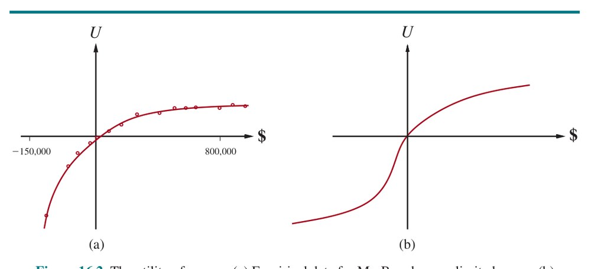
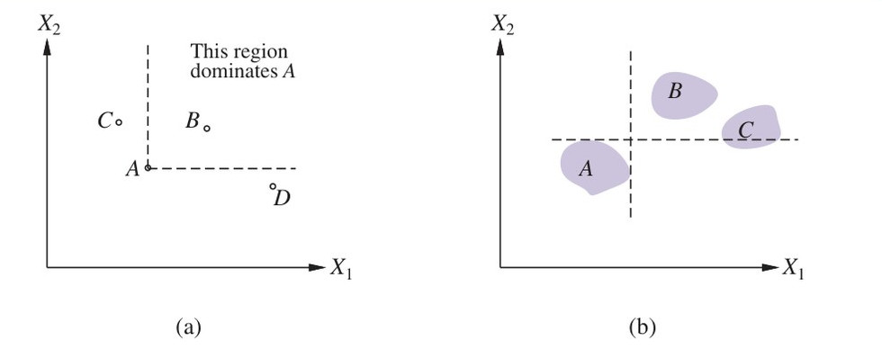
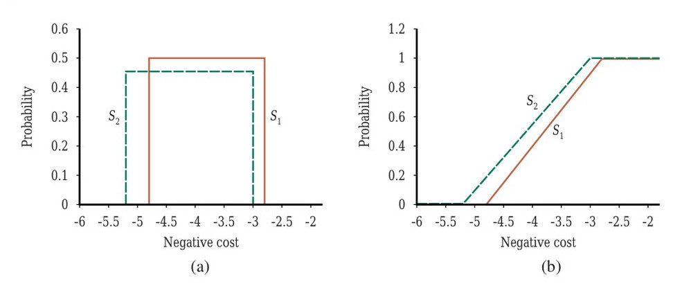
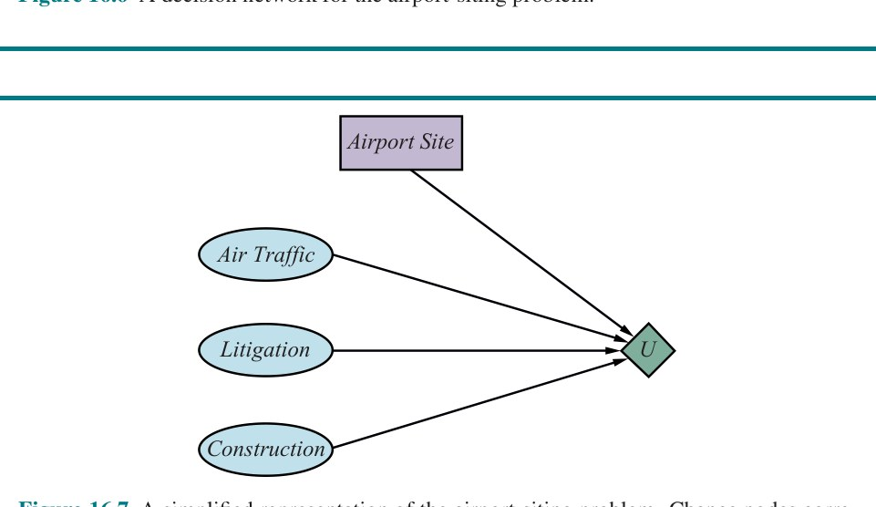
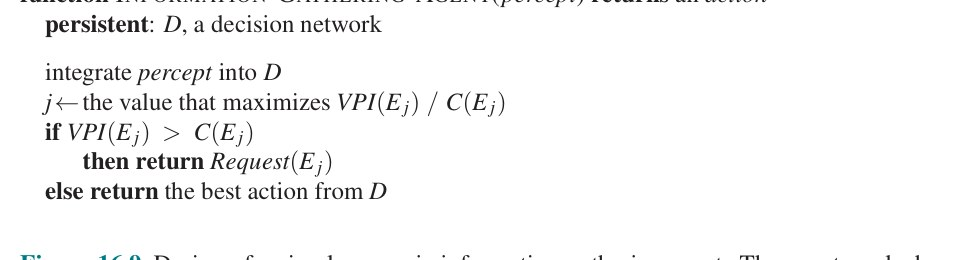
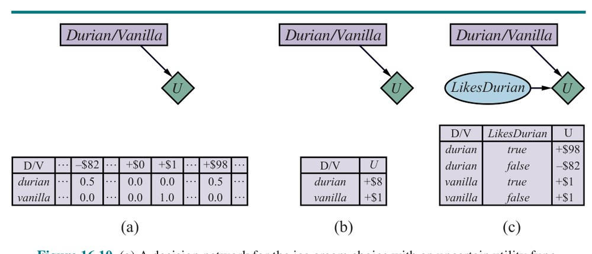

# فصل ۱۶ — تصمیم‌گیری ساده

**فصل ۱۶: تصمیم‌گیری ساده (Making Simple Decisions)**

*در این فصل می‌بینیم عامل چگونه باید تصمیم بگیرد تا در جهانی نامطمئن به آنچه می‌خواهد برسد—دست‌کم تا آن‌جا که ممکن است و به‌طورِ میانگین.*

در این فصل، جزئیاتِ چگونگیِ ترکیبِ نظریهٔ مطلوبیت با نظریهٔ احتمال برای به‌دست‌آوردنِ «عاملِ نظریه‌تصمیم» (Decision-Theoretic Agent)—عاملی که می‌تواند بر اساسِ آنچه باور دارد و آنچه می‌خواهد تصمیم‌های عقلایی بگیرد—را پر می‌کنیم. چنین عاملی می‌تواند در بافت‌هایی تصمیم بگیرد که عدم قطعیت و هدف‌های متعارض، عاملِ منطقی را بدونِ راهی برای تصمیم‌گیری رها می‌کنند. عاملِ هدف‌محور تمایزِ دودویی میان حالت‌های خوب (هدف) و بد (غیرهدف) دارد، در حالی که عاملِ نظریه‌تصمیم به حالت‌ها دامنه‌ای پیوسته از مقادیر تخصیص می‌دهد و بنابراین می‌تواند آسان‌تر حالتِ بهتری را برگزیند حتی وقتی بهترین حالت در دسترس نیست.

بخش ۱۶.۱ اصلِ پایهٔ نظریهٔ تصمیم را معرفی می‌کند: بیشینه‌سازیِ مطلوبیتِ موردانتظار. بخش ۱۶.۲ نشان می‌دهد رفتارِ عاملِ عقلایی را می‌توان با بیشینه‌کردنِ تابعِ مطلوبیت مدل کرد. بخش ۱۶.۳ ماهیتِ توابعِ مطلوبیت را با جزئیاتِ بیشتر بحث می‌کند، و به‌طورِ خاص رابطه‌شان را با کمیت‌های فردی مانندِ پول. بخش ۱۶.۴ نشان می‌دهد چگونه توابعِ مطلوبیتی را که به چند کمیت بستگی دارند مدیریت کنیم. در بخش ۱۶.۵، پیاده‌سازیِ سامانه‌های تصمیم‌گیری را توصیف می‌کنیم. به‌طورِ خاص، صورت‌بندی‌ای به نام «شبکهٔ تصمیم» (Decision Network) معرفی می‌کنیم (که «نمودارِ تأثیر» (Influence Diagram) نیز نامیده می‌شود) که شبکه‌های بیزی را با گنجاندنِ کنش‌ها و مطلوبیت‌ها بسط می‌دهد. بخش ۱۶.۶ نشان می‌دهد عاملِ نظریه‌تصمیم چگونه می‌تواند ارزشِ کسبِ اطلاعاتِ تازه برای بهبودِ تصمیم‌هایش را محاسبه کند.

در حالی که بخش‌های ۱۶.۱ تا ۱۶.۶ فرض می‌کنند عامل با تابعِ مطلوبیتِ داده‌شده و شناخته‌شده عمل می‌کند، بخش ۱۶.۷ این فرض را سست می‌کند. پیامدهای عدم قطعیتِ ترجیح از جانبِ ماشین را بحث می‌کنیم—که مهم‌ترینش «اطاعت از انسان» (Deference to Humans) است.

## ۱۶.۱ ترکیبِ باورها و خواسته‌ها تحتِ عدم قطعیت

با عاملی شروع می‌کنیم که، مانندِ همهٔ عامل‌ها، باید تصمیم بگیرد. کنش‌هایی a در دسترس دارد. ممکن است عدم قطعیت دربارهٔ حالتِ کنونی باشد، پس فرض می‌کنیم عامل به هر حالتِ کنونیِ ممکنِ s احتمالی P(s) تخصیص می‌دهد. همچنین ممکن است عدم قطعیت دربارهٔ پیامدهای کنش باشد؛ مدلِ انتقال با P(s′|s,a)، احتمالِ رسیدنِ کنشِ a در حالتِ s به حالتِ s′، داده می‌شود. چون عمدتاً به پیامدِ s′ علاقه‌مندیم، از نمادِ مخففِ P(RESULT(a)=s′)، احتمالِ رسیدن به s′ با انجامِ a در حالتِ کنونی، هرچه باشد، نیز استفاده می‌کنیم. این دو چنین به هم مربوط‌اند:

```
P(RESULT(a)=s′) = ∑s P(s) P(s′|s, a)
```

نظریهٔ تصمیم، در ساده‌ترین شکلش، با انتخاب میان کنش‌ها بر اساسِ مطلوبیتِ پیامدهای بی‌واسطه‌شان سروکار دارد؛ یعنی فرض می‌شود محیط «اپیزودیک» (Episodic) است، به معنایی که در صفحهٔ ۴۵ تعریف شد. (این فرض در فصل ۱۷ سست می‌شود.) ترجیح‌های عامل توسط «تابعِ مطلوبیت» (Utility Function) به نام U(s) در بر گرفته می‌شوند، که عددی تکی برای بیانِ مطلوبیتِ یک حالت تخصیص می‌دهد. «مطلوبیتِ موردانتظار» (Expected Utility) کنشِ a با توجه به شواهد، EU(a)، صرفاً میانگینِ مقدارِ مطلوبیتِ پیامدهاست، وزن‌داده‌شده با احتمالِ وقوعِ پیامد:

```
EU(a) = ∑s′ P(RESULT(a)=s′) U(s′)        (16.1)
```

«اصلِ بیشینهٔ مطلوبیتِ موردانتظار» (MEU) می‌گوید عاملِ عقلایی باید کنشی را برگزیند که مطلوبیتِ موردانتظارِ عامل را بیشینه می‌کند:

```
action = argmax_a EU(a)
```

از جهتی، اصلِ MEU را می‌توان نسخه‌ای برای رفتارِ هوشمند دانست. تنها کاری که عاملِ هوشمند باید بکند محاسبهٔ کمیت‌های گوناگون، بیشینه‌کردنِ مطلوبیت روی کنش‌هایش، و سپس حرکت است. اما این بدان معنا نیست مسئلهٔ هوش مصنوعی با تعریف حل شده!

اصلِ MEU این تصورِ کلی را صوری می‌کند که عاملِ هوشمند باید «کارِ درست» را انجام دهد، اما آن توصیه را عملیاتی نمی‌کند. برآوردِ توزیعِ احتمالِ P(s) روی حالت‌های ممکنِ جهان، که در P(RESULT(a)=s′) جمع می‌شود، به ادراک، یادگیری، بازنماییِ دانش و استنتاج نیاز دارد. محاسبهٔ خودِ P(RESULT(a)=s′) به مدلِ علّی از جهان نیاز دارد. ممکن است کنش‌های بسیاری برای درنظرگرفتن باشند، و محاسبهٔ مطلوبیت‌های پیامدِ U(s′) خودش ممکن است به جستجو یا برنامه‌ریزیِ بیشتر نیاز داشته باشد، زیرا عامل ممکن است نداند حالتی چقدر خوب است تا وقتی بداند از آن حالت به کجا می‌تواند برسد. سامانهٔ هوش مصنوعیِ عمل‌کننده از جانبِ انسان ممکن است تابعِ مطلوبیتِ واقعیِ انسان را نداند، پس ممکن است عدم قطعیت دربارهٔ U باشد. به‌طورِ خلاصه، نظریهٔ تصمیم نوشدارویی نیست که مسئلهٔ هوش مصنوعی را حل کند—اما آغازِ چارچوبِ ریاضیِ پایه‌ای را فراهم می‌کند که به‌اندازهٔ کافی عمومی است تا مسئلهٔ هوش مصنوعی را تعریف کند.

اصلِ MEU رابطهٔ روشنی با ایدهٔ معیارهای عملکردِ معرفی‌شده در فصل ۲ دارد. ایدهٔ پایه ساده است. محیط‌هایی را در نظر بگیرید که می‌توانند عامل را به داشتنِ تاریخچهٔ حس‌گذارِهٔ معینی برسانند، و عامل‌های متفاوتی را که می‌توانستیم طراحی کنیم در نظر بگیرید. اگر عامل چنان عمل کند که تابعِ مطلوبیتی را بیشینه کند که به‌درستی معیارِ عملکرد را بازتاب می‌دهد، آنگاه عامل بالاترین امتیازِ عملکردِ ممکن را به دست خواهد آورد (میانگین‌گرفته روی همهٔ محیط‌های ممکن). این توجیهِ مرکزیِ خودِ اصلِ MEU است. اگرچه این ادعا ممکن است بدیهی‌گونه به نظر برسد، در واقع گذارِ بسیار مهمی از معیارِ عملکردِ بیرونی به تابعِ مطلوبیتِ درونی را در بر دارد. معیارِ عملکرد برای یک تاریخچه—توالی‌ای از حالت‌ها—امتیاز می‌دهد. بدین‌ترتیب، به‌صورتِ پس‌نگرانه پس از کامل‌کردنِ توالی‌ای از کنش‌ها توسط عامل اعمال می‌شود. تابعِ مطلوبیت بر همان حالتِ بسیار بعدی اعمال می‌شود، پس می‌توان از آن برای هدایتِ گام‌به‌گامِ کنش‌ها استفاده کرد.

## ۱۶.۲ مبنای نظریهٔ مطلوبیت

به‌صورتِ شهودی، اصلِ بیشینهٔ مطلوبیتِ موردانتظار (MEU) راهِ معقولی برای تصمیم‌گیری به نظر می‌رسد، اما به هیچ وجه بدیهی نیست که تنها راهِ عقلایی است. بالاخره، چرا بیشینه‌کردنِ میانگینِ مطلوبیت باید این‌قدر خاص باشد؟ چه اشکالی دارد عاملی که جمعِ وزن‌دارِ مکعب‌های مطلوبیت‌های ممکن را بیشینه می‌کند، یا سعی می‌کند بدترین زیانِ ممکن را کمینه کند؟ آیا عاملی می‌تواند صرفاً با بیانِ ترجیح‌ها میان حالت‌ها، بدونِ دادنِ مقادیرِ عددی به آن‌ها، عقلایی عمل کند؟ سرانجام، چرا تابعِ مطلوبیتی با ویژگی‌های لازم باید اصلاً وجود داشته باشد؟ خواهیم دید.

### ۱۶.۲.۱ قیدهای ترجیح‌های عقلایی

این پرسش‌ها را می‌توان با نوشتنِ برخی قیدها روی ترجیح‌هایی که عاملِ عقلایی باید داشته باشد و سپس نشان‌دادنِ اینکه اصلِ MEU را می‌توان از قیدها اشتقاق کرد، پاسخ داد. از نمادِ زیر برای توصیفِ ترجیح‌های عامل استفاده می‌کنیم:

```
A ≻ B       عامل A را بر B ترجیح می‌دهد.
A ∼ B       عامل میان A و B بی‌تفاوت است.
A ⪰ B       عامل A را بر B ترجیح می‌دهد یا میان‌شان بی‌تفاوت است.
```

حالا پرسشِ بدیهی این است که A و B چه جور چیزهایی‌اند؟ آن‌ها می‌توانند حالت‌های جهان باشند، اما بیشترِ اوقات دربارهٔ آنچه واقعاً ارائه می‌شود عدم قطعیت هست. برای نمونه، مسافرِ هواپیمایی که «ماکارونی یا مرغ» به او پیشنهاد می‌شود نمی‌داند زیرِ پوششِ فویل چه چیزی نهفته است.¹ ماکارونی می‌تواند خوشمزه یا منجمد باشد، مرغ آبدار یا فراتر از شناسایی پخته‌شده. می‌توانیم مجموعهٔ پیامدهای هر کنش را «لاتاری» (Lottery) بدانیم—هر کنش را بلیطِ لاتاری تصور کنید. لاتاریِ L با پیامدهای ممکنِ S1,...,Sn که با احتمال‌های p1,...,pn رخ می‌دهند، چنین نوشته می‌شود:

```
L = [p1, S1; p2, S2; ... pn, Sn]
```

به‌طورِ کلی، هر پیامدِ Si از لاتاری می‌تواند یا حالتِ اتمی باشد یا لاتاریِ دیگر. مسئلهٔ اصلیِ نظریهٔ مطلوبیت فهمِ این است که ترجیح‌های میانِ لاتاری‌های پیچیده چگونه به ترجیح‌های میانِ حالت‌های زیربناییِ آن لاتاری‌ها مربوط می‌شوند. برای پرداختن به این مسئله، شش قید را فهرست می‌کنیم که از هر رابطهٔ ترجیحِ معقولی می‌خواهیم پیروی کند:

- **ترتیب‌پذیری (Orderability):** با توجه به هر دو لاتاری، عاملِ عقلایی باید یا یکی را ترجیح دهد یا آن‌ها را به‌یکسان ترجیح‌پذیر ارزیابی کند. یعنی عامل نمی‌تواند از تصمیم‌گیری اجتناب کند. چنان‌که در صفحهٔ ۳۹۴ ذکر شد، امتناع از شرط‌بندی مانند امتناع از گذشتنِ زمان است. دقیقاً یکی از (A ≻ B)، (B ≻ A) یا (A ∼ B) برقرار است.
- **ترایایی (Transitivity):** با توجه به هر سه لاتاری، اگر عامل A را بر B و B را بر C ترجیح دهد، آنگاه عامل باید A را بر C ترجیح دهد.

```
(A ≻ B) ∧ (B ≻ C) ⇒ (A ≻ C)
```

- **پیوستگی (Continuity):** اگر لاتاریِ B در ترجیح میان A و C باشد، آنگاه احتمالِ pای هست که برای آن عاملِ عقلایی میانِ گرفتنِ قطعیِ B و لاتاریِ [p,A; 1−p,C] بی‌تفاوت باشد.

```
A ≻ B ≻ C ⇒ ∃p [p, A; 1−p, C] ∼ B
```

- **جایگزینی‌پذیری (Substitutability):** اگر عامل میان دو لاتاریِ A و B بی‌تفاوت باشد، آنگاه عامل میان دو لاتاریِ پیچیده‌تر که یکسان‌اند به‌جز اینکه B در یکی از آن‌ها به‌جای A جایگزین شده، بی‌تفاوت است. این صرف‌نظر از احتمال‌ها و دیگر پیامد(های) در لاتاری‌ها برقرار است.

```
A ∼ B ⇒ [p, A; 1−p, C] ∼ [p, B; 1−p, C]
```

این همچنین برقرار است اگر در این اصل ∼ را با ≻ جایگزین کنیم.

- **یکنواختی (Monotonicity):** فرض کنیم دو لاتاری همان دو پیامدِ ممکنِ A و B را دارند. اگر عامل A را بر B ترجیح دهد، آنگاه عامل باید لاتاریِ با احتمالِ بالاترِ A را ترجیح دهد (و برعکس).

```
A ≻ B ⇒ (p > q ⇔ [p, A; 1−p, B] ≻ [q, A; 1−q, B])
```

- **تجزیه‌پذیری (Decomposability):** لاتاری‌های مرکب را می‌توان با قوانینِ احتمال به لاتاری‌های ساده‌تر کاهش داد. این «قانونِ بدونِ لذت در قمار» نامیده شده: چنان‌که شکل ۱۶.۱(ب) نشان می‌دهد، دو لاتاریِ متوالی را به لاتاریِ معادلِ تکی فشرده می‌کند.²

```
[p, A; 1−p, [q, B; 1−q, C]] ∼ [p, A; (1−p)q, B; (1−p)(1−q), C]
```

![**شکل ۱۶.۱ — (الف) ترجیح‌های ناترایای A ≻ B ≻ C ≻ A می‌توانند به رفتارِ غیرعقلایی بینجامند: چرخه‌ای از مبادله‌ها که هر یک یک سنت هزینه دارد. (ب) اصلِ تجزیه‌پذیری. (لاتاریِ مرکب [p,A; 1−p,[q,B; 1−q,C]] معادلِ لاتاریِ [p,A; (1−p)q,B; (1−p)(1−q),C] است.)**](../figures/ch16/fig-16-1.jpg)

**شکل ۱۶.۱ — (الف) ترجیح‌های ناترایای A ≻ B ≻ C ≻ A می‌توانند به رفتارِ غیرعقلایی بینجامند: چرخه‌ای از مبادله‌ها که هر یک یک سنت هزینه دارد. (ب) اصلِ تجزیه‌پذیری. (لاتاریِ مرکب [p,A; 1−p,[q,B; 1−q,C]] معادلِ لاتاریِ [p,A; (1−p)q,B; (1−p)(1−q),C] است.)**

این قیدها به‌عنوانِ «اصل‌های نظریهٔ مطلوبیت» شناخته می‌شوند. هر اصل را می‌توان با نشان‌دادنِ اینکه عاملی که آن را نقض می‌کند در برخی موقعیت‌ها رفتارِ آشکارا غیرعقلایی از خود نشان می‌دهد، انگیزه‌مند کرد. برای نمونه، می‌توانیم ترایایی را با ساختنِ عاملی با ترجیح‌های ناترایا انگیزه‌مند کنیم که همهٔ ثروتش را به ما می‌دهد: اگر A ≻ B ≻ C ≻ A باشد، آنگاه عامل حاضر است A را با B معاوضه کند (و یک سنت بپردازد)، سپس B را با C (و یک سنت)، سپس C را با A (و یک سنت). چرخهٔ حاصل می‌تواند برای همیشه ادامه یابد و عامل را بدونِ پول و با A که ظاهراً ارزشِ کمتری نسبت به چیزی که با آن شروع کرده دارد، رها کند.

### ۱۶.۲.۲ ترجیح‌های عقلایی به مطلوبیت می‌انجامند

توجه کنید اصل‌های نظریهٔ مطلوبیت در واقع اصل‌هایی دربارهٔ ترجیح‌هایند—آن‌ها هیچ‌چیز دربارهٔ تابعِ مطلوبیت نمی‌گویند. اما در واقع از اصل‌های مطلوبیت می‌توانیم پیامدهای زیر را اشتقاق کنیم (برای اثبات، فون نویمان و مورگنشترن، 1944 را ببینید):

- **وجودِ تابعِ مطلوبیت:** اگر ترجیح‌های عامل از اصل‌های مطلوبیت پیروی کنند، آنگاه تابعِ U وجود دارد به‌گونه‌ای که U(A) > U(B) اگر و فقط اگر A بر B ترجیح داده شود، و U(A) = U(B) اگر و فقط اگر عامل میان A و B بی‌تفاوت باشد. یعنی U(A) > U(B) ⇔ A ≻ B و U(A) = U(B) ⇔ A ∼ B.
- **مطلوبیتِ موردانتظارِ لاتاری:** مطلوبیتِ لاتاری، جمعِ احتمالِ هر پیامد ضرب‌درِ مطلوبیتِ آن پیامد است:

```
U([p1, S1; ...; pn, Sn]) = ∑i pi U(Si)
```

به بیانِ دیگر، وقتی احتمال‌ها و مطلوبیت‌های حالت‌های پیامدِ ممکن مشخص شدند، مطلوبیتِ لاتاریِ مرکبی که آن حالت‌ها را شامل می‌شود کاملاً تعیین می‌شود. چون پیامدِ کنشِ ناجبرگرایانه لاتاری است، نتیجه می‌شود عامل می‌تواند عقلایی عمل کند—یعنی سازگار با ترجیح‌هایش—فقط با برگزیدنِ کنشی که مطلوبیتِ موردانتظار را طبقِ معادلهٔ (16.1) بیشینه می‌کند.

قضیه‌های پیشین ثابت می‌کنند (با فرضِ قیدهای ترجیحِ عقلایی) تابعِ مطلوبیتی برای هر عاملِ عقلایی وجود دارد. قضیه‌ها ثابت نمی‌کنند تابعِ مطلوبیت یکتاست. در واقع، دیدنِ این آسان است که رفتارِ عامل تغییر نمی‌کرد اگر تابعِ مطلوبیتش U(S) طبقِ:

```
U′(S) = aU(S) + b        (16.2)
```

تبدیل می‌شد، که در آن a و b ثابت‌اند و a > 0؛ «تبدیلِ وابستهٔ مثبت» (Positive Affine Transformation).³ این واقعیت در فصل ۵ (صفحهٔ ۱۶۷) برای بازی‌های دوشانسیِ دونفره ذکر شد؛ در این‌جا می‌بینیم برای همهٔ انواعِ سناریوهای تصمیم صدق می‌کند. مانندِ بازی، در محیطِ جبرگرایانه عامل فقط به رتبه‌بندیِ ترجیحی روی حالت‌ها نیاز دارد—اعداد مهم نیستند. این «تابعِ مقدار» (Value Function) یا «تابعِ مطلوبیتِ ترتیبی» (Ordinal Utility Function) نامیده می‌شود.

مهم است به یاد داشته باشیم وجودِ تابعِ مطلوبیتی که رفتارِ ترجیحیِ عامل را توصیف می‌کند لزوماً به این معنا نیست که عامل در تأملاتِ خودش صریحاً آن تابعِ مطلوبیت را بیشینه می‌کند. چنان‌که در فصل ۲ نشان دادیم، رفتارِ عقلایی را می‌توان به هر تعدادی از راه‌ها تولید کرد. عاملِ عقلایی ممکن است با جستجوی جدولی پیاده‌سازی شود (اگر شمارِ حالت‌های ممکن به‌اندازهٔ کافی کوچک باشد). با مشاهدهٔ رفتارِ عاملِ عقلایی، ناظر می‌تواند دربارهٔ تابعِ مطلوبیتی بیاموزد که بازنمایی می‌کند عامل واقعاً در تلاش برای رسیدن به چه چیزی است (حتی اگر خودِ عامل نداند). در بخش ۱۶.۷ به این نکته بازمی‌گردیم.

## ۱۶.۳ توابعِ مطلوبیت

توابعِ مطلوبیت از لاتاری‌ها به اعدادِ حقیقی نگاشت می‌کنند. می‌دانیم باید از اصل‌های ترتیب‌پذیری، ترایایی، پیوستگی، جایگزینی‌پذیری، یکنواختی و تجزیه‌پذیری پیروی کنند. آیا این تنها چیزی است که می‌توانیم دربارهٔ توابعِ مطلوبیت بگوییم؟ به‌طورِ سخت‌گیرانه، بله: عامل می‌تواند هر ترجیحی که دوست دارد داشته باشد. برای نمونه، عامل ممکن است ترجیح دهد تعدادِ اولِ دلار در حسابِ بانکی‌اش داشته باشد؛ در آن صورت، اگر ۱۶ دلار داشت، ۳ دلار را می‌بخشید. این ممکن است غیرعادی باشد، اما نمی‌توانیم آن را غیرعقلایی بنامیم. عامل ممکن است فورد پینتوی ۱۹۷۳ِ فرورفته را به مرسدسِ نو و براق ترجیح دهد. عامل ممکن است فقط وقتی صاحبِ پینتوست اعدادِ اولِ دلار را ترجیح دهد، اما وقتی مرسدس را دارد، دلارِ بیشتر را به کمتر ترجیح دهد. خوشبختانه، ترجیح‌های عامل‌های واقعی معمولاً نظام‌مندترند و بنابراین راحت‌تر قابلِ مدیریت.

### ۱۶.۳.۱ ارزیابیِ مطلوبیت و مقیاس‌های مطلوبیت

اگر بخواهیم سامانهٔ نظریه‌تصمیمی بسازیم که به انسان در تصمیم‌گیری کمک کند یا از جانبِ او عمل کند، نخست باید دریابیم تابعِ مطلوبیتِ انسان چیست. این فرایند، که اغلب «استخراجِ ترجیح» (Preference Elicitation) نامیده می‌شود، شاملِ ارائهٔ انتخاب‌ها به انسان و استفاده از ترجیح‌های مشاهده‌شده برای تثبیتِ تابعِ مطلوبیتِ زیربنایی است.

معادلهٔ (16.2) می‌گوید هیچ مقیاسِ مطلقی برای مطلوبیت‌ها نیست، اما با این حال مفید است مقیاسی برقرار کنیم که مطلوبیت‌ها بتوانند روی آن برای هر مسئلهٔ خاص ثبت و مقایسه شوند. مقیاس را می‌توان با تثبیتِ مطلوبیتِ هر دو پیامدِ خاص برقرار کرد، همان‌گونه که مقیاسِ دما را با تثبیتِ نقطهٔ انجماد و نقطهٔ جوشِ آب تثبیت می‌کنیم.

معمولاً، مطلوبیتِ «بهترین جایزهٔ ممکن» را U(S) = u⊤ و «بدترین فاجعهٔ ممکن» را U(S) = u⊥ تثبیت می‌کنیم. (هر دو باید متناهی باشند.) «مطلوبیت‌های نرمال‌شده» (Normalized Utilities) از مقیاسی با u⊥ = 0 و u⊤ = 1 استفاده می‌کنند. با چنین مقیاسی، هوادارِ انگلیسی ممکن است مطلوبیتِ 1 را به قهرمانیِ انگلستان در جام جهانی و مطلوبیتِ 0 را به عدمِ راه‌یابیِ انگلستان تخصیص دهد.

با توجه به مقیاسِ مطلوبیت بین u⊤ و u⊥، می‌توانیم مطلوبیتِ هر جایزهٔ خاصِ S را با پرسیدنِ انتخابِ میان S و «لاتاریِ استانداردِ» [p, u⊤; (1−p), u⊥] از عامل ارزیابی کنیم. احتمالِ p تا وقتی تنظیم می‌شود که عامل میان S و لاتاریِ استاندارد بی‌تفاوت شود. با فرضِ مطلوبیت‌های نرمال‌شده، مطلوبیتِ S با p داده می‌شود. پس از انجامِ این برای هر جایزه، مطلوبیت‌های همهٔ لاتاری‌های شاملِ آن جایزه‌ها تعیین می‌شوند. فرض کنیم، برای نمونه، می‌خواهیم بدانیم هوادارِ انگلیسیِ ما رسیدنِ انگلستان به نیمه‌نهایی و سپس باخت را چقدر ارزش‌گذاری می‌کند. آن پیامد را با لاتاریِ استانداردی مقایسه می‌کنیم که با احتمالِ p جام را می‌برد و با احتمالِ 1−p به‌شکلی رسواکننده از راه‌یابی بازمی‌ماند. اگر بی‌تفاوتی در p=0.3 رخ دهد، آنگاه 0.3 مقدارِ رسیدن به نیمه‌نهایی و سپس باخت است.

در مسائلِ تصمیمِ پزشکی، حمل‌ونقل، زیست‌محیطی و دیگر مسائل، جانِ انسان‌ها در میان است. (بله، چیزهایی مهم‌تر از سرنوشتِ انگلستان در جام جهانی هست.) در چنین مواردی، u⊥ مقداری است که به مرگِ فوری تخصیص داده می‌شود (یا در بدترین حالت‌های واقعی، مرگ‌های بسیار). اگرچه هیچ‌کس با گذاشتنِ ارزشی روی زندگیِ انسان راحت نیست، این واقعیت است که معاوضه‌ها در امورِ مرگ و زندگی همیشه انجام می‌شوند. هواپیماها در بازه‌هایی تعمیرِ اساسی می‌شوند، نه پس از هر سفر. خودروها به‌گونه‌ای ساخته می‌شوند که هزینه‌ها را با نرخ‌های بقای تصادف معاوضه می‌کنند. سطحی از آلودگیِ هوا را تحمل می‌کنیم که سالانه چهار میلیون نفر را می‌کشد. به‌صورتِ متناقض‌نما، امتناع از گذاشتنِ ارزشِ پولی بر زندگی می‌تواند بدان معنا باشد که زندگی کم‌ارزش‌گذاری می‌شود.

راس شاکتر سازمانِ دولتی‌ای را توصیف می‌کند که مطالعه‌ای دربارهٔ حذفِ پنبه‌نسوز از مدارس سفارش داد. تحلیلگرانِ تصمیمِ انجام‌دهندهٔ مطالعه، مقدارِ دلاریِ خاصی برای زندگیِ کودکِ مدرسه‌ای فرض کردند و استدلال کردند انتخابِ عقلایی تحتِ آن فرض حذفِ پنبه‌نسوز بود. سازمان، از نظرِ اخلاقی خشمگین از ایدهٔ تعیینِ ارزشِ زندگی، گزارش را یک‌جا رد کرد. سپس علیه حذفِ پنبه‌نسوز تصمیم گرفت—به‌صورتِ ضمنی ادعایِ ارزشِ کمتری برای زندگیِ کودک از آنچه تحلیلگران تخصیص داده بودند.

در حالِ حاضر چند سازمانِ دولتِ آمریکا، از جملهِ آژانسِ حفاظت از محیط زیست، سازمانِ غذا و دارو و وزارتِ حمل‌ونقل، از «ارزشِ زندگیِ آماری» (Value of a Statistical Life) برای تعیینِ هزینه‌ها و مزایای مقررات و مداخله‌ها استفاده می‌کنند. مقادیرِ نمونه‌ای در ۲۰۱۹ تقریباً ۱۰ میلیون دلارند.

برخی تلاش‌ها برای یافتنِ ارزشی که مردم روی زندگیِ خودشان می‌گذارند شده. یکی از «ارزهای» رایجِ استفاده‌شده در تحلیلِ پزشکی و ایمنی «میکرومورت» (Micromort) است، یک‌شانسِ مرگ در یک میلیون. اگر از مردم بپرسید چقدر حاضرند برای اجتناب از ریسکی بپردازند—برای نمونه، برای اجتناب از بازیِ رولتِ روسی با هفت‌تیرِ یک‌میلیون‌خشاب—با اعدادِ بسیار بزرگ پاسخ می‌دهند، شاید ده‌ها هزار دلار، اما رفتارِ واقعی‌شان ارزشِ پولیِ بسیار کمتری برای میکرومورت بازتاب می‌دهد. برای نمونه، در بریتانیا، رانندگیِ ۲۳۰ مایل با خودرو ریسکِ یک میکرومورت را در بر دارد. در طولِ عمرِ خودرو—مثلاً ۹۲٬۰۰۰ مایل—آن ۴۰۰ میکرومورت است. به نظر می‌رسد مردم حاضرند حدود ۱۲٬۰۰۰ دلار بیشتر برای خودروی امن‌تری بپردازند که ریسکِ مرگ را نصف می‌کند. بدین‌ترتیب، کنشِ خریدِ خودروی‌شان می‌گوید برای هر میکرومورت ارزشِ ۶۰ دلار قائل‌اند. شماری از مطالعات رقمی در این محدوده را در میانِ افراد و انواعِ ریسکِ بسیار تأیید کرده‌اند. با این حال، سازمان‌های دولتی مانندِ وزارتِ حمل‌ونقلِ آمریکا معمولاً رقمِ پایین‌تری تعیین می‌کنند؛ آن‌ها فقط حدود ۶ دلار در تعمیراتِ جاده‌ای به‌ازای هر زندگیِ موردانتظارِ نجات‌یافته هزینه می‌کنند. البته، این محاسبه‌ها فقط برای ریسک‌های کوچک برقرارند. بیشترِ مردم حاضر نمی‌شوند خودکشی کنند، حتی برای ۶۰ میلیون دلار.

معیارِ دیگر «QALY» است، یا «سالِ زندگیِ تعدیل‌شده با کیفیت» (Quality-Adjusted Life Year). بیماران حاضرند طولِ عمرِ کوتاه‌تری را برای اجتناب از ناتوانی بپذیرند. برای نمونه، بیمارانِ کلیوی به‌طورِ میانگین میانِ زندگیِ دو ساله با دیالیز و یک سالِ با سلامتِ کامل بی‌تفاوت‌اند.

### ۱۶.۳.۲ مطلوبیتِ پول

نظریهٔ مطلوبیت ریشه در اقتصاد دارد، و اقتصاد یک نامزدِ بدیهی برای معیارِ مطلوبیت فراهم می‌کند: پول (یا دقیق‌تر، کلِ دارایی‌های خالصِ عامل). قابلیتِ مبادلهٔ تقریباً همگانیِ پول با همهٔ انواعِ کالاها و خدمات پیشنهاد می‌کند پول نقشِ قابلِ‌توجهی در توابعِ مطلوبیتِ انسانی بازی می‌کند.

معمولاً چنین خواهد بود که عامل پولِ بیشتر را به کمتر ترجیح می‌دهد، با ثابت‌بودنِ سایرِ چیزها. می‌گوییم عامل «ترجیحِ یکنواخت» (Monotonic Preference) برای پولِ بیشتر نشان می‌دهد. این بدان معنا نیست پول مانندِ تابعِ مطلوبیت رفتار می‌کند، زیرا هیچ‌چیز دربارهٔ ترجیح‌های میانِ لاتاری‌های شاملِ پول نمی‌گوید.

فرض کنید در یک مسابقهٔ تلویزیونی بر رقبای دیگر پیروز شده‌اید. مجری حالا انتخابی به شما پیشنهاد می‌کند: یا می‌توانید جایزهٔ ۱٬۰۰۰٬۰۰۰ دلاری را بردارید یا آن را روی پرتابِ سکه قمار کنید. اگر سکه رو بیاید، با هیچ‌چیز تمام می‌کنید، اما اگر پشت بیاید، ۲٬۵۰۰٬۰۰۰ دلار می‌گیرید. اگر مثلِ بیشترِ مردم باشید، از قمار صرف‌نظر می‌کنید و میلیون را در جیب می‌گذارید. آیا غیرعقلایی رفتار می‌کنید؟

با فرضِ منصفانه‌بودنِ سکه، «ارزشِ پولیِ موردانتظار» (Expected Monetary Value یا EMV) قمار برابر (1/2)($0) + (1/2)($2,500,000) = $1,250,000 است، که بیشتر از ۱٬۰۰۰٬۰۰۰ دلارِ اصلی است. اما این لزوماً بدان معنا نیست پذیرفتنِ قمار تصمیمِ بهتری است. فرض کنیم Sn حالتِ داشتنِ ثروتِ کلِ n دلار را نشان دهد و ثروتِ کنونی‌تان k دلار باشد. سپس مطلوبیت‌های موردانتظارِ دو کنشِ پذیرفتن و نپذیرفتنِ قمار عبارت‌اند از:

```
EU(Accept) = (1/2)U(Sk) + (1/2)U(Sk+2,500,000)
EU(Decline) = U(Sk+1,000,000)
```

برای تعیینِ اینکه چه کنیم، باید به حالت‌های پیامد مطلوبیت تخصیص دهیم. مطلوبیت با ارزشِ پولی مستقیماً متناسب نیست، زیرا مطلوبیتِ اولین میلیونِ شما بسیار بالاست (یا چنین می‌گویند)، در حالی که مطلوبیتِ میلیونِ اضافی کوچک‌تر است. فرض کنیم به وضعیتِ مالیِ کنونی‌تان (Sk) مطلوبیتِ 5، به حالتِ Sk+2,500,000 مطلوبیتِ 9 و به حالتِ Sk+1,000,000 مطلوبیتِ 8 تخصیص می‌دهید. سپس کنشِ عقلایی نپذیرفتن خواهد بود، زیرا مطلوبیتِ موردانتظارِ پذیرفتن فقط 7 است (کمتر از 8 برای نپذیرفتن). از سوی دیگر، میلیاردری به‌احتمالِ زیاد تابعِ مطلوبیتی دارد که در بازهٔ چند میلیونِ بیشتر به‌صورتِ محلی خطی است، و بنابراین قمار را می‌پذیرد.



**شکل ۱۶.۲ — مطلوبیتِ پول. (الف) دادهٔ تجربی برای آقای بیرد در بازه‌ای محدود. (ب) منحنیِ نمونه‌ای برای کلِ بازه.**

در مطالعه‌ای پیشگامانه از توابعِ مطلوبیتِ واقعی، گریسون (1960) دریافت مطلوبیتِ پول تقریباً دقیقاً با لگاریتمِ مقدار متناسب است. (این ایده نخستین بار توسط برنولی (1738) پیشنهاد شد؛ تمرین ۱۶.STPT را ببینید.) یکی از منحنی‌های مطلوبیتِ خاص، برای آقای بیردی معین، در شکل ۱۶.۲(الف) نشان داده شده. داده‌های به‌دست‌آمده برای ترجیح‌های آقای بیرد با تابعِ مطلوبیتِ U(Sk+n) = −263.31 + 22.09·log(n + 150,000) برای بازهٔ بین n = −$150,000 و n = $800,000 سازگارند.

نباید فرض کنیم این تابعِ مطلوبیتِ قطعیِ ارزشِ پولی است، اما محتمل است بیشترِ مردم تابعِ مطلوبیتی داشته باشند که برای ثروتِ مثبت «مقعر» (Concave) است. به بدهی رفتن بد است، اما ترجیح‌های میانِ سطوحِ مختلفِ بدهی می‌توانند وارونگیِ تقعرِ مرتبط با ثروتِ مثبت را نشان دهند. برای نمونه، کسی که قبلاً ۱۰٬۰۰۰٬۰۰۰ دلار بدهکار است ممکن است خوب قمارِ روی سکهٔ منصفانه‌ای را بپذیرد که برای رو ۱۰٬۰۰۰٬۰۰۰ دلار سود و برای پشت ۲۰٬۰۰۰٬۰۰۰ دلار زیان دارد.⁴ این منحنیِ S-شکلِ نشان‌داده‌شده در شکل ۱۶.۲(ب) را می‌دهد.

اگر توجه‌مان را به بخشِ مثبتِ منحنی‌ها محدود کنیم، جایی که شیب کاهشی است، آنگاه برای هر لاتاریِ L، مطلوبیتِ رویارویی با آن لاتاری کمتر از مطلوبیتِ دریافتِ ارزشِ پولیِ موردانتظارِ لاتاری به‌عنوانِ امری قطعی است:

```
U(L) < U(S_EMV(L))
```

یعنی عامل‌های با منحنی‌های این شکل «ریسک‌گریز» (Risk-Averse) هستند: آن‌ها امرِ قطعی با بازدهی کمتر از ارزشِ پولیِ موردانتظارِ قمار را ترجیح می‌دهند. از سوی دیگر، در ناحیهٔ «مأیوسانه» در ثروتِ منفیِ بزرگ در شکل ۱۶.۲(ب)، رفتار «ریسک‌پذیر» (Risk-Seeking) است.

مقداری که عامل در ازای لاتاری می‌پذیرد «معادلِ قطعیت» (Certainty Equivalent) لاتاری نامیده می‌شود. مطالعات نشان داده‌اند بیشترِ مردم حدود ۴۰۰ دلار در ازای قماری می‌پذیرند که نیمی از اوقات ۱۰۰۰ دلار و نیمی دیگر ۰ می‌دهد—یعنی معادلِ قطعیتِ لاتاری ۴۰۰ دلار است، در حالی که EMV آن ۵۰۰ دلار است.

توجه کنید برای تغییرهای کوچکِ ثروت نسبت به ثروتِ کنونی، تقریباً هر منحنی به‌صورتِ تقریبی خطی خواهد بود. عاملِ با منحنیِ خطی «ریسک‌خنثی» (Risk-Neutral) نامیده می‌شود. برای قمارهای با مبالغِ کوچک، پس، انتظارِ ریسک‌خنثی داریم. از جهتی، این رویهٔ ساده‌شده‌ای را توجیه می‌کند که قمارهای کوچک برای ارزیابیِ احتمال‌ها و توجیهِ اصل‌های احتمال در بخش ۱۲.۲.۳ پیشنهاد می‌کرد.

### ۱۶.۳.۳ مطلوبیتِ موردانتظار و ناامیدیِ پس از تصمیم

راهِ عقلاییِ انتخابِ بهترین کنش، a*، بیشینه‌کردنِ مطلوبیتِ موردانتظار است:

```
a* = argmax_a EU(a)
```

اگر مطلوبیتِ موردانتظار را طبقِ مدلِ احتمالِ‌مان به‌درستی محاسبه کرده باشیم، و اگر مدلِ احتمال به‌درستی فرایندهای تصادفیِ زیربناییِ تولیدکنندهٔ پیامدها را بازتاب دهد، آنگاه، به‌طورِ میانگین، مطلوبیتی را که انتظار داریم می‌گیریم، اگر کلِ فرایند بارها و بارها تکرار شود. در واقعیت، با این حال، مدلِ ما معمولاً وضعیتِ واقعی را ساده‌سازیِ بیش‌ازحد می‌کند، یا به این دلیل که به‌اندازهٔ کافی نمی‌دانیم (مثلاً هنگام تصمیمِ سرمایه‌گذاریِ پیچیده) یا به این دلیل که محاسبهٔ مطلوبیتِ موردانتظارِ واقعی بسیار دشوار است (مثلاً هنگام حرکت در تخته‌نرد، با نیاز به درنظرگرفتنِ همهٔ پرتاب‌های تاسِ ممکنِ آینده). در آن صورت، در واقع با برآوردهایی EÛ(a) از مطلوبیتِ موردانتظارِ واقعی کار می‌کنیم. فرض می‌کنیم، شاید از سرِ خوش‌بینی، برآوردها «بدونِ اریب» (Unbiased) هستند—یعنی مقدارِ موردانتظارِ خطا، E(EÛ(a) − EU(a))، صفر است. در آن صورت، همچنان معقول به نظر می‌رسد کنشی را با بالاترین مطلوبیتِ برآوردشده برگزینیم و انتظارِ دریافتِ آن مطلوبیت را، به‌طورِ میانگین، هنگام اجرایِ کنش داشته باشیم.

متأسفانه، پیامدِ واقعی معمولاً به‌طورِ قابلِ‌توجهی بدتر از برآوردِ ما خواهد بود، حتی اگرچه برآورد بدونِ اریب بود! برای دیدنِ چرایی، مسئلهٔ تصمیمی را در نظر بگیرید که در آن k انتخاب هست و هر یک مطلوبیتِ واقعیِ برآوردشدهٔ 0 دارد. فرض کنیم خطای هر برآوردِ مطلوبیت مستقل است و توزیعِ نرمالِ واحد دارد—یعنی گاوسی با میانگینِ صفر و انحرافِ معیارِ 1، که به‌صورتِ منحنیِ پررنگ در شکل ۱۶.۳ نشان داده شده. حالا، وقتی واقعاً شروع به تولیدِ برآوردها می‌کنیم، برخی خطاها منفی (بدبینانه) و برخی مثبت (خوش‌بینانه) خواهند بود. چون کنشی را با بالاترین برآوردِ مطلوبیت انتخاب می‌کنیم، به برآوردهای بیش‌ازحدِ خوش‌بینانه رجحان می‌دهیم، و این منشأِ اریب است.

محاسبهٔ توزیعِ بیشینهٔ k برآورد و در نتیجه کمّی‌کردنِ میزانِ ناامیدی‌مان کارِ سرراستی است. (این محاسبه حالتِ خاصی از محاسبهٔ «آمارهٔ ترتیبی» (Order Statistic) است، توزیعِ هر عنصرِ رتبه‌بندی‌شدهٔ خاصِ نمونه.) فرض کنیم هر برآوردِ Xi تابعِ چگالیِ احتمالِ f(x) و توزیعِ تجمعیِ F(x) دارد. (چنان‌که در پیوستِ الف توضیح داده شده، توزیعِ تجمعیِ F احتمالِ اینکه هزینه کمتر یا مساوی هر مقدارِ معین باشد را اندازه می‌گیرد—یعنی چگالیِ اصلیِ f را انتگرال می‌گیرد.) حالا X* بزرگ‌ترین برآورد باشد، یعنی max{X1,...,Xk}. سپس توزیعِ تجمعی برای X* چنین است:

```
P(max{X1,...,Xk} ≤ x) = P(X1 ≤ x, ..., Xk ≤ x)
                      = P(X1 ≤ x) ... P(Xk ≤ x)
                      = F(x)^k
```


**شکل ۱۶.۳ — خوش‌بینیِ بی‌توجیهِ ناشی از انتخابِ بهترین از میانِ k گزینه: فرض می‌کنیم هر گزینه مطلوبیتِ واقعیِ 0 دارد اما برآوردِ مطلوبیتش طبقِ نرمالِ واحد توزیع شده (منحنیِ قهوه‌ای). منحنی‌های دیگر توزیع‌های بیشینهٔ k برآورد را برای k=3، 10 و 30 نشان می‌دهند.**

تابعِ چگالیِ احتمال مشتقِ تابعِ توزیعِ تجمعی است، پس چگالی برای X*، بیشینهٔ k برآورد، چنین است:

```
P(x) = (d/dx)(F(x)^k) = k·f(x)·(F(x))^(k−1)
```

این چگالی‌ها برای مقادیرِ مختلفِ k در شکل ۱۶.۳ برای حالتی که f(x) نرمالِ واحد است نشان داده شده‌اند. برای k=3، چگالیِ X* میانگینی حدودِ 0.85 دارد، پس میانگینِ ناامیدی حدودِ ۸۵٪ انحرافِ معیارِ برآوردهای مطلوبیت خواهد بود. با انتخاب‌های بیشتر، برآوردهای فوق‌العاده خوش‌بینانه محتمل‌ترند: برای k=30، ناامیدی حدودِ دو برابرِ انحرافِ معیارِ برآوردها خواهد بود.

این گرایشِ بیش‌ازحدِ بالابودنِ مطلوبیتِ موردانتظارِ برآوردشدهٔ بهترین انتخاب، «نفرینِ بهینه‌ساز» (Optimizer's Curse) نامیده می‌شود (اسمیت و وینکلر، 2006). حتی باتجربه‌ترین تحلیلگرانِ تصمیم و آماردانان را گرفتار می‌کند. تظاهراتِ جدی شاملِ باور به اینکه داروی مهیجِ تازه‌ای که ۸۰٪ بیماران را در کارآزمایی درمان کرده ۸۰٪ بیماران را درمان خواهد کرد (از میانِ k = هزاران داروی نامزد انتخاب شده)، یا اینکه صندوقِ سرمایه‌گذاریِ مشترکی که به‌عنوانِ دارای بازدهِ بالاتر از میانگین تبلیغ شده همچنان آن را خواهد داشت (از میانِ k = ده‌ها صندوق در سبدِ کلیِ شرکت برای ظاهرشدن در تبلیغ انتخاب شده). حتی می‌تواند چنین باشد که آنچه بهترین انتخاب به نظر می‌رسد نباشد، اگر واریانسِ برآوردِ مطلوبیت بالا باشد: دارویی که ۹ از ۱۰ بیمار را درمان کرده و از میانِ هزاران امتحان‌شده انتخاب شده، احتمالاً بدتر از دارویی است که ۸۰۰ از ۱۰۰۰ را درمان کرده. نفرینِ بهینه‌ساز همه‌جا سر برمی‌آورد، به دلیلِ فراگیریِ فرایندهای انتخابِ بیشینه‌کنندهٔ مطلوبیت، پس گرفتنِ برآوردهای مطلوبیت به‌صورتِ ظاهری ایدهٔ بدی است. می‌توانیم با رویکردِ بیزی که از مدلِ احتمالِ صریحِ P(ÊU|EU) برای خطای برآوردهای مطلوبیت استفاده می‌کند از نفرین اجتناب کنیم. با توجه به این مدل و پیشینی دربارهٔ آنچه به‌صورتِ معقولی می‌توانیم انتظارِ مطلوبیت‌ها را داشته باشیم، برآوردِ مطلوبیت را شاهد می‌گیریم و توزیعِ پسینیِ مطلوبیتِ واقعی را با قاعدهٔ بیز محاسبه می‌کنیم.

### ۱۶.۳.۴ قضاوتِ انسانی و غیرعقلانیت

نظریهٔ تصمیم «نظریهٔ هنجاری» (Normative Theory) است: توصیف می‌کند عاملِ عقلایی چگونه باید عمل کند. «نظریهٔ توصیفی» (Descriptive Theory)، از سوی دیگر، توصیف می‌کند عامل‌های واقعی—برای نمونه، انسان‌ها—واقعاً چگونه عمل می‌کنند. کاربردِ نظریهٔ اقتصادی اگر این دو هم‌زمان می‌شدند بسیار تقویت می‌شد، اما به نظر می‌رسد شواهدِ تجربی برخلافِ آن است. شواهد پیشنهاد می‌کنند انسان‌ها «به‌صورتِ قابلِ‌پیش‌بینی غیرعقلایی» هستند (آریلی، 2009).

شناخته‌شده‌ترین مسئله «پارادوکسِ آله» (Allais Paradox) است (آله، 1953). به مردم میانِ لاتاری‌های A و B و سپس میانِ C و D انتخاب داده می‌شود که جایزه‌های زیر را دارند:

```
A : 80% شانسِ $4000        C : 20% شانسِ $4000
B : 100% شانسِ $3000       D : 25% شانسِ $3000
```

بیشترِ مردم به‌طورِ پیوسته B را بر A (گرفتنِ امرِ قطعی) و C را بر D (گرفتنِ EMV بالاتر) ترجیح می‌دهند. تحلیلِ هنجاری مخالف است! این را به‌آسانی می‌بینیم اگر از آزادیِ دلالت‌شده توسط معادلهٔ (16.2) برای گذاشتنِ U($0) = 0 استفاده کنیم. در آن صورت، B ≻ A دلالت دارد U($3000) > 0.8·U($4000)، در حالی که C ≻ D دقیقاً عکسِ آن دلالت دارد. به بیانِ دیگر، هیچ تابعِ مطلوبیتی نیست که با این انتخاب‌ها سازگار باشد.

یک تبیین برای ترجیح‌های ظاهراً غیرعقلایی «اثرِ قطعیت» (Certainty Effect) است (کانمن و تورسکی، 1979): مردم به‌شدت جذبِ سودهای قطعی می‌شوند. دلایلِ چند برای این می‌تواند باشد. نخست، مردم ممکن است ترجیح دهند بارِ محاسباتی‌شان را کاهش دهند؛ با انتخابِ پیامدهای قطعی، مجبور نیستند با احتمال‌ها محاسبه کنند. اما اثر حتی وقتی محاسباتِ درگیر بسیار آسان‌اند نیز باقی می‌ماند. دوم، مردم ممکن است به مشروعیتِ احتمال‌های بیان‌شده اعتماد نکنند. اعتماد دارم پرتابِ سکه تقریباً ۵۰/۵۰ است اگر بر سکه و پرتابش کنترل داشته باشم، اما ممکن است به نتیجه اعتماد نکنم اگر پرتاب توسط کسی با منافعِ شخصی در پیامد انجام شود.⁵ در حضورِ بی‌اعتمادی، شاید بهتر باشد سراغِ امرِ قطعی رفت.⁶ سوم، مردم ممکن است وضعیتِ عاطفی‌شان را نیز به‌حساب بیاورند، نه فقط وضعیتِ مالی‌شان را. مردم می‌دانند اگر پاداشِ قطعی (B) را برای شانسِ ۸۰٪ِ پاداشِ بالاتر رها می‌کردند و سپس می‌باختند، پشیمان می‌شدند. به بیانِ دیگر، اگر A انتخاب شود، ۲۰٪ شانسِ بی‌پولی و احساسِ ابلهِ کامل‌بودن هست، که بدتر از صرفاً بی‌پولی است. پس شاید افرادی که B را بر A و C را بر D انتخاب می‌کنند غیرعقلایی نیستند؛ آن‌ها حاضرند ۲۰۰ دلارِ EMV را برای اجتناب از شانسِ ۲۰٪ِ احساسِ ابله‌بودن ببخشند.

مسئلهٔ مرتبطی «پارادوکسِ اِلزبرگ» (Ellsberg Paradox) است.¹⁰ در این‌جا جایزه‌ها ثابت‌اند، اما احتمال‌ها کم‌قیدند. پرداختِ شما به رنگِ گویِ انتخاب‌شده از کوزه بستگی دارد. به شما گفته می‌شود کوزه شاملِ 1/3 گویِ قرمز و 2/3 یا سیاه یا زرد است، اما نمی‌دانید چند سیاه و چند زرد. باز، از شما پرسیده می‌شود آیا لاتاریِ A یا B را ترجیح می‌دهید؛ و سپس C یا D:

```
A : $100 برای گوی قرمز        C : $100 برای گوی قرمز یا زرد
B : $100 برای گوی سیاه        D : $100 برای گوی سیاه یا زرد
```

باید روشن باشد اگر فکر کنید قرمزها از سیاه‌ها بیشترند باید A را بر B و C را بر D ترجیح دهید؛ اگر فکر کنید قرمزها از سیاه‌ها کمترند باید عکسِ آن را ترجیح دهید. اما معلوم می‌شود بیشترِ مردم A را بر B و نیز D را بر C ترجیح می‌دهند، حتی اگرچه هیچ حالتِ جهانی نیست که این برایش عقلایی باشد. به نظر می‌رسد مردم «بیزاری از ابهام» (Ambiguity Aversion) دارند: A به شما شانسِ 1/3 بردن می‌دهد، در حالی که B می‌تواند هر جای بینِ 0 و 2/3 باشد. به‌طورِ مشابه، D به شما شانسِ 2/3 می‌دهد، در حالی که C می‌تواند هر جای بینِ 1/3 و 3/3 باشد. بیشترِ مردم احتمالِ شناخته‌شده را به ناشناخته‌های ناشناخته ترجیح می‌دهند.

مسئلهٔ دیگر این است که عبارت‌بندیِ دقیقِ مسئلهٔ تصمیم می‌تواند تأثیرِ بزرگی بر انتخاب‌های عامل داشته باشد؛ این «اثرِ قاب‌بندی» (Framing Effect) نامیده می‌شود. آزمایش‌ها نشان می‌دهند مردم رویهٔ پزشکیِ توصیف‌شده با «نرخِ بقای ۹۰٪» را حدود دو برابرِ توصیف‌شده با «نرخِ مرگِ ۱۰٪» دوست دارند، حتی اگرچه این دو گزاره دقیقاً یک معنا دارند. این ناسازگاریِ قضاوتی در آزمایش‌های متعدد یافت شده و تقریباً یکسان است، خواه آزمودنی‌ها بیمارانِ درمانگاه باشند، خواه دانشجویانِ کسب‌وکارِ آماری‌ماهر، خواه پزشکانِ باتجربه.

مردم در قضاوتِ مطلوبیتِ نسبی راحت‌ترند تا مطلوبیتِ مطلق. ممکن است تصورِ اندکی داشته باشم که چقدر از شراب‌های گوناگونِ ارائه‌شده توسط رستوران لذت می‌برم. رستوران از این بهره می‌گیرد با ارائهٔ بطریِ ۲۰۰ دلاری که هیچ‌کس نمی‌خرد، اما به‌عنوانِ لنگر عمل می‌کند و برآوردِ مشتری از ارزشِ همهٔ شراب‌ها را به بالا منحرف می‌کند، و بطریِ ۵۵ دلاری را معامله به نظر می‌رساند. این «اثرِ لنگراندازی» (Anchoring Effect) نامیده می‌شود.

اگر مطلع‌کنندگانِ انسانی بر قضاوت‌های ترجیحیِ متناقض اصرار ورزند، هیچ‌کاری نیست که عامل‌های خودکار بتوانند برای سازگاری با آن‌ها انجام دهند. خوشبختانه، قضاوت‌های ترجیحیِ انجام‌شده توسط انسان‌ها اغلب در پرتوِ ملاحظهٔ بیشتر قابلِ تجدیدنظرند. پارادوکس‌هایی مانندِ پارادوکس‌های آله و اِلزبرگ اگر انتخاب‌ها بهتر توضیح داده شوند بسیار کاهش می‌یابند (اما حذف نمی‌شوند). در کارِ مدرسهٔ کسب‌وکارِ هاروارد دربارهٔ ارزیابیِ مطلوبیتِ پول، کینی و رایفا (1976، ص ۲۱۰) دریافتند:

«آزمودنی‌ها در کوچک تمایل به ریسک‌گریزیِ بیش‌ازحد دارند و بنابراین ... توابعِ مطلوبیتِ برازش‌شده حق‌بیمه‌های ریسکِ غیرقابلِ‌قبولِ بزرگی برای لاتاری‌های با گسترهٔ زیاد نشان می‌دهند. ... با این حال، بیشترِ آزمودنی‌ها می‌توانند ناسازگاری‌هایشان را آشتی دهند و احساس می‌کنند درسِ مهمی دربارهٔ چگونگیِ رفتاری که می‌خواهند داشته باشند آموخته‌اند. در نتیجه، برخی آزمودنی‌ها بیمهٔ تصادفِ خودروی‌شان را لغو می‌کنند و بیمهٔ عمرِ مدت‌دارِ بیشتری بر زندگی‌شان می‌گیرند.»

شواهدِ غیرعقلانیتِ انسانی همچنین توسط پژوهشگرانِ حوزهٔ «روان‌شناسیِ تکاملی» (Evolutionary Psychology) زیر سؤال رفته، که به این واقعیت اشاره می‌کنند سازوکارهای تصمیم‌گیریِ مغزِ ما برای حلِ مسائلِ کلامی با احتمال‌ها و جایزه‌های بیان‌شده به‌صورتِ اعدادِ اعشاری تکامل نیافته‌اند. برای بحث، بپذیریم مغز سازوکارهای عصبیِ تعبیه‌شده‌ای برای محاسبه با احتمال‌ها و مطلوبیت‌ها دارد، یا چیزی از نظرِ عملکردی معادل. اگر چنین باشد، ورودی‌های لازم از طریقِ تجربهٔ انباشتهٔ پیامدها و پاداش‌ها به دست می‌آمدند، نه از طریقِ ارائه‌های زبانیِ مقادیرِ عددی.

به هیچ وجه بدیهی نیست که بتوانیم با ارائهٔ مسائلِ تصمیم در قالبِ زبانی/عددی مستقیماً به سازوکارهای عصبیِ تعبیه‌شدهٔ مغز دسترسی پیدا کنیم. خودِ این واقعیت که عبارت‌بندی‌های متفاوتِ همان مسئلهٔ تصمیم انتخاب‌های متفاوتی برمی‌انگیزند پیشنهاد می‌کند خودِ مسئلهٔ تصمیم به‌درستی منتقل نمی‌شود. با انگیزهٔ این مشاهده، روان‌شناسان ارائهٔ مسائل در استدلالِ نامطمئن و تصمیم‌گیری را در شکل‌های «تکاملاً مناسب» امتحان کرده‌اند؛ برای نمونه، به‌جای گفتنِ «نرخِ بقای ۹۰٪»، آزمایشگر ممکن است ۱۰۰ پویانماییِ خطی از عمل جراحی نشان دهد، که بیمار در ۱۰ تایشان می‌میرد و در ۹۰ تایشان زنده می‌ماند. با طرحِ مسائلِ تصمیم بدین‌گونه، به نظر می‌رسد رفتارِ مردم بسیار نزدیک‌تر به معیارِ عقلانیت است.

## ۱۶.۴ توابعِ مطلوبیتِ چندویژگی

تصمیم‌گیری در حوزهٔ سیاستِ عمومی سرمایهٔ بزرگی در میان است، هم در پول و هم در جان. برای نمونه، در تصمیم‌گیری دربارهٔ اینکه چه سطحی از انتشاراتِ مضر از نیروگاه اجازه داده شود، سیاست‌گذاران باید پیشگیریِ مرگ و ناتوانی را با منفعتِ برق و بارِ اقتصادیِ کاهشِ انتشارات بسنجند. برگزیدنِ مکانی برای فرودگاهِ تازه مستلزم درنظرگرفتنِ اختلالِ ناشی از ساخت‌وساز؛ هزینهٔ زمین؛ فاصله از مراکزِ جمعیت؛ نویزِ عملیاتِ پرواز؛ مسائلِ ایمنیِ ناشی از توپوگرافیِ محلی و شرایطِ آب‌وهوا؛ و مانندِ آن است. مسائلی مانندِ این‌ها، که در آن‌ها پیامدها با دو یا چند ویژگی مشخص می‌شوند، توسط «نظریهٔ مطلوبیتِ چندویژگی» (Multiattribute Utility Theory) مدیریت می‌شوند. در اصل، نظریهٔ مقایسهٔ سیب و پرتقال است.

فرض کنیم ویژگی‌ها X = X1,...,Xn باشند و x = ⟨x1,...,xn⟩ بردارِ کاملی از تخصیص‌ها باشد، که در آن هر xi یا مقدارِ عددی است یا مقدارِ گسسته. با درنظرگرفتنِ یک ویژگی، ممکن است ترجیحِ یکنواختی داشته باشیم—برای نمونه، در انتخابِ محلِ فرودگاه، احتمالاً ترجیح می‌دهیم تعدادِ پرواز در روز بیشتر باشد (تا زمانی که نویز در نظر گرفته نشود). برای ویژگیِ «دما» در اتاق، ممکن است ترجیحِ یکنواخت نداشته باشیم: ۷۰ درجهٔ فارنهایت بهتر از ۹۰ است و بهتر از ۵۰، اما ۷۲ درجه به‌اندازهٔ ۷۰ درجه خوب است. برای مدل‌کردنِ این، می‌توانیم از تابعِ کمیتِ دیگری استفاده کنیم—مثلاً 70−t برای اندازه‌گیریِ اینکه اتاق چقدر گرم است و t−70 برای اندازه‌گیریِ اینکه چقدر خنک است؛ هر دو این ویژگی‌ها تا رسیدن به حداکثرِ مقدارِ مطلوبیت‌شان در 0 به‌صورتِ یکنواخت صعودی خواهند بود؛ منحنیِ مطلوبیت از آن نقطه به بعد تخت است، بدان معنا که بالای ۷۰ درجهٔ فارنهایت «گرم‌تر از حدِ کافی» به دست نمی‌آورید و زیرِ ۷۰ درجهٔ فارنهایت «خنک‌تر از حدِ کافی». ویژگی‌های مسئلهٔ فرودگاه می‌توانند شاملِ موارد زیر باشند:

- **ظرفیت (Throughput)**، اندازه‌گیری‌شده با شمارِ پروازها در روز؛
- **ایمنی (Safety)**، اندازه‌گیری‌شده با منفیِ شمارِ موردانتظارِ مرگ‌ها در سال؛
- **آرامش (Quietness)**، اندازه‌گیری‌شده با منفیِ شمارِ افرادِ ساکن زیرِ مسیرهای پرواز؛
- **صرفه‌جویی (Frugality)**، اندازه‌گیری‌شده با هزینهٔ منفیِ ساخت‌وساز.

با بررسیِ مواردی شروع می‌کنیم که در آن‌ها تصمیم‌ها را می‌توان بدونِ ترکیبِ مقادیرِ ویژگی در مقدارِ مطلوبیتِ تکی گرفت. سپس به مواردی نگاه می‌کنیم که مطلوبیت‌های ترکیب‌های ویژگی را می‌توان بسیار موجز مشخص کرد.

### ۱۶.۴.۱ سلطه (Dominance)

فرض کنیم مکانِ فرودگاهِ S1 هزینه‌اش کمتر است، آلودگیِ صوتیِ کمتری تولید می‌کند و از S2 ایمن‌تر است. در ردکردنِ S2 تردید نمی‌کنیم. سپس می‌گوییم «سلطهٔ سختِ» (Strict Dominance) S1 بر S2 هست. به‌طورِ کلی، اگر گزینه‌ای در همهٔ ویژگی‌ها از گزینهٔ دیگرِ معینی ارزشِ کمتری داشته باشد، دیگر لازم نیست در نظر گرفته شود. سلطهٔ سخت اغلب در محدودکردنِ میدانِ انتخاب‌ها به رقبای واقعی بسیار مفید است، هرچند به‌ندرت انتخابِ یکتایی می‌دهد. شکل ۱۶.۴(الف) نمودارِ شماتیکی برای حالتِ دوویژگی نشان می‌دهد.



**شکل ۱۶.۴ — سلطهٔ سخت. (الف) جبرگرایانه: گزینهٔ A به‌صورتِ سخت توسط B سلطه می‌شود، اما توسط C یا D نه. (ب) نامطمئن: A به‌صورتِ سخت توسط B سلطه می‌شود، اما توسط C نه.**

این برای حالتِ جبرگرایانه، که در آن مقادیرِ ویژگی با قطعیت معلوم‌اند، خوب است. حالتِ کلی که پیامدها نامطمئن‌اند چطور؟ همتایِ مستقیمی از سلطهٔ سخت می‌توان ساخت، که در آن، با وجودِ عدم قطعیت، همهٔ پیامدهای عینیِ ممکنِ S1 به‌صورتِ سخت همهٔ پیامدهای ممکنِ S2 را سلطه می‌کنند. (شکل ۱۶.۴(ب) را ببینید.) البته، این احتمالاً حتی کمتر از حالتِ جبرگرایانه رخ خواهد داد.

خوشبختانه، تعمیمِ مفیدتری به نام «سلطهٔ تصادفی» (Stochastic Dominance) هست، که در مسائلِ واقعی بسیار مکرر رخ می‌دهد. سلطهٔ تصادفی در بافتِ ویژگیِ تکی آسان‌تر فهمیده می‌شود. فرض کنیم باور داریم هزینهٔ قراردادنِ فرودگاه در S1 به‌صورتِ یکنواخت بینِ ۲.۸ میلیارد و ۴.۸ میلیارد دلار توزیع شده و هزینه در S2 به‌صورتِ یکنواخت بینِ ۳ میلیارد و ۵.۲ میلیارد دلار. ویژگیِ صرفه‌جویی را هزینهٔ منفی تعریف کنیم. شکل ۱۶.۵(الف) توزیع‌های صرفه‌جوییِ مکان‌های S1 و S2 را نشان می‌دهد. سپس، با توجه به فقط اطلاعاتِ اینکه انتخابِ صرفه‌جوتر بهتر است (با ثابت‌بودنِ سایرِ چیزها)، می‌توانیم بگوییم S1 به‌صورتِ تصادفی S2 را سلطه می‌کند (یعنی S2 را می‌توان کنار گذاشت). توجه به این نکته مهم است که این از مقایسهٔ هزینه‌های موردانتظار نتیجه نمی‌شود. برای نمونه، اگر می‌دانستیم هزینهٔ S1 دقیقاً ۳.۸ میلیارد دلار است، بدونِ اطلاعاتِ اضافی دربارهٔ مطلوبیتِ پول قادر به تصمیم‌گیری نبودیم. (ممکن است عجیب به نظر برسد که اطلاعاتِ بیشتر دربارهٔ هزینهٔ S1 عامل را کمتر قادر به تصمیم‌گیری کند. پارادوکس با یادآوریِ این حل می‌شود که در غیابِ اطلاعاتِ دقیقِ هزینه، تصمیم آسان‌تر گرفته می‌شود اما محتمل‌تر است غلط باشد.) رابطهٔ دقیقِ میانِ توزیع‌های ویژگیِ لازم برای برقراریِ سلطهٔ تصادفی بهتر است با بررسیِ توزیع‌های تجمعی، که در شکل ۱۶.۵(ب) نشان داده شده‌اند، دیده شود.



**شکل ۱۶.۵ — سلطهٔ تصادفی. (الف) S1 به‌صورتِ تصادفی S2 را در صرفه‌جویی (هزینهٔ منفی) سلطه می‌کند. (ب) توزیع‌های تجمعی برای صرفه‌جوییِ S1 و S2.**

اگر توزیعِ تجمعیِ S1 همیشه سمتِ راستِ توزیعِ تجمعیِ S2 باشد، آنگاه، از نظرِ تصادفی، S1 از S2 ارزان‌تر است. به‌صورتِ صوری، اگر دو کنشِ A1 و A2 به توزیع‌های احتمالِ p1(x) و p2(x) روی ویژگیِ X منتهی شوند، آنگاه A1 به‌صورتِ تصادفی A2 را در X سلطه می‌کند اگر:

```
∫_{−∞}^{x} p1(x′) dx′ ≤ ∫_{−∞}^{x} p2(x′) dx′    برای همهٔ x
```

ارتباطِ این تعریف با انتخابِ تصمیم‌های بهینه از ویژگیِ زیر می‌آید: اگر A1 به‌صورتِ تصادفی A2 را سلطه کند، آنگاه برای هر تابعِ مطلوبیتِ یکنواختِ غیرنزولیِ U(x)، مطلوبیتِ موردانتظارِ A1 دستِ‌کم به‌اندازهٔ مطلوبیتِ موردانتظارِ A2 است. برای دیدنِ چراییِ درست‌بودنِ این، دو مطلوبیتِ موردانتظار، ∫p1(x)U(x)dx و ∫p2(x)U(x)dx را در نظر بگیرید. در آغاز، بدیهی نیست چرا انتگرالِ نخست از دوم بزرگ‌تر است، با توجه به اینکه شرطِ سلطهٔ تصادفی انتگرالِ p1ی دارد که از انتگرالِ p2 کوچک‌تر است. اما به‌جای فکرکردن دربارهٔ انتگرال روی x، به انتگرال روی y، احتمالِ تجمعی، فکر کنید، چنان‌که در شکل ۱۶.۵(ب) نشان داده شده. برای هر مقدارِ y، مقدارِ متناظرِ x (و از این رو U(x)) برای S1 از S2 بزرگ‌تر است؛ پس اگر کمیتِ بزرگ‌تری را روی کلِ بازهٔ y انتگرال بگیریم، قطعاً به نتیجهٔ بزرگ‌تری می‌رسیم. به‌صورتِ صوری، صرفاً جایگزینیِ y = P1(x) در انتگرالِ مقدارِ موردانتظارِ S1 و y = P2(x) در انتگرالِ S2 است. با این جایگزینی‌ها، dy = (d/dx)(P1(x))dx = p1(x)dx برای S1 و dy = p2(x)dx برای S2 داریم، از این رو:

```
∫ p1(x)U(x)dx = ∫ U(P1⁻¹(y))dy ≥ ∫ U(P2⁻¹(y))dy = ∫ p2(x)U(x)dx
```

این نامساوی به ما اجازه می‌دهد در مسئلهٔ تک‌ویژگی A1 را به A2 ترجیح دهیم. عمومی‌تر، اگر کنشی در یک مسئلهٔ چندویژگی در همهٔ ویژگی‌ها به‌صورتِ تصادفی توسط کنشِ دیگر سلطه شود، آنگاه می‌توان آن را کنار گذاشت.

شرطِ سلطهٔ تصادفی ممکن است نسبتاً فنی به نظر برسد و شاید بدونِ محاسباتِ احتمالِ گسترده به‌آسانی ارزیابی‌شدنی نباشد. در واقع، در بسیاری از موارد می‌توان آن را بسیار آسان تصمیم گرفت. برای نمونه، ترجیح می‌دهید با سر از روی بتون از ارتفاعِ ۳ میلی‌متری بیفتید یا ۳ متری؟ با فرضِ انتخابِ ۳ میلی‌متری—انتخابِ خوبی است! چرا لزوماً تصمیمِ بهتری است؟ عدم قطعیتِ قابلِ‌توجهی دربارهٔ درجهٔ آسیبِ واردشده در هر دو حالت هست؛ اما برای هر سطحِ معینِ آسیب، احتمالِ اینکه دستِ‌کم آن سطحِ آسیب را متحمل شوید هنگامِ افتادن از ۳ متر بیشتر از ۳ میلی‌متر است. به بیانِ دیگر، ۳ میلی‌متر به‌صورتِ تصادفی ۳ متر را در ویژگیِ ایمنی سلطه می‌کند.

این نوع استدلال برای انسان‌ها طبیعتِ دوم است؛ آن‌قدر بدیهی است که حتی به آن فکر هم نمی‌کنیم. سلطهٔ تصادفی در مسئلهٔ فرودگاه نیز فراوان است. فرض کنیم، برای نمونه، هزینهٔ حمل‌ونقلِ ساخت‌وساز به فاصله تا تأمین‌کننده بستگی دارد. خودِ هزینه نامطمئن است، اما هرچه فاصله بیشتر باشد، هزینه بیشتر. اگر S1 به S2 نزدیک‌تر باشد، آنگاه S1 در صرفه‌جویی بر S2 سلطه خواهد داشت. اگرچه آن‌ها را این‌جا ارائه نمی‌کنیم، الگوریتم‌هایی برای انتشارِ این نوع اطلاعاتِ کیفی میانِ متغیرهای نامطمئن در «شبکه‌های احتمالاتیِ کیفی» (Qualitative Probabilistic Networks) وجود دارند، که سامانه‌ای را بر اساسِ سلطهٔ تصادفی، بدونِ استفاده از هیچ مقدارِ عددی، قادر به تصمیم‌گیریِ عقلایی می‌کنند.

### ۱۶.۴.۲ ساختارِ ترجیح و مطلوبیتِ چندویژگی

فرض کنیم n ویژگی داریم که هر یک d مقدارِ متمایزِ ممکن دارد. برای مشخص‌کردنِ تابعِ مطلوبیتِ کاملِ U(x1,...,xn)، در بدترین حالت به dⁿ مقدار نیاز داریم. نظریهٔ مطلوبیتِ چندویژگی هدفش شناساییِ ساختارِ اضافی در ترجیح‌های انسانی است تا لازم نباشد همهٔ dⁿ مقدار را جداگانه مشخص کنیم. پس از شناساییِ نظم‌مندی‌ای در رفتارِ ترجیحی، «قضیه‌های بازنمایی» (Representation Theorems) را اشتقاق می‌کنیم تا نشان دهیم عاملی با نوعِ خاصی از ساختارِ ترجیح، تابعِ مطلوبیتی به‌صورتِ U(x1,...,xn) = F[f1(x1),...,fn(xn)] دارد، که در آن F (امیدواریم) تابعِ ساده‌ای مانندِ جمع است. شباهت را با استفاده از شبکه‌های بیزی برای تجزیهٔ احتمالِ مشترکِ چند متغیرِ تصادفی توجه کنید.

به‌عنوانِ نمونه، فرض کنیم هر xi مقدارِ پولی باشد که عامل در ارزِ خاصی دارد: دلار، یورو، مارک، لیره و... توابعِ fi می‌توانستند هر مقدار را به ارزِ مشترکی تبدیل کنند و F سپس صرفاً جمع می‌بود.

**ترجیح‌ها بدونِ عدم قطعیت.** با حالتِ جبرگرایانه شروع کنیم. در صفحهٔ ۵۳۲ اشاره کردیم برای محیط‌های جبرگرایانه، عامل تابعِ مقداری دارد، که آن را این‌جا V(x1,...,xn) می‌نویسیم؛ هدف بازنماییِ موجزِ این تابع است. نظم‌مندیِ پایه‌ای که در ساختارهای ترجیحِ جبرگرایانه پدید می‌آید «استقلالِ ترجیحی» (Preference Independence) نامیده می‌شود. دو ویژگیِ X1 و X2 از ویژگیِ سومِ X3 به‌صورتِ ترجیحی مستقل‌اند اگر ترجیح میانِ پیامدهای ⟨x1,x2,x3⟩ و ⟨x′1,x′2,x3⟩ به مقدارِ خاصِ x3 برای ویژگیِ X3 بستگی نداشته باشد.

با بازگشت به مثالِ فرودگاه، که در آن (در میانِ ویژگی‌های دیگر) آرامش، صرفه‌جویی و ایمنی را باید در نظر گرفت، ممکن است پیشنهاد شود آرامش و صرفه‌جویی از ایمنی به‌صورتِ ترجیحی مستقل‌اند. برای نمونه، اگر پیامدی با ۲۰٬۰۰۰ نفرِ ساکن در مسیرِ پرواز و هزینهٔ ساختِ ۴ میلیارد دلاری را بر پیامدی با ۷۰٬۰۰۰ نفرِ ساکن در مسیرِ پرواز و هزینهٔ ۳.۷ میلیارد دلاری ترجیح دهیم، وقتی سطحِ ایمنی در هر دو حالت 0.006 مرگ به‌ازای هر میلیارد مایلِ مسافر باشد، آنگاه همان ترجیح را خواهیم داشت وقتی سطحِ ایمنی 0.012 یا 0.003 است؛ و همان استقلال برای ترجیح‌های میانِ هر جفتِ مقدارِ دیگرِ آرامش و صرفه‌جویی برقرار خواهد بود. همچنین آشکار است صرفه‌جویی و ایمنی از آرامش به‌صورتِ ترجیحی مستقل‌اند و آرامش و ایمنی از صرفه‌جویی.

می‌گوییم مجموعهٔ ویژگی‌های {آرامش، صرفه‌جویی، ایمنی} «استقلالِ ترجیحیِ دوجانبه» (Mutual Preferential Independence یا MPI) نشان می‌دهد. MPI می‌گوید، در حالی که هر ویژگی ممکن است مهم باشد، بر شیوه‌ای که در آن ویژگی‌های دیگر را با یکدیگر معاوضه می‌کنید اثر نمی‌گذارد.

استقلالِ ترجیحیِ دوجانبه نامِ پیچیده‌ای است، اما به شکلِ ساده‌ای برای تابعِ مقدارِ عامل می‌انجامد (دبرو، 1960): اگر ویژگی‌های X1,...,Xn به‌صورتِ دوجانبه ترجیحی مستقل باشند، آنگاه ترجیح‌های عامل را می‌توان با تابعِ مقداری به‌صورتِ:

```
V(x1,...,xn) = ∑i Vi(xi)
```

بازنمایی کرد، که در آن هر Vi فقط به ویژگیِ Xi اشاره دارد. برای نمونه، به‌خوبی ممکن است تصمیمِ فرودگاه را بتوان با تابعِ مقداری به‌صورتِ V(آرامش، صرفه‌جویی، ایمنی) = آرامش × 10⁴ + صرفه‌جویی + ایمنی × 10¹² گرفت.

تابعِ مقداری از این نوع «تابعِ مقدارِ افزایشی» (Additive Value Function) نامیده می‌شود. توابعِ افزایشی راهِ فوق‌العاده طبیعی برای توصیفِ ترجیح‌های عامل‌اند و در بسیاری از موقعیت‌های دنیایِ واقعی معتبرند. برای n ویژگی، ارزیابیِ تابعِ مقدارِ افزایشی به ارزیابیِ n تابعِ مقدارِ تک‌بعدیِ جداگانه نیاز دارد، نه یک تابعِ n-بعدی؛ معمولاً، این کاهشِ نمایی در شمارِ آزمایش‌های ترجیحِ لازم را بازنمایی می‌کند. حتی وقتی MPI به‌صورتِ سخت‌گیرانه برقرار نیست، چنان‌که ممکن است در مقادیرِ حدیِ ویژگی‌ها باشد، تابعِ مقدارِ افزایشی همچنان ممکن است تقریبِ خوبی از ترجیح‌های عامل فراهم کند. این به‌ویژه وقتی صادق است که نقض‌های MPI در بخش‌هایی از بازه‌های ویژگی رخ دهند که محتمل نیست در عمل رخ دهند.

برای فهمِ بهترِ MPI، کمک می‌کند به مواردی نگاه کنیم که در آن برقرار نیست. فرض کنید در بازارِ قرون‌وسطایی هستید و خریدِ سگ‌های شکاری، چند مرغ و چند قفسِ ترکه‌ای برای مرغ‌ها را در نظر دارید. سگ‌های شکاری بسیار ارزشمندند، اما اگر قفسِ کافی برای مرغ‌ها نداشته باشید، سگ‌ها مرغ‌ها را خواهند خورد؛ از این رو، معاوضهٔ میانِ سگ‌ها و مرغ‌ها به‌شدت به شمارِ قفس‌ها بستگی دارد، و MPI نقض می‌شود. وجودِ این نوع تعامل‌ها میانِ ویژگی‌های گوناگون، ارزیابیِ تابعِ مقدارِ کلی را بسیار دشوارتر می‌کند.

**ترجیح‌ها با عدم قطعیت.** وقتی عدم قطعیت در حوزه هست، همچنین باید ساختارِ ترجیح‌های میانِ لاتاری‌ها را در نظر بگیریم و ویژگی‌های حاصلِ توابعِ مطلوبیت را بفهمیم، نه فقط توابعِ مقدار را. ریاضیاتِ این مسئله می‌تواند کاملاً پیچیده شود، پس فقط یکی از نتایجِ اصلی را ارائه می‌کنیم تا طعمِ آنچه می‌توان انجام داد داده شود.

مفهومِ پایهٔ «استقلالِ مطلوبیت» (Utility Independence) استقلالِ ترجیحی را برای پوششِ لاتاری‌ها بسط می‌دهد: مجموعه‌ای از ویژگی‌های X از مجموعه‌ای از ویژگی‌های Y به‌صورتِ مطلوبیتی مستقل است اگر ترجیح‌های میانِ لاتاری‌های روی ویژگی‌های در X مستقل از مقادیرِ خاصِ ویژگی‌های در Y باشند. مجموعه‌ای از ویژگی‌ها «دوجانبه‌ی مطلوبیتی مستقل» (Mutually Utility Independent یا MUI) است اگر هر یک از زیرمجموعه‌هایش از ویژگی‌های باقی‌مانده به‌صورتِ مطلوبیتی مستقل باشد. باز، معقول به نظر می‌رسد ویژگی‌های فرودگاه MUI را پیشنهاد کنیم.

MUI دلالت دارد رفتارِ عامل را می‌توان با «تابعِ مطلوبیتِ ضربی» (Multiplicative Utility Function) توصیف کرد (کینی، 1974). شکلِ عمومیِ تابعِ مطلوبیتِ ضربی بهتر است با نگاه به حالتِ سه‌ویژگی دیده شود. برای اختصار، از Ui برای معنیِ Ui(xi) استفاده می‌کنیم:

```
U = k1U1 + k2U2 + k3U3 + k1k2U1U2 + k2k3U2U3 + k3k1U3U1 + k1k2k3U1U2U3
```

اگرچه این چندان ساده به نظر نمی‌رسد، فقط سه تابعِ مطلوبیتِ تک‌ویژگی و سه ثابت دارد. به‌طورِ کلی، مسئلهٔ n-ویژگیِ نشان‌دهندهٔ MUI را می‌توان با n مطلوبیتِ تک‌ویژگی و n ثابت مدل کرد. هر یک از توابعِ مطلوبیتِ تک‌ویژگی را می‌توان مستقل از ویژگی‌های دیگر توسعه داد، و تضمین می‌شود این ترکیب ترجیح‌های کلیِ درست را تولید کند. برای به‌دست‌آوردنِ تابعِ مطلوبیتِ صرفاً افزایشی، مفروضاتِ اضافی لازم است.

## ۱۶.۵ شبکه‌های تصمیم

در این بخش، به سازوکارِ عمومیِ تصمیم‌گیریِ عقلایی نگاه می‌کنیم. این نماد اغلب «نمودارِ تأثیر» (Influence Diagram) نامیده می‌شود (هاوارد و ماتیسون، 1984)، اما ما از اصطلاحِ توصیفی‌ترِ «شبکهٔ تصمیم» (Decision Network) استفاده می‌کنیم. شبکه‌های تصمیم شبکه‌های بیزی را با انواعِ گرهِ اضافی برای کنش‌ها و مطلوبیت‌ها ترکیب می‌کنند. از مسئلهٔ انتخابِ مکانِ فرودگاه به‌عنوانِ مثال استفاده می‌کنیم.

### ۱۶.۵.۱ بازنماییِ مسئلهٔ تصمیم با شبکهٔ تصمیم

در عمومی‌ترین شکلش، شبکهٔ تصمیم اطلاعاتِ مربوط به حالتِ کنونیِ عامل، کنش‌های ممکنِ او، حالتی که از کنشِ عامل نتیجه می‌شود و مطلوبیتِ آن حالت را بازنمایی می‌کند. بنابراین بستری برای پیاده‌سازیِ عامل‌های مبتنی بر مطلوبیت از نوعِ نخستین‌بارِ معرفی‌شده در بخش ۲.۴.۵ فراهم می‌کند. شکل ۱۶.۶ شبکهٔ تصمیم را برای مسئلهٔ مکان‌یابیِ فرودگاه نشان می‌دهد.


**شکل ۱۶.۶ — شبکهٔ تصمیم برای مسئلهٔ مکان‌یابیِ فرودگاه. گره‌های شانس: Litigation (دادخواهی)، Construction (ساخت‌وساز)، Air Traffic (ترافیک هوایی)، Quietness (آرامش)، Frugality (صرفه‌جویی)، Safety (ایمنی)؛ گرهٔ تصمیم: Airport Site (مکان فرودگاه)؛ گرهٔ مطلوبیت: U.**

سه نوع گره در شبکهٔ تصمیم هست:

- **گره‌های شانس** (Chance Nodes) متغیرهای تصادفی را بازنمایی می‌کنند. همان‌گونه که در شبکه‌های بیزی، هر گرهٔ شانس توزیعِ شرطی دارد که به والدهایش شرطی است. والدهای گرهٔ شانس می‌توانند گره‌های تصمیم یا گره‌های شانسِ دیگر باشند.
- **گره‌های تصمیم** (Decision Nodes) نقاطی را بازنمایی می‌کنند که عامل انتخابِ کنش دارد. والدهای گرهٔ تصمیم بازنماییِ اطلاعاتِ در دسترسِ عامل در زمانِ تصمیم‌گیری‌اند؛ برای سادگی، فرض می‌کنیم والدها دقیقاً متغیرهای شاهدِ ارزش‌گذاری‌شده‌اند و فقط متغیرهای شاهد می‌توانند والدِ گره‌های تصمیم باشند.
- **گره‌های مطلوبیت** (Utility Nodes)⁷ مطلوبیتِ حالت‌های پیامد را بازنمایی می‌کنند.

در حالتِ ساده‌شده، گره‌های شانسِ توصیف‌کنندهٔ حالت‌های پیامد حذف می‌شوند. در عوض، گرهٔ مطلوبیت مستقیماً به گره‌های حالتِ کنونی و گرهٔ تصمیم متصل می‌شود. در این مورد، به‌جای بازنماییِ تابعِ مطلوبیت روی حالت‌های پیامد، گرهٔ مطلوبیت مطلوبیتِ موردانتظارِ مرتبط با هر کنش را بازنمایی می‌کند، چنان‌که در معادلهٔ (16.1) در صفحهٔ ۵۲۹ تعریف شد؛ یعنی گره با «تابعِ کنش-مطلوبیت» (Action-Utility Function) مرتبط است (که در یادگیریِ تقویتی «تابعِ Q» نیز نامیده می‌شود، چنان‌که در فصل ۲۲ توصیف شده). شکل ۱۶.۷ بازنماییِ کنش-مطلوبیتِ مسئلهٔ مکان‌یابیِ فرودگاه را نشان می‌دهد.



**شکل ۱۶.۷ — بازنماییِ ساده‌شدهٔ مسئلهٔ مکان‌یابیِ فرودگاه. گره‌های شانسِ متناظر با حالت‌های پیامد حذف شده‌اند.**

توجه کنید، چون گره‌های شانسِ آرامش، ایمنی و صرفه‌جویی در شکل ۱۶.۶ به حالت‌های آینده اشاره دارند، هرگز نمی‌توان مقادیرشان را به‌عنوانِ متغیرهای شاهد تنظیم کرد. بدین‌ترتیب، نسخهٔ ساده‌شده‌ای که این گره‌ها را حذف می‌کند هرگاه شکلِ عمومی‌تر قابلِ‌استفاده باشد قابلِ‌استفاده است. اگرچه شکلِ ساده‌شده گره‌های کمتری دارد، حذفِ توصیفِ صریحِ پیامدِ تصمیمِ مکان‌یابی بدان معناست نسبت به تغییرهای شرایط انعطافِ کمتری دارد. برای نمونه، در شکل ۱۶.۶، تغییر در سطحِ نویزِ هواپیما را می‌توان با تغییر در جدولِ احتمالِ شرطیِ مرتبط با گرهٔ آرامش بازتاب داد، در حالی که تغییر در وزنی که در تابعِ مطلوبیت به آلودگیِ صوتی داده می‌شود را می‌توان با تغییر در جدولِ مطلوبیت بازتاب داد. در نمودارِ کنش-مطلوبیت، شکل ۱۶.۷، از سوی دیگر، همهٔ چنین تغییرهایی باید با تغییر در جدولِ کنش-مطلوبیت بازتاب داده شوند. اساساً، صورت‌بندیِ کنش-مطلوبیت نسخهٔ کامپایل‌شدهٔ صورت‌بندیِ اصلی است، که با خارج‌کردنِ متغیرهای حالتِ پیامد از جمع به دست می‌آید.

### ۱۶.۵.۲ ارزیابیِ شبکه‌های تصمیم

کنش‌ها با ارزیابیِ شبکهٔ تصمیم برای هر تنظیمِ ممکنِ گرهٔ تصمیم انتخاب می‌شوند. پس از تنظیمِ گرهٔ تصمیم، دقیقاً مانندِ گرهٔ شانسی رفتار می‌کند که به‌عنوانِ متغیرِ شاهد تنظیم شده. الگوریتمِ ارزیابیِ شبکه‌های تصمیم به‌صورتِ زیر است:

۱. متغیرهای شاهد را برای حالتِ کنونی تنظیم کن.
۲. برای هر مقدارِ ممکنِ گرهٔ تصمیم:
   (الف) گرهٔ تصمیم را روی آن مقدار تنظیم کن.
   (ب) احتمال‌های پسینی را برای گره‌های والدِ گرهٔ مطلوبیت، با یک الگوریتمِ استنتاجِ احتمالاتیِ استاندارد، محاسبه کن.
   (ج) مطلوبیتِ حاصل را برای کنش محاسبه کن.
۳. کنشِ با بالاترین مطلوبیت را بازگردان.

این رویکردِ سرراستی است که می‌تواند از هر الگوریتمِ شبکهٔ بیزیِ موجود استفاده کند و می‌تواند مستقیماً در طراحیِ عاملِ داده‌شده در شکل ۱۲.۱ صفحهٔ ۳۸۸ گنجانده شود. در فصل ۱۷ خواهیم دید امکانِ اجرایِ چند کنش به‌صورتِ متوالی مسئله را بسیار جالب‌تر می‌کند.

## ۱۶.۶ ارزشِ اطلاعات

در تحلیلِ پیشین، فرض کردیم همهٔ اطلاعاتِ مربوط، یا دست‌کم همهٔ اطلاعاتِ موجود، قبل از تصمیم‌گیری به عامل داده می‌شود. در عمل، به‌ندرت چنین است. یکی از مهم‌ترین بخش‌های تصمیم‌گیری دانستنِ این است که چه پرسش‌هایی بپرسیم. برای نمونه، پزشک نمی‌تواند انتظار داشته باشد نتایجِ همهٔ آزمون‌ها و پرسش‌های تشخیصیِ ممکن در لحظهٔ ورودِ نخستینِ بیمار به اتاقِ مشاوره به او داده شود. آزمون‌ها اغلب گران‌اند و گاهی خطرناک (هم مستقیم و هم به دلیلِ تأخیرهای مرتبط). اهمیتشان به دو عامل بستگی دارد: اینکه آیا نتایجِ آزمون به طرحِ درمانیِ به‌طورِ قابلِ‌توجهی بهتر می‌انجامند، و اینکه نتایجِ گوناگونِ آزمون چقدر محتمل‌اند.

این بخش «نظریهٔ ارزشِ اطلاعات» (Information Value Theory) را توصیف می‌کند، که عاملی را قادر می‌کند انتخاب کند چه اطلاعاتی کسب کند. فرض می‌کنیم پیش از انتخابِ کنشِ «واقعیِ» بازنمایی‌شده توسط گرهٔ تصمیم، عامل می‌تواند مقدارِ هر یک از متغیرهای شانسِ بالقوه قابلِ مشاهده در مدل را کسب کند. بدین‌ترتیب، نظریهٔ ارزشِ اطلاعات شکلِ ساده‌شده‌ای از تصمیم‌گیریِ ترتیبی را در بر دارد—ساده‌شده، زیرا کنش‌های مشاهده فقط بر حالتِ باورِ عامل اثر می‌گذارند، نه بر حالتِ فیزیکیِ بیرونی. ارزشِ هر مشاهدهٔ خاص باید از پتانسیلِ اثرگذاری بر کنشِ فیزیکیِ نهاییِ عامل به دست آید؛ و این پتانسیل را می‌توان مستقیماً از خودِ مدلِ تصمیم برآورد کرد.

### ۱۶.۶.۱ نمونهٔ ساده

فرض کنیم شرکتِ نفتی امیدوار است یکی از n بلوکِ غیرقابلِ‌تمایزِ حقوقِ حفاریِ اقیانوسی را بخرد. همچنین فرض کنیم دقیقاً یکی از بلوک‌ها حاوی نفتی است که سودِ خالصِ C دلار تولید خواهد کرد، در حالی که بقیه بی‌ارزش‌اند. قیمتِ پیشنهادیِ هر بلوک C/n دلار است. اگر شرکت ریسک‌خنثی باشد، میانِ خریدنِ بلوکی و نخریدنِ آن بی‌تفاوت خواهد بود، زیرا سودِ موردانتظار در هر دو حالت صفر است.

حالا فرض کنیم لرزه‌شناسی نتایجِ بررسیِ بلوکِ شمارهٔ 3 را به شرکت پیشنهاد می‌دهد، که قطعاً نشان می‌دهد آیا بلوک حاوی نفت است یا نه. شرکت حاضر است چقدر برای این اطلاعات بپردازد؟ راهِ پاسخ به این پرسش بررسیِ این است که شرکت اگر اطلاعات را داشت چه می‌کرد:

- با احتمالِ 1/n، بررسی نشان خواهد داد بلوکِ 3 نفت دارد. در این صورت، شرکت بلوکِ 3 را به قیمتِ C/n دلار می‌خرد و سودی برابرِ C − C/n = (n−1)C/n دلار می‌کند.
- با احتمالِ (n−1)/n، بررسی نشان خواهد داد بلوک نفت ندارد، که در آن صورت شرکت بلوکِ دیگری خواهد خرید. حالا احتمالِ یافتنِ نفت در یکی از بلوک‌های دیگر از 1/n به 1/(n−1) تغییر می‌کند، پس شرکت سودِ موردانتظاری برابرِ C/(n−1) − C/n = C/(n(n−1)) دلار می‌کند.

حالا می‌توانیم سودِ موردانتظار را، با دسترسی به اطلاعاتِ بررسی، محاسبه کنیم:

```
(1/n) × ((n−1)C/n) + ((n−1)/n) × (C/(n(n−1))) = C/n
```

بدین‌ترتیب، اطلاعات برای شرکت C/n دلار ارزش دارد و شرکت باید حاضر باشد بخشِ قابلِ‌توجهی از این مقدار را به لرزه‌شناس بپردازد.

ارزشِ اطلاعات از این واقعیت ناشی می‌شود که با اطلاعات، می‌توان دورهٔ کنش را برای تطبیق با وضعیتِ واقعی تغییر داد. می‌توان با توجه به وضعیت تمایز قائل شد، در حالی که بدونِ اطلاعات، باید آنچه در میانگینِ وضعیت‌های ممکن بهترین است انجام داد. به‌طورِ کلی، ارزشِ قطعهٔ اطلاعاتِ معین به‌صورتِ تفاوتِ ارزشِ موردانتظارِ میانِ بهترین کنش‌ها قبل و بعد از کسبِ اطلاعات تعریف می‌شود.

### ۱۶.۶.۲ فرمولِ عمومی برای اطلاعاتِ کامل

اشتقاقِ فرمولِ ریاضیِ عمومی برای ارزشِ اطلاعات ساده است. فرض می‌کنیم شواهدِ دقیقی دربارهٔ مقدارِ متغیرِ تصادفیِ Ej می‌توان به دست آورد (یعنی Ej = ej می‌آموزیم)، پس عبارتِ «ارزشِ اطلاعاتِ کامل» (Value of Perfect Information یا VPI) استفاده می‌شود.⁸ در حالتِ اطلاعاتِ اولیهٔ عامل، ارزشِ بهترین کنشِ کنونیِ α، از معادلهٔ (16.1):

```
EU(α) = max_a ∑s′ P(RESULT(a)=s′) U(s′)
```

و ارزشِ بهترین کنشِ تازه (پس از به‌دست‌آمدنِ شاهدِ تازهٔ Ej = ej):

```
EU(α_ej | ej) = max_a ∑s′ P(RESULT(a)=s′ | ej) U(s′)
```

خواهد بود. اما Ej متغیرِ تصادفی است که مقدارش در حالِ حاضر ناشناخته است، پس برای تعیینِ ارزشِ کشفِ Ej باید روی همهٔ مقادیرِ ممکنِ ej که ممکن است برای Ej کشف کنیم، با استفاده از باورهای کنونی‌مان دربارهٔ مقدارش، میانگین بگیریم:

```
VPI(Ej) = (∑_ej P(Ej = ej) EU(α_ej | Ej = ej)) − EU(α)
```

برای شهودِ این فرمول، حالتِ ساده‌ای را در نظر بگیرید که فقط دو کنش، a1 و a2، برای انتخاب هست. مطلوبیت‌های موردانتظارِ کنونی‌شان U1 و U2 است. اطلاعاتِ Ej = ej مطلوبیت‌های موردانتظارِ تازه‌ای U′1 و U′2 برای کنش‌ها خواهد داد، اما قبل از به‌دست‌آوردنِ Ej، توزیع‌های احتمالیِ معینی روی مقادیرِ ممکنِ U′1 و U′2 خواهیم داشت (که مستقل فرض می‌کنیم).

فرض کنیم a1 و a2 دو مسیرِ متفاوت در رشته‌کوه در زمستان‌اند: a1 بزرگراهِ خوب و مستقیمی از میانِ تونل است و a2 جادهٔ خاکیِ پرپیچ‌وخمی روی قله. با این اطلاعات، a1 به‌وضوح ترجیح‌پذیرتر است، زیرا کاملاً ممکن است a2 با برف مسدود شده باشد، در حالی که بعید است چیزی a1 را مسدود کند. U1 پس به‌وضوح از U2 بالاتر است. ممکن است گزارش‌های ماهواره‌ایِ Ej دربارهٔ وضعیتِ واقعیِ هر جاده به دست آید که انتظارهای تازه‌ای، U′1 و U′2، برای دو گذر می‌داد. توزیع‌های این انتظارها در شکل ۱۶.۸(الف) نشان داده شده‌اند. بدیهی است، در این مورد، صرفِ هزینهٔ به‌دست‌آوردنِ گزارش‌های ماهواره‌ای ارزش ندارد، زیرا بعید است اطلاعاتِ مشتق‌شده از آن‌ها برنامه را تغییر دهد. با بدونِ تغییر، اطلاعات هیچ ارزشی ندارد.


**شکل ۱۶.۸ — سه حالتِ عام برای ارزشِ اطلاعات. در (الف)، a1 تقریباً مطمئناً برتر از a2 باقی می‌ماند، پس اطلاعات لازم نیست. در (ب)، انتخاب نامشخص است و اطلاعات حیاتی است. در (ج)، انتخاب نامشخص است، اما چون تفاوتِ کمی ایجاد می‌کند، اطلاعات کم‌ارزش‌تر است. (توجه کنید این واقعیت که U2 در (ج) قلهٔ بلندی دارد بدان معناست مقدارِ موردانتظارش با قطعیتِ بالاتری از U1 شناخته شده.)**

حالا فرض کنیم بین دو جادهٔ خاکیِ پرپیچ‌وخمِ متفاوت با طول‌های کمی متفاوت انتخاب می‌کنیم و مسافری به‌شدت زخمی حمل می‌کنیم. آن‌گاه، حتی وقتی U1 و U2 بسیار نزدیک‌اند، توزیع‌های U′1 و U′2 بسیار پهن‌اند. احتمالِ قابلِ‌توجهی هست مسیرِ دوم معلوم شود باز است در حالی که اولی مسدود است، و در این صورت تفاوتِ مطلوبیت‌ها بسیار زیاد خواهد بود. فرمولِ VPI نشان می‌دهد ممکن است به‌دست‌آوردنِ گزارش‌های ماهواره‌ای ارزشمند باشد. چنین وضعیتی در شکل ۱۶.۸(ب) نشان داده شده.

سرانجام، فرض کنیم در تابستان بین دو جادهٔ خاکی انتخاب می‌کنیم، وقتی مسدودشدنِ با برف بعید است. در این مورد، گزارش‌های ماهواره‌ای ممکن است نشان دهند یک مسیر به دلیلِ چمنزارهای آلپیِ گل‌دار از دیگری منظره‌تر است، یا شاید به دلیلِ بارانِ اخیر خیس‌تر. بنابراین کاملاً محتمل است اگر اطلاعات را داشتیم برنامه‌مان را تغییر می‌دادیم. در این مورد، با این حال، تفاوتِ ارزشِ بینِ دو مسیر همچنان احتمالاً بسیار کوچک است، پس زحمتِ به‌دست‌آوردنِ گزارش‌ها را به خود نمی‌دهیم. این وضعیت در شکل ۱۶.۸(ج) نشان داده شده.

به‌طورِ خلاصه، اطلاعات تا آن‌جا ارزش دارد که محتمل است به تغییرِ برنامه بینجامد و تا آن‌جا که برنامهٔ تازه به‌طورِ قابلِ‌توجهی از برنامهٔ کهنه بهتر خواهد بود.

### ۱۶.۶.۳ ویژگی‌های ارزشِ اطلاعات

ممکن است کسی بپرسد آیا ممکن است اطلاعات زیان‌آور باشد: آیا می‌تواند ارزشِ موردانتظارِ منفی داشته باشد؟ به‌صورتِ شهودی، باید انتظار داشته باشیم این ناممکن باشد. بالاخره، در بدترین حالت، می‌توان صرفاً اطلاعات را نادیده گرفت و وانمود کرد هرگز دریافت نشده. این توسط قضیهٔ زیر تأیید می‌شود، که برای هر عاملِ نظریه‌تصمیمیِ استفاده‌کننده از هر شبکهٔ تصمیمی با مشاهده‌های ممکنِ Ej اعمال می‌شود:

**ارزشِ موردانتظارِ اطلاعات نامنفی است: ∀j VPI(Ej) ≥ 0.**

قضیه مستقیماً از تعریفِ VPI نتیجه می‌شود، و اثباتش را به‌عنوانِ تمرین (تمرین ۱۶.NNVP) واگذار می‌کنیم. البته، قضیه‌ای دربارهٔ ارزشِ موردانتظار است، نه ارزشِ واقعی. اطلاعاتِ اضافی به‌آسانی می‌تواند به برنامه‌ای بینجامد که معلوم شود بدتر از برنامهٔ اصلی است، اگر اطلاعات اتفاقاً گمراه‌کننده باشد. برای نمونه، آزمونِ پزشکی که نتیجهٔ مثبتِ کاذب می‌دهد ممکن است به جراحیِ غیرضروری بینجامد؛ اما این بدان معنا نیست آزمون نباید انجام شود. مهم است به یاد داشته باشیم VPI به حالتِ کنونیِ اطلاعات بستگی دارد. می‌تواند با کسبِ اطلاعاتِ بیشتر تغییر کند. برای هر قطعهٔ شاهدِ معینِ Ej، ارزشِ کسبِ آن می‌تواند پایین برود (مثلاً اگر متغیرِ دیگری پسینِ Ej را به‌شدت قید کند) یا بالا برود (مثلاً اگر متغیرِ دیگری سرنخی فراهم کند که Ej روی آن بنا می‌شود و برنامهٔ تازه و بهتری را ممکن می‌کند). بدین‌ترتیب، VPI افزایشی نیست. یعنی VPI(Ej, Ek) ≠ VPI(Ej) + VPI(Ek) (به‌طورِ کلی). با این حال، VPI مستقل از ترتیب است. یعنی:

```
VPI(Ej, Ek) = VPI(Ej) + VPI(Ek | Ej) = VPI(Ek) + VPI(Ej | Ek) = VPI(Ek, Ej)
```

که در آن نمادِ VPI(·|E) ارزشِ VPI محاسبه‌شده طبقِ توزیعِ پسینیِ شرطی‌شده بر E را نشان می‌دهد.

### ۱۶.۶.۴ پیاده‌سازیِ عاملِ اطلاعات‌جمع‌کن

عاملِ عاقل باید پرسش‌ها را در ترتیبِ معقولی بپرسد، باید از پرسیدنِ پرسش‌های نامربوط اجتناب کند، باید اهمیتِ هر قطعهٔ اطلاعات را نسبت به هزینه‌اش در نظر بگیرد، و باید وقتی مناسب است پرسیدن را متوقف کند. همهٔ این توانایی‌ها را می‌توان با استفاده از ارزشِ اطلاعات به‌عنوانِ راهنما به دست آورد.

شکل ۱۶.۹ طراحیِ کلیِ عاملی را نشان می‌دهد که می‌تواند قبل از عمل‌کردن هوشمندانه اطلاعات جمع کند. فعلاً فرض می‌کنیم با هر متغیرِ شاهدِ قابلِ مشاهدهٔ Ej، هزینه‌ای مرتبط به نامِ C(Ej) هست، که هزینهٔ کسبِ شواهد از طریقِ آزمون‌ها، مشاوران، پرسش‌ها یا هر چیزِ دیگر را بازتاب می‌دهد. عامل چیزی را درخواست می‌کند که به نظر کارآمدترین مشاهده از نظرِ سودِ مطلوبیت به‌ازای هر واحدِ هزینه باشد. فرض می‌کنیم نتیجهٔ کنشِ Request(Ej) این است که حس‌گذارِهٔ بعدی مقدارِ Ej را فراهم می‌کند. اگر هیچ مشاهده‌ای ارزشِ هزینه‌اش را نداشته باشد، عامل کنشِ «واقعی» را انتخاب می‌کند.



**شکل ۱۶.۹ — طراحیِ عاملِ سادهٔ اطلاعات‌جمع‌کنِ کوته‌نگر. عامل با انتخابِ مکررِ مشاهده‌ای با بالاترین ارزشِ اطلاعات کار می‌کند، تا وقتی هزینهٔ مشاهدهٔ بعدی از منفعتِ موردانتظارش بیشتر شود.**

```
تابع INFORMATION-GATHERING-AGENT(percept) کنش برمی‌گرداند
  ماندگار: D، شبکهٔ تصمیم
  percept را در D ادغام کن
  j ← مقداری که VPI(Ej) / C(Ej) را بیشینه می‌کند
  اگر VPI(Ej) > C(Ej) پس بازگرداندن Request(Ej)
  وگرنه بازگرداندن بهترین کنش از D
```

الگوریتمِ عاملِ توصیف‌شده شکلی از جمع‌آوریِ اطلاعات را پیاده‌سازی می‌کند که «کوته‌نگر» (Myopic) نامیده می‌شود. این به این دلیل است که از فرمولِ VPI کوته‌نگرانه استفاده می‌کند و ارزشِ اطلاعات را چنان محاسبه می‌کند که گویی فقط یک متغیرِ شاهد کسب خواهد شد. کنترلِ کوته‌نگر بر همان ایدهٔ اکتشافیِ جستجوی حریصانه مبتنی است و اغلب در عمل خوب کار می‌کند. (برای نمونه، نشان داده شده در انتخابِ آزمون‌های تشخیصی از پزشکانِ متخصص بهتر عمل می‌کند.) اما اگر هیچ متغیرِ شاهدِ تکی‌ای نباشد که خیلی کمک کند، عاملِ کوته‌نگر ممکن است شتاب‌زده کنشی انجام دهد، در حالی که بهتر بود نخست دو یا چند متغیر را درخواست کند و سپس کنش انجام دهد. بخشِ بعد امکانِ کسبِ چند مشاهده را در نظر می‌گیرد.

### ۱۶.۶.۵ جمع‌آوریِ اطلاعاتِ غیرکوته‌نگر

این واقعیت که ارزشِ توالیِ مشاهده‌ها تحتِ جایگشت‌های توالی ناورداست جذاب است، اما به خودیِ خود به الگوریتم‌های کارآمد برای جمع‌آوریِ اطلاعاتِ بهینه نمی‌انجامد. حتی اگر خودمان را به انتخابِ ازپیشِ زیرمجموعهٔ ثابتی از مشاهده‌ها محدود کنیم، 2ⁿ زیرمجموعهٔ ممکن از n مشاهدهٔ بالقوه هست. در حالتِ عمومی، با مسئلهٔ حتی پیچیده‌تری از یافتنِ برنامهٔ شرطیِ بهینه (چنان‌که در بخش ۱۱.۵.۲ توصیف شد) روبه‌روییم که مشاهده‌ای را انتخاب می‌کند و سپس، بسته به پیامد، عمل می‌کند یا مشاهده‌های بیشتری انتخاب می‌کند. چنین برنامه‌هایی درخت‌هایی تشکیل می‌دهند، و شمارِ چنین درخت‌هایی فوق‌نمایی در n است.⁹ برای مشاهده‌های متغیرها در شبکهٔ تصمیم، معلوم می‌شود این مسئله ناشدنی است حتی وقتی شبکه پلیدرخت باشد. با این حال، حالت‌های خاصی هست که در آن مسئله را می‌توان کارآمد حل کرد. در این‌جا یکی از این حالت‌ها را ارائه می‌کنیم: مسئلهٔ «گنج‌یابی» (Treasure Hunt) (یا «مسئلهٔ توالیِ آزمونِ کم‌هزینه‌ترین»، برای آن‌هایی که رمانتیک‌تر نیستند). n مکانِ 1,...,n هست؛ هر مکانِ i با احتمالِ مستقلِ P(i) حاوی گنج است؛ و بررسیِ مکانِ i هزینهٔ C(i) دارد. این با شبکهٔ تصمیمی متناظر است که در آن همهٔ متغیرهای شاهدِ بالقوهٔ Treasurei به‌صورتِ مطلق مستقل‌اند. عامل مکان‌ها را به ترتیبی بررسی می‌کند تا گنج پیدا شود؛ پرسش این است که ترتیبِ بهینه چیست؟

برای پاسخ به این پرسش، باید هزینه‌های موردانتظار و احتمال‌های موفقیتِ توالی‌های گوناگونِ مشاهده را در نظر بگیریم، با فرضِ اینکه عامل وقتی گنج پیدا شد می‌ایستد. فرض کنیم x چنین توالی‌ای باشد؛ xy الحاقِ توالی‌های x و y؛ C(x) هزینهٔ موردانتظارِ x؛ P(x) احتمالِ اینکه توالیِ x در یافتنِ گنج موفق شود؛ و F(x) = 1−P(x) احتمالِ اینکه شکست بخورد. با این تعریف‌ها:

```
C(xy) = C(x) + F(x)C(y)        (16.3)
```

داریم، یعنی توالیِ xy قطعاً هزینهٔ x را متحمل می‌شود و، اگر x شکست بخورد، هزینهٔ y را نیز. ایدهٔ پایه در هر مسئلهٔ بهینه‌سازیِ توالی، نگاه‌کردن به تغییرِ هزینه است، که با Δ = C(wxyz) − C(wyxz) تعریف می‌شود، وقتی دو زیرتوالیِ مجاورِ x و y در توالیِ عمومیِ wxyz جابه‌جا می‌شوند. وقتی توالی بهینه است، همهٔ چنین تغییرهایی توالی را بدتر می‌کنند. گامِ نخست نشان‌دادنِ این است که علامتِ اثر (افزایش یا کاهشِ هزینه) به بافتِ فراهم‌شده توسط w و z بستگی ندارد. داریم:

```
Δ = [C(w) + F(w)C(xyz)] − [C(w) + F(w)C(yxz)]        (با معادلهٔ (16.3))
  = F(w)[C(xyz) − C(yxz)]
  = F(w)[(C(xy) + F(xy)C(z)) − (C(yx) + F(yx)C(z))]   (با معادلهٔ (16.3))
  = F(w)[C(xy) − C(yx)]                                (زیرا F(xy) = F(yx))
```

پس نشان داده‌ایم جهتِ تغییرِ هزینهٔ کلِ توالی فقط به جهتِ تغییرِ هزینهٔ جفتِ عناصرِ جابه‌جاشونده بستگی دارد؛ بافتِ جفت مهم نیست. این راهی به ما می‌دهد توالی را با مقایسه‌های دوتایی مرتب کنیم تا راه‌حلِ بهینه به دست آید. به‌طورِ خاص، اکنون:

```
Δ = F(w)[(C(x) + F(x)C(y)) − (C(y) + F(y)C(x))]       (با معادلهٔ (16.3))
  = F(w)[C(x)(1−F(y)) − C(y)(1−F(x))]
  = F(w)[C(x)P(y) − C(y)P(x)]
```

داریم. این برای هر توالیِ x و y برقرار است، پس به‌طورِ خاص وقتی x و y مشاهده‌های تکیِ مکان‌های i و j باشند برقرار است. پس می‌دانیم برای اینکه i و j در توالیِ بهینه مجاور باشند، باید C(i)P(j) ≤ C(j)P(i) داشته باشیم، یا:

```
P(i)/C(i) ≥ P(j)/C(j)
```

به بیانِ دیگر، ترتیبِ بهینه مکان‌ها را بر اساسِ احتمالِ موفقیت به‌ازای هر واحدِ هزینه رتبه‌بندی می‌کند. تمرین ۱۶.HUNT از شما می‌خواهد تعیین کنید آیا این در واقع سیاستِ دنبال‌شده توسط الگوریتمِ شکل ۱۶.۹ برای این مسئله است یا نه.

### ۱۶.۶.۶ تحلیلِ حساسیت و تصمیم‌های مقاوم

رویهٔ «تحلیلِ حساسیت» (Sensitivity Analysis) در رشته‌های فناورانه فراگیر است: یعنی تحلیلِ اینکه خروجیِ فرایندی با دست‌کاری‌شدنِ پارامترهای مدل چقدر تغییر می‌کند. تحلیلِ حساسیت در سامانه‌های احتمالاتی و نظریه‌تصمیمی به‌طورِ خاص مهم است، زیرا احتمال‌های استفاده‌شده معمولاً یا از داده‌ها یاد گرفته می‌شوند یا توسط کارشناسانِ انسانی برآورد می‌شوند، که بدان معناست خودشان در معرضِ عدم قطعیتِ قابلِ‌توجهی‌اند. فقط در مواردِ نادر، مانندِ پرتاب‌های تاس در تخته‌نرد، احتمال‌ها به‌صورتِ عینی شناخته شده‌اند.

برای فرایندِ تصمیم‌گیریِ مطلوبیت‌محور، می‌توانید خروجی را یا تصمیمِ واقعیِ گرفته‌شده یا مطلوبیتِ موردانتظارِ آن تصمیم بدانید. نخستِ دومی را در نظر بگیرید: چون انتظار به احتمال‌های مدل بستگی دارد، می‌توانیم مشتقِ مطلوبیتِ موردانتظارِ هر کنشِ معین را نسبت به هر یک از آن مقادیرِ احتمال محاسبه کنیم. (برای نمونه، اگر همهٔ توزیع‌های احتمالِ شرطیِ مدل به‌صورتِ صریح جدول‌بندی شده باشند، محاسبهٔ انتظار شاملِ محاسبهٔ نسبتِ دو عبارتِ جمع-حاصل‌ضرب است؛ برای اطلاعاتِ بیشتر، فصل ۲۰ را ببینید.) بدین‌ترتیب، می‌توان تعیین کرد کدام پارامترهای مدل بزرگ‌ترین اثر را بر مطلوبیتِ موردانتظارِ تصمیمِ نهایی دارند.

اگر، در عوض، نگرانِ تصمیمِ واقعیِ گرفته‌شده باشیم، نه مطلوبیتِ آن طبقِ مدل، آن‌گاه می‌توانیم به‌سادگی پارامترها را به‌صورتِ نظام‌مند تغییر دهیم (شاید با جستجوی دودویی) تا ببینیم آیا تصمیم تغییر می‌کند و، اگر می‌کند، کوچک‌ترین اغتشاشی که چنین تغییری ایجاد می‌کند چیست. ممکن است فکر کنید چندان مهم نیست کدام تصمیم گرفته می‌شود، فقط مطلوبیتِ آن مهم است. درست است، اما در عمل ممکن است تفاوتِ بسیار قابلِ‌توجهی میانِ مطلوبیتِ واقعیِ تصمیم و مطلوبیتِ طبقِ مدل باشد.

اگر همهٔ اغتشاش‌های معقولِ پارامترها تصمیمِ بهینه را تغییر ندهند، آن‌گاه معقول است فرض کنیم تصمیم تصمیمِ خوبی است، حتی اگر برآوردِ مطلوبیتِ آن تصمیم به‌طورِ قابلِ‌توجهی نادرست باشد. اگر، از سوی دیگر، تصمیمِ بهینه با تغییرِ پارامترهای مدل به‌طورِ قابلِ‌توجهی تغییر کند، آن‌گاه شانسِ خوبی هست مدل تصمیمی تولید کند که در واقعیت به‌طورِ قابلِ‌توجهی زیربهینه باشد. در آن صورت، ارزش دارد تلاشِ بیشتری برای پالایشِ مدل سرمایه‌گذاری شود.

این شهودها در چند حوزه (نظریهٔ کنترل، تحلیلِ تصمیم، مدیریتِ ریسک) صوری شده‌اند که مفهومِ تصمیمِ «مقاوم» (Robust) یا «حداکثرِ حداقل» (Minimax) را پیشنهاد می‌کنند—یعنی تصمیمی که در بدترین حالت بهترین نتیجه را می‌دهد. در این‌جا، «بدترین حالت» یعنی بدترین نسبت به همهٔ تغییرهای محتمل در مقادیرِ پارامترهای مدل. با θ برای همهٔ پارامترهای مدل، تصمیمِ مقاوم چنین تعریف می‌شود:

```
a* = argmax_a min_θ EU(a; θ)
```

در بسیاری از موارد، به‌طورِ خاص در نظریهٔ کنترل، رویکردِ مقاوم به طرح‌هایی می‌انجامد که در عمل بسیار قابلِ‌اعتماد کار می‌کنند. در مواردِ دیگر، به تصمیم‌های بیش‌ازحدِ محافظه‌کارانه می‌انجامد. برای نمونه، هنگام طراحیِ خودروی خودران، رویکردِ مقاوم بدترین حالتِ رفتارِ خودروهای دیگرِ جاده را فرض می‌کرد—یعنی همه‌شان توسط قاتلانِ دیوانه رانده می‌شوند. در آن صورت، راه‌حلِ بهینه برای خودرو ماندن در گاراژ است.

نظریهٔ تصمیمِ بیزی جایگزینی برای روش‌های مقاوم ارائه می‌دهد: اگر عدم قطعیت دربارهٔ پارامترهای مدل هست، آن‌گاه آن عدم قطعیت را با «ابرپارامترها» (Hyperparameters) مدل کن. در حالی که رویکردِ مقاوم ممکن است بگوید احتمالِ θi در مدل می‌تواند هر جایِ بینِ 0.3 و 0.7 باشد، با مقدارِ واقعیِ انتخاب‌شده توسط دشمنی برای اینکه همه‌چیز تا آن‌جا که ممکن است بد از آب درآید، رویکردِ بیزی توزیعِ احتمالِ پیشینی روی θi می‌گذارد و سپس مثلِ قبل ادامه می‌دهد. این به تلاشِ مدل‌سازیِ بیشتری نیاز دارد—برای نمونه، مدل‌سازِ بیزی باید تصمیم بگیرد آیا پارامترهای θi و θj مستقل‌اند—اما اغلب در عمل به عملکردِ بهتر می‌انجامد.

علاوه بر عدم قطعیتِ پارامتری، کاربردهای نظریهٔ تصمیم در دنیایِ واقعی از عدم قطعیتِ ساختاری نیز رنج می‌برند. برای نمونه، فرضِ استقلالِ AirTraffic، Litigation و Construction در شکل ۱۶.۶ ممکن است نادرست باشد، و ممکن است متغیرهای اضافی باشند که مدل صرفاً حذف‌شان می‌کند. در حالِ حاضر، درکِ خوبی از چگونگیِ درنظرگرفتنِ این نوع عدم قطعیت نداریم. یکی از امکان‌ها نگه‌داشتنِ مجموعه‌ای از مدل‌هاست، شاید تولیدشده توسط الگوریتم‌های یادگیریِ ماشین، به امیدِ اینکه مجموعه تغییرهای مهمِ مربوط را در بر بگیرد.

## ۱۶.۷ ترجیح‌های ناشناخته

در این بخش بحث می‌کنیم وقتی عدم قطعیت دربارهٔ تابعِ مطلوبیتی هست که قرار است مقدارِ موردانتظارش بهینه شود چه اتفاقی می‌افتد. دو نسخه از این مسئله هست: یکی که در آن عامل (ماشین یا انسان) دربارهٔ تابعِ مطلوبیتِ خودش نامطمئن است، و دیگری که در آن ماشین قرار است به انسان کمک کند اما دربارهٔ آنچه انسان می‌خواهد نامطمئن است.

### ۱۶.۷.۱ عدم قطعیت دربارهٔ ترجیح‌های خود

تصور کنید در بستنی‌فروشی‌ای در تایلند هستید و فقط دو طعم باقی مانده: وانیل و دوریان. هر دو ۲ دلار قیمت دارند. می‌دانید به وانیل علاقه‌ای متوسط دارید و در چنین روزِ گرمی حاضرید تا ۳ دلار برای بستنیِ وانیلی بپردازید، پس سودِ خالصِ ۱ دلاری برای انتخابِ وانیل هست. از سوی دیگر، هیچ ایده‌ای ندارید دوریان را دوست دارید یا نه، اما در ویکی‌پدیا خوانده‌اید دوریان پاسخ‌های متفاوتی از افرادِ مختلف برمی‌انگیزد: برخی می‌یابند «در طعم از همهٔ میوه‌های جهان فراتر است» در حالی که برخی دیگر آن را به «فاضلاب، استفراغِ مانده، اسپریِ اسکانک و تامپونِ جراحیِ استفاده‌شده» مانند می‌کنند. برای عددگذاشتن روی این، بگوییم ۵۰٪ شانس هست آن را فوق‌العاده بیابید (+۱۰۰ دلار) و ۵۰٪ شانس هست از آن متنفر شوید (−۸۰ دلار اگر طعمش تمامِ بعدازظهر بماند). در این‌جا، هیچ عدم قطعیتی دربارهٔ جایزه‌ای که می‌برید نیست—به هر حال همان بستنیِ دوریانی است—اما عدم قطعیت دربارهٔ ترجیحِ خودتان برای آن جایزه هست.

می‌توانیم صورت‌بندیِ شبکهٔ تصمیم را برای اجازه‌دادن به مطلوبیت‌های نامطمئن بسط دهیم، چنان‌که در شکل ۱۶.۱۰(الف) نشان داده شده. اما اگر اطلاعاتِ بیشتری دربارهٔ ترجیحِ دوریانی‌تان قابلِ‌کسب نباشد—برای نمونه، اگر مغازه اجازه‌ی چشیدنِ قبلی ندهد—آن‌گاه مسئلهٔ تصمیم یکسان با نشان‌داده‌شده در شکل ۱۶.۱۰(ب) است. می‌توانیم به‌سادگی مقدارِ نامطمئنِ دوریان را با سودِ خالصِ موردانتظارش، (0.5×$100) − (0.5×$80) − $2 = $8، جایگزین کنیم و تصمیم‌تان بدونِ تغییر می‌ماند.



**شکل ۱۶.۱۰ — (الف) شبکهٔ تصمیم برای انتخابِ بستنی با تابعِ مطلوبیتِ نامطمئن. (ب) شبکه با مطلوبیتِ موردانتظارِ هر کنش. (ج) انتقالِ عدم قطعیت از تابعِ مطلوبیت به متغیرِ تصادفیِ تازه.**

اگر ممکن باشد باورهایتان دربارهٔ دوریان تغییر کنند—شاید طعمِ ریزی بچشید، یا بفهمید همهٔ خویشاوندانِ زنده‌تان دوریان را دوست دارند—آن‌گاه تبدیلِ شکل ۱۶.۱۰(ب) معتبر نیست. اما معلوم می‌شود همچنان می‌توانیم مدلِ معادلی بیابیم که در آن تابعِ مطلوبیت قطعی است. به‌جای گفتنِ اینکه عدم قطعیت دربارهٔ تابعِ مطلوبیت هست، آن عدم قطعیت را «به درونِ جهان» منتقل می‌کنیم، به بیانِ دیگر. یعنی متغیرِ تصادفیِ تازه‌ای به نام LikesDurian با احتمال‌های پیشینیِ 0.5 برای صادق و کاذب می‌سازیم، چنان‌که در شکل ۱۶.۱۰(ج) نشان داده شده. با این متغیرِ اضافی، تابعِ مطلوبیت قطعی می‌شود، اما همچنان می‌توانیم باورهای در حالِ تغییر دربارهٔ ترجیحِ دوریانی‌تان را مدیریت کنیم.

### ۱۶.۷.۲ اطاعت از انسان

حالا به حالتِ دومِ ذکرشده در بالا بپردازیم: ماشینی که قرار است به انسان کمک کند اما دربارهٔ آنچه انسان می‌خواهد نامطمئن است. برخوردِ کاملِ این حالت باید به فصل ۱۸ موکول شود، جایی که تصمیم‌های شاملِ بیش از یک عامل را بحث می‌کنیم. در این‌جا، یک پرسشِ ساده می‌پرسیم: تحتِ چه شرایطی چنین ماشینی از انسان اطاعت خواهد کرد؟


**شکل ۱۶.۱۱ — بازیِ کلیدِ خاموش. R، ربات، می‌تواند انتخاب کند همین حالا عمل کند، با بازدهیِ بسیار نامطمئن؛ خودش را خاموش کند؛ یا به H، انسان، تفویض کند. H می‌تواند R را خاموش کند یا بگذارد ادامه دهد. R حالا دوباره همان انتخاب را دارد. عمل‌کردن همچنان بازدهیِ نامطمئن دارد، اما حالا R می‌داند بازدهی نامنفی است.**

برای مطالعهٔ این پرسش، سناریوی بسیار ساده‌ای را در نظر بگیریم، چنان‌که در شکل ۱۶.۱۱ نشان داده شده. روبی رباتِ نرم‌افزاری است که برای هریت، انسانِ پرمشغله‌ای، به‌عنوانِ دستیارِ شخصی‌اش کار می‌کند. هریت برای جلسهٔ کاریِ بعدی‌اش در ژنو به اتاقِ هتل نیاز دارد. روبی می‌تواند همین حالا عمل کند—بگذارید بگوییم می‌تواند هریت را در هتلِ بسیار گرانی نزدیکِ محلِ جلسه رزرو کند. او کاملاً نامطمئن است هریت هتل و قیمتش را چقدر دوست خواهد داشت؛ بگذارید بگوییم احتمالِ یکنواختی برای ارزشِ خالصش برای هریت بینِ −40 و +60، با میانگینِ +10 دارد. او همچنین می‌تواند «خودش را خاموش کند»—کم‌دراماتیک‌تر، خودش را کلاً از فرایندِ رزروِ هتل خارج کند—که تعریف می‌کنیم (بدونِ ازدست‌دادنِ عمومیت) ارزشِ 0 برای هریت دارد. اگر این دو انتخابِ او بودند، جلو می‌رفت و هتل را رزرو می‌کرد، و ریسکِ قابلِ‌توجهیِ ناراضی‌کردنِ هریت را متحمل می‌شد. (اگر بازه −60 تا +40، با میانگینِ −10 بود، در عوض خودش را خاموش می‌کرد.) با این حال، انتخابِ سومی به روبی می‌دهیم: برنامه‌اش را توضیح بده، صبر کن و بگذار هریت او را خاموش کند. هریت یا می‌تواند او را خاموش کند یا بگذارد جلو برود و هتل را رزرو کند. چه خیرِ ممکنی از این حاصل می‌شود، ممکن است کسی بپرسد، با توجه به اینکه او می‌توانست هر دوی آن انتخاب‌ها را خودش بکند؟ نکته این است که انتخابِ هریت—خاموش‌کردنِ روبی یا گذاشتنِ او به جلو—اطلاعاتی دربارهٔ ترجیح‌های هریت به روبی فراهم می‌کند. فعلاً فرض می‌کنیم هریت عقلایی است، پس اگر هریت بگذارد روبی جلو برود، بدان معناست ارزش برای هریت مثبت است. حالا، چنان‌که در شکل ۱۶.۱۱ نشان داده شده، باورِ روبی تغییر می‌کند: یکنواخت بینِ 0 و +60، با میانگینِ +30 است. پس، اگر انتخاب‌های اولیهٔ روبی را از دیدگاهِ او ارزیابی کنیم:

۱. عمل‌کردنِ همین حالا و رزروِ هتل ارزشِ موردانتظارِ +10 دارد.
۲. خاموش‌کردنِ خودش ارزشِ 0 دارد.
۳. صبرکردن و گذاشتنِ هریت به خاموش‌کردنش به دو پیامدِ ممکن می‌انجامد:
   (الف) ۴۰٪ شانس هست، بر اساسِ عدم قطعیتِ روبی دربارهٔ ترجیح‌های هریت، که او از برنامه متنفر شود و روبی را خاموش کند، با ارزشِ 0.
   (ب) ۶۰٪ شانس هست هریت برنامه را دوست داشته باشد و به روبی اجازه دهد جلو برود، با ارزشِ موردانتظارِ +30. بدین‌ترتیب، صبرکردن ارزشِ موردانتظارِ (0.4×0) + (0.6×30) = +18 دارد، که بهتر از +10ای است که روبی اگر همین حالا عمل کند انتظار دارد.

نتیجهٔ نهایی این است که روبی انگیزهٔ مثبتی برای تفویض به هریت دارد—یعنی اجازه‌دادن به خاموش‌شدنِ خودش. این انگیزه مستقیماً از عدم قطعیتِ روبی دربارهٔ ترجیح‌های هریت می‌آید. روبی آگاه است شانسی هست (۴۰٪ در این مثال) که در آستانهٔ انجامِ کاری باشد که هریت را ناراحت کند، که در آن صورت خاموش‌شدن بر جلو رفتن ترجیح‌پذیر است. اگر روبی قبلاً از ترجیح‌های هریت مطمئن بود، صرفاً جلو می‌رفت و تصمیم را می‌گرفت (یا خودش را خاموش می‌کرد)؛ مطلقاً چیزی برای به‌دست‌آوردن از مشورت با هریت نبود، زیرا، طبقِ باورهای قطعیِ روبی، او می‌توانست دقیقاً پیش‌بینی کند هریت چه تصمیمی خواهد گرفت.

در واقع، می‌توان همان نتیجه را در حالتِ عمومی اثبات کرد: تا زمانی که روبی کاملاً مطمئن نیست دارد همان کاری را می‌کند که خودِ هریت می‌کرد، برایش بهتر است به او اجازه دهد او را خاموش کند. به‌صورتِ شهودی، تصمیمِ او اطلاعاتی به روبی فراهم می‌کند، و ارزشِ موردانتظارِ اطلاعات همیشه نامنفی است. برعکس، اگر روبی از تصمیمِ هریت مطمئن باشد، تصمیمِ او اطلاعاتِ تازه‌ای فراهم نمی‌کند، و بنابراین روبی انگیزه‌ای برای اجازه‌دادن به تصمیم‌گیریِ او ندارد.

به‌صورتِ صوری، فرض کنیم P(u) چگالیِ احتمالِ پیشینیِ روبی روی مطلوبیتِ هریت برای کنشِ پیشنهادیِ a باشد. سپس ارزشِ جلو رفتن با a:

```
EU(a) = ∫ P(u)·u du = ∫_{−∞}^{0} P(u)·u du + ∫_{0}^{∞} P(u)·u du
```

(به‌زودی خواهیم دید چرا انتگرال این‌گونه تقسیم می‌شود.) از سوی دیگر، ارزشِ کنشِ d، تفویض به هریت، از دو بخش تشکیل شده: اگر u > 0 آن‌گاه هریت می‌گذارد روبی جلو برود، پس ارزش u است، اما اگر u < 0 آن‌گاه هریت روبی را خاموش می‌کند، پس ارزش 0 است:

```
EU(d) = ∫_{−∞}^{0} P(u)·0 du + ∫_{0}^{∞} P(u)·u du
```

با مقایسهٔ عبارت‌های EU(a) و EU(d)، بلافاصله می‌بینیم EU(d) ≥ EU(a)، زیرا عبارتِ EU(d) ناحیهٔ مطلوبیتِ منفی را صفر کرده. دو انتخاب فقط وقتی ارزشِ برابر دارند که ناحیهٔ منفی احتمالِ صفر داشته باشد—یعنی وقتی روبی قبلاً مطمئن است هریت کنشِ پیشنهادی را دوست دارد.

بسط‌های بدیهی‌ای بر مدل هست که ارزشِ کاوشِ فوری دارند. بسطِ نخست تحمیلِ هزینه‌ای برای وقتِ هریت است. در آن صورت، روبی اگر ریسکِ نزولی کوچک باشد تمایلِ کمتری به مزاحمتِ هریت دارد. این همان‌گونه است که باید باشد. و اگر هریت واقعاً از قطع‌شدنش ناراحت باشد، نباید زیاد تعجب کند اگر روبی گاهی کارهایی کند که دوست ندارد. بسطِ دوم اجازه‌دادن به احتمالی برای خطای انسانی است—یعنی هریت ممکن است گاهی روبی را خاموش کند حتی وقتی کنشِ پیشنهادی‌اش معقول است، و ممکن است گاهی بگذارد روبی جلو برود حتی وقتی کنشِ پیشنهادی‌اش نامطلوب است. جمع‌کردنِ این احتمالِ خطا در مدل سرراست است (تمرین ۱۶.OFFS را ببینید). چنان‌که انتظار می‌رود، راه‌حل نشان می‌دهد روبی تمایلِ کمتری به تفویض به هریتِ غیرعقلایی دارد که گاهی برضدِ منافعِ خودش عمل می‌کند. هرچه او تصادفی‌تر رفتار کند، روبی باید دربارهٔ ترجیح‌هایش نامطمئن‌تر باشد تا به او تفویض کند. باز، این همان‌گونه است که باید باشد: برای نمونه، اگر روبی خودروی خودران باشد و هریت مسافرِ دو سالهٔ شیطانش، روبی نباید اجازه دهد هریت در وسطِ بزرگراه او را خاموش کند.

## خلاصهٔ فصل

این فصل نشان می‌دهد چگونه نظریهٔ مطلوبیت را با احتمال ترکیب کنیم تا عامل بتواند کنش‌هایی را انتخاب کند که عملکردِ موردانتظارش را بیشینه می‌کنند.

- نظریهٔ احتمال توصیف می‌کند عامل بر اساسِ شواهد چه باید باور کند، نظریهٔ مطلوبیت توصیف می‌کند عامل چه می‌خواهد، و نظریهٔ تصمیم این دو را کنار هم می‌گذارد تا توصیف کند عامل چه باید بکند.
- می‌توانیم از نظریهٔ تصمیم برای ساختنِ سامانه‌ای استفاده کنیم که با درنظرگرفتنِ همهٔ کنش‌های ممکن و برگزیدنِ کنشی که به بهترین پیامدِ موردانتظار می‌انجامد تصمیم می‌گیرد. چنین سامانه‌ای «عاملِ عقلایی» شناخته می‌شود.
- نظریهٔ مطلوبیت نشان می‌دهد عاملی که ترجیح‌هایش میانِ لاتاری‌ها با مجموعه‌ای از اصل‌های ساده سازگار است را می‌توان به‌عنوانِ دارندهٔ تابعِ مطلوبیت توصیف کرد؛ علاوه بر این، عامل کنش‌ها را چنان انتخاب می‌کند که گویی مطلوبیتِ موردانتظارش را بیشینه می‌کند.
- نظریهٔ مطلوبیتِ چندویژگی با مطلوبیت‌هایی سروکار دارد که به چند ویژگیِ متمایز از حالت‌ها بستگی دارند. سلطهٔ تصادفی فنِ خاصاً مفیدی برای گرفتنِ تصمیم‌های بدونِ ابهام است، حتی بدونِ مقادیرِ مطلوبیتِ دقیق برای ویژگی‌ها.
- شبکه‌های تصمیم صورت‌بندیِ ساده‌ای برای بیان و حلِ مسائلِ تصمیم فراهم می‌کنند. آن‌ها بسطِ طبیعیِ شبکه‌های بیزی‌اند، شاملِ گره‌های تصمیم و مطلوبیت علاوه بر گره‌های شانس.
- گاهی، حلِ مسئله شاملِ یافتنِ اطلاعاتِ بیشتر قبل از گرفتنِ تصمیم است. ارزشِ اطلاعات به‌صورتِ بهبودِ موردانتظارِ مطلوبیت در مقایسه با گرفتنِ تصمیم بدونِ اطلاعات تعریف می‌شود؛ به‌طورِ خاص برای هدایتِ فرایندِ جمع‌آوریِ اطلاعات قبل از گرفتنِ تصمیمِ نهایی مفید است.
- وقتی، چنان‌که اغلب رخ می‌دهد، مشخص‌کردنِ کامل و درستِ تابعِ مطلوبیتِ انسان ناممکن است، ماشین‌ها باید تحتِ عدم قطعیت دربارهٔ هدفِ واقعی عمل کنند. این وقتی تفاوتِ قابلِ‌توجهی ایجاد می‌کند که امکانِ کسبِ اطلاعاتِ بیشتر دربارهٔ ترجیح‌های انسانی برای ماشین وجود داشته باشد. با استدلالی ساده نشان دادیم عدم قطعیت دربارهٔ ترجیح‌ها تضمین می‌کند ماشین از انسان اطاعت کند، تا آن‌جا که به خودش اجازه دهد خاموش شود.

## یادداشت‌های کتاب‌شناختی و تاریخی

در رسالهٔ قرنِ هفدهمیِ «هنرِ اندیشیدن» (L'art de Penser)، یا «منطقِ پورت-رویال»، آرنو (1662) بیان می‌کند:

«برای قضاوت دربارهٔ آنچه باید برای به‌دست‌آوردنِ خیری یا اجتناب از شری انجام داد، لازم است نه فقط خودِ خیر و شر، بلکه احتمالِ وقوع یا عدمِ وقوعِ آن را نیز در نظر گرفت؛ و نسبتِ هندسیِ همهٔ این چیزها را با هم دید.»

متن‌های مدرن به‌جای خیر و شر از مطلوبیت سخن می‌گویند، اما این بیان به‌درستی یادآوری می‌کند باید مطلوبیت را در احتمال ضرب کرد («به‌صورتِ هندسی دید») تا مطلوبیتِ موردانتظار به دست آید، و آن را روی همهٔ پیامدها («همهٔ این چیزها») بیشینه کرد تا «قضاوت کرد چه باید کرد». قابلِ‌توجه است آرنو چقدر را درست گفت، بیش از ۳۵۰ سال پیش، و فقط ۸ سال پس از آنکه پاسکال و فرما نخستین بار نشان دادند چگونه احتمال را درست به کار ببریم.

دانیل برنولی (1738)، هنگام بررسیِ «پارادوکسِ سنتپترزبورگ» (تمرین ۱۶.STPT را ببینید)، نخستین کسی بود که به اهمیتِ اندازه‌گیریِ ترجیح برای لاتاری‌ها پی برد، و نوشت «ارزشِ یک قلم نباید بر قیمتش مبتنی باشد، بلکه بر مطلوبیتی که می‌دهد» (تأکید از اوست). فیلسوفِ فایده‌گرای جرمی بنتام (1823) «حسابِ لذت‌گرایانه» (Hedonic Calculus) را برای سنجیدنِ «لذت‌ها» و «دردها» پیشنهاد کرد، و استدلال کرد همهٔ تصمیم‌ها (نه فقط تصمیم‌های پولی) را می‌توان به مقایسه‌های مطلوبیت کاهش داد.

معرفیِ برنولی از مطلوبیت—کمیتِ درونی و ذهنی—برای تبیینِ رفتارِ انسانی از طریقِ نظریهٔ ریاضی، برای زمانِ خود پیشنهادِ کاملاً قابلِ‌توجهی بود. همه‌توجه‌تر از این واقعیت که برخلافِ مبالغِ پولی، مقادیرِ مطلوبیتِ شرط‌ها و جایزه‌های گوناگون مستقیماً قابلِ مشاهده نیستند؛ در عوض، مطلوبیت‌ها قرار است از ترجیح‌های نشان‌داده‌شده توسط فرد استنتاج شوند. دو قرن طول می‌کشید تا پیامدهای این ایده کاملاً کار شود و به‌طورِ گسترده توسط آماردانان و اقتصاددانان پذیرفته شود.

اشتقاقِ مطلوبیت‌های عددی از ترجیح‌ها نخستین بار توسط رامسی (1931) انجام شد؛ اصل‌های ترجیح در متنِ حاضر از نظرِ شکل به آن‌هایی نزدیک‌ترند که در «نظریهٔ بازی‌ها و رفتارِ اقتصادی» (فون نویمان و مورگنشترن، 1944) دوباره کشف شدند. رامسی احتمال‌های ذهنی (نه فقط مطلوبیت‌ها) را از ترجیح‌های عامل اشتقاق کرده بود؛ ساویج (1954) و جفری (1983) ساخت‌های جدیدتری از این نوع انجام می‌دهند. بیردون و همکاران (2002) نشان می‌دهند تابعِ مطلوبیت برای بازنماییِ ترجیح‌های ناترایا و دیگر موقعیت‌های نابهنجار کافی نیست.

در دورهٔ پس از جنگ، نظریهٔ تصمیم ابزارِ استانداردی در اقتصاد، مالی و علمِ مدیریت شد. حوزه‌ای از «تحلیلِ تصمیم» (Decision Analysis) برای عقلایی‌ترکردنِ تصمیم‌های سیاستی در حوزه‌هایی مانندِ استراتژیِ نظامی، تشخیصِ پزشکی، بهداشتِ عمومی، طراحیِ مهندسی و مدیریتِ منابع پدید آمد. فرایند شاملِ «تصمیم‌گیرنده» (Decision Maker) است که ترجیح‌های میانِ پیامدها را بیان می‌کند و «تحلیلگرِ تصمیم» (Decision Analyst) که کنش‌ها و پیامدهای ممکن را برمی‌شمارد و ترجیح‌ها را از تصمیم‌گیرنده استخراج می‌کند تا بهترین دورهٔ کنش تعیین شود. فن وینترفلت و ادواردز (1986) دیدگاهِ ظریفی دربارهٔ تحلیلِ تصمیم و رابطه‌اش با ساختارهای ترجیحِ انسانی فراهم می‌کنند. اسمیت (1988) مروری بر روش‌شناسیِ تحلیلِ تصمیم می‌دهد.

تا دههٔ ۱۹۸۰، مسائلِ تصمیمِ چندمتغیره با ساختنِ «درخت‌های تصمیم» از همهٔ مصداق‌های ممکنِ متغیرها مدیریت می‌شدند. نمودارهای تأثیر یا شبکه‌های تصمیم، که از همان ویژگی‌های استقلالِ شرطیِ شبکه‌های بیزی بهره می‌گیرند، توسط هاوارد و ماتیسون (1984) معرفی شدند، بر اساسِ کارِ قبلی در SRI (میلر و همکاران، 1976). الگوریتمِ هاوارد و ماتیسون درختِ تصمیمِ کامل (به‌صورتِ نمایی بزرگ) را از شبکهٔ تصمیم می‌ساخت. شاکتر (1986) روشی برای تصمیم‌گیریِ مستقیم بر اساسِ شبکهٔ تصمیم، بدونِ ایجادِ درختِ تصمیمِ میانی، توسعه داد. این الگوریتم همچنین یکی از نخستین‌هایی بود که استنتاجِ کامل برای شبکه‌های بیزیِ چندمتصل فراهم می‌کرد. نیلسون و لوریتزن (2000) الگوریتم‌های شبکهٔ تصمیم را به پیشرفت‌های جاری در الگوریتم‌های خوشه‌بندی برای شبکه‌های بیزی پیوند می‌دهند. مجموعهٔ اولیور و اسمیت (1990) مقاله‌های اولیهٔ مفیدِ بسیاری دربارهٔ شبکه‌های تصمیم دارد، همان‌گونه که شمارهٔ ویژهٔ 1990 ژورنالِ Networks. متنِ فنتون و نیل (2018) راهنمای عملی برای حلِ مسائلِ تصمیمِ دنیایِ واقعی با شبکه‌های تصمیم فراهم می‌کند. مقاله‌های شبکه‌های تصمیم و مدل‌سازیِ مطلوبیت نیز به‌طورِ منظم در ژورنال‌های Management Science و Decision Analysis ظاهر می‌شوند.

شگفت‌آورانه، پژوهشگرانِ معدودی از هوش مصنوعیِ اولیه پس از کاربردهای اولیهٔ تصمیم‌گیریِ پزشکیِ توصیف‌شده در فصل ۱۲ ابزارهای نظریه‌تصمیم را اتخاذ کردند. یکی از معدود استثناها جری فلدمن بود، که نظریهٔ تصمیم را بر مسائلِ بینایی (فلدمن و یاکیموفسکی، 1974) و برنامه‌ریزی (فلدمن و اسپرول، 1977) اعمال کرد. سامانه‌های خبرهٔ قاعده‌محورِ اواخرِ دههٔ ۱۹۷۰ و اوایلِ دههٔ ۱۹۸۰ بر پاسخ‌دادن به پرسش‌ها تمرکز داشتند، نه بر تصمیم‌گیری. آن سامانه‌هایی که کنش را توصیه می‌کردند عموماً با قاعده‌های شرط–کنش این کار را می‌کردند، نه با بازنمایی‌های صریحِ پیامدها و ترجیح‌ها.

شبکه‌های تصمیم رویکردِ بسیار انعطاف‌پذیرتری ارائه می‌دهند، برای نمونه با اجازه‌دادن به تغییرِ ترجیح‌ها در حالی که مدلِ انتقال ثابت می‌ماند، یا برعکس. آن‌ها همچنین محاسبهٔ اصولیِ اینکه بعداً چه اطلاعاتی جست‌وجو شود را اجازه می‌دهند. در اواخرِ دههٔ ۱۹۸۰، تا حدی به دلیلِ کارِ پرل روی شبکه‌های بیز، سامانه‌های خبرهٔ نظریه‌تصمیم پذیرشِ گسترده‌ای به دست آوردند (هورویتز و همکاران، 1988؛ کاول و همکاران، 2002). در واقع، از ۱۹۹۱ به بعد، طرحِ رویِ جلدِ ژورنالِ Artificial Intelligence یک شبکهٔ تصمیم را به تصویر کشیده، هرچند به نظر می‌رسد با جهتِ پیکان‌ها کمی مجوزِ هنری گرفته شده.

تلاش‌های عملی برای اندازه‌گیریِ مطلوبیت‌های انسانی با تحلیلِ تصمیمِ پس از جنگ آغاز شد (بالا را ببینید). معیارِ مطلوبیتِ میکرومورت توسط هاوارد (1989) بحث شده. تیلر (1992) دریافت برای شانسِ 1/1000 مرگ، پاسخ‌دهنده حاضر نبود بیش از ۲۰۰ دلار برای حذفِ ریسک بپردازد، اما ۵۰٬۰۰۰ دلار برای پذیرشِ ریسک نمی‌پذیرفت.

استفاده از QALYها (سال‌های زندگیِ تعدیل‌شده با کیفیت) برای انجامِ تحلیل‌های هزینه–فایدهٔ مداخله‌های پزشکی و سیاست‌های اجتماعیِ مرتبط دست‌کم به کارِ کلارمن و همکاران (1968) بازمی‌گردد، هرچند خودِ اصطلاح نخستین بار توسط زکهاوزر و شپارد (1976) استفاده شد. مانندِ پول، QALYها فقط تحتِ مفروضاتِ نسبتاً قوی، مانندِ ریسک‌خنثی، که اغلب نقض می‌شوند، مستقیماً با مطلوبیت‌ها متناظرند (برسنیاک و همکاران، 2015)؛ با این حال، QALYها در عمل بسیار موردِ استفاده‌اند، برای نمونه در شکل‌دادن به سیاست‌های سرویسِ بهداشتِ ملی در بریتانیا.

۲۰۰۹ سالِ بزرگی برای کتاب‌های عامه‌پسند دربارهٔ غیرعقلانیتِ انسانی بود، از جملهِ «غیرعقلانیِ قابلِ‌پیش‌بینی» (آریلی، 2009)، «سوای» (برافمن و برافمن، 2009)، «تلنگر» (تیلر و سانستین، 2009)، «کلوگ» (مارکوس، 2009)، «چگونه تصمیم می‌گیریم» (لرر، 2009) و «دربارهٔ یقین‌داشتن» (برتون، 2009). آن‌ها کتابِ کلاسیکِ «قضاوت تحتِ عدم قطعیت» (کانمن و همکاران، 1982) و مقاله‌ای را که همه‌چیز را شروع کرد (کانمن و تورسکی، 1979) تکمیل می‌کنند. خودِ کانمن روایتی ژرف‌بین و خواندنی در «تفکر: سریع و آهسته» (کانمن، 2011) فراهم می‌کند.

حوزهٔ روان‌شناسیِ تکاملی (باس، 2005)، از سوی دیگر، خلافِ این ادبیات حرکت کرده و استدلال می‌کند انسان‌ها در بافت‌های تکاملاً مناسب کاملاً عقلایی‌اند. پیروانش اشاره می‌کنند غیرعقلانیت طبقِ تعریف در بافتِ تکاملی جریمه می‌شود و نشان می‌دهند در برخی موارد مصنوعِ چیدمانِ آزمایشی است (کامینز و آلن، 1998). احیایِ اخیری در علاقه به مدل‌های بیزیِ شناخت بوده، که دهه‌ها بدبینی را واژگون می‌کند (الیو، 2002؛ چاتر و اوکسفورد، 2008؛ گریفیتس و همکاران، 2008)؛ این احیا، با این حال، بدونِ منتقدانش نیست (جونز و لاو، 2011).

نظریهٔ ارزشِ اطلاعات نخست در بافتِ آزمایش‌های آماری کاوش شد، جایی که شبه‌مطلوبیتی (کاهشِ آنتروپی) استفاده می‌شد (لیندلی، 1956). نظریه‌پردازِ کنترلِ روسلان استراتونوویچ (1965) نظریهٔ عمومی‌تری را که این‌جا ارائه شده توسعه داد، که در آن اطلاعات به واسطهٔ توانایی‌اش در اثرگذاری بر تصمیم‌ها ارزش دارد. کارِ استراتونوویچ در غرب شناخته‌شده نبود، جایی که ران هاوارد (1966) همان ایده را پیشگام کرد. مقاله‌اش با این یادداشت پایان می‌یابد: «اگر نظریهٔ ارزشِ اطلاعات و ساختارهای نظریه‌تصمیمِ مرتبط در آینده بخشِ بزرگی از آموزشِ مهندسان را اشغال نکنند، آن‌گاه حرفهٔ مهندسی خواهد یافت که نقشِ سنتی‌اش در مدیریتِ منابعِ علمی و اقتصادی برای منفعتِ انسان به حرفه‌ای دیگر واگذار شده.» تا امروز، انقلابِ دلالت‌شده در روش‌های مدیریتی رخ نداده.

الگوریتمِ جمع‌آوریِ اطلاعاتِ کوته‌نگرِ توصیف‌شده در فصل در ادبیاتِ تحلیلِ تصمیم فراگیر است؛ خطوطِ کلی‌اش را می‌توان در مقالهٔ اصلیِ نمودارهای تأثیر (هاوارد و ماتیسون، 1984) دید. روش‌های محاسبهٔ کارآمد توسط دیتمِر و جنسن (1997) مطالعه شده. لاسکی (1995) و نیلسن و جنسن (2003) به‌ترتیب روش‌های تحلیلِ حساسیت را در شبکه‌های بیزی و شبکه‌های تصمیم بحث می‌کنند. متنِ کلاسیکِ «کنترلِ مقاوم و بهینه» (ژو و همکاران، 1995) پوششِ کاملی و مقایسه‌ای از رویکردهای مقاوم و نظریه‌تصمیم به تصمیم‌های تحتِ عدم قطعیت فراهم می‌کند.

مسئلهٔ گنج‌یابی به‌طورِ مستقل توسط نویسندگانِ بسیاری حل شد، دست‌کم به مقاله‌های آزمونِ ترتیبیِ گلاس (1959) و میتن (1960) بازمی‌گردد. سبکِ اثبات در این فصل بر نتیجهٔ پایه‌ای، از اسمیت (1956)، تکیه می‌کند که ارزشِ توالی را به ارزشِ همان توالی با دو عنصرِ مجاورِ جایگشته مرتبط می‌کند. این نتایج برای آزمون‌های مستقل به مسائلِ عمومی‌ترِ جستجوی درختی و گرافی (جایی که آزمون‌ها تا حدی مرتب‌اند) توسط کادان و سایمون (1977) بسط یافتند. نتایجِ پیچیدگیِ محاسباتِ غیرکوته‌نگرِ ارزشِ اطلاعات توسط کراوزه و گستریَن (2009) به دست آمد. کراوزه و همکاران (2008) مواردی را شناسایی کردند که در آن‌ها «زیرمدولاری» (Submodularity) به الگوریتمِ تقریبِ شدنی می‌انجامد، با تکیه بر کارِ بنیادینِ نموهاوزر و همکاران (1978) روی توابعِ زیرمدولار؛ کراوزه و گستریَن (2005) مواردی را شناسایی می‌کنند که الگوریتمِ دقیقِ برنامه‌نویسیِ پویا برای هر دو انتخابِ زیرمجموعهٔ شاهد و تولیدِ برنامهٔ شرطی راه‌حلِ کارآمدی می‌دهد.

هارسانی (1967) مسئلهٔ اطلاعاتِ ناقص را در نظریهٔ بازی مطالعه کرد، جایی که بازیکنان ممکن است توابعِ بازدهیِ یکدیگر را دقیقاً ندانند. او نشان داد چنین بازی‌هایی با بازی‌های با اطلاعاتِ ناقص، که در آن‌ها بازیکنان دربارهٔ حالتِ جهان نامطمئن‌اند، یکسان‌اند، از طریقِ حقهٔ افزودنِ متغیرهای حالتِ اشاره‌کننده به بازدهی‌های بازیکنان. سایرت و دِ گروت (1979) نظریه‌ای از «مطلوبیتِ تطبیقی» (Adaptive Utility) توسعه دادند که در آن عامل می‌توانست دربارهٔ تابعِ مطلوبیتِ خودش نامطمئن باشد و می‌توانست از طریقِ تجربه اطلاعاتِ بیشتری کسب کند.

کارِ «استخراجِ ترجیحِ بیزی» (چاجوسکا و همکاران، 2000؛ بوتیلیر، 2002) از فرضِ احتمالِ پیشینی روی تابعِ مطلوبیتِ عامل شروع می‌شود. فرن و همکاران (2014) مدلِ نظریه‌تصمیمیِ «کمک» (Assistance) را پیشنهاد می‌کنند که در آن ربات می‌کوشد هدفِ انسانی را که در آغاز درباره‌اش نامطمئن است دریابد و به آن کمک کند. مثالِ کلیدِ خاموش در بخش ۱۶.۷.۲ از هادفیلد-منل و همکاران (2017b) اقتباس شده. راسل (2019) چارچوبِ عمومی‌ای برای هوش مصنوعیِ سودمند پیشنهاد می‌کند که بازیِ کلیدِ خاموش نمونهٔ کلیدیِ آن است.

---

**پانوشت‌ها:**

¹ از خوانندگانی که خطوطِ هواییِ محلی‌شان دیگر در پروازهای طولانی غذا ارائه نمی‌دهد پوزش می‌خواهیم.
² می‌توانیم لذتِ قمار را با رمزگذاریِ رویدادهای قمار در توصیفِ حالت حساب کنیم؛ برای نمونه، «۱۰ دلار داشتن و قمارکردن» می‌تواند بر «۱۰ دلار داشتن و قمارنکردن» ترجیح داده شود.
³ از این نظر، مطلوبیت‌ها شبیهِ دماها هستند: دمای فارنهایت 1.8 برابرِ دمای سانتی‌گراد به‌علاوهٔ 32 است، اما تبدیلِ یکی به دیگری شما را گرم‌تر یا سردتر نمی‌کند.
⁴ چنین رفتاری ممکن است مأیوسانه نامیده شود، اما اگر کسی از قبل در وضعیتِ مأیوسانه باشد عقلایی است.
⁵ برای نمونه، ریاضی‌دان/شعبده‌بازِ پرس د یاکونیس می‌تواند پرتابِ سکه را هر بار آن‌گونه که می‌خواهد از آب درآورد (لندهویز، 2004).
⁶ حتی امرِ قطعی ممکن است قطعی نباشد. با وجودِ وعده‌های آهنین، هنوز آن ۲۷٬۰۰۰٬۰۰۰ دلار را از حسابِ بانکیِ نیجریه‌ایِ خویشاوندِ متوفایِ قبلاً ناشناخته دریافت نکرده‌ایم.
⁷ این گره‌ها در ادبیات «گره‌های مقدار» (Value Nodes) نیز نامیده می‌شوند.
⁸ در الزامِ اطلاعاتِ کامل از دست‌دادنِ بیانی نیست. فرض کنیم می‌خواهیم حالتی را مدل کنیم که در آن نسبت به متغیری کمی مطمئن‌تر می‌شویم. می‌توانیم آن را با معرفیِ متغیرِ دیگری که درباره‌اش اطلاعاتِ کامل می‌آموزیم انجام دهیم. برای نمونه، فرض کنیم در آغاز عدم قطعیتِ گسترده‌ای دربارهٔ متغیرِ Temperature داریم. سپس دانشِ کاملِ Thermometer = 37 را به دست می‌آوریم؛ این اطلاعاتِ ناقصی دربارهٔ Temperatureِ واقعی می‌دهد، و عدم قطعیتِ ناشی از خطای اندازه‌گیری در مدلِ حسگرِ P(Thermometer|Temperature) رمزگذاری می‌شود. برای مثالِ دیگر، تمرین ۱۶.VPIX را ببینید.
⁹ مسئلهٔ عمومیِ تولیدِ رفتارِ ترتیبی در محیطِ تا حدی قابلِ مشاهده تحتِ عنوانِ فرایندهای تصمیمِ مارکوفِ تا حدی قابلِ مشاهده قرار می‌گیرد، که در فصل ۱۷ توصیف شده‌اند.
¹⁰ اِلزبرگ بعداً تحلیلگرِ نظامیِ RAND شد و اسنادی را که «اسنادِ پنتاگون» شناخته می‌شوند فاش کرد، و بدین‌ترتیب به پایانِ جنگِ ویتنام کمک کرد.
