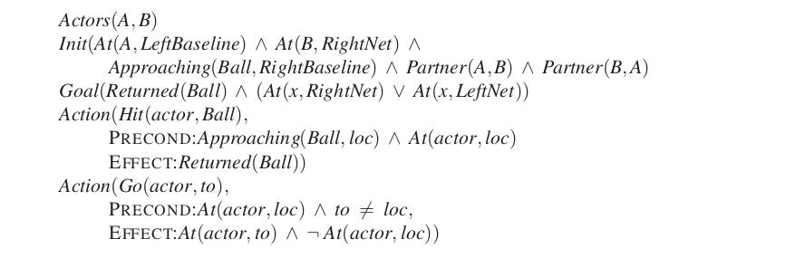
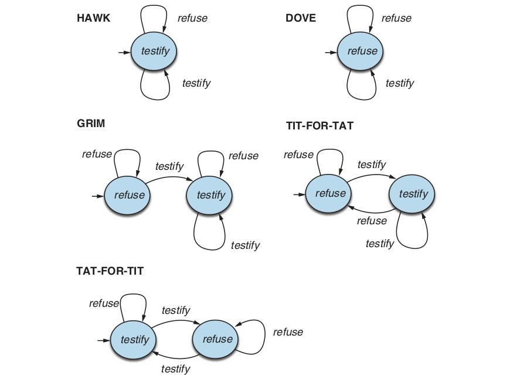
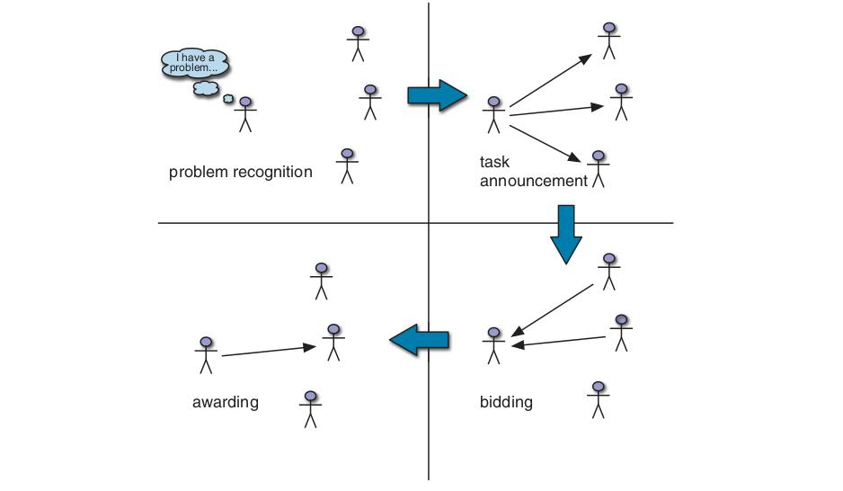

# فصل ۱۸ — تصمیم‌گیری چندعاملی

**فصل ۱۸: تصمیم‌گیری چندعاملی (Multiagent Decision Making)**

*در این فصل بررسی می‌کنیم وقتی بیش از یک عامل در محیط زندگی می‌کند چه باید کرد.*

## ۱۸.۱ ویژگی‌های محیط‌های چندعاملی

تاکنون، تا حد زیادی فرض کرده‌ایم فقط یک عامل حس‌کردن، برنامه‌ریزی و عمل‌کردن را انجام می‌دهد. اما این فرض ساده‌سازی عظیمی را بازنمایی می‌کند که بسیاری از محیط‌های هوش مصنوعی دنیای واقعی را در بر نمی‌گیرد. در این فصل، بنابراین، مسائل ناشی از تصمیم‌گیری عامل در محیط‌هایی که شامل چند کنشگرند را در نظر می‌گیریم. چنین محیط‌هایی «سامانه‌های چندعاملی» (Multiagent Systems) نامیده می‌شوند، و عامل‌های چنین سامانه‌ای با «مسئلهٔ برنامه‌ریزی چندعاملی» (Multiagent Planning Problem) روبه‌رویند. اما، چنان‌که خواهیم دید، ماهیت دقیق مسئلهٔ برنامه‌ریزی چندعاملی—و فنون مناسب حل آن—به روابط میان عامل‌های محیط بستگی خواهد داشت.

### ۱۸.۱.۱ تصمیم‌گیرندهٔ تکی

نخستین امکان این است که، در حالی که محیط شامل چند کنشگر است، فقط یک تصمیم‌گیرنده دارد. در چنین حالتی، تصمیم‌گیرنده برای عامل‌های دیگر برنامه توسعه می‌دهد و به آن‌ها می‌گوید چه کنند. فرض اینکه عامل‌ها صرفاً آنچه بدان‌ها گفته می‌شود انجام می‌دهند، «فرض عامل خیرخواه» (Benevolent Agent Assumption) نامیده می‌شود. اما حتی در این محیط، برنامه‌های شامل چند کنشگر، کنشگرها را ملزم به هم‌زمان‌سازی کنش‌هایشان می‌کند. کنشگرهای A و B باید هم‌زمان برای کنش‌های مشترک (مانند خواندن دونفره) عمل کنند، در زمان‌های متفاوت برای کنش‌های مانعةالجمع (مانند شارژ باتری‌ها وقتی فقط یک پریز هست)، و به‌صورت متوالی وقتی یکی پیش‌شرطی برای دیگری برقرار می‌کند (مانند شستن ظرف‌ها توسط A و سپس خشک‌کردن آن‌ها توسط B). حالت خاص، جایی است که تصمیم‌گیرندهٔ تکی با چند «اثرگر» (Effector) داریم که می‌توانند هم‌زمان عمل کنند—برای نمونه، انسانی که می‌تواند هم‌زمان راه برود و حرف بزند.

چنین عاملی باید «برنامه‌ریزی چنداثرگری» (Multieffector Planning) انجام دهد تا هر اثرگر را مدیریت کند و در عین حال تعامل‌های مثبت و منفی میان اثرگرها را مدیریت کند. وقتی اثرگرها از نظر فیزیکی به واحدهای جدا از هم گسسته شده‌اند—مانند ناوگانی از ربات‌های تحویل‌دهنده در کارخانه—برنامه‌ریزی چنداثرگری «برنامه‌ریزی چندبدنه» (Multibody Planning) می‌شود. مسئلهٔ چندبدنه‌ای همچنان مسئلهٔ «استاندارد» تک‌عاملی است تا زمانی که اطلاعات حسگر مربوط جمع‌آوری‌شده توسط هر بدنه بتواند—یا به‌صورت مرکزی یا درون هر بدنه—برای تشکیل برآورد مشترکی از حالت جهان جمع شود که سپس مبنای اجرای برنامهٔ کلی قرار می‌گیرد؛ در این صورت، می‌توان چند بدنه را چنان در نظر گرفت که گویی بدنهٔ تکی‌اند. وقتی قیدهای ارتباطی این را ناممکن می‌کنند، آنچه داریم گاهی «مسئلهٔ برنامه‌ریزی غیرمتمرکز» (Decentralized Planning) نامیده می‌شود؛ این شاید نام درستی نباشد، زیرا فاز برنامه‌ریزی متمرکز است اما فاز اجرا دست‌کم تا حدی از هم گسسته است. در این صورت، زیربرنامهٔ ساخته‌شده برای هر بدنه ممکن است لازم باشد شامل کنش‌های ارتباطی صریح با بدنه‌های دیگر باشد. برای نمونه، چند ربات شناسایی که منطقهٔ وسیعی را پوشش می‌دهند ممکن است اغلب از تماس رادیویی با یکدیگر خارج باشند و باید یافته‌هایشان را در زمان‌هایی که ارتباط ممکن است به اشتراک بگذارند.

### ۱۸.۱.۲ تصمیم‌گیرنده‌های متعدد

امکان دوم این است که کنشگران دیگر محیط نیز تصمیم‌گیرنده باشند: آن‌ها هر یک ترجیح‌هایی دارند و برنامهٔ خودشان را انتخاب و اجرا می‌کنند. آن‌ها را «همتایان» (Counterparts) می‌نامیم. در این صورت، دو امکان دیگر را می‌توانیم تمایز دهیم.

- نخستین این است که، اگرچه تصمیم‌گیرنده‌های متعددی هستند، همه «هدف مشترکی» (Common Goal) را دنبال می‌کنند. این تقریباً وضعیت کارکنان شرکت است، که در آن تصمیم‌گیرنده‌های مختلف، امیدواریم، همان اهداف را از جانب شرکت دنبال می‌کنند. مسئلهٔ اصلی پیش روی تصمیم‌گیرنده‌ها در این محیط «مسئلهٔ هماهنگی» (Coordination Problem) است: آن‌ها باید مطمئن شوند همه در یک جهت تلاش می‌کنند و تصادفاً برنامه‌های یکدیگر را خراب نمی‌کنند.
- امکان دوم این است که تصمیم‌گیرنده‌ها هر یک ترجیح‌های شخصی خودشان را دارند، که هر یک تا آن‌جا که بتوانند دنبالش می‌کنند. ممکن است ترجیح‌ها به‌صورت قطبی مخالف باشند، چنان‌که در بازی‌های جمع صفر مانند شطرنج هست (فصل ۵ را ببینید). اما بیشتر رویارویی‌های چندعاملی پیچیده‌تر از آن‌اند، با ترجیح‌های پیچیده‌تر. وقتی تصمیم‌گیرنده‌های متعدد، هر یک دنبال ترجیح‌های خودشان، هستند، عامل باید ترجیح‌های عامل‌های دیگر را در نظر بگیرد، و نیز این واقعیت را که آن عامل‌های دیگر نیز ترجیح‌های عامل‌های دیگر را در نظر می‌گیرند، و همین‌طور. این ما را به قلمرو «نظریهٔ بازی» (Game Theory) می‌آورد: نظریهٔ تصمیم‌گیری استراتژیک. همین جنبهٔ استراتژیک استدلال—این‌که هر بازیکن در نظر می‌گیرد بازیکنان دیگر ممکن است چگونه عمل کنند—است که نظریهٔ بازی را از نظریهٔ تصمیم متمایز می‌کند. همان‌گونه که نظریهٔ تصمیم شالودهٔ نظری تصمیم‌گیری در هوش مصنوعی تک‌عاملی را فراهم می‌کند، نظریهٔ بازی شالودهٔ نظری تصمیم‌گیری در سامانه‌های چندعاملی را فراهم می‌کند.

استفاده از واژهٔ «بازی» در این‌جا نیز ایده‌آل نیست: استنتاج طبیعی این است که نظریهٔ بازی عمدتاً به سرگرمی‌های تفریحی یا سناریوهای مصنوعی مربوط است. هیچ‌چیز دورتر از حقیقت نیست. نظریهٔ بازی نظریهٔ «تصمیم‌گیری استراتژیک» (Strategic Decision Making) است. در موقعیت‌های تصمیم‌گیری استفاده می‌شود، از جمله حراج حقوق حفاری نفت و حقوق طیف بسامد بی‌سیم، رسیدگی‌های ورشکستگی، توسعهٔ محصول و تصمیم‌های قیمت‌گذاری، و دفاع ملی—موقعیت‌هایی شامل میلیاردها دلار و جان انسان‌های بی‌شمار. نظریهٔ بازی در هوش مصنوعی به دو راه اصلی استفاده می‌شود:

۱. **طراحی عامل (Agent Design):** یک عامل می‌تواند از نظریهٔ بازی برای تحلیل تصمیم‌های ممکنش و محاسبهٔ مطلوبیت موردانتظار هر یک استفاده کند (تحت فرض اینکه عامل‌های دیگر عقلایی‌اند، طبق نظریهٔ بازی). بدین‌گونه، فنون نظریهٔ بازی می‌توانند بهترین استراتژی را در برابر بازیکن عقلایی و بازده موردانتظار هر بازیکن تعیین کنند.
۲. **طراحی سازوکار (Mechanism Design):** وقتی محیطی توسط عامل‌های بسیاری مسکون است، ممکن است بتوان قاعده‌های محیط (یعنی بازی‌ای که عامل‌ها باید بازی کنند) را طوری تعریف کرد که خیر جمعی همهٔ عامل‌ها بیشینه شود، وقتی هر عامل راه‌حل نظریه‌بازی بیشینه‌کنندهٔ مطلوبیت خودش را اتخاذ کند. برای نمونه، نظریهٔ بازی می‌تواند به طراحی پروتکل‌هایی برای مجموعه‌ای از مسیریاب‌های ترافیک اینترنت کمک کند به‌گونه‌ای که هر مسیریاب انگیزه‌ای برای عمل به شیوه‌ای داشته باشد که گذردهی سراسری بیشینه شود. طراحی سازوکار همچنین می‌تواند برای ساخت سامانه‌های چندعاملی هوشمندی استفاده شود که مسائل پیچیده را به‌صورت توزیع‌شده حل می‌کنند.

نظریهٔ بازی طیفی از مدل‌های متفاوت فراهم می‌کند، که هر یک مجموعه‌ای از مفروضات زیربنایی دارد؛ مهم است مدل درست برای هر محیط انتخاب شود. مهم‌ترین تمایز این است که آیا باید آن را «بازی همکارانه» (Cooperative Game) در نظر بگیریم یا نه:

- در بازی همکارانه، ممکن است «توافق الزام‌آور» (Binding Agreement) میان عامل‌ها وجود داشته باشد، که همکاری استوار را ممکن می‌کند. در جهان انسانی، قراردادهای حقوقی و هنجارهای اجتماعی به برقراری چنین توافق‌های الزام‌آوری کمک می‌کنند. در جهان برنامه‌های رایانه‌ای، ممکن است بتوان کد منبع را بازرسی کرد تا مطمئن شویم از توافقی پیروی خواهد کرد. از نظریهٔ بازی همکارانه برای تحلیل این وضعیت استفاده می‌کنیم.
- اگر توافق‌های الزام‌آور ممکن نباشند، «بازی غیرهمکارانه» (Non-Cooperative Game) داریم. اگرچه این اصطلاح پیشنهاد می‌کند بازی ذاتاً رقابتی است و همکاری ممکن نیست، لازم نیست چنین باشد: غیرهمکارانه صرفاً بدان معناست که هیچ توافق الزام‌آور مرکزی‌ای وجود ندارد که همهٔ عامل‌ها را متعهد کند و همکاری را تضمین نماید. اما به‌خوبی ممکن است عامل‌ها مستقلانه تصمیم به همکاری بگیرند، زیرا به نفع خودشان است.

از نظریهٔ بازی غیرهمکارانه برای تحلیل این وضعیت استفاده می‌کنیم.

برخی محیط‌ها چند بُعد متفاوت را ترکیب می‌کنند. برای نمونه، شرکت تحویل بسته ممکن است برنامه‌ریزی متمرکز و آفلاینی برای مسیرهای کامیون‌ها و هواپیماهایش هر روز انجام دهد، اما برخی جنبه‌ها را برای تصمیم‌های خودمختار رانندگان و خلبانان باز بگذارد، که می‌توانند فرداً به موقعیت‌های ترافیکی و آب‌وهوایی پاسخ دهند. همچنین، هدف‌های شرکت و کارکنانش، تا حدی، با پرداخت «مشوق‌ها» (Incentives) (حقوق و پاداش‌ها) هم‌راستا می‌شوند—نشانهٔ قطعی اینکه این سامانهٔ چندعاملی واقعی است.

### ۱۸.۱.۳ برنامه‌ریزی چندعاملی

فعلاً، محیط‌های چنداثرگری، چندبدنه‌ای و چندعاملی را یکسان در نظر می‌گیریم و آن‌ها را به‌صورت عمومی محیط‌های «چندکنشگری» (Multiactor) برچسب‌گذاری می‌کنیم، و از اصطلاح عمومی «کنشگر» (Actor) برای پوشش اثرگرها، بدنه‌ها و عامل‌ها استفاده می‌کنیم. هدف این بخش تبیین چگونگی تعریف مدل‌های انتقال، برنامه‌های درست و الگوریتم‌های برنامه‌ریزی کارآمد برای محیط چندکنشگری است.

برنامهٔ درست برنامه‌ای است که، اگر توسط کنشگرها اجرا شود، به هدف برسد. (در محیط واقعاً چندعاملی، البته، عامل‌ها ممکن است موافق اجرای هیچ برنامهٔ خاصی نباشند، اما دست‌کم خواهند دانست چه برنامه‌هایی اگر موافق اجرایشان بودند کار می‌کرد.) دشواری کلیدی در تلاش برای ارائهٔ مدل رضایت‌بخشی از کنش چندعاملی این است که باید به نحوی با مسئلهٔ دشوار «هم‌زمانی» (Concurrency) کنار بیاییم، که صرفاً بدان معناست برنامه‌های هر عامل ممکن است هم‌زمان اجرا شوند. اگر بخواهیم دربارهٔ اجرای برنامه‌های چندکنشگری استدلال کنیم، نخست به مدلی از برنامه‌های چندکنشگری نیاز خواهیم داشت که مدل رضایت‌بخشی از کنش هم‌زمان را در بر داشته باشد.

علاوه بر این، کنش چندکنشگری مجموعه‌ای کامل از مسائل را برمی‌انگیزد که در برنامه‌ریزی تک‌عاملی دغدغه نیستند. به‌طور خاص، عامل‌ها باید شیوه‌ای را در نظر بگیرند که کنش‌های خودشان با کنش‌های عامل‌های دیگر تعامل می‌کند. برای نمونه، عامل باید در نظر بگیرد آیا کنش‌های انجام‌شده توسط عامل‌های دیگر ممکن است پیش‌شرط‌های کنش‌های خودش را خراب کنند، آیا منابعی که هنگام اجرای سیاستش استفاده می‌کند قابل اشتراک‌اند یا ممکن است توسط عامل‌های دیگر تهی شوند؛ آیا کنش‌ها مانعةالجمع‌اند؛ و عامل مایل به کمک می‌تواند در نظر بگیرد چگونه کنش‌هایش ممکن است کنش‌های دیگران را تسهیل کند.

برای پاسخ به این پرسش‌ها به مدلی از کنش هم‌زمان نیاز داریم که بتوانیم مسائل را درون آن به‌درستی صورت‌بندی کنیم. مدل‌های کنش هم‌زمان دهه‌ها کانون اصلی پژوهش در جامعهٔ اصلی علوم رایانه بوده‌اند، اما هیچ مدل قطعی و پذیرفته‌شدهٔ همگانی‌ای غالب نشده. با این وجود، سه رویکرد زیر به‌طور گسترده تثبیت شده‌اند. رویکرد نخست در نظرگرفتن «اجرای میان‌لایه‌ای» (Interleaved Execution) کنش‌ها در برنامه‌های مربوط است. برای نمونه، فرض کنیم دو عامل، A و B، با برنامه‌های زیر داریم:

```
A: [حرکت(A, راست), ضربه(A, توپ)]
B: [بی‌عمل(B), بی‌عمل(B)]
```

اجرای میان‌لایه‌ای این برنامه‌ها به دنباله‌های کنش [A1, B1, A2, B2] یا [A1, A2, B1, B2] یا هر ترتیب دیگری که هر برنامه حفظ شود می‌انجامد. این رویکرد ساده این مزیت را دارد که می‌توان از آن با تکنیک‌های برنامه‌ریزی کلاسیک استفاده کرد، و به‌صورت صریح مشکل هم‌زمانی را با ممنوع‌کردن هر کنش هم‌زمانی حذف می‌کند. اما عیب آشکاری دارد: بعضی کنش‌ها در دنیای واقعی فقط در صورتی کار می‌کنند که هم‌زمان اجرا شوند. برای نمونه، «سواری‌کردن» توسط A بر «نگه‌داشتن» توسط B فقط وقتی کار می‌کند که A و B هم‌زمان عمل کنند. رویکرد دوم، رویکرد «هم‌زمانی هم‌زمان» است: در هر «گام زمانی» t، همهٔ کنشگرها کنش‌های خود را هم‌زمان انتخاب می‌کنند. این به درخت بازی هم‌زمانی منتهی می‌شود که در آن ضریب انشعاب، حاصل‌ضرب تعداد کنش‌های هر کنشگر است. رویکرد سوم مدل «هم‌زمانی جزئی» (Partial Concurrency) است: برای کنشگرها مشخص می‌کنیم کدام کنش‌ها باید هم‌زمان شروع شوند، کدام باید به‌صورت ترتیبی اجرا شوند، کدام‌ها می‌توانند با هم اجرا شوند اما لازم نیست، و مانند آن.

با کنار هم گذاشتن کنشگرها در سامانهٔ چندکنشگری با ضریب انشعاب عظیم، کانون اصلی پژوهش برنامه‌ریزی چندکنشگری جداسازی کنشگرها تا آن‌جا که ممکن بوده، به‌گونه‌ای که (ایده‌آل‌تر) پیچیدگی مسئله به‌صورت خطی با n رشد کند نه نمایی با bⁿ. اگر کنشگرها هیچ تعاملی با یکدیگر نداشته باشند—برای نمونه، n کنشگر که هر یک بازی ورق تکی بازی می‌کنند—آن‌گاه می‌توانیم به‌سادگی n مسئلهٔ جداگانه حل کنیم. اگر کنشگرها «سست‌جفت» (Loosely Coupled) باشند، آیا می‌توانیم به چیزی نزدیک این بهبود نمایی برسیم؟ این، البته، پرسش مرکزی در بسیاری از حوزه‌های هوش مصنوعی است. روش‌های موفق حل را برای سامانه‌های سست‌جفت در بافت CSPها دیده‌ایم، جایی که گراف‌های قید «درخت‌مانند» روش‌های حل کارآمد می‌دادند (صفحهٔ ۲۰۲)، و نیز در بافت پایگاه‌های دادهٔ الگوی مجزا (صفحهٔ ۱۰۰) و اکتشافی‌های افزایشی برای برنامه‌ریزی (صفحهٔ ۳۵۶).

رویکرد استاندارد به مسائل سست‌جفت این است که وانمود کنیم مسائل کاملاً از هم جدا شده‌اند و سپس تعامل‌ها را اصلاح کنیم. برای مدل انتقال، این به معنای نوشتن طرح‌های کنش چنان است که گویی کنشگرها مستقل عمل می‌کنند.

ببینیم این برای بازی تنیس دونفره چگونه کار می‌کند. در این‌جا، دو بازیکن تنیس انسانی داریم که تیم دونفره‌ای را با هدف مشترک بردن مسابقه در برابر تیم حریف تشکیل می‌دهند. فرض کنیم در نقطه‌ای از بازی، تیم هدف برگرداندن توپی را دارد که به سویشان زده شده و تضمین اینکه دست‌کم یکی از آن‌ها جلوی تور را پوشش می‌دهد.



**شکل ۱۸.۱ — مسئلهٔ تنیس دونفره. (شرایط اولیه، هدف و طرح‌های کنش برای دو بازیکن A و B؛ هدف: Returned(Ball) ∧ (At(A,LeftNet) ∨ At(B,LeftNet)).)**

به‌آسانی دیده می‌شود با «برنامهٔ مشترک» (Joint Plan) دوا‌گامی که مشخص می‌کند هر بازیکن چه باید بکند می‌توانیم از شرایط اولیه به هدف برسیم: A باید به خط پایانی راست برود و توپ را بزند، در حالی که B باید سر تور بماند:

```
برنامه ۱: A : [Go(A, RightBaseline), Hit(A, Ball)]
          B : [NoOp(B), NoOp(B)]
```

با این حال، وقتی برنامه‌ای حکم می‌کند هر دو عامل هم‌زمان به توپ بزنند، مسائل پیش می‌آیند. در دنیای واقعی، این کار نخواهد کرد، اما طرح کنش Hit می‌گوید توپ با موفقیت برگردانده می‌شود. دشواری این است که پیش‌شرط‌ها حالتی را قید می‌کنند که در آن کنش به‌تنهایی می‌تواند با موفقیت اجرا شود، اما کنش‌های هم‌زمان دیگری را که ممکن است خرابش کنند قید نمی‌کنند. این مسئله را با تقویت طرح‌های کنش با یک ویژگی تازه حل می‌کنیم: «قید کنش هم‌زمان» (Concurrent Action Constraint) که بیان می‌کند کدام کنش‌ها باید یا نباید هم‌زمان اجرا شوند. برای نمونه، کنش Hit را می‌توان چنین توصیف کرد:

```
Action(Hit(actor, Ball),
  CONCURRENT: ∀b (b ≠ actor ⇒ ¬Hit(b, Ball))
  PRECOND: Approaching(Ball, loc) ∧ At(actor, loc)
  EFFECT: Returned(Ball))
```

به بیان دیگر، کنش Hit اثر بیان‌شده‌اش را فقط اگر هیچ کنش Hit دیگری توسط عامل دیگر در همان زمان رخ ندهد دارد. (در رویکرد SATPLAN، این با اصل موضوعهٔ حذف جزئی کنش مدیریت می‌شد.) برای برخی کنش‌ها، اثر موردنظر فقط وقتی حاصل می‌شود که کنش دیگری هم‌زمان رخ دهد. برای نمونه، دو عامل برای حمل کولری پر از نوشیدنی به زمین تنیس لازم‌اند:

```
Action(Carry(actor, cooler, here, there),
  CONCURRENT: ∃b (b ≠ actor ∧ Carry(b, cooler, here, there))
  PRECOND: At(actor, here) ∧ At(cooler, here) ∧ Cooler(cooler)
  EFFECT: At(actor, there) ∧ At(cooler, there) ∧ ¬At(actor, here) ∧ ¬At(cooler, here))
```

با این نوع طرح‌های کنش، هر یک از الگوریتم‌های برنامه‌ریزی توصیف‌شده در فصل ۱۱ را می‌توان با اصلاح‌های کوچکی برای تولید برنامه‌های چندکنشگری سازگار کرد. تا آن‌جا که جفت‌شدگی میان زیربرنامه‌ها سست است—به این معنا که قیدهای هم‌زمانی فقط به‌ندرت در طول جستجوی برنامه به کار می‌آیند—انتظار می‌رود اکتشافی‌های گوناگون اشتقاق‌شده برای برنامه‌ریزی تک‌عاملی در بافت چندکنشگری نیز مؤثر باشند.

### ۱۸.۱.۴ برنامه‌ریزی با عامل‌های متعدد: همکاری و هماهنگی

حالا محیط واقعاً چندعاملی را در نظر بگیریم که در آن هر عامل برنامهٔ خودش را می‌سازد. برای شروع، فرض کنیم هدف‌ها و پایگاه دانش مشترک‌اند. ممکن است فکر کنیم این به حالت چندبدنه‌ای کاهش می‌یابد—هر عامل به‌سادگی راه‌حل مشترک را محاسبه و بخش خودش از آن راه‌حل را اجرا می‌کند. افسوس، وجود حرف تعریف («the») در «راه‌حل مشترک» گمراه‌کننده است [زیرا ممکن است بیش از یک راه‌حل وجود داشته باشد]. این‌جا برنامهٔ دومی است که آن نیز به هدف می‌رسد:

```
برنامه ۲: A : [Go(A, LeftNet), NoOp(A)]
          B : [Go(B, RightBaseline), Hit(B, Ball)]
```

اگر هر دو عامل بتوانند بر برنامهٔ 1 یا برنامهٔ 2 توافق کنند، هدف محقق می‌شود. اما اگر A برنامهٔ 2 و B برنامهٔ 1 را انتخاب کند، آن‌گاه هیچ‌کس توپ را برنخواهد گرداند. برعکس، اگر A برنامهٔ 1 و B برنامهٔ 2 را انتخاب کند، آن‌گاه هر دو سعی می‌کنند به توپ بزنند و آن نیز شکست خواهد خورد. عامل‌ها این را می‌دانند، اما چگونه می‌توانند هماهنگ شوند تا مطمئن شوند بر برنامه توافق می‌کنند؟

یکی از گزینه‌ها اتخاذ «قرارداد» (Convention) قبل از درگیرشدن در فعالیت مشترک است. قرارداد هر قیدی بر انتخاب برنامه‌های مشترک است. برای نمونه، قرارداد «به سمت خودت بچسب» برنامهٔ 1 را رد می‌کرد و باعث می‌شد هر دو شریک برنامهٔ 2 را انتخاب کنند. رانندگان در جاده با مسئلهٔ برخورد نکردن با یکدیگر روبه‌رویند؛ این (تا حدی) با اتخاذ قرارداد «در سمت راست جاده بمان» در بیشتر کشورها حل می‌شود؛ جایگزین، «در سمت چپ بمان»، به‌همان خوبی کار می‌کند تا زمانی که همهٔ عامل‌های محیط موافق‌اند.

ملاحظات مشابهی برای توسعهٔ زبان انسانی صدق می‌کند، جایی که نکتهٔ مهم این نیست هر فرد چه زبانی باید صحبت کند، بلکه این واقعیت است که جامعه‌ای همه یک زبان صحبت می‌کنند. وقتی قراردادها فراگیر می‌شوند، «قوانین اجتماعی» (Social Laws) نامیده می‌شوند.

در غیاب قرارداد، عامل‌ها می‌توانند از ارتباط برای دستیابی به دانش مشترک یک برنامهٔ مشترک شدنی استفاده کنند. برای نمونه، بازیکن تنیس می‌تواند فریاد بزند «مال من!» یا «مال تو!» تا برنامهٔ مشترک ترجیحی را نشان دهد. ارتباط لزوماً شامل تبادل کلامی نیست. برای نمونه، یک بازیکن می‌تواند برنامهٔ مشترک ترجیحی را به دیگری صرفاً با اجرای بخش نخست آن ارتباط دهد. اگر عامل A به سمت تور برود، آن‌گاه عامل B موظف است به خط پایانی برگردد تا توپ را بزند، زیرا برنامهٔ 2 تنها برنامهٔ مشترکی است که با رفتن A به سمت تور آغاز می‌شود. این رویکرد هماهنگی، که گاهی «بازشناسی برنامه» (Plan Recognition) نامیده می‌شود، وقتی کار می‌کند که کنش تکی (یا توالی کوتاهی از کنش‌ها) توسط یک عامل برای تعیین بدون ابهام برنامهٔ مشترک توسط دیگری کافی باشد.

## ۱۸.۲ نظریهٔ بازی غیرهمکارانه

حالا مفاهیم کلیدی و فنون تحلیلی نظریهٔ بازی را معرفی می‌کنیم—نظریه‌ای که زیربنای تصمیم‌گیری در محیط‌های چندعاملی است. گشت ما با نظریهٔ بازی غیرهمکارانه شروع می‌شود.

### ۱۸.۲.۱ بازی‌های با حرکت تکی: بازی‌های شکل نرمال

نخستین مدل بازی که به آن نگاه می‌کنیم، بازی‌ای است که در آن همهٔ بازیکنان هم‌زمان کنش می‌گیرند و نتیجهٔ بازی بر اساس «نمایهٔ کنش‌هایی» (Profile of Actions) است که بدین‌گونه انتخاب می‌شوند. (در واقع، هم‌زمان‌بودن کنش‌ها حیاتی نیست؛ مهم این است هیچ بازیکنی از انتخاب‌های بازیکنان دیگر آگاهی ندارد.) این بازی‌ها «بازی‌های شکل نرمال» (Normal Form Games) نامیده می‌شوند. بازی شکل نرمال با سه مؤلفه تعریف می‌شود:

- «بازیکنان» (Players) یا عامل‌هایی که تصمیم خواهند گرفت. بازی‌های دونفره بیشترین توجه را دریافت کرده‌اند، هرچند بازی‌های n-نفره برای n > 2 نیز رایج‌اند. به بازیکنان نام‌های با حرف بزرگ می‌دهیم، مانند علی و بو یا O و E.
- «کنش‌هایی» (Actions) که بازیکنان می‌توانند انتخاب کنند. به کنش‌ها نام‌های با حرف کوچک می‌دهیم، مانند one یا testify. بازیکنان ممکن است مجموعهٔ کنش‌های یکسانی داشته باشند یا نه.
- «تابع بازدهی» (Payoff Function) که مطلوبیت را به هر بازیکن برای هر ترکیب کنش توسط همهٔ بازیکنان می‌دهد. برای بازی‌های دونفره، تابع بازدهی برای بازیکنی را می‌توان با ماتریسی بازنمایی کرد که در آن برای هر کنش ممکن یک بازیکن ردیفی و برای هر انتخاب ممکن بازیکن دیگر ستونی هست: ردیف انتخاب‌شده و ستون انتخاب‌شده سلولی از ماتریس را تعریف می‌کنند، که با بازدهی بازیکن مربوط برچسب‌گذاری می‌شود. در حالت دونفره، مرسوم است دو ماتریس در «ماتریس بازدهی» (Payoff Matrix) تکی ترکیب شوند، که در آن هر سلول با بازدهی‌های هر دو بازیکن برچسب‌گذاری می‌شود.

برای نشان‌دادن این ایده‌ها، به بازی نمونه‌ای به نام «مورای دوانگشتی» (Two-Finger Morra) نگاه کنیم. در این بازی، دو بازیکن، O و E، هم‌زمان یک یا دو انگشت نشان می‌دهند. فرض کنیم شمار کل انگشتان نشان‌داده‌شده f باشد. اگر f فرد باشد، O از E به اندازهٔ f دلار دریافت می‌کند؛ و اگر f زوج باشد، E از O به اندازهٔ f دلار دریافت می‌کند.¹ ماتریس بازدهی برای مورای دوانگشتی به‌صورت زیر است:

| | O: یک | O: دو |
|---|---|---|
| **E: یک** | E = +2، O = −2 | E = −3، O = +3 |
| **E: دو** | E = −3، O = +3 | E = +4، O = −4 |

می‌گوییم E «بازیکن ردیف» (Row Player) و O «بازیکن ستون» (Column Player) است. پس، برای نمونه، گوشهٔ پایین-راست نشان می‌دهد وقتی بازیکن O کنش two و E نیز two را انتخاب می‌کند، بازدهی +4 برای E و −4 برای O است. قبل از تحلیل مورای دوانگشتی، ارزش دارد در نظر بگیریم اصلاً چرا به ایده‌های نظریهٔ بازی نیاز است: چرا نمی‌توانیم چالش پیش روی (مثلاً) بازیکن E را با ابزار نظریهٔ تصمیم و بیشینه‌سازی مطلوبیت که در جای دیگر کتاب استفاده کرده‌ایم حل کنیم؟ برای دیدن اینکه چرا چیز دیگری لازم است، فرض کنیم E در تلاش برای یافتن بهترین کنش است.

جایگزین‌ها one یا two هستند. اگر E one را انتخاب کند، بازدهی یا +2 خواهد بود یا −3. اینکه E در واقع کدام بازدهی را دریافت کند، با این حال، به انتخاب O بستگی خواهد داشت: بیشترین کاری که E، به‌عنوان بازیکن ردیف، می‌تواند بکند این است که پیامد بازی را مجبور کند در ردیف خاصی باشد. به‌طور مشابه، O فقط ستون را انتخاب می‌کند.

برای انتخاب بهینه میان این امکان‌ها، E باید در نظر بگیرد O به‌عنوان تصمیم‌گیرندهٔ عقلایی چگونه عمل خواهد کرد. اما O، به‌نوبهٔ خود، باید این واقعیت را در نظر بگیرد که E تصمیم‌گیرندهٔ عقلایی است. بدین‌ترتیب، تصمیم‌گیری در محیط‌های چندعاملی از نظر شخصیت کاملاً با تصمیم‌گیری در محیط‌های تک‌عاملی متفاوت است، زیرا بازیکنان باید استدلال یکدیگر را در نظر بگیرند. نقش «مفاهیم راه‌حل» (Solution Concepts) در نظریهٔ بازی دقیق‌کردن این نوع استدلال است.

اصطلاح «استراتژی» (Strategy) در نظریهٔ بازی برای نشان‌دادن آنچه قبلاً «سیاست» می‌نامیدیم استفاده می‌شود. «استراتژی خالص» (Pure Strategy) سیاست جبرگرایانه است؛ برای بازی تک‌حرکتی، استراتژی خالص فقط یک کنش است. چنان‌که در زیر خواهیم دید، برای بسیاری از بازی‌ها عامل می‌تواند با «استراتژی ترکیبی» (Mixed Strategy) بهتر عمل کند، که سیاست تصادفی‌شده‌ای است که کنش‌ها را طبق توزیع احتمالی انتخاب می‌کند. استراتژی ترکیبی که کنش a را با احتمال p و کنش b را در غیر این صورت انتخاب می‌کند، به‌صورت [p:a; (1−p):b] نوشته می‌شود. برای نمونه، استراتژی ترکیبی برای مورای دوانگشتی ممکن است [0.5:one; 0.5:two] باشد. «نمایهٔ استراتژی» (Strategy Profile) تخصیص استراتژی به هر بازیکن است؛ با توجه به نمایهٔ استراتژی، پیامد بازی مقدار عددی برای هر بازیکن است—اگر بازیکنان از استراتژی‌های ترکیبی استفاده کنند، باید از مطلوبیت موردانتظار استفاده کنیم.

پس عامل‌ها در بازی‌هایی مانند مورا چگونه باید تصمیم بگیرند؟ نظریهٔ بازی طیفی از مفاهیم راه‌حل فراهم می‌کند که تلاش می‌کنند کنش عقلایی را نسبت به باورهای عامل دربارهٔ باورهای عامل دیگر تعریف کنند. متأسفانه، هیچ مفهوم راه‌حل کاملی نیست: تعریف اینکه «عقلایی» وقتی هر عامل فقط بخشی از نمایهٔ استراتژی تعیین‌کنندهٔ پیامد را انتخاب می‌کند به چه معناست، مسئله‌دار است.

نخستین مفهوم راه‌حل‌مان را از طریق احتمالاً مشهورترین بازی در قانون نظریهٔ بازی معرفی می‌کنیم—«دوراهی زندانی» (Prisoner's Dilemma). این بازی با داستان زیر انگیزه‌مند می‌شود: دو سارق متهم، علی و بو، نزدیک صحنهٔ سرقتی دستگیر شده‌اند و جداگانه بازجویی می‌شوند. دادستانی به هر یک معامله‌ای پیشنهاد می‌کند: اگر علیه شریکت به‌عنوان رهبر باند سرقت شهادت دهی، برای همکاری‌کردن آزاد می‌شوی، در حالی که شریکت ۱۰ سال زندان خواهد کرد. با این حال، اگر هر دو علیه یکدیگر شهادت دهید، هر دو ۵ سال می‌گیرید. علی و بو همچنین می‌دانند اگر هر دو از شهادت امتناع کنند، فقط ۱ سال برای اتهام سبک‌تر داشتن اموال مسروقه می‌گیرند. حالا علی و بو با به‌اصطلاح دوراهی زندانی روبه‌رویند: باید شهادت بدهند یا امتناع کنند؟ به‌عنوان عامل‌های عقلایی، علی و بو هر یک می‌خواهند مطلوبیت موردانتظار خودشان را بیشینه کنند، یعنی شمار سال‌های زندان را کمینه کنند—هر یک نسبت به رفاه بازیکن دیگر بی‌تفاوت است. دوراهی زندانی در ماتریس بازدهی زیر در بر گرفته می‌شود:

| | علی: شهادت | علی: امتناع |
|---|---|---|
| **بو: شهادت** | A = −5، B = −5 | A = −10، B = 0 |
| **بو: امتناع** | A = 0، B = −10 | A = −1، B = −1 |

(اعداد منفی سال‌های زندان‌اند.) به‌سادگی دیده می‌شود شهادت‌دادن «استراتژی مسلط» (Dominant Strategy) برای هر دو بازیکن است: استراتژی‌ای که بدون توجه به انتخاب بازیکن دیگر بهترین بازدهی را می‌دهد. برای علی، اگر بو شهادت دهد، علی با شهادت −5 و با امتناع −10 می‌گیرد؛ اگر بو امتناع کند، علی با شهادت 0 و با امتناع −1 می‌گیرد. پس در هر دو حالت شهادت بهتر است.

در وضعیتی مانند این، که همهٔ بازیکنان استراتژی مسلط انتخاب می‌کنند، به پیامد حاصل «تعادل استراتژی مسلط» (Dominant Strategy Equilibrium) گفته می‌شود. «تعادل» است، زیرا هیچ بازیکنی انگیزه‌ای برای انحراف از بخش خودش از آن ندارد: طبق تعریف، اگر انحراف می‌کرد، نمی‌توانست بهتر عمل کند و ممکن بود بدتر عمل کند. از این نظر، تعادل استراتژی مسلط مفهوم راه‌حل بسیار قوی‌ای است. با بازگشت به دوراهی زندانی، می‌بینیم دوراهی این است که پیامد تعادل استراتژی مسلط، که در آن هر دو بازیکن شهادت می‌دهند، برای هر دو بازیکن بدتر از پیامدی است که اگر هر دو امتناع می‌کردند می‌گرفتند. پیامد (امتناع، امتناع) به هر دو بازیکن فقط یک سال زندان می‌داد، که برای هر دویشان بهتر از ۵ سالی بود که هر یک اگر تعادل استراتژی مسلط را انتخاب می‌کردند می‌گرفتند.

آیا راهی برای رسیدن علی و بو به پیامد (امتناع، امتناع) هست؟ قطعاً برای هر دو گزینهٔ مجاز امتناع از شهادت هست، اما سخت است ببینیم عامل‌های عقلایی چگونه می‌توانستند این انتخاب را بکنند، با توجه به نحوهٔ چیدمان بازی. به یاد آورید این بازی غیرهمکارانه است: آن‌ها اجازه ندارند با یکدیگر حرف بزنند، پس نمی‌توانند توافق الزام‌آوری برای امتناع بکنند. اما اگر بازی را تغییر دهیم، ممکن است به راه‌حل (امتناع، امتناع) رسید. می‌توانستیم آن را به بازی همکارانه‌ای تغییر دهیم که در آن عامل‌ها اجازه دارند توافق الزام‌آور تشکیل دهند. یا می‌توانستیم به بازی تکراری تغییر دهیم که در آن بازیکنان می‌دانند دوباره همدیگر را خواهند دید—خواهیم دید این چگونه کار می‌کند. یا، بازیکنان ممکن است باورهای اخلاقی‌ای داشته باشند که همکاری و انصاف را تشویق می‌کند. اما آن بدان معنا بود توابع مطلوبیت متفاوتی دارند، و باز، بازی متفاوتی بازی می‌کردند.

حضور استراتژی مسلط برای بازیکن خاصی فرایند تصمیم‌گیری را برای آن بازیکن بسیار ساده می‌کند. وقتی علی دریافته شهادت‌دادن استراتژی مسلط است، نیازی به صرف تلاش برای فهمیدن اینکه بو چه خواهد کرد ندارد، زیرا می‌داند مهم نیست بو چه کند، شهادت‌دادن بهترین «پاسخ» (Best Response) او خواهد بود. اما بیشتر بازی‌ها نه استراتژی مسلط دارند و نه تعادل استراتژی مسلط. نادر است استراتژی تکی بهترین پاسخ به همهٔ استراتژی‌های ممکن همتایان باشد.

مفهوم راه‌حل بعدی که در نظر می‌گیریم ضعیف‌تر از تعادل استراتژی مسلط است، اما بسیار گسترده‌تر قابل اعمال است. «تعادل نش» (Nash Equilibrium) نامیده می‌شود، به نام جان فوربس نش کوچک (۲۰۱۵–۱۹۲۸)، که آن را در پایان‌نامهٔ دکترای ۱۹۵۰ خود مطالعه کرد—کاری که برایش در ۱۹۹۴ جایزهٔ نوبل دریافت کرد.

نمایهٔ استراتژی تعادل نش است اگر هیچ بازیکنی نتواند یک‌جانبه استراتژی‌اش را تغییر دهد و در نتیجه بازدهی بالاتری دریافت کند، تحت فرض اینکه بازیکنان دیگر در انتخاب‌های استراتژی‌شان ماندند. بدین‌ترتیب، در تعادل نش، هر بازیکن هم‌زمان در حال بازی بهترین پاسخ به انتخاب‌های همتایانش است. تعادل نش نقطهٔ پایداری در بازی را بازنمایی می‌کند: پایدار به این معنا که هیچ انگیزهٔ عقلایی‌ای برای هیچ بازیکنی به انحراف نیست. با این حال، تعادل‌های نش نقاط پایدار محلی‌اند: چنان‌که خواهیم دید، بازی ممکن است شامل چند تعادل نش باشد. چون استراتژی مسلط بهترین پاسخ به همهٔ استراتژی‌های همتایان است، نتیجه می‌شود هر تعادل استراتژی مسلطی باید تعادل نش نیز باشد (تمرین ۱۸.EQIB). در دوراهی زندانی، بنابراین، تعادل استراتژی مسلط یکتایی هست، که آن نیز تعادل نش یکتاست.

بازی نمونهٔ زیر نشان می‌دهد، نخست، گاهی بازی‌ها هیچ استراتژی مسلطی ندارند، و دوم، برخی بازی‌ها چند تعادل نش دارند.

| | علی: چپ (l) | علی: راست (r) |
|---|---|---|
| **بو: بالا (t)** | A = 10، B = 10 | A = 0، B = 0 |
| **بو: پایین (b)** | A = 0، B = 0 | A = 1، B = 1 |

به‌آسانی قابل بررسی است در این بازی برای هیچ بازیکنی استراتژی مسلط نیست، و از این رو تعادل استراتژی مسلطی نیست. با این حال، نمایه‌های استراتژی (t,l) و (b,r) هر دو تعادل نش‌اند. حالا، بدیهی است در راستای منافع هر دو عامل است که هدف همان تعادل نش را بگیرند—یا (t,l) یا (b,r)—اما چون در قلمرو نظریهٔ بازی غیرهمکارانه‌ایم، بازیکنان باید انتخاب‌هایشان را مستقلانه، بدون هیچ دانشی از انتخاب‌های دیگران و بدون هیچ راهی برای توافق با آن‌ها، انجام دهند. این نمونه‌ای از مسئلهٔ هماهنگی است: بازیکنان می‌خواهند کنش‌هایشان را به‌صورت سراسری هماهنگ کنند، به‌گونه‌ای که هر دو کنش‌هایی انتخاب کنند که به همان تعادل می‌انجامد، اما باید فقط با تصمیم‌گیری محلی این کار را بکنند. شماری از رویکردها برای حل مسائل هماهنگی پیشنهاد شده. یکی از ایده‌ها «نقاط کانونی» (Focal Points) است. نقطهٔ کانونی در بازی پیامدی است که به نحوی برای بازیکنان به‌عنوان پیامد «بدیهی» که انتخاب‌هایشان را روی آن هماهنگ کنند برجسته می‌شود. این البته تعریف دقیقی نیست—معنایش به بازی مورد نظر بستگی خواهد داشت. در مثال بالا، با این حال، یک نقطهٔ کانونی بدیهی هست: پیامد (t,l) به هر دو بازیکن مطلوبیت به‌طور قابل‌توجهی بالاتری از آنچه اگر روی (b,r) هماهنگ می‌شدند می‌داد. از دیدگاه نظریهٔ بازی، هر دو پیامد تعادل نش‌اند—اما واقعاً بازیکن منحرفی می‌بود که انتظار هماهنگی بر (b,r) را داشته باشد.

برخی بازی‌ها در استراتژی‌های خالص هیچ تعادل نشی ندارند، چنان‌که بازی زیر به نام «پنی‌های هم‌خوان» (Matching Pennies) نشان می‌دهد. در این بازی، علی و بو هم‌زمان یک سمت سکه را انتخاب می‌کنند، رو یا پشت: اگر انتخاب‌های یکسانی بکنند، بو ۱ دلار به علی می‌دهد، در حالی که اگر انتخاب‌های متفاوتی بکنند، علی ۱ دلار به بو می‌دهد:

| | علی: رو | علی: پشت |
|---|---|---|
| **بو: رو** | A = 1، B = −1 | A = −1، B = 1 |
| **بو: پشت** | A = −1، B = 1 | A = 1، B = −1 |

از خواننده دعوت می‌کنیم بررسی کند بازی هیچ استراتژی مسلطی ندارد، و هیچ پیامدی تعادل نش در استراتژی‌های خالص نیست: در هر پیامد، یک بازیکن از انتخابش پشیمان است و ترجیح می‌داد با توجه به انتخاب بازیکن دیگر متفاوت انتخاب کرده باشد.

برای یافتن تعادل نش، حقه استفاده از استراتژی‌های ترکیبی است—اجازه‌دادن به بازیکنان برای تصادفی‌کردن انتخاب‌هایشان. نش اثبات کرد هر بازی دست‌کم یک تعادل نش در استراتژی‌های ترکیبی دارد. این توضیح می‌دهد چرا تعادل نش چنین مفهوم راه‌حل مهمی است: مفاهیم راه‌حل دیگر، مانند تعادل استراتژی مسلط، برای هر بازی تضمین‌شده وجود ندارند، اما اگر به دنبال تعادل‌های نش با استراتژی‌های ترکیبی باشیم همیشه راه‌حل می‌گیریم.

در مورد پنی‌های هم‌خوان، تعادل نش در استراتژی‌های ترکیبی داریم اگر هر دو بازیکن رو و پشت را با احتمال برابر انتخاب کنند. برای دیدن اینکه این پیامد در واقع تعادل نش است، فرض کنیم یکی از بازیکنان پیامدی را با احتمالی غیر از 0.5 انتخاب کرد. آن‌گاه بازیکن دیگر می‌توانست از آن بهره‌برداری کند، با گذاشتن تمام وزنش پشت استراتژی خاصی. برای نمونه، فرض کنیم بو رو را با احتمال 0.6 بازی کند (و بنابراین پشت را با احتمال 0.4). آن‌گاه علی بهترین کارش را با بازی قطعی رو می‌کرد. سپس به‌آسانی دیده می‌شود بو با بازی رو با احتمال 0.6 نمی‌توانست بخشی از هیچ تعادل نشی باشد.

### ۱۸.۲.۲ رفاه اجتماعی

دیدگاه اصلی در نظریهٔ بازی دیدگاه بازیکنان درون بازی است، که می‌کوشند بهترین پیامدهای ممکن را برای خودشان بگیرند. با این حال، گاهی اتخاذ دیدگاه متفاوت آموزنده است. فرض کنیم نهاد خیرخواه و دانای مطلقی باشید که از بالا به بازی نگاه می‌کند و می‌توانید پیامد را انتخاب کنید. از آن‌جا که خیرخواه هستید، می‌خواهید بهترین پیامد کلی را انتخاب کنید—پیامدی که، به بیان دیگر، برای کل جامعه بهترین باشد.

چگونه باید انتخاب کنید؟ چه معیارهایی ممکن است اعمال کنید؟ این‌جاست که مفهوم «رفاه اجتماعی» (Social Welfare) وارد می‌شود. احتمالاً مهم‌ترین و کم‌چالش‌ترین معیار رفاه اجتماعی این است که باید از پیامدهایی که مطلوبیت را هدر می‌دهند اجتناب کنید. این الزام در مفهوم «بهینگی پارتو» (Pareto Optimality) در بر گرفته شده، که به نام اقتصاددان ایتالیایی ویلفردو پارتو (۱۹۲۳–۱۸۴۸) نام‌گذاری شده. پیامد پارتو-بهینه است اگر هیچ پیامد دیگری نباشد که بازیکنی را بدون بدترکردن دیگری بهتر کند. اگر پیامدی را انتخاب کنید که پارتو-بهینه نیست، مطلوبیت را به این معنا هدر می‌دهید که می‌توانستید به دست‌کم یک عامل مطلوبیت بیشتری بدهید، بدون گرفتن از عامل‌های دیگر.

«رفاه اجتماعی فایده‌گرایانه» (Utilitarian Social Welfare) معیاری از خوب‌بودن پیامد در کل است. رفاه اجتماعی فایده‌گرایانهٔ پیامد صرفاً جمع مطلوبیت‌های داده‌شده به بازیکنان توسط آن پیامد است. دو دشواری کلیدی با رفاه اجتماعی فایده‌گرایانه هست. نخستین این است که جمع را در نظر می‌گیرد اما نه توزیع مطلوبیت‌ها را میان بازیکنان، پس می‌تواند به توزیع بسیار نابرابری بینجامد اگر اتفاقاً جمع را بیشینه کند. دشواری دوم این است که مقیاس مشترکی برای مطلوبیت‌ها فرض می‌کند. بسیاری از اقتصاددانان استدلال می‌کنند برقراری این ناممکن است، زیرا مطلوبیت (برخلاف پول) کمیت ذهنی است. اگر می‌خواهیم تصمیم بگیریم دسته‌ای کلوچه را چگونه تقسیم کنیم، آیا باید همه‌شان را به «هیولای مطلوبیت» بدهیم که می‌گوید «من کلوچه را هزار برابر هر کس دیگر دوست دارم»؟ آن مطلوبیت کل خودگزارش‌شده را بیشینه می‌کرد، اما درست به نظر نمی‌رسد.

پرسش چگونگی توزیع مطلوبیت میان بازیکنان توسط پژوهش «رفاه اجتماعی برابری‌گرایانه» (Egalitarian Social Welfare) پرداخته می‌شود. برای نمونه، پیشنهادی پیشنهاد می‌کند مطلوبیت موردانتظار بدترین‌حال عضو جامعه را بیشینه کنیم—رویکرد بیشینه‌حداقلی (Maximin). معیارهای دیگر نیز ممکن‌اند، از جمله «ضریب جینی» (Gini Coefficient)، که خلاصه می‌کند مطلوبیت چقدر یکنواخت میان بازیکنان پخش شده. دشواری اصلی چنین پیشنهادهایی این است که ممکن است رفاه کل زیادی را برای سودهای توزیعی کوچک قربانی کنند، و، مانند فایده‌گرایی ساده، همچنان در رحمت هیولای مطلوبیت‌اند.

اعمال این مفاهیم بر بازی دوراهی زندانی معرفی‌شده در بالا توضیح می‌دهد چرا دوراهی نامیده می‌شود. به یاد آورید (شهادت، شهادت) تعادل استراتژی مسلط و تنها تعادل نش است. با این حال، این تنها پیامدی است که پارتو-بهینه نیست. پیامد (امتناع، امتناع) هم رفاه اجتماعی فایده‌گرایانه و هم برابری‌گرایانه را بیشینه می‌کند. دوراهی در دوراهی زندانی بدین‌ترتیب پدید می‌آید، زیرا مفهوم راه‌حل بسیار قوی (تعادل استراتژی مسلط) به پیامدی می‌انجامد که اساساً در هر آزمون معقول‌بودن پیامد از دیدگاه «جامعه» شکست می‌خورد. و با این حال هیچ راه روشنی برای عامل‌های فردی برای رسیدن به راه‌حل بهتر نیست.

**محاسبهٔ تعادل‌ها.** حالا پرسش‌های محاسباتی کلیدی مرتبط با مفاهیم بالا را در نظر بگیریم. نخست استراتژی‌های خالص را در نظر می‌گیریم، جایی که تصادفی‌سازی مجاز نیست. اگر بازیکنان فقط شمار متناهی انتخاب ممکن داشته باشند، آن‌گاه می‌توان از جستجوی جامع برای یافتن تعادل‌ها استفاده کرد: از میان هر نمایهٔ استراتژی ممکن تکرار کن و بررسی کن آیا بازیکنی انحراف سودمندی از آن نمایه دارد؛ اگر نه، تعادل نش در استراتژی‌های خالص است. استراتژی‌های مسلط و تعادل‌های استراتژی مسلط را می‌توان با الگوریتم‌های مشابهی محاسبه کرد. متأسفانه، شمار نمایه‌های استراتژی ممکن برای n بازیکن که هر یک m کنش ممکن دارند، mⁿ است، یعنی برای جستجوی جامع به‌طرز ناشدنی بزرگ.

رویکرد جایگزین، که در برخی بازی‌ها خوب کار می‌کند، «بهترین پاسخ کوته‌نگر» (Myopic Best Response) است (که «بهترین پاسخ تکرارشونده» نیز نامیده می‌شود): با انتخاب تصادفی نمایهٔ استراتژی شروع کن؛ سپس، اگر بازیکنی بهترین انتخابش را با توجه به انتخاب‌های دیگران بازی نمی‌کند، انتخابش را به انتخاب بهینه برگردان، و فرایند را تکرار کن. فرایند همگرا خواهد شد اگر به نمایهٔ استراتژی‌ای منتهی شود که در آن هر بازیکن با توجه به انتخاب‌های دیگران انتخاب بهینه‌ای می‌کند—یعنی تعادل نش. برای برخی بازی‌ها، بهترین پاسخ کوته‌نگر همگرا نمی‌شود، اما برای برخی رده‌های مهم بازی‌ها، تضمین‌شده همگرا می‌شود.

محاسبهٔ تعادل‌های استراتژی ترکیبی از نظر الگوریتمی بسیار پیچیده‌تر است. برای ساده‌نگه‌داشتن امور، روی روش‌های بازی‌های جمع صفر تمرکز می‌کنیم و در پایان این بخش به‌طور مختصر به بسط آن‌ها به بازی‌های دیگر اشاره می‌کنیم.

در ۱۹۲۸، فون نویمان روشی برای یافتن استراتژی ترکیبی بهینه برای بازی‌های جمع صفر دونفره توسعه داد—بازی‌هایی که در آن‌ها بازدهی‌ها همیشه به صفر جمع می‌شوند (یا به ثابت، چنان‌که در صفحهٔ ۱۴۷ توضیح داده شد). بدیهی است، مورا چنین بازی‌ای است. برای بازی‌های جمع صفر دونفره، می‌دانیم بازدهی‌ها برابر و متضادند، پس لازم است بازدهی‌های فقط یک بازیکن را در نظر بگیریم، که بیشینه‌کننده خواهد بود (درست مانند فصل ۵). برای مورا، بازیکن زوج E را بیشینه‌کننده برمی‌گزینیم، پس می‌توانیم ماتریس بازدهی را با مقادیر UE(e,o)—بازدهی E اگر E کنش e و O کنش o انجام دهد—تعریف کنیم. (برای تفکیک و راحتی، در متن اصلی از ضمیر مؤنث برای بازیکن E و ضمیر مذکر برای O استفاده شده که در این ترجمه با عنوان «بازیکن زوج E» و «بازیکن فرد O» مشخص می‌شوند.) روش فون نویمان «فن بیشینه‌حداقلی» (Maximin Technique) نامیده می‌شود و چنین کار می‌کند:

- فرض کنیم قاعده‌ها را چنین تغییر دهیم: نخست E استراتژی‌اش را برمی‌گزیند و به O فاش می‌کند. سپس O استراتژی‌اش را، با دانش استراتژی E، برمی‌گزیند. سرانجام، بازدهی موردانتظار بازی را بر اساس استراتژی‌های انتخاب‌شده ارزیابی می‌کنیم. این بازی نوبتی به ما می‌دهد که می‌توانیم الگوریتم استاندارد مینیمکس را از فصل ۵ روی آن اعمال کنیم. فرض کنیم این پیامد UE,O بدهد. بدیهی است، این بازی به نفع O است، پس مطلوبیت واقعی U بازی اصلی (از دیدگاه E) دست‌کم UE,O است. برای نمونه، اگر فقط به استراتژی‌های خالص نگاه کنیم، درخت بازی مینیمکس مقدار ریشه‌ای −3 دارد (شکل ۱۸.۲(الف) را ببینید)، پس می‌دانیم U ≥ −3.
- حالا فرض کنیم قاعده‌ها را طوری تغییر دهیم که O مجبور شود اول استراتژی‌اش را فاش کند و سپس E. با تقارن، این بازی به نفع E است، و مطلوبیت واقعی U باید دست‌کم به‌اندازهٔ ارزش این بازی باشد. با مینیمکس، ارزش این بازی را می‌توان محاسبه کرد (شکل ۱۸.۲(ب)).


**شکل ۱۸.۲ — (الف) و (ب): درخت‌های بازی مینیمکس برای مورای دوانگشتی اگر بازیکنان به‌نوبت استراتژی‌های خالص بازی کنند. (ج) و (د): درخت‌های بازی پارامتری که در آن‌ها بازیکن نخست استراتژی ترکیبی بازی می‌کند. بازدهی‌ها به پارامتر احتمال p یا q در استراتژی ترکیبی بستگی دارند. (ه) و (و): برای برخی مقادیر p و q، بیشینه‌حداقلی به بازدهی موردانتظار −1/12 می‌انجامد.**

در این نقطه، ارزش بازی اصلی بین −1/12 و −1/12 است؛ یعنی دقیقاً −1/12 است. (نتیجه این است که اگر این بازی را بازی می‌کنید، بهتر است O باشید تا E.) علاوه بر این، مطلوبیت واقعی با استراتژی ترکیبی [7/12:one; 5/12:two] به دست می‌آید، که هر دو بازیکن باید آن را بازی کنند. این استراتژی «تعادل بیشینه‌حداقلی» (Maximin Equilibrium) بازی نامیده می‌شود و تعادل نش است. توجه کنید هر استراتژی مؤلفه‌ای در استراتژی ترکیبی تعادلی همان مطلوبیت موردانتظار را دارد. در این مورد، هم one و هم two همان مطلوبیت موردانتظار، −1/12، را به‌عنوان خود استراتژی ترکیبی دارند.²

نتیجهٔ ما برای مورای دوانگشتی نمونه‌ای از نتیجهٔ عمومی فون نویمان است: هر بازی جمع صفر دونفره‌ای وقتی استراتژی‌های ترکیبی را اجازه دهید تعادل بیشینه‌حداقلی دارد. علاوه بر این، هر تعادل نشی در بازی جمع صفر برای هر دو بازیکن بیشینه‌حداقلی است. بازیکنی که استراتژی بیشینه‌حداقلی را اتخاذ کند دو تضمین دارد: نخست، هیچ استراتژی دیگری نمی‌تواند در برابر حریفی که خوب بازی می‌کند بهتر عمل کند (هرچند برخی استراتژی‌های دیگر ممکن است در بهره‌برداری از حریفی که اشتباه‌های غیرعقلایی می‌کند بهتر باشند). دوم، بازیکن حتی اگر استراتژی فاش شود نیز به‌همان خوبی ادامه می‌دهد.

الگوریتم عمومی یافتن تعادل‌های بیشینه‌حداقلی در بازی‌های جمع صفر تا حدی درگیرتر از آن چیزی است که شکل‌های ۱۸.۲(ه) و (و) پیشنهاد می‌کنند. وقتی n کنش ممکن هست، استراتژی ترکیبی نقطه‌ای در فضای n-بعدی است و خط‌ها ابرصفحه می‌شوند. همچنین ممکن است برخی استراتژی‌های خالص برای بازیکن دوم توسط دیگران مسلط شوند، به‌گونه‌ای که در برابر هیچ استراتژی بازیکن نخست بهینه نباشند. پس از حذف چنین استراتژی‌هایی (که ممکن است لازم باشد مکرراً انجام شود)، انتخاب بهینه در ریشه، بالاترین (یا پایین‌ترین) نقطهٔ تقاطع ابرصفحه‌های باقی‌مانده است.

یافتن این انتخاب نمونه‌ای از مسئلهٔ برنامه‌نویسی خطی است: بیشینه‌کردن تابع هدف مشروط به قیدهای خطی. چنین مسائلی را می‌توان با فنون استاندارد در زمان چندجمله‌ای در شمار کنش‌ها حل کرد (و در شمار بیت‌های استفاده‌شده برای مشخص‌کردن تابع پاداش، اگر بخواهید فنی شوید).

پرسش باقی می‌ماند که عامل عقلایی هنگام بازی تک‌بارهٔ مورا واقعاً چه باید بکند. عامل عقلایی این واقعیت را اشتقاق کرده که [7/12:one; 5/12:two] استراتژی تعادل بیشینه‌حداقلی است، و فرض می‌کند این دانش دوجانبه با حریف عقلایی است. عامل می‌توانست از تاس ۱۲-وجهی یا مولد اعداد تصادفی برای انتخاب تصادفی طبق این استراتژی ترکیبی استفاده کند، که در آن صورت بازدهی موردانتظار −1/12 برای E می‌بود. یا عامل می‌توانست صرفاً تصمیم بگیرد one یا two بازی کند. در هر صورت، بازدهی موردانتظار −1/12 برای E باقی می‌ماند. جالب است که انتخاب یک‌جانبهٔ کنش خاص به بازدهی موردانتظار آسیب نمی‌زند، اما اجازه‌دادن به عامل دیگر برای دانستن اینکه چنین انتخاب یک‌جانبه‌ای کرده‌اید بر بازدهی موردانتظار اثر می‌گذارد، زیرا آن‌گاه حریف می‌تواند استراتژی‌اش را متناسباً تنظیم کند.

یافتن تعادل‌ها در بازی‌های غیرجمع‌صفر تا حدی پیچیده‌تر است. رویکرد عمومی دو گام دارد: (۱) همهٔ زیرمجموعه‌های ممکن کنش‌هایی را که ممکن است استراتژی‌های ترکیبی تشکیل دهند برشمار. برای نمونه، نخست همهٔ نمایه‌های استراتژی را امتحان کن که در آن‌ها هر بازیکن از کنش تکی استفاده می‌کند، سپس آن‌هایی را که در آن‌ها هر بازیکن از یک یا دو کنش استفاده می‌کند، و همین‌طور. این در شمار کنش‌ها نمایی است، و بنابراین فقط برای بازی‌های نسبتاً کوچک اعمال می‌شود. (۲) برای هر نمایهٔ استراتژی شمارش‌شده در (۱)، بررسی کن آیا تعادل است. این با حل مجموعه‌ای از معادله‌ها و نامساوی‌ها انجام می‌شود که مشابه آن‌هایی‌اند که در حالت جمع صفر استفاده شدند. برای دو بازیکن این معادله‌ها خطی‌اند و با فنون پایهٔ برنامه‌نویسی خطی قابل حل‌اند، اما برای سه بازیکن یا بیشتر غیرخطی‌اند و ممکن است حل‌شدنشان بسیار دشوار باشد.

### ۱۸.۲.۳ بازی‌های تکراری

تاکنون فقط به بازی‌هایی نگاه کرده‌ایم که یک حرکت طول می‌کشند. ساده‌ترین نوع بازی چندحرکتی «بازی تکراری» (Repeated Game) است (که «بازی تکرارشونده» نیز نامیده می‌شود)، که در آن بازیکنان مکرراً دورهای یک بازی تک‌حرکتی را بازی می‌کنند، که «بازی مرحله‌ای» (Stage Game) نامیده می‌شود. استراتژی در بازی تکراری، انتخاب کنش را برای هر بازیکن در هر گام زمانی برای هر تاریخچهٔ ممکن انتخاب‌های قبلی بازیکنان مشخص می‌کند. نخست، به حالتی نگاه کنیم که بازی مرحله‌ای برای شمار ثابت، متناهی و دوجانبه‌ی معلوم دورها تکرار می‌شود—همهٔ این شرایط برای کارکردن تحلیل زیر لازم‌اند. فرض کنیم علی و بو نسخهٔ تکراری دوراهی زندانی را بازی می‌کنند، و هر دو می‌دانند باید دقیقاً ۱۰۰ دور از بازی را بازی کنند. در هر دور، از آن‌ها پرسیده می‌شود شهادت بدهند یا امتناع کنند، و طبق قاعده‌های دوراهی زندانی که بالا دیدیم بازدهی آن دور را دریافت می‌کنند.

در پایان ۱۰۰ دور، بازدهی کلی هر بازیکن را با جمع‌کردن بازدهی‌های آن بازیکن در ۱۰۰ دور می‌یابیم. علی و بو چه استراتژی‌هایی باید برای بازی انتخاب کنند؟ استدلال زیر را در نظر بگیرید. هر دو می‌دانند دور ۱۰۰م بازی تکراری نخواهد بود—یعنی پیامدش نمی‌تواند بر دورهای آینده اثر بگذارد. پس، در دور ۱۰۰م، در عمل در حال بازی تکی دوراهی زندانی‌اند.

چنان‌که بالا دیدیم، پیامد دور ۱۰۰م (شهادت، شهادت) خواهد بود، استراتژی تعادلی مسلط برای هر دو بازیکن. اما وقتی دور ۱۰۰م تعیین شد، دور ۹۹م نمی‌تواند بر دورهای بعدی اثر بگذارد، پس آن نیز (شهادت، شهادت) خواهد داد. با این استدلال استقرایی، هر دو بازیکن در هر دور شهادت را انتخاب خواهند کرد و در مجموع ۵۰۰ سال زندان برای هر یک به دست می‌آورند. این نوع استدلال «استقرای عقب‌رو» (Backward Induction) نامیده می‌شود و نقش بنیادین در نظریهٔ بازی بازی می‌کند. با این حال، اگر یکی از سه شرط—ثابت، متناهی یا دوجانبه‌ی معلوم—را حذف کنیم، استدلال استقرایی برقرار نمی‌ماند. فرض کنیم بازی شمار نامتناهی بار تکرار شود. از نظر ریاضی، استراتژی بازیکن در بازی بی‌نهایت‌تکراری تابعی است که هر تاریخچهٔ متناهی ممکن بازی را به انتخابی در بازی مرحله‌ای برای آن بازیکن در دور متناظر نگاشت می‌کند. بدین‌ترتیب، استراتژی به آنچه قبلاً در بازی رخ داده نگاه می‌کند و تصمیم می‌گیرد در دور کنونی چه انتخابی بکند. اما نمی‌توانیم جدول نامتناهی را در رایانهٔ متناهی ذخیره کنیم. برای بازی‌هایی که شمار نامتناهی دور بازی خواهند شد به مدل متناهی استراتژی‌ها نیاز داریم. به همین دلیل، مرسوم است استراتژی‌های بازی‌های بی‌نهایت‌تکراری را به‌صورت «ماشین‌های حالت متناهی» (Finite State Machines یا FSM) با خروجی بازنمایی کنیم.

شکل ۱۸.۳ شماری از استراتژی‌های FSM را برای دوراهی زندانی تکرارشونده نشان می‌دهد.



**شکل ۱۸.۳ — برخی استراتژی‌های ماشین حالت متناهی رایج با نام‌های رنگارنگ برای دوراهی زندانی بی‌نهایت‌تکراری: HAWK (شاهین)، GRIM (سنگین‌گیر)، TAT-FOR-TIT، TIT-FOR-TAT (چشم‌دربرابرچشم) و DOVE (کبوتر).**

استراتژی «چشم‌دربرابرچشم» (Tit-for-Tat) را در نظر بگیرید. هر بیضی حالتی از ماشین است، و درون بیضی انتخابی است که استراتژی اگر ماشین در آن حالت بود می‌کرد. از هر حالت، برای هر انتخاب ممکن عامل همتا یک یال خروجی داریم: از یال خروجی متناظر با انتخاب انجام‌شده توسط دیگری پیروی می‌کنیم تا حالت بعدی ماشین را بیابیم. سرانجام، یک حالت با پیکان ورودی برچسب‌گذاری می‌شود، که نشان می‌دهد حالت اولیه است. بدین‌ترتیب، با TIT-FOR-TAT، ماشین در حالت امتناع شروع می‌شود؛ اگر عامل همتا امتناع بازی کند، در حالت امتناع می‌ماند، در حالی که اگر همتا شهادت بازی کند، به حالت شهادت گذار می‌کند. تا زمانی که همتایش شهادت بازی کند در حالت شهادت خواهد ماند، اما اگر همتایش امتناع بازی کند، به حالت امتناع بازخواهد گشت. به‌طور خلاصه، TIT-FOR-TAT با انتخاب امتناع شروع می‌کند و سپس صرفاً هرچه همتایش در دور قبلی کرد کپی می‌کند.

استراتژی‌های HAWK و DOVE ساده‌ترند: HAWK صرفاً در هر دور شهادت بازی می‌کند، در حالی که DOVE صرفاً در هر دور امتناع بازی می‌کند. استراتژی GRIM تا حدی شبیه TIT-FOR-TAT است، اما با یک تفاوت مهم: اگر همتایش شهادت بازی کند، اساساً به HAWK تبدیل می‌شود: برای همیشه شهادت بازی می‌کند. در حالی که TIT-FOR-TAT بخشنده است، به این معنا که به امتناع بعدی با متقابل‌سازی همان پاسخ می‌دهد، با GRIM هیچ راه بازگشتی نیست. فقط یک‌بار شهادت‌بازی‌کردن به مجازاتی (بازی شهادت) می‌انجامد که برای همیشه ادامه می‌یابد. (می‌توانید ببینید TAT-FOR-TIT چه می‌کند؟)

مسئلهٔ بعدی بازی‌های بی‌نهایت‌تکراری این است که مطلوبیت توالی نامتناهی از بازدهی‌ها را چگونه اندازه‌گیری کنیم. در این‌جا، روی رویکرد «حد میانگین‌ها» (Limit of Means) تمرکز می‌کنیم—اساساً، یعنی گرفتن میانگین مطلوبیت‌های دریافت‌شده روی توالی نامتناهی. با این رویکرد، با توجه به توالی نامتناهی از بازدهی‌ها (U0,U1,U2,...)، مطلوبیت توالی را برای بازیکن متناظر چنین تعریف می‌کنیم:

```
lim_{T→∞} (1/T) ∑_{t=0}^{T} Ut
```

این مقدار برای توالی‌های دلخواه مطلوبیت تضمین‌شده همگرا نیست، اما برای توالی‌های مطلوبیتی که اگر از استراتژی‌های FSM استفاده کنیم تولید می‌شوند تضمین‌شده همگراست. برای دیدن این، مشاهده کنید اگر استراتژی‌های FSM با یکدیگر بازی کنند، سرانجام، FSMها به پیکربندی‌ای که قبلاً در آن بودند دوباره وارد خواهند شد، که در آن نقطه شروع به تکرار خودشان می‌کنند. دقیق‌تر، هر توالی مطلوبیتی که توسط استراتژی‌های FSM تولید شود شامل توالی متناهی (احتمالاً خالی) غیرتکراری، به‌دنبال توالی متناهی غیرخالی است که بی‌نهایت بار تکرار می‌شود. برای محاسبهٔ میانگین مطلوبیت دریافت‌شده توسط بازیکن روی آن توالی نامتناهی، صرفاً باید میانگین توالی متناهی تکراری را محاسبه کنیم.

در آنچه در ادامه می‌آید، فرض می‌کنیم بازیکنان در بازی بی‌نهایت‌تکراری صرفاً ماشین حالت متناهی‌ای انتخاب می‌کنند که بازی را از جانب آن‌ها انجام دهد. هیچ قیدی بر این ماشین‌ها تحمیل نمی‌کنیم: آن‌ها می‌توانند به‌اندازه‌ای که بازیکنان می‌خواهند بزرگ و پرکار باشند. وقتی همهٔ بازیکنان ماشین حالت متناهی‌ای انتخاب کردند که از جانب آن‌ها بازی کند، می‌توانیم بازدهی‌های هر بازیکن را با رویکرد حد میانگین‌ها چنان‌که بالا توصیف شد محاسبه کنیم. بدین‌گونه، بازی بی‌نهایت‌تکراری به بازی شکل نرمال کاهش می‌یابد، هرچند بازی‌ای با بی‌نهایت استراتژی ممکن برای هر بازیکن. ببینیم وقتی دوراهی زندانی بی‌نهایت‌تکراری را با برخی استراتژی‌های شکل ۱۸.۳ بازی می‌کنیم چه اتفاقی می‌افتد. نخست، فرض کنیم علی و بو هر دو DOVE را انتخاب کنند:

```
... علی: DOVE   امتناع امتناع امتناع امتناع امتناع امتناع ...   مطلوبیت = −1
... بو: DOVE    امتناع امتناع امتناع امتناع امتناع امتناع ...   مطلوبیت = −1
```

دشوار نیست ببینیم این جفت استراتژی تعادل نش تشکیل نمی‌دهد: هر بازیکنی با تغییر انتخابش به HAWK بهتر عمل می‌کرد. پس، فرض کنیم علی به HAWK سوئیچ کند:

```
... علی: HAWK   شهادت شهادت شهادت شهادت شهادت شهادت ...   مطلوبیت = 0
... بو: DOVE    امتناع امتناع امتناع امتناع امتناع امتناع ...   مطلوبیت = −10
```

این بدترین پیامد ممکن برای بوست؛ و این جفت استراتژی باز تعادل نش نیست. بو با انتخاب HAWK نیز بهتر عمل می‌کرد:

```
... علی: HAWK   شهادت شهادت شهادت شهادت شهادت شهادت ...   مطلوبیت = −5
... بو: HAWK    شهادت شهادت شهادت شهادت شهادت شهادت ...   مطلوبیت = −5
```

این جفت استراتژی تعادل نش تشکیل می‌دهد، اما چندان جالبی نیست—ما را کم‌وبیش به جایی که در نسخهٔ تک‌بارهٔ بازی شروع کردیم بازمی‌گرداند، با شهادت‌دادن هر دو بازیکن علیه یکدیگر. ویژگی کلیدی بازی‌های بی‌نهایت‌تکراری را نشان می‌دهد: تعادل‌های نش بازی مرحله‌ای به‌عنوان تعادل در نسخهٔ بی‌نهایت‌تکراری بازی حفظ خواهند شد. اما داستان ما هنوز تمام نشده. فرض کنیم بو به GRIM سوئیچ کند:

```
... علی: HAWK   شهادت شهادت شهادت شهادت شهادت شهادت ...   مطلوبیت = −5
... بو: GRIM    امتناع شهادت شهادت شهادت شهادت شهادت ...   مطلوبیت = −5
```

در این‌جا، بو بدتر از بازی HAWK عمل نمی‌کند: در دور نخست، علی شهادت بازی می‌کند در حالی که بو امتناع بازی می‌کند، اما این بو را به شهادت‌بازی همیشگی بعد از آن وادار می‌کند: ازدست‌رفتن مطلوبیت در دور نخست در حد نهایی ناپدید می‌شود. در کل، دو بازیکن همان مطلوبیتی را می‌گیرند که گویی هر دو HAWK بازی کرده‌اند. اما نکته این‌جاست: این استراتژی‌ها تعادل نش تشکیل نمی‌دهند، زیرا این بار علی انحراف سودمندی دارد—به GRIM. اگر هر دو بازیکن GRIM را انتخاب کنند، این اتفاق می‌افتد:

```
... علی: GRIM   امتناع امتناع امتناع امتناع امتناع امتناع ...   مطلوبیت = −1
... بو: GRIM    امتناع امتناع امتناع امتناع امتناع امتناع ...   مطلوبیت = −1
```

پیامدها و بازدهی‌ها همان‌اند که گویی هر دو بازیکن DOVE انتخاب کرده‌اند، اما برخلاف آن مورد، GRIM در برابر GRIM تعادل نش تشکیل می‌دهد، و علی و بو قادرند به‌صورت عقلایی به پیامدی برسند که در نسخهٔ تک‌بارهٔ بازی ناممکن است.

برای دیدن اینکه این استراتژی‌ها تعادل نش تشکیل می‌دهند، برای تناقض فرض کنیم تشکیل نمی‌دهند. سپس یکی از بازیکنان—بدون ازدست‌دادن عمومیت فرض کنید علی است—انحراف سودمندی دارد، در قالب استراتژی FSM ای که بازدهی بالاتری از GRIM می‌داد. حالا، در نقطه‌ای، این استراتژی باید کاری متفاوت از GRIM می‌کرد—در غیر این صورت همان مطلوبیت را می‌گرفت. پس، در نقطه‌ای باید شهادت بازی کند. اما سپس استراتژی GRIM بو به حالت مجازات می‌چرخید، با شهادت‌بازی دائمی در پاسخ. در آن نقطه، علی محکوم به دریافت بازدهی حداکثر −5 می‌شد: بدتر از −1 که با انتخاب GRIM می‌گرفت. بدین‌ترتیب، انتخاب GRIM توسط هر دو بازیکن در دوراهی زندانی بی‌نهایت‌تکراری تعادل نش تشکیل می‌دهد، و پیامدی عقلایی پایدار می‌دهد که در نسخهٔ تک‌بارهٔ بازی ناممکن است.

این نمونه‌ای از ردهٔ عمومی نتایجی به نام «قضیه‌های عامیانهٔ نش» (Nash Folk Theorems) است، که پیامدهای قابل‌حفظ‌شده توسط تعادل‌های نش در بازی‌های بی‌نهایت‌تکراری را مشخصه‌سازی می‌کنند. فرض کنیم «ارزش امنیتی» بازیکن بهترین بازدهی‌ای باشد که بازیکن می‌توانست به‌دست‌آوردنش را تضمین کند. سپس شکل عمومی قضیه‌های عامیانهٔ نش تقریباً این است که هر پیامدی که در آن هر بازیکن دست‌کم ارزش امنیتی‌اش را دریافت کند، می‌تواند به‌عنوان تعادل نش در بازی بی‌نهایت‌تکراری حفظ شود. استراتژی‌های GRIM کلید قضیه‌های عامیانه‌اند: تهدید دوجانبهٔ مجازات اگر هر عاملی از بازی‌کردن نقشش در پیامد موردنظر ناکام بماند، بازیکنان را در خط نگه می‌دارد. اما فقط به‌عنوان بازدارنده کار می‌کند اگر بازیکن دیگر باور کند این استراتژی را اتخاذ کرده‌اید—یا دست‌کم که ممکن است اتخاذ کرده باشید.

همچنین می‌توانیم با تغییر عامل‌ها، به‌جای تغییر قاعده‌های درگیری، راه‌حل‌های متفاوتی بگیریم. فرض کنیم عامل‌ها ماشین‌های حالت متناهی‌اند (به جای اینکه فقط از آن‌ها استفاده کنند). اگر عامل‌ها خود ماشین‌های حالت متناهی باشند، تحلیل تعادل‌های نش در بازی‌های بی‌نهایت‌تکراری به‌طور چشمگیری تغییر می‌کند: فقط باید راه‌حل‌هایی را در نظر بگیریم که در آن‌ها هر بازیکن ماشینی با اندازه‌ای محدود است. تعادل‌هایی که با این فرض به دست می‌آیند، تعادل‌های «ماشین حالت متناهی» (Finite-State Machine Equilibria) نامیده می‌شوند. در چنین تعادلی، بازیکنی با ماشین کوچکتر نمی‌تواند بهتر از بازیکنی با ماشین بزرگتر عمل کند—ماشین‌های کوچک‌تر به‌عنوان راه‌حل ترجیح داده می‌شوند، زیرا بازیکنان برای انتخاب ماشین پیچیده‌تر هزینه می‌پردازند. با این فرض جدید، بازدهی تعادل‌های نش بی‌نهایت‌تکراری به‌صورت قابل‌توجهی تغییر می‌کند: برای نمونه، مشخص شده که در تعادل نش ماشین حالت متناهی، بازیکنان باید استراتژی‌های ساده‌ای مانند TIT-FOR-TAT یا GRIM را بازی کنند، و هیچ‌کدام نمی‌تواند با ماشین بزرگ‌تر بهتر عمل کند.

### ۱۸.۲.۴ بازی‌های ترتیبی: شکل گسترده

در حالت عمومی، بازی شامل توالی نوبت‌هایی است که لازم نیست همه یکسان باشند. چنین بازی‌هایی بهتر با درخت بازی بازنمایی می‌شوند، که نظریه‌پردازان بازی «شکل گسترده» (Extensive Form) می‌نامند. درخت شامل همهٔ اطلاعات مشابهی است که در بخش ۵.۱ دیدیم: حالت اولیهٔ S0، تابع PLAYER(s) که می‌گوید کدام بازیکن نوبت دارد، تابع ACTIONS(s) که کنش‌های ممکن را برمی‌شمارد، تابع RESULT(s,a) که گذار به حالت تازه را تعریف می‌کند، و تابع جزئی UTILITY(s,p)، که فقط روی حالت‌های پایانی تعریف شده، تا بازدهی هر بازیکن را بدهد. بازی‌های تصادفی را می‌توان با معرفی بازیکن متمایزی به نام «شانس» (Chance) در بر گرفت، که انتخاب‌هایش توسط توزیع احتمالی تعیین می‌شود. «استراتژی» شانس بخشی از تعریف بازی است، که به‌صورت توزیع احتمال روی کنش‌ها مشخص می‌شود (بازیکنان دیگر خودشان استراتژی‌شان را انتخاب می‌کنند). برای بازنمایی بازی‌های با کنش‌های ناجبرگرایانه، مانند بیلیارد، کنش را به دو بخش می‌شکنیم: خود کنش بازیکن نتیجهٔ قطعی دارد، و سپس شانس نوبتی دارد تا به‌شیوهٔ هوسبازانه‌اش به کنش واکنش نشان دهد.

فعلاً، یک فرض ساده‌کننده می‌کنیم: فرض می‌کنیم بازیکنان «اطلاعات کامل» (Perfect Information) دارند. تقریباً، اطلاعات کامل بدان معناست وقتی بازی آن‌ها را به تصمیم‌گیری فرامی‌خواند، دقیقاً می‌دانند در کجای درخت بازی‌اند: هیچ عدم قطعیتی دربارهٔ آنچه قبلاً در بازی رخ داده ندارند. این، البته، وضعیت بازی‌هایی مانند شطرنج یا گو، اما نه پوکر یا کریگزپیل، است. در بخش بعد، نشان خواهیم داد شکل گسترده چگونه می‌تواند برای دربرگرفتن اطلاعات ناقص در بازی‌ها استفاده شود، اما فعلاً اطلاعات کامل را فرض می‌کنیم.

استراتژی در بازی شکل گسترده با اطلاعات کامل، تابعی برای بازیکن است که برای هر یک از حالت‌های تصمیم او، s، حکم می‌کند کدام کنش را از ACTIONS(s) باید انتخاب کند. وقتی هر بازیکن استراتژی‌ای انتخاب کرد، نمایهٔ استراتژی حاصل مسیری را در درخت بازی از حالت اولیهٔ S0 به حالت پایانی ترسیم می‌کند، و تابع UTILITY مطلوبیت‌هایی را که هر بازیکن دریافت خواهد کرد تعریف می‌کند.

با این چیدمان، می‌توانیم مستقیماً ابزار تعادل‌های نش را که بالا معرفی کردیم برای تحلیل بازی‌های شکل گسترده اعمال کنیم. برای محاسبهٔ تعادل‌های نش، می‌توانیم از تعمیم سرراست فن جستجوی مینیمکس که در فصل ۵ دیدیم استفاده کنیم. در ادبیات بازی‌های شکل گسترده، این فن «استقرای عقب‌رو» (Backward Induction) نامیده می‌شود—قبلاً استقرای عقب‌رو را به‌صورت غیررسمی برای تحلیل دوراهی زندانی متناهی‌تکراری استفاده کردیم. استقرای عقب‌رو از برنامه‌نویسی پویا استفاده می‌کند، از حالت‌های پایانی به سمت حالت اولیه به عقب کار می‌کند، و هر حالت را به‌طور پیش‌رونده با «نمایهٔ بازدهی» (Payoff Profile) برچسب‌گذاری می‌کند (تخصیص بازدهی‌ها به بازیکنان) که اگر بازی از آن نقطه به بعد به‌صورت بهینه بازی می‌شد به دست می‌آمد. با جزئیات بیشتر، برای هر حالت غیرپایانی s، اگر همهٔ فرزندان s با نمایهٔ بازدهی برچسب‌گذاری شده‌اند، آن‌گاه s را با نمایهٔ بازدهی فرزندی برچسب‌گذاری کن که بازدهی بازیکن تصمیم‌گیرنده در حالت s را بیشینه می‌کند. (اگر تساوی هست، یکی را به دلخواه انتخاب کن؛ اگر گره‌های شانس داریم، مطلوبیت موردانتظار را محاسبه کن.) الگوریتم استقرای عقب‌رو تضمین‌شده خاتمه می‌یابد، و علاوه بر آن، در زمان خطی برحسب اندازهٔ درخت بازی اجرا می‌شود.

هم‌زمان با اجرای الگوریتم، استراتژی‌هایی برای هر بازیکن ساخته می‌شود. معلوم می‌شود این استراتژی‌ها استراتژی‌های تعادل نش‌اند، و نمایهٔ بازدهی برچسب‌گذارندهٔ حالت اولیه، نمایهٔ بازدهی‌ای است که با بازی استراتژی‌های تعادل نش به دست می‌آمد. بدین‌ترتیب، استراتژی‌های تعادل نش برای بازی‌های شکل گسترده را می‌توان در زمان چندجمله‌ای با استقرای عقب‌رو محاسبه کرد؛ و چون الگوریتم تضمین‌شده حالت اولیه را با نمایهٔ بازدهی برچسب‌گذاری می‌کند، نتیجه می‌شود هر بازی شکل گسترده‌ای دست‌کم یک تعادل نش در استراتژی‌های خالص دارد. این‌ها نتایج جذابی‌اند، اما چند ملاحظه هست. درخت‌های بازی خیلی سریع خیلی بزرگ می‌شوند، پس زمان اجرای چندجمله‌ای باید در آن بافت فهمیده شود. اما مسئله‌دارتر، خود تعادل نش وقتی روی بازی‌های شکل گسترده اعمال شود محدودیت‌هایی دارد. بازی شکل ۱۸.۴ را در نظر بگیرید. بازیکن 1 دو حرکت دارد: above یا below. اگر below حرکت کند، هر دو بازیکن بازدهی 0 دریافت می‌کنند (صرف‌نظر از حرکت انتخاب‌شده توسط بازیکن 2). اگر above حرکت کند، بازیکن 2 با انتخاب up یا down روبه‌رو می‌شود: اگر down حرکت کند، هر دو بازیکن بازدهی 0 دریافت می‌کنند، در حالی که اگر up حرکت کند، هر دو 1 دریافت می‌کنند.


**شکل ۱۸.۴ — بازی شکل گسترده با تعادل نش ضدشهودی. (بازیکن 1 بین above و below انتخاب می‌کند؛ اگر above، بازیکن 2 بین up (بازدهی 1,1) و down (بازدهی 0,0) انتخاب می‌کند؛ below بازدهی 0,0 می‌دهد.)**

استقرای عقب‌رو بلافاصله به ما می‌گوید (above,up) تعادل نش است و به هر دو بازیکن بازدهی 1 می‌دهد. با این حال، (below,down) نیز تعادل نش است، که به هر دو بازیکن بازدهی 0 می‌رساند. بازیکن 2 بازیکن 1 را تهدید می‌کند، با نشان‌دادن اینکه اگر به تصمیم‌گیری فراخوانده شود down را انتخاب خواهد کرد، که به بازدهی 0 برای بازیکن 1 می‌انجامد؛ در این صورت، بازیکن 1 جایگزین بهتری از انتخاب below ندارد. مسئله این است که تهدید بازیکن 2 (به بازی down) «تهدید معتبری» (Credible Threat) نیست، زیرا اگر بازیکن 2 واقعاً به انتخاب فراخوانده شود، up را انتخاب خواهد کرد.

پالایش تعادل نش به نام «تعادل نش کامل زیربازی» (Subgame Perfect Nash Equilibrium) با این مسئله سروکار دارد. برای تعریف آن، به ایدهٔ «زیربازی» (Subgame) نیاز داریم. هر حالت تصمیم بازیکن و تمام فرزندانش زیربازی بازی را تشکیل می‌دهند. نمایهٔ استراتژی‌ها سپس تعادل نش کامل زیربازی در بازی G را تشکیل می‌دهد اگر در هر زیربازی G تعادل نش باشد. با اعمال این تعریف بر بازی شکل ۱۸.۴، درمی‌یابیم (above,up) کامل زیربازی است، اما (below,down) نیست، زیرا انتخاب down تعادل نش زیربازی ریشه‌دار در حالت تصمیم بازیکن 2 نیست.

اگرچه برای تعریف تعادل نش کامل زیربازی به اصطلاح‌شناسی تازه‌ای نیاز داشتیم، به هیچ الگوریتم تازه‌ای نیاز نداریم. استراتژی‌های محاسبه‌شده از طریق استقرای عقب‌رو تعادل‌های نش کامل زیربازی‌اند، و نتیجه می‌شود هر بازی شکل گسترده با اطلاعات کامل تعادل نش کامل زیربازی دارد، که می‌توان آن را در زمان چندجمله‌ای در اندازهٔ درخت بازی محاسبه کرد.

**شانس و حرکت‌های هم‌زمان.** برای بازنمایی بازی‌های تصادفی، مانند تخته‌نرد، در شکل گسترده، بازیکنی به نام شانس را می‌افزاییم، که انتخاب‌هایش توسط توزیع احتمالی تعیین می‌شود. برای بازنمایی حرکت‌های هم‌زمان، مانند دوراهی زندانی یا مورای دوانگشتی، ترتیب دلخواهی بر بازیکنان تحمیل می‌کنیم، اما این گزینه را داریم که اظهار کنیم کنش‌های بازیکن قبلی برای بازیکنان بعدی قابل مشاهده نیستند: مثلاً، علی باید اول امتناع یا شهادت را انتخاب کند، سپس بو انتخاب می‌کند، اما بو نمی‌داند علی در آن زمان چه انتخابی کرده (همچنین می‌توانیم این واقعیت را بازنمایی کنیم که حرکت بعداً فاش می‌شود). با این حال، فرض می‌کنیم بازیکنان همیشه همهٔ کنش‌های قبلی خودشان را به یاد می‌آورند؛ این فرض «بازخوانی کامل» (Perfect Recall) نامیده می‌شود.

**دربرگرفتن اطلاعات ناقص.** ویژگی کلیدی شکل گسترده که آن را از درخت‌های بازی دیده‌شده در فصل ۵ متمایز می‌کند این است که می‌تواند مشاهده‌پذیری جزئی را در بر بگیرد. نظریه‌پردازان بازی از اصطلاح «اطلاعات ناقص» (Imperfect Information) برای توصیف موقعیت‌هایی استفاده می‌کنند که بازیکنان دربارهٔ حالت واقعی بازی نامطمئن‌اند. متأسفانه، استقرای عقب‌رو با بازی‌های اطلاعات ناقص کار نمی‌کند، و به‌طور کلی، آن‌ها به‌طور قابل‌توجهی پیچیده‌تر از بازی‌های اطلاعات کامل برای حل‌کردن‌اند.

در بخش ۵.۶ دیدیم بازیکن در بازی تا حدی قابل مشاهده مانند کریگزپیل می‌تواند درختی بر فضای حالت‌های باور بسازد. با آن درخت، دیدیم در برخی موارد بازیکن می‌تواند توالی حرکت‌هایی (استراتژی) بیابد که به کیش‌ومات اجباری می‌انجامد، صرف‌نظر از اینکه از چه حالت واقعی شروع کرده باشیم و صرف‌نظر از اینکه حریف چه استراتژی‌ای استفاده کند. با این حال، فنون فصل ۵ نمی‌توانستند به بازیکن بگویند وقتی کیش‌ومات تضمینی نیست چه کند. اگر بهترین استراتژی بازیکن به استراتژی حریف بستگی داشته باشد و برعکس، آن‌گاه مینیمکس (یا آلفا-بتا) به‌تنهایی نمی‌تواند راه‌حل بیابد. شکل گسترده به ما اجازه می‌دهد راه‌حل‌ها را بیابیم، زیرا حالت‌های باور (نظریه‌پردازان بازی آن‌ها را «مجموعه‌های اطلاعاتی» (Information Sets) می‌نامند) همهٔ بازیکنان را هم‌زمان بازنمایی می‌کند. از آن بازنمایی می‌توانیم راه‌حل‌های تعادلی را بیابیم، درست همان‌گونه که با بازی‌های شکل نرمال انجام دادیم.

![**شکل ۱۸.۵ — شکل گستردهٔ نسخهٔ ساده‌شده‌ای از پوکر با دو بازیکن و فقط چهار کارت. حرکت‌ها عبارت‌اند از r (بالا بردن)، f (انصراف)، c (هم‌خوانی) و k (چک). بازیکن 0 شانس است؛ بازیکنان 1 و 2 با مثلث‌ها نشان داده شده‌اند. حالت‌های پایانی مستطیل‌هایی‌اند که با بازدهی بازیکنان 1 و 2 برچسب‌گذاری شده‌اند. مجموعه‌های اطلاعاتی به‌صورت جعبه‌های خط‌چین برچسب‌دار نشان داده شده‌اند؛ برای نمونه، I1,1 مجموعهٔ اطلاعاتی است که در آن نوبت بازیکن 1 است و او می‌داند آس دارد (اما نمی‌داند بازیکن 2 چه دارد). در مجموعهٔ اطلاعاتی I2,1، نوبت بازیکن 2 است و او می‌داند آس دارد و بازیکن 1 بالا برده، اما نمی‌داند بازیکن 1 چه کارتی دارد.**](../figures/ch18/fig-18-5.jpg)

**شکل ۱۸.۵ — شکل گستردهٔ نسخهٔ ساده‌شده‌ای از پوکر با دو بازیکن و فقط چهار کارت. حرکت‌ها عبارت‌اند از r (بالا بردن)، f (انصراف)، c (هم‌خوانی) و k (چک). بازیکن 0 شانس است؛ بازیکنان 1 و 2 با مثلث‌ها نشان داده شده‌اند. حالت‌های پایانی مستطیل‌هایی‌اند که با بازدهی بازیکنان 1 و 2 برچسب‌گذاری شده‌اند. مجموعه‌های اطلاعاتی به‌صورت جعبه‌های خط‌چین برچسب‌دار نشان داده شده‌اند؛ برای نمونه، I1,1 مجموعهٔ اطلاعاتی است که در آن نوبت بازیکن 1 است و او می‌داند آس دارد (اما نمی‌داند بازیکن 2 چه دارد). در مجموعهٔ اطلاعاتی I2,1، نوبت بازیکن 2 است و او می‌داند آس دارد و بازیکن 1 بالا برده، اما نمی‌داند بازیکن 1 چه کارتی دارد.**

به‌عنوان مثال ساده‌ای از بازی ترتیبی، دو عامل را در جهان 4×3 شکل ۱۷.۱ قرار دهید و آن‌ها را هم‌زمان حرکت دهید تا وقتی یکی به مربع خروجی برسد و بازدهی آن مربع را بگیرد. اگر مشخص کنیم وقتی دو عامل هم‌زمان سعی می‌کنند به همان مربع حرکت کنند هیچ حرکتی رخ نمی‌دهد (مسئله‌ای رایج در بسیاری از تقاطع‌های ترافیکی)، آن‌گاه برخی استراتژی‌های خالص می‌توانند برای همیشه گیر کنند. بدین‌ترتیب، عامل‌ها در این بازی برای عملکرد خوب به استراتژی ترکیبی نیاز دارند: تصادفی بین حرکت به جلو و ماندن انتخاب کنید. این دقیقاً همان کاری است که برای حل برخوردهای بسته در شبکه‌های اترنت انجام می‌شود.

بعد، نوع بسیار ساده‌ای از پوکر را در نظر می‌گیریم. عرشه فقط چهار کارت دارد، دو آس و دو شاه. به هر بازیکن یک کارت داده می‌شود. بازیکن نخست سپس این گزینه را دارد که شرط بازی را از 1 امتیاز به 2 بالا ببرد، یا چک کند. اگر بازیکن 1 چک کند، بازی تمام است. اگر بازیکن 1 بالا ببرد، بازیکن 2 این گزینه را دارد که هم‌خوانی کند، بپذیرد که بازی 2 امتیاز ارزش دارد، یا انصراف دهد، 1 امتیاز را واگذار کند. اگر بازی با انصراف پایان نیابد، بازدهی به کارت‌ها بستگی دارد: اگر کارت‌های یکسانی داشته باشند برای هر دو بازیکن صفر است؛ در غیر این صورت بازیکن با شاه شرط را به بازیکن با آس می‌پردازد.

درخت شکل گسترده برای این بازی در شکل ۱۸.۵ نشان داده شده. یک راه برای حل بازی گسترده تبدیل آن به بازی شکل نرمال است. به یاد آورید شکل نرمال ماتریسی است که هر ردیفش با استراتژی خالص بازیکن 1 و هر ستونش با استراتژی خالص بازیکن 2 برچسب‌گذاری می‌شود. در بازی گسترده، استراتژی خالص بازیکن i با کنشی برای هر مجموعهٔ اطلاعاتی شامل آن بازیکن متناظر است. پس در شکل ۱۸.۵، یکی از استراتژی‌های خالص بازیکن 1 «وقتی در I1,1 هستم (یعنی آس دارم) بالا ببر، و وقتی در I1,2 هستم (شاه دارم) چک کن» است. در ماتریس بازدهی زیر، این استراتژی rk نامیده می‌شود. به‌طور مشابه، استراتژی cf برای بازیکن 2 بدان معناست «وقتی آس دارم هم‌خوانی کن و وقتی شاه دارم انصراف بده». چون این بازی جمع صفر است، ماتریس زیر فقط بازدهی بازیکن 1 را می‌دهد؛ بازیکن 2 همیشه بازدهی مقابل را دارد:

| | 2:cc | 2:cf | 2:ff | 2:fc |
|---|---|---|---|---|
| **1:rr** | 0 | −1/6 | 1 | 7/6 |
| **1:kr** | −1/3 | −1/6 | 5/6 | 2/3 |
| **1:rk** | 1/3 | 0 | 1/6 | 1/2 |
| **1:kk** | 0 | 0 | 0 | 0 |

این بازی چنان ساده است که دو تعادل استراتژی خالص دارد: (rk, cf) و (kk, cf)؛ یعنی cf برای بازیکن 2 و rk یا kk برای بازیکن 1. اما به‌طور کلی می‌توانیم بازی‌های گسترده را با تبدیل به شکل نرمال و سپس یافتن راه‌حل (معمولاً استراتژی ترکیبی) با روش‌های استاندارد برنامه‌نویسی خطی حل کنیم. این در تئوری کار می‌کند. اما اگر بازیکنی I مجموعهٔ اطلاعاتی و a کنش در هر مجموعه داشته باشد، آن بازیکن aᴵ استراتژی خالص خواهد داشت. به بیان دیگر، اندازهٔ ماتریس شکل نرمال در شمار مجموعه‌های اطلاعاتی نمایی است، پس در عمل رویکرد فقط برای درخت‌های بازی کوچک—حدود ده‌ها حالت—کار می‌کند. بازی‌ای مانند پوکر تگزاس هولدم دونفره حدود 10¹⁸ حالت دارد، که این رویکرد را کاملاً ناشدنی می‌کند.

جایگزین‌ها چیست؟ در فصل ۵ دیدیم چگونه جستجوی آلفا-بتا می‌توانست بازی‌های اطلاعات کامل با درخت‌های بازی عظیم را با تولید تدریجی درخت، با هرس برخی شاخه‌ها و با ارزیابی اکتشافی گره‌های غیرپایانی مدیریت کند. اما آن رویکرد برای بازی‌های اطلاعات ناقص خوب کار نمی‌کند، به دو دلیل: نخست، هرس آن دشوارتر است، زیرا باید استراتژی‌های ترکیبی را در نظر بگیریم که چند شاخه را ترکیب می‌کنند، نه استراتژی خالصی را که همیشه بهترین شاخه را انتخاب می‌کند. دوم، ارزیابی اکتشافی گره غیرپایانی دشوارتر است، زیرا با مجموعه‌های اطلاعاتی سروکار داریم، نه حالت‌های فردی.

کولر و همکاران (1996) با بازنمایی جایگزینی از بازی‌های گسترده به کمک آمدند، به نام «شکل توالی» (Sequence Form)، که فقط در اندازهٔ درخت خطی است، نه نمایی. به‌جای بازنمایی استراتژی‌ها، مسیرهای درون درخت را بازنمایی می‌کند؛ شمار مسیرها برابر شمار گره‌های پایانی است. روش‌های استاندارد برنامه‌نویسی خطی را می‌توان دوباره روی این بازنمایی اعمال کرد. سامانهٔ حاصل می‌تواند انواع پوکر را با ۲۵٬۰۰۰ حالت در یکی دو دقیقه حل کند. این سرعت نمایی نسبت به رویکرد شکل نرمال است، اما همچنان از مدیریت، مثلاً، پوکر تگزاس هولدم دونفره، با 10¹⁸ حالت، بسیار کوتاه است.

اگر نتوانیم 10¹⁸ حالت را مدیریت کنیم، شاید بتوانیم با تغییر بازی به شکل ساده‌تر، مسئله را ساده کنیم. برای نمونه، اگر آس دارم و امکان اینکه کارت بعدی به من جفت آس بدهد را در نظر می‌گیرم، پس به خال کارت بعدی اهمیت نمی‌دهم؛ تحت قاعده‌های پوکر هر خالی به‌یکسان خوب است. این پیشنهاد تشکیل «انتزاعی» (Abstraction) از بازی می‌کند، که در آن خال‌ها نادیده گرفته می‌شوند. درخت بازی حاصل با ضریب 4! = 24 کوچک‌تر خواهد بود. فرض کنیم بتوانم این بازی کوچک‌تر را حل کنم؛ راه‌حل آن بازی چگونه به بازی اصلی مربوط می‌شود؟ اگر هیچ بازیکنی در فکر رفتن برای فلاش نباشد (تنها دستی که خال‌ها در آن مهم‌اند)، آن‌گاه راه‌حل انتزاع نیز راه‌حل بازی اصلی خواهد بود. با این حال، اگر بازیکنی در فکر فلاش باشد، انتزاع فقط راه‌حل تقریبی خواهد بود (اما می‌توان کران‌هایی بر خطا محاسبه کرد).

فرصت‌های بسیاری برای انتزاع هست. برای نمونه، در نقطه‌ای از بازی که هر بازیکن دو کارت دارد، اگر جفت بی‌بی داشته باشم، آن‌گاه دست‌های بازیکنان دیگر را می‌توان به سه رده انتزاع کرد: بهتر (فقط جفت شاه یا جفت آس)، یکسان (جفت بی‌بی) یا بدتر (هر چیز دیگر). با این حال، این انتزاع ممکن است بیش‌ازحد درشت باشد. انتزاع بهتر «بدتر» را به، مثلاً، جفت متوسط (نه تا سرباز)، جفت پایین و بدون جفت تقسیم می‌کرد. این نمونه‌ها انتزاع‌های حالت‌اند؛ انتزاع کنش‌ها نیز ممکن است. برای نمونه، به‌جای کنش شرط برای هر عدد صحیح از 1 تا 1000، می‌توانستیم شرط‌ها را به 10⁰، 10¹، 10² و 10³ محدود کنیم. یا می‌توانستیم یکی از دورهای شرط‌بندی را کلاً حذف کنیم.

همچنین می‌توانیم روی گره‌های شانس انتزاع کنیم، با درنظرگرفتن فقط زیرمجموعه‌ای از توزیع‌های ممکن. این معادل فن «رول‌اوت» (Rollout) استفاده‌شده در برنامه‌های گو است. با کنار هم گذاشتن همهٔ این انتزاع‌ها، می‌توانیم 10¹⁸ حالت پوکر را به 10⁷ حالت کاهش دهیم، اندازه‌ای که با فنون کنونی قابل حل است. در فصل 5 دیدیم برنامه‌های پوکر مانند Libratus و DeepStack چگونه توانستند قهرمانان انسانی را در پوکر تگزاس هولدم سر به سر (دونفره) شکست دهند. اخیراً، برنامهٔ Pluribus توانست قهرمانان انسانی را در پوکر شش‌نفره در دو قالب شکست دهد: پنج نسخه از برنامه پشت میز با یک انسان، و یک نسخه از برنامه با پنج انسان. جهش عظیمی در پیچیدگی این‌جاست. با یک حریف، 50-choose-2 = 1225 امکان برای کارت‌های پنهان حریف هست. اما با پنج حریف، 50-choose-10 ≈ 10 میلیارد امکان هست. Pluribus استراتژی پایه‌ای را کاملاً از خودبازی توسعه می‌دهد، سپس استراتژی را در طول بازی واقعی برای واکنش به موقعیت خاص اصلاح می‌کند.

Pluribus از ترکیبی از فنون استفاده می‌کند، از جمله جستجوی درختی مونت‌کارلو، جستجوی عمق‌محدود و انتزاع. شکل گسترده بازنمایی چندمنظوره‌ای است: می‌تواند محیط‌های تا حدی قابل مشاهده، چندعاملی، تصادفی، ترتیبی و بلادرنگ را مدیریت کند—بیشتر حالت‌های دشوار از فهرست ویژگی‌های محیط در صفحهٔ ۴۳. با این حال، دو محدودیت برای شکل گسترده به‌طور خاص و نظریهٔ بازی به‌طور کلی هست. نخست، با حالت‌ها و کنش‌های پیوسته خوب سروکار ندارد (هرچند بسط‌هایی به حالت پیوسته بوده؛ برای نمونه، نظریهٔ «رقابت کورنو» (Cournot Competition) از نظریهٔ بازی برای حل مسائلی استفاده می‌کند که دو شرکت قیمت محصولاتشان را از فضای پیوسته انتخاب می‌کنند). دوم، نظریهٔ بازی فرض می‌کند بازی معلوم است. بخش‌هایی از بازی ممکن است برای برخی بازیکنان نامشاهده مشخص شوند، اما باید معلوم باشد کدام بخش‌ها نامشاهده‌اند. در مواردی که بازیکنان ساختار ناشناختهٔ بازی را در طول زمان یاد می‌گیرند، مدل شروع به فروپاشی می‌کند. هر منبع عدم قطعیت را بررسی کنیم، و ببینیم آیا هر یک در نظریهٔ بازی قابل بازنمایی است:

- **کنش‌ها:** راه آسانی برای بازنمایی بازی‌ای که بازیکنان باید کشف کنند چه کنش‌هایی در دسترس‌اند نیست. بازی میان نویسندگان ویروس رایانه‌ای و کارشناسان امنیت را در نظر بگیرید. بخشی از مسئله پیش‌بینی این است که نویسندگان ویروس بعداً چه کنشی را امتحان خواهند کرد.
- **استراتژی‌ها:** نظریهٔ بازی در بازنمایی این ایده که استراتژی‌های بازیکنان دیگر در آغاز ناشناخته‌اند بسیار خوب است—تا زمانی که فرض کنیم همهٔ عامل‌ها عقلایی‌اند. نظریه نمی‌گوید وقتی بازیکنان دیگر کمتر از حد کامل عقلایی‌اند چه باید کرد. مفهوم «تعادل بیز-نش» (Bayes–Nash Equilibrium) تا حدی به این نکته می‌پردازد: تعادلی است نسبت به توزیع احتمال پیشینی بازیکن روی استراتژی‌های بازیکنان دیگر—به بیان دیگر، باورهای بازیکن را دربارهٔ استراتژی‌های احتمالی بازیکنان دیگر بیان می‌کند.
- **شانس:** اگر بازی به پرتاب تاس بستگی دارد، مدل‌کردن گرهٔ شانسی با توزیع یکنواخت روی پیامدها به‌اندازهٔ کافی آسان است. اما اگر ممکن است تاس ناعادلانه باشد چه؟ می‌توانیم آن را با گرهٔ شانس دیگری، بالاتر در درخت، با دو شاخه برای «تاس عادلانه است» و «تاس ناعادلانه است» بازنمایی کنیم، به‌گونه‌ای که گره‌های متناظر در هر شاخه در همان مجموعهٔ اطلاعاتی باشند (یعنی بازیکنان نمی‌دانند تاس عادلانه است یا نه). و اگر شک کنیم حریف دیگر می‌داند چه؟ سپس گرهٔ شانس دیگری می‌افزاییم، با شاخه‌ای که حالت دانستن حریف و شاخه‌ای که حالت ندانستن او را بازنمایی می‌کند.
- **مطلوبیت‌ها:** اگر مطلوبیت‌های حریف‌مان را ندانیم چه؟ باز، آن را می‌توان با گرهٔ شانسی مدل کرد، به‌گونه‌ای که عامل دیگر مطلوبیت‌های خودش را در هر شاخه می‌داند، اما ما نمی‌دانیم. اما اگر مطلوبیت‌های خودمان را ندانیم چه؟ برای نمونه، چگونه بدانم سفارش سالاد سرآشپز عقلایی است اگر نمی‌دانم چقدر آن را دوست خواهم داشت؟ می‌توانیم آن را با گرهٔ شانس دیگری مدل کنیم که «کیفیت ذاتی» نامشاهده‌ای از سالاد را مشخص می‌کند.

### ۱۸.۲.۵ بازدهی‌های نامطمئن و بازی‌های کمکی

در فصل ۱ (صفحهٔ ۴) به اهمیت طراحی سامانه‌های هوش مصنوعی اشاره کردیم که می‌توانند تحت عدم قطعیت دربارهٔ هدف واقعی انسانی عمل کنند. فصل ۱۶ (صفحهٔ ۵۵۳) مدل ساده‌ای برای عدم قطعیت دربارهٔ ترجیح‌های خود معرفی کرد، با مثال بستنی دوریانی. با ابزار سادهٔ افزودن متغیر نهان تازه‌ای به مدل برای بازنمایی ترجیح‌های ناشناخته، همراه با مدل حسگر مناسب (مثلاً مشاهدهٔ طعم نمونهٔ کوچکی از بستنی)، ترجیح‌های نامطمئن را می‌توان به‌صورت طبیعی مدیریت کرد.

فصل ۱۶ همچنین مسئلهٔ کلید خاموش را مطالعه کرد: نشان دادیم رباتی با عدم قطعیت دربارهٔ ترجیح‌های انسانی از انسان اطاعت خواهد کرد و به خودش اجازه خواهد داد خاموش شود. در آن مسئله، ربات روبی دربارهٔ ترجیح‌های هریت انسانی نامطمئن است، اما تصمیم هریت (خاموش‌کردن روبی یا نه) را به‌عنوان پیامد سادهٔ قطعی ترجیح‌های خودش برای کنشی که روبی پیشنهاد می‌کند مدل می‌کنیم. در این‌جا، این ایده را به «بازی کمکی» (Assistance Game) با عنوان کامل دو‌نفره تعمیم می‌دهیم، که در آن هر دو هریت و روبی بازیکن‌اند. فرض می‌کنیم هریت ترجیح‌های خودش θ را مشاهده می‌کند و مطابق آن‌ها عمل می‌کند، در حالی که روبی احتمال پیشینی P(θ) روی ترجیح‌های هریت دارد.

بازدهی توسط θ تعریف می‌شود و برای هر دو بازیکن یکسان است: هم هریت و هم روبی بازدهی هریت را بیشینه می‌کنند. بدین‌گونه، بازی کمکی مدل صوری ایدهٔ «هوش مصنوعی قابل‌اثبات سودمند» (Provably Beneficial AI) معرفی‌شده در فصل ۱ را فراهم می‌کند.

علاوه بر رفتار اطاعت‌آمیز نشان‌داده‌شده توسط روبی در مسئلهٔ کلید خاموش—که نوع مقیدی از بازی کمکی است—رفتارهای دیگری که به‌عنوان استراتژی‌های تعادلی در بازی‌های کمکی عمومی پدید می‌آیند شامل کنش‌هایی از جانب هریت می‌شوند که آن‌ها را آموزش، پاداش، فرمان، تصحیح، نمایش یا توضیح توصیف می‌کنیم، و نیز کنش‌هایی از جانب روبی که آن‌ها را اجازه‌خواستن، یادگیری از نمایش‌ها، استخراج ترجیح و مانند آن توصیف می‌کنیم. نکتهٔ کلیدی این است که این رفتارها لازم نیست از پیش نوشته‌شده باشند: با حل بازی، هریت و روبی خودشان کشف می‌کنند چگونه اطلاعات ترجیحی را از هریت به روبی منتقل کنند، تا روبی بتواند برای هریت مفیدتر باشد. لازم نیست از پیش مقرر کنیم هریت قرار است «پاداش بدهد» یا روبی قرار است «از دستورها پیروی کند»، هرچند این‌ها ممکن است تفسیرهای معقولی از نحوهٔ پایان‌یافتن رفتارشان باشند.

برای نشان‌دادن بازی‌های کمکی، از «بازی گیره‌کاغذ» (Paperclip Game) استفاده می‌کنیم. بازی بسیار ساده‌ای است که در آن هریت انسانی انگیزه‌ای برای «سیگنال‌دادن» به روبی ربات دربارهٔ برخی اطلاعات ترجیحی‌اش دارد. روبی قادر به تفسیر آن سیگنال است، زیرا می‌تواند بازی را حل کند و بنابراین می‌تواند بفهمد دربارهٔ ترجیح‌های هریت چه چیزی باید صادق باشد تا او بدین‌گونه سیگنال دهد.

![**شکل ۱۸.۶ — بازی گیره‌کاغذ. هر شاخه با [p,s] برچسب‌گذاری شده که شمار گیره‌کاغذها و منگنه‌های تولیدشده روی آن شاخه را نشان می‌دهد. هریت انسانی می‌تواند انتخاب کند دو گیره‌کاغذ، دو منگنه یا یکی از هر کدام بسازد. (مقادیر سبز مورب، مقادیر هریت اگر بازی همان‌جا پایان می‌یافت، با فرض θ=0.45 هستند: 0.90، 1.00، 1.10.) روبی ربات سپس انتخاب دارد 90 گیره‌کاغذ، 90 منگنه یا 50 از هر کدام بسازد (با مقادیر [90,0]، [50,50] و [0,90]).**](../figures/ch18/fig-18-6.jpg)

**شکل ۱۸.۶ — بازی گیره‌کاغذ. هر شاخه با [p,s] برچسب‌گذاری شده که شمار گیره‌کاغذها و منگنه‌های تولیدشده روی آن شاخه را نشان می‌دهد. هریت انسانی می‌تواند انتخاب کند دو گیره‌کاغذ، دو منگنه یا یکی از هر کدام بسازد. (مقادیر سبز مورب، مقادیر هریت اگر بازی همان‌جا پایان می‌یافت، با فرض θ=0.45 هستند: 0.90، 1.00، 1.10.) روبی ربات سپس انتخاب دارد 90 گیره‌کاغذ، 90 منگنه یا 50 از هر کدام بسازد (با مقادیر [90,0]، [50,50] و [0,90]).**

گام‌های بازی در شکل ۱۸.۶ به تصویر کشیده شده. شامل ساختن گیره‌کاغذ و منگنه است. ترجیح‌های هریت با تابع بازدهی بیان می‌شود که به شمار گیره‌کاغذهای تولیدشده و شمار منگنه‌های تولیدشده بستگی دارد، با «نرخ مبادلهٔ» معینی بین این دو. پارامتر ترجیح هریت، θ، ارزش نسبی (به دلار) یک گیره‌کاغذ را نشان می‌دهد؛ برای نمونه، او ممکن است گیره‌کاغذها را θ=0.45 دلار ارزش‌گذاری کند، که بدان معناست منگنه‌ها 1−θ = 0.55 دلار می‌ارزند. پس، اگر p گیره‌کاغذ و s منگنه تولید شود، بازدهی هریت در مجموع pθ + s(1−θ) دلار خواهد بود. پیشین روبی P(θ) = Uniform(θ;0,1) است. در خود بازی، هریت اول می‌رود و می‌تواند انتخاب کند دو گیره‌کاغذ، دو منگنه یا یکی از هر کدام بسازد. سپس روبی می‌تواند انتخاب کند 90 گیره‌کاغذ، 90 منگنه یا 50 از هر کدام بسازد.

توجه کنید اگر او به‌تنهایی این کار را می‌کرد، هریت فقط دو منگنه می‌ساخت، با ارزش 1.10 دلار. (حاشیه‌نویسی‌های سطح نخست درخت در شکل ۱۸.۶ را ببینید.) اما روبی تماشا می‌کند و از انتخاب او یاد می‌گیرد. دقیقاً چه چیزی یاد می‌گیرد؟ خوب، بستگی به این دارد هریت چگونه انتخابش را بکند. هریت چگونه انتخابش را می‌کند؟ بستگی به این دارد روبی چگونه آن را تفسیر کند. می‌توانیم این دور را با یافتن تعادل نش حل کنیم.

در این مورد، تعادل یکتاست و می‌توان با اعمال بهترین پاسخ کوته‌نگر آن را یافت: هر استراتژی برای هریت برگزین؛ بهترین استراتژی را برای روبی، با توجه به استراتژی هریت، برگزین؛ بهترین استراتژی را برای هریت، با توجه به استراتژی روبی، برگزین؛ و همین‌طور. فرایند چنین باز می‌شود:

۱. با استراتژی حریصانه برای هریت شروع کن: اگر گیره‌کاغذ را ترجیح می‌دهد دو گیره‌کاغذ بساز؛ اگر بی‌تفاوت است یکی از هر کدام بساز؛ اگر منگنه را ترجیح می‌دهد دو منگنه بساز.
۲. با توجه به این استراتژی هریت، سه امکان برای روبی هست که باید در نظر بگیرد:
   (الف) اگر روبی ببیند هریت دو گیره‌کاغذ می‌سازد، استنتاج می‌کند گیره‌کاغذ را ترجیح می‌دهد، پس حالا باور دارد ارزش گیره‌کاغذ به‌صورت یکنواخت بین 0.5 و 1.0 توزیع شده، با میانگین 0.75. در آن صورت، بهترین برنامه‌اش ساختن 90 گیره‌کاغذ با ارزش موردانتظار 67.50 دلار برای هریت است.
   (ب) اگر روبی ببیند هریت یکی از هر کدام می‌سازد، استنتاج می‌کند گیره‌کاغذها و منگنه‌ها را 0.50 ارزش‌گذاری می‌کند، پس بهترین انتخاب ساختن 50 از هر کدام است.
   (ج) اگر روبی ببیند هریت دو منگنه می‌سازد، با همان استدلال (الف)، باید 90 منگنه بسازد.
۳. با توجه به این استراتژی روبی، بهترین استراتژی هریت حالا تا حدی با استراتژی حریصانهٔ گام 1 متفاوت است. اگر روبی قرار است با ساختن 50 از هر کدام به ساختن یکی از هر کدام توسط او پاسخ دهد، آن‌گاه او بهتر است یکی از هر کدام را بسازد نه فقط اگر دقیقاً بی‌تفاوت است، بلکه اگر در هر جای نزدیک بی‌تفاوتی است. در واقع، سیاست بهینه حالا این است که یکی از هر کدام را بسازد اگر گیره‌کاغذها را در هر جای حدود 0.446 تا 0.554 ارزش‌گذاری کند.
۴. با توجه به این استراتژی تازهٔ هریت، استراتژی روبی بدون تغییر می‌ماند. برای نمونه، اگر او یکی از هر کدام را انتخاب کند، روبی استنتاج می‌کند ارزش گیره‌کاغذ به‌صورت یکنواخت بین 0.446 و 0.554 توزیع شده، با میانگین 0.50، پس بهترین انتخاب ساختن 50 از هر کدام است. چون استراتژی روبی همان استراتژی گام 2 است، بهترین پاسخ هریت همان پاسخ گام 3 خواهد بود، و تعادل را یافته‌ایم.

هریت با استراتژی‌اش، در واقع، با کد ساده‌ای—زبانی، اگر دوست داشته باشید—که از تحلیل تعادلی پدید می‌آید، ترجیح‌هایش را به روبی آموزش می‌دهد. همچنین توجه کنید روبی هرگز ترجیح‌های هریت را دقیقاً یاد نمی‌گیرد، اما به‌اندازهٔ کافی یاد می‌گیرد تا از جانب او به‌صورت بهینه عمل کند—یعنی دقیقاً همان‌گونه عمل می‌کند که گویی ترجیح‌هایش را دقیقاً می‌دانست. او تحت مفروضات بیان‌شده، و تحت فرض اینکه هریت بازی را درست بازی می‌کند، به‌صورت اثبات‌پذیر برای هریت سودمند است.

بهترین پاسخ کوته‌نگر برای این مثال و مثال‌های مشابه آن کار می‌کند، اما برای موارد پیچیده‌تر نه. می‌توان اثبات کرد، مشروط بر اینکه هیچ تساوی‌ای که باعث مسائل هماهنگی شود نباشد، یافتن نمایهٔ استراتژی بهینه برای بازی کمکی به حل POMDPای تقلیل‌پذیر است که فضای حالتش فضای حالت زیربنایی بازی به‌علاوهٔ پارامترهای ترجیح انسانی θ است. POMDPها به‌طور کلی حل‌شدنشان بسیار دشوار است (بخش ۱۷.۵)، اما POMDPهایی که بازی‌های کمکی را بازنمایی می‌کنند ساختار اضافی دارند که الگوریتم‌های کارآمدتری را ممکن می‌کند.

بازی‌های کمکی را می‌توان برای اجازه‌دادن به چند شرکت‌کنندهٔ انسانی، چند ربات، انسان‌های با عقلانیت ناقص، انسان‌هایی که ترجیح‌های خودشان را نمی‌دانند و مانند آن تعمیم داد. با فراهم‌کردن فضای کنش عاملی یا ساخت‌یافته، در مقابل کنش‌های اتمی ساده در بازی گیره‌کاغذ، فرصت‌های ارتباط می‌توانند بسیار افزایش یابند. تاکنون تعداد کمی از این تغییرها کاوش شده، اما انتظار داریم ویژگی کلیدی بازی‌های کمکی صادق بماند: هرچه ربات باهوش‌تر باشد، پیامد برای انسان بهتر است.

## ۱۸.۳ نظریهٔ بازی همکارانه

به یاد آورید بازی‌های همکارانه سناریوهای تصمیم‌گیری را در بر می‌گیرند که در آن‌ها عامل‌ها می‌توانند توافق‌های الزام‌آوری با یکدیگر برای همکاری تشکیل دهند. آن‌گاه می‌توانند از دریافت ارزش اضافی در مقایسه با آنچه با عمل تنها می‌گرفتند سود ببرند.

با معرفی مدلی برای رده‌ای از بازی‌های همکارانه شروع می‌کنیم. به‌صورت صوری، این بازی‌ها «بازی‌های همکارانه با مطلوبیت قابل‌انتقال در شکل تابع مشخصه» نامیده می‌شوند. ایدهٔ مدل این است که وقتی گروهی از عامل‌ها همکاری می‌کنند، گروه به‌عنوان کل مقداری مطلوبیت به دست می‌آورد، که سپس می‌تواند میان اعضای گروه تقسیم شود. مدل نمی‌گوید عامل‌ها چه کنش‌هایی خواهند گرفت، و نه خود ساختار بازی مشخص می‌کند ارزش به‌دست‌آمده چگونه تقسیم خواهد شد (آن بعداً می‌آید).

به‌صورت صوری، از فرمول G = (N,ν) برای گفتن اینکه بازی همکارانهٔ G با مجموعه‌ای از بازیکنان N = {1,...,n} و «تابع مشخصه» (Characteristic Function) ν تعریف می‌شود، استفاده می‌کنیم، که برای هر زیرمجموعهٔ بازیکنان C ⊆ N ارزشی را می‌دهد که گروه بازیکنان می‌توانست، اگر انتخاب می‌کردند با هم کار کنند، به دست آورد. معمولاً فرض می‌کنیم مجموعهٔ خالی از بازیکنان هیچ‌چیز به دست نمی‌آورد (ν({}) = 0)، و تابع نامنفی است (ν(C) ≥ 0 برای همهٔ C). در برخی بازی‌ها فرض بیشتری می‌کنیم که بازیکنان با کار تنها هیچ‌چیز به دست نمی‌آورند: ν({i}) = 0 برای همهٔ i ∈ N.

### ۱۸.۳.۱ ساختارهای ائتلاف و پیامدها

مرسوم است به زیرمجموعه‌ای از بازیکنان C «ائتلاف» (Coalition) گفته شود. در استفادهٔ روزمره، اصطلاح «ائتلاف» دلالت بر مجموعه‌ای از افراد با هدف مشترکی دارد (مانند ائتلاف توقف خشونت با اسلحه)، اما ما به هر زیرمجموعه‌ای از بازیکنان ائتلاف خواهیم گفت. مجموعهٔ همهٔ بازیکنان N «ائتلاف بزرگ» (Grand Coalition) شناخته می‌شود.

در مدل ما، هر بازیکن باید انتخاب کند دقیقاً به یک ائتلاف بپیوندد (که می‌تواند ائتلاف فقط خود بازیکن تنها باشد). بدین‌ترتیب، ائتلاف‌ها افرازی از مجموعهٔ بازیکنان تشکیل می‌دهند. این افراز را «ساختار ائتلاف» (Coalition Structure) می‌نامیم. به‌صورت صوری، ساختار ائتلاف روی مجموعهٔ بازیکنان N، مجموعه‌ای از ائتلاف‌ها {C1,...,Ck} است به‌گونه‌ای که:

```
Ci ≠ {}      Ci ⊆ N      Ci ∩ Cj = {} برای همهٔ i ≠ j ∈ N      C1 ∪ ... ∪ Ck = N
```

برای نمونه، اگر N = {1,2,3} داشته باشیم، هفت ائتلاف ممکن هست: {1}، {2}، {3}، {1,2}، {2,3}، {3,1} و {1,2,3}، و پنج ساختار ائتلاف ممکن: {{1},{2},{3}}، {{1},{2,3}}، {{2},{1,3}}، {{3},{1,2}} و {{1,2,3}}.

از نماد CS(N) برای نشان‌دادن مجموعهٔ همهٔ ساختارهای ائتلاف روی مجموعهٔ بازیکنان N، و از CS(i) برای نشان‌دادن ائتلافی که بازیکن i به آن تعلق دارد استفاده می‌کنیم.

پیامد بازی با انتخاب‌هایی که بازیکنان می‌کنند تعریف می‌شود، در تصمیم‌گیری دربارهٔ اینکه کدام ائتلاف‌ها را تشکیل دهند، و در انتخاب چگونگی تقسیم ارزش ν(C) که هر ائتلاف دریافت می‌کند. به‌صورت صوری، با توجه به بازی همکارانهٔ تعریف‌شده با (N,ν)، پیامد جفت (CS,x) است که از ساختار ائتلاف و «بردار بازدهی» (Payoff Vector) x = (x1,...,xn) تشکیل می‌شود، که در آن xi ارزشی است که به بازیکن i می‌رسد. بازدهی باید قید زیر را ارضا کند که هر ائتلاف C همهٔ ارزش ν(C) را میان اعضایش تقسیم می‌کند:

```
∑_{i∈C} xi = ν(C)    برای همهٔ C ∈ CS
```

برای نمونه، با توجه به بازی ({1,2,3},ν) که در آن ν({1}) = 4 و ν({2,3}) = 10، پیامد ممکن: ({{1},{2,3}},(4,5,5)) است. یعنی بازیکن 1 تنها می‌ماند و ارزش 4 را می‌پذیرد، در حالی که بازیکنان 2 و 3 با هم تیم می‌شوند تا ارزش 10 را دریافت کنند، که تصمیم می‌گیرند به‌طور مساوی تقسیم کنند.

برخی بازی‌های همکارانه این ویژگی را دارند که وقتی دو ائتلاف با هم ادغام می‌شوند، بدتر از آنچه اگر جدا می‌ماندند نمی‌شوند. این ویژگی «فوق‌افزایی» (Superadditivity) نامیده می‌شود. به‌صورت صوری، بازی فوق‌افزاست اگر تابع مشخصه‌اش شرط زیر را ارضا کند:

```
ν(C∪D) ≥ ν(C) + ν(D)    برای همهٔ C, D ⊆ N
```

اگر بازی فوق‌افزاست، آن‌گاه ائتلاف بزرگ ارزشی دریافت می‌کند که دست‌کم به‌اندازهٔ کل دریافت‌شده توسط هر ساختار ائتلاف دیگر است. با این حال، چنان‌که به‌زودی خواهیم دید، بازی‌های فوق‌افزا همیشه به ائتلاف بزرگ نمی‌انجامند، به همان دلیلی که بازیکنان همیشه در دوراهی زندانی به پیامد مطلوب جمعی پارتو-بهینه نمی‌رسند.

### ۱۸.۳.۲ استراتژی در بازی‌های همکارانه

فرض پایه در نظریهٔ بازی همکارانه این است که بازیکنان تصمیم‌های استراتژیک دربارهٔ اینکه با چه کسی همکاری کنند خواهند گرفت. به‌صورت شهودی، بازیکنان مایل به کار با بازیکنان غیرمولد نخواهند بود—آن‌ها طبیعتاً بازیکنانی را جست‌وجو خواهند کرد که به‌صورت جمعی ارزش ائتلافی بالایی می‌دهند. اما این بازیکنان پرطرفدار استدلال استراتژیک خودشان را خواهند کرد. قبل از توصیف این استدلال، به چند تعریف بیشتر نیاز داریم.

«تخصیص» (Imputation) برای بازی همکارانهٔ (N,ν) بردار بازدهی‌ای است که دو شرط زیر را ارضا می‌کند:

```
∑_{i=1}^{n} xi = ν(N)
xi ≥ ν({i})    برای همهٔ i ∈ N
```

شرط نخست می‌گوید تخصیص باید ارزش کل ائتلاف بزرگ را توزیع کند؛ شرط دوم، که «عقلانیت فردی» (Individual Rationality) شناخته می‌شود، می‌گوید هر بازیکن دست‌کم به‌اندازه‌ای که اگر تنها کار می‌کرد راحت است راحت است.

با توجه به تخصیص x = (x1,...,xn) و ائتلاف C ⊆ N، x(C) را جمع ∑_{i∈C} xi تعریف می‌کنیم—مبلغ کل پرداخت‌شده به C توسط تخصیص x.

بعد، «هستهٔ» (Core) بازی (N,ν) را مجموعهٔ همهٔ تخصیص‌های x تعریف می‌کنیم که شرط x(C) ≥ ν(C) را برای هر ائتلاف ممکن C ⊂ N ارضا می‌کنند. بدین‌ترتیب، اگر تخصیص x در هسته نباشد، ائتلاف C ⊂ N هست به‌گونه‌ای که ν(C) > x(C). بازیکنان C از پیوستن به ائتلاف بزرگ امتناع می‌ورزیدند، زیرا با چسبیدن به C وضع بهتری داشتند.

هستهٔ بازی بنابراین شامل همهٔ بردارهای بازدهی ممکنی است که هیچ ائتلافی نمی‌توانست به آن‌ها اعتراض کند به این دلیل که با نپیوستن به ائتلاف بزرگ بهتر عمل می‌کرد. بدین‌ترتیب، اگر هسته خالی باشد، ائتلاف بزرگ نمی‌تواند تشکیل شود، زیرا مهم نیست ائتلاف بزرگ بازدهی‌اش را چگونه تقسیم می‌کرد، برخی ائتلاف‌های کوچک‌تر از پیوستن امتناع می‌ورزیدند. پرسش‌های محاسباتی اصلی پیرامون هسته به خالی‌بودن یا نبودنش و اینکه آیا توزیع بازدهی خاصی در هسته است یا نه مربوط می‌شوند.

تعریف هسته به‌طور طبیعی به دستگاه نامساوی‌های خطی زیر می‌انجامد (مجهول‌ها متغیرهای x1,...,xn و مقادیر ν(C) ثابت‌اند):

```
xi ≥ ν({i})        برای همهٔ i ∈ N
∑_{i∈N} xi = ν(N)
∑_{i∈C} xi ≥ ν(C)  برای همهٔ C ⊆ N
```

هر راه‌حلی برای این نامساوی‌ها تخصیصی در هسته تعریف می‌کند. می‌توانیم نامساوی‌ها را با استفاده از تابع هدف دامی به‌صورت برنامهٔ خطی صورت‌بندی کنیم (برای نمونه، بیشینه‌کردن ∑_{i∈N} xi)، که به ما اجازه می‌دهد تخصیص‌ها را در زمان چندجمله‌ای در شمار نامساوی‌ها محاسبه کنیم. دشواری این است که این شمار نمایی نامساوی می‌دهد (یکی برای هر یک از 2ⁿ ائتلاف ممکن). بدین‌ترتیب، این رویکرد الگوریتمی برای بررسی غیرخالی‌بودن هسته می‌دهد که در زمان نمایی اجرا می‌شود. اینکه آیا می‌توانیم بهتر از این عمل کنیم به بازی مورد مطالعه بستگی دارد: برای بسیاری از رده‌های بازی همکارانه، مسئلهٔ بررسی غیرخالی‌بودن هسته هم-NP-کامل است. در زیر مثالی می‌دهیم.

قبل از ادامه، نمونه‌ای از بازی فوق‌افزا با هستهٔ خالی ببینیم. بازی سه بازیکن دارد، N = {1,2,3}، و تابع مشخصه‌ای چنین تعریف‌شده:

```
ν(C) = { 1   اگر |C| ≥ 2
       { 0   در غیر این صورت
```

حالا هر تخصیص (x1,x2,x3) برای این بازی را در نظر بگیر. چون ν(N) = 1، باید چنین باشد که دست‌کم یک بازیکن i با xi > 0 هست و دو تای دیگر بازدهی کل کمتر از 1 می‌گیرند. آن دو می‌توانستند با تشکیل ائتلافی بدون بازیکن i و اشتراک ارزش 1 میان خودشان سود ببرند. اما چون این برای همهٔ تخصیص‌ها برقرار است، هسته باید خالی باشد.

هسته ایدهٔ پایدار‌بودن ائتلاف بزرگ را صوری می‌کند، به این معنا که هیچ ائتلافی نمی‌تواند با سود از آن منحرف شود. با این حال، هسته ممکن است حاوی تخصیص‌هایی باشد که نامعقول‌اند، به این معنا که یک یا چند بازیکن ممکن است احساس کنند ناعادلانه‌اند. فرض کنیم N = {1,2}، و تابع مشخصه‌ای چنین تعریف‌شده:

```
ν({1}) = ν({2}) = 5        ν({1,2}) = 20
```

در این‌جا، همکاری مازادی 10 بر آنچه بازیکنان با کار تنها می‌توانستند به دست آورند تولید می‌کند، و بنابراین، به‌صورت شهودی، همکاری در این سناریو معنا خواهد داشت. حالا، به‌آسانی دیده می‌شود تخصیص (6,14) در هستهٔ این بازی است: هیچ بازیکنی نمی‌تواند برای به‌دست‌آوردن مطلوبیت بالاتر منحرف شود. اما از دیدگاه بازیکن 1، این ممکن است نامعقول به نظر برسد، زیرا 9/10 مازاد را به بازیکن 2 می‌دهد. بدین‌ترتیب، مفهوم هسته به ما می‌گوید ائتلاف بزرگ چه زمانی می‌تواند تشکیل شود، اما نمی‌گوید بازدهی را چگونه توزیع کنیم.

منصفانه‌بودن به چه معناست؟ توزیع ν(N) بر اساس رنگ چشم بازیکنان، یا جنسیت‌شان، یا رنگ پوست‌شان ناعادلانه می‌بود. دانشجویان اغلب پیشنهاد می‌کنند ارزش ν(N) باید به‌طور مساوی تقسیم شود، که منصفانه به نظر می‌رسد، تا وقتی در نظر بگیریم این به بازیکنانی که زیاد مشارکت می‌کنند و بازیکنانی که هیچ مشارکتی نمی‌کنند همان پاداش را می‌داد. بینش شپلی این بود که پیشنهاد کند تنها راه منصفانه برای تقسیم ارزش ν(N) این است که طبق میزان مشارکت هر بازیکن در ایجاد ارزش ν(N) تقسیم شود.

نخست باید مفهوم «مشارکت حاشیه‌ای» (Marginal Contribution) بازیکن را تعریف کنیم. مشارکت حاشیه‌ای بازیکن i در ائتلاف C، ارزشی است که i می‌افزود (یا حذف می‌کرد)، اگر i به ائتلاف C بپیوندد. به‌صورت صوری، مشارکت حاشیه‌ای بازیکن i در C با mci(C) نشان داده می‌شود:

```
mci(C) = ν(C∪{i}) − ν(C)
```

حالا، نخستین تلاش برای تعریف طرح تقسیم بازدهی مطابق پیشنهاد شپلی که بازیکنان باید طبق مشارکتشان پاداش بگیرند، پرداخت هر بازیکن i به‌اندازهٔ ارزشی است که به ائتلاف شامل همهٔ بازیکنان دیگر می‌افزود: mci(N−{i}). مسئله این است که این به‌صورت ضمنی فرض می‌کند بازیکن i آخرین بازیکنی است که وارد ائتلاف می‌شود.

پس، شپلی پیشنهاد کرد باید همهٔ راه‌های ممکن تشکیل ائتلاف بزرگ، یعنی همهٔ ترتیب‌های ممکن بازیکنان N، را در نظر بگیریم، و ارزشی را که i به بازیکنان مقدم خودش در ترتیب می‌افزاید در نظر بگیریم. سپس، بازیکن باید با پرداخت میانگین مشارکت حاشیه‌ای‌ای که بازیکن i، روی همهٔ ترتیب‌های ممکن بازیکنان، به مجموعهٔ بازیکنان مقدم i در ترتیب می‌کند، پاداش بگیرد.

P را مجموعهٔ همهٔ جایگشت‌های ممکن (مثلاً ترتیب‌ها) بازیکنان N بگذاریم، و اعضای P را با p، p′ و... نشان دهیم. جایی که p ∈ P و i ∈ N، با pi مجموعهٔ بازیکنانی را نشان می‌دهیم که در ترتیب p قبل از i می‌آیند. سپس «ارزش شپلی» (Shapley Value) برای بازی G تخصیص φ(G) = (φ1(G),...,φn(G)) است که چنین تعریف می‌شود:

```
φi(G) = (1/n!) ∑_{p∈P} mci(pi)        (18.1)
```

این باید شما را قانع کند ارزش شپلی پیشنهاد معقولی است. اما واقعیت قابل‌توجه این است که راه‌حل یکتای مجموعه‌ای از اصل‌هایی است که طرح توزیع بازدهی «منصفانه» را مشخصه‌سازی می‌کنند. قبل از تعریف اصل‌ها به چند تعریف بیشتر نیاز داریم.

«بازیکن دامی» (Dummy Player) را بازیکنی تعریف می‌کنیم که هرگز ارزشی به ائتلاف نمی‌افزاید—یعنی mci(C) = 0 برای همهٔ C ⊆ N−{i}. خواهیم گفت دو بازیکن i و j «بازیکنان متقارن» (Symmetric Players) هستند اگر همیشه مشارکت‌های یکسانی در ائتلاف‌ها داشته باشند—یعنی mci(C) = mcj(C) برای همهٔ C ⊆ N−{i,j}. سرانجام، جایی که G = (N,ν) و G′ = (N,ν′) بازی‌هایی با همان مجموعهٔ بازیکنان‌اند، بازی G + G′ بازی با همان مجموعهٔ بازیکنان و تابع مشخصه‌ای است که با ν″(C) = ν(C) + ν′(C) تعریف می‌شود.

با این تعریف‌ها، می‌توانیم اصل‌های انصافی را که ارزش شپلی ارضا می‌کند تعریف کنیم:

- **کارایی (Efficiency):** ∑_{i∈N} φi(G) = ν(N). (همهٔ ارزش باید توزیع شود.)
- **بازیکن دامی (Dummy Player):** اگر i در G بازیکن دامی باشد، آن‌گاه φi(G) = 0. (بازیکنانی که هرگز هیچ‌چیز مشارکت نمی‌کنند هرگز هیچ‌چیز نباید دریافت کنند.)
- **تقارن (Symmetry):** اگر i و j در G متقارن‌اند، آن‌گاه φi(G) = φj(G). (بازیکنانی که مشارکت‌های یکسانی می‌کنند باید بازدهی‌های یکسانی دریافت کنند.)
- **افزایشی‌بودن (Additivity):** ارزش روی بازی‌ها افزایشی است: برای همهٔ بازی‌های G = (N,ν) و G′ = (N,ν′)، و برای همهٔ بازیکنان i ∈ N، داریم φi(G+G′) = φi(G) + φi(G′).

اصل افزایشی‌بودن اعترافاً نسبتاً فنی است. اما اگر آن را به‌عنوان الزامی بپذیریم، می‌توانیم ویژگی کلیدی زیر را برقرار کنیم: ارزش شپلی تنها راه توزیع ارزش ائتلافی است که این اصل‌های انصاف را ارضا می‌کند.

### ۱۸.۳.۳ محاسبه در بازی‌های همکارانه

از دیدگاه نظری، اکنون راه‌حل رضایت‌بخشی داریم. اما از دیدگاه محاسباتی، باید بدانیم چگونه بازی‌های همکارانه را به‌صورت فشرده بازنمایی کنیم، و چگونه مفاهیم راه‌حل مانند هسته و ارزش شپلی را کارآمد محاسبه کنیم.

بازنمایی بدیهی تابع مشخصه، جدولی است که ارزش ν(C) را برای همهٔ 2ⁿ ائتلاف فهرست می‌کند. این برای n بزرگ ناشدنی است. شماری از رویکردها برای بازنمایی فشردهٔ بازی‌های همکارانه توسعه یافته، که می‌توان آن‌ها را بر اساس کامل‌بودن یا نبودنشان متمایز کرد. طرح بازنمایی کامل، طرحی است که قادر به بازنمایی هر بازی همکارانه‌ای باشد. عیب طرح‌های بازنمایی کامل این است که همیشه بازی‌هایی خواهند بود که نمی‌توان آن‌ها را به‌صورت فشرده بازنمایی کرد. جایگزین، استفاده از طرح بازنمایی تضمین‌شدهٔ فشرده اما غیرکامل است.

**شبکه‌های مشارکت حاشیه‌ای.** حالا یک طرح بازنمایی به نام «شبکه‌های مشارکت حاشیه‌ای» (Marginal Contribution Nets یا MC-Nets) را توصیف می‌کنیم. از نسخهٔ کمی ساده‌شده‌ای برای تسهیل ارائه استفاده خواهیم کرد، و ساده‌سازی آن را ناقص می‌کند—نسخهٔ کامل MC-Nets بازنمایی کاملی است.

ایدهٔ پشت شبکه‌های مشارکت حاشیه‌ای بازنمایی تابع مشخصهٔ بازی (N,ν) به‌صورت مجموعه‌ای از «قاعده‌های ارزش-ائتلاف» به شکل (Ci,xi) است، که در آن Ci ⊆ N ائتلاف و xi عدد است. برای محاسبهٔ ارزش ائتلاف C، صرفاً ارزش همهٔ قاعده‌های (Ci,xi) را جمع می‌کنیم که Ci ⊆ C. بدین‌ترتیب، با توجه به مجموعه‌ای از قاعده‌های R = {(C1,x1),...,(Ck,xk)}، تابع مشخصهٔ متناظر:

```
ν(C) = ∑ {xi | (Ci,xi) ∈ R و Ci ⊆ C}
```

فرض کنیم مجموعهٔ قاعده‌ای R شامل سه قاعدهٔ زیر باشد:

```
{({1,2},5), ({2},2), ({3},4)}
```

سپس، برای نمونه، داریم: ν({1}) = 0 (زیرا هیچ قاعده‌ای اعمال نمی‌شود)، ν({3}) = 4 (قاعدهٔ سوم)، ν({1,3}) = 4 (قاعدهٔ سوم)، ν({2,3}) = 6 (قاعده‌های دوم و سوم)، و ν({1,2,3}) = 11 (قاعده‌های اول، دوم و سوم).

با این بازنمایی می‌توانیم ارزش شپلی را در زمان چندجمله‌ای محاسبه کنیم. بینش کلیدی این است که هر قاعده را می‌توان به‌عنوان تعریف بازی‌ای به‌تنهایی فهمید، که در آن بازیکنان متقارن‌اند. با توسل به اصل‌های افزایشی‌بودن و تقارن شپلی، بنابراین، ارزش شپلی φi(R) بازیکن i در بازی مرتبط با مجموعهٔ قاعده‌های R صرفاً:

```
φi(R) = ∑_{(C,x)∈R} ( x/|C|   اگر i ∈ C
                       0       در غیر این صورت )
```

است. نسخه‌ای از شبکه‌های مشارکت حاشیه‌ای که این‌جا ارائه کرده‌ایم طرح بازنمایی کاملی نیست: بازی‌هایی هست که تابع مشخصه‌شان را نمی‌توان با مجموعه‌های قاعده‌ای از شکل توصیف‌شده بازنمایی کرد. نوع غنی‌تری از شبکه‌های مشارکت حاشیه‌ای قاعده‌هایی به شکل (φ,x) اجازه می‌دهد، که در آن φ فرمول منطق گزاره‌ای روی بازیکنان N است: ائتلاف C شرط φ را اگر با تخصیص ارضاکننده‌ای برای φ متناظر باشد ارضا می‌کند. این طرح بازنمایی کاملی است—در بدترین حالت، برای هر ائتلاف ممکن به قاعده‌ای نیاز داریم. علاوه بر این، ارزش شپلی را می‌توان با این طرح در زمان چندجمله‌ای محاسبه کرد؛ جزئیات درگیرتر از قاعده‌های سادهٔ توصیف‌شده در بالا هستند، هرچند اصل پایه یکسان است؛ مراجع را در یادداشت‌های پایان فصل ببینید.

**ساختارهای ائتلاف برای بیشینهٔ رفاه اجتماعی.** اگر فرض کنیم عامل‌ها هدف مشترکی دارند، دیدگاه متفاوتی از بازی‌های همکارانه به دست می‌آوریم. برای نمونه، اگر عامل‌ها را کارکنان شرکت بدانیم، آن‌گاه ملاحظات استراتژیک مربوط به تشکیل ائتلاف که مثلاً توسط هسته پرداخته می‌شوند، مربوط نیستند. در عوض، ممکن است بخواهیم نیروی کار (عامل‌ها) را به تیم‌هایی سازمان دهیم تا بهره‌وری کلی‌شان بیشینه شود. عمومی‌تر، تکلیف یافتن ائتلافی است که «رفاه اجتماعی» سامانه را بیشینه می‌کند، که به‌صورت جمع ارزش‌های ائتلاف‌های فردی تعریف می‌شود. رفاه اجتماعی ساختار ائتلاف CS را sw(CS) می‌نویسیم، با تعریف زیر:

```
sw(CS) = ∑_{C∈CS} ν(C)
```

سپس «ساختار ائتلاف بهینهٔ اجتماعی» CS* نسبت به G این کمیت را بیشینه می‌کند.

یافتن ساختار ائتلاف بهینهٔ اجتماعی مسئلهٔ محاسباتی بسیار طبیعی‌ای است، که فراتر از جامعهٔ سامانه‌های چندعاملی مطالعه شده: گاهی «مسئلهٔ افراز مجموعه» (Set Partitioning Problem) نامیده می‌شود. متأسفانه، مسئله NP-سخت است، زیرا شمار ساختارهای ائتلاف ممکن در شمار بازیکنان به‌صورت نمایی رشد می‌کند.

یافتن ساختار ائتلاف بهینه با جستجوی جامع ساده‌لوحانه بنابراین به‌طور کلی ناشدنی است. رویکرد تأثیرگذاری برای تشکیل ائتلاف بهینه بر ایدهٔ جستجو در زیرفضایی از «گراف ساختار ائتلاف» (Coalition Structure Graph) مبتنی است. این ایده بهتر است با ارجاع به مثالی توضیح داده شود. فرض کنیم بازی با چهار عامل، N = {1,2,3,4} داریم. پانزده ساختار ائتلاف ممکن برای این مجموعه از عامل‌ها هست. می‌توانیم این‌ها را در گراف ساختار ائتلاف چنان‌که در شکل ۱۸.۷ نشان داده شده سازمان دهیم، که در آن گره‌های سطح ℓ گراف با همهٔ ساختارهای ائتلاف با دقیقاً ℓ ائتلاف متناظرند. یال رو به بالا در گراف، تقسیم ائتلافی در گرهٔ پایینی به دو ائتلاف جداگانه در گرهٔ بالایی را بازنمایی می‌کند.


**شکل ۱۸.۷ — گراف ساختار ائتلاف برای N = {1,2,3,4}. سطح 1 ساختارهای ائتلاف شامل ائتلاف تکی دارد؛ سطح 2 ساختارهای ائتلاف شامل دو ائتلاف دارد، و همین‌طور. (سطح‌های 1 تا 4 با گره‌هایشان نشان داده شده‌اند: {1,2,3,4}؛ ساختارهای دوائتلافی مانند {1},{2,3,4} و {1,2},{3,4}؛ ساختارهای سه‌ائتلافی مانند {1},{2},{3,4}؛ و سطح 4 با {1},{2},{3},{4}.)**

برای نمونه، یالی از {{1},{2,3,4}} به {{1},{2},{3,4}} هست، زیرا این ساختار ائتلاف اخیر از ساختار قبلی با تقسیم ائتلاف {2,3,4} به ائتلاف‌های {2} و {3,4} به دست می‌آید. ساختار ائتلاف بهینهٔ CS* جایی درون گراف ساختار ائتلاف است، و برای یافتن آن، به نظر می‌رسد باید هر گرهٔ گراف را ارزیابی کنیم. اما دو ردیف پایینی گراف—سطوح 1 و 2—را در نظر بگیرید. هر ائتلاف ممکن (به‌جز ائتلاف خالی) در این دو سطح ظاهر می‌شود. (البته، نه هر ساختار ائتلاف ممکنی در این دو سطح ظاهر می‌شود.) حالا، فرض کنیم جستجوی‌مان را برای ساختار ائتلاف ممکن به همین دو سطح محدود کنیم—در گراف بالاتر نمی‌رویم. CS′ بهترین ساختار ائتلافی باشد که در این دو سطح می‌یابیم، و CS* بهترین ساختار ائتلاف در کل باشد.

C* ائتلافی با بالاترین ارزش از میان همهٔ ائتلاف‌های ممکن باشد:

```
C* ∈ argmax_{C⊆N} ν(C)
```

ارزش بهترین ساختار ائتلاف یافت‌شده در دو سطح نخست گراف ساختار ائتلاف باید دست‌کم به‌اندازهٔ ارزش بهترین ائتلاف ممکن باشد: sw(CS′) ≥ ν(C*). این به این دلیل است که هر ائتلاف ممکن در دست‌کم یک ساختار ائتلاف در دو سطح نخست گراف ظاهر می‌شود. پس بدترین حالت را فرض کنید، یعنی sw(CS′) = ν(C*). ارزش sw(CS′) را با sw(CS*) مقایسه کنید. چون sw(CS′) بالاترین ارزش ممکن هر ساختار ائتلاف است، و n عامل هست (در مورد شکل ۱۸.۷، n = 4)، آن‌گاه بالاترین ارزش ممکن sw(CS*) برابر n·ν(C*) = n·sw(CS′) خواهد بود. به بیان دیگر، در بدترین حالت ممکن، ارزش بهترین ساختار ائتلاف یافت‌شده در دو سطح نخست گراف، 1/n ارزش بهترین خواهد بود، که در آن n شمار عامل‌هاست. بدین‌ترتیب، اگرچه جستجو در دو سطح نخست گراف یافتن ساختار ائتلاف بهینه را تضمین نمی‌کند، یافتن ساختاری را تضمین می‌کند که بدتر از 1/n بهینه نیست. در عمل اغلب بسیار بهتر از آن خواهد بود.

## ۱۸.۴ تصمیم‌گیری جمعی

حالا از طراحی عامل به طراحی سازوکار می‌پردازیم—مسئلهٔ طراحی بازی درست برای مجموعه‌ای از عامل‌ها. به‌صورت صوری، سازوکار شامل:

۱. زبانی برای توصیف مجموعهٔ استراتژی‌های مجاز که عامل‌ها ممکن است اتخاذ کنند.
۲. عامل متمایزی به نام «مرکز» (Center)، که گزارش‌های انتخاب‌های استراتژی را از عامل‌های بازی جمع‌آوری می‌کند. (برای نمونه، حراج‌کننده در حراج مرکز است.)
۳. «قاعدهٔ پیامد» (Outcome Rule) شناخته‌شده برای همهٔ عامل‌ها، که مرکز برای تعیین بازدهی‌های هر عامل، با توجه به انتخاب‌های استراتژی‌شان، از آن استفاده می‌کند.

این بخش برخی از مهم‌ترین سازوکارها را بحث می‌کند.

### ۱۸.۴.۱ تخصیص وظایف با شبکهٔ قرارداد

«پروتکل شبکهٔ قرارداد» (Contract Net Protocol) احتمالاً قدیمی‌ترین و مهم‌ترین فن حل مسئلهٔ چندعاملی مطالعه‌شده در هوش مصنوعی است. پروتکل سطح‌بالایی برای به‌اشتراک‌گذاری وظایف است. چنان‌که نامش نشان می‌دهد، شبکهٔ قرارداد از شیوه‌ای الهام گرفته که شرکت‌ها از قراردادها استفاده می‌کنند.

پروتکل کلی شبکهٔ قرارداد چهار فاز اصلی دارد—شکل ۱۸.۸ را ببینید. فرایند با شناسایی نیاز به کنش همکارانه نسبت به وظیفه‌ای توسط عاملی شروع می‌شود. نیاز ممکن است پدید آید، زیرا عامل توانایی اجرای وظیفه را به‌تنهایی ندارد، یا به این دلیل که راه‌حل همکارانه ممکن است به نحوی بهتر باشد (سریع‌تر، کارآمدتر، دقیق‌تر). عامل وظیفه را به عامل‌های دیگر شبکه با پیام «اعلام وظیفه» (Task Announcement) تبلیغ می‌کند، و سپس برای مدت آن وظیفه به‌عنوان «مدیر» (Manager) آن عمل می‌کند. پیام اعلام وظیفه باید اطلاعات کافی برای گیرندگان شامل شود تا قضاوت کنند آیا مایل‌اند و قادرند برای وظیفه پیشنهاد دهند. اطلاعات دقیق شامل‌شده در اعلام وظیفه به حوزهٔ کاربرد بستگی خواهد داشت. ممکن است کدی باشد که باید اجرا شود؛ یا ممکن است مشخصات منطقی هدفی باشد که باید محقق شود. اعلام وظیفه همچنین ممکن است شامل اطلاعات دیگری باشد که گیرندگان ممکن است نیاز داشته باشند، مانند مهلت‌ها، الزامات کیفیت سرویس و مانند آن.



**شکل ۱۸.۸ — پروتکل تخصیص وظیفهٔ شبکهٔ قرارداد. (فازها: «من مشکلی دارم...» تشخیص مسئله، اعلام وظیفه، پیشنهاددهی، اعطا.)**

وقتی عاملی اعلام وظیفه‌ای دریافت می‌کند، باید آن را نسبت به توانایی‌ها و ترجیح‌های خودش ارزیابی کند. به‌طور خاص، هر عامل باید تعیین کند، نخست، آیا توانایی اجرای وظیفه را دارد، و دوم، آیا مایل به انجام آن است. بر این اساس، ممکن است سپس «پیشنهادی» (Bid) برای وظیفه ارائه کند. پیشنهاد معمولاً توانایی‌های پیشنهاددهنده‌ای را که به وظیفهٔ تبلیغ‌شده مربوط‌اند، و هر شرایط و ضوابطی که وظیفه تحت آن انجام خواهد شد، نشان می‌دهد. به‌طور کلی، مدیر ممکن است در پاسخ به اعلام وظیفهٔ تکی چند پیشنهاد دریافت کند. بر اساس اطلاعات پیشنهادها، مدیر مناسب‌ترین عامل (یا عامل‌ها) را برای اجرای وظیفه انتخاب می‌کند. عامل‌های موفق از طریق پیام «اعطا» (Award) مطلع می‌شوند و برای وظیفه «پیمانکار» (Contractor) می‌شوند و تا تکمیل وظیفه مسئولیت آن را بر عهده می‌گیرند.

تکلیف‌های محاسباتی اصلی لازم برای پیاده‌سازی پروتکل شبکهٔ قرارداد را می‌توان چنین خلاصه کرد:

- **پردازش اعلام وظیفه.** با دریافت اعلام وظیفه، عامل تصمیم می‌گیرد آیا مایل است برای وظیفهٔ تبلیغ‌شده پیشنهاد دهد.
- **پردازش پیشنهاد.** با دریافت چند پیشنهاد، مدیر باید تصمیم بگیرد کدام عامل را برای وظیفه انتخاب کند و سپس وظیفه را اعطا کند.
- **پردازش اعطا.** پیشنهاددهندگان موفق (پیمانکاران) باید تلاش کنند وظیفه را اجرا کنند، که ممکن است به معنای تولید زیروظایف تازه‌ای باشد، که از طریق اعلام‌های وظیفهٔ بیشتر تبلیغ می‌شوند.

با وجود (یا شاید به دلیل) سادگی‌اش، شبکهٔ قرارداد احتمالاً پرکاربردترین و بهترین‌مطالعه‌شده‌ترین چارچوب برای حل مسئلهٔ همکارانه است. به‌طور طبیعی در بسیاری از محیط‌ها قابل اعمال است—هر بار که با اوبر خودرو درخواست می‌کنید، تغییری از آن اجرا می‌شود.

### ۱۸.۴.۲ تخصیص منابع کمیاب با حراج‌ها

یکی از مهم‌ترین مسائل در سامانه‌های چندعاملی تخصیص منابع کمیاب است؛ اما ممکن است به‌همان خوبی فقط بگوییم «تخصیص منابع»، زیرا در عمل بیشتر منابع مفید از جهتی کمیاب‌اند. «حراج» (Auction) مهم‌ترین سازوکار تخصیص منابع است. ساده‌ترین محیط برای حراج جایی است که یک منبع تکی و چند «پیشنهاددهندهٔ» (Bidder) ممکن هست. هر پیشنهاددهندهٔ i برای قلم ارزش مطلوبیتی vi دارد.

در برخی موارد، هر پیشنهاددهنده برای قلم «ارزش خصوصی» (Private Value) دارد. برای نمونه، ژاکت بدقواره‌ای ممکن است برای یک پیشنهاددهنده جذاب و برای دیگری بی‌ارزش باشد. در موارد دیگر، مانند حراج حقوق حفاری بلوک نفتی، قلم «ارزش مشترک» (Common Value) دارد—بلوک مقداری پول، X، تولید خواهد کرد و همهٔ پیشنهاددهندگان دلار را به‌یکسان ارزش‌گذاری می‌کنند—اما عدم قطعیت دربارهٔ مقدار واقعی X هست. پیشنهاددهندگان مختلف اطلاعات متفاوتی دارند، و از این رو برآوردهای متفاوتی از ارزش واقعی قلم دارند. در هر صورت، پیشنهاددهندگان به vi خودشان می‌رسند. با توجه به vi، هر پیشنهاددهنده فرصتی می‌گیرد، در زمان یا زمان‌های مناسب حراج، پیشنهادی bi بدهد. بالاترین پیشنهاد، bmax، قلم را می‌برد، اما قیمت پرداختی لازم نیست bmax باشد؛ آن بخشی از طراحی سازوکار است.

شناخته‌شده‌ترین سازوکار حراج، «حراج پیشنهاد صعودی» (Ascending-Bid Auction) است،³ یا «حراج انگلیسی» (English Auction)، که در آن مرکز با درخواست پیشنهاد کمینه (یا رزرو) bmin شروع می‌کند. اگر پیشنهاددهنده‌ای مایل به پرداخت آن مبلغ باشد، مرکز سپس bmin + d را برای افزایش d درخواست می‌کند، و از آن‌جا به بالا ادامه می‌دهد. حراج وقتی پایان می‌یابد که هیچ‌کس مایل به پیشنهاد بیشتر نباشد؛ سپس آخرین پیشنهاددهنده قلم را می‌برد و قیمت پیشنهادشده را می‌پردازد.

از کجا بدانیم این سازوکار خوبی است؟ یکی از هدف‌ها بیشینه‌کردن درآمد موردانتظار برای فروشنده است. هدف دیگر بیشینه‌کردن تصوری از مطلوبیت سراسری است. این هدف‌ها تا حدی هم‌پوشانی دارند، زیرا یکی از جنبه‌های بیشینه‌کردن مطلوبیت سراسری تضمین این است که برندهٔ حراج عاملی است که قلم را بیشترین ارزش‌گذاری می‌کند (و بنابراین مایل به پرداخت بیشترین است). می‌گوییم حراج «کارآمد» (Efficient) است اگر کالاها به عاملی برسند که بیش از همه ارزش‌گذاری‌شان می‌کند. حراج پیشنهاد صعودی معمولاً هم کارآمد است و هم درآمد-بیشینه، اما اگر قیمت رزرو بیش‌ازحد بالا تنظیم شود، پیشنهاددهنده‌ای که بیش از همه ارزش‌گذاری می‌کند ممکن است پیشنهاد ندهد، و اگر رزرو بیش‌ازحد پایین باشد، فروشنده ممکن است درآمد کمتری بگیرد. احتمالاً مهم‌ترین کاری که سازوکار حراج می‌تواند بکند تشویق شمار کافی از پیشنهاددهندگان به ورود به بازی و دلسردکردن آن‌ها از درگیرشدن در «تبانی» (Collusion) است. تبانی توافق ناعادلانه یا غیرقانونی دو یا چند پیشنهاددهنده برای دست‌کاری قیمت‌هاست. می‌تواند در معاملات مخفیانهٔ پشتی یا به‌صورت ضمنی، درون قاعده‌های سازوکار، رخ دهد. برای نمونه، در ۱۹۹۹، آلمان ده بلوک طیف تلفن همراه را با حراج هم‌زمان حراج کرد (پیشنهادها روی هر ده بلوک هم‌زمان گرفته شد)، با استفاده از قاعده‌ای که هر پیشنهاد باید حداقل ۱۰٪ افزایش بر پیشنهاد قبلی بلوک باشد. فقط دو پیشنهاددهندهٔ معتبر بود، و نخستین، مانسمان، پیشنهاد ۲۰ میلیون مارک آلمان روی بلوک‌های 1-5 و 18.18 میلیون روی بلوک‌های 6-10 داد. چرا 18.18M؟ یکی از مدیران تی-موبایل گفت آن‌ها «نخستین پیشنهاد مانسمان را پیشنهادی تفسیر کردند.» هر دو طرف می‌توانستند محاسبه کنند 10٪ افزایش 18.18M برابر 19.99M است؛ بدین‌ترتیب پیشنهاد مانسمان به‌عنوان گفتن این تفسیر شد: «هر کدام می‌توانیم نصف بلوک‌ها را با 20M بگیریم؛ بیایید با بالا بردن قیمت‌ها خرابش نکنیم.» و در واقع تی-موبایل 20M روی بلوک‌های 6-10 پیشنهاد داد و پایان پیشنهاددهی بود.

دولت آلمان کمتر از انتظارش گرفت، زیرا دو رقیب توانستند از سازوکار پیشنهاددهی برای رسیدن به توافق ضمنی دربارهٔ اینکه چگونه رقابت نکنند استفاده کنند. از دیدگاه دولت، با هر یک از این تغییرهای سازوکار نتیجهٔ بهتری می‌شد گرفت: قیمت رزرو بالاتر؛ حراج پیشنهاد مهروموم قیمت-اول، تا رقبا نتوانند از طریق پیشنهادهایشان ارتباط برقرار کنند؛ یا مشوق‌هایی برای آوردن پیشنهاددهندهٔ سوم. شاید قاعدهٔ 10٪ خطایی در طراحی سازوکار بود، زیرا سیگنال‌دهی دقیق از مانسمان به تی-موبایل را تسهیل می‌کرد.

به‌طور کلی، هم فروشنده و هم تابع مطلوبیت سراسری از پیشنهاددهندگان بیشتر سود می‌برند، هرچند مطلوبیت سراسری می‌تواند آسیب ببیند اگر هزینهٔ زمان تلف‌شدهٔ پیشنهاددهندگانی را بشمارید که شانسی برای بردن ندارند. یکی از راه‌های تشویق پیشنهاددهندگان بیشتر، آسان‌ترکردن سازوکار برای آن‌هاست. بالاخره، اگر به تحقیق یا محاسبهٔ زیادی از جانب پیشنهاددهندگان نیاز داشته باشد، ممکن است تصمیم بگیرند پولشان را جای دیگر ببرند.

پس مطلوب است پیشنهاددهندگان «استراتژی مسلط» داشته باشند. به یاد آورید «مسلط» بدان معناست استراتژی در برابر همهٔ استراتژی‌های دیگر کار می‌کند، که به‌نوبهٔ خود بدان معناست عامل می‌تواند آن را بدون توجه به استراتژی‌های دیگر اتخاذ کند. عاملی با استراتژی مسلط می‌تواند فقط پیشنهاد دهد، بدون تلف‌کردن وقت در تأمل دربارهٔ استراتژی‌های ممکن عامل‌های دیگر. سازوکاری که در آن عامل‌ها دارای استراتژی مسلط هستند «سازوکار مقاوم در برابر دستکاری / ضداستراتژی» (Strategy-Proof) نامیده می‌شود. اگر، چنان‌که معمولاً هست، آن استراتژی شامل فاش‌کردن ارزش واقعی vi توسط پیشنهاددهندگان باشد، آن‌گاه «حراج حقیقت‌فاش» (Truth-Revealing) یا «صادقانه» (Truthful) نامیده می‌شود؛ اصطلاح «سازگار با انگیزه» (Incentive Compatible) نیز استفاده می‌شود. «اصل فاش‌سازی» (Revelation Principle) بیان می‌کند هر سازوکاری را می‌توان به سازوکار حقیقت‌فاش معادلی تبدیل کرد، پس بخشی از طراحی سازوکار یافتن این سازوکارهای معادل است.

معلوم می‌شود حراج پیشنهاد صعودی بیشتر ویژگی‌های مطلوب را دارد. پیشنهاددهنده با بالاترین ارزش vi کالاها را به قیمت bo + d می‌گیرد، که در آن bo بالاترین پیشنهاد در میان همهٔ عامل‌های دیگر و d افزایش حراج‌کننده است.⁴ پیشنهاددهندگان استراتژی مسلط ساده‌ای دارند: تا وقتی هزینهٔ کنونی زیر vi شماست به پیشنهاد ادامه بده. سازوکار کاملاً حقیقت‌فاش نیست، زیرا برندهٔ پیشنهاد فقط فاش می‌کند vi ≥ bo + d؛ کران پایینی بر vi داریم اما مقدار دقیق را نه.

عیب حراج پیشنهاد صعودی (از دیدگاه فروشنده) این است که می‌تواند رقابت را دلسرد کند. فرض کنیم در پیشنهادی برای طیف تلفن همراه شرکتی ممتاز هست که همه موافق‌اند می‌تواند از مشتریان و زیرساخت موجود بهره بگیرد، و بنابراین می‌تواند سود بزرگ‌تری از هر کس دیگر بکند. رقبای بالقوه می‌بینند در حراج پیشنهاد صعودی هیچ شانسی ندارند، زیرا شرکت ممتاز همیشه می‌تواند بالاتر پیشنهاد دهد. بدین‌ترتیب، رقبا ممکن است اصلاً وارد نشوند و شرکت ممتاز با بردن حراج در قیمت رزرو پایان می‌دهد.

ویژگی منفی دیگر حراج انگلیسی هزینه‌های ارتباطی بالایش است. یا حراج در یک اتاق برگزار می‌شود یا همهٔ پیشنهاددهندگان باید خطوط ارتباطی پرسرعت و امن داشته باشند؛ در هر صورت باید وقت داشته باشند چند دور پیشنهاددهی را طی کنند.

سازوکار جایگزین، که به ارتباط بسیار کمتری نیاز دارد، «حراج پیشنهاد مهروموم» (Sealed-Bid Auction) است. هر پیشنهاددهنده پیشنهاد تکی می‌دهد و بدون دیده‌شدن آن توسط سایر پیشنهاددهندگان به حراج‌کننده ابلاغ می‌کند. با این سازوکار، دیگر استراتژی مسلط ساده‌ای نیست. اگر ارزش شما vi است و باور دارید بیشینهٔ همهٔ پیشنهادهای عامل‌های دیگر bo خواهد بود، باید bo + ǫ پیشنهاد دهید، برای ǫ کوچکی، اگر آن کمتر از vi باشد. بدین‌ترتیب، پیشنهاد شما به برآورد شما از پیشنهادهای عامل‌های دیگر بستگی دارد، که مستلزم کار بیشتر شماست. همچنین توجه کنید عامل با بالاترین vi ممکن است حراج را نبرد. این با این واقعیت جبران می‌شود که حراج رقابتی‌تر است و سوگیری به سمت پیشنهاددهندهٔ ممتاز را کاهش می‌دهد.

تغییر کوچکی در سازوکار حراج‌های پیشنهاد مهروموم به «حراج پیشنهاد مهروموم قیمت-دوم» می‌انجامد، که «حراج ویکری» (Vickrey Auction) نیز نامیده می‌شود.⁵ در چنین حراج‌هایی، برنده قیمت دومین پیشنهاد بالاتر، bo، را می‌پردازد، نه پیشنهاد خودش را. این اصلاح ساده تأملات پیچیدهٔ لازم برای حراج‌های پیشنهاد مهروموم استاندارد (یا قیمت-اول) را کاملاً حذف می‌کند، زیرا استراتژی مسلط حالا صرفاً پیشنهاد vi است؛ سازوکار حقیقت‌فاش است. توجه کنید مطلوبیت عامل i بر حسب پیشنهادش bi، ارزشش vi و بهترین پیشنهاد در میان عامل‌های دیگر، bo، چنین است:

```
Ui = { (vi − bo)   اگر bi > bo
     { 0           در غیر این صورت
```

برای دیدن اینکه bi = vi استراتژی مسلط است، توجه کنید وقتی (vi−bo) مثبت است، هر پیشنهادی که حراج را ببرد بهینه است، و پیشنهاد vi به‌طور خاص حراج را می‌برد. از سوی دیگر، وقتی (vi−bo) منفی است، هر پیشنهادی که حراج را ببازد بهینه است، و پیشنهاد vi به‌طور خاص حراج را می‌بازد. پس پیشنهاد vi برای همهٔ مقادیر ممکن bo بهینه است، و در واقع، vi تنها پیشنهادی است که این ویژگی را دارد. به دلیل سادگی‌اش و حداقل‌بودن الزامات محاسباتی برای هم فروشنده و هم پیشنهاددهندگان، حراج ویکری در سامانه‌های هوش مصنوعی توزیع‌شده به‌طور گسترده استفاده می‌شود.

موتورهای جستجوی اینترنتی هر سال چند تریلیون حراج برای فروش تبلیغات همراه با نتایج جستجویشان برگزار می‌کنند، و سایت‌های حراج برخط سالانه ۱۰۰ میلیارد دلار کالا را مدیریت می‌کنند، همه با استفاده از انواع حراج ویکری. توجه کنید ارزش موردانتظار برای فروشنده bo است، که همان بازده موردانتظار حد حراج انگلیسی با گرایش d به صفر است. این در واقع نتیجه‌ای بسیار عمومی است: «قضیهٔ هم‌ارزی درآمد» (Revenue Equivalence Theorem) بیان می‌کند، با چند ملاحظهٔ جزئی، هر سازوکار حراجی که در آن پیشنهاددهندگان ارزش‌های vi را دارند که فقط خودشان می‌دانند (اما توزیع احتمالی نمونه‌برداری آن ارزش‌ها را می‌دانند)، همان درآمد موردانتظار را خواهد داد. این اصل بدان معناست سازوکارهای گوناگون بر اساس تولید درآمد با هم رقابت نمی‌کنند، بلکه بر اساس کیفیت‌های دیگر.

اگرچه حراج قیمت-دوم حقیقت‌فاش است، معلوم می‌شود حراج n کالا با حراج قیمت n+1 حقیقت‌فاش نیست. بسیاری از موتورهای جستجوی اینترنتی از سازوکاری استفاده می‌کنند که در آن n جایگاه برای تبلیغات در صفحه حراج می‌شود. بالاترین پیشنهاددهنده جایگاه بالایی را می‌برد، دومین بالاتر جایگاه دوم را، و همین‌طور. هر برنده قیمتی را می‌پردازد که پیشنهاددهندهٔ پایین‌تر بعدی پیشنهاد کرده، با این تفاهم که پرداخت فقط اگر جستجوگر واقعاً روی تبلیغ کلیک کند انجام می‌شود. جایگاه‌های بالا ارزشمندتر دانسته می‌شوند، زیرا محتمل‌تر است دیده و کلیک شوند. تصور کنید سه پیشنهاددهنده، b1، b2 و b3، ارزش‌گذاری کلیک v1 = 200، v2 = 180 و v3 = 100 دارند، و n = 2 جایگاه موجود است؛ و معلوم است جایگاه بالا ۵٪ مواقع و جایگاه پایین ۲٪ مواقع کلیک می‌شود. اگر همهٔ پیشنهاددهندگان صادقانه پیشنهاد دهند، b1 جایگاه بالا را می‌برد و 180 می‌پردازد، و بازده موردانتظار (200−180)×0.05 = 1 دارد. جایگاه دوم به b2 می‌رسد. اما b1 می‌تواند ببیند اگر هر چیزی در بازهٔ 101–179 پیشنهاد می‌داد، جایگاه بالا را به b2 واگذار می‌کرد، جایگاه دوم را می‌برد، و بازده موردانتظار (200−100)×.02 = 2 می‌داشت. بدین‌ترتیب، b1 می‌تواند با پیشنهاد کمتر از ارزش واقعی‌اش در این مورد، بازده موردانتظارش را دو برابر کند.

به‌طور کلی، پیشنهاددهندگان در این حراج قیمت n+1 باید انرژی زیادی صرف تحلیل پیشنهادهای دیگران برای تعیین بهترین استراتژی‌شان کنند؛ هیچ استراتژی مسلط ساده‌ای نیست. آگاروال و همکاران (2006) نشان می‌دهند سازوکار حراج حقیقت‌فاش یکتایی برای این مسئلهٔ چندجایگاهی هست، که در آن برندهٔ جایگاه j قیمت جایگاه j را فقط برای آن کلیک‌های اضافی که در جایگاه j و نه در جایگاه j+1 در دسترس‌اند می‌پردازد. برنده برای کلیک‌های باقی‌مانده قیمت جایگاه پایین‌تر را می‌پردازد. در مثال ما، b1 صادقانه 200 پیشنهاد می‌کرد، و برای کلیک‌های اضافی .05−.02 = .03 در جایگاه بالا 180 می‌پرداخت، اما برای .02 کلیک باقی‌مانده فقط هزینهٔ جایگاه پایین، 100 را می‌پرداخت. بدین‌ترتیب، بازده کل b1 برابر (200−180)×.03 + (200−100)×.02 = 2.6 می‌بود.

مثال دیگری از جایی که حراج‌ها می‌توانند در هوش مصنوعی به کار آیند، وقتی است که مجموعه‌ای از عامل‌ها تصمیم می‌گیرند آیا در برنامهٔ مشترکی همکاری کنند. هانسبرگر و گروز (2000) نشان می‌دهند این را می‌توان با حراجی کارآمد انجام داد که در آن عامل‌ها برای نقش‌ها در برنامهٔ مشترک پیشنهاد می‌دهند.

**کالاهای مشترک.** حالا نوع دیگری از بازی را در نظر بگیریم، که در آن کشورها سیاستشان را برای کنترل آلودگی هوا تعیین می‌کنند. هر کشور انتخابی دارد: می‌توانند آلودگی را با هزینهٔ -10 امتیاز برای پیاده‌سازی تغییرهای لازم کاهش دهند، یا می‌توانند به آلودگی ادامه دهند، که مطلوبیت خالص -5 به آن‌ها می‌دهد (در هزینه‌های بهداشتی افزوده و...) و همچنین به هر کشور دیگر -1 امتیاز کمک می‌کند (زیرا هوا میان کشورها مشترک است). بدیهی است، استراتژی مسلط برای هر کشور «ادامهٔ آلودگی» است، اما اگر ۱۰۰ کشور باشد و هر یک این سیاست را دنبال کند، هر کشور مطلوبیت کل -104 می‌گیرد، در حالی که اگر همهٔ کشورها آلودگی را کاهش می‌دادند، هر یک مطلوبیت -10 داشت. این وضعیت «تراژدی مشترکات» (Tragedy of the Commons) نامیده می‌شود: اگر هیچ‌کس مجبور نباشد برای استفاده از منبع مشترک بپردازد، ممکن است به‌گونه‌ای بهره‌برداری شود که به مطلوبیت کل کمتری برای همهٔ عامل‌ها می‌انجامد. شبیه دوراهی زندانی است: راه‌حل دیگری برای بازی هست که برای همهٔ طرف‌ها بهتر است، اما به نظر می‌رسد هیچ راهی برای عامل‌های عقلایی برای رسیدن به آن راه‌حل تحت بازی کنونی نیست.

یکی از رویکردهای مقابله با تراژدی مشترکات تغییر سازوکار به سازوکاری است که از هر عامل برای استفاده از مشترکات هزینه می‌گیرد. عمومی‌تر، باید مطمئن شویم همهٔ «پیامدهای خارجی / اثرات جانبی» (Externalities)—تأثیراتی بر مطلوبیت سراسری که در مبادلات عامل‌های فردی محاسبه نمی‌شوند—شفاف و صریح گردند. تعیین درست قیمت‌ها بخش دشوار است. در حد نهایی، این رویکرد به ایجاد سازوکاری می‌انجامد که در آن هر عامل به‌صورت مؤثر ملزم به بیشینه‌کردن مطلوبیت سراسری است، اما می‌تواند این کار را با تصمیم محلی انجام دهد. برای این مثال، «مالیات کربن» نمونه‌ای از سازوکاری است که برای استفاده از مشترکات هزینه می‌گیرد به‌گونه‌ای که، اگر خوب پیاده‌سازی شود، مطلوبیت سراسری را بیشینه می‌کند.

معلوم می‌شود طراحی سازوکاری هست، به نام «سازوکار ویکری–کلارک–گرووز» (Vickrey–Clarke–Groves) یا VCG، که دو ویژگی مطلوب دارد. نخست، مطلوبیت-بیشینه است—یعنی مطلوبیت سراسری، که جمع مطلوبیت‌های همهٔ طرف‌ها، ∑ivi، است، بیشینه می‌کند. دوم، سازوکار حقیقت‌فاش است—استراتژی مسلط برای همهٔ عامل‌ها فاش‌کردن ارزش واقعی‌شان است. نیازی به درگیرشدن در محاسبات پیشنهاد استراتژیک پیچیده نیست.

مثالی با استفاده از مسئلهٔ تخصیص برخی کالاهای مشترک می‌زنیم. فرض کنیم شهری تصمیم می‌گیرد چند فرستندهٔ وای‌فای رایگان اینترنتی نصب کند. با این حال، شمار فرستنده‌های موجود کمتر از شمار محله‌هایی است که آن‌ها را می‌خواهند. شهر می‌خواهد مطلوبیت سراسری را بیشینه کند، اما اگر به هر شورای محله بگوید «فرستندهٔ رایگان را چقدر ارزش‌گذاری می‌کنید (و ضمناً آن‌ها را به طرف‌هایی می‌دهیم که بیش از همه ارزش‌گذاری‌شان می‌کنند)؟»، آن‌گاه هر محله انگیزه‌ای برای گزارش ارزش بسیار بالایی خواهد داشت. سازوکار VCG این حیله را دلسرد می‌کند و به آن‌ها انگیزه‌ای برای گزارش ارزش واقعی‌شان می‌دهد.

این‌گونه کار می‌کند: ۱. مرکز از هر عامل می‌خواهد ارزشش را برای قلم، vi، گزارش کند. ۲. مرکز کالاها را به مجموعه‌ای از برندگان، W، تخصیص می‌دهد تا ∑_{i∈W} vi بیشینه شود. ۳. مرکز برای هر عامل برنده محاسبه می‌کند حضور فردی‌اش در بازی چقدر زیان به بازندگان وارد کرده (که هر یک مطلوبیت 0 گرفتند، اما اگر برنده بودند می‌توانستند vj بگیرند). ۴. هر عامل برنده سپس «مالیات» (Tax) برابر این زیان به مرکز می‌پردازد.

برای نمونه، فرض کنیم ۳ فرستنده موجود و ۵ پیشنهاددهنده باشد، که پیشنهادهای 100، 50، 40، 20 و 10 می‌دهند. بدین‌ترتیب، مجموعهٔ ۳ برنده، W، آن‌هایی‌اند که 100، 50 و 40 پیشنهاد کردند، و مطلوبیت سراسری تخصیص این کالاها 190 است. برای هر برنده، چنین است که اگر در بازی نبودند، پیشنهاد 20 برنده می‌شد. بدین‌ترتیب، هر برنده مالیات 20 به مرکز می‌پردازد. همهٔ برندگان باید خوشحال باشند، زیرا مالیاتی کمتر از ارزششان می‌پردازند، و همهٔ بازندگان تا آن‌جا که می‌توانند خوشحال‌اند، زیرا کالاها را کمتر از مالیات لازم ارزش‌گذاری می‌کنند. به همین دلیل است که سازوکار حقیقت‌فاش است. در این مثال، ارزش حیاتی 20 است؛ پیشنهاد بالای 20 اگر ارزش واقعی‌تان در واقع زیر 20 بود غیرعقلایی می‌بود، و برعکس.

چون ارزش حیاتی می‌تواند هر چیزی باشد (بسته به پیشنهاددهندگان دیگر)، بدان معناست همیشه غیرعقلایی است چیزی غیر از ارزش واقعی‌تان پیشنهاد دهید.

سازوکار VCG بسیار عمومی است و با تعمیم جزئی سازوکار توصیف‌شده در بالا، می‌توان آن را برای انواع بازی‌ها اعمال کرد، نه فقط حراج‌ها. برای نمونه، در «حراج ترکیبی» (Combinatorial Auction) چند قلم متفاوت موجود است و هر پیشنهاددهنده می‌تواند چند پیشنهاد بگذارد، هر یک روی زیرمجموعه‌ای از قلم‌ها. برای نمونه، در پیشنهاد زمین‌ها، یک پیشنهاددهنده ممکن است یا قطعهٔ X یا قطعهٔ Y را بخواهد اما نه هر دو را؛ دیگری ممکن است هر سه قطعهٔ مجاور را بخواهد، و همین‌طور. سازوکار VCG را می‌توان برای یافتن پیامد بهینه استفاده کرد، هرچند با 2ᴺ زیرمجموعه از N کالا برای سر و کله‌زدن، محاسبهٔ پیامد بهینه NP-کامل است. با چند ملاحظه، سازوکار VCG یکتاست: هر سازوکار بهینهٔ دیگری اساساً معادل است.

### ۱۸.۴.۳ رأی‌گیری

ردهٔ بعدی سازوکارهایی که به آن‌ها نگاه می‌کنیم رویه‌های رأی‌گیری هستند، از نوعی که برای تصمیم‌گیری سیاسی در جوامع دموکراتیک استفاده می‌شود. مطالعهٔ رویه‌های رأی‌گیری از حوزهٔ «نظریهٔ انتخاب اجتماعی» (Social Choice Theory) مشتق می‌شود.

محیط پایه به‌صورت زیر است. مثل همیشه، مجموعه‌ای N = {1,...,n} از عامل‌ها داریم، که در این بخش «رأی‌دهندگان» (Voters) خواهند بود. این رأی‌دهندگان می‌خواهند دربارهٔ مجموعه‌ای Ω = {ω1,ω2,...} از پیامدهای ممکن تصمیم بگیرند. در انتخابات سیاسی، هر عنصر Ω می‌تواند به‌جای برنده‌شدن نامزد متفاوتی بایستد.

هر رأی‌دهنده ترجیح‌هایی روی Ω خواهد داشت. این‌ها معمولاً نه به‌صورت مطلوبیت‌های کمی، بلکه به‌صورت مقایسه‌های کیفی بیان می‌شوند: ω ≻i ω′ را می‌نویسیم تا بدان معنا باشد پیامد ω توسط عامل i بالاتر از پیامد ω′ رتبه‌بندی می‌شود. در انتخاباتی با سه نامزد، عامل i ممکن است ω2 ≻i ω3 ≻i ω1 داشته باشد. مسئلهٔ بنیادین نظریهٔ انتخاب اجتماعی ترکیب این ترجیح‌ها، با استفاده از «تابع رفاه اجتماعی» (Social Welfare Function)، برای رسیدن به «ترتیب ترجیح اجتماعی» است: رتبه‌بندی نامزدها، از بیشترین ترجیح تا کمترین. در برخی موارد، فقط به «پیامد اجتماعی» (Social Outcome)—پیامد بیشترین‌ترجیح توسط گروه در کل—علاقه‌مندیم. ω ≻* ω′ را می‌نویسیم تا بدان معنا باشد ω در ترتیب ترجیح اجتماعی بالاتر از ω′ رتبه‌بندی شده.

محیط ساده‌تر جایی است که به دست‌آوردن کل ترتیب نامزدها اهمیت نمی‌دهیم، بلکه صرفاً می‌خواهیم مجموعه‌ای از برندگان انتخاب کنیم. «تابع انتخاب اجتماعی» (Social Choice Function) ترتیب ترجیح هر رأی‌دهنده را به‌عنوان ورودی می‌گیرد و مجموعه‌ای از برندگان را به‌عنوان خروجی تولید می‌کند.

جوامع دموکراتیک پیامد اجتماعی منعکس‌کنندهٔ ترجیح‌های رأی‌دهندگان را می‌خواهند. متأسفانه، این همیشه سرراست نیست. «پارادوکس کندورسه» (Condorcet's Paradox) را در نظر بگیرید، مثال مشهوری که مارکی دو کندورسه (۱۷۹۴–۱۷۴۳) مطرح کرد. فرض کنیم سه پیامد، Ω = {ωa,ωb,ωc}، و سه رأی‌دهنده، N = {1,2,3}، با ترجیح‌های زیر داریم:

```
ωa ≻1 ωb ≻1 ωc
ωc ≻2 ωa ≻2 ωb
ωb ≻3 ωc ≻3 ωa        (18.2)
```

حالا، فرض کنیم باید یکی از سه نامزد را بر اساس این ترجیح‌ها انتخاب کنیم. پارادوکس این است که: ۲/۳ رأی‌دهندگان ωa را بر ωb ترجیح می‌دهند؛ ۲/۳ رأی‌دهندگان ωb را بر ωc ترجیح می‌دهند؛ و ۲/۳ رأی‌دهندگان ωc را بر ωa ترجیح می‌دهند. پس، برای هر برندهٔ ممکن، می‌توانیم به نامزد دیگری اشاره کنیم که دست‌کم ۲/۳ رأی‌دهندگان آن را ترجیح می‌دهند. بدیهی است در دموکراسی نمی‌توانیم امیدوار باشیم هر رأی‌دهنده خوشحال شود. این نشان می‌دهد سناریوهایی هست که در آن‌ها مهم نیست کدام پیامد را انتخاب کنیم، اکثریت رأی‌دهندگان پیامد متفاوتی را ترجیح می‌دهند.

پرسش طبیعی این است که آیا رویهٔ انتخاب اجتماعی «خوبی» هست که واقعاً ترجیح‌های رأی‌دهندگان را بازتاب دهد. برای پاسخ به این، باید دقیق باشیم دربارهٔ اینکه وقتی می‌گوییم قاعده‌ای «خوب» است چه می‌گوییم. برخی ویژگی‌هایی را فهرست می‌کنیم که می‌خواهیم تابع رفاه اجتماعی خوبی ارضا کند:

- **شرط پارتو (The Pareto Condition):** شرط پارتو صرفاً می‌گوید اگر هر رأی‌دهنده ωi را بالاتر از ωj رتبه‌بندی کند، آن‌گاه ωi ≻* ωj.
- **شرط برندهٔ کندورسه (The Condorcet Winner Condition):** به پیامدی «برندهٔ کندورسه» گفته می‌شود اگر اکثریتی از رأی‌دهندگان آن را بر همهٔ پیامدهای دیگر ترجیح دهند. به بیان دیگر، برندهٔ کندورسه نامزدی است که در انتخابات دوتایی هر نامزد دیگری را می‌برد. شرط برندهٔ کندورسه می‌گوید اگر ωi برندهٔ کندورسه باشد، آن‌گاه ωi باید اول رتبه‌بندی شود.
- **استقلال از گزینه‌های نامربوط (Independence of Irrelevant Alternatives یا IIA):** فرض کنیم شماری نامزد، از جمله ωi و ωj، هست، و ترجیح‌های رأی‌دهندگان چنان‌اند که ωi ≻* ωj. حالا، فرض کنیم رأی‌دهنده‌ای ترجیح‌هایش را به نحوی تغییر دهد، اما نه دربارهٔ رتبه‌بندی نسبی ωi و ωj. شرط IIA می‌گوید ωi ≻* ωj نباید تغییر کند.
- **بدون دیکتاتوری (No Dictatorships):** نباید چنین باشد که تابع رفاه اجتماعی صرفاً ترجیح‌های یک رأی‌دهنده را خروجی دهد و همهٔ رأی‌دهندگان دیگر را نادیده بگیرد.

این چهار شرط معقول به نظر می‌رسند، اما قضیهٔ بنیادین نظریهٔ انتخاب اجتماعی به نام «قضیهٔ ارو» (Arrow's Theorem) (از کنت ارو) به ما می‌گوید ارضای هر چهار شرط ناممکن است (برای مواردی که دست‌کم سه پیامد هست). این بدان معناست برای هر سازوکار انتخاب اجتماعی که ممکن است بخواهیم برگزینیم، موقعیت‌هایی (شاید غیرعادی یا آسیب‌شناختی) خواهد بود که به پیامدهای بحث‌برانگیز می‌انجامند. اما بدان معنا نیست تصمیم‌گیری دموکراتیک در بیشتر موارد ناامیدکننده است. هنوز هیچ رویهٔ رأی‌گیری واقعی ندیده‌ایم، پس حالا به برخی نگاه کنیم.

- با فقط دو نامزد، «رأی اکثریت ساده» (Simple Majority Vote) (روش استاندارد در آمریکا و بریتانیا) سازوکار موردعلاقه است. از هر رأی‌دهنده می‌پرسیم کدام‌یک از دو نامزد را ترجیح می‌دهد، و نامزدی که بیشترین رأی را داشته باشد برنده است.
- با بیش از دو پیامد، «رأی کثرت» (Plurality Voting) سامانهٔ رایجی است. از هر رأی‌دهنده انتخاب اولش را می‌پرسیم و نامزد(هایی) را انتخاب می‌کنیم (بیش از یکی در صورت تساوی) که بیشترین رأی را بگیرند، حتی اگر هیچ‌کس اکثریت نگیرد. در حالی که رایج است، رأی کثرت به دلیل تحویل پیامدهای نامحبوب مورد انتقاد بوده. مشکل کلیدی این است که فقط نامزد بالارتبه را در ترجیح هر رأی‌دهنده در نظر می‌گیرد.
- «شمارش بوردا» (Borda Count) (پس از ژان-شارل دو بوردا، هم‌عصر و رقیب کندورسه) رویهٔ رأی‌گیری‌ای است که همهٔ اطلاعات ترتیب ترجیح رأی‌دهنده را در نظر می‌گیرد. فرض کنیم k نامزد داریم. سپس برای هر رأی‌دهندهٔ i، ترتیب ترجیح ≻i را می‌گیریم و به نامزد بالارتبه امتیاز k، به نامزد دوم امتیاز k−1، و همین‌طور تا کم‌محبوب‌ترین نامزد در ترتیب i می‌دهیم. امتیاز کل هر نامزد «شمارش بوردای» اوست، و برای به‌دست‌آوردن پیامد اجتماعی ≻*، پیامدها با شمارش بوردایشان مرتب می‌شوند—بالاترین تا پایین‌ترین. مشکل عملی این سامانه این است که از رأی‌دهندگان می‌خواهد ترجیح‌هایشان را دربارهٔ همهٔ نامزدها بیان کنند، و برخی رأی‌دهندگان ممکن است فقط به زیرمجموعه‌ای از نامزدها اهمیت دهند.
- در «رأی تأییدی» (Approval Voting)، رأی‌دهندگان زیرمجموعه‌ای از نامزدهایی را که تأیید می‌کنند ارائه می‌کنند. برنده(ها) کسانی‌اند که توسط بیشترین رأی‌دهندگان تأیید شده‌اند. این سامانه اغلب وقتی استفاده می‌شود که تکلیف انتخاب چند برنده است.
- در «رأی دومرحله‌ای فوری» (Instant Runoff Voting)، رأی‌دهندگان همهٔ نامزدها را رتبه‌بندی می‌کنند، و اگر نامزدی اکثریت آرای اول داشته باشد، برنده اعلام می‌شود. اگر نه، نامزدی با کمترین آرای اول حذف می‌شود. آن نامزد از همهٔ رتبه‌بندی‌های ترجیح حذف می‌شود (پس آن رأی‌دهندگانی که نامزد حذف‌شده را انتخاب اول داشتند، حالا نامزد دیگری را به‌عنوان انتخاب اول تازه دارند) و فرایند تکرار می‌شود. سرانجام، نامزدی اکثریت آرای اول خواهد داشت (مگر اینکه تساوی باشد).
- در «رأی قاعدهٔ اکثریت واقعی» (True Majority Rule Voting)، برنده نامزدی است که در مقایسه‌های دوتایی هر نامزد دیگری را می‌برد. از رأی‌دهندگان رتبه‌بندی ترجیحی کامل همهٔ نامزدها خواسته می‌شود. می‌گوییم ω بر ω′ می‌برد، اگر رأی‌دهندگان بیشتری ω ≻ ω′ داشته باشند تا ω′ ≻ ω. این سامانه این ویژگی خوب را دارد که اگر اکثریت همیشه بر سر یک برنده توافق داشته باشند برگزیده می‌شود، اما این ویژگی نامطلوب را نیز دارد که لزوماً هر انتخاباتی برنده نخواهد داشت (ممکن است بلاتکلیف بماند): در پارادوکس کندورسه، برای نمونه، هیچ گزینه‌ای اکثریت نمی‌آورد.

**دستکاری استراتژیک.** علاوه بر قضیهٔ ارو، نتیجهٔ منفی مهم دیگری در حوزهٔ نظریهٔ انتخاب اجتماعی هست: «قضیهٔ گیبارد–ساتروایت» (Gibbard–Satterthwaite Theorem). این نتیجه به شرایطی مربوط است که رأی‌دهنده می‌تواند از نادرست‌بازنمایی ترجیح‌هایش سود ببرد. به یاد آورید تابع انتخاب اجتماعی ترتیب ترجیح هر رأی‌دهنده را به‌عنوان ورودی می‌گیرد و به‌عنوان خروجی مجموعه‌ای از نامزدهای برنده می‌دهد. هر رأی‌دهنده، البته، ترجیح واقعی خودش را دارد، اما هیچ‌چیز در تعریف تابع انتخاب اجتماعی نیست که رأی‌دهندگان را به گزارش صادقانهٔ ترجیح‌هایشان ملزم کند؛ آن‌ها می‌توانند هر ترجیحی که دوست دارند اعلام کنند.

در برخی موارد، می‌تواند برای رأی‌دهنده معنا داشته باشد ترجیح‌هایش را نادرست بازنمایی کند. برای نمونه، در رأی کثرت، رأی‌دهندگانی که فکر می‌کنند نامزد موردعلاقه‌شان شانسی برای بردن ندارد ممکن است در عوض به انتخاب دومشان رأی دهند. این بدان معناست رأی کثرت بازی‌ای است که در آن رأی‌دهندگان باید استراتژیک فکر کنند (دربارهٔ رأی‌دهندگان دیگر) تا مطلوبیت موردانتظارشان را بیشینه کنند.

این پرسش جالبی را برمی‌انگیزد: آیا می‌توانیم سازوکار رأی‌گیری‌ای طراحی کنیم که در برابر چنین دستکاری‌ای ایمن باشد—سازوکاری که حقیقت‌فاش باشد؟ قضیهٔ گیبارد–ساتروایت به ما می‌گوید نمی‌توانیم: هر تابع انتخاب اجتماعی ارضاکنندهٔ شرط پارتو برای حوزه‌ای با بیش از دو پیامد، یا دستکاری‌پذیر است یا دیکتاتوری. یعنی، برای هر رویهٔ انتخاب اجتماعی «معقولی»، شرایطی خواهد بود که در آن رأی‌دهنده اصولاً می‌تواند با نادرست‌بازنمایی ترجیح‌هایش سود ببرد. با این حال، به ما نمی‌گوید چنین دستکاری‌ای چگونه ممکن است انجام شود؛ و به ما نمی‌گوید چنین دستکاری‌ای در عمل محتمل است.

### ۱۸.۴.۴ چانه‌زنی

«چانه‌زنی» (Bargaining)، یا مذاکره، سازوکار دیگری است که مکرراً در زندگی روزمره استفاده می‌شود. از دههٔ ۱۹۵۰ در نظریهٔ بازی مطالعه شده و اخیراً به تکلیفی برای عامل‌های خودکار تبدیل شده. چانه‌زنی وقتی استفاده می‌شود که عامل‌ها باید در مورد موضوعی با علاقهٔ مشترک به توافق برسند. عامل‌ها تحت پروتکل‌های خاص به یکدیگر «پیشنهادهایی» (Offers) می‌دهند (که «پیشنهادها» (Proposals) یا «معاملات» (Deals) نیز نامیده می‌شوند)، و هر پیشنهاد را می‌پذیرند یا رد می‌کنند.

**چانه‌زنی با پروتکل پیشنهادهای متناوب.** یکی از پروتکل‌های چانه‌زنی تأثیرگذار «مدل چانه‌زنی پیشنهادهای متناوب» (Alternating Offers Bargaining Model) است. برای سادگی، باز فقط دو عامل را فرض می‌کنیم. چانه‌زنی در توالی دورها رخ می‌دهد. A1 در دور 0 با پیشنهاد شروع می‌کند. اگر A2 پیشنهاد را بپذیرد، پیشنهاد اجرا می‌شود. اگر A2 پیشنهاد را رد کند، مذاکره به دور بعد می‌رود. این بار A2 پیشنهاد می‌دهد و A1 انتخاب می‌کند بپذیرد یا رد کند، و همین‌طور. اگر مذاکره هرگز خاتمه نیابد (زیرا عامل‌ها هر پیشنهادی را رد می‌کنند)، پیامد را «معاملهٔ تعارض» (Conflict Deal) تعریف می‌کنیم. فرض ساده‌کنندهٔ مناسبی این است که هر دو عامل ترجیح می‌دهند در زمان متناهی به پیامدی—هر پیامدی—برسند تا اینکه در معاملهٔ تعارض بی‌نهایت‌زمان‌گیر گیر کنند.

نخست، حالت ساده‌ای را در نظر بگیریم که در آن فقط یک دور مذاکره مجاز است. این بازی «اولتیماتوم» (Ultimatum Game) نامیده می‌شود. A1 پیشنهادی ارائه می‌کند؛ اگر A2 آن را بپذیرد، توافق محقق می‌شود؛ اگر A2 آن را رد کند، مذاکره به معاملهٔ تعارض می‌انجامد. در این بازی، A2 هیچ انگیزه‌ای برای رد هیچ پیشنهادی ندارد: ردکردن به معنای معاملهٔ تعارض است، که طبق فرض، برای A2 بدترین پیامد است. بدین‌ترتیب، A1 می‌تواند بهترین پیامد ممکن را برای خودش بگیرد. اگر پای تقسیم‌شده بین دو عامل «پای» (Pie) تکی باشد، A1 می‌تواند پیشنهاد (1,0) را ارائه دهد—همهٔ پای برای A1، هیچ برای A2—و A2 آن را می‌پذیرد، زیرا هیچ جایگزین بهتری ندارد. (اگر نگران تساوی‌ها هستید، A1 می‌تواند پیشنهاد (1−ǫ, ǫ) را برای ǫ کوچکی ارائه دهد.) این تعادل نش است: هیچ بازیکنی با انحراف بهتر عمل نمی‌کند.

حالا به حالت عمومی برویم، جایی که هیچ کرانی بر شمار دورها نیست. فرض کنیم A1 از استراتژی زیر استفاده کند: همیشه (1,0) پیشنهاد کن، و هر پیشنهاد متقابلی را همیشه رد کن. بهترین پاسخ A2 به این چیست؟ اگر A2 پیوسته پیشنهاد را رد کند، عامل‌ها برای همیشه مذاکره خواهند کرد، که طبق تعریف بدترین پیامد برای A2 است (و نیز برای A1). پس A2 نمی‌تواند بهتر از پذیرش نخستین پیشنهاد A1 عمل کند. باز، این تعادل نش است. اما اگر A1 از استراتژی زیر استفاده کند چه: همیشه (0.8,0.2) پیشنهاد کن، و هر پیشنهادی را همیشه رد کن؟ با استدلال مشابهی می‌بینیم برای این پیشنهاد یا برای هر معاملهٔ ممکن (x, 1−x) در مجموعهٔ مذاکره، جفت تعادل نشی از استراتژی‌های مذاکره هست به‌گونه‌ای که پیامد، توافق بر معامله در نخستین دورهٔ زمانی خواهد بود.

**عامل‌های بی‌صبر.** این تحلیل به ما می‌گوید اگر هیچ قیدی بر شمار دورها نباشد، بی‌نهایت تعادل نش خواهد بود. پس فرضی می‌افزاییم: برای هر پیامد x و زمان‌های t1 و t2، که t1 < t2، هر دو عامل پیامد x در زمان t1 را بر پیامد x در زمان t2 ترجیح می‌دهند. به بیان دیگر، عامل‌ها بی‌صبرند. رویکرد استاندارد به بی‌صبری استفاده از عامل تنزیل γi (صفحهٔ ۵۶۵ را ببینید) برای هر عامل است (0 ≤ γi < 1). فرض کنیم در نقطه‌ای از مذاکره به عامل i برشی از پای با اندازهٔ x پیشنهاد شود. ارزش برش x در زمان t برابر γiᵗx است. بدین‌ترتیب، در نخستین گام مذاکره (زمان 0)، ارزش γi⁰x = x است، و در هر نقطهٔ زمانی بعدی ارزش همان پیشنهاد کمتر خواهد بود. مقدار بزرگ‌تر γi (نزدیک‌تر به 1) بدین‌ترتیب دلالت بر صبر بیشتر دارد؛ مقدار کوچک‌تر یعنی صبر کمتر.

برای تحلیل حالت عمومی، نخست چانه‌زنی بر دوره‌های زمانی ثابت را در نظر بگیریم، چنان‌که در بالا. حالت ۱-دوره همان تحلیل داده‌شده در بالا را دارد: صرفاً بازی اولتیماتوم داریم. با دو دور وضعیت تغییر می‌کند، زیرا ارزش پای مطابق عامل‌های تنزیل γi کاهش می‌یابد. فرض کنیم A2 پیشنهاد اولیهٔ A1 را رد کند. سپس A2 کل پای را با اولتیماتوم در دور دوم می‌گیرد. اما ارزش آن کل پای کاهش یافته: برای A2 فقط γ2 می‌ارزد. عامل A1 می‌تواند این واقعیت را با پیشنهاد (1−γ2, γ2) در نظر بگیرد، پیشنهادی که A2 ممکن است خوب بپذیرد، زیرا A2 در این نقطه از زمان نمی‌تواند بهتر از γ2 عمل کند. (اگر نگران تساوی‌ها هستید، فقط پیشنهاد را (1−(γ2+ǫ), γ2+ǫ) برای ǫ کوچکی کنید.) پس، دو استراتژی پیشنهاد (1−γ2, γ2) توسط A1 و پذیرش آن پیشنهاد توسط A2 در تعادل نش‌اند. بازیکنان صبور (آن‌هایی با γ2 بزرگ‌تر) تحت این پروتکل قادر خواهند بود برش‌های بزرگ‌تری از پای بگیرند: در این محیط، صبر واقعاً فضیلت است.

حالا حالت عمومی را در نظر بگیریم، جایی که هیچ کرانی بر شمار دورها نیست. مانند حالت ۱-دوره، A1 می‌تواند پیشنهادی بسازد که A2 باید بپذیرد، زیرا با توجه به عامل‌های تنزیل، حداکثر مقدار قابل‌دستیابی را به A2 می‌دهد. معلوم می‌شود A1 خواهد گرفت:

```
(1 − γ2) / (1 − γ1γ2)
```

و A2 بقیه را. 

**مذاکره در حوزه‌های وظیفه‌محور.** در این بخش، مذاکره برای «حوزه‌های وظیفه‌محور» (Task-Oriented Domains) را در نظر می‌گیریم. در چنین حوزه‌ای، مجموعه‌ای از وظایف باید انجام شود، و هر وظیفه در آغاز به مجموعه‌ای از عامل‌ها تخصیص داده می‌شود. عامل‌ها ممکن است با مذاکره بر سر اینکه چه کسی کدام وظایف را انجام دهد سود ببرند. برای نمونه، فرض کنیم برخی وظایف روی ماشین تراش و برخی دیگر روی ماشین فرز انجام می‌شوند، و هر عاملی که از ماشینی استفاده می‌کند باید هزینهٔ راه‌اندازی قابل‌توجهی متحمل شود. آن‌گاه منطقی بود عاملی به دیگری پیشنهاد دهد «من به هر حال باید ماشین فرز را راه بیندازم؛ چه می‌شود همهٔ وظایف فرز تو را من انجام دهم، و تو همهٔ وظایف تراش من را؟» برخلاف سناریوی چانه‌زنی، با تخصیص اولیه شروع می‌کنیم، پس اگر عامل‌ها نتوانند بر هیچ پیشنهادی توافق کنند، وظایف Ti⁰ را که در آغاز به آن‌ها تخصیص داده شده انجام می‌دهند.

برای ساده‌نگه‌داشتن امور، باز فقط دو عامل را فرض می‌کنیم. T مجموعهٔ همهٔ وظایف و (T1⁰, T2⁰) تخصیص اولیهٔ وظایف به دو عامل در زمان 0 باشد. هر وظیفه در T باید دقیقاً به یک عامل تخصیص یابد. فرض می‌کنیم تابع هزینهٔ c داریم، که برای هر مجموعه‌ای از وظایف T′ عدد حقیقی مثبتی c(T′) می‌دهد که هزینهٔ انجام وظایف T′ توسط هر عاملی را نشان می‌دهد. (فرض کنید هزینه فقط به وظایف بستگی دارد، نه به عاملی که وظیفه را انجام می‌دهد.) تابع هزینه یکنواخت است—افزودن وظایف بیشتر هرگز هزینه را کاهش نمی‌دهد—و هزینهٔ هیچ‌کاری‌نکردن صفر است: c({}) = 0. به‌عنوان نمونه، فرض کنیم هزینهٔ راه‌اندازی ماشین فرز 10 و هر وظیفهٔ فرز 1 است، پس هزینهٔ مجموعه‌ای از دو وظیفهٔ فرز 12 و هزینهٔ مجموعه‌ای از پنج‌تایی 15 خواهد بود.

پیشنهادی به شکل (T1,T2) بدان معناست عامل i متعهد به انجام مجموعهٔ وظایف Ti، با هزینهٔ c(Ti) است. مطلوبیت عامل i مقدار سودی است که از پذیرش پیشنهاد به دست می‌آورد—تفاوت میان هزینهٔ انجام این مجموعهٔ تازهٔ وظایف در برابر مجموعهٔ تخصیص‌یافتهٔ اولیه:

```
Ui((T1,T2)) = c(Ti⁰) − c(Ti)
```

پیشنهاد (T1,T2) «فرداً عقلایی» (Individually Rational) است اگر Ui((T1,T2)) ≥ 0 برای هر دو عامل. اگر معامله‌ای فرداً عقلایی نباشد، دست‌کم یک عامل می‌تواند صرفاً با انجام وظایفی که در آغاز به او تخصیص داده شده بهتر عمل کند. «مجموعهٔ مذاکره» برای حوزه‌های وظیفه‌محور (با فرض عامل‌های عقلایی) مجموعهٔ پیشنهادهایی است که هم فرداً عقلایی و هم پارتو-بهینه‌اند. هیچ معنایی در ارائهٔ پیشنهاد فرداً غیرعقلایی ردشدنی نیست، و نه در ارائهٔ پیشنهادی وقتی پیشنهاد بهتری هست که مطلوبیت عاملی را بدون آسیب‌زدن به دیگران بهبود می‌بخشد.

**پروتکل امتیاز یکنواخت.** پروتکل مذاکره‌ای که برای حوزه‌های وظیفه‌محور در نظر می‌گیریم «پروتکل امتیاز یکنواخت» (Monotonic Concession Protocol) شناخته می‌شود. قاعده‌های این پروتکل به‌صورت زیرند:

- مذاکره در توالی دورها پیش می‌رود.
- در دور نخست، هر دو عامل هم‌زمان معامله‌ای، Di = (T1,T2)، از مجموعهٔ مذاکره پیشنهاد می‌کنند. (این با پیشنهادهای متناوب قبلی متفاوت است.)
- اگر دو عامل به‌ترتیب معامله‌های D1 و D2 را پیشنهاد کنند به‌گونه‌ای که یا (i) U1(D2) ≥ U1(D1) یا (ii) U2(D1) ≥ U2(D2)—یعنی یکی از عامل‌ها بیابد معاملهٔ پیشنهادشده توسط دیگری دست‌کم به‌اندازهٔ پیشنهاد خودش خوب یا بهتر است—توافق حاصل می‌شود. اگر توافق حاصل شود، قاعدهٔ تعیین معاملهٔ توافقی به‌صورت زیر است: اگر پیشنهاد هر عامل با پیشنهاد عامل دیگر برابری کند یا از آن فراتر رود، یکی از پیشنهادها به‌صورت تصادفی انتخاب می‌شود. اگر فقط یک پیشنهاد از پیشنهاد دیگری فراتر رود یا با آن برابری کند، این معاملهٔ توافقی است.
- اگر توافقی حاصل نشود، مذاکره به دور دیگری از پیشنهادهای هم‌زمان می‌رود. در دور t+1، هر عامل باید یا پیشنهاد دور قبلی را تکرار کند یا «امتیازی» (Concession) بدهد—پیشنهادی که توسط عامل دیگر بیشتر ترجیح داده می‌شود (یعنی مطلوبیت بالاتری دارد).
- اگر هیچ عاملی امتیاز ندهد، مذاکره خاتمه می‌یابد و هر دو عامل معاملهٔ تعارض را پیاده‌سازی می‌کنند، و وظایفی را که در آغاز به آن‌ها تخصیص داده شده انجام می‌دهند.

چون مجموعهٔ معامله‌های ممکن متناهی است، عامل‌ها نمی‌توانند به‌صورت نامحدود مذاکره کنند: یا عامل‌ها به توافق می‌رسند، یا دوری رخ می‌دهد که در آن هیچ‌کس امتیاز نمی‌دهد. با این حال، پروتکل تضمین نمی‌کند توافق سریعاً حاصل شود: چون شمار معامله‌های ممکن O(2^|T|) است، قابل تصور است مذاکره برای شماری از دورها ادامه یابد که در شمار وظایف مورد تخصیص نمایی است.

**استراتژی زوتن.** تاکنون هیچ‌چیز دربارهٔ اینکه شرکت‌کنندگان مذاکره هنگام استفاده از پروتکل امتیاز یکنواخت برای حوزه‌های وظیفه‌محور ممکن است یا باید چگونه رفتار کنند نگفته‌ایم. یکی از استراتژی‌های ممکن «استراتژی زوتن» (Zeuthen Strategy) است. ایدهٔ استراتژی زوتن اندازه‌گیری «تمایل عامل به ریسک تعارض» است. به‌صورت شهودی، عامل اگر تفاوت مطلوبیت میان پیشنهاد کنونی‌اش و معاملهٔ تعارض کم باشد، مایل‌تر به ریسک تعارض خواهد بود. در این صورت، عامل اگر مذاکره شکست بخورد و معاملهٔ تعارض پیاده‌سازی شود چیز کمی برای ازدست‌دادن دارد، و بنابراین مایل‌تر به ریسک تعارض، و کم‌مایل‌تر به امتیازدادن است. در مقابل، اگر تفاوت میان پیشنهاد کنونی عامل و معاملهٔ تعارض زیاد باشد، عامل از تعارض چیز بیشتری برای ازدست‌دادن دارد و بنابراین کم‌مایل‌تر به ریسک تعارض—و بدین‌ترتیب مایل‌تر به امتیازدادن است.

تمایل عامل i به ریسک تعارض در دور t، که riskt_i نشان داده می‌شود، چنین اندازه‌گیری می‌شود:

```
riskt_i = (مطلوبیتی که i با امتیازدادن و پذیرش پیشنهاد j از دست می‌دهد)
          / (مطلوبیتی که i با امتیازندادن و ایجاد تعارض از دست می‌دهد)
```

تا وقتی توافقی حاصل نشود، مقدار riskt_i بین 0 و 1 خواهد بود. مقادیر بالاتر riskt_i (نزدیک‌تر به 1) نشان می‌دهد i چیز کمتری برای ازدست‌دادن از تعارض دارد، و بنابراین مایل‌تر به ریسک تعارض است. استراتژی زوتن می‌گوید نخستین پیشنهاد هر عامل باید معامله‌ای در مجموعهٔ مذاکره باشد که مطلوبیت خودش را بیشینه می‌کند (ممکن است بیش از یکی باشد). پس از آن، عاملی که باید در دور t مذاکره امتیاز دهد باید عاملی با مقدار کوچک‌تر ریسک باشد—عاملی که بیشترین چیز را برای ازدست‌دادن از تعارض دارد، اگر هیچ‌کس امتیاز ندهد.

پرسش بعدی پاسخ‌دادن این است که چقدر باید امتیاز داد؟ پاسخ ارائه‌شده توسط استراتژی زوتن این است: «فقط به‌اندازه‌ای که توازن ریسک را به عامل دیگر منتقل کند.» یعنی عامل باید کوچک‌ترین امتیازی را بدهد که عامل دیگر را در دور بعد امتیازدهنده کند. یک پالایش نهایی برای استراتژی زوتن هست. فرض کنیم در نقطه‌ای هر دو عامل ریسک برابر دارند. سپس، طبق استراتژی، هر دو باید امتیاز بدهند. اما، با دانستن این، یک عامل به‌طور بالقوه می‌توانست «انحراف» کند با امتیازندادن، و بنابراین سود ببرد. برای اجتناب از امکان امتیازدادن هر دو در این نقطه، استراتژی را با «سکه انداختن» توسط عامل‌ها برای تصمیم‌گیری دربارهٔ اینکه چه کسی امتیاز دهد، اگر هرگز وضعیت ریسک برابر حاصل شد، بسط می‌دهیم.

با این استراتژی، توافق پارتو-بهینه و فرداً عقلایی خواهد بود. با این حال، چون فضای معامله‌های ممکن در شمار وظایف نمایی است، پیروی از این استراتژی ممکن است O(2^|T|) محاسبهٔ تابع هزینه در هر گام مذاکره لازم داشته باشد. سرانجام، استراتژی زوتن (با قاعدهٔ سکه‌انداختن) در تعادل نش است.

## خلاصهٔ فصل

- برنامه‌ریزی چندعاملی وقتی لازم است که عامل‌های دیگری در محیط با آن‌ها برای همکاری یا رقابت باشند. برنامه‌های مشترک را می‌توان ساخت، اما باید با شکلی از هماهنگی تقویت شوند اگر دو عامل قرار است بر اجرای کدام برنامهٔ مشترک توافق کنند.
- نظریهٔ بازی رفتار عقلایی را برای عامل‌ها در موقعیت‌هایی توصیف می‌کند که چند عامل تعامل می‌کنند. نظریهٔ بازی برای تصمیم‌گیری چندعاملی همان‌گونه است که نظریهٔ تصمیم برای تصمیم‌گیری تک‌عاملی.
- مفاهیم راه‌حل در نظریهٔ بازی برای مشخصه‌سازی پیامدهای عقلایی بازی هستند—پیامدهایی که ممکن است رخ دهند اگر هر عامل عقلایی عمل کند.
- نظریهٔ بازی غیرهمکارانه فرض می‌کند عامل‌ها باید تصمیم‌هایشان را مستقلانه بگیرند. تعادل نش مهم‌ترین مفهوم راه‌حل در نظریهٔ بازی غیرهمکارانه است. تعادل نش نمایهٔ استراتژی‌ای است که در آن هیچ عاملی انگیزه‌ای برای انحراف از استراتژی مشخص‌شده‌اش ندارد. فنون بازی‌های تکراری و بازی‌های ترتیبی را داریم.
- نظریهٔ بازی همکارانه محیط‌هایی را در نظر می‌گیرد که عامل‌ها می‌توانند توافق‌های الزام‌آوری برای تشکیل ائتلاف‌ها به‌منظور همکاری بکنند. مفاهیم راه‌حل در بازی همکارانه تلاش می‌کنند صورت‌بندی کنند کدام ائتلاف‌ها پایدارند (هسته) و چگونه ارزش به‌دست‌آمده توسط ائتلاف را به‌طور منصفانه تقسیم کنیم (ارزش شپلی).
- فنون تخصصی برای رده‌های مهم خاصی از تصمیم چندعاملی موجود است: شبکهٔ قرارداد برای به‌اشتراک‌گذاری وظایف؛ حراج‌ها برای تخصیص کارآمد منابع کمیاب؛ چانه‌زنی برای رسیدن به توافق‌ها در مورد موضوعات با علاقهٔ مشترک؛ و رویه‌های رأی‌گیری برای تجمیع ترجیح‌ها.

## یادداشت‌های کتاب‌شناختی و تاریخی

کنجکاوی حوزه این است که پژوهشگران هوش مصنوعی تا دههٔ ۱۹۸۰ به‌طور جدی مسائل پیرامون عامل‌های متعامل را در نظر نگرفتند—و حوزهٔ سامانه‌های چندعاملی تا یک دههٔ بعد واقعاً به‌عنوان زیررشتهٔ متمایزی از هوش مصنوعی تثبیت نشد. با این وجود، ایده‌هایی که به سامانه‌های چندعاملی اشاره می‌کردند در دههٔ ۱۹۷۰ حضور داشتند. برای نمونه، در نظریهٔ بسیار تأثیرگذار «ذهن جامعه» (Society of Mind)، ماروین مینسکی (1986، 2007) پیشنهاد کرد ذهن‌های انسانی از مجموعه‌ای از عامل‌ها ساخته شده‌اند. داگ لنات ایده‌های مشابهی در چارچوبی به نام BEINGS داشت (لنات، 1975). در دههٔ ۱۹۷۰، کارل هویت، بر پایهٔ کار دکترای خود روی سامانهٔ PLANNER، مدلی از محاسبه به‌عنوان عامل‌های متعامل به نام «مدل کنشگر» (Actor Model) پیشنهاد کرد، که به‌عنوان یکی از مدل‌های بنیادین در محاسبهٔ هم‌زمان تثبیت شده (هویت، 1977؛ آغا، 1986).

پیش‌تاریخ حوزهٔ سامانه‌های چندعاملی به‌طور کامل در مجموعه‌ای از مقاله‌ها به نام «خواندنی‌هایی در هوش مصنوعی توزیع‌شده» (باند و گسر، 1988) مستند شده. مجموعه با بیان مفصلی از چالش‌های پژوهشی کلیدی سامانه‌های چندعاملی مقدمه‌دار می‌شود، که بیش از سی سال پس از نوشته‌شدنش به‌طرز قابل‌توجهی امروزی باقی مانده. پژوهش اولیهٔ سامانه‌های چندعاملی تمایل داشت فرض کند همهٔ عامل‌های سامانه با علاقهٔ مشترک، با طراح تکی، عمل می‌کنند. این اکنون به‌عنوان حالت خاصی از محیط عمومی‌تر چندعاملی شناخته می‌شود—حالت خاص به‌عنوان «حل مسئلهٔ همکارانهٔ توزیع‌شده» (Cooperative Distributed Problem Solving) شناخته می‌شود. سامانهٔ کلیدی این زمان «تخت آزمایش پایش خودروی توزیع‌شده» (DVMT) بود، که تحت نظارت ویکتور لسر در دانشگاه ماساچوست توسعه یافت (لسر و کورکیل، 1988). DVMT سناریویی را مدل می‌کرد که در آن مجموعه‌ای از عامل‌های حسگر صوتی پراکندهٔ جغرافیایی برای ردیابی حرکت خودروها همکاری می‌کنند. دورهٔ معاصر پژوهش سامانه‌های چندعاملی در اواخر دههٔ ۱۹۸۰ آغاز شد، وقتی به‌طور گسترده دریافته شد عامل‌های با ترجیح‌های متفاوت در هوش مصنوعی و جامعه هنجارند—از این نقطه به بعد، نظریهٔ بازی به‌عنوان روش‌شناسی اصلی مطالعهٔ چنین عامل‌هایی تثبیت شد. برنامه‌ریزی چندعاملی در سال‌های اخیر جهش محبوبیت داشته، هرچند تاریخچهٔ بلندی دارد. کونولیگ (1982) برنامه‌ریزی چندعاملی را در منطق مرتبهٔ اول صوری می‌کند، در حالی که پدنو (1986) تعمیم STRIPS را برای برنامه‌ریزی چندعاملی می‌دهد.

بنیان نظریهٔ بازی در کار فون نویمان (1928) در نظریهٔ بازی‌های استراتژیک است، که «قضیهٔ مینیمکس» را اثبات کرد: در هر بازی جمع صفر دونفره با اطلاعات کامل، استراتژی ترکیبی‌ای وجود دارد که بازدهی موردانتظار بازیکن را بیشینه می‌کند، مستقل از استراتژی حریف. در ۱۹۵۰، در سن ۲۱ سالگی، جان نش ایده‌هایش را دربارهٔ تعادل‌ها در بازی‌های عمومی (غیرجمع‌صفر) منتشر کرد. تعریف او از راه‌حل تعادلی، هرچند در کار کورنو (1838) پیش‌بینی شده بود، به‌عنوان تعادل نش شناخته شد. پس از تأخیری طولانی به دلیل اسکیزوفرنی‌ای که از ۱۹۵۹ به بعد از آن رنج می‌برد، نش در ۱۹۹۴ (به‌همراه راینهارت زلتن و جان هارسانی) جایزهٔ یادبود نوبل در اقتصاد را دریافت کرد. تعادل بیز–نش توسط هارسانی (1967) توصیف و توسط کادان و لارکی (1982) بحث شده.

برخی مسائل استفاده از نظریهٔ بازی برای کنترل عامل توسط بینمور (1982) پوشش داده شده. اومان و براندنبورگر (1995) نشان می‌دهند بسته به دانش هر بازیکن چگونه می‌توان به تعادل‌های متفاوتی رسید.

دوراهی زندانی به‌عنوان تمرین کلاسی توسط آلبرت دبلیو. تاکر در ۱۹۵۰ اختراع شد (بر اساس مثالی از مریل فلود و ملوین درشر) و به‌طور گسترده توسط آکسلرود (1985) و پاوندستون (1993) پوشش داده شده. بازی‌های تکراری توسط لوس و رایفا (1957) معرفی شدند، و آبرو و روبینشتاین (1988) استفاده از ماشین‌های حالت متناهی برای بازی‌های تکراری را بحث می‌کنند—از نظر فنی، ماشین‌های مور. متن میلاث و ساموئلسون (2006) بر بازی‌های تکراری تمرکز دارد.

بازی‌های اطلاعات جزئی در شکل گسترده توسط کان (1953) معرفی شدند. شکل توالی برای بازی‌های اطلاعات جزئی توسط رومانوفسکی (1962) و به‌طور مستقل توسط کولر و همکاران (1996) اختراع شد؛ مقالهٔ کولر و ففر (1997) مقدمه‌ای خواندنی بر حوزه فراهم می‌کند و سامانه‌ای برای بازنمایی و حل بازی‌های ترتیبی توصیف می‌کند.

استفاده از انتزاع برای کاهش درخت بازی به اندازه‌ای که با فن کولر قابل حل باشد توسط بیلینگز و همکاران (2003) معرفی شد. متعاقباً، روش‌های بهبودیافتهٔ تعادل‌یابی حل انتزاع‌ها را با 10¹² حالت ممکن کردند (گیلپین و همکاران، 2008؛ زینکویچ و همکاران، 2008). بولینگ و همکاران (2008) نشان می‌دهند چگونه از نمونه‌برداری اهمیت برای برآورد بهتر ارزش استراتژی استفاده کنیم. واو و همکاران (2009) دریافتند رویکرد انتزاع در برابر خطاهای نظام‌مند در تقریب راه‌حل تعادلی آسیب‌پذیر است: برای برخی بازی‌ها کار می‌کند اما برای برخی دیگر نه. براون و سندلم (2019) نشان دادند، دست‌کم در مورد پوکر تگزاس هولدم چندنفره، این آسیب‌پذیری‌ها را می‌توان با قدرت محاسباتی کافی غلبه کرد. آن‌ها از سرور ۶۴-هسته‌ای استفاده کردند که ۸ روز اجرا شد تا استراتژی پایه‌ای برای برنامهٔ Pluribus خود محاسبه کنند. با آن استراتژی توانستند قهرمانان انسانی را شکست دهند. نظریهٔ بازی و MDPها در نظریهٔ «بازی‌های مارکوف» ترکیب می‌شوند، که «بازی‌های تصادفی» نیز نامیده می‌شوند (لیتمن، 1994؛ هو و ولمن، 1998). شپلی (1953b) در واقع الگوریتم تکرار مقدار را مستقل از بلمن توصیف کرد، اما نتایجش به‌طور گسترده قدردانی نشد، شاید به این دلیل که در بافت بازی‌های مارکوف ارائه شده بودند. نظریهٔ بازی تکاملی (اسمیت، 1982؛ وایبول، 1995) به رانش استراتژی در طول زمان نگاه می‌کند: اگر استراتژی حریفت در حال تغییر است، چگونه باید واکنش نشان دهی؟

کتاب‌های درسی نظریهٔ بازی از دیدگاه اقتصادی شامل میرسن (1991)، فودنبرگ و تیرول (1991)، آزبورن (2004) و آزبورن و روبینشتاین (1994) می‌شوند. از دیدگاه هوش مصنوعی، نیسان و همکاران (2007) و لیتون-براون و شوهام (2008) را داریم. سندلم (1999) را برای مرور مفیدی از تصمیم‌گیری چندعاملی ببینید.

یادگیری تقویتی چندعاملی (Multiagent RL) از یادگیری تقویتی توزیع‌شده با حضور عامل‌هایی متمایز می‌شود که نمی‌توانند کنش‌هایشان را هماهنگ کنند (به‌جز با کنش‌های ارتباطی صریح) و ممکن است تابع مطلوبیت مشترکی نداشته باشند. بدین‌ترتیب، یادگیری تقویتی چندعاملی با مسائل بازی-نظری ترتیبی یا بازی‌های مارکوف، چنان‌که در فصل ۱۷ تعریف شد، سروکار دارد. آنچه مشکل ایجاد می‌کند این واقعیت است که، در حالی که عاملی یاد می‌گیرد سیاست حریفش را شکست دهد، حریف سیاستش را برای شکست عامل تغییر می‌دهد. بدین‌ترتیب، محیط غیرایستاست (صفحهٔ ۴۴۴ را ببینید). لیتمن (1994) هنگام معرفی نخستین الگوریتم‌های RL برای بازی‌های مارکوف جمع صفر به این دشواری اشاره کرد. هو و ولمن (2003) الگوریتم Q-learning را برای بازی‌های جمع عمومی ارائه می‌کنند که وقتی تعادل نش یکتاست همگرا می‌شود؛ وقتی تعادل‌های متعدد هست، مفهوم همگرایی چندان آسان تعریف‌شدنی نیست (شوهام و همکاران، 2004).

بازی‌های کمکی تحت عنوان «یادگیری تقویتی معکوس همکارانه» توسط هادفیلد-منل و همکاران (2017a) معرفی شدند. مالیک و همکاران (2018) حل‌کنندهٔ کارآمد POMDP ای را معرفی کردند که به‌طور خاص برای بازی‌های کمکی طراحی شده. آن‌ها به «بازی‌های کارفرما–کارگزار» (Principal–Agent Games) در اقتصاد مربوط‌اند، که در آن اصیل (مثلاً کارفرما) و کارگزار (مثلاً کارمند) باید با وجود ترجیح‌های بسیار متفاوت، ترتیبی با سود متقابل بیابند. تفاوت‌های اصلی این‌اند که (۱) ربات ترجیح خودش را ندارد، و (۲) ربات دربارهٔ ترجیح انسانی که باید بهینه کند نامطمئن است.

بازی‌های همکارانه نخستین بار توسط فون نویمان و مورگنشترن (1944) مطالعه شدند. مفهوم هسته توسط دونالد گیلیز (1959) و ارزش شپلی توسط لوید شپلی (1953a) معرفی شد. مقدمهٔ خوبی بر ریاضیات بازی‌های همکارانه پلگ و زودهولتر (2002) است. بازی‌های ساده به‌طور کلی با جزئیات توسط تیلور و زویکر (1999) بحث شده‌اند. برای مقدمه‌ای بر جنبه‌های محاسباتی نظریهٔ بازی همکارانه، چالکیاداکیس و همکاران (2011) را ببینید. بسیاری از طرح‌های بازنمایی فشرده برای بازی‌های همکارانه در سه دههٔ گذشته توسعه یافته‌اند، با شروع از کار دنگ و پاپادیمیتریو (1994). تأثیرگذارترین این طرح‌ها مدل شبکه‌های مشارکت حاشیه‌ای است، که توسط یئونگ و شوهام (2005) معرفی شد. رویکرد تشکیل ائتلاف که توصیف می‌کنیم توسط سندلم و همکاران (1999) توسعه یافت؛ راهوان و همکاران (2015) وضعیت هنر را مرور می‌کنند.

پروتکل شبکهٔ قرارداد توسط رید اسمیت برای کار دکترای خود در دانشگاه استنفورد در اواخر دههٔ ۱۹۷۰ معرفی شد (اسمیت، 1980). به نظر می‌رسد پروتکل چنان طبیعی است که تا به امروز مرتباً دوباره اختراع می‌شود. شالوده‌های اقتصادی پروتکل توسط سندلم (1993) مطالعه شد. حراج‌ها و طراحی سازوکار برای چند دهه موضوعات اصلی در علوم رایانه و هوش مصنوعی بوده‌اند: نیسان (2007) را برای دیدگاه اصلی علوم رایانه، کریشنا (2002) را برای مقدمه‌ای بر نظریهٔ حراج‌ها، و کرامتون و همکاران (2006) را برای مجموعه‌ای از مقاله‌ها دربارهٔ جنبه‌های محاسباتی حراج‌ها ببینید.

جایزهٔ یادبود نوبل اقتصاد ۲۰۰۷ به هورویتس، ماسکین و میرسن «برای پایه‌گذاری نظریهٔ طراحی سازوکار» تعلق گرفت (هورویتس، ۱۹۷۳). تراژدی مشترکات، مسئلهٔ انگیزه‌بخش حوزه، توسط ویلیام لوید (1833) تحلیل شد اما توسط گرت هاردین (1968) نام‌گذاری و به توجه عمومی آورده شد. رونالد کوز قضیه‌ای ارائه کرد که اگر منابع تحت مالکیت خصوصی باشند و هزینه‌های معامله به‌اندازهٔ کافی پایین باشند، منابع به‌صورت کارآمد مدیریت خواهند شد (کوز، 1960). او اشاره می‌کند در عمل هزینه‌های معامله بالا هستند، پس این قضیه اعمال نمی‌شود، و باید به راه‌حل‌های دیگر فراتر از خصوصی‌سازی و بازار نگاه کنیم. «حکومت بر مشترکات» الینور اوستروم (1990) راه‌حل‌هایی برای مسئله توصیف کرد که بر اساس قراردادن کنترل مدیریتی منابع در دستان مردم محلی دارای بیشترین دانش از وضعیت است. هم کوز و هم اوستروم برای کارشان جایزهٔ نوبل در اقتصاد بردند.

اصل فاش‌سازی از میرسن (1986) است، و قضیهٔ هم‌ارزی درآمد به‌طور مستقل توسط میرسن (1981) و رایلی و ساموئلسون (1981) توسعه یافت. دو اقتصاددان، میلگروم (1997) و کلمپرر (2002)، دربارهٔ حراج‌های طیف چندمیلیارددلاری که در آن‌ها درگیر بودند می‌نویسند.

طراحی سازوکار در برنامه‌ریزی چندعاملی (هانسبرگر و گروز، 2000؛ استون و همکاران، 2009) و زمان‌بندی (راسنتی و همکاران، 1982) استفاده می‌شود. واریان (1995) مرور مختصری با ارتباط‌هایی به ادبیات علوم رایانه می‌دهد، و روزنشاین و زلوتکین (1994) برخورد کتاب‌حجمی با کاربردهایی در هوش مصنوعی توزیع‌شده ارائه می‌کنند. کارهای مربوط به هوش مصنوعی توزیع‌شده تحت چند نام می‌رود، از جمله «هوش جمعی» (تومر و وولپرت، 2000؛ سگاران، 2007) و «کنترل بازارمحور» (کلیرواتر، 1996). از ۲۰۰۱، «مسابقهٔ سالانهٔ عامل‌های معامله‌گر» (TAC) برگزار می‌شود، که در آن عامل‌ها سعی می‌کنند بهترین سود را در توالی‌ای از حراج‌ها به دست آورند (ولمن و همکاران، 2001؛ آروناچالام و ساده، 2005).

ادبیات انتخاب اجتماعی عظیم است و گستره‌ای از ملاحظات فلسفی دربارهٔ ماهیت دموکراسی تا تحلیل‌های بسیار فنی رویه‌های رأی‌گیری خاص را در بر می‌گیرد. کمپبل و کلی (2002) نقطهٔ شروع خوبی برای این ادبیات فراهم می‌کنند. «راهنمای انتخاب اجتماعی محاسباتی» طیفی از مقاله‌ها را فراهم می‌کند که موضوعات پژوهشی و روش‌های این حوزه را مرور می‌کنند (برانت و همکاران، 2016). قضیهٔ ارو ویژگی‌های مطلوب سامانهٔ رأی‌گیری را فهرست می‌کند و اثبات می‌کند دستیابی به همهٔ آن‌ها ناممکن است (ارو، 1951). داسگوپتا و ماسکین (2008) نشان می‌دهند قاعدهٔ اکثریت (نه قاعدهٔ کثرت، و نه رأی رتبه‌بندی‌شده) مقاوم‌ترین سامانهٔ رأی‌گیری است. پیچیدگی محاسباتی دستکاری انتخابات نخستین بار توسط بارتولدی و همکاران (1989) مطالعه شد.

ما به‌سختی سطح کار مذاکره در برنامه‌ریزی چندعاملی را خراشیده‌ایم. دورفی و لسر (1989) بحث می‌کنند چگونه وظایف را می‌توان با مذاکره میان عامل‌ها به اشتراک گذاشت. کراوس و همکاران (1991) سامانه‌ای برای بازی «دیپلماسی» توصیف می‌کنند، بازی رومیزی‌ای که نیازمند مذاکره، تشکیل ائتلاف و ناصادقی است. استون (2000) نشان می‌دهد چگونه عامل‌ها می‌توانند به‌عنوان هم‌تیمی در محیط رقابتی، پویا و تا حدی قابل مشاهدهٔ فوتبال رباتیک همکاری کنند. در مقاله‌ای بعدی، استون (2003) دو محیط چندعاملی رقابتی—RoboCup، مسابقهٔ فوتبال رباتیک، و TAC، مسابقهٔ عامل‌های معامله‌گر مبتنی بر حراج—را تحلیل می‌کند و درمی‌یابد ناشدنی محاسباتی رویکردهای کنونی ازنظر نظری خوش‌بنیاد به طراحی بسیاری از سامانه‌های چندعاملی با روش‌های موردی انجامیده.

ساریت کراوس شماری از عامل‌ها را توسعه داده که می‌توانند با انسان‌ها و عامل‌های دیگر مذاکره کنند—مرور را در کراوس (2001) ببینید. پروتکل امتیاز یکنواخت برای مذاکرهٔ خودکار توسط جفری اس. روزنشاین و دانشجویانش پیشنهاد شد (روزنشاین و زلوتکین، 1994). پروتکل پیشنهادهای متناوب توسط روبینشتاین (1982) توسعه یافت.

کتاب‌های سامانه‌های چندعاملی شامل وایس (2000a)، یانگ (2004)، ولاسیس (2008)، شوهام و لیتون-براون (2009) و وولدریج (2009) می‌شوند. کنفرانس اصلی سامانه‌های چندعاملی «کنفرانس بین‌المللی عامل‌های خودمختار و سامانه‌های چندعاملی» (AAMAS) است؛ ژورنالی با همان نام نیز هست. «کنفرانس ACM در تجارت الکترونیک» (EC) نیز مقاله‌های مربوط بسیاری منتشر می‌کند، به‌طور خاص در حوزهٔ الگوریتم‌های حراج. ژورنال اصلی نظریهٔ بازی «بازی‌ها و رفتار اقتصادی» (Games and Economic Behavior) است.

---

**پانوشت‌ها:**

¹ مورا نسخهٔ تفریحی بازی بازرسی است. در چنین بازی‌هایی، بازرس روزی را برای بازرسی تأسیساتی (مانند رستوران یا کارخانهٔ سلاح بیولوژیک) انتخاب می‌کند، و اپراتور تأسیسات روزی را برای پنهان‌کردن همهٔ چیزهای بد انتخاب می‌کند. بازرس اگر روزها متفاوت باشند می‌برد، و اپراتور تأسیسات اگر یکسان باشند.
² تصادفی است این معادله‌ها همان معادله‌های p هستند؛ تصادف پدید می‌آید، زیرا UE(one,two) = UE(two,one) = −3. این همچنین توضیح می‌دهد چرا استراتژی بهینه برای هر دو بازیکن یکسان است.
³ واژهٔ «auction» از لاتین augeo، به معنای افزایش، می‌آید.
⁴ در واقع شانس کوچکی هست که عامل با بالاترین vi در به‌دست‌آوردن کالاها ناکام بماند، در حالتی که bo < vi < bo + d. احتمال این اتفاق را می‌توان با کوچک‌کردن دلخواه گام افزایش d کاهش داد.
⁵ به نام ویلیام ویکری (۱۹۹۶–۱۹۱۴)، که برای این کار برندهٔ جایزهٔ نوبل ۱۹۹۶ در اقتصاد شد و سه روز بعد بر اثر حملهٔ قلبی درگذشت.
