# فصل ۲۰ — یادگیری مدل‌های احتمالاتی

**فصل ۲۰: یادگیری مدل‌های احتمالاتی (Learning Probabilistic Models)**

*در این فصل یادگیری را شکلی از استدلالِ نامطمئن از مشاهده‌ها می‌بینیم و مدل‌هایی برای بازنماییِ جهانِ نامطمئن طراحی می‌کنیم.*

فصل ۱۲ به شیوعِ عدم قطعیت در محیط‌های واقعی اشاره کرد. عامل‌ها می‌توانند با استفاده از روش‌های احتمال و نظریهٔ تصمیم عدم قطعیت را مدیریت کنند، اما نخست باید نظریه‌های احتمالاتی‌شان از جهان را از تجربه یاد بگیرند. این فصل توضیح می‌دهد چگونه می‌توانند این کار را بکنند، با صورت‌بندیِ خودِ تکلیفِ یادگیری به‌عنوانِ فرایندی از استنتاجِ احتمالاتی (بخش ۲۰.۱). خواهیم دید دیدگاهِ بیزی از یادگیری بسیار قدرتمند است، و راه‌حل‌های عمومی برای مسائلِ نویز، بیش‌برازش و پیش‌بینیِ بهینه فراهم می‌کند. همچنین این واقعیت را در نظر می‌گیرد که عاملِ کمتر از دانایِ مطلق هرگز نمی‌تواند دربارهٔ درست‌بودنِ کدام نظریه از جهان مطمئن باشد، و با این حال باید با استفاده از برخی نظریه‌های جهان تصمیم بگیرد.

روش‌هایی برای یادگیریِ مدل‌های احتمال—عمدتاً شبکه‌های بیزی—در بخش‌های ۲۰.۲ و ۲۰.۳ توصیف می‌کنیم. برخی از مطالبِ این فصل نسبتاً ریاضی‌اند، هرچند درس‌های عمومی را می‌توان بدونِ فرو رفتن در جزئیات فهمید. شاید برای خواننده مفید باشد فصل‌های ۱۲ و ۱۳ را مرور کند و به پیوستِ الف نگاهی بیندازد.

## ۲۰.۱ یادگیریِ آماری

مفاهیمِ کلیدیِ این فصل، درست مانندِ فصل ۱۹، داده و فرضیه‌اند. در این‌جا، داده شواهد است—یعنی مصداق‌هایی از برخی یا همهٔ متغیرهای تصادفیِ توصیف‌کنندهٔ حوزه. فرضیه‌های این فصل نظریه‌های احتمالاتیِ چگونگیِ کارکردنِ حوزه‌اند، از جملهِ نظریه‌های منطقی به‌عنوانِ حالتِ خاص.

مثالِ ساده‌ای در نظر بگیرید. آب‌نباتِ سورپرایزِ موردعلاقه‌مان در دو طعم می‌آید: گیلاس (مم) و لیمو (اف). تولیدکننده حسِ شوخ‌طبعیِ عجیبی دارد و هر تکه آب‌نبات را در همان لفافِ مات می‌پیچد، صرف‌نظر از طعم. آب‌نبات در کیسه‌های بسیار بزرگ فروخته می‌شود، که معلوم است پنج نوع‌اند—باز، از بیرون غیرقابلِ تمایز:

```
h1: 100% گیلاس،    h2: 75% گیلاس + 25% لیمو،    h3: 50% گیلاس + 50% لیمو،
h4: 25% گیلاس + 75% لیمو،    h5: 100% لیمو
```

با توجه به کیسهٔ تازه‌ای از آب‌نبات، متغیرِ تصادفیِ H (برای فرضیه) نوعِ کیسه را نشان می‌دهد، با مقادیرِ ممکنِ h1 تا h5. H البته مستقیماً قابلِ مشاهده نیست. همان‌طور که تکه‌های آب‌نبات باز و بازرسی می‌شوند، داده آشکار می‌شود—D1, D2, ..., DN، که در آن هر Di متغیرِ تصادفی با مقادیرِ ممکنِ گیلاس و لیمو است. تکلیفِ پایه‌ایِ پیشِ رویِ عامل پیش‌بینیِ طعمِ تکهٔ بعدیِ آب‌نبات است.¹ با وجودِ بدیهی‌بودنِ ظاهری‌اش، این سناریو برای معرفیِ بسیاری از مسائلِ اصلی خدمت می‌کند. عامل واقعاً باید نظریه‌ای از جهانش استنتاج کند، هرچند بسیار ساده.

«یادگیریِ بیزی» (Bayesian Learning) به‌سادگی احتمالِ هر فرضیه را، با توجه به داده، محاسبه می‌کند و پیش‌بینی‌ها را بر آن اساس انجام می‌دهد. یعنی، پیش‌بینی‌ها با استفاده از همهٔ فرضیه‌ها، وزن‌گذاری‌شده با احتمال‌هایشان، انجام می‌شوند، نه با استفاده از فقط یک فرضیهٔ «بهترینِ» تکی. بدین‌گونه، یادگیری به استنتاجِ احتمالاتی کاهش می‌یابد.

D همهٔ داده‌ها با مقدارِ مشاهده‌شدهٔ d باشد. کمیت‌های کلیدی در رویکردِ بیزی «پیشینِ فرضیه» (Hypothesis Prior)، P(hi)، و «درستنماییِ» (Likelihood) داده تحتِ هر فرضیه، P(d|hi)، هستند. احتمالِ هر فرضیه با قاعدهٔ بیز به دست می‌آید:

```
P(hi|d) = αP(d|hi)P(hi)        (20.1)
```

حالا، فرض کنیم می‌خواهیم دربارهٔ کمیتِ ناشناخته‌ای X پیش‌بینی کنیم. سپس:

```
P(X|d) = ∑i P(X|hi)P(hi|d)        (20.2)
```

داریم، که در آن هر فرضیه توزیعِ احتمالی روی X تعیین می‌کند. این معادله نشان می‌دهد پیش‌بینی‌ها میانگین‌های وزنیِ پیش‌بینی‌های فرضیه‌های فردی‌اند، که در آن وزنِ P(hi|d) متناسب با احتمالِ پیشینیِ hi و درجهٔ برازشِ آن، طبقِ معادلهٔ (20.1)، است. خودِ فرضیه‌ها اساساً «واسطه‌هایی» بینِ دادهٔ خام و پیش‌بینی‌ها هستند. برای مثالِ آب‌نبات‌مان، فعلاً فرض می‌کنیم توزیعِ پیشینی روی h1,...,h5 با ⟨0.1, 0.2, 0.4, 0.2, 0.1⟩ داده می‌شود، چنان‌که تولیدکننده تبلیغ کرده. درستنماییِ داده تحتِ فرضِ i.i.d. بودنِ مشاهده‌ها (صفحهٔ ۶۶۵ را ببینید) محاسبه می‌شود، پس:

```
P(d|hi) = ∏j P(dj|hi)        (20.3)
```

برای نمونه، فرض کنیم کیسه واقعاً کیسهٔ تمام‌لیمو (h5) است و ۱۰ آب‌نباتِ نخست همه لیمو باشند؛ سپس P(d|h3) برابر 0.5¹⁰ است، زیرا نیمی از آب‌نبات‌های کیسهٔ h3 لیمو هستند.² شکل ۲۰.۱(الف) نشان می‌دهد احتمال‌های پسینیِ پنج فرضیه چگونه با مشاهدهٔ توالیِ ۱۰ آب‌نباتِ لیمو تغییر می‌کنند. توجه کنید احتمال‌ها از مقادیرِ پیشینی‌شان شروع می‌شوند، پس h3 در آغاز محتمل‌ترین انتخاب است و پس از بازشدنِ ۱ آب‌نباتِ لیمو نیز چنین می‌ماند. پس از بازشدنِ ۲ آب‌نباتِ لیمو، h4 محتمل‌ترین است؛ پس از ۳ یا بیشتر، h5 (کیسهٔ هراسناکِ تمام‌لیمو) محتمل‌ترین است. پس از ۱۰ تای متوالی، نسبتاً از سرنوشتمان مطمئنیم. شکل ۲۰.۱(ب) احتمالِ پیش‌بینی‌شدهٔ لیموبودنِ آب‌نباتِ بعدی را، بر اساسِ معادلهٔ (20.2)، نشان می‌دهد. چنان‌که انتظار داریم، به‌صورتِ یکنواخت به سمتِ 1 افزایش می‌یابد.

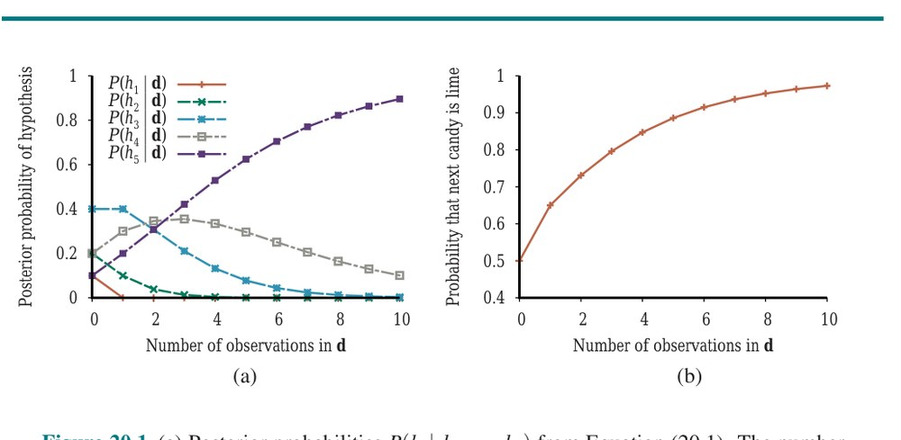

**شکل ۲۰.۱ — (الف) احتمال‌های پسینیِ P(hi|d1,...,dN) از معادلهٔ (20.1). شمارِ مشاهده‌های N از 1 تا 10 متغیر است، و هر مشاهده آب‌نباتِ لیموست. (ب) پیش‌بینیِ بیزیِ P(DN+1 = lime|d1,...,dN) از معادلهٔ (20.2).**

مثال نشان می‌دهد پیش‌بینیِ بیزی سرانجام با فرضیهٔ واقعی موافق می‌شود. این ویژگیِ یادگیریِ بیزی است. برای هر پیشینِ ثابتی که فرضیهٔ واقعی را رد نمی‌کند، احتمالِ پسینیِ هر فرضیهٔ کاذبی، تحتِ شرایطِ فنیِ معینی، سرانجام ناپدید خواهد شد. این صرفاً به این دلیل رخ می‌دهد که احتمالِ تولیدِ نامحدودِ دادهٔ «غیرمشخصه» به‌طرزِ محوکننده‌ای کوچک است. (این نکته مشابهِ نکته‌ای است که در بحثِ یادگیریِ PAC در فصل ۱۹ مطرح شد.) مهم‌تر، پیش‌بینیِ بیزی بهینه است، چه مجموعهٔ داده کوچک باشد چه بزرگ. با توجه به پیشینِ فرضیه، هر پیش‌بینیِ دیگری انتظار می‌رود کمتر درست باشد.

بهینگیِ یادگیریِ بیزی، البته، بهایی دارد. برای مسائلِ یادگیریِ واقعی، فضایِ فرضیه معمولاً بسیار بزرگ یا نامتناهی است، چنان‌که در فصل ۱۹ دیدیم. در برخی موارد، جمعِ معادلهٔ (20.2) (یا انتگرال، در حالتِ پیوسته) می‌تواند به‌صورتِ شدنی انجام شود، اما در بیشترِ موارد باید به روش‌های تقریبی یا ساده‌شده پناه ببریم.

تقریبِ بسیار رایجی—که معمولاً در علم اتخاذ می‌شود—انجامِ پیش‌بینی‌ها بر اساسِ فرضیهٔ محتمل‌ترینِ تکی است—یعنی hi که P(hi|d) را بیشینه می‌کند. این اغلب فرضیهٔ «بیشینهٔ پسین» (Maximum A Posteriori یا MAP، تلفظ «اِم-اِی-پی») نامیده می‌شود. پیش‌بینی‌های انجام‌شده طبقِ فرضیهٔ MAPِ hMAP تا آن‌جا تقریباً بیزی‌اند که P(X|d) ≈ P(X|hMAP). در مثالِ آب‌نبات‌مان، پس از سه آب‌نباتِ لیمویِ متوالی hMAP = h5 است، پس یادگیرندهٔ MAP سپس پیش‌بینی می‌کند آب‌نباتِ چهارم با احتمالِ 1.0 لیموست—پیش‌بینیِ بسیار خطرناک‌تری از پیش‌بینیِ بیزیِ 0.8 نشان‌داده‌شده در شکل ۲۰.۱(ب). با رسیدنِ دادهٔ بیشتر، پیش‌بینی‌های MAP و بیزی نزدیک‌تر می‌شوند، زیرا رقبای فرضیهٔ MAP کم‌محتمل‌تر و کم‌محتمل‌تر می‌شوند.

اگرچه این مثال نشان نمی‌دهد، یافتنِ فرضیه‌های MAP اغلب بسیار آسان‌تر از یادگیریِ بیزی است، زیرا به حلِ مسئلهٔ بهینه‌سازی نیاز دارد، نه مسئلهٔ جمعِ (یا انتگرالِ) بزرگ.

در هر دو یادگیریِ بیزی و یادگیریِ MAP، پیشینِ فرضیهٔ P(hi) نقشِ مهمی بازی می‌کند. در فصل ۱۹ دیدیم بیش‌برازش می‌تواند رخ دهد وقتی فضایِ فرضیه بیش‌ازحد بیانی است، یعنی وقتی فرضیه‌های بسیاری دارد که داده را خوب برازش می‌کنند. روش‌های یادگیریِ بیزی و MAP از پیشین برای جریمه‌کردنِ پیچیدگی استفاده می‌کنند. معمولاً، فرضیه‌های پیچیده‌تر احتمالِ پیشینیِ کمتری دارند—تا حدی به این دلیل که بسیارند. از سوی دیگر، فرضیه‌های پیچیده‌تر ظرفیتِ بیشتری برای برازشِ داده دارند. (در حالتِ حدی، جدولِ جستجو می‌تواند داده را دقیقاً بازتولید کند.) از این رو، پیشینِ فرضیه معاوضه‌ای بینِ پیچیدگیِ فرضیه و درجهٔ برازشِ آن به داده را در بر دارد.

اثرِ این معاوضه را در حالتِ منطقی، جایی که H فقط فرضیه‌های قطعی دارد (مانندِ h1، که می‌گوید هر آب‌نبات گیلاس است)، واضح‌تر می‌بینیم. در آن صورت، P(d|hi) اگر hi سازگار باشد 1 و در غیرِ این صورت 0 است. با نگاه به معادلهٔ (20.1)، می‌بینیم hMAP سپس ساده‌ترین نظریهٔ منطقیِ سازگار با داده خواهد بود. بنابراین، یادگیریِ بیشینهٔ پسین تجسمِ طبیعیِ تیغِ آوکام فراهم می‌کند.

بینشِ دیگری دربارهٔ معاوضهٔ بینِ پیچیدگی و درجهٔ برازش با گرفتنِ لگاریتمِ معادلهٔ (20.1) به دست می‌آید. انتخابِ hMAP برای بیشینه‌کردنِ P(d|hi)P(hi) معادلِ کمینه‌کردنِ −log2 P(d|hi) − log2 P(hi) است. با استفاده از ارتباطِ بینِ رمزگذاریِ اطلاعات و احتمال که در بخش ۱۹.۳.۳ معرفی کردیم، می‌بینیم جملهٔ −log2 P(hi) برابرِ شمارِ بیت‌های لازم برای مشخص‌کردنِ فرضیهٔ hi است. علاوه بر این، −log2 P(d|hi) شمارِ بیت‌های اضافیِ لازم برای مشخص‌کردنِ داده، با توجه به فرضیه، است. (برای دیدنِ این، در نظر بگیرید اگر فرضیه داده را دقیقاً پیش‌بینی کند—مانندِ h5 و رشتهٔ آب‌نبات‌های لیمو—بیتی لازم نیست و log2 1 = 0.) از این رو، یادگیریِ MAP فرضیه‌ای را انتخاب می‌کند که حداکثرِ فشرده‌سازیِ داده را فراهم می‌کند. همان تکلیف مستقیم‌تر توسط روشِ یادگیریِ «حداقلِ طولِ توصیف» (Minimum Description Length یا MDL) پرداخته می‌شود. در حالی که یادگیریِ MAP سادگی را با تخصیصِ احتمال‌های بالاتر به فرضیه‌های ساده‌تر بیان می‌کند، MDL آن را مستقیماً با شمردنِ بیت‌ها در رمزگذاریِ دودوییِ فرضیه‌ها و داده بیان می‌کند.

## ۲۰.۲ یادگیری با دادهٔ کامل

فرایندِ یادگیریِ مدلِ احتمال را با درنظرگرفتنِ حالتِ ساده‌ای شروع می‌کنیم که در آن همهٔ متغیرهای تصادفیِ مربوط در هر مثال مشاهده می‌شوند. این «دادهٔ کامل» (Complete Data) نامیده می‌شود. (اصطلاحِ «دادهٔ کامل» گاهی به معنایِ دیگری نیز استفاده می‌شود: اینکه هیچ مقدارِ ویژگی‌ای از دست نرفته.) بعداً، در بخش ۲۰.۳، حالتِ «متغیرهای پنهان» (Hidden Variables) را در نظر می‌گیریم.

### ۲۰.۲.۱ یادگیریِ پارامترِ بیشینه‌درستنمایی: مدل‌های گسسته

فرض کنیم از تولیدکنندهٔ تازه‌ای کیسه‌ای آب‌نباتِ لیمو و گیلاس بخریم که نسبت‌های طعمش کاملاً ناشناخته‌اند؛ کسرِ گیلاس می‌تواند هر جایِ بینِ 0 و 1 باشد. در آن صورت، پیوستاری از فرضیه‌ها داریم. پارامتر در این مورد، که θ می‌نامیم، نسبتِ آب‌نبات‌های گیلاس است، و فرضیه hθ است. (نسبتِ آب‌نبات‌های لیمو فقط 1−θ است.) اگر فرض کنیم همهٔ نسبت‌ها از نظرِ پیشینی به‌یکسان محتمل‌اند، رویکردِ بیشینه‌درستنمایی معقول است. اگر وضعیت را با شبکهٔ بیزی مدل کنیم، فقط به یک متغیرِ تصادفی نیاز داریم، Flavor (طعمِ آب‌نباتِ تصادفیِ انتخاب‌شده از کیسه). مقادیرِ گیلاس و لیمو را دارد، که در آن احتمالِ گیلاس θ است (شکل ۲۰.۲(الف) را ببینید). حالا فرض کنیم N آب‌نبات باز کنیم، که c تایشان گیلاس و ℓ = N − c تایشان لیمو هستند. طبقِ معادلهٔ (20.3)، درستنماییِ این مجموعهٔ دادهٔ خاص:

```
P(d|hθ) = ∏_{j=1}^{N} P(dj|hθ) = θ^c · (1−θ)^ℓ
```

است. فرضیهٔ بیشینه‌درستنمایی با مقدارِ θ که این عبارت را بیشینه می‌کند داده می‌شود. چون تابعِ لگاریتم یکنواست، همان مقدار با بیشینه‌کردنِ «لگاریتمِ درستنمایی» (Log Likelihood) به‌جایش به دست می‌آید:

```
L(d|hθ) = log P(d|hθ) = ∑_{j=1}^{N} log P(dj|hθ) = c·log θ + ℓ·log(1−θ)
```

(با گرفتنِ لگاریتم، حاصلِ‌ضرب را به جمعی روی داده کاهش می‌دهیم، که معمولاً بیشینه‌کردنش آسان‌تر است.) برای یافتنِ مقدارِ بیشینه‌درستنماییِ θ، L را نسبت به θ مشتق می‌گیریم و عبارتِ حاصل را صفر می‌گذاریم:

```
dL(d|hθ)/dθ = c/θ − ℓ/(1−θ) = 0    ⇒    θ = c/(c+ℓ) = c/N
```

به زبانِ ساده، فرضیهٔ بیشینه‌درستنماییِ hML ادعا می‌کند نسبتِ واقعیِ آب‌نبات‌های گیلاسِ کیسه برابرِ نسبتِ مشاهده‌شده در آب‌نبات‌های بازشدهٔ تاکنون است! به نظر می‌رسد کارِ زیادی کرده‌ایم تا بدیهیات را کشف کنیم. در واقع، با این حال، یک روشِ استاندارد برای یادگیریِ پارامترِ بیشینه‌درستنمایی را برچیده‌ایم، روشی با کاربردپذیریِ گسترده:

۱. عبارتی برای درستنماییِ داده به‌عنوانِ تابعی از پارامتر(ها) بنویس.
۲. مشتقِ لگاریتمِ درستنمایی را نسبت به هر پارامتر بنویس.
۳. مقادیرِ پارامتر را بیاب که مشتق‌ها در آن‌ها صفرند.

دشوارترین گام معمولاً آخرین است. در مثالِ ما بی‌اهمیت بود، اما خواهیم دید در بسیاری از موارد باید به الگوریتم‌های حلِ تکرارشونده یا فنونِ بهینه‌سازیِ عددیِ دیگر پناه ببریم، چنان‌که در بخش ۴.۲ توصیف شد. (باید تأیید کنیم ماتریسِ هسین معینِ منفی است.) مثال همچنین مسئلهٔ قابلِ‌توجهی از یادگیریِ بیشینه‌درستنمایی را به‌طورِ کلی نشان می‌دهد: وقتی مجموعهٔ داده به‌اندازهٔ کافی کوچک است که برخی رخدادها هنوز مشاهده نشده‌اند—برای نمونه، هیچ آب‌نباتِ گیلاسی—فرضیهٔ بیشینه‌درستنمایی احتمالِ صفر به آن رخدادها تخصیص می‌دهد. حقه‌های گوناگونی برای اجتناب از این مسئله استفاده می‌شود، مانندِ مقداردهیِ اولیهٔ شمارشِ هر رخداد به 1 به‌جای 0.

مثالِ دیگری نگاه کنیم. فرض کنیم این تولیدکنندهٔ تازهٔ آب‌نبات می‌خواهد اشارهٔ کوچکی به مصرف‌کننده بدهد و از لفاف‌های آب‌نباتِ قرمز و سبز استفاده می‌کند. لفافِ هر آب‌نبات به‌صورتِ احتمالاتی، طبقِ توزیعِ شرطیِ ناشناخته‌ای، بسته به طعم انتخاب می‌شود. مدلِ احتمالِ متناظر در شکل ۲۰.۲(ب) نشان داده شده.

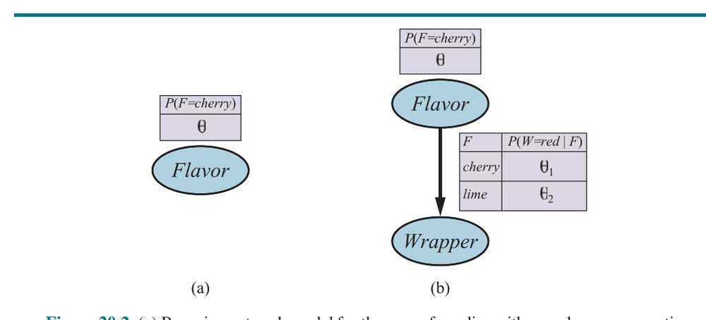

**شکل ۲۰.۲ — (الف) مدلِ شبکهٔ بیزی برای حالتِ آب‌نبات‌های با نسبتِ ناشناختهٔ گیلاس و لیمو. (ب) مدل برای حالتی که رنگِ لفاف (به‌صورتِ احتمالاتی) به طعمِ آب‌نبات بستگی دارد.**

توجه کنید سه پارامتر دارد: θ، θ1 و θ2. با این پارامترها، درستنماییِ دیدنِ، مثلاً، آب‌نباتِ گیلاسی در لفافِ سبز را می‌توان از معناشناسیِ استانداردِ شبکه‌های بیزی (صفحهٔ ۴۱۵) به دست آورد:

```
P(Flavor = cherry, Wrapper = green | hθ,θ1,θ2) = P(Flavor = cherry | hθ,θ1,θ2)·P(Wrapper = green | Flavor = cherry, hθ,θ1,θ2)
                                               = θ·(1−θ1)
```

حالا N آب‌نبات باز می‌کنیم، که c تایشان گیلاس و ℓ تایشان لیمو هستند. شمارشِ لفاف‌ها چنین است: rc از آب‌نبات‌های گیلاس لفافِ قرمز دارند و gc سبز، در حالی که rℓ از آب‌نبات‌های لیمو قرمز و gℓ سبز دارند. درستنماییِ داده:

```
P(d|hθ,θ1,θ2) = θ^c(1−θ)^ℓ · θ1^rc(1−θ1)^gc · θ2^rℓ(1−θ2)^gℓ
```

این کاملاً وحشتناک به نظر می‌رسد، اما گرفتنِ لگاریتم کمک می‌کند:

```
L = [c·log θ + ℓ·log(1−θ)] + [rc·log θ1 + gc·log(1−θ1)] + [rℓ·log θ2 + gℓ·log(1−θ2)]
```

مزیتِ گرفتنِ لگاریتم روشن است: لگاریتمِ درستنمایی جمعِ سه جمله است، که هر یک پارامترِ تکی دارد. وقتی نسبت به هر پارامتر مشتق می‌گیریم و آن‌ها را صفر می‌گذاریم، سه معادلهٔ مستقل می‌گیریم، که هر یک فقط یک پارامتر دارد:

```
∂L/∂θ = c/θ − ℓ/(1−θ) = 0    ⇒    θ = c/(c+ℓ)
∂L/∂θ1 = rc/θ1 − gc/(1−θ1) = 0    ⇒    θ1 = rc/(rc+gc)
∂L/∂θ2 = rℓ/θ2 − gℓ/(1−θ2) = 0    ⇒    θ2 = rℓ/(rℓ+gℓ)
```

راه‌حلِ θ همان قبلی است. راه‌حلِ θ1، احتمالِ اینکه آب‌نباتِ گیلاسی لفافِ قرمز داشته باشد، کسرِ مشاهده‌شدهٔ آب‌نبات‌های گیلاسیِ با لفافِ قرمز است، و به‌طورِ مشابه برای θ2. این نتایج بسیار دلگرم‌کننده‌اند، و دیدنِ اینکه می‌توان آن‌ها را به هر شبکهٔ بیزی که احتمال‌های شرطی‌اش به‌صورتِ جدول‌ها بازنمایی می‌شوند بسط داد آسان است. مهم‌ترین نکته این است که با دادهٔ کامل، مسئلهٔ یادگیریِ پارامترِ بیشینه‌درستنمایی برای شبکهٔ بیزی به مسائلِ یادگیریِ جداگانه‌ای تجزیه می‌شود، یکی برای هر پارامتر. (تمرین ۲۰.NORX را برای حالتِ غیرجدولی ببینید، جایی که هر پارامتر بر چند احتمالِ شرطی اثر می‌گذارد.) نکتهٔ دوم این است که مقادیرِ پارامتر برای متغیر، با توجه به والدهایش، صرفاً بسامدهای مشاهده‌شدهٔ مقادیرِ متغیر برای هر تنظیمِ مقادیرِ والدند. مانندِ قبل، باید مراقب اجتناب از صفرها وقتی مجموعهٔ داده کوچک است باشیم.

### ۲۰.۲.۲ مدل‌های بیزِ ساده

احتمالاً رایج‌ترین مدلِ شبکهٔ بیزیِ استفاده‌شده در یادگیریِ ماشینی، مدلِ بیزِ ساده‌ای است که نخستین بار در صفحهٔ ۴۰۲ معرفی شد. در این مدل، متغیرِ «ردهٔ» C (که قرار است پیش‌بینی شود) ریشه و متغیرهای «ویژگیِ» Xi برگ‌ها هستند. مدل «ساده» است، زیرا فرض می‌کند ویژگی‌ها با توجه به رده به‌صورتِ شرطی مستقل‌اند. (مدلِ شکل ۲۰.۲(ب) مدلِ بیزِ ساده با ردهٔ Flavor و فقط یک ویژگی، Wrapper است.) در موردِ متغیرهای بولی، پارامترها θ = P(C=true)، θi1 = P(Xi=true|C=true)، θi2 = P(Xi=true|C=false) هستند.

مقادیرِ پارامترِ بیشینه‌درستنمایی دقیقاً به همان شیوهٔ شکل ۲۰.۲(ب) یافت می‌شوند. پس از آموزشِ مدل بدین‌گونه، می‌توان از آن برای رده‌بندیِ مثال‌های تازه‌ای استفاده کرد که متغیرِ ردهٔ C در آن‌ها مشاهده نشده. با مقادیرِ ویژگیِ مشاهده‌شدهٔ x1,...,xn، احتمالِ هر رده:

```
P(C|x1,...,xn) = α P(C) ∏i P(xi|C)
```

داده می‌شود. پیش‌بینیِ قطعی را می‌توان با انتخابِ محتمل‌ترین رده به دست آورد. شکل ۲۰.۳ منحنیِ یادگیریِ این روش را وقتی روی مسئلهٔ رستورانِ فصل ۱۹ اعمال شود نشان می‌دهد.

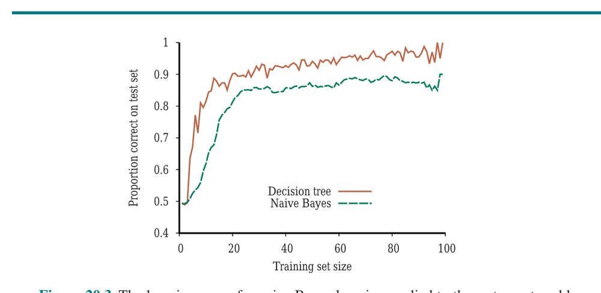

**شکل ۲۰.۳ — منحنیِ یادگیریِ یادگیریِ بیزِ ساده روی مسئلهٔ رستورانِ فصل ۱۹؛ منحنیِ یادگیریِ یادگیریِ درختِ تصمیم برای مقایسه نشان داده شده.**

این روش نسبتاً خوب یاد می‌گیرد اما نه به‌خوبی یادگیریِ درختِ تصمیم؛ احتمالاً به این دلیل که فرضیهٔ واقعی—که درختِ تصمیم است—با مدلِ بیزِ ساده دقیقاً قابلِ بازنمایی نیست. معلوم می‌شود یادگیریِ بیزِ ساده در طیفِ وسیعی از کاربردها به‌طرزِ شگفت‌آوری خوب عمل می‌کند؛ نسخهٔ تقویت‌شده‌اش (تمرین ۲۰.BNBX) یکی از مؤثرترین الگوریتم‌های یادگیریِ هم‌همنظوره است. یادگیریِ بیزِ ساده به‌خوبی به مسائلِ بسیار بزرگ مقیاس می‌شود: با n ویژگیِ بولی، فقط 2n+1 پارامتر هست، و برای یافتنِ hML، فرضیهٔ بیزِ سادهٔ بیشینه‌درستنمایی، جستجویی لازم نیست. سرانجام، سامانه‌های یادگیریِ بیزِ ساده با دادهٔ نویزی یا مفقود خوب کنار می‌آیند و می‌توانند وقتی مناسب است پیش‌بینی‌های احتمالاتی بدهند. عیبِ اصلی‌شان این واقعیت است که فرضِ استقلالِ شرطی به‌ندرت دقیق است؛ چنان‌که در صفحهٔ ۴۰۳ ذکر شد، فرض به احتمال‌های بیش‌ازحدِ مطمئنی می‌انجامد که اغلب بسیار نزدیکِ 0 یا 1 هستند، به‌ویژه با شمارِ زیادِ ویژگی‌ها.

### ۲۰.۲.۳ مدل‌های مولد و تفکیکی

می‌توانیم دو نوع مدلِ یادگیریِ ماشینیِ استفاده‌شده برای رده‌بندها را متمایز کنیم: مولد و تفکیکی. «مدلِ مولد» (Generative Model) توزیعِ احتمالِ هر رده را مدل می‌کند. برای نمونه، رده‌بندِ متنِ بیزِ ساده از بخش ۱۲.۶.۱ برای هر ردهٔ ممکنِ متن مدلِ جداگانه‌ای می‌سازد—یکی برای ورزش، یکی برای آب‌وهوا، و همین‌طور. هر مدل شاملِ احتمالِ پیشینیِ رده—برای نمونه P(Category=weather)—و نیز احتمالِ شرطیِ P(Inputs|Category=weather) است. از این‌ها می‌توانیم احتمالِ مشترکِ P(Inputs, Category=weather) را محاسبه کنیم و می‌توانیم انتخابِ تصادفیِ واژه‌هایی تولید کنیم که نمایندهٔ متن‌های ردهٔ آب‌وهواست.

«مدلِ تفکیکی» (Discriminative Model) مستقیماً مرزِ تصمیم بینِ رده‌ها را یاد می‌گیرد. یعنی P(Category|Inputs) را یاد می‌گیرد. با ورودی‌های مثال، مدلِ تفکیکی به ردهٔ خروجی می‌رسد، اما نمی‌توانی از مدلِ تفکیکی برای، مثلاً، تولیدِ واژه‌های تصادفیِ نمایندهٔ رده استفاده کنی. رگرسیونِ لجستیک، درخت‌های تصمیم و ماشین‌های بردارِ پشتیبان همگی مدل‌های تفکیکی‌اند.

چون مدل‌های تفکیکی همهٔ تأکیدشان را بر تعریفِ مرزِ تصمیم می‌گذارند—یعنی در واقع انجامِ تکلیفِ رده‌بندیِ خواسته‌شده—آن‌ها در حدِّ نهایی، با مقدارِ دلخواهی دادهٔ آموزشی، تمایل به عملکردِ بهتر دارند. با این حال، با دادهٔ محدود، در برخی موارد مدلِ مولد بهتر عمل می‌کند. نگ و جوردن (2002) رده‌بندِ مولدِ بیزِ ساده را با رده‌بندِ تفکیکیِ رگرسیونِ لجستیک روی ۱۵ مجموعهٔ دادهٔ (کوچک) مقایسه می‌کنند و درمی‌یابند با حداکثرِ مقدارِ داده، مدلِ تفکیکی در ۹ از ۱۵ مجموعهٔ داده بهتر عمل می‌کند، اما با فقط مقدارِ کمی داده، مدلِ مولد در ۱۴ از ۱۵ مجموعهٔ داده بهتر عمل می‌کند.

### ۲۰.۲.۴ یادگیریِ پارامترِ بیشینه‌درستنمایی: مدل‌های پیوسته

مدل‌های احتمالِ پیوسته مانندِ مدلِ خطی–گاوسی در صفحهٔ ۴۲۲ نشان داده شدند. چون متغیرهای پیوسته در کاربردهای دنیایِ واقعی فراگیرند، مهم است بدانیم چگونه پارامترهای مدل‌های پیوسته را از داده یاد بگیریم.

اصولِ یادگیریِ بیشینه‌درستنمایی در حالت‌های پیوسته و گسسته یکسان‌اند. با حالتِ بسیار ساده‌ای شروع کنیم: یادگیریِ پارامترهای تابعِ چگالیِ گاوسی روی متغیرِ تکی. یعنی فرض می‌کنیم داده چنین تولید شده:

```
P(x) = (1/(σ√2π)) e^(−(x−µ)²/(2σ²))
```

پارامترهای این مدل میانگینِ µ و انحرافِ معیارِ σ هستند. (توجه کنید «ثابتِ» نرمال‌سازی به σ بستگی دارد، پس نمی‌توانیم آن را نادیده بگیریم.) مقادیرِ مشاهده‌شده x1,...,xN باشند. سپس لگاریتمِ درستنمایی:

```
L = ∑_{j=1}^{N} log[(1/(σ√2π)) e^(−(xj−µ)²/(2σ²))]
  = N(−log√(2π) − log σ) − ∑_{j=1}^{N} (xj−µ)²/(2σ²)
```

با صفرگذاشتنِ مشتق‌ها مثلِ همیشه، به دست می‌آوریم:

```
∂L/∂µ = −(1/σ²) ∑_{j=1}^{N}(xj−µ) = 0    ⇒    µ = (∑j xj)/N
∂L/∂σ = −N/σ + (1/σ³) ∑_{j=1}^{N}(xj−µ)² = 0    ⇒    σ = √(∑j(xj−µ)²/N)        (20.4)
```

یعنی، مقدارِ بیشینه‌درستنماییِ میانگین، میانگینِ نمونه‌ای و مقدارِ بیشینه‌درستنماییِ انحرافِ معیار، جذرِ واریانسِ نمونه‌ای است. باز، این‌ها نتایجِ دلگرم‌کننده‌ای‌اند که رویهٔ «عقلِ سلیم» را تأیید می‌کنند.

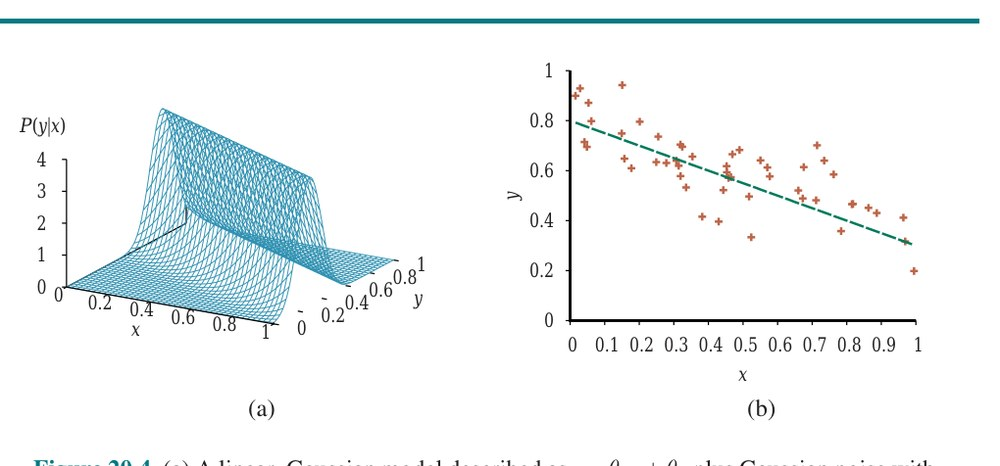

**شکل ۲۰.۴ — (الف) مدلِ خطی–گاوسی توصیف‌شده به‌صورتِ y = θ1x + θ2 به‌علاوهٔ نویزِ گاوسی با واریانسِ ثابت. (ب) مجموعه‌ای از ۵۰ نقطهٔ داده تولیدشده از این مدل و خطِ بهترین‌برازش.**

حالا مدلِ خطی–گاوسی با والدِ پیوستهٔ X و فرزندِ پیوستهٔ Y را در نظر بگیر. چنان‌که در صفحهٔ ۴۲۲ توضیح داده شد، Y توزیعِ گاوسی دارد که میانگینش به‌صورتِ خطی به مقدارِ X بستگی دارد و انحرافِ معیارش ثابت است. برای یادگیریِ توزیعِ شرطیِ P(Y|X)، می‌توانیم درستنماییِ شرطی را بیشینه کنیم:

```
P(y|x) = (1/(σ√2π)) e^(−(y−(θ1x+θ2))²/(2σ²))        (20.5)
```

در این‌جا، پارامترها θ1، θ2 و σ هستند. داده مجموعه‌ای از جفت‌های (xj,yj) است، چنان‌که در شکل ۲۰.۴ نشان داده شده. با روش‌های معمول (تمرین ۲۰.LINR)، می‌توانیم مقادیرِ بیشینه‌درستنماییِ پارامترها را بیابیم. نکتهٔ این‌جا متفاوت است. اگر فقط پارامترهای θ1 و θ2 را که رابطهٔ خطیِ بینِ x و y را تعریف می‌کنند در نظر بگیریم، روشن می‌شود بیشینه‌کردنِ لگاریتمِ درستنمایی نسبت به این پارامترها همان کمینه‌کردنِ صورت‌کنندهٔ (y − (θ1x + θ2))² در توانِ معادلهٔ (20.5) است. این زیانِ L2 است، خطایِ مربعِ بینِ مقدارِ واقعیِ y و پیش‌بینیِ θ1x + θ2.

این همان کمیتی است که رویهٔ استانداردِ رگرسیونِ خطیِ توصیف‌شده در بخش ۱۹.۶ کمینه می‌کند. حالا می‌توانیم بفهمیم چرا: کمینه‌کردنِ جمعِ خطاهای مربع، مدلِ خطِ راستِ بیشینه‌درستنمایی را می‌دهد، مشروط بر اینکه داده با نویزِ گاوسیِ واریانسِ ثابت تولید شده باشد.

### ۲۰.۲.۵ یادگیریِ پارامترِ بیزی

یادگیریِ بیشینه‌درستنمایی به رویه‌های ساده می‌انجامد، اما با مجموعه‌های دادهٔ کوچک کاستی‌های جدی دارد. برای نمونه، پس از دیدنِ یک آب‌نباتِ گیلاس، فرضیهٔ بیشینه‌درستنمایی این است که کیسه ۱۰۰٪ گیلاس است (یعنی θ = 1.0). مگر اینکه پیشینِ فرضیهٔ فرد این باشد که کیسه‌ها باید یا تمام‌گیلاس باشند یا تمام‌لیمو، این نتیجهٔ معقولی نیست. محتمل‌تر است کیسه مخلوطی از لیمو و گیلاس باشد. رویکردِ بیزی به یادگیریِ پارامتر با پیشینِ فرضیه شروع می‌کند و توزیع را با رسیدنِ داده به‌روزرسانی می‌کند.

مثالِ آب‌نباتِ شکل ۲۰.۲(الف) یک پارامتر دارد، θ: احتمالِ اینکه تکهٔ تصادفیِ انتخاب‌شدهٔ آب‌نبات طعمِ گیلاس داشته باشد. در دیدگاهِ بیزی، θ مقدارِ (ناشناختهٔ) متغیرِ تصادفیِ Θ است که فضایِ فرضیه را تعریف می‌کند؛ پیشینِ فرضیه توزیعِ پیشینیِ P(Θ) است. بدین‌ترتیب، P(Θ=θ) احتمالِ پیشینیِ اینکه کیسه کسرِ θ آب‌نباتِ گیلاس داشته باشد است. اگر پارامترِ θ بتواند هر مقدارِ بینِ 0 و 1 باشد، P(Θ) تابعِ چگالیِ احتمالِ پیوسته است (بخش الف.۳ را ببینید). اگر چیزی دربارهٔ مقادیرِ ممکنِ θ ندانیم، می‌توانیم از تابعِ چگالیِ یکنواختِ P(θ) = Uniform(θ;0,1) استفاده کنیم، که می‌گوید همهٔ مقادیر به‌یکسان محتمل‌اند. خانوادهٔ انعطاف‌پذیرتری از توابعِ چگالیِ احتمال به‌عنوانِ «توزیع‌های بتا» (Beta Distributions) شناخته می‌شود. هر توزیعِ بتا با دو «ابرپارامترِ» (Hyperparameters)³ a و b تعریف می‌شود به‌گونه‌ای که:

```
Beta(θ; a, b) = α θ^(a−1) (1−θ)^(b−1)        (20.6)
```

برای θ در بازهٔ [0,1]. ثابتِ نرمال‌سازیِ α، که توزیع را به انتگرالِ 1 می‌رساند، به a و b بستگی دارد. شکل ۲۰.۵ نشان می‌دهد توزیع برای مقادیرِ مختلفِ a و b چگونه به نظر می‌رسد. مقدارِ میانگینِ توزیعِ بتا a/(a+b) است، پس مقادیرِ بزرگ‌ترِ a باورِ نزدیک‌تربودنِ Θ به 1 تا به 0 را پیشنهاد می‌کنند. مقادیرِ بزرگ‌ترِ a+b توزیع را قله‌دارتر می‌کنند، که قطعیتِ بیشتر دربارهٔ مقدارِ Θ را پیشنهاد می‌کند. معلوم می‌شود تابعِ چگالیِ یکنواخت همان Beta(1,1) است: میانگین 1/2 است و توزیع تخت.

![**شکل ۲۰.۵ — نمونه‌هایی از توزیعِ Beta(a,b) برای مقادیرِ مختلفِ (a,b). (الف) [1,1]، [2,2] و [5,5]. (ب) [3,1]، [6,2] و [30,10].**](../figures/ch20/fig-20-5.jpg)

**شکل ۲۰.۵ — نمونه‌هایی از توزیعِ Beta(a,b) برای مقادیرِ مختلفِ (a,b). (الف) [1,1]، [2,2] و [5,5]. (ب) [3,1]، [6,2] و [30,10].**

نکتهٔ مهمِ بعدی این است که توزیعِ بتا «همسازِ» (Conjugate) با توزیعِ برنولی است. به‌طورِ خاص، با پیشینِ Beta(a,b) و مشاهدهٔ c آب‌نباتِ گیلاس و ℓ آب‌نباتِ لیمو، احتمالِ پسینی برای Θ به‌صورتِ Beta(a+c, b+ℓ) است. این نتیجه‌ای حیاتی است: توزیعِ بتا خانوادهٔ بسته‌ای تحتِ به‌روزرسانیِ بیزی است. به‌علاوه، به‌صورتِ شهودی، می‌توانیم آن را چنین ببینیم: با مشاهدهٔ آب‌نباتِ گیلاس، پارامترِ a را افزایش می‌دهیم؛ به‌طورِ مشابه، پس از دیدنِ آب‌نباتِ لیمو، پارامترِ b را افزایش می‌دهیم. بدین‌ترتیب، می‌توانیم ابرپارامترهای a و b را «شمارشِ مجازی» (Virtual Counts) ببینیم، به این معنا که پیشینِ Beta(a,b) دقیقاً چنان رفتار می‌کند که گویی با پیشینِ یکنواختِ Beta(1,1) شروع کرده و a−1 آب‌نباتِ گیلاسِ واقعی و b−1 آب‌نباتِ لیمویِ واقعی دیده‌ایم. با بررسیِ توالیِ توزیع‌های بتا برای مقادیرِ افزایشیِ a و b، با ثابت‌نگه‌داشتنِ نسبت‌ها، می‌توانیم به‌وضوح ببینیم توزیعِ پسینی روی پارامترِ Θ با رسیدنِ داده چگونه تغییر می‌کند. برای نمونه، فرض کنیم کیسهٔ واقعیِ آب‌نبات ۷۵٪ گیلاس باشد. شکل ۲۰.۵(ب) توالیِ Beta(3,1)، Beta(6,2)، Beta(30,10) را نشان می‌دهد. بدیهی است، توزیع به قله‌ای باریک دورِ مقدارِ واقعیِ Θ همگرا می‌شود. برای مجموعه‌های دادهٔ بزرگ، پس، یادگیریِ بیزی (دستِ‌کم در این مورد) به همان پاسخِ یادگیریِ بیشینه‌درستنمایی همگرا می‌شود.

حالا حالتِ پیچیده‌تری در نظر بگیریم. شبکهٔ شکل ۲۰.۲(ب) سه پارامتر دارد، θ، θ1 و θ2، که در آن θ1 احتمالِ لفافِ قرمز روی آب‌نباتِ گیلاس و θ2 احتمالِ لفافِ قرمز روی آب‌نباتِ لیموست.⁴ پیشینِ فرضیهٔ بیزی باید همهٔ سه پارامتر را پوشش دهد—یعنی باید P(Θ,Θ1,Θ2) را مشخص کنیم. معمولاً، «استقلالِ پارامتر» (Parameter Independence) را فرض می‌کنیم:

```
P(Θ,Θ1,Θ2) = P(Θ)P(Θ1)P(Θ2)
```

با این فرض، هر پارامتر می‌تواند توزیعِ بتای خودش را داشته باشد که با رسیدنِ داده جداگانه به‌روزرسانی می‌شود. شکل ۲۰.۶ نشان می‌دهد چگونه می‌توانیم پیشینِ فرضیه و هر داده‌ای را در شبکهٔ بیزی بگنجانیم، که در آن برای هر متغیرِ پارامتر گره‌ای داریم.

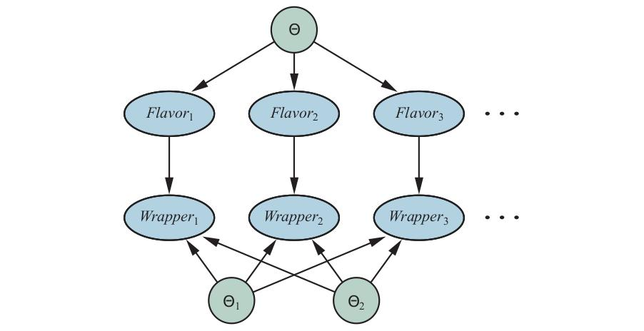

**شکل ۲۰.۶ — شبکهٔ بیزیِ متناظر با فرایندِ یادگیریِ بیزی. توزیع‌های پسینی برای متغیرهای پارامترِ Θ، Θ1 و Θ2 را می‌توان با استنتاج در این شبکه به دست آورد. (گره‌ها: Θ، Θ1، Θ2 بدونِ والد؛ سپس Flavor_i و Wrapper_i برای هر مشاهدهٔ i.)**

گره‌های Θ، Θ1، Θ2 والد ندارند. برای i-امین مشاهدهٔ لفاف و طعمِ متناظرِ تکهٔ آب‌نبات، گره‌های Wrapperi و Flavori را می‌افزاییم. Flavori به پارامترِ طعمِ Θ وابسته است: P(Flavori=cherry|Θ=θ) = θ. Wrapperi به Θ1 و Θ2 وابسته است:

```
P(Wrapperi = red | Flavori = cherry, Θ1 = θ1) = θ1
P(Wrapperi = red | Flavori = lime, Θ2 = θ2) = θ2
```

حالا، کلِ فرایندِ یادگیریِ بیزی برای شبکهٔ بیزِ اصلیِ شکل ۲۰.۲(ب) را می‌توان به‌عنوانِ مسئلهٔ استنتاجی در شبکهٔ بیزِ مشتق‌شدهٔ نشان‌داده‌شده در شکل ۲۰.۶ صورت‌بندی کرد، که در آن داده و پارامترها گره می‌شوند. پس از افزودنِ همهٔ گره‌های شاهدِ تازه، می‌توانیم متغیرهای پارامتر را (در این مورد، Θ، Θ1، Θ2) پرس‌وجو کنیم. تحتِ این صورت‌بندی فقط یک الگوریتمِ یادگیری هست—الگوریتمِ استنتاج برای شبکه‌های بیزی.

البته، ماهیتِ این شبکه‌ها تا حدی با شبکه‌های فصل ۱۳ متفاوت است، به دلیلِ شمارِ بالقوهٔ عظیمِ متغیرهای شاهدِ بازنمایی‌کنندهٔ مجموعهٔ آموزشی و شیوعِ متغیرهای پارامترِ پیوسته‌مقدار. استنتاجِ دقیق ممکن است به‌جز در مواردِ بسیار ساده مانندِ مدلِ بیزِ ساده ناممکن باشد. دست‌اندرکاران معمولاً از روش‌های استنتاجِ تقریبی مانندِ MCMC استفاده می‌کنند (بخش ۱۳.۴.۲)؛ بسیاری از بسته‌های نرم‌افزاریِ آماری پیاده‌سازی‌های کارآمدی از MCMC را برای این منظور در بر می‌گیرند.

### ۲۰.۲.۶ رگرسیونِ خطیِ بیزی

در این‌جا نشان می‌دهیم چگونه رویکردِ بیزی را روی تکلیفِ آماریِ استانداردی اعمال کنیم: رگرسیونِ خطی. رویکردِ متعارف در بخش ۱۹.۶ به‌عنوانِ کمینه‌کردنِ جمعِ خطاهای مربع توصیف شد و در بخش ۲۰.۲.۴ به‌عنوانِ بیشینه‌کردنِ درستنمایی با فرضِ مدلِ خطایِ گاوسی بازتفسیر شد. این‌ها یک فرضیهٔ بهترینِ تکی تولید می‌کنند: خطِ راستی با مقادیرِ خاصِ شیب و عرض از مبدأ و واریانسِ ثابتِ خطایِ پیش‌بینی در هر نقطهٔ معین. هیچ معیاری از اینکه چقدر باید به مقادیرِ شیب و عرض از مبدأ مطمئن بود نیست.

علاوه بر این، اگر برای نقطهٔ دادهٔ دیده‌نشده‌ای دور از نقاطِ دادهٔ مشاهده‌شده مقداری پیش‌بینی کنیم، به نظر نمی‌رسد معنا داشته باشد خطایِ پیش‌بینی‌ای فرض کنیم که همان خطایِ پیش‌بینیِ نقطهٔ داده‌ای درستِ کنارِ نقطهٔ دادهٔ مشاهده‌شده است. معقول‌تر به نظر می‌رسد خطایِ پیش‌بینی بزرگ‌تر باشد، هرچه نقطه از دادهٔ مشاهده‌شده دورتر باشد، زیرا تغییرِ کوچک در شیب باعث تغییرِ بزرگ در مقدارِ پیش‌بینی‌شده برای نقطهٔ دور می‌شود. رویکردِ بیزی هر دو این مسائل را اصلاح می‌کند. ایدهٔ کلی، مانندِ بخشِ قبلی، گذاشتنِ پیشینی روی پارامترهای مدل—در این‌جا، ضرایبِ مدلِ خطی و واریانسِ نویز—و سپس محاسبهٔ پسینِ پارامتر با توجه به داده است. برای دادهٔ چندمتغیره و مدلِ نویزِ ناشناخته، این به جبرِ خطیِ نسبتاً زیادی می‌انجامد، پس روی حالتِ ساده تمرکز می‌کنیم: دادهٔ تک‌متغیره، مدلی که مقید به عبور از مبدأ است، و نویزِ معلوم: توزیعِ نرمال با واریانسِ σ². سپس فقط یک پارامترِ θ داریم و مدل:

```
P(y|x,θ) = N(y; θx, σy²) = (1/(σ√2π)) e^(−(1/2)((y−θx)²/σ²))        (20.7)
```

است. چون لگاریتمِ درستنمایی در θ درجه‌دومی است، شکلِ مناسب برای پیشینِ همساز روی θ نیز گاوسی است. این تضمین می‌کند پسینِ θ نیز گاوسی باشد. میانگینِ θ0 و واریانسِ σ0² را برای پیشین فرض می‌کنیم، پس:

```
P(θ) = N(θ; θ0, σ0²) = (1/(σ0√2π)) e^(−(1/2)((θ−θ0)²/σ0²))        (20.8)
```

بسته به داده‌ای که مدل می‌شود، ممکن است ایده‌ای از چه نوع شیبی θ انتظار داریم داشته باشیم، یا ممکن است کاملاً بی‌نظر باشیم. در حالتِ اخیر، منطقی است θ0 را 0 و σ0² را بزرگ انتخاب کنیم—به اصطلاح «پیشینِ بی‌اطلاع‌کننده» (Uninformative Prior). سرانجام، می‌توانیم پیشینِ P(x) را برای مقدارِ x هر نقطهٔ داده فرض کنیم، اما این کاملاً برای تحلیل بی‌اثر است، زیرا به θ بستگی ندارد.

حالا چیدمان کامل است، پس می‌توانیم پسینِ θ را با معادلهٔ (20.1) محاسبه کنیم:

```
P(θ|d) ∝ P(d|θ)P(θ)
```

نقاطِ دادهٔ مشاهده‌شده d = (x1,y1),...,(xN,yN) هستند، پس درستنماییِ داده از معادلهٔ (20.7) چنین به دست می‌آید:

```
P(d|θ) = (∏i P(xi)) (∏i P(yi|xi,θ)) = α ∏i e^(−(1/2)((yi−θxi)²/σ²)) = α e^(−(1/2)∑i((yi−θxi)²/σ²))
```

که در آن پیشین‌های مقدارِ x و ثابت‌های نرمال‌سازیِ N گاوسی را در ثابتِ αای که مستقل از θ است جذب کرده‌ایم. حالا این و پیشینِ پارامترِ معادلهٔ (20.8) را ترکیب می‌کنیم تا پسین به دست آید:

```
P(θ|d) = α″ e^(−(1/2)((θ−θ0)²/σ0²)) e^(−(1/2)∑i((yi−θxi)²/σ²))
```

اگرچه این پیچیده به نظر می‌رسد، هر توان تابعِ درجه‌دومی از θ است، پس جمعِ دو توان نیز چنین است. از این رو، کلِ عبارت توزیعِ گاوسی برای θ را بازنمایی می‌کند. با دستکاری‌های جبریِ بسیار مشابهِ آن‌های بخش ۱۴.۴، درمی‌یابیم:

```
P(θ|d) = α‴ e^(−(1/2)((θ−θN)²/σN²))
```

با میانگین و واریانسِ «به‌روزشده» که چنین داده می‌شوند:

```
θN = (σ²θ0 + σ0²∑i xiyi) / (σ² + σ0²∑i xi²)        و        σN² = (σ²σ0²) / (σ² + σ0²∑i xi²)
```

به این فرمول‌ها نگاه کنیم تا ببینیم چه معنا می‌دهند. وقتی داده به‌صورتِ باریک روی ناحیهٔ کوچکی از محورِ x نزدیکِ مبدأ متمرکز است، ∑i xi² کوچک خواهد بود و واریانسِ پسینیِ σN² بزرگ، تقریباً برابرِ واریانسِ پیشینیِ σ0². این همان‌گونه است که انتظار داریم: داده کارِ کمی برای مقیدکردنِ چرخشِ خط دورِ مبدأ می‌کند. برعکس، وقتی داده به‌صورتِ گسترده در طولِ محور پخش شده، ∑i xi² بزرگ خواهد بود و واریانسِ پسینیِ σN² کوچک، تقریباً برابرِ σ²/(∑i xi²)، پس شیب بسیار محکم مقید خواهد شد.


**شکل ۲۰.۷ — رگرسیونِ خطیِ بیزی با مدلی مقید به عبور از مبدأ و واریانسِ نویزِ ثابتِ σ² = 0.2. کانتورهای ±1، ±2 و ±3 انحرافِ معیار برای چگالیِ پیش‌بینی نشان داده شده‌اند. (الف) با سه نقطهٔ دادهٔ نزدیکِ مبدأ، شیب کاملاً نامطمئن است، با σN² ≈ 0.3861. توجه کنید عدم قطعیت با فاصله از نقاطِ دادهٔ مشاهده‌شده چگونه افزایش می‌یابد. (ب) با دو نقطهٔ دادهٔ اضافیِ دورتر، شیبِ θ بسیار محکم مقید شده، با σN² ≈ 0.0286. واریانسِ باقی‌مانده در چگالیِ پیش‌بینی تقریباً کاملاً به نویزِ ثابتِ σ² مربوط است.**

برای پیش‌بینی در نقطهٔ دادهٔ خاص، باید روی مقادیرِ ممکنِ θ انتگرال بگیریم، چنان‌که معادلهٔ (20.2) پیشنهاد می‌کند:

```
P(y|x,d) = ∫ P(y|x,d,θ)P(θ|x,d)dθ = ∫ P(y|x,θ)P(θ|d)dθ = α ∫ e^(−(1/2)((y−θx)²/σ²)) e^(−(1/2)((θ−θN)²/σN²)) dθ
```

باز، جمعِ دو توان تابعِ درجه‌دومی از θ است، پس گاوسی روی θ داریم که انتگرالش 1 است. جمله‌های باقی‌مانده در y گاوسیِ دیگری تشکیل می‌دهند:

```
P(y|x,d) ∝ e^(−(1/2)((y−θNx)²/(σ²+σN²x²)))
```

با نگاه به این عبارت، می‌بینیم میانگینِ پیش‌بینیِ y برابر θNx است، یعنی بر میانگینِ پسینیِ θ مبتنی است. واریانسِ پیش‌بینی با نویزِ مدلِ σ² به‌علاوهٔ جمله‌ای متناسب با x² داده می‌شود، که بدان معناست انحرافِ معیارِ پیش‌بینی به‌صورتِ مجانبی خطی با فاصله از مبدأ افزایش می‌یابد. شکل ۲۰.۷ این پدیده را نشان می‌دهد. چنان‌که در آغازِ این بخش ذکر شد، داشتنِ عدم قطعیتِ بیشتر برای پیش‌بینی‌هایی که از نقاطِ دادهٔ مشاهده‌شده دورترند کاملاً معنا دارد.

### ۲۰.۲.۷ یادگیریِ ساختارِ شبکه‌های بیز

تاکنون فرض کرده‌ایم ساختارِ شبکهٔ بیز داده شده و فقط سعی در یادگیریِ پارامترها داریم. ساختارِ شبکه دانشِ علّیِ پایه‌ای دربارهٔ حوزه را بازنمایی می‌کند که اغلب برای کارشناس، یا حتی کاربرِ ساده‌لوح، آسان است فراهم کند. در برخی موارد، با این حال، مدلِ علّی ممکن است در دسترس نباشد یا موضوعِ اختلاف باشد—برای نمونه، برخی شرکت‌ها مدت‌ها ادعا کرده‌اند سیگار باعث سرطان نمی‌شود و شرکت‌های دیگر اظهار می‌کنند غلظت‌های CO2 هیچ اثری بر اقلیم ندارند—پس مهم است بفهمیم چگونه ساختارِ شبکهٔ بیز را می‌توان از داده یاد گرفت. این بخش طرحِ مختصری از ایده‌های اصلی می‌دهد. بدیهی‌ترین رویکرد جستجو برای مدلِ خوب است. می‌توانیم با مدلی بدونِ پیوند شروع کنیم و افزودنِ والدها برای هر گره را آغاز کنیم، پارامترها را با روش‌هایی که پوشش دادیم برازش کنیم و دقتِ مدلِ حاصل را اندازه بگیریم. به‌طورِ جایگزین، می‌توانیم با حدسِ اولیه‌ای از ساختار شروع کنیم و از جستجوی تپه‌نوردی یا بازپختِ شبیه‌سازی‌شده برای ایجادِ اصلاح‌ها استفاده کنیم، و پس از هر تغییرِ ساختار پارامترها را دوباره تنظیم کنیم. اصلاح‌ها می‌توانند شاملِ معکوس‌کردن، افزودن یا حذفِ پیوندها باشند. در این فرایند نباید دور وارد کنیم، پس بسیاری از الگوریتم‌ها فرض می‌کنند ترتیبی برای متغیرها داده شده و گره فقط می‌تواند والدهایی در میانِ گره‌هایی داشته باشد که در ترتیب زودتر می‌آیند (درست مانندِ فرایندِ ساخت در فصل ۱۳). برای عمومیتِ کامل، باید روی ترتیب‌های ممکن نیز جستجو کنیم.

دو روشِ جایگزین برای تصمیم‌گیری دربارهٔ اینکه چه زمانی ساختارِ خوبی یافت شده هست. نخستین، آزمودنِ این است که آیا اظهارهای استقلالِ شرطیِ ضمنی در ساختار واقعاً در داده برآورده می‌شوند. برای نمونه، استفاده از مدلِ بیزِ ساده برای مسئلهٔ رستوران فرض می‌کند P(Hungry, Bar|WillWait) = P(Hungry|WillWait)P(Bar|WillWait)، و می‌توانیم در داده بررسی کنیم آیا همان معادله بینِ بسامدهای شرطیِ متناظر برقرار است. اما حتی اگر ساختار ماهیتِ علّیِ واقعیِ حوزه را توصیف کند، نوسان‌های آماریِ مجموعهٔ داده بدان معناست معادله هرگز دقیقاً برقرار نخواهد شد، پس باید آزمونِ آماریِ مناسبی انجام دهیم تا ببینیم شواهدِ کافی برای نقضِ فرضیهٔ استقلال هست. پیچیدگیِ شبکهٔ حاصل به آستانه‌ای که برای این آزمون استفاده می‌شود بستگی خواهد داشت—هرچه آزمونِ استقلال سخت‌گیرانه‌تر باشد، پیوندهای بیشتری افزوده می‌شوند و خطرِ بیش‌برازش بیشتر است.

رویکردی سازگارتر با ایده‌های این فصل، ارزیابیِ درجه‌ای است که مدلِ پیشنهادی داده را تبیین می‌کند (به معنایِ احتمالاتی). باید مراقب باشیم این را چگونه اندازه بگیریم. اگر فقط سعی کنیم فرضیهٔ بیشینه‌درستنمایی را بیابیم، به شبکهٔ کاملاً متصل می‌رسیم، زیرا افزودنِ والدهای بیشتر به گره نمی‌تواند درستنمایی را کاهش دهد (تمرین ۲۰.MLPA). به نحوی مجبور به جریمه‌کردنِ پیچیدگیِ مدل هستیم. رویکردِ MAP (یا MDL) صرفاً جریمه‌ای از درستنماییِ هر ساختار (پس از تنظیمِ پارامتر) کم می‌کند، قبل از مقایسهٔ ساختارهای متفاوت. رویکردِ بیزی پیشینِ مشترکی روی ساختارها و پارامترها می‌گذارد. معمولاً ساختارهای بسیار زیادی برای جمع‌زدن هست (فوق‌نمایی در شمارِ متغیرها)، پس بیشترِ دست‌اندرکاران از MCMC برای نمونه‌برداری روی ساختارها استفاده می‌کنند.

جریمه‌کردنِ پیچیدگی (خواه با روش‌های MAP یا بیزی) ارتباطِ مهمی بینِ ساختارِ بهینه و ماهیتِ بازنماییِ توزیع‌های شرطیِ شبکه معرفی می‌کند. با توزیع‌های جدولی، جریمهٔ پیچیدگیِ توزیعِ گره با شمارِ والدها به‌صورتِ نمایی رشد می‌کند، اما با، مثلاً، توزیع‌های نویزی-OR، فقط خطی رشد می‌کند. این بدان معناست یادگیری با مدل‌های نویزی-OR (یا دیگر مدل‌های فشرده‌پارامتر) تمایل به تولیدِ ساختارهای یادگرفته‌شده با والدهای بیشتر از یادگیری با توزیع‌های جدولی دارد.

### ۲۰.۲.۸ برآوردِ چگالی با مدل‌های ناپارامتری

ممکن است بتوان مدلِ احتمالی را بدونِ هیچ فرضی دربارهٔ ساختار و پارامترسازی‌اش با اتخاذِ روش‌های ناپارامتریِ بخش ۱۹.۷ یاد گرفت. تکلیفِ «برآوردِ چگالیِ ناپارامتری» (Nonparametric Density Estimation) معمولاً در حوزه‌های پیوسته انجام می‌شود، مانندِ آنچه در شکل ۲۰.۸(الف) نشان داده شده. شکل، تابعِ چگالیِ احتمالی را روی فضایی نشان می‌دهد که با دو متغیرِ پیوسته تعریف شده. در شکل ۲۰.۸(ب) نمونه‌ای از نقاطِ داده از این تابعِ چگالی می‌بینیم. پرسش این است: آیا می‌توانیم مدل را از نمونه‌ها بازیابی کنیم؟

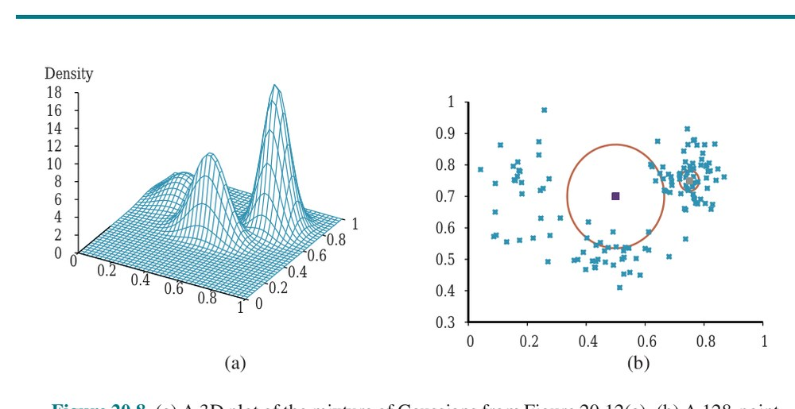

**شکل ۲۰.۸ — (الف) نمودارِ سه‌بعدیِ مخلوطِ گاوسی‌ها از شکل ۲۰.۱۲(الف). (ب) نمونهٔ ۱۲۸-نقطه‌ای از نقاطِ مخلوط، همراه با دو نقطهٔ پرس‌وجو (مربع‌های کوچکِ نارنجی) و ۱۰-همسایگی‌هایشان (دایرهٔ بزرگ و دایرهٔ کوچک‌تر در راست).**

نخست مدل‌های k-نزدیک‌ترین-همسایه را در نظر می‌گیریم. (در فصل ۱۹ مدل‌های نزدیک‌ترین-همسایه را برای رده‌بندی و رگرسیون دیدیم؛ این‌جا آن‌ها را برای برآوردِ چگالی می‌بینیم.) با نمونه‌ای از نقاطِ داده، برای برآوردِ چگالیِ احتمالِ ناشناخته در نقطهٔ پرس‌وجویِ x می‌توانیم به‌سادگی چگالیِ نقاطِ داده را در همسایگیِ x اندازه بگیریم. شکل ۲۰.۸(ب) دو نقطهٔ پرس‌وجو (مربع‌های کوچک) را نشان می‌دهد. برای هر نقطهٔ پرس‌وجو کوچک‌ترین دایره‌ای را رسم کرده‌ایم که ۱۰ همسایه را در بر می‌گیرد—10-نزدیک‌ترین-همسایگی. می‌بینیم دایرهٔ مرکزی بزرگ است، بدان معنا که چگالیِ کمی آن‌جاست، و دایرهٔ سمتِ راست کوچک است، بدان معنا که چگالیِ زیادی آن‌جاست. در شکل ۲۰.۹ سه نمودار از برآوردِ چگالی با k-نزدیک‌ترین-همسایه‌ها، برای مقادیرِ مختلفِ k، نشان می‌دهیم. روشن به نظر می‌رسد (ب) تقریباً درست است، در حالی که (الف) بیش‌ازحد تیغی است (k بیش‌ازحد کوچک است) و (ج) بیش‌ازحد نرم است (k بیش‌ازحد بزرگ است).

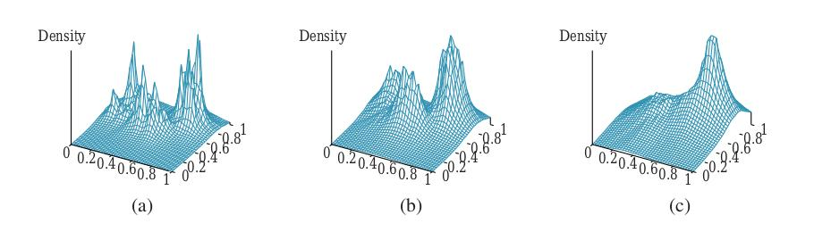

**شکل ۲۰.۹ — برآوردِ چگالی با k-نزدیک‌ترین-همسایه‌ها، اعمال‌شده روی دادهٔ شکل ۲۰.۸(ب)، به‌ترتیب برای k=3، 10 و 40. k=3 بیش‌ازحد تیغی، 40 بیش‌ازحد نرم، و 10 تقریباً درست است. بهترین مقدارِ k را می‌توان با اعتبارسنجیِ متقاطع انتخاب کرد.**

امکانِ دیگر استفاده از توابعِ هسته است، چنان‌که برای رگرسیونِ وزن‌محلی انجام دادیم. برای اعمالِ مدلِ هسته بر برآوردِ چگالی، فرض کنید هر نقطهٔ داده تابعِ چگالیِ کوچکِ خودش را تولید می‌کند. برای نمونه، ممکن است از گاوسی‌های کروی با انحرافِ معیارِ w در طولِ هر محور استفاده کنیم. سپس چگالیِ برآوردشده در نقطهٔ پرس‌وجویِ x میانگینِ هسته‌های داده است:

```
P(x) = (1/N) ∑_{j=1}^{N} K(x, xj)        که در آن        K(x, xj) = (1/(w²√(2π)))^d e^(−D(x,xj)²/(2w²))
```

که در آن d شمارِ ابعادِ x و D تابعِ فاصلهٔ اقلیدسی است. همچنان مسئلهٔ انتخابِ مقدارِ مناسبِ پهنایِ هستهٔ w را داریم؛ شکل ۲۰.۱۰ مقادیری را نشان می‌دهد که بیش‌ازحد کوچک، درست و بیش‌ازحد بزرگ‌اند. مقدارِ خوبِ w را می‌توان با اعتبارسنجیِ متقاطع انتخاب کرد.

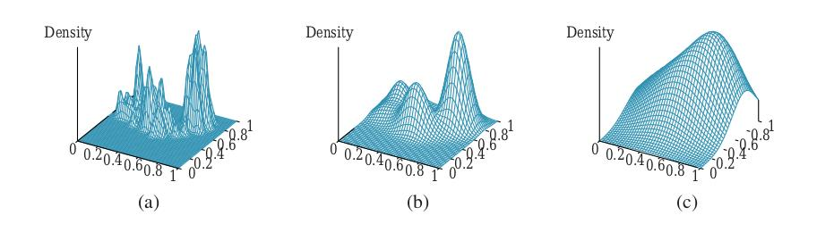

**شکل ۲۰.۱۰ — برآوردِ چگالی با هسته‌ها برای دادهٔ شکل ۲۰.۸(ب)، با هسته‌های گاوسی با w=0.02، 0.07 و 0.20 به‌ترتیب. w=0.07 تقریباً درست است.**

## ۲۰.۳ یادگیری با متغیرهای پنهان: الگوریتمِ EM

بخشِ قبلی با حالتِ کاملاً قابلِ مشاهده سروکار داشت. بسیاری از مسائلِ دنیایِ واقعی «متغیرهای پنهان» (Hidden Variables) دارند (که گاهی «متغیرهای نهان» (Latent Variables) نیز نامیده می‌شوند)، که در داده قابلِ مشاهده نیستند. برای نمونه، سوابقِ پزشکی اغلب شاملِ نشانه‌های مشاهده‌شده، تشخیصِ پزشک، درمانِ اعمال‌شده و شاید پیامدِ درمان‌اند، اما به‌ندرت شاملِ مشاهدهٔ مستقیمِ خودِ بیماری‌اند! (توجه کنید تشخیص بیماری نیست؛ پیامدِ علّیِ نشانه‌های مشاهده‌شده است، که به‌نوبهٔ خود توسط بیماری ایجاد شده‌اند.) ممکن است کسی بپرسد، «اگر بیماری مشاهده نشود، آیا می‌توانیم مدلی را فقط بر اساسِ متغیرهای مشاهده‌شده بسازیم؟» پاسخ در شکل ۲۰.۱۱ ظاهر می‌شود، که مدلِ تشخیصیِ کوچک و تخیلیِ بیماریِ قلبی را نشان می‌دهد. سه عاملِ مستعدکنندهٔ قابلِ مشاهده و سه نشانهٔ قابلِ مشاهده (که نام‌بردنشان افسرده‌کننده است) هست. فرض کنید هر متغیر سه مقدارِ ممکن دارد (مثلاً هیچ، متوسط و شدید).


**شکل ۲۰.۱۱ — (الف) شبکهٔ تشخیصیِ ساده برای بیماریِ قلبی، که فرض می‌شود متغیرِ پنهان باشد. هر متغیر سه مقدار دارد و با شمارِ پارامترهای مستقلِ توزیعِ شرطی‌اش برچسب‌گذاری شده؛ شمارِ کل 78 است. (ب) شبکهٔ معادل با حذفِ HeartDisease. توجه کنید متغیرهای نشانه دیگر با توجه به والدهایشان به‌صورتِ شرطی مستقل نیستند. این شبکه به 708 پارامتر نیاز دارد.**

حذفِ متغیرِ پنهان از شبکهٔ (الف)، شبکهٔ (ب) را می‌دهد، که در آن متغیرهای نشانه دیگر با توجه به والدهایشان به‌صورتِ شرطی مستقل نیستند. این شبکه به 708 پارامتر نیاز دارد، در حالی که شبکهٔ اصلی با متغیرِ پنهان فقط 78 پارامتر لازم دارد. این مثال نشان می‌دهد متغیرهای پنهان می‌توانند بازنماییِ مدل را به‌صورتِ دراماتیک ساده‌کنند. اگر متغیرِ پنهان مشاهده شود یا نشود، این مزیتِ بازنمایی باقی می‌ماند؛ اما اگر مشاهده نشود، یادگیریِ پارامترها دشوارتر می‌شود. این بخش الگوریتمِ «بیشینه‌سازیِ انتظار» (Expectation–Maximization یا EM) را توصیف می‌کند، الگوریتمی عمومی برای یادگیریِ مدل‌های احتمالی با متغیرهای پنهان. EM الگوریتمی تکرارشونده است که دو گام را متناوب می‌کند: گامِ E (انتظار) پسینیِ متغیرهای پنهان را با توجه به مدلِ کنونی و دادهٔ مشاهده‌شده محاسبه می‌کند؛ گامِ M (بیشینه‌سازی) پارامترهای مدل را برای بیشینه‌کردنِ لگاریتمِ درستنماییِ موردانتظارِ داده، با استفاده از پسینی‌های محاسبه‌شده در گامِ E، به‌روزرسانی می‌کند. فرایند تا همگرایی تکرار می‌شود.

### ۲۰.۳.۱ خوشه‌بندیِ نظارت‌نشده: یادگیریِ مخلوطِ گاوسی‌ها

«خوشه‌بندیِ نظارت‌نشده» (Unsupervised Clustering) مسئلهٔ تشخیصِ چند رده در مجموعه‌ای از اشیاست. مسئله نظارت‌نشده است، زیرا برچسب‌های رده داده نشده‌اند. برای نمونه، فرض کنیم طیفِ صد هزار ستاره را ثبت کنیم؛ آیا انواعِ متفاوتی از ستاره‌ها توسط طیف‌ها آشکار می‌شوند، و اگر آری، چند نوع و ویژگی‌هایشان چیست؟ ما همگی با اصطلاحاتی مانندِ «غولِ سرخ» و «کوتولهٔ سفید» آشنا هستیم، اما ستاره‌ها این برچسب‌ها را روی کلاه‌هایشان ندارند—ستاره‌شناسان باید خوشه‌بندیِ نظارت‌نشده انجام می‌دادند تا این رده‌ها را شناسایی کنند. مثال‌های دیگر شاملِ شناساییِ گونه‌ها، سرده‌ها، راسته‌ها، شاخه‌ها و... در رده‌بندیِ لینه‌ای و ایجادِ انواعِ طبیعی برای اشیای معمولی است (فصل ۱۰ را ببینید). خوشه‌بندیِ نظارت‌نشده با داده شروع می‌شود. شکل ۲۰.۱۲(ب) ۵۰۰ نقطهٔ داده را نشان می‌دهد، که هر یک مقادیرِ دو ویژگیِ پیوسته را مشخص می‌کند. نقاطِ داده ممکن است با ستاره‌ها متناظر باشند، و ویژگی‌ها ممکن است با شدت‌های طیفی در دو بسامدِ خاص متناظر باشند.

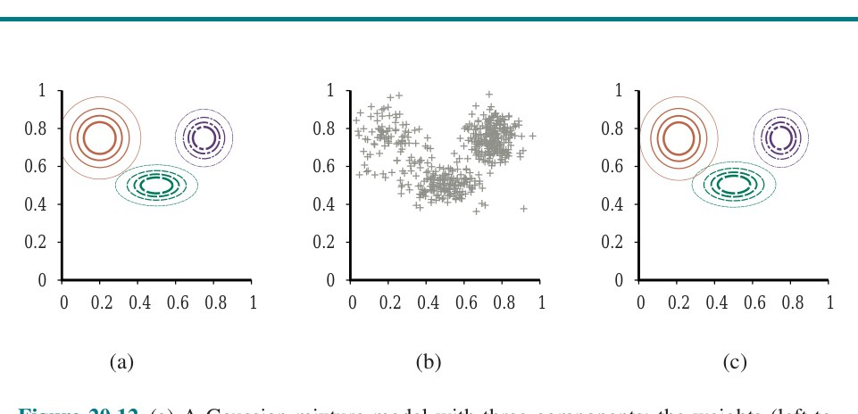

**شکل ۲۰.۱۲ — (الف) مدلِ مخلوطِ گاوسی با سه مؤلفه؛ وزن‌ها (از چپ به راست) 0.2، 0.3 و 0.5 هستند. (ب) ۵۰۰ نقطهٔ دادهٔ نمونه‌برداری‌شده از مدلِ (الف). (ج) مدلِ بازسازی‌شده توسط EM از دادهٔ (ب).**

بعد، باید بفهمیم چه نوع توزیعِ احتمالی ممکن است داده را تولید کرده باشد. خوشه‌بندی فرض می‌کند داده از «توزیعِ مخلوط» (Mixture Distribution) به نامِ P تولید شده. چنین توزیعی k مؤلفه دارد، که هر یک به‌حق خودش توزیعی است. نقطهٔ داده با نخست انتخابِ مؤلفه و سپس تولیدِ نمونه‌ای از آن مؤلفه تولید می‌شود. متغیرِ تصادفیِ C مؤلفه را با مقادیرِ 1,...,k نشان دهد؛ سپس توزیعِ مخلوط چنین داده می‌شود:

```
P(x) = ∑_{i=1}^{k} P(C=i) P(x|C=i)
```

که در آن x به مقادیرِ ویژگی‌های نقطهٔ داده اشاره دارد. برای دادهٔ پیوسته، انتخابِ طبیعی برای توزیع‌های مؤلفه، گاوسیِ چندمتغیره است، که خانوادهٔ به اصطلاح «مخلوطِ گاوسی‌ها» (Mixture of Gaussians) را می‌دهد. پارامترهای مخلوطِ گاوسی‌ها wi = P(C=i) (وزنِ هر مؤلفه)، µi (میانگینِ هر مؤلفه) و Σi (کوواریانسِ هر مؤلفه) هستند. شکل ۲۰.۱۲(الف) مخلوطی از سه گاوسی را نشان می‌دهد؛ این مخلوط در واقع منبعِ دادهٔ (ب) و نیز مدلِ نشان‌داده‌شده در شکل ۲۰.۸(الف) در صفحهٔ ۷۳۶ است. مسئلهٔ خوشه‌بندیِ نظارت‌نشده، پس، بازیابیِ مدلِ مخلوطِ گاوسی مانندِ شکل ۲۰.۱۲(الف) از دادهٔ خام مانندِ شکل ۲۰.۱۲(ب) است. بدیهی است، اگر می‌دانستیم کدام مؤلفه هر نقطهٔ داده را تولید کرده، بازیابیِ گاوسی‌های مؤلفه آسان بود: می‌توانستیم همهٔ نقاطِ داده از مؤلفهٔ معین را انتخاب کنیم و سپس (نسخهٔ چندمتغیره‌ای از) معادلهٔ (20.4) (صفحهٔ ۷۲۹) را برای برازشِ پارامترهای گاوسی به مجموعه‌ای از داده اعمال کنیم. از سوی دیگر، اگر پارامترهای هر مؤلفه را می‌دانستیم، می‌توانستیم، دستِ‌کم در معنایِ احتمالاتی، هر نقطهٔ داده را به مؤلفه‌ای تخصیص دهیم.

مسئله این است که نه تخصیص‌ها را می‌دانیم و نه پارامترها را. ایدهٔ پایهٔ EM در این بافت این است که وانمود کنیم پارامترهای مدل را می‌دانیم و سپس احتمالِ تعلقِ هر نقطهٔ داده به هر مؤلفه را استنتاج کنیم. پس از آن، مؤلفه‌ها را به داده برازش می‌کنیم، جایی که هر مؤلفه به کلِ مجموعهٔ داده برازش می‌شود با هر نقطه که با احتمالِ تعلقش به آن مؤلفه وزن‌گذاری شده. فرایند تا همگرایی تکرار می‌شود. اساساً، ما در حالِ «تکمیلِ» داده با استنتاجِ توزیع‌های احتمال روی متغیرهای پنهان—هر نقطهٔ داده به کدام مؤلفه تعلق دارد—بر اساسِ مدلِ کنونی‌ایم. برای مخلوطِ گاوسی‌ها، پارامترهای مدلِ مخلوط را خودسرانه مقداردهی می‌کنیم و سپس دو گامِ زیر را تکرار می‌کنیم:

۱. **گامِ E:** احتمال‌های pij = P(C=i|xj)، احتمالِ اینکه دادهٔ xj توسط مؤلفهٔ i تولید شده، را محاسبه کن. با قاعدهٔ بیز، pij = αP(xj|C=i)P(C=i) داریم. جملهٔ P(xj|C=i) فقط احتمالِ xj زیرِ گاوسیِ iام است، و جملهٔ P(C=i) فقط پارامترِ وزنِ گاوسیِ iام است. ni = ∑j pij را تعریف کن، شمارِ مؤثرِ نقاطِ داده‌ای که در حالِ حاضر به مؤلفهٔ i تخصیص داده شده‌اند.

۲. **گامِ M:** میانگین، کوواریانس و وزن‌های مؤلفهٔ تازه را با گام‌های زیر به‌ترتیب محاسبه کن:

```
µi ← ∑j pij xj / ni
Σi ← ∑j pij (xj − µi)(xj − µi)ᵀ / ni
wi ← ni/N
```

که در آن N شمارِ کلِ نقاطِ داده است. گامِ E، یا گامِ انتظار، را می‌توان محاسبهٔ مقادیرِ موردانتظارِ pij متغیرهای نشانگرِ پنهانِ Zij دانست، که در آن Zij برابر 1 است اگر دادهٔ xj توسط مؤلفهٔ i تولید شده باشد و در غیرِ این صورت 0. گامِ M، یا گامِ بیشینه‌سازی، مقادیرِ تازهٔ پارامترهایی را می‌یابد که لگاریتمِ درستنماییِ داده را، با توجه به مقادیرِ موردانتظارِ متغیرهای نشانگرِ پنهان، بیشینه می‌کنند.

مدلِ نهایی‌ای که EM وقتی روی دادهٔ شکل ۲۰.۱۲(الف) اعمال می‌شود یاد می‌گیرد در شکل ۲۰.۱۲(ج) نشان داده شده؛ عملاً از مدلِ اصلی‌ای که داده از آن تولید شده (خطِ افقی) غیرقابلِ تمایز است. شکل ۲۰.۱۳(الف) لگاریتمِ درستنماییِ داده را طبقِ مدلِ کنونی با پیشرویِ EM رسم می‌کند.


**شکل ۲۰.۱۳ — نمودارهایی که لگاریتمِ درستنماییِ داده، L، را به‌عنوانِ تابعی از تکرارِ EM نشان می‌دهند. خطِ افقی لگاریتمِ درستنماییِ طبقِ مدلِ واقعی را نشان می‌دهد. (الف) نمودار برای مدلِ مخلوطِ گاوسیِ شکل ۲۰.۱۲. (ب) نمودار برای شبکهٔ بیزیِ شکل ۲۰.۱۴(الف).**

دو نکته برای توجه هست. نخست، لگاریتمِ درستنماییِ مدلِ نهاییِ یادگرفته‌شده کمی از مدلِ اصلی، که داده از آن تولید شد، فراتر می‌رود. این ممکن است شگفت‌آور به نظر برسد، اما صرفاً این واقعیت را بازتاب می‌دهد که داده به‌صورتِ تصادفی تولید شده و ممکن است بازتابِ دقیقی از مدلِ زیربنایی فراهم نکند. نکتهٔ دوم این است که EM در هر تکرار لگاریتمِ درستنماییِ داده را افزایش می‌دهد. این واقعیت را می‌توان به‌طورِ کلی اثبات کرد. علاوه بر این، تحتِ شرایطِ معینی (که در بیشترِ موارد برقرارند)، می‌توان اثبات کرد EM به بیشینهٔ محلیِ درستنمایی می‌رسد. (در مواردِ نادر، می‌تواند به نقطهٔ زینی یا حتی کمینهٔ محلی برسد.) از این نظر، EM شبیهِ الگوریتمِ تپه‌نوردیِ مبتنی بر گرادیان است، اما توجه کنید پارامترِ «اندازهٔ گام» ندارد.

همیشه همه‌چیز به‌خوبیِ شکل ۲۰.۱۳(الف) پیش نمی‌رود. ممکن است، برای نمونه، رخ دهد یکی از مؤلفه‌های گاوسی چنان کوچک شود که فقط یک نقطهٔ داده را بپوشاند. سپس واریانسش به صفر و درستنمایی‌اش به بی‌نهایت می‌رود! اگر ندانیم چند مؤلفه در مخلوط است، باید مقادیرِ مختلفِ k را امتحان کنیم و ببینیم کدام بهتر است؛ آن می‌تواند منبعِ خطا باشد. مسئلهٔ دیگر این است که دو مؤلفه می‌توانند «ادغام» شوند، با میانگین‌ها و واریانس‌های یکسان و به‌اشتراک‌گذاریِ نقاطِ داده‌شان. این نوع بیشینه‌های محلیِ تباهیده مسائلِ جدی‌اند، به‌ویژه در ابعادِ بالا. یکی از راه‌حل‌ها گذاشتنِ پیشینی روی پارامترهای مدل و اعمالِ نسخهٔ MAPِ EM است. راهِ دیگر راه‌اندازیِ دوبارهٔ مؤلفه با پارامترهای تصادفیِ تازه اگر بیش‌ازحد کوچک شود یا بیش‌ازحد به مؤلفهٔ دیگر نزدیک شود. مقداردهیِ حساس نیز کمک می‌کند.

### ۲۰.۳.۲ یادگیریِ مقادیرِ پارامترِ شبکه‌های بیز برای متغیرهای پنهان

برای یادگیریِ شبکهٔ بیزی با متغیرهای پنهان، همان بینش‌هایی را اعمال می‌کنیم که برای مخلوطِ گاوسی‌ها کار کرد. شکل ۲۰.۱۴(الف) وضعیتی را بازنمایی می‌کند که در آن دو کیسهٔ آب‌نبات با هم مخلوط شده‌اند. آب‌نبات‌ها با سه ویژگی توصیف می‌شوند: علاوه بر Flavor و Wrapper، برخی آب‌نبات‌ها سوراخِ (Hole) وسطی دارند و برخی نه.

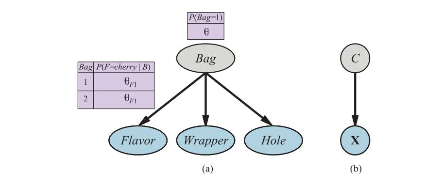

**شکل ۲۰.۱۴ — (الف) مدلِ مخلوط برای آب‌نبات. نسبت‌های طعم‌های مختلف، لفاف‌ها و وجودِ سوراخ به کیسه بستگی دارد، که مشاهده نمی‌شود. (ب) شبکهٔ بیزی برای مخلوطِ گاوسی. میانگین و کوواریانسِ متغیرهای قابلِ مشاهدهِ X به مؤلفهٔ C بستگی دارد.**

توزیعِ آب‌نبات‌های هر کیسه با مدلِ بیزِ ساده توصیف می‌شود: ویژگی‌ها با توجه به کیسه مستقل‌اند، اما توزیعِ احتمالِ شرطیِ هر ویژگی به کیسه بستگی دارد. پارامترها چنین‌اند: θ احتمالِ پیشینیِ اینکه آب‌نباتی از کیسهٔ 1 باشد؛ θF1 و θF2 احتمال‌های اینکه طعم گیلاس باشد، با توجه به اینکه آب‌نبات به‌ترتیب از کیسهٔ 1 یا 2 می‌آید؛ θW1 و θW2 احتمال‌های قرمزبودنِ لفاف را می‌دهند؛ و θH1 و θH2 احتمال‌های سوراخ‌داشتنِ آب‌نبات.

مدلِ کلی مدلِ مخلوط است: جمعِ وزن‌دارِ دو توزیعِ متفاوت، که هر یک حاصلِ‌ضربی از توزیع‌های مستقلِ تک‌متغیره است. (در واقع، می‌توانیم مخلوطِ گاوسی‌ها را نیز به‌عنوانِ شبکهٔ بیزی مدل کنیم، چنان‌که در شکل ۲۰.۱۴(ب) نشان داده شده.) در شکل، کیسه متغیرِ پنهان است، زیرا پس از مخلوط‌شدنِ آب‌نبات‌ها، دیگر نمی‌دانیم هر آب‌نبات از کدام کیسه آمده. در چنین حالتی، آیا می‌توانیم توصیف‌های دو کیسه را با مشاهدهٔ آب‌نبات‌های مخلوط بازیابی کنیم؟ بیایید یک تکرارِ EM را برای این مسئله کار کنیم. نخست، به داده نگاه کنیم. 1000 نمونه از مدلی تولید کردیم که پارامترهای واقعی‌اش چنین‌اند:

```
θ = 0.5،    θF1 = θW1 = θH1 = 0.8،    θF2 = θW2 = θH2 = 0.3        (20.9)
```

یعنی آب‌نبات‌ها به‌یکسان محتمل است از هر کیسه بیایند؛ نخستین عمدتاً گیلاس با لفافِ قرمز و سوراخ است؛ دومین عمدتاً لیمو با لفافِ سبز و بدونِ سوراخ. شمارش‌های هشت نوعِ ممکنِ آب‌نبات چنین‌اند:

| | W = قرمز | | W = سبز | |
|---|---|---|---|---|
| | H = 1 | H = 0 | H = 1 | H = 0 |
| **F = گیلاس** | 273 | 93 | 104 | 90 |
| **F = لیمو** | 79 | 100 | 94 | 167 |

با مقداردهیِ پارامترها شروع می‌کنیم. برای سادگیِ عددی، خودسرانه⁵ انتخاب می‌کنیم:

```
θ⁽⁰⁾ = 0.6،    θF1⁽⁰⁾ = θW1⁽⁰⁾ = θH1⁽⁰⁾ = 0.6،    θF2⁽⁰⁾ = θW2⁽⁰⁾ = θH2⁽⁰⁾ = 0.4        (20.10)
```

نخست، روی پارامترِ θ کار کنیم. در حالتِ کاملاً قابلِ مشاهده، آن را مستقیماً از شمارش‌های مشاهده‌شدهٔ آب‌نبات‌های کیسه‌های 1 و 2 برآورد می‌کردیم. چون کیسه متغیرِ پنهان است، در عوض شمارشِ موردانتظار را محاسبه می‌کنیم. شمارشِ موردانتظارِ N̂(Bag=1) جمعِ، روی همهٔ آب‌نبات‌ها، احتمالِ اینکه آب‌نبات از کیسهٔ 1 آمده است:

```
θ⁽¹⁾ = N̂(Bag=1)/N = ∑_{j=1}^{N} P(Bag=1|flavor_j, wrapper_j, holes_j)/N
```

این احتمال‌ها را می‌توان با هر الگوریتمِ استنتاجی برای شبکه‌های بیزی محاسبه کرد. برای مدلِ بیزِ ساده مانندِ مثالِ ما، می‌توانیم استنتاج را «با دست» انجام دهیم، با قاعدهٔ بیز و اعمالِ استقلالِ شرطی:

```
θ⁽¹⁾ = (1/N) ∑_{j=1}^{N} [P(flavor_j|Bag=1)P(wrapper_j|Bag=1)P(holes_j|Bag=1)P(Bag=1)]
                        / [∑i P(flavor_j|Bag=i)P(wrapper_j|Bag=i)P(holes_j|Bag=i)P(Bag=i)]
```

با اعمالِ این فرمول بر، مثلاً، 273 آب‌نباتِ گیلاسِ لفافِ قرمزِ سوراخ‌دار، سهمی از:

```
(1/1000) · (θF1⁽⁰⁾θW1⁽⁰⁾θH1⁽⁰⁾θ⁽⁰⁾) / (θF1⁽⁰⁾θW1⁽⁰⁾θH1⁽⁰⁾θ⁽⁰⁾ + θF2⁽⁰⁾θW2⁽⁰⁾θH2⁽⁰⁾(1−θ⁽⁰⁾)) ≈ 0.22797
```

می‌گیریم. با ادامه با هفت نوعِ دیگرِ آب‌نبات در جدولِ شمارش، θ⁽¹⁾ = 0.6124 به دست می‌آوریم.

حالا پارامترهای دیگر، مانندِ θF1، را در نظر بگیریم. در حالتِ کاملاً قابلِ مشاهده، آن را مستقیماً از شمارش‌های مشاهده‌شدهٔ آب‌نبات‌های گیلاس و لیمویِ کیسهٔ 1 برآورد می‌کردیم. شمارشِ موردانتظارِ آب‌نبات‌های گیلاسِ کیسهٔ 1 چنین داده می‌شود:

```
∑_{j: Flavor_j = cherry} P(Bag=1|Flavor_j = cherry, wrapper_j, holes_j)
```

باز، این احتمال‌ها را می‌توان با هر الگوریتمِ شبکهٔ بیزی محاسبه کرد. با کامل‌کردنِ این فرایند، مقادیرِ تازهٔ همهٔ پارامترها را به دست می‌آوریم:

```
θ⁽¹⁾ = 0.6124،    θF1⁽¹⁾ = 0.6684،    θW1⁽¹⁾ = 0.6483،    θH1⁽¹⁾ = 0.6558،
θF2⁽¹⁾ = 0.3887،    θW2⁽¹⁾ = 0.3817،    θH2⁽¹⁾ = 0.3827        (20.11)
```

لگاریتمِ درستنماییِ داده از حدود −2044 در آغاز به حدود −2021 پس از نخستین تکرار افزایش می‌یابد، چنان‌که در شکل ۲۰.۱۳(ب) نشان داده شده. یعنی، به‌روزرسانی خودِ درستنمایی را با ضریبِ حدودِ e²³ ≈ 10¹⁰ بهبود می‌بخشد. تا تکرارِ دهم، مدلِ یادگرفته‌شده برازشِ بهتری از مدلِ اصلی است (L = −1982.214). پس از آن، پیشرفت بسیار کند می‌شود. این با EM غیرمعمول نیست، و بسیاری از سامانه‌های عملی EM را با الگوریتمِ مبتنی بر گرادیان مانندِ نیوتن–رافسون (فصل ۴ را ببینید) برای فازِ آخرِ یادگیری ترکیب می‌کنند.

درسِ عمومی از این مثال این است که به‌روزرسانی‌های پارامتر برای یادگیریِ شبکهٔ بیزی با متغیرهای پنهان مستقیماً از نتایجِ استنتاج روی هر مثال در دسترس‌اند. علاوه بر این، فقط احتمال‌های پسینیِ محلی برای هر پارامتر لازم است. در این‌جا، «محلی» بدان معناست جدولِ احتمالِ شرطی (CPT) هر متغیرِ Xi را می‌توان از احتمال‌های پسینیِ شاملِ فقط Xi و والدهایش Ui یاد گرفت. با تعریفِ θijk به‌عنوانِ پارامترِ CPTِ P(Xi = xij | Ui = uik)، به‌روزرسانی با شمارش‌های موردانتظارِ نرمال‌شده چنین داده می‌شود:

```
θijk ← N̂(Xi = xij, Ui = uik) / N̂(Ui = uik)
```

شمارش‌های موردانتظار با جمع‌زدن روی مثال‌ها، با محاسبهٔ احتمال‌های P(Xi = xij, Ui = uik) برای هر یک با هر الگوریتمِ استنتاجِ شبکهٔ بیزی، به دست می‌آیند. برای الگوریتم‌های دقیق—شاملِ حذفِ متغیر—همهٔ این احتمال‌ها مستقیماً به‌عنوانِ محصولِ جانبیِ استنتاجِ استاندارد قابلِ‌حصول‌اند، بدونِ نیاز به محاسبه‌های اضافیِ خاصِ یادگیری. علاوه بر این، اطلاعاتِ لازم برای یادگیری برای هر پارامتر به‌صورتِ محلی در دسترس است.

اگر کمی به عقب بایستیم، می‌توانیم فکر کنیم الگوریتمِ EM در این مثال چه می‌کند: بازیابیِ هفت پارامتر (θ، θF1، θW1، θH1، θF2، θW2، θH2) از هفت (2³ − 1) شمارشِ مشاهده‌شده در داده. (شمارشِ هشتم با این واقعیت که شمارش‌ها به 1000 جمع می‌شوند ثابت است.) اگر هر آب‌نبات با دو ویژگی به‌جای سه تا توصیف می‌شد (مثلاً با حذفِ سوراخ‌ها)، پنج پارامتر (θ، θF1، θW1، θF2، θW2) اما فقط سه (2² − 1) شمارشِ مشاهده‌شده می‌داشتیم. در چنین حالتی، بازیابیِ وزنِ مخلوطِ θ یا ویژگی‌های دو کیسه‌ای که مخلوط شدند ممکن نیست.

### ۲۰.۳.۳ یادگیریِ مدل‌های مارکوفِ پنهان

کاربردِ نهاییِ ما از EM شاملِ یادگیریِ احتمال‌های انتقال در مدل‌های مارکوفِ پنهان (HMMها) است. از بخش ۱۴.۳ به یاد آورید مدلِ مارکوفِ پنهان را می‌توان با شبکهٔ بیزِ پویا با متغیرِ حالتِ گسستهٔ تکی بازنمایی کرد، چنان‌که در شکل ۲۰.۱۵ نشان داده شده.

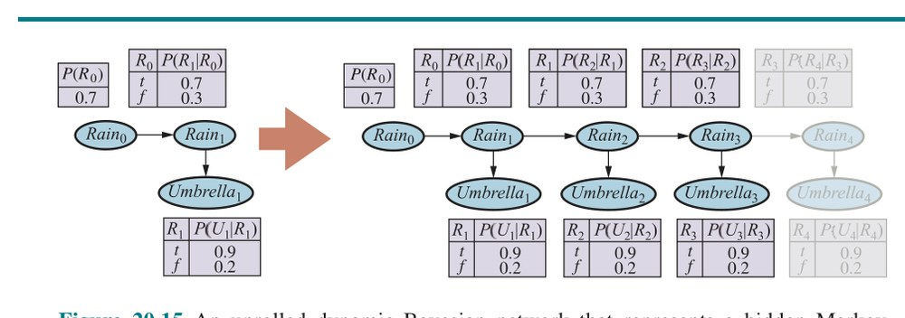

**شکل ۲۰.۱۵ — شبکهٔ بیزیِ پویایِ بازشده که مدلِ مارکوفِ پنهانی را بازنمایی می‌کند. (متغیرهای حالتِ Xt و مشاهده‌های Et در برش‌های زمانیِ متوالی.)**

هر نقطهٔ داده شاملِ توالیِ مشاهده‌ای با طولِ متناهی است، پس مسئله یادگیریِ احتمال‌های انتقال از مجموعه‌ای از توالی‌های مشاهده (یا از فقط یک توالیِ بلند) است. قبلاً دیده‌ایم چگونه شبکه‌های بیز را یاد بگیریم، اما پیچیدگی‌ای هست: در شبکه‌های بیز، هر پارامتر متمایز است؛ در مدلِ مارکوفِ پنهان، از سوی دیگر، احتمال‌های انتقالِ فردی از حالتِ i به حالتِ j در زمانِ t، θijt = P(Xt+1 = j | Xt = i)، در طولِ زمان تکرار می‌شوند—یعنی θijt = θij برای همهٔ t. برای برآوردِ احتمالِ انتقال از حالتِ i به حالتِ j، به‌سادگی نسبتِ موردانتظارِ دفعاتی را محاسبه می‌کنیم که سامانه هنگامِ بودن در حالتِ i به حالتِ j انتقال می‌یابد:

```
θij ← ∑t N̂(Xt+1 = j, Xt = i) / ∑t N̂(Xt = i)
```

شمارش‌های موردانتظار با الگوریتمِ استنتاجِ HMM محاسبه می‌شوند. الگوریتمِ پیشرو–عقب‌روِ نشان‌داده‌شده در شکل ۱۴.۴ را می‌توان به‌راحتی برای محاسبهٔ احتمال‌های لازم اصلاح کرد. نکتهٔ مهم این است که احتمال‌های لازم با هموارسازی به دست می‌آیند، نه فیلترکردن. فیلترکردن توزیعِ احتمالِ حالتِ کنونی را با توجه به گذشته می‌دهد، اما هموارسازی توزیع را با توجه به همهٔ شواهد، از جملهِ آنچه بعداً رخ داده، می‌دهد. این نسخهٔ EM برای HMMها «الگوریتمِ باوم–ولچ» (Baum–Welch Algorithm) نامیده می‌شود، به نامِ مخترعانش.

### ۲۰.۳.۴ شکلِ عمومیِ الگوریتمِ EM

چند نمونه از الگوریتمِ EM دیده‌ایم. هر یک شاملِ محاسبهٔ مقادیرِ موردانتظارِ متغیرهای پنهان برای هر مثال و سپس بازمحاسبهٔ پارامترها، با استفاده از مقادیرِ موردانتظار چنان‌که گویی مقادیرِ مشاهده‌شده‌اند، است. x همهٔ مقادیرِ مشاهده‌شده در همهٔ مثال‌ها، Z همهٔ متغیرهای پنهان برای همهٔ مثال‌ها، و θ همهٔ پارامترهای مدلِ احتمال باشد. سپس الگوریتمِ EM:

```
θ⁽ⁱ⁺¹⁾ = argmax_θ ∑z P(Z=z|x,θ⁽ⁱ⁾) L(x, Z=z|θ)
```

این معادله الگوریتمِ EM در یک‌کلام است. گامِ E محاسبهٔ جمع است، که انتظارِ لگاریتمِ درستنماییِ دادهٔ «تکمیل‌شده» نسبت به توزیعِ P(Z=z|x,θ⁽ⁱ⁾) است، که پسینِ متغیرهای پنهان با توجه به داده است. گامِ M بیشینه‌سازیِ این لگاریتمِ درستنماییِ موردانتظار نسبت به پارامترهاست. برای مخلوطِ گاوسی‌ها، متغیرهای پنهان Zij ها هستند، که در آن Zij برابر 1 است اگر مثالِ j توسط مؤلفهٔ i تولید شده باشد. برای شبکه‌های بیز، Zij مقدارِ متغیرِ مشاهده‌نشدهٔ Xi در مثالِ j است. برای HMMها، Zjt حالتِ توالیِ مثالِ j در زمانِ t است. با شروع از شکلِ عمومی، می‌توان الگوریتمِ EM را برای کاربردِ خاصی اشتقاق کرد، پس از شناساییِ متغیرهای پنهانِ مناسب.

به محض فهمِ ایدهٔ عمومیِ EM، اشتقاقِ انواعِ گوناگون و بهبودها آسان می‌شود. برای نمونه، در بسیاری از موارد گامِ E—محاسبهٔ پسینی‌ها روی متغیرهای پنهان—ناشدنی است، مانندِ شبکه‌های بیزِ بزرگ. معلوم می‌شود می‌توان از گامِ E تقریبی استفاده کرد و همچنان الگوریتمِ یادگیریِ مؤثری به دست آورد. با الگوریتمِ نمونه‌برداری مانندِ MCMC (بخش ۱۳.۴ را ببینید)، فرایندِ یادگیری بسیار شهودی است: هر حالت (پیکربندیِ متغیرهای پنهان و مشاهده‌شده) که MCMC از آن بازدید می‌کند دقیقاً چنان رفتار می‌شود که گویی مشاهدهٔ کاملی است. بدین‌ترتیب، پارامترها را می‌توان مستقیماً پس از هر گذارِ MCMC به‌روزرسانی کرد. شکل‌های دیگرِ استنتاجِ تقریبی، مانندِ روش‌های تغییراتی و انتشارِ باورِ حلقه‌دار، نیز برای یادگیریِ شبکه‌های بسیار بزرگ مؤثر ثابت شده‌اند.

### ۲۰.۳.۵ یادگیریِ ساختارِ شبکه‌های بیز با متغیرهای پنهان

در بخش ۲۰.۲.۷، مسئلهٔ یادگیریِ ساختارِ شبکه‌های بیز با دادهٔ کامل را بحث کردیم. وقتی متغیرهای مشاهده‌نشده بر دادهٔ مشاهده‌شده اثر می‌گذارند، اوضاع دشوارتر می‌شود. در ساده‌ترین حالت، کارشناسِ انسانی ممکن است به الگوریتمِ یادگیری بگوید متغیرهای پنهانِ خاصی وجود دارند، و یافتنِ جایشان در ساختارِ شبکه را به الگوریتم واگذارد. برای نمونه، الگوریتمی ممکن است سعی کند ساختارِ نشان‌داده‌شده در شکل ۲۰.۱۱(الف) در صفحهٔ ۷۳۸ را یاد بگیرد، با توجه به اطلاعاتِ اینکه HeartDisease (متغیرِ سه‌مقداره) باید در مدل گنجانده شود. مانندِ حالتِ دادهٔ کامل، الگوریتمِ کلی حلقهٔ بیرونی دارد که روی ساختارها جستجو می‌کند و حلقهٔ درونی که پارامترهای شبکه را با توجه به ساختار برازش می‌کند.

اگر به الگوریتمِ یادگیری گفته نشود کدام متغیرهای پنهان وجود دارند، دو انتخاب هست: یا وانمود کنیم داده واقعاً کامل است—که ممکن است الگوریتم را به یادگیریِ مدلی پارامتر-فشرده مانندِ شکل ۲۰.۱۱(ب) وادار کند—یا متغیرهای پنهانِ تازه‌ای برای ساده‌کردنِ مدل اختراع کنیم. رویکردِ اخیر را می‌توان با گنجاندنِ انتخاب‌های اصلاحِ تازه در جستجوی ساختار پیاده‌سازی کرد: علاوه بر اصلاحِ پیوندها، الگوریتم می‌تواند متغیرِ پنهانی را بیفزاید یا حذف کند یا آریتی‌اش را تغییر دهد. البته، الگوریتم نخواهد دانست متغیرِ تازه‌ای که اختراع کرده HeartDisease نامیده می‌شود؛ و برای مقادیرش نام‌های معناداری نخواهد داشت. خوشبختانه، متغیرهای پنهانِ تازه‌اختراع‌شده معمولاً به متغیرهای ازپیش‌موجود متصل خواهند شد، پس کارشناسِ انسانی اغلب می‌تواند توزیع‌های شرطیِ محلیِ شاملِ متغیرِ تازه را بازرسی کند و معنایش را دریابد.

مانندِ حالتِ دادهٔ کامل، یادگیریِ خالصِ ساختارِ بیشینه‌درستنمایی به شبکهٔ کاملاً متصل می‌انجامد (علاوه بر آن، شبکه‌ای بدونِ متغیرهای پنهان)، پس نوعی جریمهٔ پیچیدگی لازم است. همچنین می‌توانیم MCMC را برای نمونه‌برداری از ساختارهای شبکهٔ ممکنِ بسیار اعمال کنیم، و بدین‌ترتیب یادگیریِ بیزی را تقریب بزنیم. برای نمونه، می‌توانیم مخلوطِ گاوسی‌ها را با شمارِ ناشناخته‌ای مؤلفه با نمونه‌برداری روی شمار یاد بگیریم؛ توزیعِ پسینیِ تقریبیِ شمارِ گاوسی‌ها با بسامدهای نمونه‌برداریِ فرایندِ MCMC داده می‌شود.

برای حالتِ دادهٔ کامل، حلقهٔ درونیِ یادگیریِ پارامترها بسیار سریع است—فقط مسئلهٔ استخراجِ بسامدهای شرطی از مجموعهٔ داده. وقتی متغیرهای پنهان هستند، حلقهٔ درونی ممکن است شاملِ تکرارهای بسیاری از EM یا الگوریتمِ مبتنی بر گرادیان باشد، و هر تکرار شاملِ محاسبهٔ پسینی‌ها در شبکهٔ بیز است، که خودش مسئلهٔ NP-سختی است. تا به امروز، این رویکرد برای یادگیریِ مدل‌های پیچیده غیرعملی ثابت شده.

بهبودِ ممکنِ یکی «الگوریتمِ EM ساختاری» (Structural EM) است، که تقریباً به همان شیوهٔ EM معمولی (پارامتری) عمل می‌کند به‌جز اینکه الگوریتم می‌تواند ساختار را نیز به‌روزرسانی کند، نه فقط پارامترها را. همان‌گونه که EM معمولی از پارامترهای کنونی برای محاسبهٔ شمارش‌های موردانتظار در گامِ E استفاده می‌کند و سپس آن شمارش‌ها را در گامِ M برای انتخابِ پارامترهای تازه اعمال می‌کند، EM ساختاری از ساختارِ کنونی برای محاسبهٔ شمارش‌های موردانتظار استفاده می‌کند و سپس آن شمارش‌ها را در گامِ M برای ارزیابیِ درستنماییِ ساختارهای تازهٔ بالقوه اعمال می‌کند. (این با روشِ حلقه‌ی-بیرونی/حلقه‌ی-درونی در تضاد است، که شمارش‌های موردانتظارِ تازه‌ای برای هر ساختارِ بالقوه محاسبه می‌کند.) بدین‌گونه، EM ساختاری ممکن است چند اصلاحِ ساختاری به شبکه بدهد بدونِ اینکه یک‌بار هم شمارش‌های موردانتظار را بازمحاسبه کند، و قادر به یادگیریِ ساختارهای شبکهٔ بیزِ غیربدیهی است. EM ساختاری فضایِ جستجویی روی فضایِ ساختارها دارد، نه فضایِ ساختارها و پارامترها. با این حال، کارِ زیادی باقی مانده تا بتوانیم بگوییم مسئلهٔ یادگیریِ ساختار حل شده.

## خلاصهٔ فصل

روش‌های یادگیریِ آماری از محاسبهٔ سادهٔ میانگین‌ها تا ساختِ مدل‌های پیچیده مانندِ شبکه‌های بیزی متغیرند. کاربردهایی در سراسرِ علومِ رایانه، مهندسی، زیست‌شناسیِ محاسباتی، علومِ اعصاب، روان‌شناسی و فیزیک دارند. این فصل برخی از ایده‌های پایه را ارائه کرده و طعمی از زیرساخت‌های ریاضی داده است. نکاتِ اصلی:

- روش‌های یادگیریِ بیزی یادگیری را به‌عنوانِ شکلی از استنتاجِ احتمالاتی صورت‌بندی می‌کنند، با استفاده از مشاهده‌ها برای به‌روزرسانیِ توزیعِ پیشینی روی فرضیه‌ها. این رویکرد راهِ خوبی برای پیاده‌سازیِ تیغِ آوکام فراهم می‌کند، اما برای فضاهای فرضیهٔ پیچیده به‌سرعت ناشدنی می‌شود.
- یادگیریِ بیشینهٔ پسین (MAP) فرضیهٔ محتمل‌ترینِ تکی را با توجه به داده انتخاب می‌کند. پیشینِ فرضیه همچنان استفاده می‌شود و روش اغلب از یادگیریِ بیزیِ کامل شدنی‌تر است.
- یادگیریِ بیشینه‌درستنمایی صرفاً فرضیه‌ای را انتخاب می‌کند که درستنماییِ داده را بیشینه می‌کند؛ با پیشینِ یکنواخت معادلِ یادگیریِ MAP است. در مواردِ ساده مانندِ رگرسیونِ خطی و شبکه‌های بیزیِ کاملاً قابلِ مشاهده، راه‌حل‌های بیشینه‌درستنمایی به‌آسانی به‌صورتِ بسته یافت می‌شوند. یادگیریِ بیزِ ساده فنِ خاصاً مؤثری است که خوب مقیاس می‌شود.
- وقتی برخی متغیرها پنهان‌اند، راه‌حل‌های بیشینهٔ درستنماییِ محلی را می‌توان با الگوریتمِ بیشینه‌سازیِ انتظار (EM) یافت. کاربردها شاملِ خوشه‌بندیِ نظارت‌نشده با مخلوطِ گاوسی‌ها، یادگیریِ شبکه‌های بیزی و یادگیریِ مدل‌های مارکوفِ پنهان است.
- یادگیریِ ساختارِ شبکه‌های بیزی نمونه‌ای از انتخابِ مدل است. این معمولاً شاملِ جستجوی گسسته در فضایِ ساختارهاست. روشی برای معاوضهٔ پیچیدگیِ مدل با درجهٔ برازش لازم است.
- مدل‌های ناپارامتری توزیعی را با استفاده از مجموعهٔ نقاطِ داده بازنمایی می‌کنند. بدین‌ترتیب، شمارِ پارامترها با مجموعهٔ آموزشی رشد می‌کند. روش‌های نزدیک‌ترین-همسایه‌ها به مثال‌های نزدیکِ نقطهٔ موردِ نظر نگاه می‌کنند، در حالی که روش‌های هسته ترکیبِ وزن‌دار-فاصله‌ای از همهٔ مثال‌ها تشکیل می‌دهند.

یادگیریِ آماری همچنان حوزهٔ پژوهشیِ بسیار فعالی است. گام‌های عظیمی در هر دو نظریه و عمل برداشته شده، تا حدی که یادگیریِ تقریباً هر مدلی که استنتاجِ دقیق یا تقریبی برایش شدنی است ممکن شده.

## یادداشت‌های کتاب‌شناختی و تاریخی

کاربردِ فنونِ یادگیریِ آماری در هوش مصنوعی در سال‌های آغازین حوزهٔ پژوهشیِ فعالی بود (دودا و هارت، 1973 را ببینید) اما با تمرکزِ دومی بر روش‌های نمادین از جریانِ اصلیِ هوش مصنوعی جدا شد. احیایِ علاقه مدتِ کوتاهی پس از معرفیِ مدل‌های شبکهٔ بیزی در اواخرِ دههٔ ۱۹۸۰ رخ داد؛ تقریباً در همان زمان، دیدگاهِ آماریِ یادگیریِ شبکهٔ عصبی شروع به ظهور کرد. در اواخرِ دههٔ ۱۹۹۰، همگراییِ قابلِ‌توجهی از علاقه‌ها در یادگیریِ ماشینی، آمار و شبکه‌های عصبی، متمرکز بر روش‌هایی برای ایجادِ مدل‌های احتمالاتیِ بزرگ از داده، رخ داد.

مدلِ بیزِ ساده یکی از قدیمی‌ترین و ساده‌ترین شکل‌های شبکهٔ بیزی است، که به دههٔ ۱۹۵۰ برمی‌گردد. خاستگاه‌هایش در فصل ۱۲ ذکر شد. موفقیتِ شگفت‌آورش تا حدی توسط دومینگوس و پازانی (1997) تبیین شده. شکلِ تقویت‌شدهٔ یادگیریِ بیزِ ساده نخستین مسابقهٔ استخراجِ دادهٔ جامِ KDD را برد (الکان، 1997). هکرمن (1998) مقدمهٔ عالی‌ای بر مسئلهٔ عمومیِ یادگیریِ شبکهٔ بیز می‌دهد. یادگیریِ پارامترِ بیزی با پیشین‌های دیریکله برای شبکه‌های بیزی توسط اشپیگلهالتر و همکاران (1993) بحث شد. توزیعِ بتا به‌عنوانِ پیشینِ همساز برای متغیرِ برنولی نخستین بار توسط توماس (بیز، 1763) اشتقاق و بعداً توسط کارل پیرسون (1895) به‌عنوانِ مدلی برای دادهٔ چوله دوباره معرفی شد؛ سال‌ها به‌عنوانِ «توزیعِ نوعِ I پیرسون» شناخته می‌شد. رگرسیونِ خطیِ بیزی در متنِ باکس و تیائو (1973) بحث شده؛ مینکا (2010) خلاصهٔ موجزی از اشتقاق‌ها برای حالتِ عمومیِ چندمتغیره فراهم می‌کند.

چند بستهٔ نرم‌افزاری سازوکارهایی برای یادگیریِ آماری با مدل‌های شبکهٔ بیز در بر دارند. این‌ها شاملِ BUGS (استنتاجِ بیزی با نمونه‌برداریِ گیبس) (گیلکس و همکاران، 1994؛ لان و همکاران، 2000، 2013)، JAGS (فقط یک نمونه‌بردارِ گیبسِ دیگر) (پلامر، 2003) و STAN (کارپنتر و همکاران، 2017) می‌شوند. نخستین الگوریتم‌های یادگیریِ ساختارِ شبکه‌های بیز از آزمون‌های استقلالِ شرطی استفاده کردند (پرل، 1988؛ پرل و وارما، 1991). اسپیرتس و همکاران (1993) رویکردِ جامعی را در بستهٔ TETRAD برای یادگیریِ شبکهٔ بیز پیاده‌سازی کردند. بهبودهای الگوریتمی از آن زمان به پیروزیِ آشکارِ روشِ یادگیریِ شبکهٔ بیز در مسابقهٔ استخراجِ دادهٔ جامِ KDD 2001 انجامید (چنگ و همکاران، 2002). (تکلیفِ خاص در این‌جا مسئلهٔ بیوانفورماتیکی با 139,351 ویژگی بود!) رویکردِ یادگیریِ ساختار مبتنی بر بیشینه‌کردنِ درستنمایی توسط کوپر و هرسکویتس (1992) توسعه یافت و توسط هکرمن و همکاران (1994) بهبود یافت. الگوریتم‌های جدیدتر به عملکردِ کاملاً قابلِ‌احترامی در حالتِ دادهٔ کامل رسیده‌اند (مور و وانگ، 2003؛ تیسیه و کولر، 2005). یکی از مؤلفه‌های مهم، ساختارِ دادهٔ کارآمدِ درختِ AD برای کش‌کردنِ شمارش‌ها روی همهٔ ترکیب‌های ممکنِ متغیرها و مقادیر است (مور و لی، 1997). فریدمن و گلدشمیت (1996) به اثرِ بازنماییِ توزیع‌های شرطیِ محلی بر ساختارِ یادگرفته‌شده اشاره کردند.

مسئلهٔ عمومیِ یادگیریِ مدل‌های احتمال با متغیرهای پنهان و دادهٔ مفقود توسط هارتلی (1958) پرداخته شد، که ایدهٔ عمومیِ آنچه بعداً EM نامیده شد را توصیف و چند مثال داد. انگیزهٔ بیشتر از الگوریتمِ باوم–ولچ برای یادگیریِ HMM آمد (باوم و پتری، 1966)، که حالتِ خاصِ EM است. مقالهٔ دمپستر، لیرد و روبین (1977)، که الگوریتمِ EM را به شکلِ عمومی ارائه و همگرایی‌اش را تحلیل کرد، یکی از پراستنادترین مقاله‌ها در هر دو علومِ رایانه و آمار است. (دمپستر خودش EM را طرح‌واره می‌بیند نه الگوریتم، زیرا ممکن است کارِ ریاضیِ زیادی قبل از اعمالش روی خانوادهٔ تازه‌ای از توزیع‌ها لازم باشد.) مک‌لاکلان و کریشنان (1997) کتابی کامل به الگوریتم و ویژگی‌هایش اختصاص می‌دهند. مسئلهٔ خاصِ یادگیریِ مدل‌های مخلوط، از جملهِ مخلوطِ گاوسی‌ها، توسط تیترینگتون و همکاران (1985) پوشش داده شده.

درونِ هوش مصنوعی، AUTOCLASS (چیزمن و همکاران، 1988؛ چیزمن و استوتز، 1996) نخستین سامانهٔ موفقِ استفاده‌کننده از EM برای مدل‌سازیِ مخلوط بود. AUTOCLASS روی شماری از تکلیف‌های طبقه‌بندیِ علمیِ دنیایِ واقعی اعمال شد، از جملهِ کشفِ انواعِ تازهٔ ستاره‌ها از دادهٔ طیفی (گوبل و همکاران، 1989) و رده‌های تازهٔ پروتئین‌ها و اینترون‌ها در پایگاه‌های دادهٔ توالیِ DNA/پروتئین (هانتر و استیتز، 1992).

برای یادگیریِ پارامترِ بیشینه‌درستنمایی در شبکه‌های بیز با متغیرهای پنهان، EM و روش‌های مبتنی بر گرادیان تقریباً در همان زمان توسط لوریتزن (1995) و راسل و همکاران (1995) معرفی شدند. الگوریتمِ EM ساختاری توسط فریدمن (1998) توسعه یافت و برای یادگیریِ بیشینه‌درستنماییِ ساختارهای شبکهٔ بیز با متغیرهای نهان اعمال شد. فریدمن و کولر (2003) یادگیریِ ساختارِ بیزی را توصیف می‌کنند. دالی و همکاران (2011) حوزهٔ یادگیریِ شبکهٔ بیز را مرور می‌کنند و استنادهای گسترده‌ای به ادبیات فراهم می‌کنند.

تواناییِ یادگیریِ ساختارِ شبکه‌های بیزی از نزدیک به مسئلهٔ بازیابیِ اطلاعاتِ علّی از داده مرتبط است. یعنی، آیا ممکن است شبکه‌های بیز را به‌گونه‌ای یاد گرفت که ساختارِ شبکهٔ بازیابی‌شده تأثیرهای علّیِ واقعی را نشان دهد؟ سال‌ها، آماردانان از این پرسش اجتناب می‌کردند، با این باور که دادهٔ مشاهده‌ای (در برابرِ دادهٔ تولیدشده از آزمایش‌های تجربی) فقط می‌تواند اطلاعاتِ همبستگی بدهد—بالاخره، هر دو متغیری که به نظر مرتبط‌اند ممکن است در واقع توسط عاملِ علّیِ سومیِ ناشناخته تحتِ تأثیر قرار گیرند، نه اینکه مستقیماً بر یکدیگر اثر بگذارند. پرل (2000) استدلال‌های قانع‌کننده‌ای برخلافِ آن ارائه کرده، نشان می‌دهد در واقع مواردِ بسیاری هست که علیت را می‌توان تعیین کرد، و صورت‌بندیِ شبکهٔ علّی را برای بیانِ علت‌ها و اثرهای مداخله، و نیز احتمال‌های شرطیِ معمولی، توسعه می‌دهد.

برآوردِ چگالیِ ناپارامتری، که «برآوردِ چگالیِ پنجرهٔ پارزن» (Parzen Window Density Estimation) نیز نامیده می‌شود، در آغاز توسط روزن‌بلت (1956) و پارزن (1962) بررسی شد. از آن زمان، ادبیاتِ عظیمی بررسیِ ویژگی‌های برآوردگرهای گوناگون را توسعه داده. دووروآ (1987) مقدمهٔ کاملی می‌دهد. همچنین ادبیاتِ به‌سرعتِ در حالِ رشدی دربارهٔ روش‌های بیزیِ ناپارامتری هست، که با کارِ بنیادینِ فرگوسن (1973) روی «فرایندِ دیریکله» (Dirichlet Process) آغاز می‌شود، که می‌توان آن را توزیعی روی توزیع‌های دیریکله دانست. این روش‌ها برای مخلوط‌ها با شمارِ ناشناختهٔ مؤلفه‌ها به‌طورِ خاص مفیدند. غرامانی (2005) و جوردن (2005) آموزش‌های مفیدی دربارهٔ کاربردهای بسیاری این ایده‌ها در یادگیریِ آماری فراهم می‌کنند. متنِ راسموسن و ویلیامز (2006) «فرایندِ گاوسی» را پوشش می‌دهد، که راهی برای تعریفِ توزیع‌های پیشینی روی فضایِ توابعِ پیوسته می‌دهد.

مطالبِ این فصل کارِ حوزه‌های آمار و بازشناسیِ الگو را گرد هم می‌آورد، پس داستان بارها و به راه‌های بسیاری گفته شده. متن‌های خوبِ آمارِ بیزی شاملِ دگروت (1970)، برگر (1985) و گلمن و همکاران (1995) می‌شوند. بیشاپ (2007)، هاستی و همکاران (2009)، باربر (2012) و مورفی (2012) مقدمه‌های عالی‌ای بر یادگیریِ آماریِ ماشینی فراهم می‌کنند. برای رده‌بندیِ الگو، متنِ کلاسیکِ سال‌های بسیاری دودا و هارت (1973) بوده، که اکنون به‌روز شده (دودا و همکاران، 2001). کنفرانسِ سالانهٔ NeurIPS (سامانه‌های پردازشِ اطلاعاتِ عصبی، قبلاً NIPS)، که مجموعه‌مقالاتش به‌عنوانِ «پیشرفت‌هایی در سامانه‌های پردازشِ اطلاعاتِ عصبی» منتشر می‌شود، شاملِ مقاله‌های یادگیریِ بیزیِ بسیاری است، همان‌گونه که کنفرانسِ سالانهٔ «هوش مصنوعی و آمار». مکان‌های صرفاً بیزی شاملِ نشست‌های بین‌المللیِ والنسیا دربارهٔ آمارِ بیزی و ژورنالِ Bayesian Analysis می‌شوند.

---

**پانوشت‌ها:**

¹ خوانندگانِ ازنظرِ آماریِ خبره این سناریو را گونه‌ای از چیدمانِ کوزه-و-گوی تشخیص می‌دهند. ما کوزه‌ها و گوی‌ها را کمتر از آب‌نبات قانع‌کننده می‌یابیم.
² قبلاً گفتیم کیسه‌های آب‌نبات بسیار بزرگ‌اند؛ در غیرِ این صورت، فرضِ i.i.d. برقرار نمی‌ماند. از نظرِ فنی، درست‌تر (اما کم‌بهداشت‌تر) است هر آب‌نبات پس از بازرسی دوباره بپیچیم و به کیسه برگردانیم.
³ ابرپارامتر نامیده می‌شوند، زیرا توزیعی روی θ را پارامتری می‌کنند، که خودش پارامتر است.
⁴ دیگر پیشین‌های همساز شاملِ خانوادهٔ دیریکله برای پارامترهای توزیعِ گسستهٔ چندمقداره و خانوادهٔ نرمال–ویشارت برای پارامترهای توزیعِ گاوسی است. برناردو و اسمیت (1994) را ببینید.
⁵ در عمل بهتر است آن‌ها را تصادفی انتخاب کنیم، تا از بیشینه‌های محلیِ ناشی از تقارن اجتناب شود.
