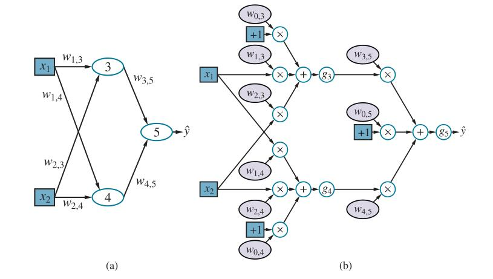
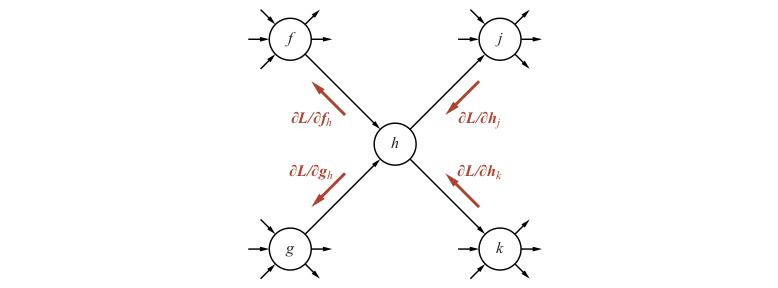
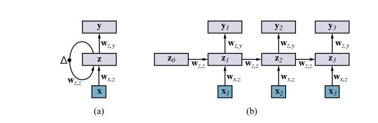

# فصل ۲۱ — یادگیری عمیق (Deep Learning)

**فصل ۲۱: یادگیری عمیق (Deep Learning)**

*در این فصل نزولِ گرادیان برنامه‌های چندمرحله‌ای را یاد می‌گیرد، با پیامدهای چشمگیری برای زیرشاخه‌های اصلیِ هوش مصنوعی.*

یادگیری عمیق خانواده‌ای گسترده از فنونِ یادگیریِ ماشینی است که در آن فرضیه‌ها شکلِ مدارهای جبریِ پیچیده با قدرتِ اتصالِ قابلِ تنظیم دارند. واژهٔ «عمیق» به این واقعیت اشاره دارد که مدارها معمولاً در بسیاری لایه سازماندهی می‌شوند، به این معنا که مسیرهای محاسبه از ورودی‌ها تا خروجی‌ها گام‌های بسیاری دارند. یادگیری عمیق در حالِ حاضر پرکاربردترین رویکرد برای کاربردهایی مانند بازشناسیِ اشیای بصری، ترجمهٔ ماشینی، بازشناسیِ گفتار، تولیدِ گفتار و تولیدِ تصویر است؛ همچنین نقشِ چشمگیری در کاربردهای یادگیریِ تقویتی دارد (فصل ۲۲ را ببینید).

ریشه‌های یادگیری عمیق به کارهای اولیه‌ای بازمی‌گردد که کوشیدند شبکه‌های نورونیِ مغز (مک‌کالوک و پیتس، 1943) را با مدارهای محاسباتی مدل کنند. به همین دلیل، شبکه‌های آموزش‌دیده با روش‌های یادگیریِ عمیق اغلب «شبکه‌های عصبی» (Neural Network) نامیده می‌شوند، حتی اگر شباهت به سلول‌ها و ساختارهای عصبیِ واقعی سطحی باشد.

گرچه دلایلِ واقعیِ موفقیتِ یادگیری عمیق هنوز به‌طور کامل تبیین نشده، مزیت‌های آشکاری نسبت به برخی از روش‌های پوشش‌داده‌شده در فصل ۱۹ دارد—به‌ویژه برای داده‌های پربعد مانند تصاویر. برای نمونه، اگرچه روش‌هایی مانند رگرسیونِ خطی و لجستیک می‌توانند تعدادِ زیادی متغیرِ ورودی را مدیریت کنند، مسیرِ محاسبه از هر ورودی تا خروجی بسیار کوتاه است: ضرب در یک وزنِ تنها، و سپس جمع در خروجیِ تجمیعی. افزون بر این، متغیرهای ورودیِ متفاوت به‌طورِ مستقل در خروجی سهیم می‌شوند، بدون اینکه با یکدیگر برهم‌کنش کنند (شکل ۲۱.۱ (الف)). این قدرتِ بیانیِ این‌گونه مدل‌ها را به‌شدت محدود می‌کند. آن‌ها فقط می‌توانند توابعِ خطی و مرزهای خطی در فضای ورودی را بازنمایی کنند، در حالی که بیشترِ مفاهیمِ جهانِ واقعی بسیار پیچیده‌ترند.

فهرست‌های تصمیم و درخت‌های تصمیم، از سوی دیگر، مسیرهای محاسبهٔ بلندی را ممکن می‌سازند که می‌توانند به متغیرهای ورودیِ بسیاری وابسته باشند—اما فقط برای کسرِ نسبتاً کوچکی از بردارهای ورودیِ ممکن (شکل ۲۱.۱ (ب)). اگر درختِ تصمیم برای کسرِ چشمگیری از ورودی‌های ممکن مسیرهای محاسبهٔ بلند داشته باشد، باید در تعدادِ متغیرهای ورودی به‌طورِ نمایی بزرگ باشد.

ایدهٔ بنیادینِ یادگیری عمیق آموزشِ مدارهایی است که مسیرهای محاسبه‌شان بلند باشد، به‌گونه‌ای که همهٔ متغیرهای ورودی بتوانند به‌روش‌های پیچیده با هم برهم‌کنش کنند (شکل ۲۱.۱ (ج)). این مدل‌های مداری معلوم می‌شود به‌اندازهٔ کافی بیانگرند تا پیچیدگیِ داده‌های جهانِ واقعی را برای بسیاری از انواعِ مهمِ مسائلِ یادگیری دربرگیرند.

بخش ۲۱.۱ شبکه‌های پیشخورِ ساده، مؤلفه‌هایشان و اصولِ یادگیری در این‌گونه شبکه‌ها را توصیف می‌کند. بخش ۲۱.۲ با جزئیاتِ بیشتر به چگونگیِ کنارِ هم گذاشتنِ شبکه‌های عمیق می‌پردازد، و بخش ۲۱.۳ رده‌ای از شبکه‌ها به نامِ «شبکه‌های عصبیِ پیچشی» را پوشش می‌دهد که در کاربردهای بینایی اهمیتِ ویژه‌ای دارند. بخش‌های ۲۱.۴ و ۲۱.۵ با جزئیاتِ بیشتر به الگوریتم‌های آموزشِ شبکه‌ها از رویِ داده و روش‌های بهبودِ تعمیم می‌پردازند. بخش ۲۱.۶ شبکه‌های با ساختارِ بازگشتی را پوشش می‌دهد که برای داده‌های ترتیبی بسیار مناسب‌اند. بخش ۲۱.۷ راه‌های استفاده از یادگیری عمیق برای تکلیف‌هایی به‌جزِ یادگیریِ نظارت‌شده را توصیف می‌کند. سرانجام، بخش ۲۱.۸ گسترهٔ کاربردهای یادگیری عمیق را مرور می‌کند.


**شکل ۲۱.۱ — (الف) یک مدلِ کم‌عمق، مانند رگرسیونِ خطی، مسیرهای محاسبهٔ کوتاهی بین ورودی‌ها و خروجی دارد. (ب) یک شبکهٔ فهرستِ تصمیم (صفحهٔ ۶۷۴) برای برخی از مقادیرِ ورودیِ ممکن مسیرهای بلندی دارد، اما بیشترِ مسیرها کوتاه‌اند. (ج) یک شبکهٔ یادگیریِ عمیق مسیرهای محاسبهٔ بلندتری دارد و به هر متغیر اجازه می‌دهد با همهٔ متغیرهای دیگر برهم‌کنش کند.**

## ۲۱.۱ شبکه‌های پیشخورِ ساده

شبکهٔ پیشخور (Feedforward Network)، چنان‌که نامش می‌گوید، فقط در یک جهت اتصال دارد—یعنی گرافِ جهت‌دارِ بدونِ دور (DAG) با گره‌های ورودی و خروجیِ معیّن را تشکیل می‌دهد. هر گره تابعی از ورودی‌هایش را محاسبه می‌کند و نتیجه را به جانشین‌هایش در شبکه می‌سپارد. اطلاعات از گره‌های ورودی به گره‌های خروجی در شبکه جریان می‌یابد، و هیچ حلق‌های وجود ندارد.

شبکهٔ بازگشتی (Recurrent Network)، از سوی دیگر، خروجی‌های میانی یا نهایی‌اش را به ورودی‌های خودش بازمی‌گرداند. این بدان معناست که مقادیرِ سیگنال درونِ شبکه سامانهٔ پویایی را تشکیل می‌دهند که حالتِ درونی یا حافظه دارد. شبکه‌های بازگشتی را در بخش ۲۱.۶ بررسی خواهیم کرد.

مدارهای بولی، که توابعِ بولی را پیاده‌سازی می‌کنند، نمونه‌ای از شبکه‌های پیشخورند. در مدارِ بولی، ورودی‌ها به ۰ و ۱ محدودند، و هر گره تابعِ بولیِ ساده‌ای از ورودی‌هایش را پیاده‌سازی می‌کند و ۰ یا ۱ تولید می‌کند. در شبکه‌های عصبی، مقادیرِ ورودی معمولاً پیوسته‌اند، و گره‌ها ورودی‌های پیوسته می‌گیرند و خروجی‌های پیوسته تولید می‌کنند.

برخی از ورودی‌های گره‌ها پارامترهای شبکه‌اند؛ شبکه با تنظیمِ مقدارهای این پارامترها یاد می‌گیرد تا شبکه به‌عنوانِ یک کل با دادهٔ آموزشی برازش یابد.

### ۲۱.۱.۱ شبکه‌ها به‌عنوانِ توابعِ پیچیده

هر گره درونِ شبکه «واحد» (Unit) نامیده می‌شود. به‌طورِ سنتی، و به پیروی از طراحیِ پیشنهادیِ مک‌کالوک و پیتس، یک واحد جمعِ وزن‌دارِ ورودی‌های واحدهای پیشین را محاسبه می‌کند و سپس یک تابعِ غیرخطی برای تولیدِ خروجی‌اش به‌کار می‌برد. فرض کنید aⱼ خروجیِ واحدِ j و wᵢ,ⱼ وزنِ متصل‌شده به پیوندِ واحدِ i به واحدِ j باشد؛ آنگاه داریم:

```
aⱼ = gⱼ(∑ᵢ wᵢ,ⱼ aᵢ) ≡ gⱼ(inⱼ)
```

که در آن gⱼ «تابعِ فعال‌سازی» (Activation Function) غیرخطیِ وابسته به واحدِ j و inⱼ جمعِ وزن‌دارِ ورودی‌های واحدِ j است. همان‌گونه که در بخش ۱۹.۶.۳ (صفحهٔ ۶۷۹)، تصریح می‌کنیم هر واحد یک ورودیِ اضافی از واحدِ مجازیِ ۰ دارد که ثابتاً 1+ است، همراه با وزنِ w₀,ⱼ برای آن ورودی. این امکان را می‌دهد که ورودیِ وزن‌دارِ کلِ inⱼ به واحدِ j حتی وقتی خروجی‌های لایهٔ پیشین همه صفرند، ناصفر باشد. با این قرارداد می‌توانیم معادلهٔ پیشین را به‌صورتِ برداری بنویسیم:

```
aⱼ = gⱼ(wᵀx)        (21.1)
```

که در آن w بردارِ وزن‌هایی است که به واحدِ j می‌روند (شاملِ w₀,ⱼ) و x بردارِ ورودی‌های واحدِ j است (شاملِ 1+).


**شکل ۲۱.۲ — توابعِ فعال‌سازیِ پرکاربرد در سامانه‌های یادگیریِ عمیق: (الف) تابعِ لجستیک یا سیگموئید؛ (ب) تابعِ ReLU و تابعِ سافت‌پلاس؛ (ج) تابعِ tanh. (در هر نمودار، محورِ افقی ورودی را در بازهٔ −6 تا 6 و محورِ عمودی خروجی را در بازهٔ −1 تا 1 (یا 0 تا 1) نشان می‌دهد.)**

این واقعیت که تابعِ فعال‌سازی غیرخطی است مهم است، زیرا اگر نبود، هر ترکیبی از واحدها همچنان تابعی خطی را بازنمایی می‌کرد. غیرخطی بودن چیزی است که به شبکه‌های به‌اندازهٔ کافی بزرگِ واحدها امکان می‌دهد توابعِ دلبخواه را بازنمایی کنند. «قضیهٔ تقریبِ همگانی» (Universal Approximation Theorem) بیان می‌کند شبکه‌ای با فقط دو لایهٔ واحدهای محاسباتی—لایهٔ نخست غیرخطی و لایهٔ دوم خطی—می‌تواند هر تابعِ پیوسته‌ای را با هر درجهٔ دقتِ دلخواهی تقریب بزند. اثبات با نشان‌دادن این کار می‌کند که شبکه‌ای به‌طورِ نمایی بزرگ می‌تواند به‌طورِ نمایی «برآمدگی‌های» زیادی با ارتفاع‌های متفاوت در مکان‌های متفاوتِ فضای ورودی بازنمایی کند و از این راه تابعِ موردنظر را تقریب بزند. به بیانِ دیگر، شبکه‌های به‌اندازهٔ کافی بزرگ می‌توانند برای توابعِ پیوسته جدولِ مراجعه پیاده‌سازی کنند، همان‌گونه که درخت‌های تصمیمِ به‌اندازهٔ کافی بزرگ جدولِ مراجعه‌ای برای توابعِ بولی پیاده‌سازی می‌کنند.

انواعِ گوناگونی از توابعِ فعال‌سازی به‌کار می‌روند. رایج‌ترین آن‌ها این‌اند:

- تابعِ لجستیک یا سیگموئید (Sigmoid)، که در رگرسیونِ لجستیک نیز استفاده می‌شود (صفحهٔ ۶۸۵ را ببینید):

```
Sigmoid:  σ(x) = 1 / (1 + e⁻ˣ)
```

- تابعِ ReLU، که نامش کوتاه‌شدهٔ «واحدِ خطیِ تصحیح‌شده» (Rectified Linear Unit) است:

```
ReLU:  ReLU(x) = max(0, x)
```

- تابعِ سافت‌پلاس (Softplus)، نسخهٔ هموارِ تابعِ ReLU:

```
Softplus:  softplus(x) = log(1 + eˣ)
```

مشتقِ تابعِ سافت‌پلاس تابعِ سیگموئید است.

- تابعِ tanh:

```
Tanh:  tanh(x) = (e²ˣ − 1) / (e²ˣ + 1)
```

توجه کنید بردِ tanh بازهٔ (1+ ,1−) است. Tanh نسخهٔ مقیاس‌شده و جابه‌جاشدهٔ سیگموئید است، زیرا tanh(x) = 2σ(2x)−1. این توابع در شکل ۲۱.۲ نشان داده شده‌اند. توجه کنید همهٔ آن‌ها یکنواختِ غیرنزولی‌اند، به این معنا که مشتق‌هایشان g′ نا‌منفی‌اند. دربارهٔ انتخابِ تابعِ فعال‌سازی در بخش‌های بعد حرف‌های بیشتری خواهیم داشت.



**شکل ۲۱.۳ — (الف) شبکهٔ عصبی با دو ورودی، یک لایهٔ پنهانِ دو واحدی و یک واحدِ خروجی. ورودی‌های مجازی و وزن‌های وابسته به آن‌ها نشان داده نشده‌اند. (ب) شبکه در (الف) که به گرافِ محاسباتیِ کاملِ خود باز شده است.**

به‌هم‌پیوستنِ چند واحد در شبکه‌ای تابعِ پیچیده‌ای می‌سازد که ترکیبی از عبارت‌های جبریِ بازنمایی‌شده توسط واحدهای منفرد است. برای نمونه، شبکهٔ نشان‌داده‌شده در شکل ۲۱.۳ (الف) تابعِ h_w(x) را بازنمایی می‌کند، که با وزن‌های w پارامتری شده و بردارِ ورودیِ دو عنصریِ x را به مقدارِ خروجیِ اسکالرِ ŷ نگاشت می‌کند. ساختارِ درونیِ تابع آینهٔ ساختارِ شبکه است. برای نمونه، می‌توانیم عبارتی برای خروجیِ ŷ به‌صورتِ زیر بنویسیم:

```
ŷ = g₅(in₅)
  = g₅(w₀,₅ + w₃,₅ a₃ + w₄,₅ a₄)
  = g₅(w₀,₅ + w₃,₅ g₃(in₃) + w₄,₅ g₄(in₄))
  = g₅(w₀,₅ + w₃,₅ g₃(w₀,₃ + w₁,₃ x₁ + w₂,₃ x₂) + w₄,₅ g₄(w₀,₄ + w₁,₄ x₁ + w₂,₄ x₂))        (21.2)
```

بنابراین، خروجیِ ŷ را به‌صورتِ تابعِ h_w(x) از ورودی‌ها و وزن‌ها بیان کرده‌ایم.

شکل ۲۱.۳ (الف) شیوهٔ سنتیِ ترسیمِ شبکه در کتابی دربارهٔ شبکه‌های عصبی را نشان می‌دهد. شیوهٔ عمومی‌ترِ اندیشیدن دربارهٔ شبکه این است که آن را «گرافِ محاسباتی» (Computation Graph) یا «گرافِ جریانِ داده» (Dataflow Graph) در نظر بگیریم—اساساً مداری که در آن هر گره یک محاسبهٔ مقدماتی را بازنمایی می‌کند. شکل ۲۱.۳ (ب) گرافِ محاسباتیِ متناظر با شبکهٔ شکل ۲۱.۳ (الف) را نشان می‌دهد؛ این گراف هر عنصرِ محاسبهٔ کلی را صریح می‌کند. همچنین بین ورودی‌ها (به رنگِ آبی) و وزن‌ها (به رنگِ بنفشِ روشن) تمایز می‌گذارد: وزن‌ها را می‌توان تنظیم کرد تا خروجیِ ŷ با مقدارِ واقعیِ y در دادهٔ آموزشی هماهنگ‌تر شود.

هر وزن مانند دستگیرهٔ کنترلِ بلندیِ صدا است که تعیین می‌کند گرهٔ بعدی در گراف چقدر از آن پیشینیِ خاص در گراف بشنود.

همان‌گونه که معادلهٔ (21.1) عملکردِ یک واحد را به‌صورتِ برداری توصیف کرد، می‌توانیم کارِ مشابهی برای شبکه به‌عنوانِ یک کل انجام دهیم. به‌طورِ کلی W را برای نشان‌دادنِ ماتریسِ وزن به‌کار می‌بریم؛ برای این شبکه، W⁽¹⁾ وزن‌های لایهٔ نخست (w₁,₃، w₁,₄ و مانندِ آن) و W⁽²⁾ وزن‌های لایهٔ دوم (w₃,₅ و مانندِ آن) را نشان می‌دهد. سرانجام، g⁽¹⁾ و g⁽²⁾ توابعِ فعال‌سازیِ لایهٔ نخست و دوم باشند. آنگاه کلِ شبکه را می‌توان به‌صورتِ زیر نوشت:

```
h_w(x) = g⁽²⁾(W⁽²⁾ g⁽¹⁾(W⁽¹⁾ x))        (21.3)
```

مانندِ معادلهٔ (21.2)، این عبارت با یک گرافِ محاسباتی متناظر است، هرچند بسیار ساده‌تر از گرافِ شکل ۲۱.۳ (ب): در این‌جا گراف صرفاً زنجیره‌ای است که ماتریس‌های وزن به هر لایه خوراک می‌دهند.

گرافِ محاسباتیِ شکل ۲۱.۳ (ب) نسبتاً کوچک و کم‌عمق است، اما همان ایده برای همهٔ شکل‌های یادگیری عمیق برقرار است: گراف‌های محاسباتی می‌سازیم و وزن‌هایشان را برای برازشِ داده تنظیم می‌کنیم. گرافِ شکل ۲۱.۳ (ب) همچنین «کاملاً متصل» (Fully Connected) است، به این معنا که هر گره در هر لایه به هر گره در لایهٔ بعد متصل است. این به‌نوعی حالتِ پیش‌فرض است، اما در بخش ۲۱.۳ خواهیم دید انتخابِ نحوهٔ اتصالِ شبکه نیز در دست‌یافتنِ یادگیریِ مؤثر اهمیت دارد.

### ۲۱.۱.۲ گرادیان‌ها و یادگیری

در بخش ۱۹.۶ رویکردی به یادگیریِ نظارت‌شده بر مبنای نزولِ گرادیان معرفی کردیم: گرادیانِ تابعِ زیان نسبت به وزن‌ها را محاسبه کن، و وزن‌ها را در جهتِ گرادیان تنظیم کن تا زیان کم شود. (اگر هنوز بخش ۱۹.۶ را نخوانده‌اید، اکیداً توصیه می‌کنیم پیش از ادامه این کار را بکنید.) دقیقاً همان رویکرد را می‌توانیم برای یادگیریِ وزن‌ها در گراف‌های محاسباتی به‌کار ببریم. برای وزن‌هایی که به واحدهای لایهٔ خروجی می‌روند—یعنی آن‌هایی که خروجیِ شبکه را تولید می‌کنند—محاسبهٔ گرادیان اساساً با فرایندِ بخش ۱۹.۶ یکسان است. برای وزن‌هایی که به واحدهای لایه‌های پنهان می‌روند، که مستقیماً به خروجی‌ها متصل نیستند، فرایند فقط کمی پیچیده‌تر است.

فعلاً تابعِ زیانِ مربعِ خطا، L₂، را به‌کار می‌بریم و گرادیان را برای شبکهٔ شکل ۲۱.۳ نسبت به یک مثالِ آموزشیِ تنها (x, y) محاسبه می‌کنیم. (برای چند مثال، گرادیان صرفاً جمعِ گرادیان‌های مثال‌های منفرد است.) شبکه پیش‌بینیِ ŷ = h_w(x) را خروجی می‌دهد و مقدارِ واقعی y است، پس داریم:

```
Loss(h_w) = L₂(y, h_w(x)) = ‖y − h_w(x)‖² = (y − ŷ)²
```

برای محاسبهٔ گرادیانِ زیان نسبت به وزن‌ها، به همان ابزارهای حسابِ دیفرانسیلِ فصل ۱۹ نیاز داریم—عمدتاً قاعدهٔ زنجیره‌ای، ∂g(f(x))/∂x = g′(f(x)) ∂f(x)/∂x.

از حالتِ آسان شروع می‌کنیم: وزنی مانند w₃,₅ که به واحدِ خروجی متصل است. مستقیماً روی عبارت‌های تعریف‌کنندهٔ شبکه از معادلهٔ (21.2) کار می‌کنیم:

```
∂/∂w₃,₅ Loss(h_w) = ∂/∂w₃,₅ (y − ŷ)²
                  = −2(y − ŷ) ∂ŷ/∂w₃,₅
                  = −2(y − ŷ) ∂/∂w₃,₅ g₅(in₅)
                  = −2(y − ŷ) g′₅(in₅) ∂/∂w₃,₅ in₅
                  = −2(y − ŷ) g′₅(in₅) ∂/∂w₃,₅ (w₀,₅ + w₃,₅ a₃ + w₄,₅ a₄)
                  = −2(y − ŷ) g′₅(in₅) a₃        (21.4)
```

ساده‌شدنِ خطِ آخر از این روست که w₀,₅ و w₄,₅ a₄ به w₃,₅ وابسته نیستند، و نه ضریبِ w₃,₅ یعنی a₃.

موردِ کمی دشوارتر وزنی مانند w₁,₃ است که مستقیماً به واحدِ خروجی متصل نیست. در این‌جا باید قاعدهٔ زنجیره‌ای را یک بار دیگر به‌کار ببریم. چند گامِ نخست یکسان‌اند، پس آن‌ها را حذف می‌کنیم:

```
∂/∂w₁,₃ Loss(h_w) = −2(y − ŷ) g′₅(in₅) ∂/∂w₁,₃ (w₀,₅ + w₃,₅ a₃ + w₄,₅ a₄)
                  = −2(y − ŷ) g′₅(in₅) w₃,₅ ∂/∂w₁,₃ a₃
                  = −2(y − ŷ) g′₅(in₅) w₃,₅ ∂/∂w₁,₃ g₃(in₃)
                  = −2(y − ŷ) g′₅(in₅) w₃,₅ g′₃(in₃) ∂/∂w₁,₃ in₃
                  = −2(y − ŷ) g′₅(in₅) w₃,₅ g′₃(in₃) ∂/∂w₁,₃ (w₀,₃ + w₁,₃ x₁ + w₂,₃ x₂)
                  = −2(y − ŷ) g′₅(in₅) w₃,₅ g′₃(in₃) x₁        (21.5)
```

پس، برای گرادیانِ زیان نسبت به وزن‌های w₃,₅ و w₁,₃ عبارت‌های نسبتاً ساده‌ای داریم. اگر Δ₅ = 2(ŷ − y) g′₅(in₅) را به‌عنوان نوعی «خطایِ ادراک‌شده» در نقطه‌ای که واحدِ ۵ ورودی‌اش را دریافت می‌کند تعریف کنیم، گرادیان نسبت به w₃,₅ صرفاً Δ₅ a₃ است. این کاملاً منطقی است: اگر Δ₅ مثبت باشد، یعنی ŷ بیش‌ازحد بزرگ است (به یاد آورید g′ همیشه نا‌منفی است)؛ اگر a₃ نیز مثبت باشد، افزایشِ w₃,₅ فقط اوضاع را بدتر می‌کند، در حالی که اگر a₃ منفی باشد، افزایشِ w₃,₅ خطا را کاهش می‌دهد. اندازهٔ a₃ نیز اهمیت دارد: اگر a₃ برای این مثالِ آموزشی کوچک باشد، w₃,₅ نقشِ اصلی‌ای در تولیدِ خطا نداشته و نیازی به تغییرِ زیاد ندارد. اگر Δ₃ = Δ₅ w₃,₅ g′₃(in₃) را نیز تعریف کنیم، گرادیانِ w₁,₃ صرفاً Δ₃ x₁ می‌شود. بدین‌سان، خطایِ ادراک‌شده در ورودیِ واحدِ ۳ برابر است با خطایِ ادراک‌شده در ورودیِ واحدِ ۵، ضرب در اطلاعات در طولِ مسیرِ بازگشت از ۵ به ۳. این پدیده کاملاً عمومی است، و نامِ «پسانتشار» (Back-propagation) را برای شیوه‌ای که خطا در خروجی از میانِ شبکه به عقب گذرانده می‌شود به وجود می‌آورد. ویژگیِ مهمِ دیگرِ این عبارت‌های گرادیانی این است که مشتق‌های محلیِ g′ⱼ(inⱼ) را به‌عنوانِ عامل دارند. همان‌گونه که پیش‌تر اشاره شد، این مشتق‌ها همیشه نا‌منفی‌اند، اما اگر ورودی‌های مثالِ آموزشیِ موردنظر واحدِ j را در ناحیهٔ تختِ عملکرد قرار دهند، می‌توانند بسیار نزدیکِ صفر باشند (در موردِ سیگموئید، سافت‌پلاس و tanh) یا دقیقاً صفر (در موردِ ReLU). اگر g′ⱼ کوچک یا صفر باشد، یعنی تغییرِ وزن‌هایی که به واحدِ j می‌روند اثری ناچیز بر خروجی‌اش خواهد داشت.

در نتیجه، شبکه‌های عمیق با لایه‌های بسیار ممکن است از «گرادیانِ ناپدیدشونده» (Vanishing Gradient) رنج ببرند—سیگنال‌های خطا در حینِ بازپس‌دهی از میانِ شبکه یک‌باره خاموش می‌شوند. بخش ۲۱.۳.۳ راه‌حلی برای این مسئله ارائه می‌دهد.

نشان دادیم گرادیان‌ها در شبکهٔ نمونهٔ کوچکِ ما عبارت‌های ساده‌ای‌اند که با بازپس‌دادنِ اطلاعات از واحدهای خروجی از میانِ شبکه محاسبه می‌شوند. معلوم می‌شود این ویژگی به‌طورِ کلی‌تر نیز برقرار است. در واقع، چنان‌که در بخش ۲۱.۴.۱ نشان می‌دهیم، محاسباتِ گرادیان برای هر گرافِ محاسباتیِ پیشخور همان ساختارِ گرافِ محاسباتیِ زیرین را دارند. این ویژگی مستقیماً از قاعده‌های دیفرانسیل‌گیری نتیجه می‌شود. جزئیاتِ خسته‌کنندهٔ یک محاسبهٔ گرادیان را نشان داده‌ایم، اما نگران نباشید: برای هر ساختارِ شبکهٔ تازه نیازی به بازانجامِ اشتقاق‌های معادله‌های (21.4) و (21.5) نیست! همهٔ این‌گونه گرادیان‌ها را می‌توان با روشِ «تمایزِ خودکار» (Automatic Differentiation) محاسبه کرد، که قاعده‌های حسابِ دیفرانسیل را به‌شکلی نظام‌مند برای محاسبهٔ گرادیان‌های هر برنامهٔ عددی به‌کار می‌برد.¹ در واقع، روشِ پسانتشار در یادگیری عمیق صرفاً کاربردِ «تمایزِ حالتِ معکوس» (Reverse Mode) است، که قاعدهٔ زنجیره‌ای را «از بیرون به درون» به‌کار می‌برد و وقتی شبکهٔ موردنظر ورودی‌های بسیاری و خروجی‌های نسبتاً کمی دارد، از مزیتِ کاراییِ برنامه‌نویسیِ پویا بهره می‌گیرد. همهٔ بسته‌های نرم‌افزاریِ عمدهٔ یادگیری عمیق تمایزِ خودکار فراهم می‌کنند، تا کاربران بتوانند آزادانه با ساختارهای شبکهٔ متفاوت، توابعِ فعال‌سازی، توابعِ زیان و شکل‌های ترکیب آزمایش کنند، بی‌آنکه برای هر آزمایش مجبور باشند کلی حسابِ دیفرانسیل انجام دهند تا الگوریتمِ یادگیریِ تازه‌ای اشتقاق دهند. این رویکردی به نامِ «یادگیریِ سرتاسری» (End-to-End Learning) را تشویق کرده، که در آن سامانهٔ محاسباتیِ پیچیده‌ای برای تکلیفی مانند ترجمهٔ ماشینی از چند زیرسامانهٔ قابلِ آموزش ترکیب می‌شود؛ سپس کلِ سامانه به‌شکلِ سرتاسری از رویِ جفت‌های ورودی-خروجی آموزش می‌بیند. با این رویکرد، طراح فقط باید تصورِ مبهمی از چگونگیِ ساختاربندیِ سامانهٔ کلی داشته باشد؛ نیازی به دانستنِ از پیشِ دقیقِ این‌که هر زیرسامانه باید چه کند یا چگونه ورودی‌ها و خروجی‌هایش را برچسب‌گذاری کند نیست.

## ۲۱.۲ گراف‌های محاسباتی برای یادگیری عمیق

ایده‌های بنیادینِ یادگیری عمیق را برقرار کرده‌ایم: فرضیه‌ها را به‌صورتِ گراف‌های محاسباتی با وزن‌های قابلِ تنظیم بازنمایی کن و گرادیانِ تابعِ زیان نسبت به آن وزن‌ها را برای برازشِ دادهٔ آموزشی محاسبه کن. حالا می‌بینیم گراف‌های محاسباتی چگونه کنارِ هم گذاشته می‌شوند. با لایهٔ ورودی شروع می‌کنیم، جایی که مثالِ آموزشی یا آزمونِ x به‌صورتِ مقادیرِ گره‌های ورودی رمز می‌شود. سپس لایهٔ خروجی را در نظر می‌گیریم، جایی که خروجی‌های ŷ با مقادیرِ واقعیِ y مقایسه می‌شوند تا سیگنالِ یادگیری برای تنظیمِ وزن‌ها به‌دست آید. سرانجام، لایه‌های پنهانِ شبکه را بررسی می‌کنیم.

### ۲۱.۲.۱ رمزگذاریِ ورودی

گره‌های ورودی و خروجیِ گرافِ محاسباتی آن‌هایی‌اند که مستقیماً به دادهٔ ورودیِ x و دادهٔ خروجیِ y متصل‌اند. رمزگذاریِ دادهٔ ورودی معمولاً ساده است، دستِ‌کم برای حالتِ دادهٔ عامل‌دار، که هر مثالِ آموزشی مقدارهایی برای n ویژگی دارد. اگر ویژگی‌ها بولی باشند، n گرهٔ ورودی داریم؛ معمولاً «کاذب» به ورودیِ ۰ و «صادق» به ۱ نگاشت می‌شود، هرچند گاهی 1− و 1+ به‌کار می‌رود. ویژگی‌های عددی، خواه عددِ صحیح باشند خواه حقیقی، معمولاً همان‌گونه که هستند به‌کار می‌روند، هرچند ممکن است مقیاس‌بندی شوند تا درونِ بازهٔ ثابتی بگنجند؛ اگر اندازه‌ها برای مثال‌های متفاوت به‌شدت تغییر کنند، می‌توان مقادیر را به مقیاسِ لگاریتمی نگاشت کرد.

تصاویر دقیقاً در ردهٔ دادهٔ عامل‌دار نمی‌گنجند؛ هرچند می‌توان تصویرِ RGB با اندازهٔ X×Y پیکسل را 3XY ویژگیِ عددِ صحیح‌مقدار (معمولاً با مقادیرِ درونِ بازهٔ {0,...,255}) در نظر گرفت، این کار این واقعیت را نادیده می‌گیرد که سه‌تایی‌های RGB به همان پیکسلِ تصویر تعلق دارند و این‌که مجاورتِ پیکسل‌ها واقعاً اهمیت دارد. البته می‌توانیم پیکسل‌های مجاور را به گره‌های ورودیِ مجاورِ شبکه نگاشت کنیم، اما معنایِ مجاورت اگر لایه‌های درونیِ شبکه کاملاً متصل باشند کاملاً از بین می‌رود. در عمل، شبکه‌های به‌کاررفته با دادهٔ تصویری ساختارهای درونیِ آرایه‌مانندی دارند که هدف‌شان بازتابِ معناشناسیِ مجاورت است. این را با جزئیاتِ بیشتر در بخش ۲۱.۳ خواهیم دید.

ویژگی‌های رسته‌ای با بیش از دو مقدار—مانندِ ویژگیِ «نوع» در مسئلهٔ رستوران از فصل ۱۹، که مقادیرِ فرانسوی، ایتالیایی، تایلندی یا برگر دارد—معمولاً با به‌اصطلاح «کدگذاریِ یک-گرم» (One-Hot Encoding) رمز می‌شوند. ویژگی‌ای با d مقدارِ ممکن با d بیتِ ورودیِ جداگانه بازنمایی می‌شود. برای هر مقدارِ داده‌شده، بیتِ ورودیِ متناظر ۱ و همهٔ بقیه ۰ می‌شوند. این معمولاً بهتر از نگاشتِ مقادیر به عددهای صحیح کار می‌کند. اگر برای ویژگیِ «نوع» عدد صحیح به‌کار می‌بردیم، تایلندی ۳ و برگر ۴ می‌شد. از آنجا که شبکه ترکیبی از توابعِ پیوسته است، چاره‌ای جز توجه به مجاورتِ عددی ندارد، اما در این مورد مجاورتِ عددیِ بینِ تایلندی و برگر از نظرِ معنایی بی‌معناست.

### ۲۱.۲.۲ لایه‌های خروجی و توابعِ زیان

در سمتِ خروجیِ شبکه، مسئلهٔ رمزکردنِ مقادیرِ خامِ داده به مقادیرِ واقعیِ y برای گره‌های خروجیِ گراف کم‌وبیش همان مسئلهٔ رمزگذاریِ ورودی است. برای نمونه، اگر شبکه بخواهد متغیرِ «آب‌وهوا» از فصل ۱۲ را پیش‌بینی کند، که مقادیرِ {آفتابی، بارانی، ابری، برفی} را دارد، از کدگذاریِ یک-گرم با چهار بیت استفاده می‌کردیم.

بسیار خب، این‌هم از مقادیرِ دادهٔ y. دربارهٔ پیش‌بینیِ ŷ چه؟ در حالتِ ایده‌آل، دقیقاً با مقدارِ مطلوبِ y منطبق می‌شد و زیان صفر می‌شد و کار تمام بود. در عمل، این به‌ندرت رخ می‌دهد—به‌ویژه پیش از آنکه فرایندِ تنظیمِ وزن‌ها را شروع کرده باشیم! پس باید بیندیشیم مقدارِ خروجیِ نادرست چه معنایی دارد و زیان چگونه اندازه‌گیری می‌شود. در اشتقاقِ گرادیان‌های معادله‌های (21.4) و (21.5)، با تابعِ زیانِ مربعِ خطا شروع کردیم. این جبر را ساده نگه می‌دارد، اما تنها امکان نیست. در واقع، برای بیشترِ کاربردهای یادگیری عمیق، رایج‌تر است که مقادیرِ خروجیِ ŷ را به‌عنوانِ احتمال تفسیر کنیم و لگاریتمِ منفیِ درست‌نمایی را به‌عنوانِ تابعِ زیان به‌کار ببریم—دقیقاً همان‌گونه که در فصل ۲۰ با یادگیریِ حداکثرِ درست‌نمایی انجام دادیم.

یادگیریِ حداکثرِ درست‌نمایی مقدارِ wای را می‌یابد که احتمالِ دادهٔ مشاهده‌شده را بیشینه می‌کند. و چون تابعِ لگاریتم یکنواخت است، این معادل است با بیشینه‌کردنِ لگاریتمِ درست‌نماییِ داده، که به‌نوبهٔ خود معادل است با کمینه‌کردنِ تابعِ زیانی که به‌عنوانِ لگاریتمِ منفیِ درست‌نمایی تعریف شده. (به یاد آورید از صفحهٔ ۷۲۵ که گرفتنِ لگاریتم حاصلضربِ احتمال‌ها را به جمع تبدیل می‌کند، که برای مشتق‌گیری مناسب‌تر است.) به بیانِ دیگر، به دنبالِ w*ای هستیم که جمعِ لگاریتم‌های منفیِ احتمالِ N مثال را کمینه کند:

```
w* = argmin_w [−∑_{j=1}^{N} log P_w(yⱼ | xⱼ)]        (21.6)
```

در ادبیاتِ یادگیری عمیق، صحبت از کمینه‌کردنِ «زیانِ آنتروپیِ متقاطع» (Cross-Entropy) رایج است. آنتروپیِ متقاطع، که H(P,Q) نوشته می‌شود، نوعی سنجهٔ ناهم‌مانندی بینِ دو توزیعِ P و Q است.² تعریفِ عمومی این است:

```
H(P, Q) = E_{z∼P(z)}[log Q(z)] = ∫ P(z) log Q(z) dz        (21.7)
```

در یادگیری ماشینی، معمولاً این تعریف را با P به‌عنوانِ توزیعِ واقعیِ رویِ مثال‌های آموزشی، یعنی P*(x,y)، و Q به‌عنوانِ فرضیهٔ پیش‌گویانهٔ P_w(y|x) به‌کار می‌بریم. کمینه‌کردنِ آنتروپیِ متقاطعِ H(P*(x,y), P_w(y|x)) با تنظیمِ w، فرضیه را به توزیعِ واقعی تا حدِ ممکن نزدیک می‌کند. در واقعیت، نمی‌توانیم این آنتروپیِ متقاطع را کمینه کنیم، زیرا به توزیعِ دادهٔ واقعیِ P*(x,y) دسترسی نداریم؛ اما به نمونه‌هایی از P*(x,y) دسترسی داریم، پس جمعِ رویِ دادهٔ واقعی در معادلهٔ (21.6) امیدِ ریاضیِ معادلهٔ (21.7) را تقریب می‌زند. برای کمینه‌کردنِ لگاریتمِ منفیِ درست‌نمایی (یا آنتروپیِ متقاطع)، باید بتوانیم خروجیِ شبکه را به‌عنوانِ احتمال تفسیر کنیم. برای نمونه، اگر شبکه یک واحدِ خروجی با تابعِ فعال‌سازیِ سیگموئید داشته باشد و رده‌بندیِ بولی یاد بگیرد، می‌توانیم مقدارِ خروجی را مستقیماً به‌عنوانِ احتمالِ تعلقِ مثال به ردهٔ مثبت تفسیر کنیم. (در واقع، این دقیقاً شیوهٔ استفاده از رگرسیونِ لجستیک است؛ صفحهٔ ۶۸۴ را ببینید.) پس برای مسائلِ رده‌بندیِ بولی معمولاً از لایهٔ خروجیِ سیگموئیدی استفاده می‌کنیم.

مسائلِ رده‌بندیِ چندرده‌ای در یادگیری ماشینی بسیار رایج‌اند. برای نمونه، رده‌بندهایی که برای بازشناسیِ اشیا استفاده می‌شوند اغلب باید هزاران ردهٔ متمایز از اشیا را بازشناسی کنند. مدل‌های زبانِ طبیعی که می‌کوشند واژهٔ بعدیِ جمله را پیش‌بینی کنند ممکن است مجبور باشند از میانِ ده‌ها هزار واژهٔ ممکن انتخاب کنند. برای این‌گونه پیش‌بینی، نیاز داریم شبکه توزیعِ رسته‌ای خروجی دهد—یعنی اگر d پاسخِ ممکن باشد، به d گرهٔ خروجی نیاز داریم که احتمال‌هایی را بازنمایی کنند که جمعِشان ۱ است.

برای دست‌یابی به این هدف، از «لایهٔ سافتمکس» (Softmax) استفاده می‌کنیم، که با گرفتنِ بردارِ ورودیِ in = ⟨in₁, ..., in_d⟩ بردارِ d مقدار خروجی می‌دهد. عنصرِ kامِ آن بردارِ خروجی به‌صورتِ زیر است:

```
softmax(in)ₖ = e^{inₖ} / ∑_{k′=1}^{d} e^{inₖ′}
```

با ساختِ این‌گونه، تابعِ سافتمکس بردارِ اعدادِ نامنفی‌ای خروجی می‌دهد که جمعِشان ۱ است.

مثلِ همیشه، ورودیِ inₖ به هر یک از گره‌های خروجی ترکیبِ خطیِ وزن‌داری از خروجی‌های لایهٔ پیشین است. به‌دلیلِ نمایی‌ها، لایهٔ سافتمکس تفاوت‌های ورودی‌ها را برجسته می‌کند: برای نمونه، اگر بردارِ ورودی in = ⟨5, 2, 0, −2⟩ باشد، خروجی‌ها ⟨0.946, 0.047, 0.006, 0.001⟩ خواهند بود. سافتمکس با این حال هموار و مشتق‌پذیر است (تمرین ۲۱.SOFG)، برخلافِ تابعِ بیشینه. به‌آسانی نشان داده می‌شود (تمرین ۲۱.SMSG) که سیگموئید یک سافتمکس با d = 2 است. به بیانِ دیگر، همان‌گونه که واحدهای سیگموئیدی اطلاعاتِ ردهٔ دودویی را از میانِ شبکه منتشر می‌کنند، واحدهای سافتمکسی اطلاعاتِ چندرده‌ای را منتشر می‌کنند.

برای مسئلهٔ رگرسیون، که مقدارِ هدفِ y پیوسته است، استفاده از «لایهٔ خروجیِ خطی» رایج است—به بیانِ دیگر، ŷⱼ = inⱼ، بدونِ هیچ تابعِ فعال‌سازیِ g—و تفسیرِ آن به‌عنوانِ میانگینِ توزیعِ گاوسیِ پیش‌بینی با واریانسِ ثابت. همان‌گونه که در صفحهٔ ۷۲۹ اشاره کردیم، بیشینه‌کردنِ درست‌نمایی (یعنی کمینه‌کردنِ لگاریتمِ منفیِ درست‌نمایی) با گاوسیِ واریانس‌ثابت همان کمینه‌کردنِ مربعِ خطاست. پس لایهٔ خروجیِ خطیِ تفسیرشده به این‌شکل، همان کارِ رگرسیونِ خطیِ کلاسیک را می‌کند. ویژگی‌های ورودیِ این رگرسیونِ خطی خروجی‌های لایهٔ پیشین‌اند، که معمولاً از چند تبدیلِ غیرخطیِ ورودی‌های اصلیِ شبکه نتیجه می‌شوند.

بسیاری از لایه‌های خروجیِ دیگر نیز ممکن‌اند. برای نمونه، «لایهٔ چگالیِ مخلوط» (Mixture Density Layer) خروجی‌ها را با مخلوطی از توزیع‌های گاوسی بازنمایی می‌کند. (برای جزئیاتِ بیشتر دربارهٔ مخلوطِ گاوسی‌ها بخش ۲۰.۳.۱ را ببینید.) این‌گونه لایه‌ها بسامدِ نسبیِ هر مؤلفهٔ مخلوط، میانگینِ هر مؤلفه و واریانسِ هر مؤلفه را پیش‌بینی می‌کنند. تا زمانی که این مقادیرِ خروجی توسط تابعِ زیان به‌درستی به‌عنوانِ تعریف‌کنندهٔ احتمالِ مقدارِ خروجیِ واقعیِ y تفسیر شوند، شبکه پس از آموزش، مدلِ مخلوطِ گاوسی را در فضایِ ویژگی‌های تعریف‌شده توسط لایه‌های پیشین برازش خواهد کرد.

### ۲۱.۲.۳ لایه‌های پنهان

در طولِ فرایندِ آموزش، شبکهٔ عصبی مقادیرِ ورودیِ x و مقادیرِ خروجیِ متناظرِ y بسیاری را می‌بیند. در هنگامِ پردازشِ بردارِ ورودیِ x، شبکهٔ عصبی پیش از تولیدِ خروجیِ y چند محاسبهٔ میانی انجام می‌دهد. می‌توانیم مقادیرِ محاسبه‌شده در هر لایهٔ شبکه را بازنماییِ متفاوتی از ورودیِ x در نظر بگیریم. هر لایه بازنماییِ تولیدشده توسط لایهٔ پیشین را تبدیل می‌کند تا بازنماییِ تازه‌ای تولید کند. ترکیبِ همهٔ این تبدیل‌ها موفق می‌شود—اگر همه‌چیز خوب پیش برود—ورودی را به خروجیِ مطلوب تبدیل کند. در واقع، یکی از فرضیه‌ها برای اینکه چرا یادگیری عمیق خوب کار می‌کند این است که تبدیلِ سرتاسریِ پیچیده‌ای که از ورودی به خروجی نگاشت می‌کند—مثلاً از تصویرِ ورودی به ردهٔ خروجیِ «زرافه»—توسط لایه‌های بسیار به ترکیبِ بسیاری از تبدیل‌های نسبتاً ساده تجزیه می‌شود، که یادگیریِ هر یک توسط فرایندِ به‌روزرسانیِ محلی نسبتاً آسان است.

در فرایندِ شکل‌دادن به همهٔ این تبدیل‌های درونی، شبکه‌های عمیق اغلب بازنمایی‌های میانیِ معناداری از داده کشف می‌کنند. برای نمونه، شبکه‌ای که یاد می‌گیرد اشیای پیچیده را در تصاویر بازشناسی کند ممکن است لایه‌های درونی‌ای تشکیل دهد که زیرواحدهای مفیدی را تشخیص می‌دهند: لبه‌ها، گوشه‌ها، بیضی‌ها، چشم‌ها، چهره‌ها—گربه‌ها. یا ممکن است چنین نکند—شبکه‌های عمیق ممکن است لایه‌های درونی‌ای تشکیل دهند که معنایشان برای انسان‌ها مبهم است، حتی اگر خروجی همچنان درست باشد.

لایه‌های پنهانِ شبکه‌های عصبی معمولاً از لایه‌های خروجی متنوع‌تر نیستند. در ۲۵ سالِ نخستِ پژوهش با شبکه‌های چندلایه (تقریباً 1985–2010)، گره‌های درونی تقریباً منحصراً از توابعِ فعال‌سازیِ سیگموئید و tanh استفاده می‌کردند. از حدودِ ۲۰۱۰ به بعد، ReLU و سافت‌پلاس محبوب‌تر شدند، تا حدی به‌دلیلِ این‌که گمان می‌رود از مسئلهٔ گرادیانِ ناپدیدشوندهٔ یادشده در بخش ۲۱.۱.۲ اجتناب می‌کنند. آزمایش با شبکه‌های به‌طورِ فزاینده‌ای عمیق نشان داد که در بسیاری از موارد، با تعدادِ کلِ ثابتی از وزن‌ها، یادگیریِ بهتر با شبکه‌های عمیق و نسبتاً باریک به‌دست می‌آید تا شبکه‌های کم‌عمق و پهن. نمونهٔ معمولی از این در شکل ۲۱.۷ در صفحهٔ ۷۶۹ نشان داده شده.

البته ساختارهای بسیار دیگری نیز برای گراف‌های محاسباتی قابلِ بررسی‌اند، به‌جزِ بازی‌کردن با پهنا و عمق. در زمانِ نوشتنِ این کتاب، شناختِ اندکی از این‌که چرا برخی ساختارها برای برخی مسائلِ خاص بهتر از بقیه کار می‌کنند وجود دارد. با تجربه، دست‌اندرکاران بینشِ شهودیِ برخی را برای طراحیِ شبکه‌ها و رفعِ مشکلِ آن‌ها وقتی کار نمی‌کنند به‌دست می‌آورند، همان‌گونه که سرآشپزها برای طراحیِ دستورهای آشپزی و رفعِ آن‌ها وقتی مزهٔ ناخوشایندی دارند بینش می‌یابند. به همین دلیل، ابزارهایی که کاوش و ارزیابیِ سریعِ ساختارهای متفاوت را آسان می‌کنند، برای موفقیت در مسائلِ جهانِ واقعی ضروری‌اند.

## ۲۱.۳ شبکه‌های پیچشی

در بخش ۲۱.۲.۱ اشاره کردیم که تصویر را نمی‌توان بردارِ ساده‌ای از مقادیرِ پیکسل‌ها در نظر گرفت، عمدتاً به‌دلیلِ این‌که مجاورتِ پیکسل‌ها واقعاً اهمیت دارد. اگر شبکه‌ای با لایه‌های کاملاً متصل و تصویری به‌عنوانِ ورودی می‌ساختیم، چه با تصاویرِ دست‌نخورده آموزش می‌دیدیم چه با تصاویری که همهٔ پیکسل‌هایشان به‌طورِ تصادفی درهم‌ریخته شده، همان نتیجه را می‌گرفتیم. افزون بر این، فرض کنید n پیکسل و n واحد در نخستین لایهٔ پنهان باشد، که پیکسل‌ها به آن‌ها ورودی می‌دهند. اگر ورودی و نخستین لایهٔ پنهان کاملاً متصل باشند، یعنی n² وزن؛ برای یک تصویرِ مگاپیکسلیِ RGBِ معمولی، این یعنی ۹ تریلیون وزن. چنین فضایِ پارامتریِ عظیمی به شمارِ به‌همان‌اندازهٔ عظیمِ تصاویرِ آموزشی و بودجهٔ محاسباتیِ هنگفتی برای اجرایِ الگوریتمِ آموزش نیاز داشت.

این ملاحظه‌ها پیشنهاد می‌کنند نخستین لایهٔ پنهان را چنان بسازیم که هر واحدِ پنهان ورودی را فقط از ناحیهٔ کوچکِ محلیِ تصویر دریافت کند. این با یک تیر دو نشان می‌زند. نخست، به مجاورت احترام می‌گذارد، دستِ‌کم به‌صورتِ محلی. (و بعداً خواهیم دید اگر لایه‌های بعدی نیز همان ویژگیِ محلی‌بودن را داشته باشند، شبکه به مجاورت به‌صورتِ سراسری احترام خواهد گذاشت.) دوم، تعدادِ وزن‌ها را کم می‌کند: اگر هر ناحیهٔ محلی l ≪ n پیکسل داشته باشد، در مجموع ln ≪ n² وزن خواهد بود.

تا این‌جا خوب است. اما ویژگیِ مهمِ دیگری از تصاویر را از دست داده‌ایم: به‌طورِ تقریبی، هر چیزی که در یک ناحیهٔ کوچکِ محلی از تصویر قابلِ تشخیص باشد—شاید یک چشم یا یک تیغهٔ علف—اگر در ناحیهٔ کوچکِ محلیِ دیگری از تصویر ظاهر شود همان‌گونه به نظر می‌رسد. به بیانِ دیگر، انتظار داریم دادهٔ تصویری «ناورداییِ فضاییِ» (Spatial Invariance) تقریبی را نشان دهد، دستِ‌کم در مقیاس‌های کوچک تا متوسط.³ الزاماً انتظار نداریم نیمه‌های بالاییِ عکس‌ها شبیهِ نیمه‌های پایینی باشند، پس مقیاسی وجود دارد که فراتر از آن ناورداییِ فضایی دیگر برقرار نیست.

ناورداییِ فضاییِ محلی را می‌توان با مقیدکردنِ l وزنِ متصل‌کنندهٔ ناحیهٔ محلی به واحدی در لایهٔ پنهان به این‌صورت به‌دست آورد که برای هر واحدِ پنهان یکسان باشند. (یعنی برای واحدهای پنهانِ i و j، وزن‌های w₁,ᵢ, ..., wₗ,ᵢ همان w₁,ⱼ, ..., wₗ,ⱼ هستند.) این واحدهای پنهان را به «آشکارسازِ ویژگی» تبدیل می‌کند که همان ویژگی را هر جا در تصویر ظاهر شود تشخیص می‌دهند. معمولاً می‌خواهیم نخستین لایهٔ پنهان انواعِ بسیاری از ویژگی‌ها را تشخیص دهد، نه فقط یک ویژگی؛ پس برای هر ناحیهٔ محلیِ تصویر ممکن است d واحدِ پنهان با d مجموعه وزنِ متمایز داشته باشیم. این بدان‌معناست که در مجموع dl وزن خواهد بود—عددی که نه‌تنها بسیار کوچک‌تر از n² است، بلکه در واقع مستقل از n، اندازهٔ تصویر، است. پس با تزریقِ دانشِ قبلیِ برخی—یعنی دانشِ مجاورت و ناورداییِ فضایی—می‌توانیم مدل‌هایی توسعه دهیم که پارامترهای بسیار کمتری دارند و می‌توانند بسیار سریع‌تر یاد بگیرند.

«شبکهٔ عصبیِ پیچشی» (Convolutional Neural Network یا CNN) شبکه‌ای است که اتصال‌های فضاییِ محلی دارد، دستِ‌کم در لایه‌های اولیه، و الگوهای وزنی‌ای دارد که در میانِ واحدهای هر لایه تکرار می‌شوند. الگوی وزنیِ تکرارشونده در چند ناحیهٔ محلی «هسته» (Kernel) نامیده می‌شود و فرایندِ اعمالِ هسته بر پیکسل‌های تصویر (یا بر واحدهای فضاییِ سازمان‌یافته در لایهٔ بعدی) «پیچش» (Convolution) نام دارد.⁴

هسته‌ها و پیچش‌ها در یک بعد آسان‌تر از دو یا چند بعد نشان داده می‌شوند، پس بردارِ ورودیِ x با اندازهٔ n را فرض می‌کنیم، متناظر با n پیکسل در تصویری تک‌بعدی، و هستهٔ برداریِ k با اندازهٔ l را. (برای سادگی فرض می‌کنیم l عددی فرد است.) همهٔ ایده‌ها به‌طورِ مستقیم به حالت‌های با ابعادِ بالاتر منتقل می‌شوند.

عملیاتِ پیچش را با نمادِ ∗ می‌نویسیم، مثلاً: z = x ∗ k. این عملیات به‌صورتِ زیر تعریف می‌شود:

```
zᵢ = ∑_{j=1}^{l} kⱼ x_{j+i−(l+1)/2}        (21.8)
```

به بیانِ دیگر، برای هر موقعیتِ خروجیِ i، ضربِ نقطه‌ای بینِ هستهٔ k و برشی از x به‌مرکزیتِ xᵢ با پهنای l می‌گیریم.


**شکل ۲۱.۴ — نمونه‌ای از عملیاتِ پیچشِ یک‌بعدی با هسته‌ای به اندازهٔ l = 3 و گامی s = 2. پاسخِ اوج روی پیکسلِ ورودیِ تیره‌تر (با شدتِ کمتر) متمرکز است. نتیجه‌ها معمولاً پیش از رفتن به لایهٔ پنهانِ بعدی از یک تابعِ فعال‌سازیِ غیرخطی (نشان‌داده‌نشده) عبور داده می‌شوند.**

فرایند در شکل ۲۱.۴ برای هستهٔ برداریِ [+1, −1, +1] نشان داده شده، که نقطه‌ای تیره‌تر را در تصویرِ یک‌بعدی تشخیص می‌دهد. (نسخهٔ دوبعدی ممکن است خطی تیره‌تر را تشخیص دهد.) توجه کنید در این مثال، پیکسل‌هایی که هسته‌ها روی آن‌ها متمرکزند با فاصلهٔ ۲ پیکسل از هم جدا شده‌اند؛ می‌گوییم هسته با «گامِ» (Stride) s = 2 اعمال می‌شود. توجه کنید لایهٔ خروجی پیکسل‌های کمتری دارد: به‌دلیلِ گام، تعدادِ پیکسل‌ها از n به تقریباً n/s کاهش می‌یابد. (در دو بعد، تعدادِ پیکسل‌ها تقریباً n/(sₓs_y) خواهد بود، که sₓ و s_y گام‌ها در جهت‌های x و y تصویرند.) «تقریباً» می‌گوییم به‌دلیلِ آنچه در لبهٔ تصویر رخ می‌دهد: در شکل ۲۱.۴ پیچش در لبه‌های تصویر می‌ایستد، اما می‌توان ورودی را با پیکسل‌های اضافی (یا صفرها یا کپیِ پیکسل‌های بیرونی) لایه‌گذاری (Padding) کرد تا هسته بتواند دقیقاً ⌊n/s⌋ بار اعمال شود. برای هسته‌های کوچک، معمولاً از s = 1 استفاده می‌کنیم، پس خروجی همان ابعادِ تصویر را دارد (شکل ۲۱.۵ را ببینید).

عملیاتِ اعمالِ هسته روی تصویر را می‌توان به‌شیوهٔ آشکار با برنامه‌ای با حلقه‌های تو در توی مناسب پیاده‌سازی کرد؛ اما می‌توان آن را به‌صورتِ یک عملیاتِ ماتریسیِ واحد نیز صورتبندی کرد، درست مانندِ اعمالِ ماتریسِ وزن در معادلهٔ (21.1). برای نمونه، پیچشِ نشان‌داده‌شده در شکل ۲۱.۴ را می‌توان به‌عنوانِ ضربِ ماتریسیِ زیر دید:

```
⟨5, 9, 4⟩ = [ [+1, −1, +1,  0,  0,  0,  0],
              [ 0,  0, +1, −1, +1,  0,  0],
              [ 0,  0,  0,  0, +1, −1, +1] ] · ⟨5, 6, 6, 2, 5, 6, 5⟩        (21.9)
```

در این ماتریسِ وزن، هسته در هر سطر ظاهر می‌شود، و طبقِ گام نسبت به سطرِ قبلی جابه‌جا شده. لزومی ندارد کسی ماتریسِ وزن را به‌صورتِ صریح بسازد—بالاخره بیشترِ آن صفر است—اما این واقعیت که پیچش یک عملیاتِ ماتریسیِ خطی است یادآور این است که نزولِ گرادیان به‌آسانی و به‌طورِ مؤثر بر CNNها اعمال می‌شود، درست مانندِ شبکه‌های عصبیِ ساده. همان‌گونه که پیش‌تر اشاره شد، d هسته وجود خواهد داشت، نه فقط یکی؛ پس با گامِ ۱، خروجی d برابر بزرگ‌تر خواهد بود. این بدان‌معناست که آرایهٔ ورودیِ دوبعدی به آرایهٔ سه‌بعدی از واحدهای پنهان تبدیل می‌شود، که بعدِ سومش اندازهٔ d دارد. سازمان‌دادنِ لایهٔ پنهان به این‌شکل مهم است، تا همهٔ خروجی‌های هسته از یک موقعیتِ خاصِ تصویر با همان موقعیت همراه بمانند. برخلافِ ابعادِ فضاییِ تصویر، اما، این «بعدِ هسته»یِ اضافی هیچ ویژگیِ مجاورتی ندارد، پس اجرایِ پیچش در امتدادِ آن معنا ندارد.


**شکل ۲۱.۵ — دو لایهٔ نخستِ یک CNN برای تصویرِ یک‌بعدی با اندازهٔ هستهٔ l = 3 و گامِ s = 1. در انتهایِ چپ و راست لایه‌گذاری اضافه شده تا لایه‌های پنهان هم‌اندازهٔ ورودی بمانند. با رنگِ قرمز «میدانِ دریافتی»ِ واحدی در دومین لایهٔ پنهان نشان داده شده. به‌طورِ کلی، هرچه واحد عمیق‌تر باشد، میدانِ دریافتی بزرگ‌تر است.**

CNNها در اصل از مدل‌های قشرِ بیناییِ پیشنهادی در عصب‌شناسی الهام گرفته شده‌اند. در آن مدل‌ها، «میدانِ دریافتی»ِ (Receptive Field) یک نورون بخشی از ورودیِ حسی است که می‌تواند بر فعال‌سازیِ آن نورون اثر بگذارد. در CNN، میدانِ دریافتیِ واحدی در نخستین لایهٔ پنهان کوچک است—فقط به اندازهٔ هسته، یعنی l پیکسل. در لایه‌های عمیق‌ترِ شبکه، می‌تواند بسیار بزرگ‌تر باشد. شکل ۲۱.۵ این را برای واحدی در دومین لایهٔ پنهان نشان می‌دهد که میدانِ دریافتی‌اش پنج پیکسل دارد. وقتی گام ۱ باشد، مانندِ شکل، گره‌ای در mاُمین لایهٔ پنهان میدانِ دریافتیِ با اندازهٔ (l−1)m+1 خواهد داشت؛ پس رشد نسبت به m خطی است. (در تصویرِ دوبعدی، هر بعدِ میدانِ دریافتی به‌صورتِ خطی با m رشد می‌کند، پس مساحت به‌صورتِ درجهٔ دوم رشد می‌کند.) وقتی گام بزرگ‌تر از ۱ باشد، هر پیکسل در لایهٔ m نمایندهٔ s پیکسل در لایهٔ m−1 است؛ بنابراین، میدانِ دریافتی به‌صورتِ O(lsᵐ)—یعنی به‌صورتِ نمایی با عمق—رشد می‌کند. همان اثر با لایه‌های تجمیع رخ می‌دهد، که در ادامه بحث می‌کنیم.

### ۲۱.۳.۱ تجمیع و پایین‌نمونه‌برداری

لایهٔ «تجمیع» (Pooling) در شبکهٔ عصبی مجموعه‌ای از واحدهای مجاور از لایهٔ پیشین را با یک مقدارِ واحد خلاصه می‌کند. تجمیع دقیقاً مانند لایهٔ پیچش کار می‌کند، با اندازهٔ هستهٔ l و گامِ s، اما عملیاتی که اعمال می‌شود ثابت است نه آموخته‌شده. معمولاً هیچ تابعِ فعال‌سازی با لایهٔ تجمیع همراه نیست. دو شکلِ رایجِ تجمیع هست:

- «تجمیعِ میانگین» (Average-Pooling) میانگینِ l ورودیِ خود را محاسبه می‌کند. این با پیچش با هستهٔ یکنواختِ k = [1/l, ..., 1/l] یکسان است. اگر l = s بگذاریم، اثر، درشت‌کردنِ وضوحِ تصویر است—یعنی «پایین‌نمونه‌برداری» (Downsampling) آن—به‌ضریبِ s. شیئی که مثلاً 10s پیکسل را اشغال می‌کرد پس از تجمیع فقط 10 پیکسل را اشغال می‌کرد. همان رده‌بندِ آموخته‌شده‌ای که می‌توانست شیء را در اندازهٔ 10 پیکسل در تصویرِ اصلی بازشناسی کند، حالا می‌تواند آن شیء را در تصویرِ تجمیع‌شده بازشناسی کند، حتی اگر برای بازشناسی در تصویرِ اصلی بیش‌ازحد بزرگ بود. به بیانِ دیگر، تجمیعِ میانگین بازشناسیِ چندمقیاسی را تسهیل می‌کند. همچنین تعدادِ وزن‌های موردنیاز در لایه‌های بعدی را کاهش می‌دهد و به هزینهٔ محاسباتیِ کمتر و احتمالاً یادگیریِ سریع‌تر می‌انجامد.

- «تجمیعِ حداکثر» (Max-Pooling) مقدارِ بیشینهٔ l ورودیِ خود را محاسبه می‌کند. از آن می‌توان صرفاً برای پایین‌نمونه‌برداری نیز استفاده کرد، اما معناشناسیِ تا حدی متفاوتی دارد. فرض کنید تجمیعِ حداکثر را روی لایهٔ پنهانِ [5, 9, 4] در شکل ۲۱.۴ اعمال می‌کنیم: نتیجه ۹ خواهد بود، نشان‌دهندهٔ این‌که جایی در تصویرِ ورودی نقطهٔ تیره‌تری هست که هسته آن را تشخیص می‌دهد. به بیانِ دیگر، تجمیعِ حداکثر به‌عنوانِ نوعی فصلی که می‌گوید یک ویژگی جایی در میدانِ دریافتیِ واحد وجود دارد عمل می‌کند.

اگر هدف، رده‌بندیِ تصویر به یکی از c رده باشد، لایهٔ پایانیِ شبکه سافتمکسی با c واحدِ خروجی خواهد بود. لایه‌های اولیهٔ CNN به اندازهٔ تصویرند، پس جایی در میانه باید کاهش‌های چشمگیری در اندازهٔ لایه رخ دهد. لایه‌های پیچش و لایه‌های تجمیع با گامِ بزرگ‌تر از ۱ همگی به کاهشِ اندازهٔ لایه کمک می‌کنند. همچنین کاهشِ اندازهٔ لایه صرفاً با داشتنِ لایه‌ای کاملاً متصل با واحدهایی کمتر از لایهٔ پیشین ممکن است. CNNها اغلب یک یا دو چنین لایه‌ای پیش از لایهٔ سافتمکسِ پایانی دارند.

### ۲۱.۳.۲ عملیاتِ تانسوری در CNNها

در معادله‌های (21.1) و (21.3) دیدیم استفاده از نمادگذاریِ برداری و ماتریسی می‌تواند در ساده و زیبا نگه‌داشتنِ اشتقاق‌های ریاضی و فراهم‌کردنِ توصیفِ موجزِ گراف‌های محاسباتی کمک‌کننده باشد. بردارها و ماتریس‌ها حالت‌های خاصِ یک‌بعدی و دوبعدیِ «تانسورها» (Tensor) هستند، که (در اصطلاح‌شناسیِ یادگیری عمیق) صرفاً آرایه‌های چندبعدیِ با هر بعدی‌اند.⁵ برای CNNها، تانسورها راهی برای ردیابیِ «شکل»ِ داده در حینِ پیشرفتِ آن از میانِ لایه‌های شبکه‌اند. این مهم است، زیرا کلِ مفهومِ پیچش به ایدهٔ مجاورت وابسته است: فرض می‌شود عناصرِ دادهٔ مجاور از نظرِ معنایی مرتبط‌اند، پس اعمالِ عملگرها بر ناحیه‌های محلیِ داده معنا دارد. افزون بر این، با اجزایِ زبانِ مناسب برای ساختِ تانسورها و اعمالِ عملگرها، خودِ لایه‌ها را می‌توان به‌طورِ موجز به‌عنوانِ نگاشت‌هایی از ورودی‌های تانسوری به خروجی‌های تانسوری توصیف کرد.

دلیلِ نهاییِ توصیفِ CNNها بر حسبِ عملیاتِ تانسوری کاراییِ محاسباتی است: با توجه به توصیفی از شبکه به‌صورتِ دنباله‌ای از عملیاتِ تانسوری، یک بستهٔ نرم‌افزاریِ یادگیری عمیق می‌تواند کدِ کامپایل‌شده‌ای تولید کند که برای بسترِ محاسباتیِ زیرین به‌شدت بهینه شده. بارهای کاریِ یادگیری عمیق اغلب روی GPUها (واحدهای پردازشِ گرافیکی) یا TPUها (واحدهای پردازشِ تانسوری) اجرا می‌شوند، که درجهٔ بالایی از موازی‌سازی فراهم می‌کنند. برای نمونه، یکی از خوشه‌های TPU نسلِ سومِ گوگل توانِ گذردهی معادلِ حدودِ ده میلیون لپ‌تاپ دارد. بهره‌برداری از این قابلیت‌ها اگر بخواهیم CNN بزرگی را روی پایگاهِ دادهٔ بزرگی از تصاویر آموزش دهیم ضروری است. پس رایج است که نه یک تصویرِ تنها در هر بار، بلکه بسیاری تصویر به‌طورِ موازی پردازش شوند؛ چنان‌که در بخش ۲۱.۴ خواهیم دید، این با شیوه‌ای که الگوریتمِ نزولِ گرادیانِ تصادفی گرادیان‌ها را نسبت به یک «مینی‌دسته» (Minibatch) از مثال‌های آموزشی محاسبه می‌کند نیز به‌خوبی هماهنگ است.

همهٔ این‌ها را در قالبِ مثالی کنارِ هم بگذاریم. فرض کنید روی تصاویرِ RGB با اندازهٔ 256×256 با اندازهٔ مینی‌دستهٔ 64 آموزش می‌بینیم. ورودی در این حالت تانسوری چهاربعدی با اندازهٔ 256×256×3×64 خواهد بود. سپس 96 هستهٔ با اندازهٔ 5×5×3 با گامِ ۲ در هر دو جهتِ x و y تصویر اعمال می‌کنیم. این تانسورِ خروجیِ با اندازهٔ 128×128×96×64 می‌دهد. چنین تانسوری اغلب «نقشهٔ ویژگی» (Feature Map) نامیده می‌شود، زیرا نشان می‌دهد هر ویژگیِ استخراج‌شده توسط یک هسته چگونه در سراسرِ تصویر ظاهر می‌شود؛ در این مورد از 96 «کانال» (Channel) تشکیل شده، که هر کانال اطلاعاتِ یک ویژگی را حمل می‌کند. توجه کنید برخلافِ تانسورِ ورودی، این نقشهٔ ویژگی دیگر کانال‌های رنگیِ اختصاصی ندارد؛ با این حال، اگر الگوریتمِ یادگیری رنگ را برای پیش‌بینی‌های نهاییِ شبکه مفید بیابد، اطلاعاتِ رنگی ممکن است همچنان در کانال‌های ویژگیِ گوناگون حاضر باشد.

### ۲۱.۳.۳ شبکه‌های باقی‌مانده

«شبکه‌های باقی‌مانده» (Residual Network) رویکردی محبوب و موفق برای ساختنِ شبکه‌های بسیار عمیق‌اند که از مسئلهٔ گرادیانِ ناپدیدشونده اجتناب می‌کنند.

مدل‌های عمیقِ معمولی لایه‌هایی به‌کار می‌برند که بازنماییِ تازه‌ای در لایهٔ i یاد می‌گیرند و بازنماییِ لایهٔ i−1 را کاملاً جایگزین می‌کنند. با نمادگذاریِ ماتریس-بردارِ معرفی‌شده در معادلهٔ (21.3)، که z⁽ⁱ⁾ مقادیرِ واحدهای لایهٔ i است، داریم:

```
z⁽ⁱ⁾ = f(z⁽ⁱ⁻¹⁾) = g⁽ⁱ⁾(W⁽ⁱ⁾ z⁽ⁱ⁻¹⁾)
```

چون هر لایه بازنماییِ لایهٔ پیشین را کاملاً جایگزین می‌کند، همهٔ لایه‌ها باید یاد بگیرند کارِ مفیدی انجام دهند. هر لایه باید، دستِ‌کم، اطلاعاتِ مربوط به تکلیفِ موجود در لایهٔ پیشین را حفظ کند. اگر برای هر لایهٔ i مقدارِ W⁽ⁱ⁾ = 0 بگذاریم، کلِ شبکه از کار می‌ایستد. اگر همچنین W⁽ⁱ⁻¹⁾ = 0 بگذاریم، شبکه حتی قادر به یادگیری هم نخواهد بود: لایهٔ i یاد نخواهد گرفت، زیرا هیچ تغییری در ورودیِ خود از لایهٔ i−1 مشاهده نمی‌کند، و لایهٔ i−1 یاد نخواهد گرفت، زیرا گرادیانِ پسانتشارشده از لایهٔ i همیشه صفر خواهد بود. البته این‌ها مثال‌های افراطی‌اند، اما نیازِ لایه‌ها به این‌که مجراهایی برای سیگنال‌های عبوری از شبکه باشند را نشان می‌دهند.

ایدهٔ کلیدیِ شبکه‌های باقی‌مانده این است که یک لایه باید بازنماییِ لایهٔ قبلی را مختل کند نه اینکه آن را کاملاً جایگزین کند. اگر اختلالِ آموخته‌شده کوچک باشد، لایهٔ بعدی نزدیکِ کپیِ لایهٔ قبلی است. این با معادلهٔ زیر برای لایهٔ i بر حسبِ لایهٔ i−1 به‌دست می‌آید:

```
z⁽ⁱ⁾ = g⁽ⁱ⁾ᵣ(z⁽ⁱ⁻¹⁾ + f(z⁽ⁱ⁻¹⁾))        (21.10)
```

که در آن gᵣ توابعِ فعال‌سازیِ لایهٔ باقی‌مانده را نشان می‌دهد. در این‌جا f را به‌عنوانِ «باقی‌مانده» (Residual) در نظر می‌گیریم، که رفتارِ پیش‌فرضِ عبورِ لایهٔ i−1 به لایهٔ i را مختل می‌کند. تابعی که برای محاسبهٔ باقی‌مانده استفاده می‌شود معمولاً شبکهٔ عصبی با یک لایهٔ غیرخطیِ ترکیب‌شده با یک لایهٔ خطی است: f(z) = Vg(Wz)، که در آن W و V ماتریس‌های وزنِ آموخته‌شده با وزن‌های بایاسِ معمولیِ افزوده‌شده‌اند.

شبکه‌های باقی‌مانده یادگیریِ قابلِ اطمینانِ شبکه‌های به‌طورِ چشمگیری عمیق‌تر را ممکن می‌کنند. در نظر بگیرید اگر برای غیرفعال‌کردنِ لایه‌ای خاص V = 0 بگذاریم چه می‌شود. آنگاه باقی‌ماندهٔ f ناپدید می‌شود و معادلهٔ (21.10) به z⁽ⁱ⁾ = gᵣ(z⁽ⁱ⁻¹⁾) ساده می‌شود. حالا فرض کنید gᵣ از توابعِ فعال‌سازیِ ReLU تشکیل شده و z⁽ⁱ⁻¹⁾ نیز یک تابعِ ReLU را بر ورودی‌هایش اعمال می‌کند: z⁽ⁱ⁻¹⁾ = ReLU(in⁽ⁱ⁻¹⁾). در آن صورت داریم:

```
z⁽ⁱ⁾ = gᵣ(z⁽ⁱ⁻¹⁾) = ReLU(z⁽ⁱ⁻¹⁾) = ReLU(ReLU(in⁽ⁱ⁻¹⁾)) = ReLU(in⁽ⁱ⁻¹⁾) = z⁽ⁱ⁻¹⁾
```

که گامِ ماقبل‌آخر به‌دلیلِ ReLU(ReLU(x)) = ReLU(x) برقرار است. به بیانِ دیگر، در شبکه‌های باقی‌مانده با فعال‌سازی‌های ReLU، لایه‌ای با وزن‌های صفر صرفاً ورودی‌هایش را بدونِ تغییر عبور می‌دهد. بقیهٔ شبکه درست همان‌گونه کار می‌کند که گویی آن لایه هرگز وجود نداشته. در حالی که شبکه‌های سنتی باید انتشارِ اطلاعات را یاد بگیرند و برای انتخاب‌های بدِ پارامترها در معرضِ شکستِ فاجعه‌بارِ انتشارِ اطلاعات‌اند، شبکه‌های باقی‌مانده اطلاعات را به‌صورتِ پیش‌فرض منتشر می‌کنند.

شبکه‌های باقی‌مانده اغلب با لایه‌های پیچشی در کاربردهای بینایی استفاده می‌شوند، اما در واقع ابزاری کاربردِ کلی‌اند که شبکه‌های عمیق را مقاوم‌تر می‌کنند و به پژوهشگران اجازه می‌دهند آزادانه‌تر با طراحی‌های شبکهٔ پیچیده و ناهمگن آزمایش کنند. در زمانِ نوشتنِ این کتاب، دیدنِ شبکه‌های باقی‌مانده با صدها لایه غیرعادی نیست. طراحیِ این‌گونه شبکه‌ها به‌سرعت در حالِ تکامل است، پس هر جزئیاتِ اضافی‌ای که ارائه دهیم احتمالاً پیش از رسیدنِ کتاب به چاپ منسوخ می‌شود. خوانندگانی که می‌خواهند بهترین معماری‌ها را برای کاربردهای خاص بدانند باید به انتشاراتِ پژوهشیِ اخیر مراجعه کنند.

## ۲۱.۴ الگوریتم‌های یادگیری

آموزشِ شبکهٔ عصبی شاملِ اصلاحِ پارامترهای شبکه برای کمینه‌کردنِ تابعِ زیان روی مجموعهٔ آموزشی است. در اصل، هر نوع الگوریتمِ بهینه‌سازی‌ای می‌تواند استفاده شود. در عمل، شبکه‌های عصبیِ مدرن تقریباً همیشه با گونه‌ای از «نزولِ گرادیانِ تصادفی» (Stochastic Gradient Descent یا SGD) آموزش می‌بینند.

نزولِ گرادیانِ استاندارد و نسخهٔ تصادفی‌اش را در بخش ۱۹.۶.۲ پوشش دادیم. در این‌جا، هدف کمینه‌کردنِ زیانِ L(w) است، که w همهٔ پارامترهای شبکه را بازنمایی می‌کند. هر گامِ به‌روزرسانی در فرایندِ نزولِ گرادیان چنین است:

```
w ← w − α ∇_w L(w)
```

که در آن α نرخِ یادگیری است. برای نزولِ گرادیانِ استاندارد، زیانِ L نسبت به کلِ مجموعهٔ آموزشی تعریف می‌شود. برای SGD، نسبت به مینی‌دسته‌ای از m مثال که در هر گام به‌طورِ تصادفی انتخاب می‌شوند تعریف می‌شود. چنان‌که در بخش ۴.۲ اشاره شد، ادبیاتِ روش‌های بهینه‌سازی برای فضاهای پیوستهٔ پربعد شاملِ بهبودهای بی‌شمارِ نزولِ گرادیانِ پایه است. همهٔ آن‌ها را در این‌جا پوشش نمی‌دهیم، اما ذکرِ چند ملاحظهٔ مهم که مخصوصاً برای آموزشِ شبکه‌های عصبی مرتبط‌اند ارزشمند است:

- برای بیشترِ شبکه‌هایی که مسائلِ جهانِ واقعی را حل می‌کنند، هم بُعدِ w و هم اندازهٔ مجموعهٔ آموزشی بسیار بزرگ‌اند. این ملاحظه‌ها به‌شدت به نفعِ استفاده از SGD با اندازهٔ مینی‌دستهٔ نسبتاً کوچکِ m است: تصادفی‌بودن به الگوریتم کمک می‌کند از کمینه‌های محلیِ کوچک در فضایِ وزنِ پربعد بگریزد (مانندِ بازپختِ شبیه‌سازی‌شده—صفحهٔ ۱۱۴ را ببینید)؛ و اندازهٔ کوچکِ مینی‌دسته تضمین می‌کند هزینهٔ محاسباتیِ هر گامِ به‌روزرسانیِ وزن ثابتِ کوچکی باشد، مستقل از اندازهٔ مجموعهٔ آموزشی.
- چون سهمِ گرادیانِ هر مثالِ آموزشی در مینی‌دستهٔ SGD را می‌توان به‌طورِ مستقل محاسبه کرد، اندازهٔ مینی‌دسته اغلب چنان انتخاب می‌شود که حداکثرِ بهره را از موازی‌سازیِ سخت‌افزاری در GPUها یا TPUها ببرد.
- برای بهبودِ همگرایی، معمولاً ایدهٔ خوبی است از نرخِ یادگیری‌ای استفاده کنیم که در طولِ زمان کاهش می‌یابد. انتخابِ برنامهٔ زمانیِ درست معمولاً موضوعِ آزمون و خطاست.
- نزدیکِ کمینهٔ محلی یا سراسریِ تابعِ زیان نسبت به کلِ مجموعهٔ آموزشی، گرادیان‌های برآوردشده از مینی‌دسته‌های کوچک اغلب واریانسِ بالایی دارند و ممکن است در جهتِ کاملاً اشتباه اشاره کنند، و همگرایی را دشوار سازند. یک راه‌حل افزایشِ اندازهٔ مینی‌دسته در جریانِ آموزش است؛ راهِ دیگر گنجاندنِ ایدهٔ «تکانه» (Momentum) است، که میانگینِ متحرکی از گرادیان‌های مینی‌دسته‌های گذشته نگه می‌دارد تا اندازهٔ کوچکِ مینی‌دسته جبران شود.
- باید مراقبِ تعدیلِ بی‌ثباتی‌های عددی‌ای بود که ممکن است از سرریز، زیرریز و خطایِ گرد‌کردن ناشی شوند. این‌ها به‌ویژه با استفاده از نمایی‌ها در توابعِ فعال‌سازیِ سافتمکس، سیگموئید و tanh، و با محاسباتِ تکرارشونده در شبکه‌های بسیار عمیق و شبکه‌های بازگشتی (بخش ۲۱.۶) که به فعال‌سازی‌ها و گرادیان‌های ناپدیدشونده و منفجرشونده می‌انجامند، مشکل‌سازند.

در مجموع، فرایندِ یادگیریِ وزن‌های شبکه معمولاً فرایندی است که بازدهیِ کاهنده نشان می‌دهد. آن‌قدر اجرا می‌کنیم تا دیگر کاهشِ خطایِ آزمون با ادامهٔ اجرا عملی نباشد. معمولاً این به آن معنا نیست که به کمینهٔ سراسری یا حتی محلیِ تابعِ زیان رسیده‌ایم. در عوض، به آن معناست که برای ادامهٔ کاهشِ هزینه باید تعدادِ غیرعملیِ بزرگی گامِ بسیار کوچک برداریم، یا این‌که گام‌های اضافی فقط به بیش‌برازش می‌انجامند، یا این‌که برآوردهای گرادیان برای پیشرفتِ بیشتر بیش‌ازحد نادقیق‌اند.

### ۲۱.۴.۱ محاسبهٔ گرادیان‌ها در گراف‌های محاسباتی

در صفحهٔ ۷۵۵، گرادیانِ تابعِ زیان را نسبت به وزن‌ها در شبکه‌ای خاص (و بسیار ساده) اشتقاق دادیم. مشاهده کردیم گرادیان را می‌توان با پسانتشارِ اطلاعاتِ خطا از لایهٔ خروجیِ شبکه به لایه‌های پنهان محاسبه کرد. همچنین گفتیم این نتیجه برای هر گرافِ محاسباتیِ پیشخوری به‌طورِ کلی برقرار است. در این‌جا توضیح می‌دهیم این چگونه کار می‌کند.



**شکل ۲۱.۶ — تصویری از پسانتشارِ اطلاعاتِ گرادیان در گرافِ محاسباتیِ دلبخواه. محاسبهٔ پیشروِ خروجیِ شبکه از چپ به راست پیش می‌رود، در حالی که پسانتشارِ گرادیان‌ها از راست به چپ.**

شکل ۲۱.۶ گره‌ای عمومی در گرافِ محاسباتی را نشان می‌دهد. (گرهٔ h درجهٔ ورودی و خروجیِ ۲ دارد، اما هیچ‌چیز در این تحلیل به این وابسته نیست.) در طولِ گذرِ پیشرو، گره تابعِ دلبخواهیِ h را از ورودی‌هایش محاسبه می‌کند، که از گره‌های f و g می‌آیند. به‌نوبهٔ خود، h مقدارش را به گره‌های j و k می‌دهد.

فرایندِ پسانتشار پیام‌ها را در طولِ هر پیوندِ شبکه به عقب می‌فرستد. در هر گره، پیام‌های ورودی جمع‌آوری و پیام‌های تازه‌ای برای بازفرستادن به لایهٔ بعد محاسبه می‌شوند. چنان‌که شکل نشان می‌دهد، پیام‌ها همگی مشتق‌های جزئیِ زیانِ Lاند. برای نمونه، پیامِ عقب‌روِ ∂L/∂hⱼ مشتقِ جزئیِ L نسبت به نخستین ورودیِ j است، که همان پیامِ پیشرو از h به j است. حالا، h از طریقِ هر دوِ j و k بر L اثر می‌گذارد، پس داریم:

```
∂L/∂h = ∂L/∂hⱼ + ∂L/∂hₖ        (21.11)
```

با این معادله، گرهٔ h می‌تواند مشتقِ L نسبت به h را با جمع‌کردنِ پیام‌های ورودی از j و k محاسبه کند. حالا، برای محاسبهٔ پیام‌های خروجیِ ∂L/∂f_h و ∂L/∂g_h، از معادله‌های زیر استفاده می‌کنیم:

```
∂L/∂f_h = (∂L/∂h)(∂h/∂f_h)
∂L/∂g_h = (∂L/∂h)(∂h/∂g_h)        (21.12)
```

در معادلهٔ (21.12)، ∂L/∂h قبلاً توسط معادلهٔ (21.11) محاسبه شده، و ∂h/∂f_h و ∂h/∂g_h صرفاً مشتق‌های h نسبت به آرگومانِ نخست و دومش‌اند. برای نمونه، اگر h گرهٔ ضرب باشد—یعنی h(f, g) = f · g—آنگاه ∂h/∂f_h = g و ∂h/∂g_h = f. بسته‌های نرم‌افزاریِ یادگیری عمیق معمولاً با کتابخانه‌ای از انواعِ گره (جمع، ضرب، سیگموئید و مانندِ آن) عرضه می‌شوند، که هر کدام می‌داند مشتق‌های خودش را هرگاه برای معادلهٔ (21.12) لازم باشد محاسبه کند.

فرایندِ پسانتشار با گره‌های خروجی آغاز می‌شود، جایی که هر پیامِ آغازینِ ∂L/∂ŷⱼ مستقیماً از عبارتِ L بر حسبِ مقدارِ پیش‌بینی‌شدهٔ ŷ و مقدارِ واقعیِ y از دادهٔ آموزشی محاسبه می‌شود. در هر گرهٔ درونی، پیام‌های عقب‌روِ ورودی طبقِ معادلهٔ (21.11) جمع و پیام‌های خروجی از معادلهٔ (21.12) تولید می‌شوند. فرایند در هر گره از گرافِ محاسباتی که وزنِ w را بازنمایی می‌کند (مثلاً بیضی‌های بنفشِ روشن در شکل ۲۱.۳ (ب)) خاتمه می‌یابد. در آن نقطه، جمعِ پیام‌های ورودی به w برابرِ ∂L/∂w است—دقیقاً گرادیانی که برای به‌روزرسانیِ w نیاز داریم.

تمرین ۲۱.BPRE از شما می‌خواهد این فرایند را بر شبکهٔ سادهٔ شکل ۲۱.۳ اعمال کنید تا عبارت‌های گرادیانِ معادله‌های (21.4) و (21.5) را بازاشتقاق کنید.

«اشتراکِ وزن»، چنان‌که در شبکه‌های پیچشی (بخش ۲۱.۳) و شبکه‌های بازگشتی (بخش ۲۱.۶) استفاده می‌شود، صرفاً با درنظرگرفتنِ هر وزنِ مشترک به‌عنوانِ گره‌ای واحد با چند کمانِ خروجی در گرافِ محاسباتی مدیریت می‌شود. در طولِ پسانتشار، این به پیام‌های گرادیانیِ چندگانهٔ ورودی می‌انجامد. طبقِ معادلهٔ (21.11)، این بدان‌معناست که گرادیانِ وزنِ مشترک جمعِ سهم‌های گرادیان از هر جایی است که در شبکه استفاده می‌شود.

از این توصیفِ فرایندِ پسانتشار روشن است هزینهٔ محاسباتی‌اش در تعدادِ گره‌های گرافِ محاسباتی خطی است، درست مانندِ هزینهٔ محاسبهٔ پیشرو. افزون بر این، چون انواعِ گره معمولاً هنگامِ طراحیِ شبکه ثابت‌اند، همهٔ محاسباتِ گرادیان را می‌توان از پیش به‌صورتِ نمادین آماده کرد و برای هر گرهٔ گراف به کدِ بسیار کارآمدی کامپایل کرد. همچنین توجه کنید پیام‌های شکل ۲۱.۶ لازم نیست اسکالر باشند: می‌توانند به‌یکسان بردار، ماتریس یا تانسورهای با ابعادِ بالاتر باشند، تا محاسباتِ گرادیان بتوانند برای بهره‌گیری از موازی‌سازی روی GPUها یا TPUها نگاشت شوند. یکی از کاستی‌های پسانتشار این است که برای محاسبهٔ گرادیان‌ها در گذرِ عقب‌رو نیاز به ذخیره‌کردنِ بیشترِ مقادیرِ میانیِ محاسبه‌شده در طولِ انتشارِ پیشرو دارد. این بدان‌معناست که هزینهٔ کلِ حافظهٔ آموزشِ شبکه متناسب با تعدادِ واحدهای کلِ شبکه است. پس، حتی اگر خودِ شبکه فقط به‌صورتِ ضمنی توسط کدِ انتشار با حلقه‌های بسیار بازنمایی شود، نه به‌صورتِ صریح با ساختارِ داده‌ای، همهٔ نتایجِ میانیِ آن کدِ انتشار باید به‌صورتِ صریح ذخیره شوند.

### ۲۱.۴.۲ نرمال‌سازیِ دسته‌ای

«نرمال‌سازیِ دسته‌ای» (Batch Normalization) فنّ پرکاربردی است که نرخِ همگراییِ SGD را با بازمقیاس‌کردنِ مقادیرِ تولیدشده در لایه‌های درونیِ شبکه از مثال‌های درونِ هر مینی‌دسته بهبود می‌بخشد. هرچند دلایلِ اثربخشیِ آن در زمانِ نوشتنِ این کتاب به‌خوبی شناخته نشده، آن را گنجانده‌ایم، زیرا در عمل مزیت‌های چشمگیری به ارمغان می‌آورد. تا حدی، به نظر می‌رسد نرمال‌سازیِ دسته‌ای اثرهایی شبیهِ شبکهٔ باقی‌مانده دارد.

گره‌ای مانندِ z را جایی در شبکه در نظر بگیرید: مقادیرِ z برای m مثالِ یک مینی‌دسته z₁, ..., zₘ هستند. نرمال‌سازیِ دسته‌ای هر zᵢ را با کمیتِ تازهٔ ẑᵢ جایگزین می‌کند:

```
ẑᵢ = γ (zᵢ − μ) / √(ε + σ²) + β
```

که در آن μ میانگینِ z در مینی‌دسته، σ انحرافِ معیارِ z₁, ..., zₘ، ε ثابتِ کوچکی برای جلوگیری از تقسیم بر صفر، و γ و β پارامترهای آموخته‌شده‌اند.

نرمال‌سازیِ دسته‌ای میانگین و واریانسِ مقادیر را استاندارد می‌کند، چنان‌که توسط مقادیرِ β و γ تعیین می‌شود. این آموزشِ شبکهٔ عمیق را بسیار ساده‌تر می‌کند. بدونِ نرمال‌سازیِ دسته‌ای، اگر وزن‌های یک لایه خیلی کوچک باشند اطلاعات می‌تواند گم شود و انحرافِ معیار در آن لایه به نزدیکیِ صفر تنزل کند. نرمال‌سازیِ دسته‌ای از رخدادنِ این جلوگیری می‌کند. همچنین نیاز به مقداردهیِ اولیهٔ دقیقِ همهٔ وزن‌های شبکه را کاهش می‌دهد تا مطمئن شویم گره‌های هر لایه در ناحیهٔ عملکردِ درست قرار دارند و اجازهٔ انتشارِ اطلاعات را می‌دهند.

با نرمال‌سازیِ دسته‌ای، معمولاً β و γ را، که ممکن است گره‌خاص یا لایه‌خاص باشند، در میانِ پارامترهای شبکه می‌گنجانیم تا در فرایندِ یادگیری لحاظ شوند. پس از آموزش، β و γ در مقادیرِ آموخته‌شده‌شان ثابت می‌شوند.

## ۲۱.۵ تعمیم

تا این‌جا توصیف کردیم چگونه شبکهٔ عصبی را به مجموعهٔ آموزشی‌اش برازش کنیم، اما در یادگیری ماشینی هدف، تعمیم به دادهٔ تازه‌ای است که قبلاً دیده نشده، چنان‌که با عملکردِ روی مجموعهٔ آزمون اندازه‌گیری می‌شود. در این بخش، بر سه رویکرد برای بهبودِ عملکردِ تعمیم تمرکز می‌کنیم: انتخابِ معماریِ درستِ شبکه، جریمه‌کردنِ وزن‌های بزرگ، و اختلالِ تصادفیِ مقادیرِ عبوری از شبکه در طولِ آموزش.

### ۲۱.۵.۱ انتخابِ معماریِ شبکه

تلاشِ فراوانی در پژوهشِ یادگیری عمیق صرفِ یافتنِ معماری‌های شبکه‌ای شده که خوب تعمیم می‌دهند. در واقع، برای هر نوعِ خاصِ داده—تصاویر، گفتار، متن، ویدئو و مانندِ آن—بخشِ بزرگی از پیشرفتِ عملکرد از کاوشِ انواعِ متفاوتِ معماری‌های شبکه و تغییرِ تعدادِ لایه‌ها، نحوهٔ اتصال‌شان و انواعِ گره در هر لایه آمده است.⁶ برخی معماری‌های شبکهٔ عصبی به‌صورتِ صریح طوری طراحی شده‌اند که روی انواعِ خاصی از داده خوب تعمیم دهند: شبکه‌های پیچشی این ایده را رمز می‌کنند که استخراج‌کنندهٔ ویژگیِ یکسان در همهٔ مکان‌های یک شبکهٔ فضایی مفید است، و شبکه‌های بازگشتی این ایده را رمز می‌کنند که قاعدهٔ به‌روزرسانیِ یکسان در همهٔ نقطه‌های جریانی از دادهٔ ترتیبی مفید است. تا جایی که این فرض‌ها معتبرند، انتظار داریم معماری‌های پیچشی روی تصاویر و شبکه‌های بازگشتی روی سیگنال‌های متن و صوت خوب تعمیم دهند.

![**شکل ۲۱.۷ — خطایِ مجموعهٔ آزمون به‌عنوانِ تابعی از پهنای لایه (که با تعدادِ کلِ وزن‌ها اندازه‌گیری می‌شود) برای شبکه‌های پیچشیِ سه‌لایه و یازده‌لایه. محورِ افقی تعدادِ وزن‌ها را بر حسبِ ×10⁷ و محورِ عمودی خطایِ مجموعهٔ آزمون را در بازهٔ 0.02 تا 0.1 نشان می‌دهد؛ منحنیِ پیوسته شبکهٔ سه‌لایه و منحنیِ چین‌خورده شبکهٔ یازده‌لایه است. داده‌ها از نسخه‌های اولیهٔ سامانهٔ گوگل برای رونویسیِ آدرس‌ها در عکس‌های گرفته‌شده توسط خودروهای Street View می‌آیند (گودفلو و همکاران، 2014).** یکی از مهم‌ترین یافته‌های تجربی در حوزهٔ یادگیری عمیق این است که وقتی دو شبکه با تعدادِ وزن‌های مشابه را مقایسه می‌کنیم، شبکهٔ عمیق‌تر معمولاً عملکردِ تعمیمِ بهتری می‌دهد. شکل ۲۱.۷ این اثر را برای دستِ‌کم یک کاربردِ جهانِ واقعی—بازشناسیِ شماره‌های خانه—نشان می‌دهد. نتیجه‌ها نشان می‌دهند برای هر تعدادِ ثابتِ پارامتر، شبکهٔ یازده‌لایه خطایِ مجموعهٔ آزمونِ بسیار کمتری از شبکهٔ سه‌لایه می‌دهد.](../figures/ch21/fig-21-7.jpg)

**شکل ۲۱.۷ — خطایِ مجموعهٔ آزمون به‌عنوانِ تابعی از پهنای لایه (که با تعدادِ کلِ وزن‌ها اندازه‌گیری می‌شود) برای شبکه‌های پیچشیِ سه‌لایه و یازده‌لایه. محورِ افقی تعدادِ وزن‌ها را بر حسبِ ×10⁷ و محورِ عمودی خطایِ مجموعهٔ آزمون را در بازهٔ 0.02 تا 0.1 نشان می‌دهد؛ منحنیِ پیوسته شبکهٔ سه‌لایه و منحنیِ چین‌خورده شبکهٔ یازده‌لایه است. داده‌ها از نسخه‌های اولیهٔ سامانهٔ گوگل برای رونویسیِ آدرس‌ها در عکس‌های گرفته‌شده توسط خودروهای Street View می‌آیند (گودفلو و همکاران، 2014).** یکی از مهم‌ترین یافته‌های تجربی در حوزهٔ یادگیری عمیق این است که وقتی دو شبکه با تعدادِ وزن‌های مشابه را مقایسه می‌کنیم، شبکهٔ عمیق‌تر معمولاً عملکردِ تعمیمِ بهتری می‌دهد. شکل ۲۱.۷ این اثر را برای دستِ‌کم یک کاربردِ جهانِ واقعی—بازشناسیِ شماره‌های خانه—نشان می‌دهد. نتیجه‌ها نشان می‌دهند برای هر تعدادِ ثابتِ پارامتر، شبکهٔ یازده‌لایه خطایِ مجموعهٔ آزمونِ بسیار کمتری از شبکهٔ سه‌لایه می‌دهد.

سامانه‌های یادگیری عمیق در برخی تکلیف‌ها خوب عمل می‌کنند اما نه همهٔ آن‌ها. برای تکلیف‌های با ورودی‌های پربعد—تصاویر، ویدئو، سیگنال‌های گفتار و مانندِ آن—بهتر از هر رویکردِ صرفِ یادگیریِ ماشینیِ دیگری عمل می‌کنند. بیشترِ الگوریتم‌های توصیف‌شده در فصل ۱۹ می‌توانند ورودیِ پربعد را فقط اگر با استفاده از ویژگی‌های دستیِ طراحی‌شده پیش‌پردازش شود تا بُعد کاهش یابد مدیریت کنند. این رویکردِ پیش‌پردازشی، که پیش از ۲۰۱۰ غالب بود، عملکردی قابلِ مقایسه با سامانه‌های یادگیری عمیق به بار نیاورده.

واضح است مدل‌های یادگیری عمیق برخی جنبه‌های مهمِ این تکلیف‌ها را درمی‌گیرند. به‌طورِ خاص، موفقیتِ آن‌ها دلالت بر این دارد که تکلیف‌ها را می‌توان با برنامه‌های موازی با تعدادِ نسبتاً کمی گام حل کرد (10¹ تا 10³ به‌جای مثلاً 10⁷). این شاید چندان تعجب‌آور نباشد، زیرا این تکلیف‌ها معمولاً توسط مغز در کمتر از یک ثانیه حل می‌شوند، که برای فقط چند ده شلیکِ عصبیِ ترتیبی زمانِ کافی است. افزون بر این، با بررسیِ بازنمایی‌های لایهٔ درونیِ آموخته‌شده توسط شبکه‌های پیچشیِ عمیق برای تکلیف‌های بینایی، شواهدی می‌یابیم که گام‌های پردازش شاملِ استخراجِ دنباله‌ای از بازنمایی‌های به‌طورِ فزاینده‌ای انتزاعی از صحنه‌اند، که با لبه‌ها، نقطه‌ها و ویژگی‌های گوشه‌ایِ ریز شروع می‌شوند و با کلِ اشیا و چیدمانِ چند شیء پایان می‌یابند.

از سوی دیگر، چون مدل‌های یادگیری عمیق مدارهای ساده‌ای‌اند، قدرتِ بیانیِ ترکیبی و سوردارِ موجود در منطقِ مرتبهٔ اول (فصل ۸) و دستورهای مستقل از بافت (فصل ۲۳) را ندارند.

هرچند مدل‌های یادگیری عمیق در بسیاری موارد خوب تعمیم می‌دهند، ممکن است خطاهای غیرشهودی نیز تولید کنند. آن‌ها تمایل به تولیدِ نگاشت‌های ورودی-خروجیِ ناپیوسته دارند، به‌گونه‌ای که تغییرِ کوچکی در ورودی می‌تواند تغییرِ بزرگی در خروجی ایجاد کند. برای نمونه، ممکن است بتوان فقط چند پیکسل را در تصویری از یک سگ تغییر داد و باعث شد شبکه سگ را شترمرغ یا اتوبوسِ مدرسه رده‌بندی کند—حتی اگر تصویرِ تغییرداده‌شده همچنان دقیقاً شبیهِ سگ باشد. تصویرِ تغییرداده‌شده‌ای از این‌گونه «مثالِ تخاصمی» (Adversarial Example) نامیده می‌شود.

در فضاهای کم‌بعد یافتنِ مثال‌های تخاصمی دشوار است. اما برای تصویری با یک میلیون مقدارِ پیکسل، اغلب چنین است که حتی اگر بیشترِ پیکسل‌ها در رده‌بندیِ تصویر به‌عنوانِ درونِ وسطِ ناحیهٔ «سگ»ِ فضا سهم کنند، چند بُعد هست که مقدارِ پیکسل در آن‌ها نزدیکِ مرزِ ردهٔ دیگر است. حریفی که تواناییِ مهندسیِ معکوسِ شبکه را دارد می‌تواند کوچک‌ترین بردارِ اختلافی را بیابد که تصویر را از آن سویِ مرز می‌برد.

وقتی مثال‌های تخاصمی نخستین بار کشف شدند، دو تلاشِ جهانی را برانگیختند: یکی برای یافتنِ الگوریتم‌های یادگیری و معماری‌های شبکه‌ای که در برابرِ حملهٔ تخاصمی آسیب‌پذیر نباشند، و دیگری برای ایجادِ حملاتِ تخاصمیِ روزبه‌روز مؤثرتر علیه همهٔ انواعِ سامانه‌های یادگیری. تاکنون به نظر می‌رسد مهاجمان جلوترند. در واقع، در حالی که ابتدا فرض می‌شد برای ساختِ مثالِ تخاصمیِ مخصوصِ آن شبکه به دسترسی به اجزایِ درونیِ شبکهٔ آموزش‌دیده نیاز است، معلوم شده می‌توان مثال‌های تخاصمیِ مقاومِ ساخت که چندین شبکه با معماری‌ها، ابرپارامترها و مجموعه‌های آموزشیِ متفاوت را فریب می‌دهند. این یافته‌ها پیشنهاد می‌کنند مدل‌های یادگیری عمیق اشیا را به‌روش‌هایی بازشناسی می‌کنند که بسیار متفاوت از سامانهٔ بیناییِ انسان است.

### ۲۱.۵.۲ جستجوی معماریِ عصبی

متأسفانه، هنوز مجموعهٔ روشنی از رهنمودها برای کمک به انتخابِ بهترین معماریِ شبکه برای مسئله‌ای خاص نداریم. موفقیت در به‌کارگیریِ راه‌حلِ یادگیریِ عمیق نیازمندِ تجربه و قضاوتِ خوب است. از نخستین روزهای پژوهشِ شبکهٔ عصبی، تلاش‌هایی برای خودکارکردنِ فرایندِ انتخابِ معماری صورت گرفته. می‌توانیم این را حالتی از تنظیمِ ابرپارامتر (بخش ۱۹.۴.۴) بدانیم، که در آن ابرپارامترها عمق، پهنا، نحوهٔ اتصال و دیگر ویژگی‌های شبکه را تعیین می‌کنند. اما انتخاب‌های آن‌قدر زیادند که رویکردهای ساده‌ای مانندِ جستجوی شبکه‌ای نمی‌توانند همهٔ امکان‌ها را در زمانِ معقولی پوشش دهند.

بنابراین، استفاده از «جستجوی معماریِ عصبی» (Neural Architecture Search) برای کاوشِ فضایِ حالتِ معماری‌های شبکهٔ ممکن رایج است. بسیاری از فنونِ جستجو و یادگیریِ پوشش‌داده‌شده در بخش‌های پیشینِ کتاب برای جستجوی معماریِ عصبی به‌کار رفته‌اند.

الگوریتم‌های تکاملی محبوب بوده‌اند، زیرا انجامِ هر دوِ بازترکیب (به‌هم‌پیوستنِ بخش‌هایی از دو شبکه) و جهش (افزودن یا حذفِ لایه‌ای یا تغییرِ مقدارِ پارامتری) معقول است. بالارفتن از تپه (Hill Climbing) را نیز می‌توان با همین عملیاتِ جهش به‌کار برد. برخی پژوهشگران مسئله را به‌صورتِ یادگیریِ تقویتی و برخی به‌صورتِ بهینه‌سازیِ بیزی صورتبندی کرده‌اند. امکانِ دیگرِ درمانِ امکان‌های معماری به‌عنوانِ فضایی پیوستهٔ مشتق‌پذیر و استفاده از نزولِ گرادیان برای یافتنِ راه‌حلِ بهینهٔ محلی است.

برای همهٔ این فنونِ جستجو، چالشِ عمده برآوردِ ارزشِ شبکهٔ نامزد است. شیوهٔ سرراستِ ارزیابیِ معماری، آموزشِ آن روی مجموعهٔ آزمون برای چند دسته و سپس ارزیابیِ دقتش روی مجموعهٔ اعتبارسنجی است. اما با شبکه‌های بزرگ این ممکن است روزها GPU بگیرد. بنابراین، تلاش‌های بسیاری برای سرعتبخشیدن به این فرایندِ برآورد با حذفِ یا دستِ‌کم کاهشِ فرایندِ گرانِ آموزش صورت گرفته. می‌توانیم روی مجموعهٔ دادهٔ کوچک‌تری آموزش ببینیم. می‌توانیم برای تعدادِ کمی دسته آموزش ببینیم و پیش‌بینی کنیم شبکه با دسته‌های بیشتر چگونه بهبود می‌یابد. می‌توانیم از نسخهٔ کوچک‌شدهٔ معماریِ شبکه استفاده کنیم به امیدِ اینکه ویژگی‌های نسخهٔ کامل را حفظ کند. می‌توانیم یک شبکهٔ بزرگ آموزش دهیم و سپس به جستجوی زیرگراف‌هایی از شبکه بپردازیم که بهتر عمل می‌کنند؛ این جستجو می‌تواند سریع باشد، زیرا زیرگراف‌ها پارامترهای مشترک دارند و نیازی به آموزشِ مجدد ندارند.

رویکردِ دیگر یادگیریِ تابعِ ارزیابیِ اکتشافی است (همان‌گونه که برای جستجوی A* انجام شد). یعنی، با انتخابِ چند صد معماریِ شبکه شروع کن و آن‌ها را آموزش بده و ارزیابی کن. این مجموعهٔ داده‌ای از جفت‌های (شبکه، امتیاز) به ما می‌دهد. سپس نگاشتی از ویژگی‌های یک شبکه به امتیازِ پیش‌بینی‌شده یاد بگیر. از آن نقطهٔ به بعد، می‌توانیم تعدادِ زیادی شبکهٔ نامزد تولید و ارزشِشان را سریع برآورد کنیم. پس از جستجو در فضایِ شبکه‌ها، بهترین‌ها را می‌توان با یک فرایندِ کاملِ آموزش به‌طورِ کامل ارزیابی کرد.

### ۲۱.۵.۳ کاهشِ وزن

در بخش ۱۹.۴.۳ دیدیم منظم‌سازی—محدودکردنِ پیچیدگیِ مدل—می‌تواند به تعمیم کمک کند. این برای مدل‌های یادگیری عمیق نیز صادق است. در زمینهٔ شبکه‌های عصبی معمولاً این رویکرد را «کاهشِ وزن» (Weight Decay) می‌نامیم.

کاهشِ وزن شاملِ افزودنِ جریمهٔ λ∑_{i,j} W²ᵢ,ⱼ به تابعِ زیانِ به‌کاررفته برای آموزشِ شبکهٔ عصبی است، که در آن λ ابرپارامتری است که قدرتِ جریمه را کنترل می‌کند و جمع معمولاً رویِ همهٔ وزن‌های شبکه گرفته می‌شود. استفاده از λ = 0 معادلِ کاهشِ وزنِ استفاده‌نکردن است، در حالی که استفاده از مقادیرِ بزرگ‌ترِ λ وزن‌ها را تشویق به کوچک‌شدن می‌کند. استفاده از کاهشِ وزن با λ نزدیکِ 10⁻⁴ رایج است.

انتخابِ معماریِ خاصِ شبکه را می‌توان قیدی مطلق بر فضایِ فرضیه دید: تابعی یا در درونِ آن معماری قابلِ بازنمایی است یا نیست. عبارت‌های جریمهٔ تابعِ زیان مانندِ کاهشِ وزن قیدِ نرم‌تری ارائه می‌دهند: توابعِ بازنمایی‌شده با وزن‌های بزرگ در خانوادهٔ تابع‌اند، اما مجموعهٔ آموزشی باید شواهدِ بیشتری به نفعِ این توابع فراهم کند تا انتخابِ تابعی با وزن‌های کوچک.

تفسیرِ اثرِ کاهشِ وزن در شبکهٔ عصبی ساده نیست. در شبکه‌های با توابعِ فعال‌سازیِ سیگموئیدی، فرضیه‌پردازی می‌شود که کاهشِ وزن به نگه‌داشتنِ فعال‌سازی‌ها نزدیکِ بخشِ خطیِ سیگموئید کمک می‌کند، و از ناحیهٔ تختِ عملکرد که به گرادیانِ ناپدیدشونده می‌انجامد اجتناب می‌ورزد. با توابعِ فعال‌سازیِ ReLU، کاهشِ وزن مفید به نظر می‌رسد، اما تبیینی که برای سیگموئیدها معنا دارد دیگر برقرار نیست، زیرا خروجیِ ReLU یا خطی است یا صفر. افزون بر این، با اتصال‌های باقی‌مانده، کاهشِ وزن شبکه را تشویق می‌کند تفاوت‌های کوچکی بینِ لایه‌های متوالی داشته باشد، نه مقادیرِ مطلقِ وزنِ کوچک. با وجودِ این تفاوت‌ها در رفتارِ کاهشِ وزن در میانِ معماری‌های بسیار، کاهشِ وزن همچنان به‌طورِ گسترده‌ای مفید است.

یک تبیین برای اثرِ سودمندِ کاهشِ وزن این است که شکلی از یادگیریِ حداکثرِ پسین (MAP) را پیاده‌سازی می‌کند (صفحهٔ ۷۲۳ را ببینید). با فرضِ اینکه X و y ورودی‌ها و خروجی‌های سراسرِ مجموعهٔ آموزشی را نشان می‌دهند، فرضیهٔ حداکثرِ پسینِ h_MAP ارضا می‌کند:

```
h_MAP = argmax_w P(y|X, W) P(W) = argmin_w [−log P(y|X, W) − log P(W)]
```

عبارتِ نخست زیانِ معمولِ آنتروپیِ متقاطع است؛ عبارتِ دوم وزن‌هایی را ترجیح می‌دهد که تحتِ توزیعِ پیشین محتمل‌اند. این دقیقاً با تابعِ زیانِ منظم‌شده هم‌راستاست اگر log P(W) = −λ∑_{i,j} W²ᵢ,ⱼ بگذاریم، که به آن معناست P(W) پیشینی گاوسی با میانگینِ صفر است.

### ۲۱.۵.۴ دراپ‌اوت

راهِ دیگری که می‌توانیم برای کاهشِ خطایِ مجموعهٔ آزمونِ شبکه دخالت کنیم—به بهایِ دشوارترکردنِ برازشِ مجموعهٔ آموزشی—استفاده از «دراپ‌اوت» (Dropout) است. در هر گامِ آموزش، دراپ‌اوت یک گامِ یادگیریِ پسانتشار را بر نسخهٔ تازه‌ای از شبکه اعمال می‌کند که با غیرفعال‌کردنِ زیرمجموعه‌ای تصادفی از واحدها ساخته شده. این تقریبی خام و بسیار کم‌هزینه از آموزشِ گروهِ بزرگی از شبکه‌های متفاوت است (بخش ۱۹.۸ را ببینید).

به‌طورِ مشخص‌تر، فرض کنید از نزولِ گرادیانِ تصادفی با اندازهٔ مینی‌دستهٔ m استفاده می‌کنیم. برای هر مینی‌دسته، الگوریتمِ دراپ‌اوت فرایندِ زیر را بر هر گرهٔ شبکه اعمال می‌کند: با احتمالِ p، خروجیِ واحد در ضریبِ 1/p ضرب می‌شود؛ در غیرِ این صورت، خروجیِ واحد در صفر ثابت می‌ماند. دراپ‌اوت معمولاً بر واحدهای لایه‌های پنهان با p = 0.5 اعمال می‌شود؛ برای واحدهای ورودی، مقدارِ p = 0.8 مؤثرترین معلوم شده. این فرایند شبکه‌ای نازک‌شده با حدودِ نصفِ واحدهایِ شبکهٔ اصلی تولید می‌کند، که پسانتشار با مینی‌دستهٔ m مثالِ آموزشی بر آن اعمال می‌شود. فرایند به‌شیوهٔ معمول تا کامل‌شدنِ آموزش تکرار می‌شود. در زمانِ آزمون، مدل بدونِ دراپ‌اوت اجرا می‌شود.

می‌توانیم دراپ‌اوت را از چند دیدگاه بنگریم:

- با واردکردنِ نویز در زمانِ آموزش، مدل مجبور می‌شود در برابرِ نویز مقاوم شود.
- همان‌گونه که اشاره شد، دراپ‌اوت ایجادِ گروهِ بزرگی از شبکه‌های نازک‌شده را تقریب می‌زند. این ادعا برای مدل‌های خطی به‌صورتِ تحلیلی قابلِ راستی‌آزمایی است و به نظر می‌رسد برای مدل‌های یادگیری عمیق به‌صورتِ تجربی برقرار است.
- واحدهای پنهانِ آموزش‌دیده با دراپ‌اوت باید نه‌تنها یاد بگیرند واحدهای پنهانِ مفیدی باشند؛ همچنین باید یاد بگیرند با بسیاری مجموعه‌های ممکنِ دیگر از واحدهای پنهانِ دیگر سازگار باشند، که ممکن است در مدلِ کامل گنجانده شوند یا نه. این شبیهِ فرایندهای انتخابِ هدایت‌کنندهٔ تکاملِ ژن‌هاست: هر ژن باید نه‌تنها در کارکردِ خودش مؤثر باشد، بلکه با ژن‌های دیگر، که هویتشان در جاندارانِ آینده ممکن است به‌طورِ چشمگیری تغییر کند، خوب کار کند.
- دراپ‌اوتِ اعمال‌شده بر لایه‌های بعدیِ شبکهٔ عمیق، تصمیمِ نهایی را مجبور می‌کند به‌صورتِ مقاوم گرفته شود، با توجه به همهٔ ویژگی‌های انتزاعیِ مثال به‌جای تمرکز بر فقط یکی و نادیده‌گرفتنِ بقیه. برای نمونه، رده‌بندی برای تصاویرِ حیوانات ممکن است بتواند فقط با نگاه‌کردن به بینیِ حیوان به عملکردِ بالایی روی مجموعهٔ آموزشی برسد، اما احتمالاً در موردِ آزمونی که بینی پوشیده یا آسیب‌دیده است شکست می‌خورد. با دراپ‌اوت، مواردِ آموزشی‌ای خواهند بود که «واحدِ بینی»ِ درونی در آن‌ها صفر می‌شود، و فرایندِ یادگیری را به یافتنِ ویژگی‌های شناساییِ اضافی می‌کشاند. توجه کنید رسیدن به همان درجهٔ مقاومت با افزودنِ نویز به دادهٔ ورودی دشوار خواهد بود: هیچ راهِ آسانی برای دانستنِ از پیشِ این‌که شبکه قصدِ تمرکز بر بینی‌ها را دارد نیست، و راهِ آسانی برای حذفِ خودکارِ بینی‌ها از هر تصویر نیست.

در مجموع، دراپ‌اوت مدل را وادار می‌کند برای هر ورودی تبیین‌های چندگانه و مقاوم یاد بگیرد. این باعث می‌شود مدل خوب تعمیم دهد، اما برازشِ مجموعهٔ آموزشی را نیز دشوارتر می‌کند—معمولاً لازم است از مدلِ بزرگ‌تری استفاده کنیم و آن را برای تکرارهای بیشتری آموزش دهیم.

## ۲۱.۶ شبکه‌های عصبیِ بازگشتی

شبکه‌های عصبیِ بازگشتی (Recurrent Neural Networks یا RNNها) از شبکه‌های پیشخور متمایزند، زیرا در گرافِ محاسباتی دور (چرخه) را مجاز می‌دانند. در همهٔ مواردی که بررسی می‌کنیم، هر دور دارای تأخیر است، تا واحدها بتوانند به‌عنوانِ ورودی مقداری را بگیرند که از خروجیِ خودشان در گامی پیشین از محاسبه محاسبه شده. (بدونِ تأخیر، مدارِ چرخه‌ای ممکن است به حالتِ ناسازگار برسد.) این به RNN امکان می‌دهد حالتِ درونی یا «حافظه» (Memory) داشته باشد: ورودی‌های دریافت‌شده در گام‌های زمانیِ پیشین بر پاسخِ RNN به ورودیِ کنونی اثر می‌گذارند.



**شکل ۲۱.۸ — (الف) نمودارِ شماتیکِ RNN پایه‌ای که لایهٔ پنهانِ z اتصال‌های بازگشتی دارد؛ نمادِ Δ تأخیر را نشان می‌دهد. (ب) همان شبکه که روی سه گامِ زمانی بازشده تا شبکهٔ پیشخوری بسازد. توجه کنید وزن‌ها در همهٔ گام‌های زمانی مشترک‌اند.**

از RNNها همچنین می‌توان برای انجامِ محاسباتِ عمومی‌تر استفاده کرد—بالاخره، رایانه‌های معمولی فقط مدارهای بولی با حافظه‌اند—و برای مدل‌کردنِ سامانه‌های عصبیِ واقعی، که بسیاری‌شان اتصال‌های چرخه‌ای دارند. در این‌جا بر استفاده از RNNها برای تحلیلِ دادهٔ ترتیبی تمرکز می‌کنیم، که در آن فرض می‌کنیم در هر گامِ زمانی بردارِ ورودیِ تازه‌ای x_t می‌رسد.

به‌عنوانِ ابزارهایی برای تحلیلِ دادهٔ ترتیبی، RNNها را می‌توان با مدل‌های مارکوفِ پنهان، شبکه‌های بیزیِ پویا و فیلترهای کالمنِ توصیف‌شده در فصل ۱۴ مقایسه کرد. (خواننده ممکن است پیش از ادامه مراجعه به آن فصل را سودمند بیابد.) مانندِ آن مدل‌ها، RNNها فرضِ مارکوف را می‌کنند (صفحهٔ ۴۶۳ را ببینید): حالتِ پنهانِ z_t شبکه برای دربرگرفتنِ اطلاعاتِ همهٔ ورودی‌های قبلی کافی است. افزون بر این، فرض کنید فرایندِ به‌روزرسانیِ حالتِ پنهان را با معادلهٔ z_t = f_w(z_{t−1}, x_t) برای تابعِ پارامتریشده‌ای مانندِ f_w توصیف می‌کنیم. پس از آموزش، این تابع فرایندی همگنِ در زمان (صفحهٔ ۴۶۳) را بازنمایی می‌کند—به‌طورِ مؤثر گزاره‌ای با سورِ همگانی که پویاییِ بازنمایی‌شده توسط f_w برای همهٔ گام‌های زمانی برقرار است. پس RNNها قدرتِ بیانی را نسبت به شبکه‌های پیشخور می‌افزایند، همان‌گونه که شبکه‌های پیچشی می‌افزایند، و همان‌گونه که شبکه‌های بیزیِ پویا قدرتِ بیانی را نسبت به شبکه‌های بیزیِ معمولی می‌افزایند. در واقع، اگر بخواهید از شبکهٔ پیشخوری برای تحلیلِ دادهٔ ترتیبی استفاده کنید، اندازهٔ ثابتِ لایهٔ ورودی شبکه را مجبور می‌کند فقط پنجره‌ای با طولِ متناهی از داده را بررسی کند، و در آن صورت شبکه در تشخیصِ وابستگی‌های دوربرد شکست می‌خورد.

### ۲۱.۶.۱ آموزشِ RNN پایه

مدلِ پایه‌ای که بررسی می‌کنیم لایهٔ ورودیِ x، لایهٔ پنهانِ z با اتصال‌های بازگشتی، و لایهٔ خروجیِ y دارد، چنان‌که در شکل ۲۱.۸ (الف) نشان داده شده. فرض می‌کنیم در دادهٔ آموزشی در هر گامِ زمانی هم x و هم y مشاهده می‌شوند. معادله‌های تعریف‌کنندهٔ مدل به مقادیرِ متغیرهای فهرست‌شده با گامِ زمانیِ t ارجاع می‌دهند:

```
z_t = f_w(z_{t−1}, x_t) = g_z(W_{z,z} z_{t−1} + W_{x,z} x_t) ≡ g_z(in_{z,t})
ŷ_t = g_y(W_{z,y} z_t) ≡ g_y(in_{y,t})        (21.13)
```

که در آن g_z و g_y توابعِ فعال‌سازیِ لایه‌های پنهان و خروجی را نشان می‌دهند. مثلِ همیشه، برای هر واحد یک ورودیِ مجازیِ ثابت در 1+ و وزن‌های بایاسِ وابسته به آن ورودی‌ها فرض می‌کنیم. با توجه به دنباله‌ای از بردارهای ورودیِ x₁, ..., x_T و خروجی‌های مشاهده‌شدهٔ y₁, ..., y_T، می‌توانیم این مدل را با «بازکردنِ» آن برای T گام به شبکهٔ پیشخوری تبدیل کنیم، چنان‌که در شکل ۲۱.۸ (ب) نشان داده شده. توجه کنید ماتریس‌های وزنِ W_{x,z}، W_{z,z} و W_{z,y} در همهٔ گام‌های زمانی مشترک‌اند. در شبکهٔ بازشده، به‌آسانی دیده می‌شود که می‌توانیم گرادیان‌ها را برای آموزشِ وزن‌ها به‌شیوهٔ معمول محاسبه کنیم؛ تنها تفاوت این است که اشتراکِ وزن‌ها در میانِ لایه‌ها محاسبهٔ گرادیان را کمی پیچیده‌تر می‌کند.

برای ساده‌نگه‌داشتنِ معادله‌ها، محاسبهٔ گرادیان را برای RNN با فقط یک واحدِ ورودی، یک واحدِ پنهان و یک واحدِ خروجی نشان می‌دهیم. برای این حالت، با صریح‌کردنِ وزن‌های بایاس داریم: z_t = g_z(w_{z,z} z_{t−1} + w_{x,z} x_t + w_{0,z}) و ŷ_t = g_y(w_{z,y} z_t + w_{0,y}). مانندِ معادله‌های (21.4) و (21.5)، زیانِ مربعِ خطایِ L را فرض می‌کنیم—در این حالت، رویِ گام‌های زمانی جمع شده. اشتقاق‌های وزن‌های لایهٔ ورودی و لایهٔ خروجی، w_{x,z} و w_{z,y}، اساساً با معادلهٔ (21.4) یکسان‌اند، پس آن‌ها را به‌عنوانِ تمرین واگذار می‌کنیم. برای وزنِ لایهٔ پنهانِ w_{z,z}، چند گامِ نخست نیز همان الگوی معادلهٔ (21.4) را دنبال می‌کنند:

```
∂L/∂w_{z,z} = ∂/∂w_{z,z} ∑_{t=1}^{T} (y_t − ŷ_t)²
            = ∑_{t=1}^{T} −2(y_t − ŷ_t) ∂ŷ_t/∂w_{z,z}
            = ∑_{t=1}^{T} −2(y_t − ŷ_t) ∂/∂w_{z,z} g_y(in_{y,t})
            = ∑_{t=1}^{T} −2(y_t − ŷ_t) g′_y(in_{y,t}) ∂/∂w_{z,z} in_{y,t}
            = ∑_{t=1}^{T} −2(y_t − ŷ_t) g′_y(in_{y,t}) ∂/∂w_{z,z} (w_{z,y} z_t + w_{0,y})
            = ∑_{t=1}^{T} −2(y_t − ŷ_t) g′_y(in_{y,t}) w_{z,y} ∂z_t/∂w_{z,z}        (21.14)
```

حالا گرادیانِ واحدِ پنهانِ z_t را می‌توان از گامِ زمانیِ قبلی به‌صورتِ زیر به‌دست آورد:

```
∂z_t/∂w_{z,z} = ∂/∂w_{z,z} g_z(in_{z,t})
              = g′_z(in_{z,t}) ∂/∂w_{z,z} in_{z,t}
              = g′_z(in_{z,t}) ∂/∂w_{z,z} (w_{z,z} z_{t−1} + w_{x,z} x_t + w_{0,z})
              = g′_z(in_{z,t}) (z_{t−1} + w_{z,z} ∂z_{t−1}/∂w_{z,z})        (21.15)
```

که در آن خطِ آخر از قاعدهٔ مشتقِ حاصلضرب استفاده می‌کند: ∂(uv)/∂x = v ∂u/∂x + u ∂v/∂x.

با نگاه به معادلهٔ (21.15)، دو چیز را متوجه می‌شویم. نخست، عبارتِ گرادیان بازگشتی است: سهمِ گامِ زمانیِ t از گرادیان با استفاده از سهمِ گامِ زمانیِ t−1 محاسبه می‌شود. اگر محاسبه‌ها را به‌شیوهٔ درست ترتیب دهیم، زمانِ اجرایِ کلِ محاسبهٔ گرادیان در اندازهٔ شبکه خطی خواهد بود. این الگوریتم «پسانتشار در طولِ زمان» (Back-Propagation Through Time) نامیده می‌شود و معمولاً به‌صورتِ خودکار توسط سامانه‌های نرم‌افزاریِ یادگیری عمیق مدیریت می‌شود. دوم، اگر محاسبهٔ بازگشتی را تکرار کنیم، می‌بینیم گرادیان‌ها در T عبارت‌های متناسب با w_{z,z} ∏_{t=1}^{T} g′_z(in_{z,t}) را شامل خواهند شد. برای سیگموئیدها، tanhها و ReLUها، g′ ≤ 1، پس RNN سادهٔ ما اگر w_{z,z} < 1 باشد قطعاً از مسئلهٔ گرادیانِ ناپدیدشونده رنج خواهد برد (صفحهٔ ۷۵۶ را ببینید). از سوی دیگر، اگر w_{z,z} > 1 باشد، ممکن است مسئلهٔ «گرادیانِ منفجرشونده» (Exploding Gradient) را تجربه کنیم. (برای حالتِ عمومی، این پیامدها به اولین مقدارِ ویژهٔ ماتریسِ وزنِ W_{z,z} بستگی دارد.) بخشِ بعدی طراحیِ RNN پرکارتری را توصیف می‌کند که برای کاهشِ این مسئله در نظر گرفته شده.

### ۲۱.۶.۲ RNNهای حافظهٔ کوتاه‌مدت-بلندمدت

چند معماریِ تخصصیِ RNN با هدفِ ممکن‌ساختنِ حفظِ اطلاعات در طولِ گام‌های زمانیِ بسیار طراحی شده‌اند. یکی از محبوب‌ترین‌ها «حافظهٔ کوتاه‌مدت-بلندمدت» (Long Short-Term Memory) یا LSTM است. مؤلفهٔ حافظهٔ بلندمدتِ LSTM، که «سلولِ حافظه» (Memory Cell) نامیده و با c نشان داده می‌شود، اساساً از گامِ زمانی‌ای به گامِ زمانیِ بعد کپی می‌شود. (در مقابل، RNN پایه حافظه‌اش را در هر گامِ زمانی در ماتریسِ وزنی ضرب می‌کند، چنان‌که در معادلهٔ (21.13) نشان داده شده.) اطلاعاتِ تازه با افزودنِ به‌روزرسانی‌ها واردِ حافظه می‌شود؛ به این‌شیوه، عبارت‌های گرادیان در طولِ زمان به‌صورتِ ضربی انباشته نمی‌شوند. LSTMها همچنین «واحدهای دروازه‌ای» (Gating Unit) دارند، که بردارهایی‌اند که جریانِ اطلاعات را در LSTM از طریقِ ضربِ عنصربه‌عنصرِ بردارِ اطلاعاتِ متناظر کنترل می‌کنند:

- «دروازهٔ فراموشی» (Forget Gate) f تعیین می‌کند آیا هر عنصرِ سلولِ حافظه به خاطر سپرده می‌شود (به گامِ زمانیِ بعد کپی می‌شود) یا فراموش می‌شود (در صفر بازنشانی می‌شود).
- «دروازهٔ ورودی» (Input Gate) i تعیین می‌کند آیا هر عنصرِ سلولِ حافظه به‌صورتِ افزایشی با اطلاعاتِ تازه از بردارِ ورودیِ گامِ زمانیِ کنونی به‌روزرسانی می‌شود.
- «دروازهٔ خروجی» (Output Gate) o تعیین می‌کند آیا هر عنصرِ سلولِ حافظه به حافظهٔ کوتاه‌مدتِ z منتقل می‌شود، که نقشی شبیهِ حالتِ پنهان در RNNهای پایه ایفا می‌کند.

در حالی که واژهٔ «دروازه» در طراحیِ مدار معمولاً تابعِ بولی را به ذهن می‌آورد، دروازه‌ها در LSTMها نرم‌اند—برای نمونه، اگر عناصرِ متناظرِ بردارِ دروازهٔ فراموشی کوچک اما ناصفر باشند، عناصرِ بردارِ سلولِ حافظه به‌صورتِ جزئی فراموش می‌شوند. مقادیرِ واحدهای دروازه‌ای همیشه در بازهٔ [0, 1]اند و به‌عنوانِ خروجی‌های تابعِ سیگموئیدِ اعمال‌شده بر ورودیِ کنونی و حالتِ پنهانِ قبلی به‌دست می‌آیند. به‌طورِ دقیق، معادله‌های به‌روزرسانیِ LSTM به‌صورتِ زیرند:

```
f_t = σ(W_{x,f} x_t + W_{z,f} z_{t−1})
i_t = σ(W_{x,i} x_t + W_{z,i} z_{t−1})
o_t = σ(W_{x,o} x_t + W_{z,o} z_{t−1})
c_t = c_{t−1} ⊙ f_t + i_t ⊙ tanh(W_{x,c} x_t + W_{z,c} z_{t−1})
z_t = tanh(c_t) ⊙ o_t
```

که در آن زیرنویس‌های رویِ ماتریس‌های وزنِ گوناگونِ W مبدأ و مقصدِ پیوندهای متناظر را نشان می‌دهند. نمادِ ⊙ ضربِ عنصربه‌عنصر را نشان می‌دهد.

LSTMها از نخستین شکل‌های عملاً قابلِ استفادهٔ RNN بودند. آن‌ها عملکردِ عالی‌ای رویِ طیفِ وسیعی از تکلیف‌ها از جملهِ بازشناسیِ گفتار و بازشناسیِ دست‌نویس نشان داده‌اند. استفادهٔ آن‌ها در پردازشِ زبانِ طبیعی در فصل ۲۴ بحث می‌شود.

## ۲۱.۷ یادگیریِ نظارت‌نشده و یادگیریِ انتقالی

سامانه‌های یادگیریِ عمیقی که تاکنون بحث کرده‌ایم بر یادگیریِ نظارت‌شده مبتنی‌اند، که برای هر مثالِ آموزشی برچسبی با مقدارِ تابعِ هدف لازم دارد. هرچند چنین سامانه‌هایی می‌توانند به سطحِ بالایی از دقتِ مجموعهٔ آزمون برسند—چنان‌که نتایجِ رقابتِ ImageNet نشان می‌دهد—اغلب به دادهٔ برچسب‌خوردهٔ بسیار بیشتری از آنچه انسان برای همان تکلیف نیاز دارد احتیاج دارند. برای نمونه، کودک برای بازشناسیِ قابلِ اطمینانِ زرافه‌ها در طیفِ وسیعی از محیط‌ها و نماها فقط نیاز به دیدنِ یک تصویر از زرافه دارد، نه هزاران. واضح است چیزی در داستانِ یادگیری عمیقِ ما کم است؛ در واقع، ممکن است رویکردِ کنونیِ ما به یادگیریِ عمیقِ نظارت‌شده برخی تکلیف‌ها را کاملاً دست‌نیافتنی کند، زیرا الزاماتِ دادهٔ برچسب‌خورده فراتر از آن چیزی خواهد بود که نسلِ بشر (یا جهان) می‌تواند تأمین کند. افزون بر این، حتی در مواردی که تکلیف شدنی است، برچسب‌گذاریِ مجموعه‌های دادهٔ بزرگ معمولاً به کارِ انسانیِ کمیاب و گران نیاز دارد.

به این دلایل، علاقهٔ شدیدی به چند پارادایمِ یادگیری هست که وابستگی به دادهٔ برچسب‌خورده را کاهش می‌دهند. چنان‌که در فصل ۱۹ دیدیم، این پارادایم‌ها شاملِ یادگیریِ نظارت‌نشده، یادگیریِ انتقالی و یادگیریِ نیمه‌نظارتی‌اند. الگوریتم‌های یادگیریِ نظارت‌نشده صرفاً از ورودی‌های برچسب‌نخوردهٔ x یاد می‌گیرند، که اغلب به‌فراوانیِ بیشتری از مثال‌های برچسب‌خورده در دسترس‌اند. الگوریتم‌های یادگیریِ نظارت‌نشده معمولاً «مدل‌های مولد» (Generative Model) تولید می‌کنند، که می‌توانند متن، تصویر، صدا و ویدئوی واقع‌نمایانه تولید کنند، به‌جای اینکه صرفاً برچسب‌هایی برای چنین داده‌ای پیش‌بینی کنند. الگوریتم‌های یادگیریِ انتقالی به مثال‌های برچسب‌خوردهٔ برخی نیاز دارند اما با مطالعهٔ مثال‌های برچسب‌خورده برای تکلیف‌های متفاوت می‌توانند عملکردشان را بیشتر بهبود بخشند، و از این راه امکانِ بهره‌گیری از منابعِ موجودِ بیشترِ داده را میسر می‌کنند. الگوریتم‌های یادگیریِ نیمه‌نظارتی به مثال‌های برچسب‌خوردهٔ برخی نیاز دارند اما با مطالعهٔ مثال‌های برچسب‌نخورده نیز می‌توانند عملکردشان را بیشتر بهبود بخشند. این بخش رویکردهای یادگیریِ عمیق را به یادگیریِ نظارت‌نشده و انتقالی پوشش می‌دهد؛ هرچند یادگیریِ نیمه‌نظارتی نیز حوزهٔ پژوهشیِ فعالی در جامعهٔ یادگیری عمیق است، فنونی که تاکنون توسعه یافته‌اند در عمل اثربخشیِ گسترده‌ای نشان نداده‌اند، پس آن‌ها را پوشش نمی‌دهیم.

### ۲۱.۷.۱ یادگیریِ نظارت‌نشده

همهٔ الگوریتم‌های یادگیریِ نظارت‌شده اساساً هدفِ یکسانی دارند: با توجه به مجموعهٔ آموزشیِ ورودی‌های x و خروجی‌های متناظرِ y = f(x)، تابعِ h را یاد بگیر که f را خوب تقریب می‌زند. الگوریتم‌های یادگیریِ نظارت‌نشده، از سوی دیگر، مجموعهٔ آموزشیِ مثال‌های برچسب‌نخوردهٔ x را می‌گیرند. در این‌جا دو کاری را توصیف می‌کنیم که چنین الگوریتمی ممکن است بکوشد انجام دهد. نخستین، یادگیریِ بازنمایی‌های تازه—برای نمونه، ویژگی‌های تازه‌ای از تصاویر که شناساییِ اشیای درونِ تصویر را آسان‌تر می‌کند. دومین، یادگیریِ مدلِ مولد—معمولاً به‌صورتِ توزیعِ احتمالی‌ای که نمونه‌های تازه‌ای می‌توان از آن تولید کرد. (الگوریتم‌های یادگیریِ شبکه‌های بیزی در فصل ۲۰ در این رده قرار می‌گیرند.) بسیاری از الگوریتم‌ها هم به یادگیریِ بازنمایی و هم به مدل‌سازیِ مولد قادرند.

فرض کنید مدلِ توأمِ P_W(x, z) را یاد می‌گیریم، که در آن z مجموعه‌ای از متغیرهای نهان و مشاهده‌نشده است که به‌نحوی محتوای دادهٔ x را بازنمایی می‌کنند. در هماهنگی با روحِ این فصل، معانیِ متغیرهای z را از پیش تعریف نمی‌کنیم؛ مدل آزاد است یاد بگیرد z را هرطور که می‌خواهد با x مرتبط کند. برای نمونه، مدلی که رویِ تصاویرِ ارقامِ دست‌نویس آموزش دیده ممکن است انتخاب کند از یک جهت در فضایِ z برای بازنماییِ ضخامتِ ضربه‌های قلم، جهتِ دیگری برای رنگِ جوهر، جهتِ دیگری برای رنگِ پس‌زمینه و مانندِ آن استفاده کند. با تصاویرِ چهره، الگوریتمِ یادگیری ممکن است یک جهت را برای بازنماییِ جنسیت و دیگری را برای دربرگرفتنِ حضور یا غیابِ عینک انتخاب کند، چنان‌که در شکل ۲۱.۹ نشان داده شده.

![**شکل ۲۱.۹ — نمایشی از اینکه چگونه مدلِ مولد یاد گرفته از جهت‌های متفاوت در فضایِ z برای بازنماییِ جنبه‌های متفاوتِ چهره‌ها استفاده کند. در واقع می‌توانیم در فضایِ z حساب انجام دهیم. تصاویرِ این‌جا همگی از مدلِ آموخته‌شده تولید شده‌اند و نشان می‌دهند وقتی نقطه‌های متفاوتِ فضایِ z رمزگشایی می‌شوند چه رخ می‌دهد. با مختصاتِ مفهومِ «مردِ عینکی» شروع می‌کنیم، مختصاتِ «مرد» را کم می‌کنیم، مختصاتِ «زن» را اضافه می‌کنیم، و مختصاتِ «زنِ عینکی» را به‌دست می‌آوریم. تصاویر با اجازه از (رادفورد و همکاران، 2015) بازتولید شده‌اند.**](../figures/ch21/fig-21-9.jpg)

**شکل ۲۱.۹ — نمایشی از اینکه چگونه مدلِ مولد یاد گرفته از جهت‌های متفاوت در فضایِ z برای بازنماییِ جنبه‌های متفاوتِ چهره‌ها استفاده کند. در واقع می‌توانیم در فضایِ z حساب انجام دهیم. تصاویرِ این‌جا همگی از مدلِ آموخته‌شده تولید شده‌اند و نشان می‌دهند وقتی نقطه‌های متفاوتِ فضایِ z رمزگشایی می‌شوند چه رخ می‌دهد. با مختصاتِ مفهومِ «مردِ عینکی» شروع می‌کنیم، مختصاتِ «مرد» را کم می‌کنیم، مختصاتِ «زن» را اضافه می‌کنیم، و مختصاتِ «زنِ عینکی» را به‌دست می‌آوریم. تصاویر با اجازه از (رادفورد و همکاران، 2015) بازتولید شده‌اند.**

مدلِ احتمالیِ آموخته‌شدهٔ P_W(x, z) هم یادگیریِ بازنمایی را محقق می‌کند (بردارهایِ معنادارِ z را از بردارهایِ خامِ x ساخته) و هم مدل‌سازیِ مولد را: اگر z را از P_W(x, z) انتگرال بگیریم P_W(x) به‌دست می‌آید.

**PCA احتمالاتی: مدلِ مولدِ ساده.** پیشنهادهای بسیاری برای شکلِ P_W(x, z) شده است. یکی از ساده‌ترین‌ها مدلِ «تحلیلِ مؤلفه‌های اصلیِ احتمالاتی» (Probabilistic Principal Components Analysis یا PPCA) است.⁷ در مدلِ PPCA، z از گاوسیِ کرویِ میانگین-صفر انتخاب می‌شود، سپس x از z با اعمالِ ماتریسِ وزنِ W و افزودنِ نویزِ گاوسیِ کروی تولید می‌شود:

```
P(z) = N(z; 0, I)
P_W(x|z) = N(x; Wz, σ²I)
```

وزن‌های W (و به‌صورتِ اختیاری پارامترِ نویزِ σ²) را می‌توان با بیشینه‌کردنِ درست‌نماییِ داده یاد گرفت، که به‌صورتِ زیر است:

```
P_W(x) = ∫ P_W(x, z) dz = N(x; 0, WWᵀ + σ²I)        (21.16)
```

بیشینه‌سازی نسبت به W را می‌توان با روش‌های گرادیانی یا با الگوریتمِ تکراریِ کارآمدِ EM انجام داد (بخش ۲۰.۳ را ببینید). پس از یادگیریِ W، نمونه‌های دادهٔ تازه را می‌توان مستقیماً از P_W(x) با استفاده از معادلهٔ (21.16) تولید کرد. افزون بر این، مشاهده‌های تازهٔ x که طبقِ معادلهٔ (21.16) احتمالِ بسیار پایینی دارند را می‌توان به‌عنوانِ ناهنجاری‌های بالقوه علامت‌گذاری کرد. با PPCA، معمولاً فرض می‌کنیم بُعدِ z بسیار کمتر از بُعدِ x است، تا مدل یاد بگیرد داده را تا حدِ ممکن بر حسبِ تعدادِ کمی ویژگی تبیین کند. این ویژگی‌ها را می‌توان برای استفاده در رده‌بندهای استاندارد با محاسبهٔ ẑ، یعنی امیدِ ریاضیِ P_W(z|x)، استخراج کرد.

تولیدِ داده از مدلِ PCA احتمالاتی ساده است: نخست z را از پیشینِ گاوسیِ ثابت‌اش نمونه‌برداری کن، سپس x را از گاوسی با میانگینِ Wz نمونه‌برداری کن. چنان‌که به‌زودی خواهیم دید، بسیاری از مدل‌های مولدِ دیگر شبیهِ این فرایندند، اما به‌جای نگاشت‌های خطی از فضایِ z به فضایِ x، از نگاشت‌های پیچیده‌ای استفاده می‌کنند که توسط مدل‌های عمیق تعریف شده‌اند.⁷

**خودرمزگذارها.** بسیاری از الگوریتم‌های یادگیریِ عمیقِ نظارت‌نشده بر ایدهٔ «خودرمزگذار» (Autoencoder) مبتنی‌اند. خودرمزگذار مدلی است با دو بخش: «رمزگذار» (Encoder) که از x به بازنماییِ ẑ نگاشت می‌کند و «رمزگشا» (Decoder) که از بازنماییِ ẑ به دادهٔ مشاهده‌شدهٔ x نگاشت می‌کند. به‌طورِ کلی، رمزگذار صرفاً تابعِ پارامتریشدهٔ f و رمزگشا صرفاً تابعِ پارامتریشدهٔ g است. مدل چنان آموزش می‌بیند که x ≈ g(f(x))، تا فرایندِ رمزگذاری تقریباً توسط فرایندِ رمزگشایی معکوس شود. توابعِ f و g می‌توانند مدل‌های خطیِ ساده‌ای باشند که با ماتریسِ واحدی پارامتری شده‌اند یا می‌توانند توسط شبکهٔ عصبیِ عمیقی بازنمایی شوند.

خودرمزگذارِ بسیار ساده‌ای «خودرمزگذارِ خطی» است، که در آن هر دوِ f و g خطی‌اند با ماتریسِ وزنِ مشترکِ W:

```
ẑ = f(x) = Wx
x = g(ẑ) = Wᵀẑ
```

یکی از راه‌های آموزشِ این مدل کمینه‌کردنِ مربعِ خطایِ ∑ⱼ ‖xⱼ − g(f(xⱼ))‖² است تا x ≈ g(f(x)). ایده این است W را چنان آموزش دهیم که ẑ کم‌بعد تا حدِ ممکن اطلاعات را برای بازسازیِ دادهٔ پربعدِ x حفظ کند. معلوم می‌شود این خودرمزگذارِ خطی با تحلیلِ مؤلفه‌های اصلیِ کلاسیک (PCA) پیوندی نزدیک دارد. وقتی z بُعدِ m داشته باشد، ماتریسِ W باید یاد بگیرد m مؤلفهٔ اصلیِ داده را بپوشاند—به بیانِ دیگر، مجموعهٔ m جهتِ متعامدی که داده در آن‌ها بالاترین واریانس را دارد، یا به‌طورِ هم‌ارز، m بردارِ ویژهٔ ماتریسِ کوواریانسِ داده که بزرگ‌ترین مقادیرِ ویژه را دارند—دقیقاً مانندِ PCA. مدلِ PCA مدلِ مولدِ ساده‌ای است که با خودرمزگذارِ خطیِ ساده‌ای متناظر است. این تناظر پیشنهاد می‌کند ممکن است راهی برای دربرگرفتنِ انواعِ پیچیده‌ترِ مدل‌های مولد با انواعِ پیچیده‌ترِ خودرمزگذارها باشد. «خودرمزگذارِ تغییراتی» (Variational Autoencoder یا VAE) یکی از راه‌های انجامِ این کار را فراهم می‌کند.

**خودرمزگذارِ تغییراتی.** روش‌های تغییراتی در صفحهٔ ۴۵۸ به‌طورِ مختصر به‌عنوانِ راهی برای تقریبِ توزیعِ پسین در مدل‌های احتمالیِ پیچیده معرفی شدند، جایی که جمع‌زدن یا انتگرال‌گرفتنِ تعدادِ زیادی متغیرِ پنهان محاسبه‌ناپذیر است. ایده استفاده از «پسینِ تغییراتی» (Variational Posterior) Q(z)، برگرفته از خانواده‌ای از توزیع‌های محاسباتاً قابلِ مدیریت، به‌عنوانِ تقریبی از پسینِ واقعی است. برای نمونه، ممکن است Q را از خانوادهٔ توزیع‌های گاوسی با ماتریسِ کوواریانسِ قطری انتخاب کنیم. درونِ خانوادهٔ انتخابیِ توزیع‌های قابلِ مدیریت، Q چنان بهینه می‌شود که تا حدِ ممکن به توزیعِ پسینِ واقعیِ P(z|x) نزدیک باشد.

برای اهدافِ ما، مفهومِ «تا حدِ ممکن نزدیک» توسط واگراییِ KL تعریف می‌شود، که در صفحهٔ ۷۵۸ به آن اشاره کردیم. این به‌صورتِ زیر است:

```
D_KL(Q(z) ‖ P(z|x)) = ∫ Q(z) log(Q(z) / P(z|x)) dz
```

که میانگینی (نسبت به Q) از لگاریتمِ نسبتِ Q و P است. به‌آسانی دیده می‌شود D_KL(Q(z) ‖ P(z|x)) ≥ 0، با برابری وقتی Q و P بر هم منطبق‌اند. سپس می‌توانیم «کرانِ پایینِ تغییراتی»ِ L (که گاهی «کرانِ پایینِ شواهد» یا ELBO نامیده می‌شود) را بر لگاریتمِ درست‌نماییِ داده تعریف کنیم:

```
L(x, Q) = log P(x) − D_KL(Q(z) ‖ P(z|x))        (21.17)
```

می‌بینیم L کرانی پایین برای log P است، زیرا واگراییِ KL نامنفی است. یادگیریِ تغییراتی به‌جای بیشینه‌کردنِ log P(x)، L را نسبت به پارامترهای w بیشینه می‌کند، به امیدِ اینکه راه‌حلِ یافت‌شدهٔ w* به بیشینه‌کردنِ log P(x) نیز نزدیک باشد.

چنان‌که نوشته شده، L هنوز به نظر نمی‌رسد بیشینه‌کردنش از log P آسان‌تر باشد. خوشبختانه، می‌توانیم معادلهٔ (21.17) را بازنویسی کنیم تا قابلیتِ محاسباتیِ بهتری را آشکار کند:

```
L = log P(x) − ∫ Q(z) log(Q(z) / P(z|x)) dz
  = −∫ Q(z) log Q(z) dz + ∫ Q(z) log P(z, x) dz
  = H(Q) + E_{z∼Q}[log P(z, x)]
```

که در آن H(Q) آنتروپیِ توزیعِ Q است. برای برخی خانواده‌های تغییراتیِ Q (مانندِ توزیع‌های گاوسی)، H(Q) را می‌توان به‌صورتِ تحلیلی ارزیابی کرد. افزون بر این، امیدِ ریاضیِ E_{z∼Q} log P(z, x) از طریقِ نمونه‌هایی از z از Q برآوردِ بدونِ اریبِ کارآمدی می‌پذیرد. برای هر نمونه، P(z, x) معمولاً می‌تواند به‌صورتِ کارآمد ارزیابی شود—برای نمونه، اگر P شبکهٔ بیزی باشد، P(z, x) صرفاً حاصلضربی از احتمال‌های شرطی است، زیرا z و x همهٔ متغیرها را دربرمی‌گیرند.

خودرمزگذارهای تغییراتی وسیله‌ای برای انجامِ یادگیریِ تغییراتی در بسترِ یادگیریِ عمیق فراهم می‌کنند. یادگیریِ تغییراتی شاملِ بیشینه‌کردنِ L نسبت به پارامترهای هر دوِ P و Q است. برای خودرمزگذارِ تغییراتی، رمزگشای g(z) به‌عنوانِ تعریف‌کنندهٔ log P(x|z) تفسیر می‌شود. برای نمونه، خروجیِ رمزگشا ممکن است میانگینِ گاوسیِ شرطی را تعریف کند. به‌همین‌سان، خروجیِ رمزگذارِ f(x) به‌عنوانِ تعریف‌کنندهٔ پارامترهای Q تفسیر می‌شود—برای نمونه، Q ممکن است گاوسی با میانگینِ f(x) باشد. آموزشِ خودرمزگذارِ تغییراتی سپس شاملِ بیشینه‌کردنِ L نسبت به پارامترهای هر دوِ رمزگذارِ f و رمزگشایِ g است، که خودشان می‌توانند شبکه‌های عمیقِ دلخواهاً پیچیده‌ای باشند.

**مدل‌های خودرگرسیونیِ عمیق.** «مدلِ خودرگرسیونی» (Autoregressive Model یا AR) مدلی است که در آن هر عنصرِ xᵢ از بردارِ دادهٔ x بر مبنای عناصرِ دیگرِ بردار پیش‌بینی می‌شود. چنین مدلی هیچ متغیرِ نهانی ندارد. اگر x اندازهٔ ثابتی داشته باشد، مدلِ AR را می‌توان شبکهٔ بیزیِ کاملاً مشاهده‌شده و احتمالاً کاملاً متصل در نظر گرفت. این بدان‌معناست که محاسبهٔ درست‌نماییِ بردارِ دادهٔ داده‌شده طبقِ مدلِ AR بی‌اهمیت است؛ همین‌طور برای پیش‌بینیِ مقدارِ متغیرِ مفقودِ تنها با توجه به بقیه، و برای نمونه‌برداریِ بردارِ داده از مدل.

رایج‌ترین کاربردِ مدل‌های خودرگرسیونی تحلیلِ دادهٔ سریِ زمانی است، که در آن مدلِ AR از مرتبهٔ k مقدارِ x_t را با توجه به x_{t−k}, ..., x_{t−1} پیش‌بینی می‌کند. در اصطلاح‌شناسیِ فصل ۱۴، مدلِ AR مدلِ مارکوفِ غیرپنهان است. در اصطلاح‌شناسیِ فصل ۲۳، مدلِ n-گرمیِ دنباله‌های حرف یا واژه مدلِ AR از مرتبهٔ n−1 است.

در مدل‌های AR کلاسیک، که متغیرهایشان حقیقی‌مقدارند، توزیعِ شرطیِ P(x_t | x_{t−k}, ..., x_{t−1}) مدلِ خطی-گاوسی با واریانسِ ثابت است که میانگینِ آن ترکیبِ خطیِ وزن‌داری از x_{t−k}, ..., x_{t−1} است—به بیانِ دیگر، مدلِ رگرسیونِ خطیِ استاندارد. راه‌حلِ حداکثرِ درست‌نمایی توسط «معادله‌های یول–واکر» (Yule–Walker Equations) به‌دست می‌آید، که با معادله‌های نرمالِ صفحهٔ ۶۸۰ پیوندی نزدیک دارند.

«مدلِ خودرگرسیونیِ عمیق» (Deep Autoregressive Model) مدلی است که در آن مدلِ خطی-گاوسی با شبکهٔ عمیقِ دلخواهی با لایهٔ خروجیِ مناسب، بسته به گسسته یا پیوسته‌بودنِ x_t، جایگزین می‌شود. کاربردهای اخیرِ این رویکردِ خودرگرسیونی شاملِ مدلِ WaveNetِ دیپ‌مایند برای تولیدِ گفتار است (فن‌دن‌اورد و همکاران، 2016a). WaveNet رویِ سیگنال‌های صوتیِ خام آموزش می‌بیند، که ۱۶٬۰۰۰ بار در ثانیه نمونه‌برداری می‌شوند، و مدلِ AR غیرخطیِ از مرتبهٔ ۴۸۰۰ با ساختارِ پیچشیِ چندلایه پیاده‌سازی می‌کند. در آزمون‌ها معلوم می‌شود به‌طورِ چشمگیری واقع‌گرایانه‌تر از سامانه‌های تولیدِ گفتارِ پیشتازِ قبلی است.

**شبکه‌های مولدِ تخاصمی.** «شبکهٔ مولدِ تخاصمی» (Generative Adversarial Network یا GAN) در واقع جفتی از شبکه‌هاست که با هم سامانه‌ای مولد تشکیل می‌دهند. یکی از شبکه‌ها، «مولد» (Generator)، مقادیرِ z را به x نگاشت می‌کند تا نمونه‌هایی از توزیعِ P_w(x) تولید کند. طرحِ معمولی z را از گاوسیِ واحد با بُعدِ متوسط نمونه‌برداری می‌کند و سپس آن را از شبکهٔ عمیقِ h_w عبور می‌دهد تا x به‌دست آید. شبکهٔ دیگر، «متمایزگر» (Discriminator)، رده‌بندی است که آموزش می‌بیند ورودی‌های x را به‌عنوانِ واقعی (گرفته‌شده از مجموعهٔ آموزشی) یا جعلی (ساخته‌شده توسط مولد) رده‌بندی کند. GANها نوعی «مدلِ ضمنی» (Implicit Model)‌اند، به این معنا که نمونه‌ها قابلِ تولیدند اما احتمال‌هایشان به‌آسانی در دسترس نیست؛ در شبکهٔ بیزی، از سوی دیگر، احتمالِ یک نمونه صرفاً حاصلضربِ احتمال‌های شرطی در طولِ مسیرِ تولیدِ نمونه است.

مولد با رمزگشایِ چارچوبِ خودرمزگذارِ تغییراتی پیوندی نزدیک دارد. چالشِ مدل‌سازیِ ضمنی طراحیِ تابعِ زیانی است که آموزشِ مدل را با استفاده از نمونه‌هایی از توزیع ممکن کند، به‌جای بیشینه‌کردنِ درست‌نماییِ تخصیص‌داده‌شده به مثال‌های آموزشی از مجموعهٔ داده.

هم مولد و هم متمایزگر به‌طورِ هم‌زمان آموزش می‌بینند، و مولد یاد می‌گیرد متمایزگر را بفریبد و متمایزگر یاد می‌گیرد دادهٔ واقعی را از جعلی دقیقاً جدا کند. رقابتِ بینِ مولد و متمایزگر را می‌توان به زبانِ نظریهٔ بازی توصیف کرد (فصل ۱۸ را ببینید). ایده این است که در حالتِ تعادلِ بازی، مولد باید توزیعِ آموزشی را کاملاً بازتولید کند، چنان‌که متمایزگر نتواند بهتر از حدسِ تصادفی عمل کند. GANها به‌ویژه برای تکلیف‌های تولیدِ تصویر خوب کار کرده‌اند. برای نمونه، GANها می‌توانند تصاویرِ واقع‌نمایِ با وضوحِ بالایی از مردمانی بسازند که هرگز وجود نداشته‌اند (کاراس و همکاران، 2017).

**ترجمهٔ نظارت‌نشده.** تکلیف‌های ترجمه، در معنایِ گسترده، شاملِ تبدیلِ ورودیِ x با ساختارِ غنی به خروجیِ y با ساختارِ غنی‌اند. در این بافت، «ساختارِ غنی» بدان معناست که داده چندبعدی است و وابستگی‌های آماریِ جالبی در میانِ ابعادِ گوناگون دارد. تصاویر و جمله‌های زبانِ طبیعی ساختارِ غنی دارند، اما عددِ تکی مانندِ شناسهٔ رده ندارد. تبدیلِ جمله‌ای از انگلیسی به فرانسوی یا تبدیلِ عکسی از صحنهٔ شب به عکسِ هم‌ارزِ گرفته‌شده در روز هر دو مثال‌هایی از تکلیفِ ترجمه‌اند. ترجمهٔ نظارت‌شده شاملِ گردآوریِ جفت‌های (x, y) بسیار و آموزشِ مدل برای نگاشتِ هر x به yِ متناظر است. برای نمونه، سامانه‌های ترجمهٔ ماشینی اغلب رویِ جفتِ جمله‌هایی آموزش می‌بینند که توسط مترجم‌های انسانیِ حرفه‌ای ترجمه شده‌اند. برای انواعِ دیگرِ ترجمه، دادهٔ آموزشیِ نظارت‌شده ممکن است در دسترس نباشد. برای نمونه، عکسی از صحنهٔ شب را در نظر بگیرید که خودروها و عابرانِ پیادهٔ متحرکِ بسیاری دارد. احتمالاً عملی نیست همهٔ خودروها و عابرانِ پیاده را بیابیم و آن‌ها را به موقعیت‌های اصلی‌شان در عکسِ شبانه بازگردانیم تا همان عکس را در روز دوباره بگیریم. برای غلبه بر این دشواری، می‌توان از فنونِ «ترجمهٔ نظارت‌نشده» (Unsupervised Translation) استفاده کرد که قادرند رویِ مثال‌های بسیاری از x و مثال‌های جداگانهٔ بسیاری از y اما بدونِ جفت‌های (x, y) متناظر آموزش ببینند.

این رویکردها عموماً بر GANها مبتنی‌اند؛ برای نمونه، می‌توان مولدِ GANای را آموزش داد که وقتی بر x شرطی می‌شود نمونهٔ واقع‌نمایانه‌ای از y تولید کند، و مولدِ GANِ دیگری برای انجامِ نگاشتِ معکوس. چارچوبِ آموزشِ GAN آموزشِ مولد را ممکن می‌کند تا هر یک از نمونه‌های ممکنِ بسیاری را که متمایزگر به‌عنوانِ نمونهٔ واقع‌نمایانهٔ y با توجه به x می‌پذیرد تولید کند، بدونِ هیچ نیازی به yِ جفت‌شدهٔ خاص، چنان‌که به‌طورِ سنتی در یادگیریِ نظارت‌شده لازم است. جزئیاتِ بیشتر دربارهٔ ترجمهٔ نظارت‌نشده برای تصاویر در بخش ۲۵.۷.۵ آمده است.

### ۲۱.۷.۲ یادگیریِ انتقالی و یادگیریِ چندوظیفه‌ای

در «یادگیریِ انتقالی» (Transfer Learning)، تجربه با یک تکلیفِ یادگیری به عامل کمک می‌کند در تکلیفِ دیگری بهتر یاد بگیرد. برای نمونه، کسی که تنیس یاد گرفته معمولاً یادگیریِ ورزش‌های وابسته مانندِ راکتبال و اسکواش را آسان‌تر می‌یابد؛ خلبانی که پرواز با یک نوعِ هواپیمایِ مسافربریِ تجاری را یاد گرفته خیلی سریع پرواز با نوعِ دیگری را یاد می‌گیرد؛ دانش‌آموزی که جبر یاد گرفته یادگیریِ حسابان را آسان‌تر می‌یابد.

ما هنوز سازوکارهای یادگیریِ انتقالیِ انسانی را نمی‌دانیم. برای شبکه‌های عصبی، یادگیری شاملِ تنظیمِ وزن‌هاست، پس محتمل‌ترین رویکرد برای یادگیریِ انتقالی کپی‌کردنِ وزن‌های آموخته‌شده برای تکلیفِ A در شبکه‌ای است که برای تکلیفِ B آموزش خواهد دید. سپس وزن‌ها به‌شیوهٔ معمول با استفاده از دادهٔ تکلیفِ B توسط نزولِ گرادیان به‌روزرسانی می‌شوند. ممکن است بسته به اینکه تکلیف‌ها چقدر شبیه‌اند و چقدر داده در تکلیفِ A استفاده شده، استفاده از نرخِ یادگیریِ کوچک‌تری در تکلیفِ B ایدهٔ خوبی باشد.

توجه کنید این رویکرد به تخصصِ انسانی در انتخابِ تکلیف‌ها نیاز دارد: برای نمونه، وزن‌های آموخته‌شده در آموزشِ جبر ممکن است در شبکه‌ای که برای راکتبال در نظر گرفته شده چندان مفید نباشند. همچنین، مفهومِ کپی‌کردنِ وزن‌ها به نگاشتِ ساده‌ای بینِ فضاهای ورودیِ دو تکلیف و معماری‌های شبکهٔ اساساً یکسان نیاز دارد.

یکی از دلایلِ محبوبیتِ یادگیریِ انتقالی در دسترس‌بودنِ مدل‌های از‌پیش‌آموزش‌دیدهٔ باکیفیت است. برای نمونه، می‌توانید مدلِ بازشناسیِ اشیای بصریِ از‌پیش‌آموزش‌دیده‌ای مانندِ مدلِ ResNet-50 آموزش‌دیده رویِ مجموعهٔ دادهٔ COCO دانلود کنید و خودتان را از هفته‌ها کار نجات دهید. از آن نقطه می‌توانید پارامترهای مدل را با ارائهٔ تصاویر و برچسب‌های شیءِ اضافی برای تکلیفِ خاصِ خود اصلاح کنید.

فرض کنید می‌خواهید انواعِ تک‌چرخه را رده‌بندی کنید. فقط چند صد عکس از تک‌چرخه‌های متفاوت دارید، اما مجموعهٔ دادهٔ COCO در هر یک از رده‌های دوچرخه، موتورسیکلت و اسکیت‌بورد بیش از ۳٬۰۰۰ تصویر دارد. این بدان‌معناست مدلِ از‌پیش‌آموزش‌دیده رویِ COCO از قبل تجربهٔ چرخ‌ها، جاده‌ها و دیگر ویژگی‌های مربوط را دارد که در تفسیرِ تصاویرِ تک‌چرخه کمک‌کننده خواهند بود.

اغلب می‌خواهید چند لایهٔ نخستِ مدلِ از‌پیش‌آموزش‌دیده را منجمد کنید—این لایه‌ها به‌عنوانِ آشکارسازهای ویژگی عمل می‌کنند که برای مدلِ تازهٔ شما مفید خواهند بود. به مجموعهٔ دادهٔ تازهٔ شما اجازه داده می‌شود فقط پارامترهای سطوحِ بالاتر را اصلاح کند؛ این‌ها لایه‌هایی‌اند که ویژگی‌های مسئله‌خاص را شناسایی و رده‌بندی می‌کنند. با این حال، گاهی تفاوتِ بینِ حس‌گذارها به آن معناست که حتی پایین‌ترین سطوحِ لایه‌ها نیز باید بازآموزی شوند.

به‌عنوانِ مثالی دیگر، برای کسانی که سامانهٔ زبانِ طبیعی می‌سازند، اکنون رایج است با مدلِ از‌پیش‌آموزش‌دیده‌ای مانندِ مدلِ ROBERTA شروع کنند (بخش ۲۴.۶ را ببینید)، که از قبل دربارهٔ واژگان و نحوِ زبانِ روزمره چیزهای زیادی «می‌داند». گامِ بعدی تنظیمِ دقیقِ مدل به دو شیوه است. نخست، با دادنِ مثال‌هایی از واژگانِ تخصصیِ به‌کاررفته در حوزهٔ مطلوب؛ شاید حوزهٔ پزشکی (جایی که دربارهٔ «سکتهٔ قلبی» یاد می‌گیرد) یا شاید حوزهٔ مالی (جایی که دربارهٔ «مسئولیتِ امانی» یاد می‌گیرد). دوم، با آموزشِ مدل رویِ تکلیفی که قرار است انجام دهد. اگر قرار است پاسخ‌گوییِ پرسش انجام دهد، آن را رویِ جفت‌های پرسش/پاسخ آموزش بده.

یک نوعِ بسیار مهمِ یادگیریِ انتقالی شاملِ انتقال بینِ شبیه‌سازی‌ها و جهانِ واقعی است. برای نمونه، کنترل‌گرِ خودرویِ خودران را می‌توان رویِ میلیاردها مایلِ رانندگیِ شبیه‌سازی‌شده آموزش داد، که در جهانِ واقعی غیرممکن است. سپس، وقتی کنترل‌گر به خودرویِ واقعی منتقل می‌شود، به‌سرعت با محیطِ تازه سازگار می‌شود.

«یادگیریِ چندوظیفه‌ای» (Multitask Learning) شکلی از یادگیریِ انتقالی است که در آن مدلی را به‌طورِ هم‌زمان رویِ چندین هدف آموزش می‌دهیم. برای نمونه، به‌جای آموزشِ سامانهٔ زبانِ طبیعی رویِ برچسب‌گذاریِ نقشِ نحوی و سپس انتقالِ وزن‌های آموخته‌شده به تکلیفِ تازه‌ای مانندِ رده‌بندیِ اسناد، یک سامانه را به‌طورِ هم‌زمان رویِ برچسب‌گذاریِ نقشِ نحوی، رده‌بندیِ اسناد، تشخیصِ زبان، پیش‌بینیِ واژه، مدل‌سازیِ دشواریِ جمله، تشخیصِ سرقتِ ادبی، استلزامِ جمله و پاسخ‌گوییِ پرسش آموزش می‌دهیم. ایده این است که برای حلِ هر یک از این تکلیف‌ها، مدل ممکن است بتواند از ویژگی‌های سطحیِ داده بهره ببرد. اما برای حلِ هر هشت تکلیف به‌طورِ هم‌زمان با لایهٔ بازنماییِ مشترک، مدل به احتمالِ بیشتر بازنماییِ مشترکی می‌سازد که کاربرد و محتوایِ واقعیِ زبانِ طبیعی را بازتاب می‌دهد.

## ۲۱.۸ کاربردها

یادگیری عمیق با موفقیت در بسیاری از حوزه‌های مسئلهٔ مهمِ هوش مصنوعی به‌کار رفته. برای تبیین‌های عمیق، خواننده را به فصل‌های مربوط ارجاع می‌دهیم: فصل ۲۲ برای استفاده از یادگیری عمیق در سامانه‌های یادگیریِ تقویتی، فصل ۲۴ برای پردازشِ زبانِ طبیعی، فصل ۲۵ (به‌ویژه بخش ۲۵.۴) برای بیناییِ رایانه، و فصل ۲۶ برای رباتیک.

### ۲۱.۸.۱ بینایی

با بیناییِ رایانه شروع می‌کنیم، که حوزهٔ کاربردیِ است که به‌جرئت می‌توان گفت بیشترین اثر را بر یادگیری عمیق داشته و به‌عکس. هرچند شبکه‌های پیچشیِ عمیق از دههٔ ۱۹۹۰ برای تکلیف‌هایی مانندِ بازشناسیِ دست‌نویس به‌کار می‌رفتند، و شبکه‌های عصبی تا حدودِ ۲۰۱۰ برای بازشناسیِ گفتار شروع به پیشی‌گرفتن از مدل‌های احتمالیِ مولد کرده بودند، موفقیتِ سامانهٔ یادگیریِ عمیقِ AlexNet در رقابتِ ImageNet در ۲۰۱۲ بود که یادگیری عمیق را به کانونِ توجه کشاند.

رقابتِ ImageNet تکلیفِ یادگیریِ نظارت‌شده‌ای با ۱٬۲۰۰٬۰۰۰ تصویر در ۱٬۰۰۰ ردهٔ متفاوت بود، و سامانه‌ها رویِ امتیازِ «۵-برترِ» ارزیابی می‌شدند—اینکه ردهٔ درست چند بار در میانِ پنج پیش‌بینیِ نخست ظاهر می‌شود. AlexNet به نرخِ خطایِ 15.3٪ دست یافت، در حالی که بهترین سامانهٔ بعدی نرخِ خطایی بیش از ۲۵٪ داشت. AlexNet پنج لایهٔ پیچشی داشت که با لایه‌های تجمیعِ حداکثر در هم آمیخته و سپس سه لایهٔ کاملاً متصل. از توابعِ فعال‌سازیِ ReLU استفاده می‌کرد و برای سرعتبخشیدن به فرایندِ آموزشِ ۶۰ میلیون وزن از GPUها بهره می‌گرفت. از ۲۰۱۲، با بهبودهای طراحیِ شبکه، روش‌های آموزش و منابعِ محاسباتی، نرخِ خطایِ ۵-برتر به کمتر از ۲٪ کاهش یافته—بسیار پایین‌تر از نرخِ خطایِ انسانِ آموزش‌دیده (حدودِ ۵٪). CNNها برای طیفِ وسیعی از تکلیف‌های بینایی به‌کار رفته‌اند، از خودروهای خودران تا درجه‌بندیِ خیار.⁸ رانندگی، که در بخش ۲۵.۷.۶ و چند بخشِ فصل ۲۶ پوشش داده شده، از دشوارترین تکلیف‌های بینایی است: الگوریتم نه‌تنها باید کبوترها، کیسه‌های کاغذی و عابرانِ پیاده را تشخیص دهد، مکان‌یابی کند، ردیابی کند و بازشناسی کند، بلکه باید این کار را در زمانِ واقعی و با دقتی نزدیکِ کامل انجام دهد.

داستانِ مشهورِ کشاورزِ خیارکارِ ژاپنی که با TensorFlow رباتِ مرتب‌کنندهٔ خیار خودش را ساخت، معلوم می‌شود بیشتر افسانه است. الگوریتم توسط پسرِ کشاورز ساخته شده بود، که قبلاً به‌عنوانِ مهندسِ نرم‌افزار در تویوتا کار می‌کرده، و دقتِ پایینِ آن—حدودِ ۷۰٪—به این معنا بود که خیارها همچنان باید با دست مرتب می‌شدند (زیبرگ، 2017).

### ۲۱.۸.۲ پردازشِ زبانِ طبیعی

یادگیری عمیق همچنین اثرِ عظیمی بر کاربردهای پردازشِ زبانِ طبیعی (NLP) مانندِ ترجمهٔ ماشینی و بازشناسیِ گفتار داشته. برخی مزیت‌های یادگیری عمیق برای این کاربردها شاملِ امکانِ یادگیریِ سرتاسری، تولیدِ خودکارِ بازنمایی‌های درونی برای معانیِ واژه‌ها، و قابلیتِ جایگزینیِ رمزگذارها و رمزگشاهای آموخته‌شده است.

یادگیریِ سرتاسری به ساختِ کلِ سامانه‌ها به‌عنوانِ تابعِ آموخته‌شدهٔ واحدی اشاره دارد. برای نمونه، f برای ترجمهٔ ماشینی ممکن است جملهٔ انگلیسیِ S_E را به‌عنوانِ ورودی بگیرد و جملهٔ ژاپنیِ هم‌ارزِ S_J = f(S_E) تولید کند. چنین fای را می‌توان از دادهٔ آموزشی در قالبِ جفتِ جمله‌های ترجمه‌شده توسط انسان یاد گرفت (یا حتی جفتِ متن‌ها، که ترازِ جمله‌ها یا عبارت‌های متناظر بخشی از مسئله‌ای است که باید حل شود). رویکردِ خطِ لولهٔ کلاسیک‌تر ممکن است نخست S_E را تجزیه کند، سپس معنایش را استخراج کند، سپس معنا را در ژاپنی به‌صورتِ S_J بازبیان کند، سپس S_J را با استفاده از مدلِ زبانِ ژاپنی پس‌ویرایش کند. این رویکردِ خطِ لوله دو کاستیِ عمده دارد: نخست، خطاها در هر مرحله تشدید می‌شوند؛ و دوم، انسان‌ها باید تعیین کنند «درختِ تجزیه» و «بازنماییِ معنا» چیست، اما حقیقتِ زمینیِ به‌آسانی در دسترسی برای این مفاهیم نیست، و ایده‌های نظریِ ما دربارهٔ آن‌ها تقریباً به‌طورِ قطع ناقص‌اند.

پس در مرحلهٔ کنونیِ فهمِ ما، رویکردِ کلاسیکِ خطِ لوله—که، دستِ‌کم به‌طورِ ساده‌لوحانه، به نظر می‌رسد با شیوهٔ کارِ مترجمِ انسانی متناظر است—توسط روشِ سرتاسریِ ممکن‌شده توسط یادگیری عمیق شکست می‌خورد. برای نمونه، وو و همکاران (2016b) نشان دادند ترجمهٔ سرتاسری با یادگیری عمیق خطاهای ترجمه را نسبت به سامانهٔ قبلیِ مبتنی بر خطِ لوله ۶۰٪ کاهش داد. از ۲۰۲۰، سامانه‌های ترجمهٔ ماشینی برای جفت‌زبان‌هایی مانندِ فرانسوی و انگلیسی که مجموعه‌های دادهٔ جفت‌شدهٔ بسیار بزرگی برایشان در دسترس است به عملکردِ انسانی نزدیک می‌شوند، و برای دیگر جفت‌زبان‌هایی که اکثریتِ جمعیتِ زمین را پوشش می‌دهند قابلِ استفاده‌اند. حتی شواهدی هست که شبکه‌های آموزش‌دیده رویِ چند زبان در واقع بازنماییِ معنایِ درونی یاد می‌گیرند: برای نمونه، پس از یادگیریِ ترجمه از پرتغالی به انگلیسی و از انگلیسی به اسپانیایی، امکانِ ترجمهٔ مستقیم از پرتغالی به اسپانیایی بدونِ هیچ جفتِ جملهٔ پرتغالی/اسپانیایی در مجموعهٔ آموزشی هست.

یکی از مهم‌ترین یافته‌های برآمده از کاربردِ یادگیری عمیق در تکلیف‌های زبانی این است که بخشِ بزرگی از کاراییِ به‌دست‌آمده از بازنماییِ دوبارهٔ واژه‌های منفرد به‌عنوانِ بردارهایی در فضایِ پربعد ناشی می‌شود—به‌اصطلاح «جاسازیِ واژه‌ها» (Word Embeddings) (بخش ۲۴.۱ را ببینید). بردارها معمولاً از وزن‌های نخستین لایهٔ پنهانِ شبکه‌ای استخراج می‌شوند که رویِ حجمِ عظیمی از متن آموزش دیده، و آمارِ بافت‌های واژگانی را دربرمی‌گیرند که واژه‌ها در آن‌ها به‌کار می‌روند. چون واژه‌های با معانیِ مشابه در بافت‌های مشابه به‌کار می‌روند، در فضایِ برداری نزدیکِ هم می‌افتند. این به شبکه اجازه می‌دهد به‌طورِ مؤثر در میانِ رده‌های واژه‌ها تعمیم دهد، بدونِ نیاز به اینکه انسان‌ها آن رده‌ها را از پیش تعریف کنند. برای نمونه، جمله‌ای که با «جان یک هندوانه و دو پوند ... خرید» شروع می‌شود به احتمالِ زیاد با «سیب» یا «موز» ادامه می‌یابد اما نه با «توریم» یا «جغرافیا». چنین پیش‌بینی‌ای بسیار آسان‌تر است اگر «سیب» و «موز» بازنمایی‌های مشابهی در لایهٔ درونی داشته باشند.

### ۲۱.۸.۳ یادگیریِ تقویتی

در یادگیریِ تقویتی (RL)، عاملِ تصمیم‌گیر از دنباله‌ای از سیگنال‌های پاداش یاد می‌گیرد که نشانه‌ای از کیفیتِ رفتارش فراهم می‌کنند. هدف، بهینه‌کردنِ مجموعِ پاداش‌های آینده است. این را می‌توان به چند شیوه انجام داد: در اصطلاح‌شناسیِ فصل ۱۷، عامل می‌تواند تابعِ ارزش، تابعِ Q، سیاست و مانندِ آن یاد بگیرد. از دیدگاهِ یادگیری عمیق، همهٔ این‌ها توابعی‌اند که می‌توانند توسط گراف‌های محاسباتی بازنمایی شوند.

برای نمونه، تابعِ ارزش در بازیِ گو موقعیتِ صفحه را به‌عنوانِ ورودی می‌گیرد و برآوردی از میزانِ سودمندیِ موقعیت برای عامل برمی‌گرداند. در حالی که روش‌های آموزش در RL با یادگیریِ نظارت‌شده متفاوت‌اند، تواناییِ گراف‌های محاسباتیِ چندلایه در بازنماییِ توابعِ پیچیده رویِ فضاهای ورودیِ بزرگ بسیار مفید ثابت شده. حوزهٔ پژوهشیِ حاصل «یادگیریِ تقویتیِ عمیق» (Deep Reinforcement Learning) نامیده می‌شود.

در دههٔ ۱۹۵۰، آرتور ساموئل با بازنمایی‌های چندلایهٔ توابعِ ارزش در کارش رویِ یادگیریِ تقویتی برای بازیِ چکرز آزمایش کرد، اما دریافت در عمل تقریب‌گرِ تابعِ خطی بهترین کارایی را دارد. (این ممکن است پیامدِ کارکردن با رایانه‌ای بوده باشد که تقریباً ۱۰۰ میلیارد بار از یک واحدِ پردازشِ تانسوریِ مدرن ضعیف‌تر بود.) نخستین نمایشِ موفقِ بزرگِ یادگیریِ تقویتیِ عمیق عاملِ بازیِ آتاریِ دیپ‌مایند، DQN بود (منیه و همکاران، 2013). کپی‌های متفاوتی از این عامل برای بازیِ هر یک از چند بازیِ ویدئوییِ متفاوتِ آتاری آموزش دیدند، و مهارت‌هایی مانندِ تیراندازی به سفینه‌های فضاییِ بیگانه، زدنِ توپ با راکت و رانندگیِ خودروهای مسابقه‌ایِ شبیه‌سازی‌شده را نشان دادند. در هر مورد، عامل تابعِ Q را از دادهٔ تصویرِ خام یاد گرفت و سیگنالِ پاداش، امتیازِ بازی بود. کارهای بعدی سامانه‌های یادگیریِ تقویتیِ عمیقی تولید کرده‌اند که در اکثریتِ ۵۷ بازیِ متفاوتِ آتاری در سطحی فراتر از انسان بازی می‌کنند. سامانهٔ ALPHAGOِ دیپ‌مایند نیز از یادگیریِ تقویتیِ عمیق برای شکستِ بهترین بازیکنانِ انسانیِ بازیِ گو استفاده کرد (فصل ۵ را ببینید).

با وجودِ موفقیت‌های چشمگیرش، یادگیریِ تقویتیِ عمیق هنوز با موانعِ چشمگیری روبه‌روست: اغلب به‌دست‌آوردنِ عملکردِ خوب دشوار است، و اگر محیط حتی اندکی با دادهٔ آموزشی تفاوت داشته باشد، سامانهٔ آموزش‌دیده ممکن است بسیار غیرقابلِ‌پیش‌بینی رفتار کند (ایرپن، 2018). در مقایسه با دیگر کاربردهای یادگیری عمیق، یادگیریِ تقویتیِ عمیق به‌ندرت در محیط‌های تجاری به‌کار می‌رود. با این حال، حوزهٔ پژوهشیِ بسیار فعالی است.

## خلاصهٔ فصل

این فصل روش‌های یادگیریِ توابعِ بازنمایی‌شده توسط گراف‌های محاسباتیِ عمیق را توصیف کرد. نکته‌های اصلی چنین بودند:

- شبکه‌های عصبی توابعِ غیرخطیِ پیچیده را با شبکه‌ای از واحدهای آستانهٔ خطیِ پارامتریشده بازنمایی می‌کنند.
- الگوریتمِ پسانتشار نزولِ گرادیانی را در فضایِ پارامتر برای کمینه‌کردنِ تابعِ زیان پیاده‌سازی می‌کند.
- یادگیری عمیق برای بازشناسیِ اشیای بصری، بازشناسیِ گفتار، پردازشِ زبانِ طبیعی و یادگیریِ تقویتی در محیط‌های پیچیده خوب کار می‌کند.
- شبکه‌های پیچشی به‌ویژه برای پردازشِ تصویر و دیگر تکلیف‌هایی که داده در آن‌ها توپولوژیِ شبکه‌ای دارد مناسب‌اند.
- شبکه‌های بازگشتی برای تکلیف‌های پردازشِ دنباله‌ای از جملهِ مدل‌سازیِ زبان و ترجمهٔ ماشینی مؤثرند.

## یادداشت‌های کتابشناختی و تاریخی

ادبیاتِ شبکه‌های عصبی گسترده است. کوان و شارپ (1988b, 1988a) تاریخچهٔ اولیه را مرور می‌کنند، که با کارِ مک‌کالوک و پیتس (1943) آغاز می‌شود. (چنان‌که در فصل ۱ اشاره شد، جان مک‌کارتی به کارِ نیکلاس راشفسکی (1936, 1938) به‌عنوانِ نخستین مدلِ ریاضیِ یادگیریِ عصبی اشاره کرده.) نوربرت وینر، پیشگامِ سایبرنتیک و نظریهٔ کنترل (وینر، 1948)، با مک‌کالوک و پیتس کار کرد و بر شماری از پژوهشگرانِ جوان، از جملهِ ماروین مینسکی، اثر گذاشت، که احتمالاً نخستین کسی بود که شبکهٔ عصبیِ کارآمدی را در سخت‌افزار توسعه داد، در ۱۹۵۱ (مینسکی و پاپرت، 1988، صص. ix–x را ببینید).

آلن تورینگ (1948) گزارشِ پژوهشیِ «ماشین‌های هوشمند» را نوشت که با جملهٔ «من پیشنهاد می‌کنم این پرسش را بررسی کنم که آیا ممکن است ماشین‌ها رفتارِ هوشمندانه نشان دهند» آغاز می‌شود و سپس معماریِ شبکهٔ عصبیِ بازگشتیِ «ماشین‌های سازمان‌نیافتهٔ نوع B» و رویکردی برای آموزشِ آن‌ها را توصیف می‌کند. متأسفانه، گزارش تا ۱۹۶۹ منتشر نشد و تا همین اواخر تقریباً نادیده گرفته می‌شد.

پرسپترون، شبکهٔ عصبیِ تک‌لایه با تابعِ فعال‌سازیِ آستانهٔ سخت، توسط فرانک روزن‌بلات (1957) رایج شد. پس از نمایشی در ژوئیهٔ ۱۹۵۸، نیویورک‌تایمز آن را «جنینِ رایانهٔ الکترونیکی که [نیروی دریایی] انتظار دارد بتواند راه برود، حرف بزند، ببیند، بنویسد، خودش را بازتولید کند و از وجودِ خودش آگاه باشد» توصیف کرد. روزن‌بلات (1960) بعداً قضیهٔ همگراییِ پرسپترون را اثبات کرد، هرچند توسط کارِ صرفاً ریاضیِ خارج از بافتِ شبکه‌های عصبی پیش‌بینی شده بود (اگمون، 1954؛ موتسکین و شوئنبرگ، 1954). برخی کارهای اولیه نیز رویِ شبکه‌های چندلایه انجام شد، از جملهِ پرسپترون‌های گامبا (گامبا و همکاران، 1961) و مادالین‌ها (ویدرو، 1962). کتابِ «ماشین‌های یادگیرنده» (نیلسون، 1965) بخشِ بزرگی از این کارِ اولیه و بیشتر را پوشش می‌دهد. زوالِ بعدیِ تلاش‌های اولیهٔ پژوهشِ پرسپترون توسط کتابِ «پرسپترون‌ها» (مینسکی و پاپرت، 1969) شتاب گرفت (یا، چنان‌که نویسندگان بعداً ادعا کردند، صرفاً تبیین شد)، که از کمبودِ دقتِ ریاضیِ حوزه اظهارِ تأسف می‌کرد. این کتاب اشاره کرد پرسپترون‌های تک‌لایه فقط می‌توانند مفاهیمِ خطیِ جدایی‌پذیر را بازنمایی کنند و به فقدانِ الگوریتم‌های یادگیریِ مؤثر برای شبکه‌های چندلایه اشاره کرد. این محدودیت‌ها از قبل شناخته‌شده بودند (هاوکینز، 1961) و توسط خودِ روزن‌بلات (1962) نیز پذیرفته شده بودند.

مقاله‌های گردآوری‌شده توسط هینتون و اندرسون (1981)، بر مبنای کنفرانسی در سن‌دیگو در ۱۹۷۹، را می‌توان نشانهٔ رنسانسِ پیوندگرایی دانست. گلچینِ دو جلدیِ «PDP» (پردازشِ توزیع‌شدهٔ موازی) (روملهارت و مک‌کللند، 1986) به انتشارِ این اندیشه، به‌اصطلاح، به‌ویژه در جامعه‌های روان‌شناسی و علومِ شناختی کمک کرد. مهم‌ترین توسعهٔ این دوره الگوریتمِ پسانتشار برای آموزشِ شبکه‌های چندلایه بود.

الگوریتمِ پسانتشار چند بار به‌طورِ مستقل در بافت‌های متفاوت کشف شد (کلی، 1960؛ برایسون، 1962؛ دریفوس، 1962؛ برایسون و هو، 1969؛ وربوس، 1974؛ پارکر، 1985) و استوارت دریفوس (1990) آن را «رویهٔ گرادیانیِ کلی–برایسون» می‌نامد. هرچند وربوس آن را بر شبکه‌های عصبی اعمال کرده بود، این ایده تا انتشارِ مقاله‌ای از دیوید روملهارت، جف هینتون و ران ویلیامز (1986) در مجلهٔ نیچر که ارائه‌ای غیرریاضی از الگوریتم می‌داد به‌طورِ گسترده شناخته نشد. اعتبارِ ریاضی توسط مقاله‌هایی افزایش یافت که نشان می‌دادند شبکه‌های پیشخورِ چندلایه (مشروط به شرایطِ فنی) تقریب‌زننده‌های همگانیِ تابع‌اند (سیبنکو، 1988, 1989). اواخرِ دههٔ ۱۹۸۰ و اوایلِ دههٔ ۱۹۹۰ رشدِ عظیمی در پژوهشِ شبکه‌های عصبی دید: تعدادِ مقاله‌ها بینِ 1980–84 و 1990–94 به‌ضریبِ ۲۰۰ قارچ‌گونه رشد کرد.

در اواخرِ دههٔ ۱۹۹۰ و اوایلِ دههٔ ۲۰۰۰، علاقه به شبکه‌های عصبی رو به افول نهاد، زیرا فنونِ دیگری مانندِ شبکه‌های بیزی، روش‌های گروهی و ماشین‌های هسته‌ای به‌پیش آمدند. علاقه به مدل‌های عمیق وقتی شعله‌ور شد که پژوهشِ جف هینتون رویِ شبکه‌های بیزیِ عمیق—مدل‌های مولد با متغیرهای رده‌ای در ریشه و متغیرهای شاهد در برگ‌ها—ثمر داد و رویِ مجموعه‌های دادهٔ معیارِ کوچک از ماشین‌های هسته‌ای پیشی گرفت (هینتون و همکاران، 2006).

علاقه به یادگیری عمیق وقتی منفجر شد که کریژفسکی و همکاران (2013) با شبکه‌های پیچشیِ عمیق رقابتِ ImageNet را بردند (روساکوفسکی و همکاران، 2015).

نظردهندگان اغلب از در دسترس‌بودنِ «دادهٔ بزرگ» و قدرتِ پردازشیِ GPUها به‌عنوانِ عواملِ اصلیِ ظهورِ یادگیری عمیق یاد می‌کنند. بهبودهای معماری نیز مهم بودند، از جملهِ پذیرشِ تابعِ فعال‌سازیِ ReLU به‌جای سیگموئیدِ لجستیک (جارت و همکاران، 2009؛ نایر و هینتون، 2010؛ گلورو و همکاران، 2011) و بعدها توسعهٔ شبکه‌های باقی‌مانده (هه و همکاران، 2016).

در سمتِ الگوریتمی، استفاده از نزولِ گرادیانِ تصادفی (SGD) با دسته‌های کوچک برای مقیاس‌پذیرکردنِ شبکه‌های عصبی به مجموعه‌های دادهٔ بزرگ ضروری بود (بوتو و بوسکه، 2008). نرمال‌سازیِ دسته‌ای (یوفه و سزگدی، 2015) نیز به سریع‌تر و قابلِ‌اعتمادترشدنِ فرایندِ آموزش کمک کرد و چند فنِ نرمال‌سازیِ اضافی دیگر را زایید (با و همکاران، 2016؛ وو و هه، 2018؛ میاتو و همکاران، 2018). چند مقاله رفتارِ تجربیِ SGD را رویِ شبکه‌های بزرگ و مجموعه‌های دادهٔ بزرگ مطالعه کرده‌اند (دوپن و همکاران، 2015؛ خورومانسکا و همکاران، 2014؛ گودفلو و همکاران، 2015b). در سمتِ نظری، پیشرفتی در تبیینِ مشاهده‌ای حاصل شده که SGD اعمال‌شده بر شبکه‌های بیش‌پارامتری اغلب با خطایِ آموزشیِ صفر به کمینهٔ سراسری می‌رسد، هرچند تاکنون قضیه‌هایِ به‌این‌مضمون شبکه‌ای با لایه‌هایی بسیار عریض‌تر از آنچه در عمل رخ می‌دهد فرض می‌کنند (آلن-ژو و همکاران، 2018؛ دو و همکاران، 2018). چنین شبکه‌هایی ظرفیتِ بیش‌ازحدِ کافی برای عملکردنِ به‌عنوانِ جدولِ مراجعه برای دادهٔ آموزشی دارند. آخرین قطعهٔ پازل، دستِ‌کم برای کاربردهای بینایی، استفاده از شبکه‌های پیچشی بود. این‌ها ریشه‌هایشان در توصیفِ سامانهٔ بیناییِ پستانداران توسط عصب‌شناسانِ دیوید هیوبل و تورستن ویزل است (هیوبل و ویزل، 1959, 1962, 1968).

آن‌ها «سلول‌های ساده» را در سامانهٔ بیناییِ گربه توصیف کردند که شبیهِ آشکارسازهای لبه‌اند، و نیز «سلول‌های پیچیده» را که نسبت به برخی تبدیل‌ها مانندِ انتقال‌های فضاییِ کوچک ناوردایند. در شبکه‌های پیچشیِ مدرن، خروجیِ یک پیچش مشابهِ سلولِ ساده است، در حالی که خروجیِ یک لایهٔ تجمیع مشابهِ سلولِ پیچیده.

کارِ هیوبل و ویزل بسیاری از مدل‌های پیوندگرایِ اولیهٔ بینایی را الهام بخشید (مار و پوجیو، 1976). نئوکوگنیترون (فوکوشیما، 1980؛ فوکوشیما و میاکه، 1982)، که به‌عنوانِ مدلی از قشرِ بینایی طراحی شده، از نظرِ معماریِ مدل اساساً شبکهٔ پیچشی بود، هرچند الگوریتمِ آموزشیِ مؤثرِ چنین شبکه‌هایی باید تا وقتی که یان لکون و همکاران نشان دادند چگونه پسانتشار اعمال شود (لکون و همکاران، 1995) معطل می‌ماند. یکی از موفقیت‌های تجاریِ اولیهٔ شبکه‌های عصبی بازشناسیِ ارقامِ دست‌نویس با استفاده از شبکه‌های پیچشی بود (لکون و همکاران، 1995).

شبکه‌های عصبیِ بازگشتی (RNNها) در دههٔ ۱۹۷۰ معمولاً به‌عنوانِ مدل‌هایی از عملکردِ مغز پیشنهاد می‌شدند، اما هیچ الگوریتمِ یادگیریِ مؤثری با این پیشنهادها همراه نبود. روشِ پسانتشار در طولِ زمان در پایان‌نامهٔ دکترایِ پل وربوس (1974) ظاهر می‌شود، و مقالهٔ مرورِ بعدی‌اش (وربوس، 1990) مرجع‌های اضافیِ چندانی برای بازکشف‌های این روش در دههٔ ۱۹۸۰ می‌دهد. یکی از تأثیرگذارترین کارهای اولیه رویِ RNNها متعلق به جف المان (1990) است، که بر معماریِ RNN پیشنهادشده توسط مایکل جردن (1986) بنا شده. ویلیامز و زیپسر (1989) الگوریتمی برای یادگیریِ برخط در RNNها ارائه می‌کنند. بنجیو و همکاران (1994) مسئلهٔ گرادیانِ ناپدیدشونده در شبکه‌های بازگشتی را تحلیل کردند. معماریِ حافظهٔ کوتاه‌مدت-بلندمدت (LSTM) (هوشرایتر، 1991؛ هوشرایتر و اشمیدهوبر، 1997؛ گرز و همکاران، 2000) به‌عنوانِ راهی برای اجتناب از این مسئله پیشنهاد شد. اخیراً، طراحی‌های مؤثرِ RNN به‌صورتِ خودکار اشتقاق شده‌اند (جوزفوویچ و همکاران، 2015؛ زوف و له، 2016).

روش‌های بسیاری برای بهبودِ تعمیم در شبکه‌های عصبی امتحان شده. کاهشِ وزن توسط هینتون (1987) پیشنهاد و توسط کروگ و هرتز (1992) به‌صورتِ ریاضی تحلیل شد. روشِ دراپ‌اوت متعلق به سریواستاوا و همکاران (2014a) است. سزگدی و همکاران (2013) ایدهٔ مثال‌های تخاصمی را معرفی کردند و ادبیاتِ عظیمی را زاییدند.

پول و همکاران (2017) نشان دادند شبکه‌های عمیق (اما نه کم‌عمق) می‌توانند توابعِ پیچیده را به خمینه‌های تخت در فضایِ واحدهای پنهان تجزیه کنند. رولنیک و تگمارک (2018) نشان دادند تعدادِ واحدهای لازم برای تقریبِ رده‌ای خاص از چندجمله‌ای‌های n متغیره برای شبکه‌های کم‌عمق به‌صورتِ نمایی و برای شبکه‌های عمیق فقط به‌صورتِ خطی رشد می‌کند.

وایت و همکاران (2019) نشان دادند سامانهٔ BANANASِ آن‌ها می‌تواند جستجوی معماریِ عصبی (NAS) را با پیش‌بینیِ دقتِ شبکه تا درونِ ۱٪ پس از آموزش رویِ فقط ۲۰۰ معماریِ نمونهٔ تصادفی انجام دهد. زوف و له (2016) از یادگیریِ تقویتی برای جستجو در فضایِ معماری‌های شبکهٔ عصبی استفاده می‌کنند. رئال و همکاران (2018) از الگوریتمِ تکاملی برای انتخابِ مدل استفاده می‌کنند، لیو و همکاران (2017) از الگوریتم‌های تکاملی رویِ بازنمایی‌های سلسله‌مراتبی استفاده می‌کنند، و یادربِرگ و همکاران (2017) آموزشِ مبتنی بر جمعیت را توصیف می‌کنند. لیو و همکاران (2019) فضایِ معماری‌ها را به فضایِ پیوستهٔ مشتق‌پذیر سست می‌کنند و از نزولِ گرادیان برای یافتنِ راه‌حلِ بهینهٔ محلی استفاده می‌کنند. فام و همکاران (2018) سامانهٔ ENAS (جستجوی کارآمدِ معماریِ عصبی) را توصیف می‌کنند، که به جستجوی زیرگراف‌های بهینهٔ گرافِ بزرگ‌تری می‌پردازد. این سریع است، زیرا نیازی به بازآموزیِ پارامترها ندارد. ایدهٔ جستجوی زیرگراف به الگوریتمِ «آسیبِ بهینهٔ مغز»ِ لکون و همکاران (1990) بازمی‌گردد.

با وجودِ این مجموعهٔ چشمگیر از رویکردها، منتقدانی هستند که احساس می‌کنند این حوزه هنوز به بلوغ نرسیده. یو و همکاران (2019) نشان می‌دهند در برخی موارد این الگوریتم‌های NAS کارآمدتر از انتخابِ تصادفیِ معماری نیستند. برای مروری بر نتایجِ اخیر در جستجوی معماریِ عصبی، السن و همکاران (2018) را ببینید. یادگیریِ نظارت‌نشده زیرشاخهٔ بزرگی در آمار تشکیل می‌دهد، بیشتر تحتِ عنوانِ برآوردِ چگالی. سیلورمن (1986) و مورفی (2012) منابعِ خوبی برای فنونِ کلاسیک و مدرن در این حوزه‌اند. تحلیلِ مؤلفه‌های اصلی (PCA) به پیرسون (1901) بازمی‌گردد؛ این نام از کارِ مستقلِ هاتلینگ (1933) می‌آید. مدلِ PCA احتمالاتی (تیپینگ و بیشاپ، 1999) مدلِ مولدِ مؤلفه‌های اصلی را به‌خودِ آن‌ها می‌افزاید. خودرمزگذارِ تغییراتی متعلق به کینگما و ولینگ (2013) و رزنده و همکاران (2014) است؛ جردن و همکاران (1999) مقدمه‌ای بر روش‌های تغییراتی برای استنتاج در مدل‌های گرافیکی ارائه می‌دهند.

برای مدل‌های خودرگرسیونی، متنِ کلاسیک متعلق به باکس و همکاران (2016) است. معادله‌های یول–واکر برای برازشِ مدل‌های AR به‌طورِ مستقل توسط یول (1927) و واکر (1931) توسعه یافتند.

مدل‌های خودرگرسیونی با وابستگی‌های غیرخطی توسط چند نویسنده توسعه یافتند (فرای، 1998؛ بنجیو و بنجیو، 2001؛ لاروشل و موری، 2011). مدلِ خودرگرسیونیِ WaveNet (فن‌دن‌اورد و همکاران، 2016a) بر کارهای اولیهٔ تولیدِ تصویرِ خودرگرسیونی بنا شده بود (فن‌دن‌اورد و همکاران، 2016b). شبکه‌های مولدِ تخاصمی، یا GANها، نخستین بار توسط گودفلو و همکاران (2015a) پیشنهاد شدند و کاربردهای بسیاری در هوش مصنوعی یافته‌اند. درکی نظری از ویژگی‌هایشان در حالِ ظهور است که به مدل‌ها و الگوریتم‌های GAN بهبودیافته می‌انجامد (لی و مالیک، 2018b, 2018a؛ ژو و همکاران، 2019). بخشی از آن درک شاملِ محافظت در برابرِ حملاتِ تخاصمی است (کارلینی و همکاران، 2019).

چند شاخه از پژوهشِ شبکه‌های عصبی در گذشته محبوب بوده‌اند اما امروزه به‌طورِ فعال بررسی نمی‌شوند. شبکه‌های هاپفیلد (هاپفیلد، 1982) اتصال‌های متقارنی بینِ هر جفتِ گره دارند و می‌توانند یاد بگیرند الگوها را در حافظهٔ تداعی‌گر ذخیره کنند، به‌گونه‌ای که کلِ یک الگو را بتوان با فهرست‌بندیِ حافظه با استفاده از تکه‌ای از الگو بازیابی کرد. شبکه‌های هاپفیلد قطعی‌اند؛ بعدها به ماشین‌های بولتزمنِ تصادفی تعمیم یافتند (هینتون و ساینوسکی، 1983, 1986). ماشین‌های بولتزمن احتمالاً نخستین نمونهٔ مدلِ مولدِ عمیق‌اند. دشواریِ استنتاج در ماشین‌های بولتزمن به پیشرفت‌هایی هم در فنونِ مونت‌کارلو و هم در فنونِ تغییراتی انجامید (بخش ۱۳.۴ را ببینید). پژوهشِ شبکه‌های عصبی برای هوش مصنوعی تا حدی با پژوهشِ شبکه‌های عصبیِ زیستی نیز در هم تنیده بوده. دو موضوع در دههٔ ۱۹۴۰ بر هم منطبق شدند، و ایده‌های شبکه‌های پیچشی و یادگیریِ تقویتی را می‌توان به مطالعهٔ سامانه‌های زیستی بازجست؛ اما در حالِ حاضر، ایده‌های تازه در یادگیری عمیق تمایل دارند بر ملاحظاتِ صرفاً محاسباتی یا آماری مبتنی باشند. حوزهٔ «عصب‌شناسیِ محاسباتی» (Computational Neuroscience) هدفش ساختِ مدل‌های محاسباتی است که ویژگی‌های مهم و خاصِ سامانه‌های زیستیِ واقعی را درمی‌گیرند. مرورها توسط دیان و ابوت (2001) و تراپنبرگ (2010) ارائه شده‌اند.

برای شبکه‌های عصبیِ مدرن و یادگیری عمیق، کتاب‌های درسیِ پیشتاز متعلق به گودفلو و همکاران (2016) و چارنیاک (2018) است. همچنین راهنماهای عملیِ بسیاری همراهِ بسته‌های نرم‌افزاریِ متن‌بازِ گوناگونِ یادگیری عمیق هست. سه رهبرِ این حوزه—یان لکون، یوشوا بنجیو و جف هینتون—ایده‌های کلیدی را برای پژوهشگرانِ غیرِ هوش مصنوعی در مقاله‌ای تأثیرگذار در مجلهٔ نیچر معرفی کردند (2015). این سه دریافت‌کنندگانِ جایزهٔ تورینگِ ۲۰۱۸ بودند. اشمیدهوبر (2015) نمایِ کلیِ عمومی ارائه می‌دهد، و دنگ و همکاران (2014) رویِ تکلیف‌های پردازشِ سیگنال تمرکز می‌کنند.

---

**پانوشت‌ها:**

¹ روش‌های تمایزِ خودکار در اصل در دهه‌های ۱۹۶۰ و ۱۹۷۰ برای بهینه‌سازیِ پارامترهای سامانه‌های تعریف‌شده توسط برنامه‌های بزرگ و پیچیدهٔ فورترن توسعه یافتند.

² آنتروپیِ متقاطع به معنایِ معمول فاصله نیست، زیرا H(P,P) صفر نیست؛ بلکه برابرِ آنتروپیِ H(P) است. به‌آسانی نشان داده می‌شود H(P,Q) = H(P) + D_KL(P‖Q)، که در آن D_KL واگراییِ کولبک–لیبلر است، که D_KL(P‖P) = 0 را برآورده می‌کند. پس برای P ثابت، تغییرِ Q برای کمینه‌کردنِ آنتروپیِ متقاطع، واگراییِ KL را نیز کمینه می‌کند.

³ ایده‌های مشابه را می‌توان برای پردازشِ منابعِ دادهٔ سریِ زمانی مانندِ شکل‌موج‌های صوتی به‌کار برد. این‌ها معمولاً ناورداییِ زمانی از خود نشان می‌دهند—واژه‌ای بدونِ توجه به اینکه در چه ساعتی از روز گفته شود یکسان به نظر می‌رسد. شبکه‌های عصبیِ بازگشتی (بخش ۲۱.۶) به‌صورتِ خودکار ناورداییِ زمانی از خود نشان می‌دهند.

⁴ در اصطلاح‌شناسیِ پردازشِ سیگنال، این عملیات را «همبستگیِ متقاطع» می‌نامیم، نه پیچش. اما «پیچش» در حوزهٔ شبکه‌های عصبی استفاده می‌شود.

⁵ تعریفِ ریاضیِ درستِ تانسورها مستلزمِ برقراریِ ناوردایی‌های معینی تحتِ تغییرِ پایه است. کاربردِ این اصطلاح در یادگیری عمیق از آن تعریفِ ریاضیِ سخت‌گیرانه ساده‌تر است.

⁶ با اشاره به اینکه بخشِ زیادی از این کارِ تدریجی و اکتشافی توسط دانشجویانِ تحصیلاتِ تکمیلی انجام می‌شود، برخی آن را «نزولِ دانشجویِ تحصیلاتِ تکمیلی» (GSD) نامیده‌اند.

⁷ PCA استاندارد شاملِ برازشِ گاوسیِ چندمتغیره به دادهٔ خامِ ورودی و سپس انتخابِ بلندترین محورها—مؤلفه‌های اصلی—آن توزیعِ بیضوی است.

⁸ داستانِ مشهورِ کشاورزِ خیارکارِ ژاپنی که با TensorFlow رباتِ مرتب‌کنندهٔ خیار خودش را ساخت، معلوم می‌شود بیشتر افسانه است. الگوریتم توسط پسرِ کشاورز ساخته شده بود، که قبلاً به‌عنوانِ مهندسِ نرم‌افزار در تویوتا کار می‌کرده، و دقتِ پایینِ آن—حدودِ ۷۰٪—به این معنا بود که خیارها همچنان باید با دست مرتب می‌شدند (زیبرگ، 2017).
