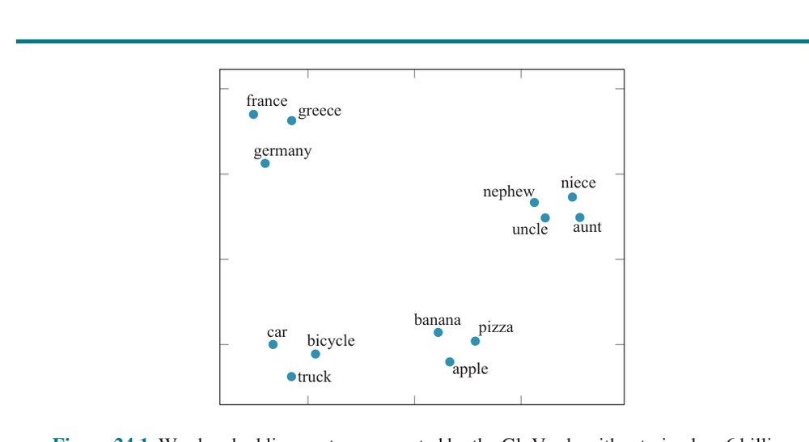
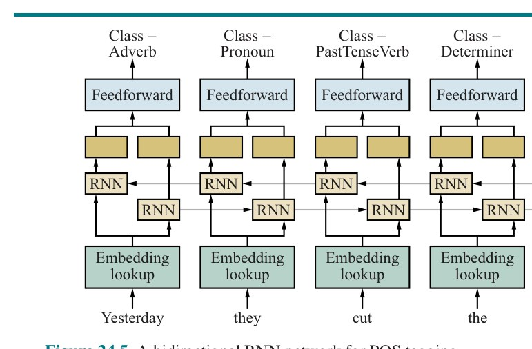
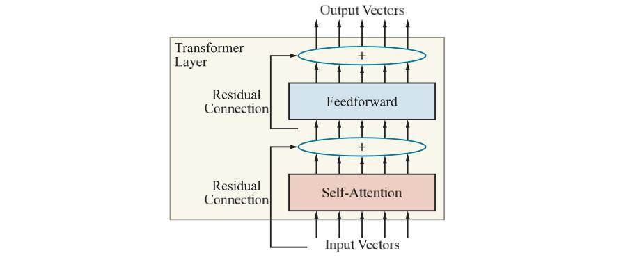
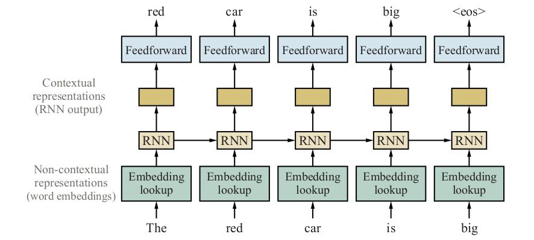
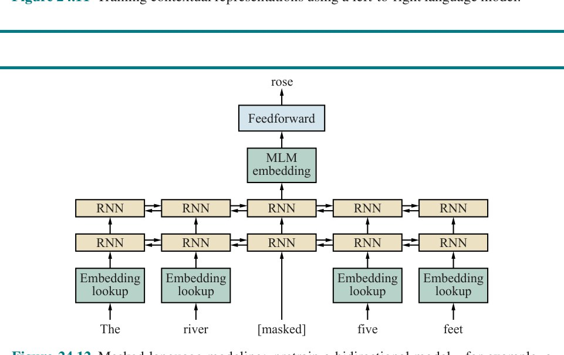

# فصل ۲۴ — یادگیری عمیق برای زبان طبیعی (Deep Learning for Natural Language Processing)

**فصل ۲۴: یادگیری عمیق برای زبان طبیعی (Deep Learning for NLP)**

*در این فصل شبکه‌های عصبیِ عمیق انواعِ تکلیف‌های زبانی را انجام می‌دهند و ساختارِ زبانِ طبیعی و همچنین سیالیتِ آن را درمی‌گیرند.*

فصل ۲۳ عناصرِ کلیدیِ زبانِ طبیعی، از جملهِ دستور و معناشناسی را توضیح داد. سامانه‌های مبتنی بر تجزیه و تحلیلِ معنایی در بسیاری از تکلیف‌ها موفقیت نشان داده‌اند، اما عملکردشان توسط پیچیدگیِ بی‌پایانِ پدیده‌های زبانی در متنِ واقعی محدود می‌شود. با توجه به حجمِ عظیمِ متنِ موجود در قالبِ خواندنیِ ماشینی، منطقی است بررسی کنیم آیا رویکردهای مبتنی بر یادگیریِ ماشینیِ داده‌محور می‌توانند مؤثرتر باشند.

این فرضیه را با ابزارهای فراهم‌شده توسط سامانه‌های یادگیری عمیق (فصل ۲۱) کاوش می‌کنیم.

در بخش ۲۴.۱ با نشان‌دادنِ اینکه چگونه یادگیری را می‌توان با بازنماییِ واژه‌ها به‌عنوانِ نقطه‌هایی در فضایِ پربعد، به‌جای مقادیرِ اتمی، بهبود بخشید شروع می‌کنیم. بخش ۲۴.۲ استفاده از شبکه‌های عصبیِ بازگشتی برای دربرگرفتنِ معنا و بافتِ دوربرد را در حالی که متن به‌صورتِ ترتیبی پردازش می‌شود پوشش می‌دهد. بخش ۲۴.۳ عمدتاً بر ترجمهٔ ماشینی تمرکز می‌کند، یکی از موفقیت‌های بزرگِ یادگیری عمیقِ اعمال‌شده بر NLP. بخش‌های ۲۴.۴ و ۲۴.۵ مدل‌هایی را پوشش می‌دهند که می‌توانند از حجمِ زیادی متنِ بدونِ برچسب آموزش ببینند و سپس بر تکلیف‌های خاص اعمال شوند، که اغلب به عملکردِ پیشتاز می‌رسند. سرانجام، بخش ۲۴.۶ ارزیابی می‌کند کجاییم و حوزه ممکن است چگونه پیشرفت کند.

## ۲۴.۱ جاسازیِ واژه

بازنماییِ واژه‌هایی می‌خواهیم که به مهندسیِ دستیِ ویژگی نیاز نداشته باشد، اما تعمیم بینِ واژه‌های مرتبط را مجاز کند—واژه‌هایی که از نظرِ نحوی مرتبط‌اند («بی‌رنگ» و «ایده‌آل» هر دو صفت‌اند)، از نظرِ معنایی («گربه» و «بچه‌گربه» هر دو گربه‌سان‌اند)، از نظرِ موضوعی («آفتابی» و «برف‌آب» هر دو اصطلاحِ آب‌وهوایند)، از نظرِ احساسات («فوق‌العاده» احساساتِ متضادِ «شرم‌آور» دارد)، یا به‌گونه‌ای دیگر.

چگونه باید واژه‌ای را به بردارِ ورودیِ x برای استفاده در شبکهٔ عصبی رمز کنیم؟ چنان‌که در بخش ۲۱.۲.۱ (صفحهٔ ۷۵۶) توضیح داده شد، می‌توانستیم از بردارِ یک-گرم استفاده کنیم—یعنی، iاُمین واژهٔ فرهنگِ لغت را با بیتی ۱ در iاُمین موقعیتِ ورودی و ۰ در همهٔ موقعیت‌های دیگر رمز کنیم. اما چنین بازنمایی‌ای شباهتِ بینِ واژه‌ها را درنمی‌گرفت.

به پیروی از حکمِ زبان‌شناسِ جان آر. فیرث (1957)، «واژه را از همنشینانش خواهی شناخت»، می‌توانستیم هر واژه را با برداری از شمارش‌های n-گرمِ همهٔ عبارت‌هایی که واژه در آن‌ها ظاهر می‌شود بازنمایی کنیم. اما شمارش‌های خامِ n-گرم دست‌وپاگیرند. با واژگانی از ۱۰۰٬۰۰۰ واژه، 10²⁵ پنج‌گرم برای پیگیری هست (هرچند بردارهای این فضایِ 10²⁵-بعدی کاملاً تنک خواهند بود—بیشترِ شمارش‌ها صفر خواهند بود). تعمیمِ بهتری می‌گرفتیم اگر این را به برداری با اندازهٔ کوچک‌تر کاهش می‌دادیم، شاید فقط با چند صد بُعد. این بردارِ کوچکِ متراکم را «جاسازیِ واژه» (Word Embedding) می‌نامیم: بردارِ کم‌بعدی که واژه‌ای را بازنمایی می‌کند. جاسازی‌های واژه به‌صورتِ خودکار از داده یاد گرفته می‌شوند. (بعداً خواهیم دید این چگونه انجام می‌شود.)

این جاسازی‌های واژهٔ آموخته‌شده چه‌شکل‌اند؟ از یک سو، هر یک فقط برداری از عددهاست، که در آن بُعدهای منفرد و مقادیرِ عددی‌شان معانیِ قابلِ تشخیصی ندارند:

```
«aardvark» = [−0.7, +0.2, −3.2, ...]
«abacus»   = [+0.5, +0.9, −1.3, ...]
...
«zyzzyva»  = [−0.1, +0.8, −0.4, ...]
```

از سوی دیگر، فضایِ ویژگی این ویژگی را دارد که واژه‌های مشابه در نهایت بردارهای مشابهی دارند. می‌توانیم آن را در شکل ۲۴.۱ ببینیم، جایی که خوشه‌های جداگانه‌ای برای واژه‌های کشور، خویشاوندی، حمل‌ونقل و غذا هست.



**شکل ۲۴.۱ — بردارهای جاسازیِ واژه که توسط الگوریتمِ GloVe آموزش‌دیده رویِ ۶ میلیارد واژهٔ متن محاسبه شده‌اند. در این تجسم، بردارهای واژهٔ 100-بعدی رویِ دو بُعد تصویر شده‌اند. واژه‌های مشابه نزدیکِ هم ظاهر می‌شوند.**

معلوم می‌شود، به دلایلی که کاملاً نمی‌فهمیم، بردارهای جاسازیِ واژه ویژگی‌های اضافی‌ای فراتر از صرفِ نزدیکیِ واژه‌های مشابه دارند. برای نمونه، فرض کنید به بردارهای A برای آتن و B برای یونان نگاه کنیم. برای این واژه‌ها، تفاضلِ بردارِ B − A به نظر می‌رسد رابطهٔ کشور/پایتخت را رمز می‌کند. جفت‌های دیگر—فرانسه و پاریس، روسیه و مسکو، زامبیا و لوزاکا—اساساً همان تفاضلِ بردار را دارند.

می‌توانیم از این ویژگی برای حلِ مسائلِ قیاسِ واژه مانندِ «آتن به یونان، همچنان که اسلو به [چه؟]» استفاده کنیم. با نوشتنِ C برای بردارِ اسلو و D برای مجهول، فرضیه می‌دهیم B − A = D − C، که به ما می‌دهد D = C + (B − A). و وقتی این بردارِ تازهٔ D را محاسبه می‌کنیم، می‌یابیم به «نروژ» نزدیک‌تر است تا هر واژهٔ دیگر. شکل ۲۴.۲ نشان می‌دهد این نوعِ حسابِ برداری برای بسیاری از رابطه‌ها کار می‌کند.

![**شکل ۲۴.۲ — مدلِ جاسازیِ واژه گاهی می‌تواند به پرسشِ «A به B، همچنان که C به [چه؟]» با حسابِ برداری پاسخ دهد: با توجه به بردارهای جاسازیِ واژه برای واژه‌های A، B و C، بردارِ D = C + (B − A) را محاسبه کن و واژه‌ای را که به D نزدیک‌ترین است پیدا کن. (پاسخ‌های ستونِ D به‌صورتِ خودکار توسط مدل محاسبه شده‌اند. توصیف‌های ستونِ «رابطه» با دست افزوده شده‌اند.) اقتباس از میکولوف و همکاران (2013, 2014).**](../figures/ch24/fig-24-2.jpg)

**شکل ۲۴.۲ — مدلِ جاسازیِ واژه گاهی می‌تواند به پرسشِ «A به B، همچنان که C به [چه؟]» با حسابِ برداری پاسخ دهد: با توجه به بردارهای جاسازیِ واژه برای واژه‌های A، B و C، بردارِ D = C + (B − A) را محاسبه کن و واژه‌ای را که به D نزدیک‌ترین است پیدا کن. (پاسخ‌های ستونِ D به‌صورتِ خودکار توسط مدل محاسبه شده‌اند. توصیف‌های ستونِ «رابطه» با دست افزوده شده‌اند.) اقتباس از میکولوف و همکاران (2013, 2014).**

با این حال، هیچ تضمینی نیست که الگوریتمِ جاسازیِ واژهٔ خاصی که رویِ پیکرهٔ خاصی اجرا می‌شود رابطهٔ معناییِ خاصی را دربرگیرد. جاسازی‌های واژه محبوب‌اند، زیرا ثابت شده بازنماییِ خوبی برای تکلیف‌های زبانیِ پایین‌دست (مانندِ پاسخ‌گوییِ پرسش یا ترجمه یا خلاصه‌سازی) هستند، نه به‌دلیلِ اینکه تضمین می‌شود به‌خودیِ‌خود به پرسش‌های قیاسی پاسخ دهند.

استفاده از بردارهای جاسازیِ واژه به‌جای رمزگذاری‌های یک-گرمِ واژه‌ها برای اساساً همهٔ کاربردهای یادگیری عمیق در تکلیف‌های NLP مفید معلوم می‌شود. در واقع، در بسیاری از موارد می‌توان از بردارهای عمومیِ از‌پیش‌آموزش‌دیده، که از هر یک از چندین تأمین‌کننده به‌دست می‌آیند، برای تکلیفِ NLPِ خاصِ خود استفاده کرد. در زمانِ نوشتنِ این کتاب، فرهنگ‌های بردارِ پرکاربرد شاملِ WORD2VEC، GloVe (بردارهای سراسری) و FASTTEXT هستند، که FASTTEXT برای ۱۵۷ زبان جاسازی دارد. استفاده از مدلِ از‌پیش‌آموزش‌دیده می‌تواند زمان و تلاشِ زیادی صرفه‌جویی کند. برای اطلاعاتِ بیشتر دربارهٔ این منابع، بخش ۲۴.۵.۱ را ببینید.

همچنین ممکن است بردارهای واژهٔ خودتان را آموزش دهید؛ این معمولاً هم‌زمان با آموزشِ شبکه‌ای برای تکلیفی خاص انجام می‌شود. برخلافِ جاسازی‌های عمومیِ از‌پیش‌آموزش‌دیده، جاسازی‌های واژهٔ تولیدشده برای تکلیفی خاص را می‌توان رویِ پیکره‌ای با دقتِ انتخاب‌شده آموزش داد و تمایل خواهند داشت بر جنبه‌هایی از واژه‌ها تأکید کنند که برای تکلیف مفیدند. فرض کنید، برای نمونه، تکلیف، برچسب‌گذاریِ نقشِ دستوری (POS) است (بخش ۲۳.۱.۶ را ببینید). به یاد آورید این شاملِ پیش‌بینیِ نقشِ دستوریِ درست برای هر واژهٔ جمله است. هرچند این تکلیفِ ساده‌ای است، بی‌اهمیت نیست، زیرا بسیاری از واژه‌ها را می‌توان به چند شیوه برچسب‌گذاری کرد—برای نمونه، واژهٔ cut می‌تواند فعلِ زمانِ حال (متعدی یا ناگذر)، فعلِ زمانِ گذشته، فعلِ مصدری، اسم‌مفعولیِ گذشته، صفت یا اسم باشد. اگر قیدِ زمانیِ نزدیکی به گذشته ارجاع کند، آن‌گاه این پیشنهاد می‌شود این رخدادِ خاصِ cut فعلِ زمانِ گذشته است؛ و ممکن است امیدوار باشیم، پس، جاسازی جنبهٔ گذشته‌ارجاعِ قیدها را دربرگیرد.

برچسب‌گذاریِ POS مقدمهٔ خوبی برای کاربردِ یادگیری عمیق در NLP است، بدونِ پیچیدگیِ تکلیف‌های پیچیده‌تر مانندِ پاسخ‌گوییِ پرسش (بخش ۲۴.۵.۳ را ببینید).

با توجه به پیکره‌ای از جمله‌ها با برچسب‌های POS، پارامترهای جاسازیِ واژه و برچسب‌گذارِ POS را به‌طورِ هم‌زمان یاد می‌گیریم. فرایند به‌صورتِ زیر کار می‌کند:

۱. پهنایِ w (تعدادِ فردِ واژه) را برای پنجرهٔ پیش‌بینیِ مورداستفاده برای برچسب‌گذاریِ هر واژه انتخاب کن. مقدارِ معمول w = 5 است، یعنی برچسب بر مبنای واژه به‌علاوهٔ دو واژهٔ سمتِ چپ و دو واژهٔ سمتِ راست پیش‌بینی می‌شود. هر جملهٔ پیکره‌ات را به پنجره‌های هم‌پوشانِ با طولِ w بشکن. هر پنجره یک مثالِ آموزشی تولید می‌کند که شاملِ w واژه به‌عنوانِ ورودی و ردهٔ POSِ واژهٔ میانی به‌عنوانِ خروجی است.
۲. واژگانی از همهٔ توکن‌های واژهٔ یکتایی که بیش از، مثلاً، ۵ بار در دادهٔ آموزشی رخ می‌دهند ایجاد کن. تعدادِ کلِ واژه‌های واژگان را v بنام.
۳. این واژگان را به هر ترتیبِ دلبخواهی مرتب کن (شاید الفبایی).
۴. مقدارِ d را به‌عنوانِ اندازهٔ هر بردارِ جاسازیِ واژه انتخاب کن.
۵. ماتریسِ وزنِ تازهٔ v-در-d به نامِ E ایجاد کن. این ماتریسِ جاسازیِ واژه است. سطرِ iامِ E جاسازیِ واژهٔ iاُمین واژهٔ واژگان است. E را به‌صورتِ تصادفی (یا از بردارهای از‌پیش‌آموزش‌دیده) مقداردهیِ اولیه کن.
۶. شبکهٔ عصبی‌ای برپا کن که برچسبِ نقشِ دستوری خروجی می‌دهد، چنان‌که در شکل ۲۴.۳ نشان داده شده.

![**شکل ۲۴.۳ — مدلِ برچسب‌گذاریِ نقشِ دستوریِ پیشخور. این مدل پنجره‌ای پنج‌واژه‌ای را به‌عنوانِ ورودی می‌گیرد و برچسبِ واژهٔ میانی—در این‌جا، cut—را پیش‌بینی می‌کند. مدل قادر به درنظرگرفتنِ موقعیتِ واژه است، زیرا هر یک از ۵ جاسازیِ ورودی در بخشِ متفاوتی از لایهٔ پنهانِ نخست ضرب می‌شود. مقادیرِ پارامترِ جاسازی‌های واژه و سه لایه همگی در طولِ آموزش به‌طورِ هم‌زمان یاد گرفته می‌شوند.** لایهٔ نخست شاملِ w نسخه از ماتریسِ جاسازی خواهد بود. ممکن است از دو لایهٔ پنهانِ اضافی، z₁ و z₂ (به‌ترتیب با ماتریس‌های وزنِ W₁ و W₂)، استفاده کنیم و سپس لایهٔ سافتمکسی که توزیعِ احتمالِ خروجیِ ŷ را رویِ رده‌های نقشِ دستوریِ ممکن برای واژهٔ میانی می‌دهد:](../figures/ch24/fig-24-3.jpg)

**شکل ۲۴.۳ — مدلِ برچسب‌گذاریِ نقشِ دستوریِ پیشخور. این مدل پنجره‌ای پنج‌واژه‌ای را به‌عنوانِ ورودی می‌گیرد و برچسبِ واژهٔ میانی—در این‌جا، cut—را پیش‌بینی می‌کند. مدل قادر به درنظرگرفتنِ موقعیتِ واژه است، زیرا هر یک از ۵ جاسازیِ ورودی در بخشِ متفاوتی از لایهٔ پنهانِ نخست ضرب می‌شود. مقادیرِ پارامترِ جاسازی‌های واژه و سه لایه همگی در طولِ آموزش به‌طورِ هم‌زمان یاد گرفته می‌شوند.** لایهٔ نخست شاملِ w نسخه از ماتریسِ جاسازی خواهد بود. ممکن است از دو لایهٔ پنهانِ اضافی، z₁ و z₂ (به‌ترتیب با ماتریس‌های وزنِ W₁ و W₂)، استفاده کنیم و سپس لایهٔ سافتمکسی که توزیعِ احتمالِ خروجیِ ŷ را رویِ رده‌های نقشِ دستوریِ ممکن برای واژهٔ میانی می‌دهد:

```
z₁ = σ(W₁ x)
z₂ = σ(W₂ z₁)
ŷ  = softmax(W_out z₂)
```

۷. برای رمزکردنِ دنباله‌ای از w واژه به بردارِ ورودی، صرفاً جاسازیِ هر واژه را نگاه کن و بردارهای جاسازی را به هم بچسبان. نتیجه بردارِ ورودیِ حقیقی‌مقدارِ x با طولِ wd است. حتی اگر واژهٔ داده‌شده‌ای همان بردارِ جاسازی را داشته باشد، چه در موقعیتِ نخست رخ دهد، چه آخرین یا جایی در میانه، هر جاسازی در بخشِ متفاوتی از لایهٔ پنهانِ نخست ضرب خواهد شد؛ بنابراین موقعیتِ نسبیِ هر واژه را به‌صورتِ ضمنی رمز می‌کنیم.

۸. وزن‌های E و دیگر ماتریس‌های وزنِ W₁، W₂ و W_out را با نزولِ گرادیان آموزش بده. اگر همه‌چیز خوب پیش برود، واژهٔ میانیِ cut، بر مبنای شاهدِ پنجره، که شاملِ واژهٔ زمانیِ گذشتهٔ «yesterday»، ضمیرِ فاعلیِ سوم‌شخصِ «they» بلافاصله پیش از cut، و مانندِ آن است، به‌عنوانِ فعلِ زمانِ گذشته برچسب خواهد خورد.

جایگزینی برای جاسازیِ واژه، مدلِ سطح-نویسه است که ورودی در آن دنباله‌ای از نویسه‌هاست، که هر یک به‌صورتِ بردارِ یک-گرم رمز شده. چنین مدلی باید یاد بگیرد نویسه‌ها چگونه به هم می‌آیند تا واژه‌ها را بسازند. بیشترِ کارِ NLP به رمزگذاری‌های سطح-واژه می‌چسبد تا سطح-نویسه.

## ۲۴.۲ شبکه‌های عصبیِ بازگشتی برای NLP

حالا بازنماییِ خوبی برای واژه‌های تکیِ منزوی داریم، اما زبان شاملِ دنبالهٔ مرتبی از واژه‌هاست که بافتِ واژه‌های اطراف در آن مهم است. برای تکلیف‌های ساده مانندِ برچسب‌گذاریِ نقشِ دستوری، پنجرهٔ کوچکِ با اندازهٔ ثابتِ شاید پنج‌واژه‌ای معمولاً بافتِ کافی فراهم می‌کند.

تکلیف‌های پیچیده‌تر مانندِ پاسخ‌گوییِ پرسش یا رفعِ ارجاع ممکن است به ده‌ها واژه به‌عنوانِ بافت نیاز داشته باشند. برای نمونه، در جملهٔ «ادواردو به من گفت میگل خیلی مریض بود، پس او را به بیمارستان بردم»، دانستنِ اینکه «او» به میگل ارجاع می‌کند نه ادواردو، به بافتی نیاز دارد که از نخستین تا آخرین واژهٔ جملهٔ ۱۴-واژه‌ای را می‌پوشاند.

### ۲۴.۲.۱ مدل‌های زبان با شبکه‌های عصبیِ بازگشتی

با مسئلهٔ ایجادِ مدلِ زبانِ با بافتِ کافی شروع می‌کنیم. به یاد آورید مدلِ زبان توزیعِ احتمالیِ رویِ دنباله‌های واژه است. به ما اجازه می‌دهد واژهٔ بعدیِ متن را با توجه به همهٔ واژه‌های قبلی پیش‌بینی کنیم، و اغلب به‌عنوانِ بلوکِ ساختمانی برای تکلیف‌های پیچیده‌تر استفاده می‌شود.

ساختنِ مدلِ زبان با مدلِ n-گرم (مانندِ بخش ۲۳.۱) یا شبکهٔ پیشخور با پنجرهٔ ثابتِ n واژه می‌تواند به‌دلیلِ مسئلهٔ بافت به دشواری بیفتد: یا بافتِ لازم از اندازهٔ پنجرهٔ ثابت فراتر خواهد رفت، یا مدل پارامترهای زیادی خواهد داشت، یا هر دو. علاوه بر این، شبکهٔ پیشخور مشکلِ نامتقارنی دارد: هرچه دربارهٔ، مثلاً، ظهورِ واژهٔ him به‌عنوانِ واژهٔ دوازدهمِ جمله یاد بگیرد، باید برای ظهورِ him در موقعیت‌های دیگرِ جمله دوباره یاد بگیرد، زیرا وزن‌ها برای هر موقعیتِ واژه متفاوت‌اند.


**شکل ۲۴.۴ — (الف) نمودارِ شماتیکِ RNN که لایهٔ پنهانِ z اتصال‌های بازگشتی دارد؛ نمادِ Δ تأخیر را نشان می‌دهد. هر ورودیِ x بردارِ جاسازیِ واژهٔ واژهٔ بعدیِ جمله است. هر خروجیِ y خروجیِ همان گامِ زمانی است. (ب) همان شبکه که رویِ سه گامِ زمانی بازشده تا شبکهٔ پیشخوری بسازد. توجه کنید وزن‌ها در همهٔ گام‌های زمانی مشترک‌اند.**

در بخش ۲۱.۶، شبکهٔ عصبیِ بازگشتی یا RNN را معرفی کردیم، که برای پردازشِ دادهٔ سریِ زمانی، هر بار یک داده، طراحی شده. این پیشنهاد می‌کند RNNها ممکن است برای پردازشِ زبان، هر بار یک واژه، مفید باشند. شکل ۲۱.۸ را این‌جا به‌عنوانِ شکل ۲۴.۴ تکرار می‌کنیم.

در مدلِ زبانِ RNN، هر واژهٔ ورودی به‌عنوانِ بردارِ جاسازیِ واژه، xᵢ، رمز می‌شود. لایهٔ پنهانِ zₜ هست که به‌عنوانِ ورودی از یک گامِ زمانی به گامِ بعدی منتقل می‌شود. به رده‌بندیِ چندرده‌ای علاقه‌مندیم: رده‌ها واژه‌های واژگان‌اند. پس خروجیِ yₜ توزیعِ احتمالِ سافتمکسی رویِ مقادیرِ ممکنِ واژهٔ بعدیِ جمله خواهد بود.

معماریِ RNN مسئلهٔ پارامترهایِ زیاد را حل می‌کند. تعدادِ پارامترهای ماتریس‌های وزنِ w_{z,z}، w_{x,z} و w_{z,y} ثابت می‌ماند، بدونِ توجه به تعدادِ واژه‌ها—O(1) است. این در تقابل با شبکه‌های پیشخور است، که O(n) پارامتر دارند، و مدل‌های n-گرم، که O(vⁿ) پارامتر دارند، که v اندازهٔ واژگان است.

معماریِ RNN همچنین مسئلهٔ نامتقارنی را حل می‌کند، زیرا وزن‌ها برای هر موقعیتِ واژه همان‌اند. معماریِ RNN گاهی می‌تواند مسئلهٔ بافتِ محدود را نیز حل کند. در تئوری هیچ حدی برای اینکه مدل چقدر به عقبِ ورودی نگاه کند نیست. هر به‌روزرسانیِ لایهٔ پنهانِ zₜ به هر دوِ واژهٔ ورودیِ کنونیِ xₜ و لایهٔ پنهانِ قبلیِ z_{t−1} دسترسی دارد، که به این معناست اطلاعاتِ مربوط به هر واژهٔ ورودی می‌تواند به‌طورِ نامحدود در لایهٔ پنهان نگه داشته شود، و از یک گامِ زمانی به گامِ بعد کپی (یا به‌صورتِ مناسب اصلاح) شود. البته، ذخیرهٔ محدودی در z هست، پس نمی‌تواند همه‌چیزِ مربوط به همهٔ واژه‌های قبلی را به خاطر بسپارد. در عمل، مدل‌های RNN در انواعِ تکلیف‌ها خوب عمل می‌کنند، اما نه در همهٔ تکلیف‌ها. پیش‌بینیِ موفق‌بودنشان برای مسئله‌ای داده‌شده دشوار است. عاملی که به موفقیت کمک می‌کند این است که فرایندِ آموزش شبکه را تشویق می‌کند فضایِ ذخیرهٔ z را به جنبه‌هایی از ورودی تخصیص دهد که در واقع مفید خواهند بود.

برای آموزشِ مدلِ زبانِ RNN، از فرایندِ آموزشِ توصیف‌شده در بخش ۲۱.۶.۱ استفاده می‌کنیم. ورودی‌های xₜ واژه‌های پیکرهٔ آموزشیِ متن و خروجی‌های مشاهده‌شده همان واژه‌ها هستند که با ۱ جابه‌جا شده‌اند. یعنی، برای متنِ آموزشیِ «hello world»، نخستین ورودیِ x₁ جاسازیِ واژهٔ «hello» و نخستین خروجیِ y₁ جاسازیِ واژهٔ «world» است. مدل را برای پیش‌بینیِ واژهٔ بعدی آموزش می‌دهیم، و انتظار داریم برای انجامِ این کار از لایهٔ پنهان برای بازنماییِ اطلاعاتِ مفید استفاده کند. چنان‌که در بخش ۲۱.۶.۱ توضیح داده شد، تفاوتِ بینِ خروجیِ مشاهده‌شده و خروجیِ واقعیِ محاسبه‌شده توسط شبکه را محاسبه می‌کنیم و در طولِ زمان پسانتشار می‌دهیم، با مراقبت از اینکه وزن‌ها را برای همهٔ گام‌های زمانی یکسان نگه داریم.

پس از آموزشِ مدل، می‌توانیم از آن برای تولیدِ متنِ تصادفی استفاده کنیم. واژهٔ ورودیِ آغازینِ x₁ را به مدل می‌دهیم، که از آن خروجیِ y₁ تولید می‌کند، توزیعِ احتمالِ سافتمکسی رویِ واژه‌ها. واژه‌ای تکی از توزیع نمونه‌برداری می‌کنیم، واژه را به‌عنوانِ خروجیِ زمانِ t ثبت می‌کنیم، و آن را به‌عنوانِ واژهٔ ورودیِ بعدیِ x₂ به عقب تغذیه می‌کنیم. تا هر زمان که خواسته شود تکرار می‌کنیم. در نمونه‌برداری از y₁ انتخابی داریم: می‌توانیم همیشه محتمل‌ترین واژه را بگیریم؛ می‌توانیم طبقِ احتمالِ هر واژه نمونه‌برداری کنیم؛ یا می‌توانیم از واژه‌های کم‌محتمل‌تر بیش‌نمونه‌برداری کنیم، تا تنوعِ بیشتری به خروجیِ تولیدشده تزریق شود. وزنِ نمونه‌برداری ابرپارامترِ مدل است.

در این‌جا نمونه‌ای از متنِ تصادفیِ تولیدشده توسط مدلِ RNN آموزش‌دیده رویِ آثارِ شکسپیر (کارپاتی، 2015) آمده (با برگردانِ فارسی):

«ازدواج کن، و خواهم کرد، سرورم، که گریستن در چنین کسی زیباترین بود؛
با این حال، اکنون من وارثِ خواندهٔ
روزِ غم‌انگیزِ جهان گشتم،
تا راهِ بعدی را با پدرش و با چهره‌اش نظاره کنم؟»

*(متن اصلی انگلیسی تولیدشده توسط مدل:)*
> *Marry, and will, my lord, to weep in such a one were best;*
> *Yet now I was adopted heir*
> *Of the world's lamentable day,*
> *To watch the next way with his father with his face?*

### ۲۴.۲.۲ رده‌بندی با شبکه‌های عصبیِ بازگشتی

همچنین می‌توان از RNNها برای دیگر تکلیف‌های زبانی، مانندِ برچسب‌گذاریِ نقشِ دستوری یا رفعِ هم‌ارجاعی، استفاده کرد. در هر دو مورد لایه‌های ورودی و پنهان همان خواهند بود، اما برای برچسب‌گذارِ POS خروجی توزیعِ سافتمکسی رویِ برچسب‌های POS خواهد بود، و برای رفعِ هم‌ارجاعی توزیعِ سافتمکسی رویِ پیشایندهای ممکن. برای نمونه، وقتی شبکه به ورودیِ «او» در «ادواردو به من گفت میگل خیلی مریض بود، پس او را به بیمارستان بردم» می‌رسد، باید احتمالِ بالایی برای «میگل» خروجی دهد.

آموزشِ RNN برای رده‌بندیِ این‌چنینی همان‌گونه که با مدلِ زبان انجام می‌شود صورت می‌گیرد. تنها تفاوت این است که دادهٔ آموزشی به برچسب‌ها نیاز خواهد داشت—برچسب‌های نقشِ دستوری یا نشانه‌های ارجاع. این جمع‌آوریِ داده را بسیار دشوارتر از حالتِ مدلِ زبان می‌کند، که در آن فقط به متنِ بدونِ برچسب نیاز داریم.

در مدلِ زبان می‌خواهیم nاُمین واژه را با توجه به واژه‌های قبلی پیش‌بینی کنیم. اما برای رده‌بندی، دلیلی نیست خود را به نگاه‌کردنِ فقط به واژه‌های قبلی محدود کنیم. نگاه‌کردن به جلو در جمله می‌تواند بسیار کمک‌کننده باشد. در مثالِ هم‌ارجاعیِ ما، مرجعِ «او» اگر جمله به‌جای «به بیمارستان» با «تا میگل را ببیند» پایان می‌یافت متفاوت بود، پس نگاه به جلو حیاتی است. از آزمایش‌های ردیابیِ چشم می‌دانیم خوانندگانِ انسانی به‌صورتِ دقیقِ چپ-به-راست پیش نمی‌روند.

برای دربرگرفتنِ بافتِ سمتِ راست، می‌توانیم از «RNN دوسویه» (Bidirectional RNN) استفاده کنیم، که مدلِ جداگانهٔ راست-به-چپ را به مدلِ چپ-به-راست می‌چسباند. نمونه‌ای از استفاده از RNN دوسویه برای برچسب‌گذاریِ POS در شکل ۲۴.۵ نشان داده شده.



**شکل ۲۴.۵ — شبکهٔ RNN دوسویه برای برچسب‌گذاریِ POS.**

در موردِ RNN چندلایه، zₜ بردارِ پنهانِ آخرین لایه خواهد بود. برای RNN دوسویه، zₜ معمولاً چسباندنِ بردارهای مدلِ چپ-به-راست و راست-به-چپ در نظر گرفته می‌شود.

RNNها همچنین می‌توانند برای تکلیف‌های رده‌بندیِ سطح-جمله (یا سطح-سند) استفاده شوند، که در آن‌ها خروجیِ تکی در پایان می‌آید، به‌جای داشتنِ جریانی از خروجی‌ها، یکی در هر گامِ زمانی. برای نمونه، در تحلیلِ احساسات هدف رده‌بندیِ متنی به‌عنوانِ دارایِ احساساتِ مثبت یا منفی است. برای نمونه، «این فیلم بد نوشته و بد بازی شده بود» باید به‌عنوانِ منفی رده‌بندی شود. (برخی طرح‌های تحلیلِ احساسات از بیش از دو رده استفاده می‌کنند، یا از مقدارِ عددیِ اسکالر.) استفاده از RNNها برای تکلیفِ سطح-جمله کمی پیچیده‌تر است، زیرا باید بازنماییِ کلِ جملهٔ تجمیعی، y، را از خروجی‌های واژه‌به‌واژهٔ yₜِ RNN به‌دست آوریم.

ساده‌ترین راه برای این کار استفاده از حالتِ پنهانِ RNNِ متناظر با آخرین واژهٔ ورودی است، زیرا RNN در آن گامِ زمانی کلِ جمله را خوانده خواهد بود. با این حال، این می‌تواند به‌صورتِ ضمنی مدل را به سمتِ توجهِ بیشتر به پایانِ جمله اریب کند. فنِ رایجِ دیگر تجمیعِ همهٔ بردارهای پنهان است. برای نمونه، «تجمیعِ میانگین» (Average Pooling) میانگینِ عنصربه‌عنصرِ همهٔ بردارهای پنهان را محاسبه می‌کند:

```
z̃ = (1/s) ∑_{t=1}^{s} zₜ
```

سپس بردارِ تجمیع‌شدهٔ d-بعدیِ z̃ را می‌توان به یک یا چند لایهٔ پیشخور خوراک داد پیش از آنکه به لایهٔ خروجی خوراک شود.

### ۲۴.۲.۳ LSTMها برای تکلیف‌های NLP

گفتیم RNNها گاهی مسئلهٔ بافتِ محدود را حل می‌کنند. در تئوری، هر اطلاعاتی می‌تواند از یک لایهٔ پنهان به لایهٔ بعدی برای هر تعدادِ گامِ زمانی منتقل شود. اما در عمل اطلاعات می‌تواند گم یا تحریف شود، درست مانندِ بازیِ تلفن، که بازیکنان در صف می‌ایستند و نخستین بازیکن پیامی را به نفرِ دوم زمزمه می‌کند، که آن را برای نفرِ سوم تکرار می‌کند، و همین‌طور تا انتهای صف. معمولاً، پیامی که در پایان بیرون می‌آید کاملاً از پیامِ اصلی خراب شده. این مسئله برای RNNها شبیهِ مسئلهٔ گرادیانِ ناپدیدشونده‌ای است که در صفحهٔ ۷۵۶ توصیف کردیم، با این تفاوت که حالا با لایه‌هایی در طولِ زمان سروکار داریم نه لایه‌های عمیق.

در بخش ۲۱.۶.۲ مدلِ حافظهٔ کوتاه‌مدت-بلندمدت (LSTM) را معرفی کردیم. این نوعی RNN با واحدهای دروازه‌ای است که از مشکلِ بازتولیدِ ناقصِ پیام از یک گامِ زمانی به گامِ بعد رنج نمی‌برد. در عوض، LSTM می‌تواند انتخاب کند برخی بخش‌های ورودی را به خاطر بسپارد، آن‌ها را به گامِ زمانیِ بعد کپی کند، و بخش‌های دیگر را فراموش کند. مدلِ زبانی را در نظر بگیر که متنی مانندِ «ورزشکارانی که همه مقدماتیِ محلی‌شان را بردند و به فینالِ توکیو راه یافتند، اکنون ...» را مدیریت می‌کند.

در این نقطه، اگر از مدل می‌پرسیدیم کدام واژهٔ بعدی محتمل‌تر است، «رقابت می‌کنند» یا «رقابت می‌کند»، انتظار داشتیم «رقابت می‌کنند» را برگیرد، زیرا با فاعلِ «ورزشکاران» توافق دارد. LSTM می‌تواند یاد بگیرد ویژگیِ نهانی برای شخص و شمارِ فاعل بسازد و آن ویژگی را بدونِ تغییر به جلو کپی کند تا وقتی برای چنین انتخابی لازم شود. RNN معمولی (یا مدلِ n-گرم، در این مورد) اغلب در جمله‌های بلند با واژه‌های میانیِ بسیار بینِ فاعل و فعل گیج می‌شود.

## ۲۴.۳ مدل‌های دنباله‌به‌دنباله

یکی از پرکاربردترینِ تکلیف‌های مطالعه‌شده در NLP «ترجمهٔ ماشینی» (Machine Translation یا MT) است، که هدف در آن ترجمهٔ جمله‌ای از «زبانِ مبدأ» به «زبانِ مقصد» است—برای نمونه، از اسپانیایی به انگلیسی. مدلِ MT را با پیکرهٔ بزرگی از جفتِ جمله‌های مبدأ/مقصد آموزش می‌دهیم. هدف سپس ترجمهٔ دقیقِ جمله‌های تازه‌ای است که در دادهٔ آموزشیِ ما نیستند.

آیا می‌توانیم از RNNها برای ایجادِ سامانهٔ MT استفاده کنیم؟ قطعاً می‌توانیم جملهٔ مبدأ را با RNN رمز کنیم. اگر تناظرِ یک‌به‌یک بینِ واژه‌های مبدأ و مقصد بود، می‌توانستیم MT را تکلیفِ برچسب‌گذاریِ ساده‌ای بدانیم—با توجه به واژهٔ مبدأِ «perro» در اسپانیایی، آن را با واژهٔ انگلیسیِ متناظرِ «dog» برچسب می‌زنیم. اما در واقع، واژه‌ها یک‌به‌یک نیستند: در اسپانیایی سه واژهٔ «caballo de mar» با واژهٔ انگلیسیِ تکیِ «seahorse» متناظر است، و دو واژهٔ «perro grande» به «big dog» ترجمه می‌شود، با ترتیبِ واژهٔ معکوس. بازچینیِ واژه می‌تواند حتی شدیدتر باشد؛ در انگلیسی فاعل معمولاً در آغازِ جمله است، اما در فیجیایی فاعل معمولاً در پایان است. پس چگونه جمله‌ای در زبانِ مقصد تولید کنیم؟

به نظر می‌رسد باید واژه‌ای‌واژه تولید کنیم، اما بافت را پیگیری کنیم تا بتوانیم بخش‌هایی از مبدأ را که هنوز ترجمه نشده به خاطر بسپاریم، و آنچه ترجمه شده را پیگیری کنیم تا خودمان را تکرار نکنیم. همچنین به نظر می‌رسد برای برخی جمله‌ها باید کلِ جملهٔ مبدأ را پیش از شروعِ تولیدِ مقصد پردازش کنیم. به بیانِ دیگر، تولیدِ هر واژهٔ مقصد مشروط بر کلِ جملهٔ مبدأ و همهٔ واژه‌های مقصدِ قبلاً تولیدشده است.

این به تولیدِ متن برای MT پیوندی نزدیک با مدلِ زبانِ RNNِ استانداردِ توصیف‌شده در بخش ۲۴.۲ می‌دهد. قطعاً، اگر RNNای را رویِ متنِ انگلیسی آموزش داده بودیم، احتمالِ تولیدِ «big dog» بیشتر از «dog big» بود. اما نمی‌خواهیم هر جملهٔ تصادفیِ زبانِ مقصد را تولید کنیم؛ می‌خواهیم جملهٔ زبانِ مقصدی تولید کنیم که با جملهٔ زبانِ مبدأ متناظر باشد. ساده‌ترین راه برای انجامِ این کار استفاده از دو RNN است، یکی برای مبدأ و یکی برای مقصد. RNNِ مبدأ را رویِ جملهٔ مبدأ اجرا می‌کنیم و سپس از حالتِ پنهانِ نهاییِ RNNِ مبدأ به‌عنوانِ حالتِ پنهانِ آغازینِ RNNِ مقصد استفاده می‌کنیم. به این‌شیوه، هر واژهٔ مقصد به‌صورتِ ضمنی هم بر کلِ جملهٔ مبدأ و هم بر واژه‌های مقصدِ قبلی مشروط است.

این معماریِ شبکهٔ عصبی «مدلِ دنباله‌به‌دنبالهٔ پایه» (Sequence-to-Sequence Model) نامیده می‌شود، که نمونه‌ای از آن در شکل ۲۴.۶ نشان داده شده. مدل‌های دنباله‌به‌دنباله بیشتر برای ترجمهٔ ماشینی استفاده می‌شوند، اما می‌توانند برای تعدادی از تکلیف‌های دیگر نیز استفاده شوند، مانندِ تولیدِ خودکارِ زیرنویسِ متنی از تصویر، یا خلاصه‌سازی: بازنویسیِ متنِ بلند به متنی کوتاه‌تر که همان معنا را حفظ می‌کند.

![**شکل ۲۴.۶ — مدلِ دنباله‌به‌دنبالهٔ پایه. هر بلوک یک گامِ زمانیِ LSTM را نشان می‌دهد. (برای سادگی، لایه‌های جاسازی و خروجی نشان داده نشده‌اند.) در گام‌های متوالی، واژه‌های جملهٔ مبدأِ «The man is tall» را به شبکه می‌دهیم، و سپس برچسبِ <start> را تا نشان دهیم شبکه باید تولیدِ جملهٔ مقصد را شروع کند. حالتِ پنهانِ نهایی در پایانِ جملهٔ مبدأ به‌عنوانِ حالتِ پنهان برای شروعِ جملهٔ مقصد استفاده می‌شود. پس از آن، هر واژهٔ جملهٔ مقصد در زمانِ t به‌عنوانِ ورودی در زمانِ t+1 استفاده می‌شود، تا وقتی شبکه برچسبِ <end> را تولید کند که نشان دهد تولیدِ جمله پایان یافته.**](../figures/ch24/fig-24-6.jpg)

**شکل ۲۴.۶ — مدلِ دنباله‌به‌دنبالهٔ پایه. هر بلوک یک گامِ زمانیِ LSTM را نشان می‌دهد. (برای سادگی، لایه‌های جاسازی و خروجی نشان داده نشده‌اند.) در گام‌های متوالی، واژه‌های جملهٔ مبدأِ «The man is tall» را به شبکه می‌دهیم، و سپس برچسبِ <start> را تا نشان دهیم شبکه باید تولیدِ جملهٔ مقصد را شروع کند. حالتِ پنهانِ نهایی در پایانِ جملهٔ مبدأ به‌عنوانِ حالتِ پنهان برای شروعِ جملهٔ مقصد استفاده می‌شود. پس از آن، هر واژهٔ جملهٔ مقصد در زمانِ t به‌عنوانِ ورودی در زمانِ t+1 استفاده می‌شود، تا وقتی شبکه برچسبِ <end> را تولید کند که نشان دهد تولیدِ جمله پایان یافته.**

مدل‌های دنباله‌به‌دنبالهٔ پایه پیشرفتِ چشمگیری در NLP و به‌طورِ خاص MT بودند. طبقِ وو و همکاران (2016b) این رویکرد به کاهشِ خطایِ ۶۰٪ نسبت به روش‌های قبلیِ MT انجامید. اما این مدل‌ها از سه کاستیِ عمده رنج می‌برند:

- **اریبِ بافتِ نزدیک:** هر آنچه RNNها می‌خواهند دربارهٔ گذشته به خاطر بسپارند، باید در حالتِ پنهانِ خود جای دهند. برای نمونه، فرض کنید RNN در حالِ پردازشِ واژه (یا گامِ زمانیِ) ۵۷ در دنباله‌ای ۷۰-واژه‌ای است. حالتِ پنهان به احتمالِ زیاد اطلاعاتِ بیشتری دربارهٔ واژهٔ گامِ زمانیِ ۵۶ دارد تا واژهٔ گامِ زمانیِ ۵، زیرا هر بار که بردارِ پنهان به‌روزرسانی می‌شود باید مقداری از اطلاعاتِ موجود را با اطلاعاتِ تازه جایگزین کند. این رفتار بخشی از طراحیِ عمدیِ مدل است، و اغلب برای NLP منطقی است، زیرا بافتِ نزدیک معمولاً مهم‌تر است. با این حال، بافتِ دور نیز می‌تواند حیاتی باشد، و می‌تواند در مدلِ RNN گم شود؛ حتی LSTMها نیز با این تکلیف دشواری دارند.
- **حدِّ اندازهٔ ثابتِ بافت:** در مدلِ ترجمهٔ RNN، کلِ جملهٔ مبدأ به بردارِ حالتِ پنهانِ تکیِ با ابعادِ ثابت فشرده می‌شود. LSTMِ استفاده‌شده در مدلِ NLPِ پیشتاز معمولاً حدودِ ۱۰۲۴ بُعد دارد، و اگر مجبور باشیم، مثلاً، جملهٔ ۶۴-واژه‌ای را در ۱۰۲۴ بُعد بازنمایی کنیم، این فقط ۱۶ بُعد به‌ازایِ هر واژه به ما می‌دهد—برای جمله‌های پیچیده کافی نیست. افزایشِ اندازهٔ بردارِ حالتِ پنهان می‌تواند به آموزشِ کند و بیش‌برازش بینجامد.
- **پردازشِ ترتیبیِ کندتر:** چنان‌که در بخش ۲۱.۳ بحث شد، شبکه‌های عصبی با پردازشِ دادهٔ آموزشی در دسته‌ها، برای بهره‌گیری از پشتیبانیِ کارآمدِ سخت‌افزاریِ ضربِ ماتریس، سودِ کاراییِ چشمگیری به‌دست می‌آورند. RNNها، از سوی دیگر، به نظر می‌رسد مقیدند رویِ دادهٔ آموزشی هر بار یک واژه عمل کنند.

### ۲۴.۳.۱ توجه

چه می‌شد اگر RNNِ مقصد بر همهٔ بردارهای پنهانِ RNNِ مبدأ مشروط بود، نه فقط آخرین‌شان؟ این کاستی‌های اریبِ بافتِ نزدیک و حدِّ اندازهٔ ثابتِ بافت را کاهش می‌داد، و به مدل اجازه می‌داد به هر واژهٔ قبلی به‌یکسان دسترسی داشته باشد. یکی از راه‌های دست‌یابی به این دسترسی چسباندنِ همهٔ بردارهای پنهانِ RNNِ مبدأ است. با این حال، این افزایشِ عظیمی در تعدادِ وزن‌ها ایجاد می‌کرد، با افزایشِ هم‌زمانِ زمانِ محاسبه و احتمالاً بیش‌برازش. در عوض، می‌توانیم از این واقعیت بهره بگیریم که وقتی RNNِ مقصد واژه‌های مقصد را یکی‌یکی تولید می‌کند، احتمال دارد فقط بخشِ کوچکی از مبدأ واقعاً به هر واژهٔ مقصد مربوط باشد.

به‌طورِ حیاتی، RNNِ مقصد باید برای هر واژه به بخش‌های متفاوتی از مبدأ توجه کند. فرض کنید شبکه‌ای برای ترجمه از انگلیسی به اسپانیایی آموزش دیده. واژه‌های «The front door is red» و سپس نشانگرِ پایانِ جمله به آن داده می‌شود، که به این معناست زمانِ شروعِ خروجیِ واژه‌های اسپانیایی رسیده. پس در حالتِ ایده‌آل، نخست باید به «The» توجه کند و «La» تولید کند، سپس به «door» توجه کند و «puerta» خروجی دهد، و همین‌طور ادامه دهد.

می‌توانیم این مفهوم را با مؤلفهٔ شبکهٔ عصبی به نامِ «توجه» (Attention) صوری کنیم، که می‌تواند برای ایجادِ «خلاصهٔ مبتنی بر بافت» از جملهٔ مبدأ به بازنماییِ با ابعادِ ثابت استفاده شود. بردارِ بافتِ cᵢ مربوط‌ترین اطلاعات را برای تولیدِ واژهٔ مقصدِ بعدی شامل است، و به‌عنوانِ ورودیِ اضافی به RNNِ مقصد استفاده خواهد شد. مدلِ دنباله‌به‌دنباله‌ای که از توجه استفاده می‌کند «مدلِ دنباله‌به‌دنبالهٔ مبتنی بر توجه» (Attentional Sequence-to-Sequence Model) نامیده می‌شود. اگر RNNِ مقصدِ استاندارد به‌صورتِ زیر نوشته شود:

```
hᵢ = RNN(h_{i−1}, xᵢ)
```

RNNِ مقصد برای مدل‌های دنباله‌به‌دنبالهٔ مبتنی بر توجه را می‌توان به‌صورتِ زیر نوشت:

```
hᵢ = RNN(h_{i−1}, [xᵢ; cᵢ])
```

که [xᵢ; cᵢ] چسباندنِ بردارهای ورودی و بافت است، و cᵢ به‌صورتِ زیر تعریف می‌شود:

```
rᵢⱼ = h_{i−1} · sⱼ
aᵢⱼ = e^{rᵢⱼ} / (∑ₖ e^{rᵢₖ})
cᵢ  = ∑ⱼ aᵢⱼ · sⱼ
```

که در آن h_{i−1} بردارِ RNNِ مقصد است که برای پیش‌بینیِ واژهٔ گامِ زمانیِ i استفاده خواهد شد، و sⱼ خروجیِ بردارِ RNNِ مبدأ برای واژهٔ مبدأ (یا گامِ زمانیِ) j است. هر دوِ h_{i−1} و sⱼ بردارهای d-بعدی‌اند، که d اندازهٔ پنهان است. مقدارِ rᵢⱼ بنابراین «امتیازِ توجهِ» خام بینِ حالتِ مقصدِ کنونی و واژهٔ مبدأِ j است. سپس این امتیازها با سافتمکس رویِ همهٔ واژه‌های مبدأ به احتمالِ aᵢⱼ نرمال می‌شوند. سرانجام، از این احتمال‌ها برای تولیدِ میانگینِ وزن‌دارِ بردارهای RNNِ مبدأ، cᵢ (بردارِ d-بعدیِ دیگری)، استفاده می‌شود. نمونه‌ای از مدلِ دنباله‌به‌دنبالهٔ مبتنی بر توجه در شکل ۲۴.۷ (الف) داده شده.


**شکل ۲۴.۷ — (الف) مدلِ دنباله‌به‌دنبالهٔ مبتنی بر توجه برای ترجمهٔ انگلیسی-به-اسپانیایی. خطوطِ چین‌خورده توجه را نشان می‌دهند. (ب) نمونه‌ای از ماتریسِ احتمالِ توجه برای جفتِ جملهٔ دوزبانه، با جعبه‌های تیره‌تر که مقادیرِ بالاترِ aᵢⱼ را نشان می‌دهند. احتمال‌های توجه رویِ هر ستون به ۱ جمع می‌شوند.**

چند جزئیاتِ مهم هست که باید فهمید. نخست، خودِ مؤلفهٔ توجه هیچ وزنِ آموخته‌ای ندارد و از دنباله‌های با طولِ متغیر هم در سمتِ مبدأ و هم در سمتِ مقصد پشتیبانی می‌کند. دوم، مانندِ بیشترِ فنونِ مدل‌سازیِ شبکهٔ عصبیِ دیگری که یاد گرفته‌ایم، توجه کاملاً نهان است. برنامه‌نویس دیکته نمی‌کند چه اطلاعاتی کی استفاده شود؛ مدل یاد می‌گیرد چه چیزی استفاده کند. توجه را همچنین می‌توان با RNNهای چندلایه ترکیب کرد. معمولاً در آن صورت توجه در هر لایه اعمال می‌شود.

صورتبندیِ احتمالاتیِ سافتمکسی برای توجه سه هدف را خدمت می‌کند. نخست، توجه را مشتق‌پذیر می‌کند، که برای استفاده‌اش با پسانتشار لازم است. حتی اگر خودِ توجه وزنِ آموخته‌ای نداشته باشد، گرادیان‌ها همچنان از طریقِ توجه به RNNهای مبدأ و مقصد به عقب جریان می‌یابند. دوم، صورتبندیِ احتمالاتی به مدل اجازه می‌دهد انواعِ خاصی از بافت‌سازیِ دوربرد را دربرگیرد که ممکن است توسط RNNِ مبدأ دربرگرفته نشده باشد، زیرا توجه می‌تواند کلِ دنبالهٔ مبدأ را یک‌جا در نظر بگیرد، و یاد بگیرد آنچه مهم است را نگه دارد و بقیه را نادیده بگیرد. سوم، توجهِ احتمالاتی به شبکه اجازه می‌دهد عدم‌قطعیت را بازنمایی کند—اگر شبکه دقیقاً نداند کدام واژهٔ مبدأ را بعد ترجمه کند، می‌تواند احتمال‌های توجه را رویِ چند گزینه توزیع کند و سپس واژه را در واقع با RNNِ مقصد انتخاب کند. برخلافِ بیشترِ مؤلفه‌های شبکه‌های عصبی، احتمال‌های توجه اغلب توسط انسان‌ها قابلِ تفسیر و به‌صورتِ شهودی معنادارند. برای نمونه، در موردِ ترجمهٔ ماشینی، احتمال‌های توجه اغلب با ترازهای واژه‌به‌واژه‌ای که انسان تولید می‌کرد متناظرند. این در شکل ۲۴.۷ (ب) نشان داده شده.

مدل‌های دنباله‌به‌دنباله برای ترجمهٔ ماشینی طبیعی‌اند، اما تقریباً هر تکلیفِ زبانِ طبیعی را می‌توان به‌صورتِ مسئلهٔ دنباله‌به‌دنباله رمز کرد. برای نمونه، سامانهٔ پاسخ‌گوییِ پرسش را می‌توان رویِ ورودیِ شاملِ پرسشی که جداکننده‌ای و سپس پاسخ دنبالش می‌کند آموزش داد.

### ۲۴.۳.۲ رمزگشایی

در زمانِ آموزش، مدلِ دنباله‌به‌دنباله می‌کوشد احتمالِ هر واژهٔ جملهٔ مقصدِ آموزشی را، مشروط بر مبدأ و همهٔ واژه‌های مقصدِ قبلی، بیشینه کند. پس از کامل‌شدنِ آموزش، جملهٔ مبدأی به ما داده می‌شود، و هدفِ ما تولیدِ جملهٔ مقصدِ متناظر است. چنان‌که در شکل ۲۴.۷ نشان داده شده، می‌توانیم واژه‌های مقصد را یکی‌یکی تولید کنیم و سپس واژه‌ای را که تولید کرده‌ایم در گامِ زمانیِ بعد به عقب تغذیه کنیم. این رویه «رمزگشایی» (Decoding) نامیده می‌شود.

ساده‌ترین شکلِ رمزگشایی انتخابِ واژهٔ با بیشترین احتمال در هر گامِ زمانی و سپس تغذیهٔ این واژه به‌عنوانِ ورودیِ گامِ زمانیِ بعد است. این «رمزگشاییِ حریصانه» (Greedy Decoding) نامیده می‌شود، زیرا پس از تولیدِ هر واژهٔ مقصد، سامانه به‌طورِ کامل به فرضیه‌ای که تاکنون تولید کرده متعهد شده. مشکل این است که هدفِ رمزگشایی بیشینه‌کردنِ احتمالِ کلِ دنبالهٔ مقصد است، که رمزگشاییِ حریصانه ممکن است به آن نرسد. برای نمونه، ترجمهٔ جملهٔ انگلیسیِ قبلی، «The front door is red»، به اسپانیایی با رمزگشایِ حریصانه را در نظر بگیر. ترجمهٔ درست «La puerta de entrada es roja» است—تحت‌اللفظی «The door of entry is red» («درِ ورودی قرمز است»). فرض کنید RNNِ مقصد به‌درستی نخستین واژهٔ La را برای The تولید کند. بعد، رمزگشایِ حریصانه ممکن است entrada را برای front پیشنهاد کند. اما این خطاست—ترتیبِ واژهٔ اسپانیایی باید اسمِ puerta را پیش از توصیف‌کننده بگذارد. رمزگشاییِ حریصانه سریع است—فقط یک انتخاب در هر گامِ زمانی در نظر می‌گیرد و می‌تواند سریع انجامش دهد—اما مدل هیچ سازوکاری برای تصحیحِ اشتباه‌ها ندارد.

می‌توانستیم تلاش کنیم سازوکارِ توجه را بهبود دهیم تا همیشه به واژهٔ درست توجه کند و هر بار درست حدس بزند. اما برای بسیاری از جمله‌ها حدسِ درستِ همهٔ واژه‌ها در آغازِ جمله تا وقتی پایانِ جمله را ندیده‌اید ناممکن است.

رویکردِ بهتر جستجو برای رمزگشاییِ بهینه (یا دستِ‌کم خوب) با یکی از الگوریتم‌های جستجویِ فصل ۳ است. انتخابِ رایج جستجویِ پرتویی است (بخش ۴.۱.۳ را ببینید). در بافتِ رمزگشاییِ MT، جستجویِ پرتویی معمولاً k فرضیهٔ برتر را در هر مرحله نگه می‌دارد، هر یک را با یک واژه با استفاده از k انتخابِ برترِ واژه بسط می‌دهد، سپس بهترین k فرضیه را از k² فرضیهٔ تازهٔ حاصل انتخاب می‌کند. وقتی همهٔ فرضیه‌های پرتو توکنِ خاصِ <end> را تولید کنند، الگوریتم فرضیهٔ با بیشترین امتیاز را خروجی می‌دهد.

تجسمی از جستجویِ پرتویی در شکل ۲۴.۸ داده شده. هرچه مدل‌های یادگیری عمیق دقیق‌تر می‌شوند، معمولاً می‌توانیم از اندازهٔ پرتویِ کوچک‌تری استفاده کنیم. مدل‌های MTِ عصبیِ پیشتازِ کنونی از اندازهٔ پرتویِ ۴ تا ۸ استفاده می‌کنند، در حالی که نسلِ قدیمی‌ترِ مدل‌های MTِ آماری از اندازهٔ پرتویِ ۱۰۰ یا بیشتر استفاده می‌کردند.

![**شکل ۲۴.۸ — جستجویِ پرتویی با اندازهٔ پرتویِ b = 2. امتیازِ هر واژه لگاریتمِ احتمالِ تولیدشده توسط سافتمکسِ RNNِ مقصد است، و امتیازِ هر فرضیه جمعِ امتیازهای واژه است. نمودار چهار گامِ زمانی را نشان می‌دهد: در هر گام، هر فرضیهٔ پرتو با دو واژهٔ نامزد بسط می‌یابد و دو فرضیهٔ برترِ حاصل به پرتویِ گامِ بعد می‌روند (گام‌ها: [start]، سپس La، سپس La entrada و La puerta، و سپس بسط‌های بعدی مانندِ La puerta de). در گامِ زمانیِ ۳، فرضیهٔ با بیشترین امتیازِ La entrada فقط می‌تواند ادامه‌های کم‌احتمال تولید کند، پس «از پرتو می‌افتد»؛ در پایان، فرضیهٔ La puerta ... با امتیازِ 22.1 برنده است.**](../figures/ch24/fig-24-8.jpg)

**شکل ۲۴.۸ — جستجویِ پرتویی با اندازهٔ پرتویِ b = 2. امتیازِ هر واژه لگاریتمِ احتمالِ تولیدشده توسط سافتمکسِ RNNِ مقصد است، و امتیازِ هر فرضیه جمعِ امتیازهای واژه است. نمودار چهار گامِ زمانی را نشان می‌دهد: در هر گام، هر فرضیهٔ پرتو با دو واژهٔ نامزد بسط می‌یابد و دو فرضیهٔ برترِ حاصل به پرتویِ گامِ بعد می‌روند (گام‌ها: [start]، سپس La، سپس La entrada و La puerta، و سپس بسط‌های بعدی مانندِ La puerta de). در گامِ زمانیِ ۳، فرضیهٔ با بیشترین امتیازِ La entrada فقط می‌تواند ادامه‌های کم‌احتمال تولید کند، پس «از پرتو می‌افتد»؛ در پایان، فرضیهٔ La puerta ... با امتیازِ 22.1 برنده است.**

## ۲۴.۴ معماریِ ترنسفورمر

مقالهٔ تأثیرگذارِ «توجه تنها چیزی است که نیاز دارید» (واسوانی و همکاران، 2018) معماریِ ترنسفورمر (Transformer) را معرفی کرد، که از سازوکارِ «خودتوجهی» (Self-Attention) استفاده می‌کند که می‌تواند بافتِ دوربرد را بدونِ وابستگیِ ترتیبی مدل کند.

### ۲۴.۴.۱ خودتوجهی

پیش‌تر، در مدل‌های دنباله‌به‌دنباله، توجه از RNNِ مقصد به RNNِ مبدأ اعمال می‌شد. خودتوجهی این سازوکار را بسط می‌دهد تا هر دنباله از حالت‌های پنهان به خودش نیز توجه کند—مبدأ به مبدأ، و مقصد به مقصد. این به مدل اجازه می‌دهد به‌علاوه بافتِ دوربرد (و نزدیک) را درونِ هر دنباله دربرگیرد.

سرراست‌ترین راهِ اعمالِ خودتوجهی جایی است که ماتریسِ توجه مستقیماً توسط ضربِ نقطه‌ایِ بردارهای ورودی تشکیل می‌شود. اما این مشکل‌ساز است. ضربِ نقطه‌ایِ یک بردار با خودش همیشه بالا خواهد بود، پس هر حالتِ پنهان به سمتِ توجه به خودش اریب خواهد بود. ترنسفورمر این را با تصویرکردنِ نخستِ ورودی به سه بازنماییِ متفاوت با سه ماتریسِ وزنِ متفاوت حل می‌کند:

- «بردارِ پرس‌وجو» (Query Vector) qᵢ = W_q xᵢ برداری است که از آن توجه می‌شود، مانندِ مقصد در سازوکارِ توجهِ استاندارد.
- «بردارِ کلید» (Key Vector) kᵢ = W_k xᵢ برداری است که به آن توجه می‌شود، مانندِ مبدأ در سازوکارِ توجهِ پایه.
- «بردارِ مقدار» (Value Vector) vᵢ = W_v xᵢ بافتی است که تولید می‌شود.

در سازوکارِ توجهِ استاندارد، شبکه‌های کلید و مقدار یکسان‌اند، اما به‌صورتِ شهودی منطقی است این‌ها بازنمایی‌های جداگانه باشند. نتایجِ رمزگذاریِ iاُمین واژه، cᵢ، را می‌توان با اعمالِ سازوکارِ توجه بر بردارهای تصویرشده محاسبه کرد:

```
rᵢⱼ = (qᵢ · kⱼ) / √d
aᵢⱼ = e^{rᵢⱼ} / (∑ₖ e^{rᵢₖ})
cᵢ  = ∑ⱼ aᵢⱼ · vⱼ
```

که d بُعدِ k و q است. توجه کنید i و j شاخص‌هایی در همان جمله‌اند، زیرا بافت را با خودتوجهی رمز می‌کنیم. در هر لایهٔ ترنسفورمر، خودتوجهی از بردارهای پنهانِ لایهٔ قبلی استفاده می‌کند، که در آغاز لایهٔ جاسازی است.

چند جزئیات در این‌جا شایانِ ذکر است. نخست از همه، سازوکارِ خودتوجهی نامتقارن است، زیرا rᵢⱼ با rⱼᵢ متفاوت است. دوم، عاملِ مقیاسِ √d برای بهبودِ پایداریِ عددی اضافه شده. سوم، رمزگذاریِ همهٔ واژه‌های یک جمله را می‌توان به‌طورِ هم‌زمان محاسبه کرد، زیرا معادله‌های بالا را می‌توان با عملیاتِ ماتریسی بیان کرد که رویِ سخت‌افزارِ تخصصیِ مدرن به‌صورتِ کارآمد و موازی محاسبه می‌شوند.

انتخابِ اینکه کدام بافت استفاده شود کاملاً از مثال‌های آموزشی یاد گرفته می‌شود، نه از پیش‌مشخص‌شده. خلاصهٔ مبتنی بر بافت، cᵢ، جمعی رویِ همهٔ موقعیت‌های قبلیِ جمله است. در تئوری، هر اطلاعاتی از جمله می‌تواند در cᵢ ظاهر شود، اما در عمل، گاهی اطلاعاتِ مهم گم می‌شود، زیرا اساساً رویِ کلِ جمله میانگین گرفته می‌شود. یکی از راه‌های پرداختن به این «توجهِ چندسر» (Multiheaded Attention) نامیده می‌شود. جمله را به m تکهٔ مساوی تقسیم می‌کنیم و مدلِ توجه را بر هر یک از m تکه اعمال می‌کنیم. هر تکه مجموعه وزنِ خودش را دارد. سپس نتایج به هم چسبانده می‌شوند تا cᵢ تشکیل شود. با چسباندن به‌جای جمع‌کردن، برجسته‌شدنِ زیرتکهٔ مهم را آسان‌تر می‌کنیم.

### ۲۴.۴.۲ از خودتوجهی تا ترنسفورمر

خودتوجهی فقط یکی از مؤلفه‌های مدلِ ترنسفورمر است. هر لایهٔ ترنسفورمر از چند لایهٔ فرعی تشکیل شده. در هر لایهٔ ترنسفورمر، نخست خودتوجهی اعمال می‌شود. خروجیِ مدولِ توجه از لایه‌های پیشخور عبور داده می‌شود، که در آن همان ماتریس‌های وزنِ پیشخور به‌صورتِ مستقل در هر موقعیت اعمال می‌شوند. تابعِ فعال‌سازیِ غیرخطی، معمولاً ReLU، پس از نخستین لایهٔ پیشخور اعمال می‌شود. برای پرداختن به مسئلهٔ بالقوهٔ گرادیانِ ناپدیدشونده، دو اتصالِ باقی‌مانده به لایهٔ ترنسفورمر اضافه می‌شود.



**شکل ۲۴.۹ — ترنسفورمر تک‌لایه از خودتوجهی، شبکهٔ پیشخور و اتصال‌های باقی‌مانده تشکیل شده.**

در عمل، مدل‌های ترنسفورمر معمولاً شش لایه یا بیشتر دارند. مانندِ دیگر مدل‌هایی که یاد گرفته‌ایم، خروجیِ لایهٔ i به‌عنوانِ ورودیِ لایهٔ i+1 استفاده می‌شود.

معماریِ ترنسفورمر ترتیبِ واژه‌ها در دنباله را به‌صورتِ صریح درنمی‌گیرد، زیرا بافت فقط از طریقِ خودتوجهی مدل می‌شود، که نسبت به ترتیبِ واژه بی‌تفاوت است. برای دربرگرفتنِ ترتیبِ واژه‌ها، ترنسفورمر از فنّی به نامِ «جاسازیِ موقعیتی» (Positional Embedding) استفاده می‌کند. اگر دنبالهٔ ورودیِ ما حداکثرِ طولِ n داشته باشد، n بردارِ جاسازیِ تازه یاد می‌گیریم—یکی برای هر موقعیتِ واژه. ورودیِ نخستین لایهٔ ترنسفورمر جمعِ جاسازیِ واژه در موقعیتِ t به‌علاوهٔ جاسازیِ موقعیتیِ متناظر با موقعیتِ t است.


**شکل ۲۴.۱۰ — استفاده از معماریِ ترنسفورمر برای برچسب‌گذاریِ POS، اعمال‌شده بر همان جملهٔ استفاده‌شده در شکل ۲۴.۳. در پایین، جاسازیِ واژه و جاسازی‌های موقعیتی جمع می‌شوند تا ورودیِ ترنسفورمرِ سه‌لایه را تشکیل دهند. ترنسفورمر برای هر واژه یک بردار تولید می‌کند، مانندِ برچسب‌گذاریِ POSِ مبتنی بر RNN. هر بردار به لایهٔ خروجیِ نهایی و لایهٔ سافتمکس تغذیه می‌شود تا توزیعِ احتمالی رویِ برچسب‌ها تولید شود.**

در این بخش، در واقع فقط نیمی از داستانِ ترنسفورمر را گفته‌ایم: مدلی که این‌جا توصیف کردیم «رمزگذارِ ترنسفورمر» (Transformer Encoder) نامیده می‌شود. برای تکلیف‌های رده‌بندیِ متن مفید است. معماریِ کاملِ ترنسفورمر در اصل به‌عنوانِ مدلِ دنباله‌به‌دنباله برای ترجمهٔ ماشینی طراحی شده بود. بنابراین، علاوه بر رمزگذار، شاملِ «رمزگشایِ ترنسفورمر» (Transformer Decoder) نیز هست. رمزگذار و رمزگشا تقریباً یکسان‌اند، با این تفاوت که رمزگشا از نسخه‌ای از خودتوجهی استفاده می‌کند که هر واژه فقط می‌تواند به واژه‌های قبل از خودش توجه کند، زیرا متن چپ-به-راست تولید می‌شود. رمزگشا همچنین در هر لایهٔ ترنسفورمر مدولِ توجهِ دومی دارد که به خروجیِ رمزگذارِ ترنسفورمر توجه می‌کند.

## ۲۴.۵ پیش‌آموزش و یادگیریِ انتقالی

به‌دست‌آوردنِ دادهٔ کافی برای ساختنِ مدلِ مقاوم می‌تواند چالش باشد. در بیناییِ رایانه (فصل ۲۵ را ببینید)، آن چالش با گردآوریِ مجموعه‌های بزرگِ تصاویر (مانندِ ImageNet) و برچسب‌زدنِ دستیِ آن‌ها پرداخته شد.

برای زبانِ طبیعی، کار با متنِ بدونِ برچسب رایج‌تر است. تفاوت تا حدی به‌دلیلِ دشواریِ برچسب‌گذاری است: کارگرِ ناآموخته می‌تواند به‌راحتی تصویری را «گربه» یا «غروب» برچسب بزند، اما برای حاشیه‌نویسیِ جمله‌ای با برچسب‌های نقشِ دستوری یا درخت‌های تجزیه آموزشِ گسترده‌ای لازم است. تفاوت همچنین به‌دلیلِ فراوانیِ متن است: اینترنت هر روز بیش از ۱۰۰ میلیارد واژهٔ متن می‌افزاید، از جملهِ کتاب‌های دیجیتالی‌شده، منابعِ ویرایش‌شده مانندِ ویکی‌پدیا، و پست‌های رسانهٔ اجتماعیِ ویرایش‌نشده.

پروژه‌هایی مانندِ Common Crawl دسترسیِ آسان به این داده فراهم می‌کنند. هر متنِ روانی را می‌توان برای ساختنِ مدل‌های n-گرم یا جاسازیِ واژه استفاده کرد، و برخی متن‌ها با ساختاری می‌آیند که می‌تواند برای انواعِ تکلیف‌ها کمک‌کننده باشد—برای نمونه، سایت‌های پرسش‌های متداول (FAQ) بسیاری با جفت‌های پرسش-پاسخ هستند که می‌توان برای آموزشِ سامانهٔ پاسخ‌گوییِ پرسش استفاده کرد. به‌همین‌سان، بسیاری از وب‌سایت‌ها ترجمه‌های کنارِ همِ متن‌ها منتشر می‌کنند، که می‌توان برای آموزشِ سامانه‌های ترجمهٔ ماشینی استفاده کرد. برخی متن‌ها حتی با برچسب‌هایی از نوعی می‌آیند، مانندِ سایت‌های نقد که کاربران نقدهای متنی‌شان را با سامانهٔ امتیازِ پنج‌ستاره حاشیه‌نویسی می‌کنند.

ترجیح می‌دهیم هر بار که مدلِ NLPِ تازه‌ای می‌خواهیم مجبور به زحمتِ ایجادِ مجموعهٔ دادهٔ تازه‌ای نباشیم. در این بخش، ایدهٔ «پیش‌آموزش» (Pretraining) را معرفی می‌کنیم: شکلی از یادگیریِ انتقالی (بخش ۲۱.۷.۲ را ببینید) که در آن از حجمِ زیادی دادهٔ زبانیِ مشترکِ حوزه‌عمومی برای آموزشِ نسخهٔ اولیهٔ مدلِ NLP استفاده می‌کنیم. از آن نقطه، می‌توانیم از مقدارِ کمتری دادهٔ حوزه‌خاص (شاید شاملِ برخی دادهٔ برچسب‌خورده) برای پالایشِ مدل استفاده کنیم. مدلِ پالایش‌شده می‌تواند واژگان، اصطلاح‌ها، ساختارهای نحوی و دیگر پدیده‌های زبانیِ خاصِ حوزهٔ تازه را یاد بگیرد.

### ۲۴.۵.۱ جاسازی‌های واژهٔ از‌پیش‌آموزش‌دیده

در بخش ۲۴.۱، جاسازی‌های واژه را به‌طورِ مختصر معرفی کردیم. دیدیم واژه‌های مشابه مانندِ موز و سیب چگونه به بردارهای مشابه می‌رسند، و دیدیم چگونه می‌توان مسائلِ قیاس را با تفریقِ برداری حل کرد. این نشان می‌دهد جاسازی‌های واژه اطلاعاتِ قابلِ توجهی دربارهٔ واژه‌ها درمی‌گیرند.

در این بخش به جزئیاتِ چگونگیِ ایجادِ جاسازی‌های واژه با فرایندی کاملاً نظارت‌نشده رویِ پیکرهٔ بزرگِ متن شیرجه می‌زنیم. این در تقابل با جاسازی‌های بخشِ ۲۴.۱ است، که در طولِ فرایندِ برچسب‌گذاریِ نظارت‌شدهٔ نقشِ دستوری ساخته می‌شدند، و بنابراین به برچسب‌های POS نیاز داشتند که از حاشیه‌نویسیِ دستیِ گران می‌آیند.

بر مدلِ خاصی برای جاسازیِ واژه تمرکز می‌کنیم، مدلِ GloVe (بردارهای سراسری). مدل با گردآوریِ شمارشِ دفعاتِ ظهورِ هر واژه در پنجره‌ای از واژه‌ای دیگر، شبیهِ مدلِ اسکیپ-گرم، شروع می‌کند. نخست اندازهٔ پنجره را انتخاب کن (شاید ۵ واژه) و Xᵢⱼ تعدادِ دفعاتی باشد که واژه‌های i و j درونِ پنجره‌ای هم‌رخداد می‌کنند، و Xᵢ تعدادِ دفعاتی باشد که واژهٔ i با هر واژهٔ دیگر هم‌رخداد می‌کند. Pᵢⱼ = Xᵢⱼ/Xᵢ احتمالِ ظهورِ واژهٔ j در بافتِ واژهٔ i باشد. مثلِ قبل، Eᵢ جاسازیِ واژه برای واژهٔ i باشد.

بخشی از بینشِ مدلِ GloVe این است که رابطهٔ بینِ دو واژه را بهتر می‌توان با مقایسهٔ هر دو با واژه‌های دیگر دربرگرفت. واژه‌های ice و steam را در نظر بگیر. حالا نسبتِ احتمال‌های هم‌رخدادِشان با واژهٔ دیگری مانندِ w را در نظر بگیر، یعنی:

P_{w,ice} / P_{w,steam}.

وقتی w واژهٔ solid باشد نسبت بالا خواهد بود (یعنی solid بیشتر به ice می‌چسبد) و وقتی w واژهٔ gas باشد پایین خواهد بود (یعنی gas بیشتر به steam می‌چسبد). و وقتی w واژهٔ غیرمحتوایی مانندِ the، واژه‌ای مانندِ water که به‌یکسان به هر دو مربوط است، یا واژه‌ای به‌یکسان نامربوط مانندِ fashion باشد، نسبت نزدیکِ ۱ خواهد بود.

مدلِ GloVe با این بینش شروع می‌کند و از استدلالِ ریاضی‌ای (پنینگتون و همکاران، 2014) عبور می‌کند که نسبت‌های احتمال را به تفاضل‌های برداری و ضرب‌های نقطه‌ای تبدیل می‌کند، و در نهایت به قیدِ زیر می‌رسد:

```
Eᵢ · E′ₖ = log(Pᵢⱼ)
``` به بیانِ دیگر، ضربِ نقطه‌ایِ دو بردارِ واژه برابرِ لگاریتمِ احتمالِ هم‌رخدادِشان است. این به‌صورتِ شهودی منطقی است: دو بردارِ تقریباً متعامد ضربِ نقطه‌ایِ نزدیکِ ۰ دارند، و دو بردارِ نرمال‌شدهٔ تقریباً یکسان ضربِ نقطه‌ایِ نزدیکِ ۱ دارند. پیچیدگیِ فنی‌ای هست که در آن مدلِ GloVe برای هر واژه دو بردارِ جاسازیِ واژه، Eᵢ و E′ᵢ، می‌سازد؛ محاسبهٔ هر دو و سپس جمع‌کردنِشان در پایان به محدودکردنِ بیش‌برازش کمک می‌کند.

آموزشِ مدلی مانندِ GloVe معمولاً بسیار کم‌هزینه‌تر از آموزشِ شبکهٔ عصبیِ استاندارد است: مدلِ تازه‌ای را می‌توان از میلیاردها واژهٔ متن در چند ساعت با CPU رومیزیِ استاندارد آموزش داد. آموزشِ جاسازیِ واژه رویِ حوزه‌ای خاص و بازیابیِ دانشِ آن حوزه ممکن است. برای نمونه، تشیتویان و همکاران (2019) از ۳٫۳ میلیون چکیدهٔ علمی دربارهٔ موضوعِ علمِ مواد برای آموزشِ مدلِ جاسازیِ واژه استفاده کردند. آن‌ها دریافتند، درست همان‌گونه که دیدیم مدلِ جاسازیِ واژهٔ عمومی می‌تواند به «آتن به یونان، همچنان که اسلو به چه؟» با «نروژ» پاسخ دهد، مدلِ علمِ موادِ آن‌ها می‌تواند به «NiFe به فرومغناطیسی، همچنان که IrMn به چه؟» با «ضدفرومغناطیسی» پاسخ دهد. مدلِ آن‌ها صرفاً به هم‌رخدادِ واژه‌ها تکیه ندارد؛ به نظر می‌رسد دانشِ علمیِ پیچیده‌تری را درمی‌گیرد. وقتی پرسیده می‌شود چه ترکیباتِ شیمیایی‌ای را می‌توان «گرمابرقی» یا «عایقِ توپولوژیک» رده‌بندی کرد، مدلِ آن‌ها قادر به پاسخِ درست است. برای نمونه، CsAgGa2Se4 هرگز نزدیکِ «گرمابرقی» در پیکره ظاهر نمی‌شود، اما نزدیکِ «کالکوژنید»، «گافِ نواری» و «اپتوالکتریک» ظاهر می‌شود، که همگی سرنخ‌هایی‌اند که رده‌بندیِ آن را به‌عنوانِ مشابهِ «گرمابرقی» ممکن می‌کنند. افزون بر این، وقتی فقط رویِ چکیده‌های تا سالِ ۲۰۰۸ آموزش دیده و خواسته شود ترکیباتی را برگزیند که «گرمابرقی»اند اما هنوز در چکیده‌ها ظاهر نشده‌اند، سه مورد از پنج انتخابِ برترِ مدل در مقاله‌های منتشرشده بینِ ۲۰۰۹ و ۲۰۱۹ گرمابرقی کشف شدند.

### ۲۴.۵.۲ بازنمایی‌های بافتیِ از‌پیش‌آموزش‌دیده

جاسازی‌های واژه بازنمایی‌های بهتری از توکن‌های واژهٔ اتمی‌اند، اما مسئلهٔ مهمی با واژه‌های چندمعنا هست. برای نمونه، واژهٔ rose می‌تواند به گل اشاره کند یا زمانِ گذشتهٔ rise باشد. پس انتظار داریم دستِ‌کم دو خوشهٔ کاملاً متمایز از بافت‌های واژه برای rose پیدا کنیم: یکی مشابهِ نامِ گل‌ها مانندِ گلِ کوکب، و یکی مشابهِ خیزش. هیچ بردارِ جاسازیِ تکی نمی‌تواند هر دو را هم‌زمان دربرگیرد. Rose مثالِ روشنی از واژه‌ای با (دستِ‌کم) دو معنای متمایز است، اما واژه‌های دیگر سایه‌های ظریفِ معنایی دارند که به بافت بستگی دارد، مانندِ واژهٔ need در «تو باید این فیلم را ببینی» در برابرِ «انسان‌ها برای بقا به اکسیژن نیاز دارند». و برخی عبارت‌های اصطلاحی مانندِ break the bank بهتر است به‌عنوانِ کل تحلیل شوند تا واژه‌های سازنده.

بنابراین، به‌جای یادگیریِ صرفِ جدولِ واژه-به-جاسازی، می‌خواهیم مدلی آموزش دهیم که «بازنمایی‌های بافتی» (Contextual Representations) هر واژهٔ جمله را تولید کند. بازنماییِ بافتی هم واژه و هم بافتِ اطرافِ واژه‌ها را به بردارِ جاسازیِ واژه نگاشت می‌کند. به بیانِ دیگر، اگر این مدل را با واژهٔ rose و بافتِ «the gardener planted a rose bush» («باغبان بوتهٔ گلی کاشت») تغذیه کنیم، باید جاسازیِ بافتی تولید کند که شبیهِ (اما نه لزوماً یکسانِ) بازنماییِ به‌دست‌آمده با بافتِ «the cabbage rose had an unusual fragrance» («گلِ کلمی عطرِ غیرعادی داشت») باشد، و بسیار متفاوت از بازنماییِ rose در بافتِ «the river rose five feet».

شکل ۲۴.۱۱ شبکهٔ بازگشتی را نشان می‌دهد که جاسازی‌های واژهٔ بافتی ایجاد می‌کند—جعبه‌های بدونِ برچسبِ شکل. فرض می‌کنیم از قبل مجموعه‌ای از جاسازی‌های واژهٔ غیربافتی ساخته‌ایم. هر بار یک واژه تغذیه می‌کنیم و از مدل می‌خواهیم واژهٔ بعدی را پیش‌بینی کند. پس برای نمونه در شکل، در نقطه‌ای که به واژهٔ «car» رسیده‌ایم، گرهٔ RNNِ آن گامِ زمانی دو ورودی دریافت می‌کند: جاسازیِ واژهٔ غیربافتیِ «car» و بافت، که اطلاعاتِ واژه‌های قبلیِ «The red» را رمز می‌کند. سپس گرهٔ RNN بازنماییِ بافتی برای «car» خروجی می‌دهد. شبکه به‌عنوانِ کل سپس پیش‌بینیِ واژهٔ بعدی، «is»، را خروجی می‌دهد. سپس وزن‌های شبکه را برای کمینه‌کردنِ خطایِ بینِ پیش‌بینی و واژهٔ بعدیِ واقعی به‌روزرسانی می‌کنیم.



**شکل ۲۴.۱۱ — آموزشِ بازنمایی‌های بافتی با مدلِ زبانِ چپ-به-راست.**

این مدل شبیهِ مدلِ برچسب‌گذاریِ POS در شکل ۲۴.۵ است، با دو تفاوتِ مهم. نخست، این مدل یک‌سویه (چپ-به-راست) است، در حالی که مدلِ POS دوسویه است. دوم، به‌جای پیش‌بینیِ برچسب‌های POS برای واژهٔ کنونی، این مدل واژهٔ بعدی را با استفاده از بافتِ قبلی پیش‌بینی می‌کند. پس از ساخته‌شدنِ مدل، می‌توانیم از آن برای بازیابیِ بازنمایی‌های واژه‌ها استفاده کنیم و آن‌ها را به تکلیفِ دیگری منتقل کنیم؛ نیازی به ادامهٔ پیش‌بینیِ واژهٔ بعدی نیست. توجه کنید محاسبهٔ بازنماییِ بافتی همیشه به دو ورودی نیاز دارد، واژهٔ کنونی و بافت.

### ۲۴.۵.۳ مدل‌های زبانِ نقاب‌دار

ضعفِ مدل‌های زبانِ استاندارد مانندِ مدل‌های n-گرم این است که بافت‌سازیِ هر واژه فقط بر واژه‌های قبلیِ جمله مبتنی است. پیش‌بینی‌ها چپ-به-راست انجام می‌شوند. اما گاهی بافتِ بعدیِ جمله—برای نمونه، feet در عبارتِ rose five feet—به روشن‌کردنِ واژه‌های قبلی کمک می‌کند.



**شکل ۲۴.۱۲ — مدل‌سازیِ زبانِ نقاب‌دار: با پوشاندنِ واژه‌های ورودی و پیش‌بینیِ فقط آن واژه‌های پوشیده‌شده، مدلِ دوسویه‌ای—مثلاً RNN چندلایه—پیش‌آموزش بده.**

یک راه‌حلِ سرراست آموزشِ مدلِ زبانِ راست-به-چپِ جداگانه‌ای است که هر واژه را بر مبنای واژه‌های بعدیِ جمله بافت‌سازی می‌کند، و سپس چسباندنِ بازنمایی‌های چپ-به-راست و راست-به-چپ. اما چنین مدلی در ترکیبِ شاهد از هر دو جهت ناکام می‌ماند. در عوض، می‌توانیم از «مدلِ زبانِ نقاب‌دار» (Masked Language Model یا MLM) استفاده کنیم. MLMها با «نقاب‌زدن» (پنهان‌کردنِ) واژه‌های منفرد در ورودی و خواستن از مدل برای پیش‌بینیِ واژه‌های نقاب‌شده آموزش می‌بینند. برای این تکلیف، می‌توان از RNN دوسویهٔ عمیق یا ترنسفورمر رویِ جملهٔ نقاب‌شده استفاده کرد.

برای نمونه، با توجه به جملهٔ ورودیِ «The river rose five feet»، می‌توانیم واژهٔ میانی را نقاب بزنیم تا «The river five feet» به‌دست آید و از مدل بخواهیم جایِ خالی را پر کند. سپس از بردارهای پنهانِ نهاییِ متناظر با توکن‌های نقاب‌شده برای پیش‌بینیِ واژه‌هایی که نقاب زده شده‌اند استفاده می‌شود—در این مثال، rose. در طولِ آموزش، می‌توان از یک جمله چند بار با واژه‌های متفاوتِ نقاب‌شده استفاده کرد. زیباییِ این رویکرد این است که به هیچ دادهٔ برچسب‌خورده‌ای نیاز ندارد؛ جمله برچسبِ خودش را برای واژهٔ نقاب‌شده فراهم می‌کند. اگر این مدل رویِ پیکرهٔ بزرگِ متن آموزش ببیند، بازنمایی‌های از‌پیش‌آموزش‌دیده‌ای تولید می‌کند که در طیفِ وسیعی از تکلیف‌های NLP (ترجمهٔ ماشینی، پاسخ‌گوییِ پرسش، خلاصه‌سازی، قضاوتِ دستوری‌بودن و دیگران) خوب عمل می‌کنند.

## ۲۴.۶ پیشتازترین‌ها

یادگیری عمیق و یادگیریِ انتقالی به‌طورِ محسوس وضعیتِ هنرِ NLP را پیش برده‌اند—تا حدی که یک مفسر در ۲۰۱۸ اعلام کرد «لحظهٔ ImageNetِ NLP فرا رسیده» (رودر، 2018). تلویح این است که همان‌گونه که در ۲۰۱۲ نقطهٔ عطفی برای بیناییِ رایانه رخ داد، وقتی سامانه‌های یادگیری عمیق نتایجِ به‌شکلِ شگفت‌آوری خوب در رقابتِ ImageNet تولید کردند، نقطهٔ عطفی در ۲۰۱۸ برای NLP رخ داد. انگیزهٔ اصلیِ این نقطهٔ عطف یافته‌ای بود که یادگیریِ انتقالی برای مسائلِ زبانِ طبیعی خوب کار می‌کند: مدلِ زبانِ عمومی را می‌توان دانلود کرد و برای تکلیفی خاص تنظیمِ دقیق کرد.

با جاسازی‌های واژهٔ ساده از سامانه‌هایی مانندِ WORD2VEC در ۲۰۱۳ و GloVe در ۲۰۱۴ شروع شد. پژوهشگران می‌توانند چنین مدلی را دانلود کنند یا نسبتاً سریع خودشان آموزش دهند، بدونِ دسترسی به ابررایانه‌ها. بازنمایی‌های بافتیِ از‌پیش‌آموزش‌دیده، از سوی دیگر، مرتبه‌های بزرگی پرهزینه‌تر برای آموزش‌اند.

این مدل‌ها فقط پس از فراگیرشدنِ پیشرفت‌های سخت‌افزاری (GPUها و TPUها) ممکن شدند، و در این مورد پژوهشگران سپاسگزار بودند که می‌توانند مدل‌ها را دانلود کنند به‌جای اینکه مجبور باشند منابع را برای آموزشِ مدلِ خودشان صرف کنند. مدلِ ترنسفورمر آموزشِ کارآمدِ شبکه‌های عصبیِ بسیار بزرگ‌تر و عمیق‌تر از آنچه قبلاً ممکن بود ممکن کرد (این بار به‌دلیلِ پیشرفت‌های نرم‌افزاری، نه سخت‌افزاری). از ۲۰۱۸، پروژه‌های NLPِ تازه معمولاً با مدلِ ترنسفورمرِ از‌پیش‌آموزش‌دیده شروع می‌شوند.

هرچند این مدل‌های ترنسفورمر برای پیش‌بینیِ واژهٔ بعدیِ متن آموزش دیده‌اند، در دیگر تکلیف‌های زبانی کارِ به‌شکلِ شگفت‌آوری خوبی انجام می‌دهند. مدلِ ROBERTA با کمی تنظیمِ دقیق به نتایجِ پیشتاز در آزمون‌های پاسخ‌گوییِ پرسش و درکِ مطلب می‌رسد (لیو و همکاران، 2019b). GPT-2، مدلِ زبانِ ترنسفورمرمانند با ۱٫۵ میلیارد پارامترِ آموزش‌دیده رویِ ۴۰ گیگابایت متنِ اینترنتی، در تکلیف‌های متنوعی مانندِ ترجمه بینِ فرانسوی و انگلیسی، یافتنِ مرجعِ وابستگی‌های دوربرد و پاسخ‌گوییِ پرسشِ دانش‌عمومی نتایجِ خوبی به‌دست می‌آورد، همه بدونِ تنظیمِ دقیق برای تکلیفِ خاص. چنان‌که شکل ۲۴.۱۴ نشان می‌دهد، GPT-2 می‌تواند با توجه به فقط چند واژه به‌عنوانِ سرنخ، متنِ نسبتاً قانع‌کننده‌ای تولید کند.


**شکل ۲۴.۱۴ — نمونه‌هایی از متن‌های تکمیل‌شدهٔ تولیدشده توسط مدلِ زبانِ GPT-2، با توجه به سرنخ‌های برجسته‌شده با حروفِ درشت. بیشترِ متن‌ها انگلیسیِ نسبتاً روان‌اند، دستِ‌کم به‌صورتِ محلی. مثالِ آخر نشان می‌دهد گاهی مدل صرفاً از کار می‌افتد.** (نمونه‌ها با ترجمهٔ فارسی:)

- **«حقیقتی همگانی که پذیرفته شده این است که زمین مرکز جهان نیست.»** کسانی هستند که ادعا می‌کنند هست. من آن‌ها را نمی‌پذیرم، اما دیگران را هم‌نظر با خودم می‌دانم. حقیقت اما این است که اگر چیزی غیر از مرکز باشد، و اگر موجوداتِ زندهٔ دیگری در جهان باشند و انسان نباشند، آنگاه هنوز پاسخ‌هایمان را نداریم. باید ادامه دهیم. این صفحه پاسخِ ساده‌شده، ساده‌شده‌ای به مسئله می‌دهد. همهٔ پاسخ‌ها را نداریم. حقیقت اما این است که حقیقت آن‌جاست.
- **«وقتی گرگور زامزا یک صبح از خواب بیدار شد،»** هیچ چیزِ عجیبی متوجه نشد. «وقتی همسرم به من نگاه می‌کند، احساس می‌کنم به یک اثرِ هنری نگاه می‌کند،» گفت. «فکر می‌کنم او چیزی را که من خلق کرده‌ام تحسین می‌کند.» ایده این است که با نگاه‌کردن به زندگیِ خودت، چیزِ مهمی یاد می‌گیری و آدمِ بهتری می‌شوی. این نظریه‌ای است که از کارِ روان‌شناسِ دانیل گلمن برخاسته، که پرسید «از کجا می‌دانی بازنده نیستی؟»
- **«آلیس داشت از نشستن با خواهرش در کنارِ ساحل خیلی خسته می‌شد.»** نشست، خمیازه کشید، و با فریادِ کوچکِ بلندی گفت: «امیدوارم ناراحت نشوی اگر همان کاری را ادامه دهم که دوست دارم انجام دهم، و اگر کسی از تو پرسید کدامِ ما بیشتر انجام می‌دهد، به او نگو که من زیاد انجام نمی‌دهم، خواهرِ عزیزم.»
- **«همهٔ خانواده‌های خوشبخت شبیهِ هماند؛»** هر خانوادهٔ خوشبخت مانند باغِ بهشتی است. تنها تفاوتِ بینِ خانواده‌های خوشبخت و ناخوشبخت این است که خانوادهٔ ناخوشبخت هیچ گلی یا درختی ندارد.
- **«یک داستان بگو.»** (تکرارِ ده‌بارهٔ «یک داستان بگو. یک داستان بگو. ...») لطفاً جزئیاتِ زیر را پر کنید. متشکریم... از علاقه‌ات به این مصاحبه متشکریم. لطفاً صبر کنید...


**شکل ۲۴.۱۳ — پرسش‌هایی از آزمونِ علومِ کلاسِ هشتم که سامانهٔ ARISTO می‌تواند با استفاده از مجموعه‌ای از روش‌ها درست پاسخ دهد، که تأثیرگذارترینِ آن‌ها مدلِ زبانِ ROBERTA است. پاسخ‌دادن به این پرسش‌ها به دانشی دربارهٔ زبانِ طبیعی، ساختارِ آزمون‌های چندگزینه‌ای، فهمِ عقلِ سلیم و علوم نیاز دارد.**

۱. چه چیزی مخلوطِ براده‌های آهن و فلفلِ سیاه را بهتر جدا می‌کند؟ (الف) آهنربا (ب) کاغذِ صافی (ج) ترازوی سه‌پله (د) ولت‌سنج
۲. وقتی کشِ لاستیکی می‌لرزد، کدام شکلِ انرژی تولید می‌شود؟ (الف) شیمیایی (ب) نور (ج) الکتریکی (د) صوت
۳. چون مس فلز است، (الف) در دمای اتاق مایع است (ب) با موادِ دیگر واکنش‌ناپذیر است (ج) رسانای ضعیفِ الکتریسیته است (د) رسانای خوبِ گرماست
۴. کدام فرایند در درختِ سیب عمدتاً از تقسیمِ سلولی ناشی می‌شود؟ (الف) رشد (ب) فتوسنتز (ج) تبادلِ گاز (د) حذفِ پسماند

به‌عنوانِ نمونهٔ سامانهٔ NLPِ پیشتاز، ARISTO (کلارک و همکاران، 2019) به امتیازِ 91.6٪ در آزمونِ علومِ چندگزینه‌ایِ کلاسِ هشتم رسید (شکل ۲۴.۱۳ را ببینید). ARISTO از مجموعه‌ای از حل‌کننده‌ها تشکیل شده: برخی از بازیابیِ اطلاعات استفاده می‌کنند (شبیهِ موتورِ جستجویِ وب)، برخی استلزامِ متنی و استدلالِ کیفی انجام می‌دهند، و برخی از مدل‌های زبانِ ترنسفورمرِ بزرگ استفاده می‌کنند. معلوم می‌شود ROBERTA به‌تنهایی 88.2٪ در آزمون امتیاز می‌گیرد. ARISTO همچنین ۸۳٪ در آزمونِ پیشرفته‌ترِ کلاسِ دوازدهم امتیاز می‌گیرد. (امتیازِ ۶۵٪ «برآورده‌کردنِ استانداردها» و ۸۵٪ «برآورده‌کردنِ استانداردها با تمایز» در نظر گرفته می‌شود.)

محدودیت‌هایی برای ARISTO هست. فقط با پرسش‌های چندگزینه‌ای سروکار دارد، نه پرسش‌های انشایی، و نه می‌تواند نمودارها را بخواند نه تولید کند.¹ T5 (ترنسفورمرِ انتقالِ متن‌به‌متن) برای تولیدِ پاسخ‌های متنی به انواعِ گوناگونِ ورودیِ متنی طراحی شده. شاملِ مدلِ ترنسفورمرِ رمزگذار-رمزگشایِ استانداردی است که رویِ ۳۵ میلیارد واژه از پیکرهٔ خزیدهٔ تمیزِ عظیمِ 750 گیگابایتی (C4) پیش‌آموزش دیده. این آموزشِ بدونِ برچسب برای دادنِ دانشِ زبانیِ قابلِ تعمیم به مدل طراحی شده که برای چندین تکلیفِ خاص مفید خواهد بود. سپس T5 برای هر تکلیف با ورودیِ شاملِ نامِ تکلیف، و سپس دونقطه و محتوایی، آموزش می‌بیند. برای نمونه، وقتی «translate English to German: That is good» داده می‌شود، خروجیِ «Das ist gut» تولید می‌کند. برای برخی تکلیف‌ها، ورودی نشانه‌گذاری می‌شود؛ برای نمونه در چالشِ وینوگراد، ورودی ضمیری را با مرجعِ مبهم برجسته می‌کند. با توجه به ورودیِ «referent: The city councilmen refused the demonstrators a permit because they feared violence» («مرجع: اعضای شورای شهر به معترضان اجازه ندادند، زیرا از خشونت می‌ترسیدند»)، پاسخِ درست «The city councilmen» (اعضای شورای شهر) است (نه «the demonstrators» — معترضان).

کارهای بسیاری برای بهبودِ سامانه‌های NLP باقی مانده. یکی از مسائل این است که مدل‌های ترنسفورمر فقط به بافتی باریک تکیه می‌کنند، محدود به چند صد واژه. برخی رویکردهای آزمایشی می‌کوشند آن بافت را بسط دهند؛ سامانهٔ Reformer (کیتایف و همکاران، 2020) می‌تواند بافتِ تا یک میلیون واژه را مدیریت کند.

نتایجِ اخیر نشان داده‌اند استفاده از دادهٔ آموزشیِ بیشتر به مدل‌های بهتر می‌انجامد—برای نمونه، ROBERTA پس از آموزش رویِ ۲٫۲ تریلیون واژه به نتایجِ پیشتاز رسید. اگر استفاده از دادهٔ متنیِ بیشتر بهتر است، چه می‌شد اگر انواعِ دیگری از داده را هم شامل می‌کردیم: پایگاه‌های دادهٔ ساخت‌یافته، دادهٔ عددی، تصاویر و ویدئو؟ برای آموزش رویِ پیکرهٔ بزرگِ ویدئو به پیشرفتی در سرعت‌های پردازشِ سخت‌افزاری نیاز می‌داشتیم، و ممکن است به چندین پیشرفت در هوش مصنوعی نیز نیاز داشته باشیم.

خوانندهٔ کنجکاو ممکن است تعجب کند چرا در فصلِ قبلی دربارهٔ دستورها، تجزیه و تفسیرِ معنایی یاد گرفتیم، فقط برای اینکه در این فصل آن مفاهیم را به نفعِ مدل‌های صرفاً داده‌محور کنار بگذاریم؟ در حالِ حاضر، پاسخ صرفاً این است که مدل‌های داده‌محور توسعه و نگهداری‌شان آسان‌تر است و در معیارهای استاندارد بهتر امتیاز می‌گیرند، در مقایسه با سامانه‌های دست‌ساخته‌ای که با مقدارِ معقولی تلاشِ انسانی با رویکردهای توصیف‌شده در فصل ۲۳ می‌توان ساخت. ممکن است مدل‌های ترنسفورمر و خویشاوندانشان بازنمایی‌های نهانی یاد می‌گیرند که همان ایده‌های پایهٔ دستورها و اطلاعاتِ معنایی را درمی‌گیرند، یا ممکن است چیزِ کاملاً متفاوتی درونِ این مدل‌های عظیم در جریان باشد؛ صرفاً نمی‌دانیم. می‌دانیم سامانه‌ای که با دادهٔ متنی آموزش دیده نگهداری و سازگاری‌اش با حوزه‌های تازه و زبان‌های طبیعیِ تازه آسان‌تر از سامانه‌ای است که بر ویژگی‌های دست‌ساخته تکیه دارد.

همچنین ممکن است پیشرفت‌های آینده در مدل‌سازیِ صریحِ دستوری و معنایی باعث شود آونگ به عقب بچرخد. شاید محتمل‌تر ظهورِ رویکردهای هیبریدی است که بهترین مفاهیمِ هر دو فصل را ترکیب می‌کنند. برای نمونه، کیتایف و کلاین (2018) از سازوکارِ توجه برای بهبودِ تجزیه‌گرِ سازه‌ایِ سنتی استفاده کردند و به بهترین نتیجه‌ای که تاکنون در مجموعهٔ آزمونِ درخت‌بانِ پن ثبت شده رسیدند. به‌همین‌سان، رینگ‌گارد و همکاران (2017) نشان می‌دهند تجزیه‌گرِ وابستگی چگونه می‌تواند با جاسازیِ واژه و شبکهٔ عصبیِ بازگشتی بهبود یابد. سامانهٔ آن‌ها، SLING، مستقیماً به بازنماییِ قابِ معنایی تجزیه می‌کند و مشکلِ انباشتِ خطاها در سامانهٔ خطِ لولهٔ سنتی را کاهش می‌دهد.
قطعاً جا برای بهبود هست: نه‌تنها سامانه‌های NLP همچنان در بسیاری از تکلیف‌ها از عملکردِ انسانی عقب‌اند، بلکه این کار را پس از پردازشِ هزاران برابرِ متنی که هر انسانی در طولِ عمرش می‌تواند بخواند انجام می‌دهند. این پیشنهاد می‌کند جای زیادی برای بینش‌های تازه از زبان‌شناسان، روان‌شناسان و پژوهشگرانِ NLP هست.

## خلاصهٔ فصل

نکته‌های کلیدیِ این فصل چنین‌اند:

- بازنمایی‌های پیوستهٔ واژه‌ها با جاسازیِ واژه از بازنمایی‌های اتمیِ گسسته مقاوم‌ترند، و می‌توانند با دادهٔ متنیِ بدونِ برچسب پیش‌آموزش ببینند.
- شبکه‌های عصبیِ بازگشتی می‌توانند بافتِ محلی و دوربرد را با نگه‌داشتنِ اطلاعاتِ مربوط در بردارهای حالتِ پنهانِشان به‌طورِ مؤثر مدل کنند.
- مدل‌های دنباله‌به‌دنباله را می‌توان برای ترجمهٔ ماشینی و مسائلِ تولیدِ متن استفاده کرد.
- مدل‌های ترنسفورمر از خودتوجهی استفاده می‌کنند و می‌توانند بافتِ دوربرد و همچنین بافتِ محلی را مدل کنند. آن‌ها می‌توانند از ضربِ ماتریسِ سخت‌افزاری استفادهٔ مؤثر کنند.
- یادگیریِ انتقالی که شاملِ جاسازی‌های واژهٔ بافتیِ از‌پیش‌آموزش‌دیده است به مدل‌ها اجازه می‌دهد از پیکره‌های بدونِ برچسبِ بسیار بزرگ توسعه یابند و بر طیفی از تکلیف‌ها اعمال شوند. مدل‌هایی که برای پیش‌بینیِ واژه‌های مفقود پیش‌آموزش دیده‌اند می‌توانند تکلیف‌های دیگری مانندِ پاسخ‌گوییِ پرسش و استلزامِ متنی را، پس از تنظیمِ دقیق برای حوزهٔ هدف، مدیریت کنند.

## یادداشت‌های کتابشناختی و تاریخی

توزیعِ واژه‌ها و عبارت‌ها در زبانِ طبیعی از «قانونِ زیپف» (Zipf, 1935, 1949) پیروی می‌کند: بسامدِ nاُمین واژهٔ محبوب تقریباً با 1/n نسبتِ معکوس دارد. این بدان‌معناست مسئلهٔ تنکیِ داده داریم: حتی با میلیاردها واژهٔ دادهٔ آموزشی، دائماً به واژه‌ها و عبارت‌های تازه‌ای برمی‌خوریم که قبلاً دیده نشده‌اند.

تعمیم به واژه‌ها و عبارت‌های تازه توسط بازنمایی‌هایی که بینشِ پایهٔ «واژه‌های با معانیِ مشابه در بافت‌های مشابه ظاهر می‌شوند» را درمی‌گیرند یاری می‌شود. دیروستر و همکاران (1990) واژه‌ها را با تجزیهٔ ماتریسِ هم‌رخدادِ تشکیل‌شده توسط واژه‌ها و اسنادی که واژه‌ها در آن‌ها ظاهر می‌شوند به بردارهای کم‌بعد تصویر کردند. امکانِ دیگر رفتارکردن با واژه‌های اطراف—مثلاً، پنجرهٔ پنج‌واژه‌ای—به‌عنوانِ بافت است. براون و همکاران (1992) واژه‌ها را طبقِ بافتِ دوگرمیِ واژه‌ها به خوشه‌های سلسله‌مراتبی گروه‌بندی کردند؛ این برای تکلیف‌هایی مانندِ بازشناسیِ موجودیتِ نام‌دار مؤثر ثابت شده (تورین و همکاران، 2010). سامانهٔ WORD2VEC (میکولوف و همکاران، 2013) نخستین نمایشِ چشمگیرِ مزیت‌های جاسازیِ واژهٔ به‌دست‌آمده از آموزشِ شبکه‌های عصبی بود. بردارهای جاسازیِ واژهٔ GloVe (پنینگتون و همکاران، 2014) با عمل‌کردنِ مستقیم بر ماتریسِ هم‌رخدادِ واژهٔ به‌دست‌آمده از میلیاردها واژهٔ متن به‌دست آمدند. لوی و گلدبرگ (2014) توضیح می‌دهند چرا و چگونه این جاسازی‌های واژه قادر به دربرگرفتنِ نظم‌های زبانی‌اند.

بنجیو و همکاران (2003) استفاده از شبکه‌های عصبی برای مدل‌های زبان را پیشگامی کردند، و پیشنهاد کردند «(۱) بازنماییِ توزیع‌شده برای هر واژه همراه با (۲) تابعِ احتمالِ دنباله‌های واژه، بیان‌شده بر حسبِ این بازنمایی‌ها» ترکیب شود. میکولوف و همکاران (2010) استفاده از RNNها را برای مدل‌کردنِ بافتِ محلی در مدل‌های زبان نشان دادند. یوزفوویچ و همکاران (2016) نشان دادند RNNِ آموزش‌دیده رویِ یک میلیارد واژه چگونه می‌تواند از مدل‌های n-گرمِ دقیقاً دست‌ساخته بهتر عمل کند. بازنمایی‌های بافتی برای واژه‌ها توسط پیترز و همکاران (2018) تأکید شد، که آن‌ها را بازنمایی‌های ELMO (جاسازی‌ها از مدل‌های زبان) نامیدند.

توجه کنید برخی نویسندگان مدل‌های زبان را با اندازه‌گیریِ «سردرگمی» (Perplexity)‌شان مقایسه می‌کنند. سردرگمیِ توزیعِ احتمالی 2ᴴ است، که H آنتروپیِ توزیع است (بخش ۱۹.۳.۳ را ببینید). مدلِ زبانِ با سردرگمیِ کمتر، با مساوی‌بودنِ بقیهٔ چیزها، مدلِ بهتری است. اما در عمل، بقیهٔ چیزها به‌ندرت مساوی‌اند. بنابراین، اندازه‌گیریِ عملکرد رویِ تکلیفِ واقعی اطلاعاتی‌تر از تکیه بر سردرگمی است.

هاوارد و رودر (2018) چارچوبِ ULMFIT (تنظیمِ دقیقِ مدلِ زبانِ همگانی) را توصیف می‌کنند، که تنظیمِ دقیقِ مدلِ زبانِ از‌پیش‌آموزش‌دیده را بدونِ نیاز به پیکرهٔ عظیمِ اسنادِ حوزهٔ هدف آسان‌تر می‌کند. رودر و همکاران (2019) آموزشِ یادگیریِ انتقالی برای NLP می‌دهند. میکولوف و همکاران (2010) ایدهٔ استفاده از RNNها برای NLP را معرفی کردند، و سوتسکِوِر و همکاران (2015) ایدهٔ یادگیریِ دنباله‌به‌دنباله با شبکه‌های عمیق را معرفی کردند. ژو و همکاران (2017) و (لیو و همکاران، 2018b) نشان دادند رویکردِ نظارت‌نشده کار می‌کند و جمع‌آوریِ داده را بسیار آسان‌تر می‌کند. به‌زودی معلوم شد این‌گونه مدل‌ها می‌توانند در انواعِ تکلیف‌ها به‌شکلِ شگفت‌آوری خوب عمل کنند، مثلاً زیرنویسِ تصویر (کارپاتی و فی-فی، 2015؛ وینیالز و همکاران، 2017b). دوولین و همکاران (2018) نشان دادند مدل‌های ترنسفورمرِ از‌پیش‌آموزش‌دیده با هدفِ مدل‌سازیِ زبانِ نقاب‌دار را می‌توان مستقیماً برای تکلیف‌های متعدد استفاده کرد. این مدل BERT (بازنمایی‌های رمزگذارِ دوسویه از ترنسفورمرها) نامیده شد. مدل‌های BERTِ از‌پیش‌آموزش‌دیده را می‌توان برای حوزه‌ها و تکلیف‌های خاص، از جملهِ پاسخ‌گوییِ پرسش، بازشناسیِ موجودیتِ نام‌دار، رده‌بندیِ متن، تحلیلِ احساسات و استنتاجِ زبانِ طبیعی، تنظیمِ دقیق کرد.

سامانهٔ XLNET (یانگ و همکاران، 2019) با حذفِ ناهمخوانیِ بینِ پیش‌آموزش و تنظیمِ دقیق BERT را بهبود می‌بخشد. چارچوبِ ERNIE 2.0 (سون و همکاران، 2019) با درنظرگرفتنِ ترتیبِ جمله و حضورِ موجودیت‌های نام‌دار، به‌جای صرفِ هم‌رخدادِ واژه‌ها، بیشتر از دادهٔ آموزشی استخراج می‌کند، و نشان داده شد از BERT و XLNET بهتر عمل می‌کند.

در پاسخ، پژوهشگران BERT را بازبینی و بهبود دادند: سامانهٔ ROBERTA (لیو و همکاران، 2019b) از دادهٔ بیشتر و ابرپارامترها و رویه‌های آموزشیِ متفاوت استفاده کرد و دریافت می‌تواند با XLNET برابری کند. سامانهٔ Reformer (کیتایف و همکاران، 2020) دامنهٔ بافتی را که می‌توان در نظر گرفت تا یک میلیون واژه بسط می‌دهد. در این میان، ALBERT (BERT سبک) در جهتِ دیگر رفت، با کاهشِ تعدادِ پارامترها از ۱۰۸ میلیون به ۱۲ میلیون (تا رویِ دستگاه‌های همراه جا شود) در حالی که دقتِ بالایی حفظ می‌کند.

سامانهٔ XLM (لمپل و کونو، 2019) مدلِ ترنسفورمری با دادهٔ آموزشی از زبان‌های متعدد است. این برای ترجمهٔ ماشینی مفید است، اما بازنمایی‌های مقاوم‌تری نیز برای تکلیف‌های تک‌زبانه فراهم می‌کند. دو سامانهٔ مهمِ دیگر، GPT-2 (رادفورد و همکاران، 2019) و T5 (رافل و همکاران، 2019)، در فصل توصیف شدند. مقالهٔ دوم همچنین پیکرهٔ خزیدهٔ تمیزِ عظیمِ ۳۵ میلیارد واژه‌ای (C4) را معرفی کرد.

بهبودهای امیدوارکنندهٔ گوناگونی بر الگوریتم‌های پیش‌آموزش پیشنهاد شده (یانگ و همکاران، 2019؛ لیو و همکاران، 2019b). مدل‌های بافتیِ از‌پیش‌آموزش‌دیده توسط پیترز و همکاران (2018) و دای و له (2016) توصیف شده‌اند. معیارِ GLUE (ارزیابیِ فهمِ عمومیِ زبان)، مجموعه‌ای از تکلیف‌ها و ابزارها برای ارزیابیِ سامانه‌های NLP، توسط وانگ و همکاران (2018a) معرفی شد. تکلیف‌ها شاملِ پاسخ‌گوییِ پرسش، تحلیلِ احساسات، استلزامِ متنی، ترجمه و تجزیه‌اند.

مدل‌های ترنسفورمر چنان بر جدولِ رتبه‌بندی مسلط شده‌اند (خطِ پایهٔ انسانی در رتبهٔ نهم پایین‌تر است) که نسخهٔ تازه‌ای، SUPERGLUE (وانگ و همکاران، 2019)، با تکلیف‌هایی معرفی شد که برای رایانه‌ها سخت‌تر، اما برای انسان‌ها همچنان آسان طراحی شده‌اند.

در پایانِ ۲۰۱۹، T5 با امتیازِ 89.3 رهبرِ کلی بود، فقط نیم‌امتیازِ پایین‌تر از خطِ پایهٔ انسانیِ 89.8. در سه مورد از ده تکلیف، T5 در واقع از عملکردِ انسانی فراتر می‌رود: پاسخ‌گوییِ پرسشِ بله/خیر (مانندِ «آیا فرانسه همان منطقهٔ زمانیِ بریتانیاست؟») و دو تکلیفِ درکِ مطلب که شاملِ پاسخ‌دادن به پرسش‌ها پس از خواندنِ پاراگرافی یا مقالهٔ خبری‌اند.

ترجمهٔ ماشینی کاربردِ عمده‌ای از مدل‌های زبان است. در ۱۹۳۳، پتر ترویانسکی برای «ماشینِ مترجم» حق‌امتیازی گرفت، اما هیچ رایانه‌ای برای پیاده‌سازیِ ایده‌هایش در دسترس نبود. در ۱۹۴۷، وارن ویور، با بهره‌گیری از کار در رمزنگاری و نظریهٔ اطلاعات، به نوربرت وینر نوشت: «وقتی به مقاله‌ای به روسی نگاه می‌کنم، می‌گویم: این واقعاً به انگلیسی نوشته شده، اما با نمادهای عجیبی رمز شده. حالا اقدام به رمزگشایی خواهم کرد.» جامعه اقدام به تلاشِ رمزگشایی به این‌شیوه کرد، اما داده و منابعِ محاسباتیِ کافی برای عملی‌کردنِ رویکرد نداشتند.

در دههٔ ۱۹۷۰ آن شروع به تغییر کرد، و سامانهٔ SYSTRAN (توما، 1977) نخستین سامانهٔ ترجمهٔ ماشینیِ موفقِ تجاری بود. SYSTRAN بر قاعده‌های واژگانی و دستوریِ دست‌ساخته توسط زبان‌شناسان و همچنین بر دادهٔ آموزشی تکیه داشت. در دههٔ ۱۹۸۰، جامعه مدل‌های صرفاً آماریِ مبتنی بر بسامدِ واژه‌ها و عبارت‌ها را در آغوش کشید (براون و همکاران، 1988؛ کوهن، 2009). وقتی مجموعه‌های آموزشی به میلیاردها یا تریلیون‌ها توکن رسیدند (برانتس و همکاران، 2007)، این به سامانه‌هایی انجامید که نتایجِ قابلِ‌فهم اما نه روان تولید می‌کردند (اوخ و نی، 2004؛ زولمن و همکاران، 2008). اوخ و نی (2002) نشان می‌دهند آموزشِ متمایزگرانه چگونه در اوایلِ دههٔ ۲۰۰۰ به پیشرفتی در ترجمهٔ ماشینی انجامید.

سوتسکِوِر و همکاران (2015) نخستین بار نشان دادند یادگیریِ مدلِ عصبیِ دنباله‌به‌دنبالهٔ سرتاسری برای ترجمهٔ ماشینی ممکن است. باهداناو و همکاران (2015) مزیتِ مدلی را نشان دادند که به‌طورِ مشترک یاد می‌گیرد جمله‌ها را در زبانِ مبدأ و مقصد تراز کند و بینِ زبان‌ها ترجمه کند. واسوانی و همکاران (2018) نشان دادند سامانه‌های ترجمهٔ ماشینیِ عصبی را می‌توان بیشتر با جایگزینیِ LSTMها با معماری‌های ترنسفورمر بهبود داد، که از سازوکارِ توجه برای دربرگرفتنِ بافت استفاده می‌کنند. این سامانه‌های ترجمهٔ عصبی به‌سرعت از روش‌های آماریِ عبارت‌محور پیشی گرفتند، و معماریِ ترنسفورمر به‌زودی به دیگر تکلیف‌های NLP گسترش یافت.

پژوهشِ پاسخ‌گوییِ پرسش با ایجادِ SQUAD، نخستین مجموعهٔ دادهٔ مقیاس‌بزرگ برای آموزش و آزمونِ سامانه‌های پاسخ‌گوییِ پرسش (راجپورکار و همکاران، 2016)، تسهیل شد. از آن زمان، تعدادی مدلِ یادگیریِ عمیق برای این تکلیف توسعه یافته (سئو و همکاران، 2017؛ کسکار و همکاران، 2019). سامانهٔ ARISTO (کلارک و همکاران، 2019) از یادگیری عمیق در پیوند با مجموعه‌ای از تاکتیک‌های دیگر استفاده می‌کند. از ۲۰۱۸، اکثریتِ مدل‌های پاسخ‌گوییِ پرسش از بازنمایی‌های زبانیِ از‌پیش‌آموزش‌دیده استفاده می‌کنند، که به بهبودِ محسوسی نسبت به سامانه‌های قبلی می‌انجامد.

استنتاجِ زبانِ طبیعی تکلیفِ قضاوتِ دربارهٔ اینکه آیا فرضیه‌ای (حیوانات باید غذا بخورند) توسط مقدمه‌ای (همهٔ حیوانات باید غذا بخورند) مستلزم می‌شود است. این تکلیف توسط چالشِ PASCAL (داگان و همکاران، 2005) رایج شد. مجموعه‌های دادهٔ مقیاس‌بزرگ اکنون در دسترس‌اند (بومن و همکاران، 2015؛ ویلیامز و همکاران، 2018). سامانه‌های مبتنی بر مدل‌های از‌پیش‌آموزش‌دیده مانندِ ELMO و BERT در حالِ حاضر بهترین عملکرد را در تکلیف‌های استنتاجِ زبانی فراهم می‌کنند.

کنفرانسِ یادگیریِ محاسباتیِ زبانِ طبیعی (CoNLL) بر یادگیری برای NLP تمرکز دارد. همهٔ کنفرانس‌ها و مجله‌های ذکرشده در فصل ۲۳ اکنون مقاله‌هایی دربارهٔ یادگیری عمیق شامل می‌شوند، که اکنون جایگاهِ غالب در حوزهٔ NLP دارد.

---

**پانوشت‌ها:**

¹ اشاره شده در برخی آزمون‌های چندگزینه‌ای، حتی بدونِ نگاه‌کردن به پرسش‌ها هم می‌توان امتیازِ خوبی گرفت، زیرا نشانه‌های خبردهنده‌ای در پاسخ‌های نادرست هست (گورورانگان و همکاران، 2018). به نظر می‌رسد این برای پاسخ‌گوییِ پرسشِ بصری نیز صادق است (چائو و همکاران، 2018).
