# فصل ۲۶ — رباتیک (Robotics)

**فصل ۲۶: رباتیک (Robotics)**

*در این فصل عامل‌ها به حس‌گذارها و اثرگذارهای فیزیکی مجهز می‌شوند تا در جهانِ واقعی حرکت کنند و خرابکاری کنند.*

## ۲۶.۱ ربات‌ها

«ربات»ها (Robot) عامل‌های فیزیکی‌اند که با دست‌کاریِ جهانِ فیزیکی تکلیف‌ها را انجام می‌دهند. برای این کار، آن‌ها به «اثرگذار»هایی (Effector) مانندِ پاها، چرخ‌ها، مفصل‌ها و گیره‌ها مجهزند. اثرگذارها برای اعمالِ نیروهای فیزیکی بر محیط طراحی شده‌اند. وقتی این کار را می‌کنند، چند چیز ممکن است رخ دهد: حالتِ ربات ممکن است تغییر کند (مثلاً، خودرویی چرخ‌هایش را می‌چرخاند و در نتیجه رویِ جاده پیشرفت می‌کند)، حالتِ محیط ممکن است تغییر کند (مثلاً، بازویِ رباتی با گیره‌اش لیوانی را رویِ پیش‌خوان هل می‌دهد)، و حتی حالتِ مردمِ اطرافِ ربات ممکن است تغییر کند (مثلاً، اسکلتِ بیرونی حرکت می‌کند و پیکربندیِ پایِ شخص را تغییر می‌دهد؛ یا رباتِ متحرکی به سمتِ درهای آسانسور پیشرفت می‌کند، و شخصی متوجه می‌شود و لطف می‌کند کنار می‌رود، یا حتی دکمه را برای ربات فشار می‌دهد).

ربات‌ها همچنین به «حس‌گذار»هایی (Sensor) مجهزند که آن‌ها را قادر به ادراکِ محیط‌شان می‌کند. رباتیکِ امروزی مجموعهٔ متنوعی از حس‌گذارها به‌کار می‌برد، از جملهِ دوربین‌ها، رادارها، لیزرها و میکروفون‌ها برای اندازه‌گیریِ حالتِ محیط و مردمِ اطرافِ آن؛ و ژیروسکوپ‌ها، حس‌گذارهای کرنش و گشتاور، و شتاب‌سنج‌ها برای اندازه‌گیریِ حالتِ خودِ ربات.

بیشینه‌کردنِ مطلوبیتِ موردانتظار برای ربات به معنای انتخابِ نحوهٔ به‌کارانداختنِ اثرگذارهایش برای اعمالِ نیروهای فیزیکیِ درست است—نیروهایی که به تغییرهایی در حالت می‌انجامند که تا حدِ ممکن پاداشِ موردانتظارِ بیشتری انباشته می‌کنند. در نهایت، ربات‌ها در تلاش‌اند تکلیفی را در جهانِ فیزیکی انجام دهند. ربات‌ها در محیط‌هایی عمل می‌کنند که با مشاهدهٔ جزئی و تصادفی‌اند: دوربین‌ها نمی‌توانند دورِ گوشه‌ها را ببینند، و چرخ‌دنده‌ها می‌توانند بلغزند. افزون بر این، افرادی که در همان محیط عمل می‌کنند غیرقابلِ‌پیش‌بینی‌اند، پس ربات باید دربارهٔ آن‌ها پیش‌بینی کند.

ربات‌ها معمولاً محیطشان را با فضایِ حالتِ پیوسته (موقعیتِ ربات مختصاتِ پیوسته دارد) و فضایِ کنشِ پیوسته (مقدارِ جریانِ الکتریکی که ربات به موتورش می‌فرستد نیز در واحدهای پیوسته اندازه‌گیری می‌شود) مدل می‌کنند. برخی ربات‌ها در فضاهای پربعد عمل می‌کنند: خودروها باید موقعیت، جهت و سرعتِ خودشان و عامل‌های نزدیک را بدانند؛ بازوهای رباتیک شش یا هفت مفصل دارند که هر یک می‌تواند به‌طورِ مستقل حرکت کند؛ و ربات‌هایی که بدنِ انسان را تقلید می‌کنند صدها مفصل دارند.

یادگیریِ رباتیک مقید است، زیرا جهانِ واقعی سرسختانه از اجرا سریع‌تر از زمانِ واقعی امتناع می‌کند. در محیطِ شبیه‌سازی‌شده، امکانِ استفاده از الگوریتم‌های یادگیری (مانندِ الگوریتمِ کیو-یادگیریِ توصیف‌شده در فصل ۲۲) برای یادگیری در چند ساعت از میلیون‌ها کوشش هست. در محیطِ واقعی، اجرایِ این کوشش‌ها ممکن است سال‌ها طول بکشد، و ربات نمی‌تواند کوششی را که ممکن است آسیب برساند به خطر بیندازد (و بنابراین از آن یاد بگیرد). پس، انتقالِ آنچه در شبیه‌سازی آموخته شده به رباتِ واقعی در جهانِ واقعی—مسئلهٔ «شبیه-به-واقعیت» (Sim-to-Real)—حوزهٔ پژوهشیِ فعالی است. سامانه‌های رباتیکِ عملی باید دانشِ قبلی دربارهٔ ربات، محیطِ فیزیکی و تکلیف‌هایی که باید انجام شوند را دربرگیرند تا ربات بتواند سریع یاد بگیرد و ایمن عمل کند.

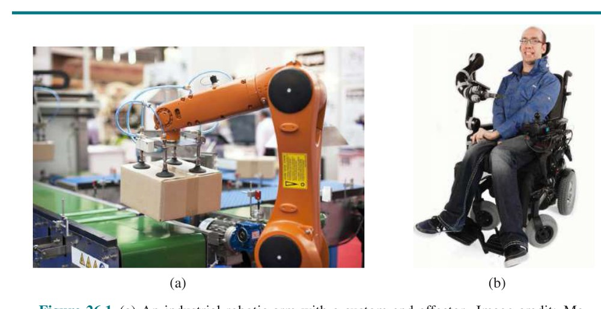

**شکل ۲۶.۱ — (الف) بازویِ رباتیکِ صنعتی با اثرگذارِ انتهاییِ سفارشی. اعتبار تصویر: Macor/123RF. (ب) بازویِ رباتِ کمکیِ Kinova® JACO® نصب‌شده رویِ ویلچر. Kinova و JACO علامت‌های تجاریِ Kinova, Inc. هستند.**

رباتیک بسیاری از مفاهیمِ دیده‌شده در این کتاب را گرد هم می‌آورد، از جملهِ تخمینِ حالتِ احتمالاتی، ادراک، برنامه‌ریزی، یادگیریِ نظارت‌نشده، یادگیریِ تقویتی و نظریهٔ بازی. برای برخی از این مفاهیم، رباتیک به‌عنوانِ کاربردِ نمونهٔ چالش‌برانگیزی خدمت می‌کند. برای مفاهیمِ دیگر، این فصل زمینِ تازه‌ای می‌شکافد، برای نمونه در معرفیِ نسخهٔ پیوستهٔ فنونی که قبلاً فقط در حالتِ گسسته دیده‌ایم.

## ۲۶.۲ سخت‌افزارِ ربات

تاکنون در این کتاب، معماریِ عامل—حس‌گذارها، اثرگذارها و پردازنده‌ها—را به‌عنوانِ داده‌شده در نظر گرفته و بر برنامهٔ عامل تمرکز کرده‌ایم. اما موفقیتِ ربات‌های واقعی دستِ‌کم به همان اندازه به طراحیِ حس‌گذارها و اثرگذارهای مناسبِ تکلیف بستگی دارد.

### ۲۶.۲.۱ انواعِ ربات‌ها از دیدگاهِ سخت‌افزاری

وقتی به ربات فکر می‌کنید، ممکن است چیزی با سر و دو بازو تصور کنید که رویِ پاها یا چرخ‌ها حرکت می‌کند. چنین «ربات‌های انسان‌نما»یی (Anthropomorphic Robot) در داستان‌های تخیلی مانندِ فیلمِ «نابودگر» و کارتونِ «جتسون‌ها» رایج شده‌اند. اما ربات‌های واقعی در شکل‌ها و اندازه‌های بسیاری می‌آیند. «دستکار»ها (Manipulator) فقط بازوهای رباتیک‌اند. لزومی ندارد به بدنهٔ ربات متصل باشند؛ ممکن است صرفاً رویِ میز یا زمین پیچ شوند، چنان‌که در کارخانه‌ها (شکل ۲۶.۱ (الف)). برخی بارِ مفیدِ بزرگی دارند، مانندِ آن‌هایی که خودرو مونتاژ می‌کنند، در حالی که برخی دیگر، مانندِ بازوهای قابلِ‌نصب‌روی-ویلچر که به افرادِ دارایِ اختلالِ حرکتی کمک می‌کنند (شکل ۲۶.۱ (ب))، می‌توانند کمتر حمل کنند اما در محیط‌های انسانی ایمن‌ترند.

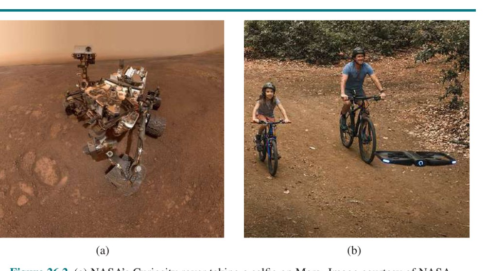

**شکل ۲۶.۲ — (الف) مریخ‌نوردِ Curiosity ناسا که رویِ مریخ سلفی می‌گیرد. تصویر با اجازه از ناسا. (ب) پهپادِ Skydio که خانواده‌ای را در گردشِ دوچرخه همراهی می‌کند. تصویر با اجازه از Skydio.**

«ربات‌های متحرک» (Mobile Robot) آن‌هایی‌اند که از چرخ‌ها، پاها یا روتورها برای حرکت در محیط استفاده می‌کنند. «پهپادهای چهارپره» (Quadcopter Drone) نوعی «وسیلهٔ نقلیهٔ هواییِ بدونِ سرنشین» (UAV) هستند؛ «وسایلِ نقلیهٔ زیرآبیِ خودمختار» (AUV) اقیانوس‌ها را می‌پیمایند. اما بسیاری از ربات‌های متحرک داخلِ ساختمان می‌مانند و رویِ چرخ حرکت می‌کنند، مانندِ جاروبرقی یا رباتِ تحویلِ حوله در هتل. همتایانِ بیرونیِ آن‌ها شاملِ «خودروهای خودران» (Autonomous Car) یا «مریخ‌نورد»هایی (Rover) است که زمینِ تازه‌ای را کاوش می‌کنند، حتی رویِ سطحِ مریخ (شکل ۲۶.۲). سرانجام، «ربات‌های پادار» (Legged Robot) برای عبور از زمینِ ناهمواری طراحی شده‌اند که با چرخ غیرقابلِ‌دسترسی است. جنبهٔ منفی این است که کنترلِ پاها برای انجامِ کارِ درست چالش‌برانگیزتر از چرخاندنِ چرخ‌هاست. انواعِ دیگرِ ربات‌ها شاملِ پروتزها، اسکلت‌های بیرونی، ربات‌های بال‌دار، دسته‌ها (Swarm) و محیط‌های هوشمندی است که ربات در آن‌ها کلِ اتاق است.

### ۲۶.۲.۲ حس‌کردنِ جهان

حس‌گذارها رابطِ ادراکیِ بینِ ربات و محیط‌اند. «حس‌گذارهای منفعل» (Passive Sensor)، مانندِ دوربین‌ها، ناظرانِ واقعیِ محیط‌اند: سیگنال‌هایی را درمی‌گیرند که توسط منابعِ دیگرِ محیط تولید می‌شوند. «حس‌گذارهای فعال» (Active Sensor)، مانندِ سونار، انرژی به محیط می‌فرستند. آن‌ها بر این واقعیت تکیه می‌کنند که این انرژی به حس‌گذار بازتاب می‌شود. حس‌گذارهای فعال تمایل به ارائهٔ اطلاعاتِ بیشتر از حس‌گذارهای منفعل دارند، اما به بهایِ مصرفِ انرژیِ بیشتر و با خطرِ تداخل وقتی چند حس‌گذارِ فعال هم‌زمان استفاده می‌شوند. همچنین تمایز می‌گذاریم آیا حس‌گذاری به سمتِ حس‌کردنِ محیط، مکانِ ربات یا پیکربندیِ درونیِ ربات جهت‌گیری شده.

«فاصله‌یاب»ها (Range Finder) حس‌گذارهایی‌اند که فاصله تا اشیای نزدیک را اندازه می‌گیرند. حس‌گذارهای «سونار» (Sonar) فاصله‌یاب‌های فعالی‌اند که امواجِ صوتیِ جهت‌دار نشر می‌کنند، که توسط اشیا بازتاب می‌شوند، با بخشی از صدا که به حس‌گذار بازمی‌گردد. زمان و شدتِ سیگنالِ بازگشتی فاصله تا اشیای نزدیک را نشان می‌دهد. سونار فناوریِ انتخابی برای وسایلِ نقلیهٔ زیرآبیِ خودمختار است، و در روزهای اولیهٔ رباتیکِ داخلی محبوب بود. «دیدِ استریو» (Stereo Vision) (بخش ۲۵.۶ را ببینید) بر دوربین‌های متعدد برای تصویربرداری از محیط از دیدگاه‌های کمی متفاوت تکیه دارد و پارالاکسِ حاصل در این تصاویر را تحلیل می‌کند تا بردِ اشیای اطراف را محاسبه کند. برای ربات‌های زمینیِ متحرک، سونار و دیدِ استریو اکنون به‌ندرت استفاده می‌شوند، زیرا به‌طورِ قابلِ‌اعتمادی دقیق نیستند. Kinect حس‌گذارِ کم‌هزینهٔ محبوبی است که دوربین و پروژکتورِ «نورِ ساخت‌یافته» (Structured Light) را ترکیب می‌کند، که الگویی از خطوطِ شبکه‌ای را رویِ صحنه می‌افکند. دوربین می‌بیند خطوطِ شبکه چگونه خم می‌شوند، که به ربات اطلاعاتی دربارهٔ شکلِ اشیای صحنه می‌دهد. در صورتِ تمایل، فرافکنی می‌تواند نورِ مادون‌قرمز باشد، تا با حس‌گذارهای دیگر (مانندِ چشم‌های انسان) تداخل نکند.

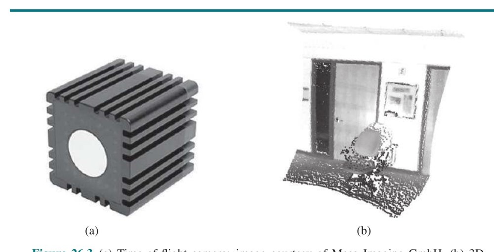

**شکل ۲۶.۳ — (الف) دوربینِ زمانِ پرواز؛ تصویر با اجازه از Mesa Imaging GmbH. (ب) تصویرِ بردِ سه‌بعدیِ به‌دست‌آمده با این دوربین. تصویرِ برد، تشخیصِ موانع و اشیای اطرافِ ربات را ممکن می‌کند. تصویر با اجازه از Willow Garage, LLC.**

بیشترِ ربات‌های زمینی اکنون به فاصله‌یاب‌های نوریِ فعال مجهزند. درست مانندِ حس‌گذارهای سونار، حس‌گذارهای بردِ نوری سیگنال‌های فعال (نور) نشر می‌کنند و زمانِ رسیدنِ بازتابِ این سیگنال به حس‌گذار را اندازه می‌گیرند. شکل ۲۶.۳ (الف) «دوربینِ زمانِ پرواز» (Time-of-Flight Camera) را نشان می‌دهد. این دوربین تصاویرِ بردی مانندِ نشان‌داده‌شده در شکل ۲۶.۳ (ب) را با نرخِ تا ۶۰ فریم در ثانیه به‌دست می‌آورد. خودروهای خودران اغلب از «لیدارهای اسکنی» (Scanning Lidar) استفاده می‌کنند—حس‌گذارهای فعالی که پرتوهای لیزر نشر می‌کنند و پرتوِ بازتابیده را حس می‌کنند، که اندازه‌گیری‌های بردِ دقیق تا یک سانتی‌متر در بردِ ۱۰۰ متر می‌دهند. آن‌ها از چیدمان‌های پیچیدهٔ آینه‌ها یا عناصرِ چرخان برای جاروبِ پرتو در سراسرِ محیط و ساختنِ نقشه استفاده می‌کنند. لیدارهای اسکنی تمایل دارند در بردهای بلندتر بهتر از دوربین‌های زمانِ پرواز کار کنند، و تمایل دارند در نورِ روزِ روشن بهتر عمل کنند.

«رادار» (Radar) اغلب حس‌گذارِ بردِ انتخابی برای وسایلِ نقلیهٔ هوایی (خودمختار یا نه) است. حس‌گذارهای رادار می‌توانند فاصله‌ها تا کیلومترها را اندازه بگیرند، و مزیتی نسبت به حس‌گذارهای نوری دارند: می‌توانند از مه ببینند. در انتهایِ نزدیکِ حسِ برد، «حس‌گذارهای لمسی» (Tactile Sensor) مانندِ سبیل‌ها، پنل‌های ضربه‌ای و پوستِ حساس به لمس هستند. این حس‌گذارها برد را بر مبنای تماسِ فیزیکی اندازه می‌گیرند و فقط برای حسِ اشیای بسیار نزدیک به ربات قابلِ استقرارند.

دومین ردهٔ مهم «حس‌گذارهای مکان» (Location Sensor) است. بیشترِ حس‌گذارهای مکان از حسِ برد به‌عنوانِ مؤلفهٔ اصلی برای تعیینِ مکان استفاده می‌کنند. بیرون، «سامانهٔ موقعیت‌یابیِ سراسری» (Global Positioning System یا GPS) رایج‌ترین راه‌حلِ مسئلهٔ مکان‌یابی است. GPS فاصله تا ماهواره‌هایی را اندازه می‌گیرد که سیگنال‌های پالسی نشر می‌کنند. در حالِ حاضر، ۳۱ ماهوارهٔ عملیاتیِ GPS در مدار هست، و ۲۴ ماهوارهٔ GLONASS، همتایِ روسی. گیرنده‌های GPS می‌توانند فاصله تا ماهواره را با تحلیلِ تغییرِ فاز بازیابی کنند. با مثلث‌سازیِ سیگنال‌های ماهواره‌های متعدد، گیرنده‌های GPS می‌توانند مکانِ مطلقِ خود را رویِ زمین تا چند متر تعیین کنند. «GPS تفاضلی» (Differential GPS) شاملِ گیرندهٔ زمینیِ دومی با مکانِ شناخته‌شده است، که در شرایطِ ایده‌آل دقتِ میلی‌متری فراهم می‌کند. متأسفانه، GPS داخلِ ساختمان یا زیرِ آب کار نمی‌کند. داخل، مکان‌یابی اغلب با اتصالِ «نشانگر»هایی (Beacon) در محیط در مکان‌های شناخته‌شده محقق می‌شود. بسیاری از محیط‌های داخلی پر از ایستگاه‌های پایهٔ بی‌سیم‌اند، که می‌توانند از طریقِ تحلیلِ سیگنالِ بی‌سیم به مکان‌یابیِ ربات‌ها کمک کنند. زیرِ آب، نشانگرهای سونارِ فعال می‌توانند حسی از مکان فراهم کنند، با استفاده از صدا برای آگاه‌کردنِ AUVها از فاصله‌های نسبی‌شان تا آن نشانگرها.

سومین ردهٔ مهم «حس‌گذارهای حس‌عمقی» (Proprioceptive Sensor) است، که ربات را از حرکتِ خودش آگاه می‌کنند. برای اندازه‌گیریِ پیکربندیِ دقیقِ مفصلِ رباتیک، موتورها اغلب به «رمزگشاهای شفت» (Shaft Decoder) مجهزند که حرکتِ زاویه‌ایِ شفت را دقیقاً اندازه می‌گیرند. رویِ بازوهای رباتیک، رمزگشاهای شفت به ردیابیِ موقعیتِ مفصل‌ها کمک می‌کنند. رویِ ربات‌های متحرک، رمزگشاهای شفت چرخشِ چرخ را برای «مسافت‌سنجی» (Odometry)—اندازه‌گیریِ مسافتِ طی‌شده—گزارش می‌کنند. متأسفانه، چرخ‌ها تمایل به انحراف و لغزش دارند، پس مسافت‌سنجی فقط در مسافت‌های کوتاه دقیق است. نیروهای خارجی، مانندِ باد و جریان‌های اقیانوسی، عدم‌قطعیتِ موقعیتی را افزایش می‌دهند. «حس‌گذارهای اینرسی» (Inertial Sensor)، مانندِ ژیروسکوپ‌ها، با تکیه بر مقاومتِ جرم در برابرِ تغییرِ سرعت، عدم‌قطعیت را کاهش می‌دهند.

جنبه‌های مهمِ دیگرِ حالتِ ربات توسط «حس‌گذارهای نیرو» (Force Sensor) و «حس‌گذارهای گشتاور» (Torque Sensor) اندازه‌گیری می‌شوند. این‌ها وقتی ربات‌ها اشیای شکننده یا اشیایی را که اندازه و شکلِ دقیقشان ناشناخته است مدیریت می‌کنند، ضروری‌اند. دستکارِ رباتیکِ یک‌تنی را تصور کنید که لامپی را پیچ می‌کند. اعمالِ نیرویِ بیش‌ازحد و شکستنِ لامپ بسیار آسان خواهد بود. حس‌گذارهای نیرو به ربات اجازه می‌دهند حس کند چقدر محکم لامپ را گرفته، و حس‌گذارهای گشتاور به آن اجازه می‌دهند حس کند چقدر محکم می‌چرخاند. حس‌گذارهای باکیفیت می‌توانند نیروها را در هر سه جهتِ انتقالی و سه جهتِ چرخشی اندازه بگیرند. آن‌ها این کار را با بسامدی چند صد بار در ثانیه انجام می‌دهند تا ربات بتواند به‌سرعت نیروهای غیرمنتظره را تشخیص دهد و پیش از شکستنِ لامپ کنش‌هایش را تصحیح کند. با این حال، تجهیزِ ربات به حس‌گذارهای رده‌بالا و قدرتِ محاسباتیِ نظارت بر آن‌ها می‌تواند چالش باشد.

### ۲۶.۲.۳ تولیدِ حرکت

سازوکاری که حرکتِ اثرگذار را آغاز می‌کند «عملگر» (Actuator) نامیده می‌شود؛ نمونه‌ها شاملِ گیربکس‌ها، چرخ‌دنده‌ها، کابل‌ها و اتصال‌هاست. رایج‌ترین نوعِ عملگر «عملگرِ الکتریکی» است، که از الکتریسیته برای چرخاندنِ موتور استفاده می‌کند. این‌ها عمدتاً در سامانه‌هایی استفاده می‌شوند که به حرکتِ چرخشی نیاز دارند، مانندِ مفصل‌های بازویِ رباتیک. «عملگرهای هیدرولیکی» (Hydraulic Actuator) از سیالِ هیدرولیکیِ تحتِ فشار (مانندِ روغن یا آب) و «عملگرهای پنوماتیکی» (Pneumatic Actuator) از هوای فشرده برای تولیدِ حرکتِ مکانیکی استفاده می‌کنند.

عملگرها اغلب برای حرکتِ «مفصل»ها (Joint) استفاده می‌شوند، که اجسامِ صلب (پیوندها) را به هم متصل می‌کنند. بازوها و پاها چنین مفصل‌هایی دارند. در «مفصلِ چرخشی» (Revolute Joint)، یک پیوند نسبت به دیگری می‌چرخد. در «مفصلِ منشوری» (Prismatic Joint)، یک پیوند در طولِ دیگری می‌لغزد. هر دو از این‌ها مفصل‌های تک‌محوره‌اند (یک محورِ حرکت). انواعِ دیگرِ مفصل شاملِ مفصل‌های کروی، استوانه‌ای و مسطح است، که مفصل‌های چندمحوره‌اند.

برای تعامل با اشیای محیط، ربات‌ها از «گیره» (Gripper) استفاده می‌کنند. ابتدایی‌ترین نوعِ گیره «گیرهٔ فکِ موازی» (Parallel Jaw Gripper) است، با دو انگشت و یک عملگرِ تکی که انگشتان را برای گرفتنِ اشیا به هم حرکت می‌دهد. این اثرگذار هم به‌خاطرِ سادگی‌اش محبوب است و هم منفور. گیره‌های سه‌انگشتی انعطافِ کمی بیشتری ارائه می‌دهند در حالی که سادگی را حفظ می‌کنند. در انتهایِ دیگرِ طیف، دست‌های انسان‌نما (انسان‌ریخت) هستند. برای نمونه، دستِ چابکِ Shadow در مجموع ۲۰ عملگر دارد. این انعطافِ بسیار بیشتری برای دست‌کاریِ پیچیده ارائه می‌دهد، از جملهِ مانورهای دست‌کاریِ درون‌دستی (به برداشتنِ گوشیِ همراه و چرخاندنِ آن در دست برای راست‌کردنِ جهت‌اش فکر کنید)، اما این انعطاف به بهایی می‌آید—یادگیریِ کنترلِ این گیره‌های پیچیده چالش‌برانگیزتر است.

## ۲۶.۳ مسئلهٔ رباتیک چه نوع مسئله‌ای است؟

حالا که می‌دانیم سخت‌افزارِ ربات ممکن است چه باشد، آماده‌ایم نرم‌افزارِ عاملی را در نظر بگیریم که سخت‌افزار را برای رسیدن به هدف‌هایمان می‌راند. نخست باید چارچوبِ محاسباتی این عامل را تعیین کنیم. دربارهٔ جستجو در محیط‌های قطعی، MDPها برای محیط‌های تصادفیِ اما کاملاً مشاهده‌پذیر، POMDPها برای مشاهدهٔ جزئی، و بازی‌ها برای موقعیت‌هایی که عامل در آن‌ها به‌صورتِ منزوی عمل نمی‌کند صحبت کرده‌ایم. با توجه به چارچوبِ محاسباتی، باید اجزایش را نمونه‌سازی کنیم: توابعِ پاداش یا مطلوبیت، حالت‌ها، کنش‌ها، فضاهای مشاهده و مانندِ آن.

قبلاً اشاره کرده‌ایم مسائلِ رباتیک غیرقطعی، با مشاهدهٔ جزئی و چندعاملی‌اند. با استفاده از مفاهیمِ نظریهٔ بازیِ فصل ۱۸، می‌بینیم گاهی عامل‌ها همکارانه‌اند و گاهی رقابتی. در راهرویِ باریکی که فقط یک عامل می‌تواند اول برود، ربات و شخص همکاری می‌کنند، زیرا هر دو می‌خواهند مطمئن شوند به هم برخورد نمی‌کنند. اما در برخی موارد ممکن است کمی رقابت کنند تا سریع به مقصدشان برسند. اگر ربات بیش‌ازحد مؤدب باشد و همیشه جا باز کند، ممکن است در موقعیت‌های شلوغ گیر کند و هرگز به هدفش نرسد.

بنابراین، وقتی ربات‌ها به‌صورتِ منزوی عمل می‌کنند و محیطشان را می‌دانند، مسئله‌ای که حل می‌کنند را می‌توان به‌عنوانِ MDP صورتبندی کرد؛ وقتی اطلاعاتی کم دارند به POMDP تبدیل می‌شود؛ و وقتی اطرافِ مردم عمل می‌کنند اغلب می‌تواند به‌عنوانِ بازی صورتبندی شود.

تابعِ پاداشِ ربات در این صورتبندی چیست؟ معمولاً ربات در خدمتِ انسان عمل می‌کند—برای نمونه، تحویلِ غذا به بیمارِ بیمارستان برای پاداشِ بیمار، نه پاداشِ خودش. برای بیشترِ محیط‌های رباتیک، حتی اگر طراحانِ ربات ممکن است بکوشند تابعِ پاداشِ جانشینِ به‌اندازهٔ کافی خوبی مشخص کنند، تابعِ پاداشِ واقعی نزدِ کاربری است که قرار است ربات به او کمک کند. ربات یا باید خواسته‌های کاربر را رمزگشایی کند، یا به مهندسی تکیه کند که تقریبی از خواسته‌های کاربر را مشخص کند.

در موردِ فضاهای کنش، حالت و مشاهدهٔ ربات، عمومی‌ترین شکل این است که مشاهده‌ها خوراکِ حس‌گذارِ خام‌اند (مثلاً، تصاویرِ ورودی از دوربین‌ها، یا برخوردهای لیزرِ ورودی از لیدار)؛ کنش‌ها جریان‌های الکتریکیِ خامی‌اند که به موتورها فرستاده می‌شوند؛ و حالت چیزی است که ربات برای تصمیم‌گیری‌اش باید بداند. این بدان‌معناست شکافِ عظیمی بینِ ادراک‌ها و کنترل‌های حرکتیِ سطح‌پایین، و برنامه‌های سطح‌بالایی که ربات باید بسازد هست.

برای پرکردنِ این شکاف، رباتیست‌ها جنبه‌های مسئله را برای ساده‌کردنش از هم جدا می‌کنند. برای نمونه، می‌دانیم وقتی POMDPها را درست حل می‌کنیم، ادراک و کنش برهم‌کنش می‌کنند: ادراک آگاه می‌کند کدام کنش‌ها منطقی‌اند، اما کنش نیز ادراک را آگاه می‌کند، با عامل‌هایی که کنش‌هایی برای جمع‌آوریِ اطلاعات می‌گیرند وقتی آن اطلاعات در گام‌های زمانیِ بعد ارزش دارد. با این حال، ربات‌ها اغلب ادراک را از کنش جدا می‌کنند، خروجی‌های ادراک را مصرف می‌کنند و وانمود می‌کنند در آینده اطلاعاتِ بیشتری نخواهند گرفت. افزون بر این، برنامه‌ریزیِ سلسله‌مراتبی لازم است، زیرا هدفِ سطح‌بالایی مانندِ «رسیدن به کافه‌تریا» بسیار دور از فرمانِ حرکتی مانندِ «محورِ اصلی را ۱° بچرخان» است.

در رباتیک اغلب از سلسله‌مراتبِ سه‌سطحی استفاده می‌کنیم. «سطحِ برنامه‌ریزیِ تکلیف» (Task Planning) برای کنش‌های سطح‌بالا برنامه یا سیاستی تصمیم می‌گیرد، که گاهی «اولیهٔ کنش» یا «هدفِ فرعی» نامیده می‌شوند: حرکت به سمتِ در، بازکردنِ آن، رفتن به آسانسور، فشردنِ دکمه و مانندِ آن. سپس «برنامه‌ریزیِ حرکت» (Motion Planning) مسئولِ یافتنِ مسیری است که ربات را از نقطه‌ای به نقطهٔ دیگر می‌رساند و هر هدفِ فرعی را محقق می‌کند. سرانجام، «کنترل» (Control) برای محقق‌کردنِ حرکتِ برنامه‌ریزی‌شده با عملگرهای ربات استفاده می‌شود. چون سطحِ برنامه‌ریزیِ تکلیف معمولاً رویِ حالت‌ها و کنش‌های گسسته تعریف می‌شود، در این فصل عمدتاً بر برنامه‌ریزیِ حرکت و کنترل تمرکز خواهیم کرد.

به‌طورِ جداگانه، «یادگیریِ ترجیح» (Preference Learning) مسئولِ برآوردِ هدفِ کاربرِ نهایی است، و «پیش‌بینیِ مردم» (People Prediction) برای پیش‌بینیِ کنش‌های مردمِ دیگرِ محیطِ ربات استفاده می‌شود. همهٔ این‌ها با هم ترکیب می‌شوند تا رفتارِ ربات را تعیین کنند.

هرگاه مسئله‌ای را به قطعاتِ جداگانه تقسیم می‌کنیم، پیچیدگی را کاهش می‌دهیم، اما فرصت‌های کمک‌کردنِ قطعات به یکدیگر را رها می‌کنیم. کنش می‌تواند به بهبودِ ادراک کمک کند، و همچنین تعیین کند چه نوعِ ادراکی مفید است. به‌همین‌سان، تصمیم‌های سطحِ حرکت ممکن است وقتی نحوهٔ دنبال‌شدنِ آن حرکت در نظر گرفته شود بهترین نباشند؛ یا تصمیم‌های سطحِ تکلیف ممکن است برنامهٔ تکلیف را در سطحِ حرکت غیرقابلِ‌نمونه‌سازی کنند. پس، با پیشرفت در این حوزه‌های جداگانه، فشار برای بازتلفیقِ آن‌ها می‌آید: انجامِ برنامه‌ریزیِ حرکت و کنترل با هم، انجامِ برنامه‌ریزیِ تکلیف و حرکت با هم، و بازتلفیقِ ادراک، پیش‌بینی و کنش—بستنِ حلقهٔ بازخورد. رباتیکِ امروز دربارهٔ پیشرفتِ ادامه‌دار در هر حوزه و در عین حال بناکردن بر این پیشرفت برای دست‌یابی به یکپارچگیِ بهتر است.

## ۲۶.۴ ادراکِ رباتیک

«ادراک» (Perception) فرایندی است که ربات‌ها توسط آن اندازه‌گیری‌های حس‌گذار را به بازنمایی‌های درونیِ محیط نگاشت می‌کنند. بخشِ زیادی از آن از فنونِ بیناییِ رایانهٔ فصلِ قبلی استفاده می‌کند. اما ادراک برای رباتیک باید با حس‌گذارهای اضافی مانندِ لیدار و حس‌گذارهای لمسی سروکار داشته باشد. ادراک دشوار است، زیرا حس‌گذارها نویزی‌اند و محیط با مشاهدهٔ جزئی، غیرقابلِ‌پیش‌بینی و اغلب پویاست. به بیانِ دیگر، ربات‌ها همهٔ مسائلِ تخمینِ حالت (یا فیلترکردن) را دارند که در بخش ۱۴.۲ بحث کردیم. به‌عنوانِ قاعدهٔ سرانگشتی، بازنمایی‌های درونیِ خوب برای ربات‌ها سه ویژگی دارند:

۱. اطلاعاتِ کافی برای تصمیم‌گیریِ خوبِ ربات شامل می‌شوند.
۲. چنان ساخت‌یافته‌اند که بتوانند به‌صورتِ کارآمد به‌روزرسانی شوند.
۳. به این معنا طبیعی‌اند که متغیرهای درونی با متغیرهای حالتِ طبیعیِ جهانِ فیزیکی متناظرند.

در فصل ۱۴ دیدیم فیلترهای کالمن، HMMها و شبکه‌های بیزیِ پویا می‌توانند مدل‌های انتقال و حس‌گذارِ محیطِ با مشاهدهٔ جزئی را بازنمایی کنند، و الگوریتم‌های دقیق و تقریبیِ به‌روزرسانیِ حالتِ باور—توزیعِ احتمالِ پسینِ رویِ متغیرهای حالتِ محیط—را توصیف کردیم. چند مدلِ شبکهٔ بیزیِ پویا برای این فرایند در فصل ۱۴ نشان داده شد. برای مسائلِ رباتیک، کنش‌های گذشتهٔ خودِ ربات را به‌عنوانِ متغیرهای مشاهده‌شده در مدل شامل می‌کنیم. شکل ۲۶.۴ نمادگذاریِ استفاده‌شده در این فصل را نشان می‌دهد: Xₜ حالتِ محیط (شاملِ ربات) در زمانِ t، Zₜ مشاهدهٔ دریافت‌شده در زمانِ t، و Aₜ کنشِ گرفته‌شده پس از دریافتِ مشاهده است.

می‌خواهیم حالتِ باورِ تازه، P(Xₜ₊₁ | z₁:ₜ₊₁, a₁:ₜ)، را از حالتِ باورِ کنونی، P(Xₜ | z₁:ₜ, a₁:ₜ₋₁)، و مشاهدهٔ تازهٔ zₜ₊₁ محاسبه کنیم. این را در بخش ۱۴.۲ انجام دادیم، اما دو تفاوت این‌جاست: هم بر کنش‌ها و هم بر مشاهده‌ها شرطی می‌شویم، و با متغیرهای پیوسته سروکار داریم نه گسسته. پس، معادلهٔ فیلترکردنِ بازگشتی (۱۴.۵ در صفحهٔ ۴۶۷) را اصلاح می‌کنیم تا به‌جای جمع از انتگرال استفاده کند:

```
P(Xₜ₊₁ | z₁:ₜ₊₁, a₁:ₜ) = α P(zₜ₊₁ | Xₜ₊₁) ∫ P(Xₜ₊₁ | xₜ, aₜ) P(xₜ | z₁:ₜ, a₁:ₜ₋₁) dxₜ    (26.1)
```

این معادله بیان می‌کند پسینِ رویِ متغیرهای حالتِ X در زمانِ t+1 به‌صورتِ بازگشتی از برآوردِ متناظرِ یک گامِ زمانیِ زودتر محاسبه می‌شود. این محاسبه شاملِ کنشِ قبلیِ aₜ و اندازه‌گیریِ حس‌گذارِ کنونیِ zₜ₊₁ است. برای نمونه، اگر هدف‌مان توسعهٔ رباتِ فوتبالیست باشد، Xₜ₊₁ ممکن است شاملِ مکانِ توپِ فوتبال نسبت به ربات باشد. پسینِ P(Xₜ | z₁:ₜ, a₁:ₜ₋₁) توزیعِ احتمالیِ رویِ همهٔ حالت‌هاست که آنچه از اندازه‌گیری‌ها و کنترل‌های حس‌گذارِ گذشته می‌دانیم را درمی‌گیرد. معادلهٔ (26.1) به ما می‌گوید چگونه این مکان را به‌صورتِ بازگشتی برآورد کنیم، با تلفیقِ تدریجیِ اندازه‌گیری‌های حس‌گذار (مثلاً، تصاویرِ دوربین) و فرمان‌های حرکتِ ربات. احتمالِ P(Xₜ₊₁ | xₜ, aₜ) «مدلِ انتقال» یا «مدلِ حرکت» (Motion Model) و P(zₜ₊₁ | Xₜ₊₁) «مدلِ حس‌گذار» (Sensor Model) نامیده می‌شود.

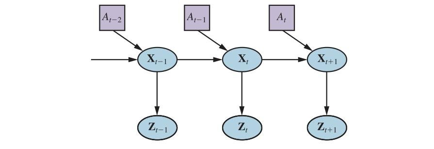

**شکل ۲۶.۴ — ادراکِ ربات را می‌توان استنتاجِ زمانی از دنباله‌های کنش‌ها و اندازه‌گیری‌ها دید، چنان‌که این شبکهٔ تصمیمِ پویا نشان می‌دهد.**

### ۲۶.۴.۱ مکان‌یابی و نگاشت

«مکان‌یابی» (Localization) مسئلهٔ یافتنِ اینکه چیزها کجا هستند—شاملِ خودِ ربات—است. برای ساده‌نگه‌داشتنِ کار، رباتِ متحرکی را در نظر بگیریم که به‌آرامی در جهانِ دوبعدیِ تخت حرکت می‌کند. همچنین فرض کنیم نقشهٔ دقیقی از محیط به ربات داده شده. (نمونه‌ای از چنین نقشه‌ای در شکل ۲۶.۷ ظاهر می‌شود.) «وضعیت» (Pose) چنین رباتِ متحرکی توسط دو مختصاتِ دکارتی‌اش با مقادیرِ x و y و سمت‌گیری‌اش با مقدارِ θ تعریف می‌شود، چنان‌که در شکل ۲۶.۵ (الف) نشان داده شده. اگر آن سه مقدار را در بردارِ مرتب کنیم، هر حالتِ خاص با Xₜ = (xₜ, yₜ, θₜ)ᵀ داده می‌شود. تا این‌جا خوب است.

در «تقریبِ سینماتیکی» (Kinematic Approximation)، هر کنش شاملِ مشخصاتِ «آن‌ی» دو سرعت است—سرعتِ انتقالیِ vₜ و سرعتِ چرخشیِ ωₜ. برای بازه‌های زمانیِ کوچکِ Δt، مدلِ قطعیِ خامی از حرکتِ چنین ربات‌هایی به‌صورتِ زیر داده می‌شود:

```
X̂ₜ₊₁ = f(Xₜ, vₜ, ωₜ) = Xₜ + (vₜΔt cosθₜ, vₜΔt sinθₜ, ωₜΔt)
```

![**شکل ۲۶.۵ — (الف) مدلِ سینماتیکیِ ساده‌شدهٔ رباتِ متحرک. ربات به‌صورتِ دایره‌ای با خطِّ شعاعِ داخلی که جهتِ جلو را علامت می‌زند نشان داده شده. حالتِ xₜ شاملِ موقعیتِ (xₜ,yₜ) (به‌صورتِ ضمنی نشان داده شده) و جهتِ θₜ است. حالتِ تازهٔ xₜ₊₁ با به‌روزرسانیِ موقعیت به‌مقدارِ vₜΔt و جهت به‌مقدارِ ωₜΔt به‌دست می‌آید. همچنین نقطهٔ نشانه‌ای در (xᵢ,yᵢ) نشان داده شده که در زمانِ t مشاهده می‌شود. (ب) مدلِ حس‌گذارِ اسکنِ برد. دو وضعیتِ رباتِ ممکن برای اسکنِ بردِ داده‌شده (z₁,z₂,z₃,z₄) نشان داده شده. بسیار محتمل‌تر است وضعیتِ چپ اسکنِ برد را تولید کرده باشد تا وضعیتِ راست.**](../figures/ch26/fig-26-5.jpg)

**شکل ۲۶.۵ — (الف) مدلِ سینماتیکیِ ساده‌شدهٔ رباتِ متحرک. ربات به‌صورتِ دایره‌ای با خطِّ شعاعِ داخلی که جهتِ جلو را علامت می‌زند نشان داده شده. حالتِ xₜ شاملِ موقعیتِ (xₜ,yₜ) (به‌صورتِ ضمنی نشان داده شده) و جهتِ θₜ است. حالتِ تازهٔ xₜ₊₁ با به‌روزرسانیِ موقعیت به‌مقدارِ vₜΔt و جهت به‌مقدارِ ωₜΔt به‌دست می‌آید. همچنین نقطهٔ نشانه‌ای در (xᵢ,yᵢ) نشان داده شده که در زمانِ t مشاهده می‌شود. (ب) مدلِ حس‌گذارِ اسکنِ برد. دو وضعیتِ رباتِ ممکن برای اسکنِ بردِ داده‌شده (z₁,z₂,z₃,z₄) نشان داده شده. بسیار محتمل‌تر است وضعیتِ چپ اسکنِ برد را تولید کرده باشد تا وضعیتِ راست.**

نمادِ X̂ به پیش‌بینیِ حالتِ قطعی اشاره دارد.

البته، ربات‌های فیزیکی تا حدی غیرقابلِ‌پیش‌بینی‌اند. این معمولاً با توزیعِ گاوسی با میانگینِ f(Xₜ, vₜ, ωₜ) و کوواریانسِ Σₓ مدل می‌شود. (برای تعریفِ ریاضی، پیوستِ الف را ببینید.)

```
P(Xₜ₊₁ | Xₜ, vₜ, ωₜ) = N(X̂ₜ₊₁, Σₓ)
```

این توزیعِ احتمال مدلِ حرکتِ ربات است. اثرهای کنشِ aₜ بر مکانِ ربات را مدل می‌کند.

بعد، به مدلِ حس‌گذار نیاز داریم. دو نوعِ مدلِ حس‌گذار را بررسی می‌کنیم. نخستین فرض می‌کند حس‌گذارها ویژگی‌های پایدار و قابلِ‌بازشناسیِ محیط به نامِ «نقطهٔ نشانه» (Landmark) را تشخیص می‌دهند. برای هر نقطهٔ نشانه، برد و یاتاقان (bearing) گزارش می‌شود. فرض کنید حالتِ ربات xₜ = (xₜ, yₜ, θₜ)ᵀ است و نقطهٔ نشانه‌ای را حس می‌کند که مکانش (xᵢ, yᵢ)ᵀ شناخته‌شده است. بدونِ نویز، پیش‌بینیِ برد و یاتاقان را می‌توان با هندسهٔ ساده محاسبه کرد (شکل ۲۶.۵ (الف) را ببینید):

```
ẑₜ = h(xₜ) = (√((xₜ − xᵢ)² + (yₜ − yᵢ)²), arctan((yᵢ − yₜ)/(xᵢ − xₜ)) − θₜ)
```

باز، نویز اندازه‌گیری‌های ما را تحریف می‌کند. برای ساده‌نگه‌داشتنِ کار، نویزِ گاوسی با کوواریانسِ Σ_z فرض کنید، که مدلِ حس‌گذارِ P(zₜ | xₜ) = N(ẑₜ, Σ_z) به ما می‌دهد.

مدلِ حس‌گذارِ تا حدی متفاوتی برای «آرایهٔ حس‌گذار» (Sensor Array) از حس‌گذارهای برد استفاده می‌شود، که هر یک یاتاقانِ ثابتی نسبت به ربات دارد. چنین حس‌گذارهایی بردارِ مقادیرِ بردِ zₜ = (z₁, ..., z_M)ᵀ تولید می‌کنند. با توجه به وضعیتِ xₜ، ẑⱼ بردِ محاسبه‌شده در طولِ jاُمین جهتِ پرتو از xₜ تا نزدیک‌ترین مانع باشد. مثلِ قبل، این توسط نویزِ گاوسی خراب می‌شود. معمولاً فرض می‌کنیم خطاهای جهت‌های پرتوِ متفاوت مستقل و هم‌توزیع‌اند، پس داریم:

```
P(zₜ | xₜ) = α ∏_{j=1}^{M} e^(−(zⱼ − ẑⱼ)² / 2σ²)
```

شکل ۲۶.۵ (ب) نمونه‌ای از اسکنِ بردِ چهارپرتو و دو وضعیتِ رباتِ ممکن را نشان می‌دهد، که یکی به‌طورِ معقولانه‌ای محتمل است اسکنِ مشاهده‌شده را تولید کرده باشد و دیگری نه.

با مقایسهٔ مدلِ اسکنِ برد با مدلِ نقطهٔ نشانه، می‌بینیم مدلِ اسکنِ برد این مزیت را دارد که پیش از تفسیرِ اسکنِ برد نیازی به شناساییِ نقطهٔ نشانه نیست؛ در واقع، در شکل ۲۶.۵ (ب)، ربات با دیوارِ بی‌ویژگی روبه‌روست. از سوی دیگر، اگر نقطه‌های نشانهٔ دیدنی و قابلِ شناسایی باشند، ممکن است مکان‌یابیِ آنی فراهم کنند.

بخش ۱۴.۴ فیلترِ کالمن را توصیف کرد، که حالتِ باور را به‌عنوانِ گاوسیِ چندمتغیرهٔ تکی بازنمایی می‌کند، و فیلترِ ذره‌ای را، که حالتِ باور را با مجموعه‌ای از ذره‌ها بازنمایی می‌کند که با حالت‌ها متناظرند. بیشترِ الگوریتم‌های مکان‌یابیِ مدرن از یکی از این دو بازنماییِ باورِ رباتِ P(Xₜ | z₁:ₜ, a₁:ₜ₋₁) استفاده می‌کنند.

مکان‌یابی با استفاده از فیلترِ ذره‌ای «مکان‌یابیِ مونت‌کارلو» (Monte Carlo Localization) یا MCL نامیده می‌شود. الگوریتمِ MCL نمونه‌ای از الگوریتمِ فیلترِ ذره‌ایِ شکل ۱۴.۱۷ (صفحهٔ ۴۹۲) است. فقط باید مدلِ حرکت و مدلِ حس‌گذارِ مناسب را فراهم کنیم. شکل ۲۶.۶ نسخه‌ای را با مدلِ حس‌گذارِ اسکنِ برد نشان می‌دهد. عملکردِ الگوریتم در شکل ۲۶.۷ نشان داده شده، در حالی که ربات می‌فهمد کجای ساختمانِ اداری است. در تصویرِ نخست، ذره‌ها بر مبنای پیشین به‌صورتِ یکنواخت توزیع شده‌اند، که عدم‌قطعیتِ سراسری دربارهٔ موقعیتِ ربات را نشان می‌دهد. در تصویرِ دوم، نخستین مجموعهٔ اندازه‌گیری‌ها می‌رسد و ذره‌ها در نواحیِ باورِ پسینِ بالا خوشه‌ها تشکیل می‌دهند. در سومین، اندازه‌گیری‌های کافی برای راندنِ همهٔ ذره‌ها به مکانِ تکی در دسترس است.

```
function MONTE-CARLO-LOCALIZATION(a, z, N, P(X′ | X, v, ω), P(z | z*), map) returns S
  inputs: a, robot velocities v and ω
          z, vector of M range scan data points
          P(X′ | X, v, ω), motion model
          P(z | z*), range sensor noise model
          map, 2D map of the environment
  persistent: S, vector of N samples
  local variables: W, vector of N weights
                   S′, temporary vector of N samples

  if S is empty then
    for i = 1 to N do
      S[i] ← sample from P(X₀)
  for i = 1 to N do
    S′[i] ← sample from P(X′ | X = S[i], v, ω)
    W[i] ← 1
    for j = 1 to M do
      z* ← RAYCAST(j, X = S′[i], map)
      W[i] ← W[i] · P(zⱼ | z*)
  S ← WEIGHTED-SAMPLE-WITH-REPLACEMENT(N, S′, W)
  return S
```

**شکل ۲۶.۶ — الگوریتمِ مکان‌یابیِ مونت‌کارلو با استفاده از مدلِ حس‌گذارِ اسکنِ برد با نویزِ مستقل.**

فیلترِ کالمن راهِ عمدهٔ دیگرِ مکان‌یابی است. فیلترِ کالمن پسینِ P(Xₜ | z₁:ₜ, a₁:ₜ₋₁) را با گاوسی بازنمایی می‌کند. میانگینِ این گاوسی را μₜ و کوواریانسش را Σₜ نشان می‌دهیم. مشکلِ اصلیِ باورهای گاوسی این است که فقط تحتِ مدل‌های حرکتِ خطیِ f و مدل‌های اندازه‌گیریِ خطیِ h بسته‌اند. برای f یا h غیرخطی، نتیجهٔ به‌روزرسانیِ فیلتر به‌طورِ کلی گاوسی نیست. پس، الگوریتم‌های مکان‌یابیِ استفاده‌کننده از فیلترِ کالمن مدل‌های حرکت و حس‌گذار را «خطی‌سازی» (Linearization) می‌کنند. خطی‌سازی تقریبِ محلیِ تابعِ غیرخطی با تابعِ خطی است. شکل ۲۶.۸ مفهومِ خطی‌سازی را برای مدلِ حرکتِ رباتِ (یک‌بعدی) نشان می‌دهد. در چپ، مدلِ حرکتِ غیرخطیِ f(xₜ, aₜ) را تصویر می‌کند (کنترلِ aₜ در این نمودار حذف شده، زیرا در خطی‌سازی نقشی ندارد). در راست، این تابع با تابعِ خطیِ f̃(xₜ, aₜ) تقریب زده می‌شود. این تابعِ خطی در نقطهٔ μₜ، میانگینِ برآوردِ حالتِ ما در زمانِ t، بر f مماس است. چنین خطی‌سازی‌ای «بسطِ تیلورِ درجهٔ اول» (Taylor Expansion) نامیده می‌شود. فیلترِ کالمنی که f و h را با بسطِ تیلور خطی می‌کند «فیلترِ کالمنِ توسعه‌یافته» (Extended Kalman Filter یا EKF) نامیده می‌شود. شکل ۲۶.۹ دنباله‌ای از برآوردهای رباتی را نشان می‌دهد که الگوریتمِ مکان‌یابیِ فیلترِ کالمنِ توسعه‌یافته را اجرا می‌کند.


**شکل ۲۶.۷ — مکان‌یابیِ مونت‌کارلو، الگوریتمِ فیلترِ ذره‌ای برای مکان‌یابیِ رباتِ متحرک. (الف) عدم‌قطعیتِ اولیهٔ سراسری. (ب) عدم‌قطعیتِ تقریباً دوموجهی پس از ناوبری در راهرویِ (متقارن). (ج) عدم‌قطعیتِ تک‌وجهی پس از ورود به اتاقی و یافتنِ اینکه متمایز است.**

با حرکتِ ربات، عدم‌قطعیتِ برآوردِ مکانش افزایش می‌یابد، چنان‌که بیضی‌های خطا نشان می‌دهند. خطایش با حس‌کردنِ برد و یاتاقانِ نقطهٔ نشانه‌ای با مکانِ شناخته‌شده کاهش می‌یابد و با ازدست‌دادنِ دیدِ ربات از نقطهٔ نشانه دوباره افزایش می‌یابد. الگوریتم‌های EKF اگر نقطه‌های نشانه به‌راحتی شناسایی شوند خوب کار می‌کنند. در غیرِ این صورت، توزیعِ پسین ممکن است چندوجهی باشد، مانندِ شکل ۲۶.۷ (ب). مسئلهٔ نیاز به دانستنِ هویتِ نقطه‌های نشانه نمونه‌ای از مسئلهٔ ارتباطِ داده است که در شکل ۱۵.۳ بحث شد.

در برخی موقعیت‌ها، نقشه‌ای از محیط در دسترس نیست. آنگاه ربات باید نقشه‌ای کسب کند. این کمی مسئلهٔ مرغ و تخم‌مرغ است: رباتِ ناوبر باید مکانش را نسبت به نقشه‌ای که کاملاً نمی‌شناسد تعیین کند، در عینِ حال این نقشه را در حالی که مکانِ واقعی‌اش را کاملاً نمی‌داند می‌سازد. این مسئله برای بسیاری از کاربردهای رباتیک مهم است، و به‌طورِ گسترده‌ای تحتِ نامِ «مکان‌یابی و نگاشتِ هم‌زمان» (Simultaneous Localization and Mapping)، که به‌صورتِ SLAM مخفف می‌شود، مطالعه شده.

مسائلِ SLAM با بسیاری از فنونِ احتمالاتیِ متفاوت حل می‌شوند، از جملهِ فیلترِ کالمنِ توسعه‌یافتهٔ بحث‌شده در بالا. استفاده از EKF سرراست است: فقط بردارِ حالت را افزوده کن تا مکان‌های نقطه‌های نشانهٔ محیط را شامل شود. خوشبختانه، به‌روزرسانیِ EKF به‌صورتِ درجهٔ دوم مقیاس می‌شود، پس برای نقشه‌های کوچک (مثلاً، چند صد نقطهٔ نشانه) محاسبه کاملاً شدنی است. نقشه‌های غنی‌تر اغلب با روش‌های تسکینِ گراف به‌دست می‌آیند، مشابهِ فنونِ استنتاجِ شبکهٔ بیزیِ بحث‌شده در فصل ۱۳. بیشینه‌سازیِ امید (EM) نیز برای SLAM استفاده می‌شود.

### ۲۶.۴.۲ انواعِ دیگرِ ادراک

همهٔ ادراکِ ربات دربارهٔ مکان‌یابی یا نگاشت نیست. ربات‌ها همچنین دما، بوها، صدا و مانندِ آن را ادراک می‌کنند. بسیاری از این کمیت‌ها را می‌توان با گونه‌هایی از شبکه‌های بیزیِ پویا برآورد کرد. تنها چیزی که برای چنین برآوردگرهایی لازم است توزیع‌های احتمالِ شرطی‌ای است که تکاملِ متغیرهای حالت را در طولِ زمان مشخص می‌کنند، و مدل‌های حس‌گذاری که رابطهٔ اندازه‌گیری‌ها با متغیرهای حالت را توصیف می‌کنند.

همچنین ممکن است ربات را به‌عنوانِ عاملِ واکنشی برنامه‌ریزی کرد، بدونِ استدلالِ صریح دربارهٔ توزیع‌های احتمالِ رویِ حالت‌ها. آن رویکرد را در بخش ۲۶.۹.۱ پوشش می‌دهیم.


**شکل ۲۶.۸ — تصویرِ یک‌بعدیِ مدلِ حرکتِ خطی‌شده: (الف) تابعِ f، و فرافکنیِ میانگینِ μₜ و بازهٔ کوواریانس (بر مبنای Σₜ) به زمانِ t+1. (ب) نسخهٔ خطی‌شده مماسِ f در μₜ است. فرافکنیِ میانگینِ μₜ درست است. با این حال، کوواریانسِ فرافکنی‌شدهٔ Σ̃ₜ₊₁ با Σₜ₊₁ تفاوت دارد.**


**شکل ۲۶.۹ — مکان‌یابی با استفاده از فیلترِ کالمنِ توسعه‌یافته. ربات رویِ خطِّ مستقیم حرکت می‌کند. با پیشرفت‌ش، عدم‌قطعیتِ برآوردِ مکانش افزایش می‌یابد، چنان‌که بیضی‌های خطا نشان می‌دهند. وقتی نقطهٔ نشانه‌ای با موقعیتِ شناخته‌شده را مشاهده می‌کند، عدم‌قطعیت کاهش می‌یابد.**

گرایشِ رباتیک به‌وضوح به سمتِ بازنمایی‌هایی با معناشناسیِ خوب‌تعریف‌شده است. فنونِ احتمالاتی در بسیاری از مسائلِ ادراکیِ دشوار مانندِ مکان‌یابی و نگاشت از رویکردهای دیگر بهتر عمل می‌کنند. با این حال، فنونِ آماری گاهی بیش‌ازحد دست‌وپاگیرند، و راه‌حل‌های ساده‌تر ممکن است در عمل به همان اندازه مؤثر باشند. برای کمک به تصمیم‌گیری دربارهٔ اینکه کدام رویکرد را بگیریم، تجربهٔ کار با ربات‌های فیزیکیِ واقعی بهترین معلم شماست.

### ۲۶.۴.۳ یادگیریِ نظارت‌شده و نظارت‌نشده در ادراکِ ربات

یادگیریِ ماشینی نقشِ مهمی در ادراکِ ربات ایفا می‌کند. این به‌ویژه وقتی صادق است که بهترین بازنماییِ درونی شناخته‌شده نباشد. یکی از رویکردهای رایج نگاشتِ جریان‌های حس‌گذارِ پربعد به فضاهای کم‌بعدتر با استفاده از روش‌های یادگیریِ ماشینیِ نظارت‌نشده (فصل ۱۹ را ببینید) است. چنین رویکردی «جاسازیِ کم‌بعد» (Low-Dimensional Embedding) نامیده می‌شود. یادگیریِ ماشینی یادگیریِ مدل‌های حس‌گذار و حرکت از داده را ممکن می‌کند، در حالی که هم‌زمان بازنماییِ درونیِ مناسبی کشف می‌شود.

فنّ یادگیریِ ماشینیِ دیگری ربات‌ها را قادر می‌سازد به‌طورِ پیوسته با تغییرهای بزرگِ اندازه‌گیری‌های حس‌گذار سازگار شوند. تصور کنید از فضایِ آفتابی به اتاقِ تاریکی با چراغ‌های نئون قدم می‌گذارید. واضح است، داخل تاریک‌تر است. اما تغییرِ منبعِ نور بر همهٔ رنگ‌ها نیز اثر می‌گذارد: نورِ نئون مؤلفهٔ سبزِ قوی‌تری نسبت به نورِ خورشید دارد. با این حال، به‌نحوی به نظر می‌رسد متوجهِ تغییر نمی‌شویم. اگر با مردم به اتاقِ نئون‌دار قدم بگذاریم، فکر نمی‌کنیم چهره‌هایشان ناگهان سبز شده. ادراکِ ما به‌سرعت با شرایطِ نورپردازیِ تازه سازگار می‌شود، و مغزِ ما تفاوت‌ها را نادیده می‌گیرد.


**شکل ۲۶.۱۰ — دنباله‌ای از رده‌بندی‌های «سطحِ قابلِ رانندگی» با بیناییِ تطبیقی. (الف) فقط جاده به‌عنوانِ قابلِ رانندگی رده‌بندی می‌شود (ناحیهٔ صورتی). خطِّ آبیِ Vشکل جایی را نشان می‌دهد که وسیلهٔ نقلیه به سمتِ آن می‌رود. (ب) به وسیلهٔ نقلیه فرمانِ رانندگیِ خارج از جاده داده می‌شود، و رده‌بند شروع به رده‌بندیِ برخی از چمن‌ها به‌عنوانِ قابلِ رانندگی می‌کند. (ج) وسیلهٔ نقلیه مدلِ سطوحِ قابلِ رانندگی‌اش را به‌روزرسانی کرده تا با چمن و همچنین جاده متناظر شود. با اجازه از سباستین ترون.**

فنونِ «ادراکِ تطبیقی» (Adaptive Perception) ربات‌ها را قادر به تنظیم با چنین تغییرهایی می‌کنند. یک نمونه در شکل ۲۶.۱۰ نشان داده شده، برگرفته از حوزهٔ رانندگیِ خودمختار. در این‌جا وسیلهٔ نقلیهٔ زمینیِ بدونِ سرنشین رده‌بندِ مفهومِ «سطحِ قابلِ رانندگی» را تطبیق می‌دهد. این چگونه کار می‌کند؟ ربات از لیزر برای ارائهٔ رده‌بندیِ ناحیهٔ کوچکی بلافاصله در جلویِ ربات استفاده می‌کند. وقتی این ناحیه در اسکنِ بردِ لیزری تخت یافت شود، به‌عنوانِ مثالِ آموزشیِ مثبت برای مفهومِ «سطحِ قابلِ رانندگی» استفاده می‌شود. سپس فنّ مخلوطِ گاوسی‌ها مشابهِ الگوریتمِ EMِ بحث‌شده در فصل ۲۰ آموزش می‌بیند تا ضرایبِ رنگ و بافتِ خاصِ وصلهٔ نمونهٔ کوچک را بازشناسی کند. تصاویرِ شکل ۲۶.۱۰ نتیجهٔ اعمالِ این رده‌بند بر کلِ تصویرند.

روش‌هایی که ربات‌ها را به جمع‌آوریِ دادهٔ آموزشیِ خودشان (با برچسب‌ها!) وادار می‌کنند «خودنظارت» (Self-Supervised) نامیده می‌شوند. در این نمونه، ربات از یادگیریِ ماشینی برای بهره‌برداری از حس‌گذارِ کوتاه‌بُردی که برای رده‌بندیِ زمین خوب کار می‌کند به حس‌گذاری که می‌تواند خیلی دورتر ببیند استفاده می‌کند. این به ربات اجازه می‌دهد سریع‌تر رانندگی کند و فقط وقتی مدلِ حس‌گذار می‌گوید تغییری در زمین هست که باید با دقتِ بیشتری توسط حس‌گذارهای کوتاه‌بُرد بررسی شود کند می‌کند.

## ۲۶.۵ برنامه‌ریزی و کنترل

تعمقِ ربات در نهایت به تصمیم‌گیری دربارهٔ نحوهٔ حرکت می‌رسد، از سطحِ انتزاعیِ تکلیف تا پایین‌ترین سطحِ جریان‌هایی که به موتورهایش فرستاده می‌شوند. در این بخش، با فرض اینکه ادراک (و در صورتِ نیاز، پیش‌بینی) داده شده ساده‌سازی می‌کنیم، پس جهان مشاهده‌پذیر است. همچنین انتقال‌های (دینامیکِ) قطعیِ جهان را فرض می‌کنیم.

با جداکردنِ حرکت از کنترل شروع می‌کنیم. «مسیر» (Path) را دنباله‌ای از نقطه‌ها در فضایِ هندسی تعریف می‌کنیم که ربات (یا بخشی از ربات، مانندِ بازو) دنبال خواهد کرد. این با مفهومِ مسیر در فصل ۳ مرتبط است، اما در این‌جا دنباله‌ای از نقطه‌ها در فضا را منظور می‌کنیم، نه دنباله‌ای از کنش‌های گسسته. تکلیفِ یافتنِ مسیرِ خوب «برنامه‌ریزیِ حرکت» (Motion Planning) نامیده می‌شود.

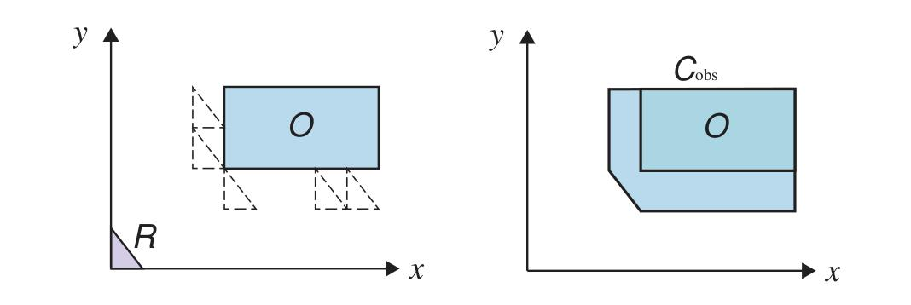

**شکل ۲۶.۱۱ — رباتِ مثلثیِ ساده‌ای که می‌تواند انتقال یابد و باید از مانعِ مستطیلی اجتناب کند. در چپ فضایِ کار و در راست فضایِ پیکربندی است.**

پس از داشتنِ مسیر، تکلیفِ اجرایِ دنباله‌ای از کنش‌ها برای دنبال‌کردنِ مسیر «کنترلِ دنبال‌کردنِ مسیر» (Trajectory Tracking Control) نامیده می‌شود. «مسیرِ زمانی» (Trajectory) مسیری است که برای هر نقطهٔ مسیر زمانی مرتبط دارد. مسیر فقط می‌گوید «از A به B به C برو و...» و مسیرِ زمانی می‌گوید «از A شروع کن، ۱ ثانیه طول بده تا به B برسی، و ۱.۵ ثانیه دیگر تا به C برسی و...».

### ۲۶.۵.۱ فضایِ پیکربندی

رباتِ سادهٔ R را به شکلِ مثلثِ قائم‌الزاویه تصور کنید، چنان‌که مثلثِ اسطوخودوسیِ گوشهٔ پایینِ چپِ شکل ۲۶.۱۱ نشان می‌دهد. ربات باید مسیری را برنامه‌ریزی کند که از مانعِ مستطیلیِ O اجتناب می‌کند. فضایِ فیزیکی که ربات در آن حرکت می‌کند «فضایِ کار» (Workspace) نامیده می‌شود. این رباتِ خاص می‌تواند در هر جهتِ صفحهٔ x–y حرکت کند، اما نمی‌تواند بچرخد. شکل پنج موقعیتِ ممکنِ دیگرِ ربات را با طرح‌های خطِّ چین نشان می‌دهد؛ هر یک به همان اندازه‌ای که ربات می‌تواند به مانع نزدیک شود به مانع نزدیک است.

بدنهٔ ربات را می‌توان به‌عنوانِ مجموعه‌ای از نقطه‌های (x,y) بازنمایی کرد (یا نقطه‌های (x,y,z) برای رباتِ سه‌بعدی)، و مانع را نیز. با این بازنمایی، اجتناب از مانع به این معناست هیچ نقطه‌ای از ربات با هیچ نقطه‌ای از مانع هم‌پوشانی ندارد. برنامه‌ریزیِ حرکت به محاسبه‌هایی رویِ مجموعه‌های نقطه نیاز می‌داشت، که می‌تواند پیچیده و وقت‌گیر باشد.

می‌توانیم محاسبه‌ها را با استفاده از طرحِ بازنمایی‌ای ساده کنیم که در آن همهٔ نقطه‌های تشکیل‌دهندهٔ ربات به‌عنوانِ نقطهٔ تکی در فضایِ انتزاعیِ چندبعدی بازنمایی می‌شوند، که آن را «فضایِ پیکربندی» (Configuration Space) یا C-فضا می‌نامیم. ایده این است که مجموعهٔ نقطه‌های تشکیل‌دهندهٔ ربات را می‌توان محاسبه کرد اگر بدانیم (۱) اندازه‌گیری‌های پایهٔ ربات (برای رباتِ مثلثیِ ما، طولِ سه ضلع کافی است) و (۲) وضعیتِ کنونیِ ربات—موقعیت و جهت‌اش.

برای رباتِ مثلثیِ سادهٔ ما، دو بُعد برای C-فضا کافی است: اگر مختصاتِ (x,y) نقطهٔ خاصی از ربات را بدانیم—از رأسِ قائم‌الزاویه استفاده می‌کنیم—آنگاه می‌توانیم محاسبه کنیم هر نقطهٔ دیگرِ مثلث کجاست (زیرا اندازه و شکلِ مثلث را می‌دانیم و چون مثلث نمی‌تواند بچرخد). در گوشهٔ پایینِ چپِ شکل ۲۶.۱۱، مثلثِ اسطوخودوسی را می‌توان با پیکربندیِ (0,0) بازنمایی کرد.

اگر قاعده‌ها را تغییر دهیم تا ربات بتواند بچرخد، به سه بُعد، (x,y,θ)، نیاز خواهیم داشت تا بتوانیم محاسبه کنیم هر نقطه کجاست. در این‌جا θ زاویهٔ چرخشِ ربات در صفحه است. اگر ربات همچنین تواناییِ کش‌آمدن داشت، با رشدِ یکنواخت با عاملِ مقیاسِ s، آنگاه C-فضا چهار بُعد، (x,y,θ,s)، می‌داشت.

فعلاً به C-فضایِ دوبعدیِ سادهٔ رباتِ مثلثیِ غیرچرخان می‌چسبیم. تکلیفِ بعدی فهمیدنِ این است که نقطه‌های مانع در C-فضا کجا هستند. پنج مثلثِ خطِّ چینِ چپِ شکل ۲۶.۱۱ را در نظر بگیر و توجه کن رأسِ قائم‌الزاویه رویِ هر یک کجاست. سپس همهٔ راه‌هایی را تصور کن که مثلث می‌توانست بلغزد. بدیهی است، رأسِ قائم‌الزاویه نمی‌تواند داخلِ مانع برود، و همچنین نمی‌تواند از هر یک از پنج مثلثِ خطِّ چین به آن نزدیک‌تر شود. پس می‌بینید ناحیه‌ای که رأسِ قائم‌الزاویه نمی‌تواند برود—«مانعِ C-فضا» (C-Space Obstacle)—پنج‌ضلعیِ راستِ شکل ۲۶.۱۱ است که با C_obs برچسب خورده.

در زبانِ روزمره می‌گوییم موانعِ متعددی برای ربات هست—میز، صندلی، چند دیوار. اما نمادگذاریِ ریاضی کمی آسان‌تر است اگر همهٔ این‌ها را ترکیب‌شده در یک «مانع» بدانیم که اتفاقاً مؤلفه‌های ناهمبند دارد. به‌طورِ کلی، مانعِ C-فضا مجموعهٔ همهٔ نقطه‌های q در C است چنان‌که اگر ربات در آن پیکربندی قرار می‌گرفت، هندسهٔ فضایِ کارش با مانعِ فضایِ کار تلاقی می‌کرد.

موانعِ فضایِ کار مجموعهٔ نقطه‌های O و مجموعهٔ همهٔ نقطه‌های ربات در پیکربندیِ q برابرِ A(q) باشد. آنگاه مانعِ C-فضا به‌صورتِ زیر تعریف می‌شود:

```
C_obs  = {q : q ∈ C ∧ A(q) ∩ O ≠ ∅}
C_free = C − C_obs
```

C-فضا برای ربات‌های با قطعاتِ متحرک جالب‌تر می‌شود. بازویِ دوپیوندیِ شکل ۲۶.۱۲ (الف) را در نظر بگیر. به میز پیچ شده، پس پایه حرکت نمی‌کند، اما بازو دو مفصل دارد که مستقل حرکت می‌کنند—این‌ها را «درجه‌های آزادی» (Degrees of Freedom یا DOF) می‌نامیم. حرکتِ مفصل‌ها مختصاتِ (x,y) آرنج، گیره و هر نقطهٔ بازو را تغییر می‌دهد. فضایِ پیکربندیِ بازو دوبعدی است: (θ_شانه، θ_آرنج)، که θ_شانه زاویهٔ مفصلِ شانه و θ_آرنج زاویهٔ مفصلِ آرنج است.

دانستنِ پیکربندیِ بازویِ دوپیوندیِ ما به این معناست می‌توانیم با مثلثاتِ ساده تعیین کنیم هر نقطهٔ بازو کجاست. به‌طورِ کلی، «نگاشتِ سینماتیکِ پیشرو» (Forward Kinematics) تابعِ φ_b : C → W است که پیکربندی را می‌گیرد و مکانِ نقطهٔ خاصِ b رویِ ربات را وقتی ربات در آن پیکربندی است خروجی می‌دهد. نگاشتِ سینماتیکِ پیشروِ به‌ویژه مفیدی مربوط به «اثرگذارِ انتهایی» ربات، φ_EE است. مجموعهٔ همهٔ نقطه‌های ربات در پیکربندیِ خاصِ q با A(q) ⊂ W نشان داده می‌شود:

```
A(q) = ⋃_b {φ_b(q)}
```

مسئلهٔ معکوس، نگاشتِ مکانِ مطلوبِ نقطه‌ای از ربات به پیکربندی(هایی) که ربات برای رخ‌دادنِ آن باید در آن‌ها باشد، «سینماتیکِ معکوس» (Inverse Kinematics) شناخته می‌شود:

```
IK_b : x ∈ W ↦ {q ∈ C : φ_b(q) = x}
```

گاهی نگاشتِ سینماتیکِ معکوس ممکن است نه فقط موقعیت، بلکه جهتِ مطلوب را نیز به‌عنوانِ ورودی بگیرد. وقتی می‌خواهیم دستکاری‌کننده شیئی را بگیرد، برای نمونه، می‌توانیم موقعیت و جهتِ مطلوبی برای گیره‌اش محاسبه کنیم و از سینماتیکِ معکوس برای تعیینِ پیکربندیِ هدفِ ربات استفاده کنیم. سپس برنامه‌ریز باید راهی برای بردنِ ربات از پیکربندیِ کنونی‌اش به پیکربندیِ هدف بدونِ تلاقی با موانع بیابد.


**شکل ۲۶.۱۲ — (الف) بازنماییِ فضایِ کارِ بازویِ رباتیک با دو درجهٔ آزادی. فضایِ کار جعبه‌ای با مانعِ تختِ آویزان از سقف است. (ب) فضایِ پیکربندیِ همان ربات. فقط ناحیه‌های سفیدِ فضا پیکربندی‌هایی‌اند که عاری از برخوردند. نقطهٔ این نمودار با پیکربندیِ رباتِ نشان‌داده‌شده در چپ متناظر است.**

موانعِ فضایِ کار اغلب به‌صورتِ شکل‌های هندسیِ ساده ترسیم می‌شوند—به‌ویژه در کتاب‌های درسیِ رباتیک، که تمایل به تمرکز بر موانعِ چندضلعی دارند. اما موانع در فضایِ پیکربندی چگونه به نظر می‌رسند؟

برای بازویِ دوپیوندی، موانعِ سادهٔ فضایِ کار، مانندِ خطِّ عمودی، همتایانِ بسیار پیچیده‌ای در C-فضا دارند، چنان‌که در شکل ۲۶.۱۲ (ب) نشان داده شده. سایه‌های متفاوتِ فضایِ اشغال‌شده با اشیای متفاوتِ فضایِ کارِ ربات متناظرند: ناحیهٔ تاریکِ اطرافِ کلِ فضایِ آزاد با پیکربندی‌هایی متناظر است که ربات در آن‌ها با خودش برخورد می‌کند. به‌آسانی دیده می‌شود مقادیرِ افراطیِ زاویه‌های شانه یا آرنج باعث چنین نقضی می‌شوند. دو ناحیهٔ بیضویِ دو طرفِ ربات با میزی متناظرند که ربات رویِ آن نصب شده. ناحیهٔ بیضویِ سوم با دیوارِ چپ متناظر است. سرانجام، جالب‌ترین شیء در فضایِ پیکربندی مانعِ عمودیِ آویزان از سقف است که حرکتِ ربات را مختل می‌کند. این شیء شکلِ بامزه‌ای در فضایِ پیکربندی دارد: به‌شدت غیرخطی و در جاهایی حتی مقعر است. با کمی تخیل، خواننده شکلِ گیره را در انتهایِ بالایِ چپ بازشناسی خواهد کرد.

خواننده را تشویق می‌کنیم لحظه‌ای مکث کند و این نمودار را مطالعه کند. شکلِ این مانع در C-فضا اصلاً بدیهی نیست! نقطهٔ داخلِ شکل ۲۶.۱۲ (ب) پیکربندیِ رباتِ شکل ۲۶.۱۲ (الف) را علامت می‌زند. شکل ۲۶.۱۳ سه پیکربندیِ اضافی را، هم در فضایِ کار و هم در فضایِ پیکربندی، ترسیم می‌کند. در پیکربندیِ conf-1، گیره مانعِ عمودی را گرفته. می‌بینیم حتی اگر فضایِ کارِ ربات با چندضلعی‌های تخت بازنمایی شود، شکلِ فضایِ آزاد می‌تواند بسیار پیچیده باشد. بنابراین، در عمل، معمولاً فضایِ پیکربندی را کاوش می‌کنیم نه اینکه به‌صورتِ صریح بسازیم. برنامه‌ریز ممکن است پیکربندی‌ای تولید کند و سپس با اعمالِ سینماتیکِ ربات و بررسیِ برخوردها در مختصاتِ فضایِ کار، آزمایش کند آیا در فضایِ آزاد است یا نه.

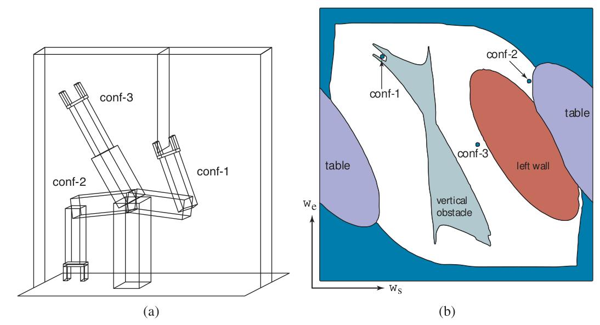

**شکل ۲۶.۱۳ — سه پیکربندیِ ربات، نشان‌داده‌شده در فضایِ کار و فضایِ پیکربندی.**

### ۲۶.۵.۲ برنامه‌ریزیِ حرکت

مسئلهٔ برنامه‌ریزیِ حرکت یافتنِ برنامه‌ای است که ربات را از پیکربندیِ‌ای به پیکربندیِ دیگر بدونِ برخورد با مانع می‌برد. بلوکِ ساختمانیِ پایه‌ای برای حرکت و دست‌کاری است. در بخش ۲۶.۵.۴ بحث خواهیم کرد چگونه این کار را تحتِ دینامیکِ پیچیده انجام دهیم، مانندِ هدایتِ خودرویی که ممکن است اگر در پیچ خیلی سریع برود از مسیر منحرف شود. فعلاً، بر مسئلهٔ سادهٔ برنامه‌ریزیِ حرکتِ یافتنِ مسیرِ هندسیِ عاری از برخورد تمرکز می‌کنیم. برنامه‌ریزیِ حرکت مسئلهٔ جستجویِ کاملاً حالت-پیوسته است، اما اغلب امکانِ گسسته‌سازیِ فضا و اعمالِ الگوریتم‌های جستجویِ فصل ۳ هست.

مسئلهٔ برنامه‌ریزیِ حرکت گاهی «مسئلهٔ جابه‌جاییِ پیانو» (Piano Mover's Problem) نامیده می‌شود. نامش را از کشمکشِ جابه‌جاکننده‌ای می‌گیرد که می‌خواهد پیانوی بزرگِ نامنظم‌شکلی را از اتاقی به اتاقِ دیگر بدونِ برخورد با چیزی ببرد. به ما داده می‌شود:

- فضایِ کارِ W یا در R² برای صفحه یا در R³ برای سه بُعد،
- ناحیهٔ مانعِ O ⊂ W،
- رباتی با فضایِ پیکربندیِ C و مجموعهٔ نقطه‌های A(q) برای q ∈ C،
- پیکربندیِ شروعِ q_s ∈ C، و
- پیکربندیِ هدفِ q_g ∈ C.

ناحیهٔ مانع، مانعِ C-فضایِ C_obs و فضایِ آزادِ متناظرِ C_free را چنان‌که در بخشِ قبلی تعریف شد القا می‌کند. باید مسیرِ پیوسته‌ای از میانِ فضایِ آزاد بیابیم. از منحنیِ پارامتریِ τ(t) برای بازنماییِ مسیر استفاده می‌کنیم، که τ(0) = q_s و τ(1) = q_g و τ(t) برای هر t بینِ ۰ و ۱ نقطه‌ای در C_free است. یعنی، t پارامترِ مقدارِ پیشرویِ ما در طولِ مسیر، از شروع تا هدف است. توجه کنید t تا حدی مانندِ زمان عمل می‌کند، زیرا با افزایشِ t فاصله در طولِ مسیر افزایش می‌یابد، اما t همیشه نقطه‌ای در بازهٔ [0,1] است و بر حسبِ ثانیه اندازه‌گیری نمی‌شود.

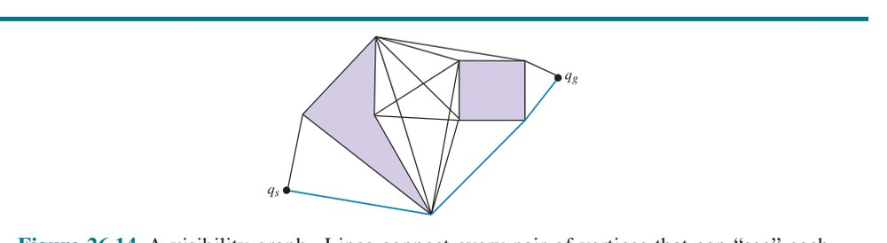

**شکل ۲۶.۱۴ — گرافِ دیدپذیری. خطوط هر جفتِ رأس را که می‌توانند یکدیگر را «ببینند»—خطوطی که از مانع عبور نمی‌کنند—به هم متصل می‌کنند. کوتاه‌ترین مسیر باید رویِ این خطوط باشد.**

مسئلهٔ برنامه‌ریزیِ حرکت را می‌توان به‌روش‌های گوناگون پیچیده‌تر کرد: تعریفِ هدف به‌عنوانِ مجموعه‌ای از پیکربندی‌های ممکن به‌جای پیکربندیِ تکی؛ تعریفِ هدف در فضایِ کار به‌جای C-فضا؛ تعریفِ تابعِ هزینه (مثلاً، طولِ مسیر) برای کمینه‌کردن؛ ارضایِ قیدها (مثلاً، اگر مسیر شاملِ حملِ فنجانِ قهوه است، مطمئن‌شدن از اینکه فنجان همیشه راست‌به‌بالا جهت‌گیری شده تا قهوه نریزد).

**فضاهای برنامه‌ریزیِ حرکت:** بیایید گامی به عقب برداریم و مطمئن شویم فضاهای درگیر در برنامه‌ریزیِ حرکت را می‌فهمیم. نخست، فضایِ کار یا جهانِ W هست. نقطه‌های W نقطه‌های جهانِ روزمرهٔ سه‌بعدی‌اند. بعد، فضایِ پیکربندی‌ها، C، را داریم. نقطه‌های q در C د-بعدی‌اند، با d تعدادِ درجه‌های آزادیِ ربات، و به مجموعه‌های نقطه‌های A(q) در W نگاشت می‌شوند. سرانجام، فضایِ مسیرها هست. فضایِ مسیرها فضایی از توابع است. هر نقطهٔ این فضا به کلِ منحنیِ از میانِ C-فضا نگاشت می‌شود. این فضا بینهایت-بعدی است! به‌صورتِ شهودی، برای هر پیکربندی در طولِ مسیر به d بُعد نیاز داریم، و به همان اندازه پیکربندی رویِ مسیر هست که نقطه در بازهٔ عددیِ [0,1]. حالا برخی راه‌های حلِ مسئلهٔ برنامه‌ریزیِ حرکت را در نظر بگیریم.

**گراف‌های دیدپذیری (Visibility Graphs):** برای حالتِ ساده‌شدهٔ فضاهای پیکربندیِ دوبعدی و موانعِ چندضلعیِ C-فضا، گراف‌های دیدپذیری راهِ مناسبی برای حلِ مسئلهٔ برنامه‌ریزیِ حرکت با راه‌حلِ کوتاه‌ترین-مسیرِ تضمین‌شده‌اند. V_obs ⊂ C مجموعهٔ رأس‌های چندضلعی‌های سازندهٔ C_obs و V = V_obs ∪ {q_s, q_g} باشد. گرافی G = (V,E) رویِ مجموعهٔ رأسِ V با یال‌های e_ij ∈ E که رأسِ v_i را به رأسِ دیگری مانندِ v_j متصل می‌کند اگر خطِّ متصل‌کنندهٔ دو رأس عاری از برخورد باشد—یعنی اگر {λv_i + (1−λ)v_j : λ ∈ [0,1]} ∩ C_obs = {} باشد. وقتی این رخ می‌دهد، می‌گوییم دو رأس «می‌توانند یکدیگر را ببینند»، که گراف‌های «دیدپذیری» نامشان را از همین جا گرفتند.

برای حلِ مسئلهٔ برنامه‌ریزیِ حرکت، فقط باید جستجویِ گرافِ گسسته (مثلاً، جستجویِ بهترین-اول) را رویِ گرافِ G با حالتِ شروعِ q_s و هدفِ q_g اجرا کنیم. در شکل ۲۶.۱۴ گرافِ دیدپذیری و راه‌حلِ بهینهٔ سهامرحله‌ای می‌بینیم. جستجویِ بهینه رویِ گراف‌های دیدپذیری همیشه مسیرِ بهینه را به ما می‌دهد (اگر یکی وجود داشته باشد)، یا اگر مسیری نباشد شکست را گزارش می‌کند.

**نمودارهای ورونوی (Voronoi Diagrams):** گراف‌های دیدپذیری مسیرهایی را تشویق می‌کنند که بلافاصله مجاورِ مانع اجرا می‌شوند—اگر مجبور بودید برای رسیدن به در دورِ میز راه بروید، کوتاه‌ترین مسیر چسبیدنِ تا حدِ ممکن به میز بود. با این حال، اگر حرکت یا حس‌کردن غیرقطعی باشد، این شما را در خطرِ برخورد با میز می‌گذارد. یکی از راه‌های پرداختن به این، وانمودکردن به اینکه بدنهٔ ربات کمی بزرگ‌تر از آنچه هست است، که ناحیهٔ بافری فراهم می‌کند. راهِ دیگر پذیرشِ این است که طولِ مسیر تنها معیاری نیست که می‌خواهیم بهینه کنیم. بخش ۲۶.۸.۲ نشان می‌دهد چگونه از مثال‌های انسانیِ رفتار معیارِ خوبی یاد بگیریم.

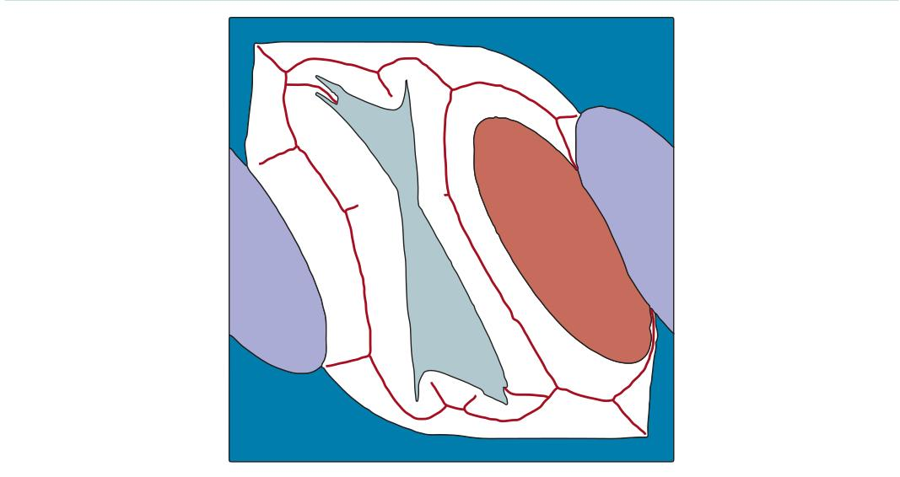

**شکل ۲۶.۱۵ — نمودارِ ورونوی که مجموعهٔ نقطه‌های (خطوطِ سیاه) با فاصلهٔ مساوی از دو یا چند مانع در فضایِ پیکربندی را نشان می‌دهد.**

راهِ سوم استفاده از فنِ متفاوتی است، که مسیرها را تا حدِ ممکن دور از موانع می‌گذارد به‌جای چسبیدن به آن‌ها. «نمودارِ ورونوی» (Voronoi Diagram) بازنماییِ است که به ما اجازه می‌دهد دقیقاً همین کار را کنیم. برای گرفتنِ ایده‌ای از اینکه نمودارِ ورونوی چه می‌کند، فضایی را در نظر بگیر که موانع در آن، مثلاً، یک‌دوجین نقطهٔ کوچکِ پراکنده در صفحه‌اند. حالا هر نقطهٔ مانع را با ناحیه‌ای احاطه کن که شاملِ همهٔ نقطه‌های صفحه‌ای است که به آن نقطهٔ مانع نزدیک‌ترند تا به هر نقطهٔ مانعِ دیگر. پس، ناحیه‌ها صفحه را افراز می‌کنند. نمودارِ ورونوی شاملِ مجموعهٔ ناحیه‌هاست، و «گرافِ ورونوی» (Voronoi Graph) شاملِ یال‌ها و رأس‌های ناحیه‌هاست. وقتی موانع ناحیه‌اند، نه نقطه، همه‌چیز تقریباً همان می‌ماند. هر ناحیه همچنان همهٔ نقطه‌هایی را شامل است که به یک مانع نزدیک‌تر از هر مانعِ دیگرند، که فاصله به نزدیک‌ترین نقطهٔ مانع اندازه‌گیری می‌شود. مرزهای بینِ ناحیه‌ها همچنان با نقطه‌هایی متناظرند که بینِ دو مانع هم‌فاصله‌اند، اما حالا مرز ممکن است منحنی باشد نه خطِّ راست. محاسبهٔ این مرزها در فضاهای پربعد می‌تواند به‌طورِ بازدارنده‌ای گران باشد. برای حلِ مسئلهٔ برنامه‌ریزیِ حرکت، نقطهٔ شروعِ q_s را با خطِّ راستی به نزدیک‌ترین نقطهٔ گرافِ ورونوی وصل می‌کنیم، و همین کار را برای نقطهٔ هدفِ q_g. سپس از جستجویِ گرافِ گسسته برای یافتنِ کوتاه‌ترین مسیر رویِ گراف استفاده می‌کنیم. برای مسائلی مانندِ ناوبری در راهروهای داخلی، این مسیرِ زیبایی می‌دهد که از وسطِ راهرو می‌گذرد.

با این حال، در محیط‌های بیرونی می‌تواند مسیرهای ناکارآمدی ارائه دهد، مثلاً پیشنهادِ انحرافِ غیرضروریِ ۱۰۰ متری برای چسبیدن به وسطِ فضایِ کاملاً بازِ ۲۰۰ متری.

**تجزیهٔ سلولی (Cell Decomposition):** رویکردِ جایگزینِ برنامه‌ریزیِ حرکت گسسته‌سازیِ C-فضاست. روش‌های تجزیهٔ سلولی فضایِ آزاد را به تعدادِ متناهی ناحیهٔ پیوسته، به نامِ «سلول» (Cell)، تجزیه می‌کنند. این سلول‌ها چنان طراحی می‌شوند که مسئلهٔ برنامه‌ریزیِ مسیر درونِ سلولِ تکی با وسایلِ ساده (مثلاً، حرکت در طولِ خطِّ راست) قابلِ حل باشد. مسئلهٔ برنامه‌ریزیِ مسیر سپس به مسئلهٔ جستجویِ گرافِ گسسته تبدیل می‌شود (مانندِ گراف‌های دیدپذیری و گراف‌های ورونوی) برای یافتنِ مسیری از میانِ دنباله‌ای از سلول‌ها.

ساده‌ترین تجزیهٔ سلولی شاملِ شبکه‌ای با فاصلهٔ منظم است. شکل ۲۶.۱۶ (الف) تجزیهٔ شبکهٔ مربعیِ فضا و مسیرِ راه‌حلِ بهینهٔ این اندازهٔ شبکه را نشان می‌دهد. سایهٔ خاکستری مقدارِ هر سلولِ شبکهٔ فضایِ آزاد را نشان می‌دهد—هزینهٔ کوتاه‌ترین مسیر از آن سلول به هدف. (این مقادیر را می‌توان با شکلِ قطعیِ الگوریتمِ VALUE-ITERATIONِ داده‌شده در شکل ۱۷.۶ در صفحهٔ ۵۷۳ محاسبه کرد.) شکل ۲۶.۱۶ (ب) مسیرِ فضایِ کارِ متناظر را برای بازو نشان می‌دهد. البته، می‌توانستیم از الگوریتمِ A* برای یافتنِ کوتاه‌ترین مسیر نیز استفاده کنیم.

این تجزیهٔ شبکه‌ای این مزیت را دارد که پیاده‌سازی‌اش ساده است، اما از سه محدودیت رنج می‌برد. نخست، فقط برای فضاهای پیکربندیِ کم‌بعد کارایی دارد، زیرا تعدادِ سلول‌های شبکه با d، تعدادِ ابعاد، به‌صورتِ نمایی افزایش می‌یابد. (آشنا به نظر می‌رسد؟ این نفرینِ ابعاد است.) دوم، مسیرهایِ از میانِ فضایِ حالتِ گسسته‌شده همیشه هموار نخواهند بود. در شکل ۲۶.۱۶ (الف) می‌بینیم بخش‌های قطریِ مسیر دندانه‌دارند و بنابراین برای ربات دنبال‌کردنِ دقیقشان بسیار دشوار است. ربات می‌تواند بکوشد مسیرِ راه‌حل را هموار کند، اما این به‌هیچ‌وجه سرراست نیست.

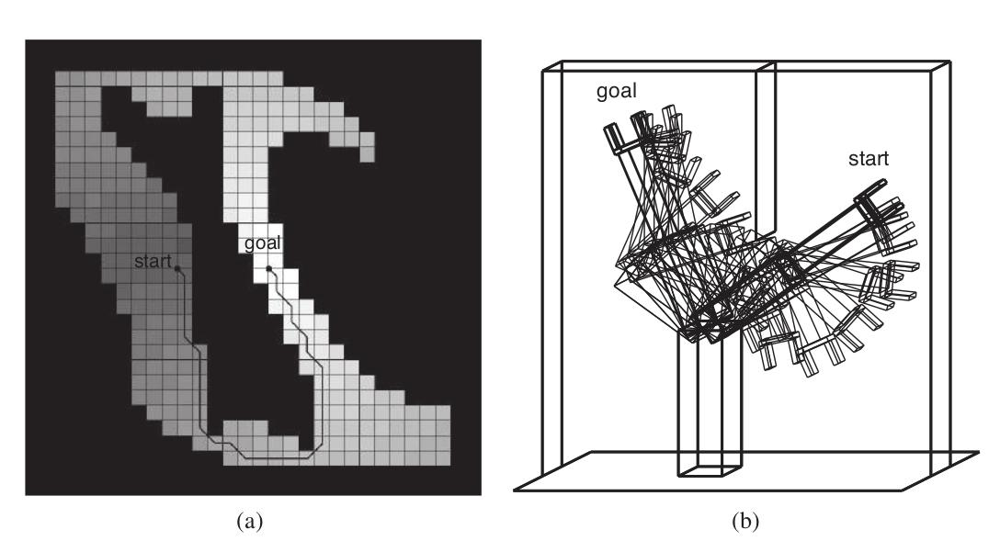

**شکل ۲۶.۱۶ — (الف) تابعِ ارزش و مسیرِ یافت‌شده برای تقریبِ شبکهٔ سلولِ گسستهٔ فضایِ پیکربندی. (ب) همان مسیر در مختصاتِ فضایِ کار تجسم شده. توجه کنید ربات چگونه آرنجش را خم می‌کند تا از برخورد با مانعِ عمودی اجتناب کند.**

سوم، مسئلهٔ کار با سلول‌های «مخلوط» هست—یعنی سلول‌هایی که نه کاملاً درونِ فضایِ آزاد‌اند و نه کاملاً درونِ فضایِ اشغال‌شده. مسیرِ راه‌حلی که چنین سلولی را شامل می‌شود ممکن است راه‌حلِ واقعی نباشد، زیرا ممکن است هیچ راهِ امنی برای عبور از سلول نباشد. این برنامه‌ریزِ مسیر را نادرست (unsound) می‌کرد. از سوی دیگر، اگر اصرار کنیم فقط سلول‌های کاملاً آزاد استفاده شوند، برنامه‌ریز ناقص (incomplete) خواهد بود، زیرا ممکن است تنها مسیرهای هدف از سلول‌های مخلوط بگذرند—ممکن است راهرویی در واقع به‌اندازهٔ کافی برای عبورِ ربات پهن باشد، اما راهرو فقط با سلول‌های مخلوط پوشیده شده باشد.

نخستین رویکرد به این مسئله تقسیمِ بیشترِ سلول‌های مخلوط است—شاید با استفاده از سلول‌هایی با نصفِ اندازهٔ اصلی. این را می‌توان به‌صورتِ بازگشتی ادامه داد تا مسیری یافت شود که کاملاً درونِ سلول‌های آزاد قرار دارد. این روش خوب کار می‌کند و کامل است اگر راهی برای تصمیم‌گیری دربارهٔ اینکه سلولِ داده‌شده‌ای سلولِ مخلوط است یا نه وجود داشته باشد، که فقط اگر مرزهای فضایِ پیکربندی توصیفِ ریاضیِ نسبتاً ساده‌ای داشته باشند آسان است.

توجه به این نکته مهم است که تجزیهٔ سلولی الزاماً به بازنماییِ صریحِ فضایِ مانعِ C_obs نیاز ندارد. می‌توانیم تصمیم بگیریم سلولی را شامل کنیم یا نه با استفاده از «بررسی‌گرِ برخورد» (Collision Checker). این مفهومِ حیاتیِ برنامه‌ریزیِ حرکت است. بررسی‌گرِ برخورد تابعِ γ(q) است که اگر پیکربندی با مانع برخورد کند ۱ و در غیرِ این صورت ۰ نگاشت می‌کند. بررسیِ اینکه پیکربندیِ خاصی در برخورد است بسیار آسان‌تر از ساختِ صریحِ کلِ فضایِ مانعِ C_obs است.

با بررسیِ مسیرِ راه‌حلِ نشان‌داده‌شده در شکل ۲۶.۱۶ (الف)، دشواریِ اضافیِ دیگری را می‌بینیم که باید حل شود. مسیر شاملِ گوشه‌های دلخواهاً تیز است، اما رباتِ فیزیکی تکانه دارد و نمی‌تواند فوراً تغییرِ جهت دهد. این مسئله را می‌توان با ذخیره‌کردن، برای هر سلولِ شبکه، حالتِ پیوستهٔ دقیق (موقعیت و سرعت) که هنگامِ رسیدن به سلول در جستجو به‌دست آمده حل کرد. بیشتر فرض کنید هنگامِ انتشارِ اطلاعات به سلول‌های شبکهٔ نزدیک، از این حالتِ پیوسته به‌عنوانِ مبنا استفاده می‌کنیم و مدلِ حرکتِ پیوستهٔ ربات را برای پرش به سلول‌های نزدیک اعمال می‌کنیم. پس چرخشِ آنیِ ۹۰ درجه‌ای نمی‌کنیم؛ چرخشِ گردی انجام می‌دهیم که توسط قوانینِ حرکت اداره می‌شود. اکنون می‌توانیم تضمین کنیم مسیرِ حاصل هموار است و واقعاً توسط ربات قابلِ اجراست. الگوریتمی که این را پیاده‌سازی می‌کند A* هیبریدی (Hybrid A*) است.

**برنامه‌ریزیِ حرکتِ تصادفی (Randomized Motion Planning):** برنامه‌ریزیِ حرکتِ تصادفی جستجویِ گراف را رویِ تجزیهٔ تصادفیِ فضایِ پیکربندی انجام می‌دهد، نه تجزیهٔ سلولیِ منظم. ایدهٔ کلیدی نمونه‌برداری از مجموعهٔ تصادفیِ نقطه‌ها و ایجادِ یال بینِ آن‌ها اگر راهِ بسیار ساده‌ای برای رفتن از یکی به دیگری (مثلاً، از طریقِ خطِّ راست) بدونِ برخورد باشد؛ سپس می‌توانیم رویِ این گراف جستجو کنیم.

الگوریتمِ «نقشهٔ راهِ احتمالاتی» (Probabilistic Roadmap یا PRM) یکی از راه‌های بهره‌برداری از این ایده است. فرض می‌کنیم به بررسی‌گرِ برخوردِ γ (تعریف‌شده در صفحهٔ ۹۴۶) و به برنامه‌ریزِ ساده‌ای B(q₁,q₂) دسترسی داریم که مسیری از q₁ به q₂ برمی‌گرداند (یا شکست) اما این کار را سریع انجام می‌دهد. این برنامه‌ریزِ ساده قرار نیست کامل باشد—ممکن است حتی اگر راه‌حل واقعاً وجود داشته باشد شکست برگرداند. کارش این است که سریع بکوشد q₁ و q₂ را متصل کند و به الگوریتمِ اصلی اطلاع دهد موفق شده یا نه. از آن برای تعریفِ اینکه آیا یالی بینِ دو رأس هست استفاده خواهیم کرد.

الگوریتم با نمونه‌برداری از M «نقطهٔ عطف» (Milestone)—نقطه‌هایی در C_free—علاوه بر نقطه‌های q_s و q_g شروع می‌کند. از نمونه‌برداریِ رد (Rejection Sampling) استفاده می‌کند، که پیکربندی‌ها به‌صورتِ تصادفی نمونه‌برداری و با γ بررسیِ برخورد می‌شوند تا در مجموع M نقطهٔ عطف یافت شود. بعد، الگوریتم از برنامه‌ریزِ ساده برای تلاشِ اتصالِ جفتِ نقطه‌های عطف استفاده می‌کند. اگر برنامه‌ریزِ ساده موفقیت برگرداند، یالی بینِ جفت به گراف اضافه می‌شود؛ در غیرِ این صورت، گراف همان‌گونه می‌ماند. می‌کوشیم هر نقطهٔ عطف را یا به k همسایهٔ نزدیک‌ترین‌اش (این را k-PRM می‌نامیم) یا به همهٔ نقطه‌های عطفِ کره‌ای با شعاعِ r متصل کنیم. سرانجام، الگوریتم مسیری را رویِ این گراف از q_s به q_g جستجو می‌کند. اگر مسیری یافت نشود، M نقطهٔ عطفِ بیشتر نمونه‌برداری، به گراف اضافه و فرایند تکرار می‌شود.


**شکل ۲۶.۱۷ — الگوریتمِ نقشهٔ راهِ احتمالاتی (PRM). بالایِ چپ: پیکربندی‌های شروع و هدف. بالایِ راست: M نقطهٔ عطفِ عاری از برخورد نمونه‌برداری کن (اینجا M = 5). پایینِ چپ: هر نقطهٔ عطف را به k همسایهٔ نزدیک‌ترین‌اش متصل کن (اینجا k = 3). پایینِ راست: کوتاه‌ترین مسیر را از شروع به هدف رویِ گرافِ حاصل بیاب.**

شکل ۲۶.۱۷ نقشهٔ راه را با مسیرِ یافت‌شده بینِ دو پیکربندی نشان می‌دهد. PRMها کامل نیستند، اما چیزی‌اند که «کاملِ احتمالاتی» (Probabilistically Complete) نامیده می‌شوند—اگر مسیری وجود داشته باشد، در نهایت آن را خواهند یافت. به‌صورتِ شهودی، این به‌دلیلِ این است که به نمونه‌برداری از نقطه‌های عطفِ بیشتر ادامه می‌دهند. PRMها حتی در فضاهای پیکربندیِ پربعد نیز خوب کار می‌کنند.

PRMها همچنین برای «برنامه‌ریزیِ چندپرس‌وجویی» (Multi-Query Planning) محبوب‌اند، که در آن چند مسئلهٔ برنامه‌ریزیِ حرکت درونِ همان C-فضا داریم. اغلب، وقتی ربات به هدفی می‌رسد، فراخوانده می‌شود در همان فضایِ کار به هدفِ دیگری برسد. PRMها واقعاً مفیدند، زیرا ربات می‌تواند از پیش وقت صرفِ ساختنِ نقشهٔ راه کند و استفاده از آن نقشهٔ راه را رویِ چند پرس‌وجو مستهلک کند.

**درخت‌های تصادفیِ سریع‌گسترش (RRT):** بسطی از PRMها به نامِ «درخت‌های تصادفیِ سریع‌گسترش» (Rapidly Exploring Random Trees یا RRT) برای برنامه‌ریزیِ تک‌پرس‌وجویی محبوب است. به‌صورتِ افزایشی دو درخت می‌سازیم، یکی با ریشهٔ q_s و یکی با ریشهٔ q_g. نقطه‌های عطفِ تصادفی انتخاب می‌شوند، و تلاش می‌شود هر نقطهٔ عطفِ تازه به درخت‌های موجود متصل شود. اگر نقطهٔ عطفی هر دو درخت را متصل کند، یعنی راه‌حلی یافت شده، مانندِ شکل ۲۶.۱۸. اگر نه، الگوریتم نزدیک‌ترین نقطه را در هر درخت می‌یابد و به درخت یالِ تازه‌ای اضافه می‌کند که از آن نقطه با فاصلهٔ δ به سمتِ نقطهٔ عطف امتداد می‌یابد.

این تمایل دارد درخت را به سمتِ بخش‌های قبلاً کاوش‌نشدهٔ فضا رشد دهد.

رباتیست‌ها RRTها را برای سهولتِ استفاده‌شان دوست دارند. با این حال، راه‌حل‌های RRT معمولاً غیربهینه‌اند و همواری ندارند. بنابراین، RRTها اغلب با گامِ پس‌پردازشی دنبال می‌شوند. رایج‌ترینِ آن‌ها «کوتاه‌سازی» (Short-Cutting) است، که در آن به‌صورتِ تصادفی یکی از رأس‌های مسیرِ راه‌حل را انتخاب می‌کنیم و می‌کوشیم با اتصالِ همسایه‌هایش به یکدیگر (از طریقِ برنامه‌ریزِ ساده) آن را حذف کنیم. این کار را بارها برای هر تعدادِ گامی که وقتِ محاسبه داریم تکرار می‌کنیم. حتی آنگاه، مسیرها ممکن است به‌دلیلِ موقعیت‌های تصادفیِ نقطه‌های عطفِ انتخاب‌شده کمی غیرطبیعی به نظر برسند، چنان‌که در شکل ۲۶.۱۹ نشان داده شده.

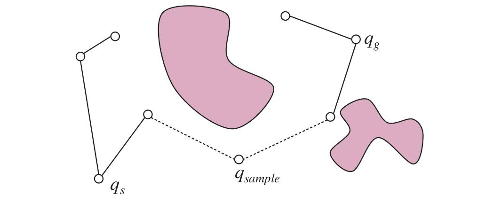

**شکل ۲۶.۱۸ — الگوریتمِ RRT دوسویه دو درخت می‌سازد (یکی از شروع، دیگری از هدف) با اتصالِ افزایشیِ هر نمونه به نزدیک‌ترین گره در هر درخت، اگر اتصال ممکن باشد. وقتی نمونه‌ای به هر دو درخت متصل شود، یعنی مسیرِ راه‌حلی یافته‌ایم.**

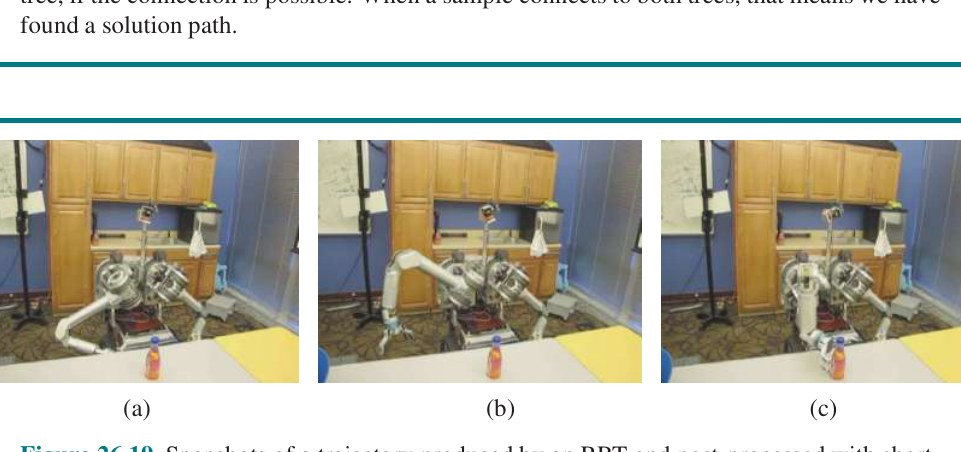

**شکل ۲۶.۱۹ — تصویرهایی از مسیرِ تولیدشده توسط RRT و پس‌پردازش‌شده با کوتاه‌سازی. با اجازه از آنکا دراگان.**

RRT* اصلاحی بر RRT است که الگوریتم را به‌صورتِ مجانبی بهینه می‌کند: راه‌حلِ RRT* با نمونه‌برداری از نقطه‌های عطفِ بیشتر و بیشتر به راه‌حلِ بهینه همگرا می‌شود. ایدهٔ کلیدی انتخابِ نزدیک‌ترین همسایه بر مبنای مفهومی از هزینه-تا-اینجا است، نه فقط فاصله از نقطهٔ عطف، و سیم‌کشیِ مجددِ درخت، با تعویضِ والدِ رأس‌های قدیمی‌تر اگر رسیدن به آن‌ها از طریقِ نقطهٔ عطفِ تازه ارزان‌تر باشد.

**بهینه‌سازیِ مسیر برای برنامه‌ریزیِ سینماتیکی:** الگوریتم‌های نمونه‌برداریِ تصادفی تمایل دارند نخست مسیرِ پیچیده اما شدنی‌ای بسازند و سپس آن را بهینه کنند. بهینه‌سازیِ مسیر برعکس عمل می‌کند: با مسیرِ ساده اما غیرشدنی شروع می‌کند و سپس برای بیرون‌راندنِ آن از برخورد کار می‌کند. هدف یافتنِ مسیری است که تابعِ هزینه‌ای رویِ مسیرها را بهینه می‌کند. یعنی، می‌خواهیم تابعِ هزینهٔ J(τ) را کمینه کنیم، که τ(0) = q_s و τ(1) = q_g. J «تابعک» (Functional) نامیده می‌شود، زیرا تابعی رویِ توابع است. آرگومانِ J برابرِ τ است، که خود تابعی است: τ(t) نقطه‌ای از بازهٔ [0,1] را می‌گیرد و آن را به پیکربندی نگاشت می‌کند. تابعکِ هزینهٔ استاندارد بینِ دو جنبهٔ مهمِ حرکتِ ربات مبادله می‌کند: اجتناب از برخورد و کارایی،

```
J = J_obs + λ J_eff
```

که J_eff کارایی را اندازه می‌گیرد—طولِ مسیر—و ممکن است همواری را نیز اندازه بگیرد. راهِ مناسبی برای تعریفِ کارایی با درجهٔ دوم است: مشتقِ اولِ مجذورِ τ را انتگرال می‌گیرد (کمی بعد خواهیم دید چرا این در واقع مسیرهای کوتاه را ترغیب می‌کند):

```
J_eff = ∫₀¹ ½ ‖τ̇(s)‖² ds
```

برای عبارتِ مانع، فرض کنید بتوانیم فاصلهٔ d(x) از هر نقطهٔ x ∈ W تا نزدیک‌ترین لبهٔ مانع را محاسبه کنیم. این فاصله در بیرونِ موانع مثبت، در لبه ۰ و در داخل منفی است. این «میدانِ فاصلهٔ علامت‌دار» (Signed Distance Field) نامیده می‌شود. حالا می‌توانیم میدانِ هزینه‌ای در فضایِ کار تعریف کنیم، آن را c بنامیم، که داخلِ موانع هزینهٔ بالا و درستِ بیرونِ آن‌ها هزینهٔ کوچکی دارد. با این هزینه، می‌توانیم نقطه‌های فضایِ کار را واقعاً از بودنِ داخلِ موانع و نزدیکِ آن‌ها متنفر کنیم (با اجتناب از مشکلِ گرافِ دیدپذیری که همیشه کنارِ لبه‌های موانع آویزان‌اند). البته، رباتِ ما نقطه‌ای در فضایِ کار نیست، پس کارِ بیشتری داریم—باید همهٔ نقطه‌های b رویِ بدنهٔ ربات را در نظر بگیریم:

```
J_obs = ∫₀¹ ∫_b c(φ_b(τ(s))) ‖d/ds φ_b(τ(s))‖ db ds
```

این «انتگرالِ مسیر» (Path Integral) نامیده می‌شود—فقط c را در طولِ راه برای هر نقطهٔ بدنه انتگرال نمی‌گیرد، بلکه آن را در مشتق ضرب می‌کند تا هزینه نسبت به باززمان‌بندیِ مسیر ناوردا باشد. رباتی را تصور کن که از میانِ میدانِ هزینه جاروب می‌کند و با حرکتش هزینه انباشته می‌کند. صرف‌نظر از اینکه بازو چقدر سریع یا کند از میدان عبور می‌کند، باید دقیقاً همان هزینه را انباشته کند.

ساده‌ترین راهِ حلِ مسئلهٔ بهینه‌سازیِ بالا و یافتنِ مسیر، نزولِ گرادیان است. اگر تعجب می‌کنید چگونه گرادیانِ تابعک‌ها را نسبت به توابع بگیریم، چیزی به نامِ «حسابِ تغییرات» (Calculus of Variations) به کمک می‌آید. این به‌ویژه برای تابعک‌هایی به شکلِ

```
J[τ] = ∫₀¹ F(s, τ(s), τ̇(s)) ds
```

آسان است، که انتگرال‌های توابعی‌اند که فقط به پارامترِ s، مقدارِ تابع در s و مشتقِ تابع در s بستگی دارند. در چنین حالتی، «معادلهٔ اویلر-لاگرانژ» (Euler-Lagrange Equation) می‌گوید گرادیان به‌صورتِ زیر است:

```
∇_τ J(s) = ∂F/∂τ(s) (s) − d/dt ∂F/∂τ̇(s) (s)
```

اگر به J_eff و J_obs دقیق نگاه کنیم، هر دو از این الگو پیروی می‌کنند. به‌طورِ خاص، برای J_eff داریم F(s, τ(s), τ̇(s)) = ‖τ̇(s)‖². برای راحت‌ترشدن، گرادیانِ فقط J_eff را محاسبه کنیم. می‌بینیم F وابستگیِ مستقیمی به τ(s) ندارد، پس عبارتِ نخستِ فرمول ۰ است. باقی می‌ماند:

```
∇_τ J(s) = 0 − d/dt τ̇(s)
```

زیرا جزئیِ F نسبت به τ̇(s) برابرِ τ̇(s) است.¹

توجه کنید چگونه هنگامِ تعریفِ J_eff کار را برای خودمان آسان کردیم—درجهٔ دومِ زیبایی از مشتق است (و حتی ½ جلویش گذاشتیم تا ۲ به‌خوبی حذف شود). در عمل، این ترفند را برای بهینه‌سازی زیاد خواهید دید—هنر نه فقط در انتخابِ نحوهٔ بهینه‌کردنِ تابعِ هزینه، بلکه در انتخابِ تابعِ هزینه‌ای است که با نحوهٔ بهینه‌کردن‌تان خوب بازی کند. با ساده‌کردنِ گرادیانِ‌مان، ∇_τ J(s) = −τ̈(s) می‌گیریم. حالا، چون J_eff درجهٔ دوم است، صفرگذاشتنِ این گرادیان راه‌حلِ τ را به ما می‌دهد اگر مجبور نبودیم با موانع سروکار داشته باشیم. یک بار انتگرال می‌گیریم: مشتقِ نخست باید ثابت باشد؛ بارِ دوم انتگرال می‌گیریم: τ(s) = a·s + b، با a و b که توسط قیدهای نقطهٔ پایانیِ τ(0) و τ(1) تعیین می‌شوند. مسیرِ بهینه نسبت به J_eff پس خطِّ راست از شروع تا هدف است! در واقع کارآمدترین راهِ رفتن از یکی به دیگری اگر مانعی برای نگرانی نباشد همین است.

البته، افزودنِ J_obs چیزی است که کار را دشوار می‌کند—و شما را از اشتقاقِ گرادیانش در این‌جا معاف می‌کنیم. ربات معمولاً مسیرش را خطِّ راست مقداردهیِ اولیه می‌کند، که مستقیم از میانِ برخی موانع می‌شکافد. سپس گرادیانِ هزینه را دربارهٔ مسیرِ کنونی محاسبه می‌کند، و گرادیان برای دورراندنِ مسیر از موانع خدمت می‌کند (شکل ۲۶.۲۰). در ذهن داشته باشید نزولِ گرادیان فقط راه‌حلِ بهینهٔ محلی را خواهد یافت—درست مانندِ بالارفتن از تپه. روش‌هایی مانندِ بازپختِ شبیه‌سازی‌شده (بخش ۴.۱.۲) را می‌توان برای کاوش استفاده کرد، تا محتمل‌تر شود بهینهٔ محلی بهینهٔ خوبی است.

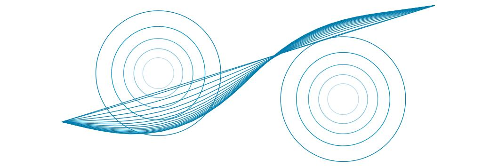

**شکل ۲۶.۲۰ — بهینه‌سازیِ مسیر برای برنامه‌ریزیِ حرکت. دو مانعِ نقطه‌ای با نوارهای دایره‌ایِ هزینهٔ کاهشی دورشان. بهینه‌ساز با مسیرِ خطِّ راست شروع می‌کند و به موانع اجازه می‌دهد خط را از برخوردها خم کنند، و مسیرِ کمینه را از میانِ میدانِ هزینه می‌یابد.**

### ۲۶.۵.۳ کنترلِ دنبال‌کردنِ مسیر

پوشش داده‌ایم چگونه حرکت‌ها را برنامه‌ریزی کنیم، اما نه چگونه واقعاً حرکت کنیم—برای اعمالِ جریان به موتورها، تولیدِ گشتاور، حرکتِ ربات. این قلمروِ «نظریهٔ کنترل» (Control Theory) است، حوزه‌ای با اهمیتِ فزاینده در هوش مصنوعی. دو پرسشِ اصلی برای رسیدگی هست: چگونه توصیفِ ریاضیِ مسیری را به دنباله‌ای از کنش‌ها در جهانِ واقعی تبدیل کنیم (کنترلِ حلقهٔ باز)، و چگونه مطمئن شویم در مسیر می‌مانیم (کنترلِ حلقهٔ بسته)؟

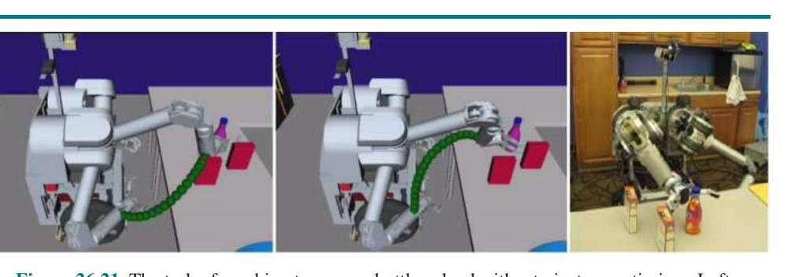

**شکل ۲۶.۲۱ — تکلیفِ رسیدن برای گرفتنِ بطری، حل‌شده با بهینه‌سازِ مسیر. چپ: مسیرِ اولیه، ترسیم‌شده برای اثرگذارِ انتهایی. وسط: مسیرِ نهایی پس از بهینه‌سازی. راست: پیکربندیِ هدف. با اجازه از آنکا دراگان. راتلیف و همکاران (2009) را ببینید.**

**از پیکربندی‌ها به گشتاورها برای دنبال‌کردنِ حلقهٔ باز:** مسیرِ زمانیِ τ(t) ما پیکربندی‌ها را می‌دهد. ربات در حالتِ سکون در q_s = τ(0) شروع می‌کند. از آن‌جا، موتورهای ربات جریان‌ها را به گشتاورها تبدیل می‌کنند که به حرکت می‌انجامد. اما ربات باید چه گشتاورهایی را هدف بگیرد تا در نهایت به q_g = τ(1) برسد؟ این‌جاست که ایدهٔ «مدلِ دینامیک» (Dynamics Model) (یا مدلِ انتقال) وارد می‌شود. می‌توانیم تابعِ f را به ربات بدهیم که اثرهای گشتاورها را بر پیکربندی محاسبه می‌کند. F = ma از فیزیک را به یاد دارید؟ خوب، چیزی شبیهِ آن برای گشتاورها هم هست، به شکلِ u = f⁻¹(q, q̇, q̈)، با u گشتاور، q̇ سرعت و q̈ شتاب.² اگر ربات در پیکربندیِ q و سرعتِ q̇ باشد و گشتاورِ u اعمال کند، آن به شتابِ q̈ = f(q, q̇, u) می‌انجامد.

دوتاییِ (q, q̇) «حالتِ دینامیکی» (Dynamic State) است، زیرا شاملِ سرعت است، در حالی که q «حالتِ سینماتیکی» (Kinematic State) است و برای محاسبهٔ دقیقِ اینکه چه گشتاوری اعمال شود کافی نیست. f مدلِ دینامیکِ قطعی در MDP رویِ حالت‌های دینامیکی با گشتاورها به‌عنوانِ کنش است. f⁻¹ «دینامیکِ معکوس» (Inverse Dynamics) است، که می‌گوید اگر شتابِ خاصی بخواهیم چه گشتاوری اعمال کنیم، که به تغییرِ سرعت و در نتیجهِ تغییرِ حالتِ دینامیکی می‌انجامد.

حالا، به‌صورتِ ساده‌لوحانه، می‌توانستیم به t ∈ [0,1] به‌عنوانِ «زمان» در مقیاسی از ۰ تا ۱ فکر کنیم و گشتاورِ خود را با دینامیکِ معکوس انتخاب کنیم:

```
u(t) = f⁻¹(τ(t), τ̇(t), τ̈(t))    (26.2)
```

با فرضِ اینکه ربات از (τ(0), τ̇(0)) شروع می‌کند. در واقعیت، با این حال، کارها آن‌قدرها آسان نیستند.

مسیرِ τ به‌عنوانِ دنباله‌ای از نقطه‌ها ایجاد شد، بدونِ درنظرگرفتنِ سرعت‌ها و شتاب‌ها. به‌این‌ترتیب، مسیر ممکن است τ̇(0) = 0 (ربات با سرعتِ صفر شروع می‌کند) را ارضا نکند، یا حتی τ مشتق‌پذیر باشد (چه برسد به دوبار مشتق‌پذیر). افزون بر این، معنای نقطهٔ پایانیِ «۱» نامشخص است: به چند ثانیه نگاشت می‌شود؟

در عمل، پیش از فکرکردن به دنبال‌کردنِ مسیرِ مرجع، معمولاً آن را «باززمان‌بندی» (Retiming) می‌کنیم، یعنی آن را به مسیرِ زمانیِ ξ(t) تبدیل می‌کنیم که بازهٔ [0,T] را برای مدتِ زمانیِ T به نقطه‌های فضایِ پیکربندیِ C نگاشت می‌کند. (نمادِ ξ حرفِ یونانیِ Xi است.) باززمان‌بندی از آنچه فکر می‌کنید حیله‌گرانه‌تر است، اما راه‌های تقریبی برای انجامش هست، برای نمونه با انتخابِ حداکثرِ سرعت و شتاب، و استفاده از پروفایلی که به آن حداکثر شتاب می‌گیرد، تا جایی که می‌تواند آن‌جا می‌ماند، و سپس به ۰ کاهش می‌یابد.² با فرضِ تواناییِ انجامِ این، معادلهٔ (26.2) بالا را می‌توان به‌صورتِ زیر بازنویسی کرد:

```
u(t) = f⁻¹(ξ(t), ξ̇(t), ξ̈(t))    (26.3)
```

حتی با تغییر از τ به ξ، یک مسیرِ زمانیِ واقعی، معادلهٔ اعمالِ گشتاورها از بالا (که «قانونِ کنترل» (Control Law) نامیده می‌شود) در عمل مشکلی دارد. با فکرکردن به بخشِ یادگیریِ تقویتی، ممکن است حدس بزنید چیست. معادله در موقعیتی که f دقیق است عالی کار می‌کند، اما واقعیتِ مزاحم مثلِ همیشه سرِ راه می‌آید: در سامانه‌های واقعی، نمی‌توانیم جرم‌ها و اینرسی‌ها را دقیقاً اندازه بگیریم، و f ممکن است پدیده‌های فیزیکی مانندِ «اصطکاکِ ایستایی» (Stiction) در موتورها را به‌درستی درنظر نگیرد (اصطکاکی که تمایل دارد از به‌حرکت‌درآمدنِ سطوحِ ساکن جلوگیری کند—آن‌ها را بچسباند). پس، وقتی بازویِ ربات شروع به اعمالِ آن گشتاورها می‌کند اما f اشتباه است، خطاها انباشته می‌شوند و بیشتر و بیشتر از مسیرِ مرجع منحرف می‌شوید.

به‌جای رهاکردنِ انباشتِ این خطاها، ربات می‌تواند از فرایندِ کنترلی استفاده کند که به جایی که فکر می‌کند هست نگاه می‌کند، آن را با جایی که می‌خواست باشد مقایسه می‌کند، و گشتاوری برای کمینه‌کردنِ خطا اعمال می‌کند. کنترل‌گری که نیرو را به نسبتِ منفیِ خطایِ مشاهده‌شده فراهم می‌کند «کنترل‌گرِ تناسبی» (Proportional Controller) یا به‌طورِ خلاصه کنترل‌گرِ P شناخته می‌شود. معادلهٔ نیرو به‌صورتِ زیر است:

```
u(t) = K_P (ξ(t) − qₜ)
```

که qₜ پیکربندیِ کنونی و K_P ثابتی است که «ضریبِ بهره» (Gain Factor) کنترل‌گر را بازنمایی می‌کند. K_P تنظیم می‌کند کنترل‌گر چقدر قوی انحراف‌های بینِ حالتِ واقعیِ qₜ و حالتِ مطلوبِ ξ(t) را تصحیح می‌کند.

شکل ۲۶.۲۲ (الف) نشان می‌دهد چه چیزی می‌تواند با کنترلِ تناسبی خراب شود. هرگاه انحرافی رخ می‌دهد—چه به‌دلیلِ نویز چه به‌دلیلِ قیدهای رویِ نیروهایی که ربات می‌تواند اعمال کند—ربات نیرویِ مخالفی فراهم می‌کند که اندازه‌اش متناسب با این انحراف است. به‌صورتِ شهودی، این ممکن است قابلِ‌قبول به نظر برسد، زیرا انحراف‌ها باید با نیرویِ متقابلی جبران شوند تا ربات در مسیر بماند. با این حال، چنان‌که شکل ۲۶.۲۲ (الف) نشان می‌دهد، کنترل‌گرِ تناسبی می‌تواند باعث شود ربات نیرویِ زیادی اعمال کند، از مسیرِ مطلوب بگذرد و به عقب و جلو زیگزاگ برود. این نتیجهٔ اینرسیِ طبیعیِ ربات است: پس از بازگردانده‌شدن به موقعیتِ مرجع، ربات سرعتی دارد که نمی‌توان آنی متوقف کرد.


**شکل ۲۶.۲۲ — کنترلِ بازویِ رباتیک با (الف) کنترلِ تناسبی با ضریبِ بهرهٔ 1.0، (ب) کنترلِ تناسبی با ضریبِ بهرهٔ 0.1، و (ج) کنترلِ PD (تناسبی-مشتقی) با ضرایبِ بهرهٔ 0.3 برای مؤلفهٔ تناسبی و 0.8 برای مؤلفهٔ مشتقی. در همهٔ موارد بازویِ رباتیک می‌کوشد مسیرِ خطِّ صاف را دنبال کند، اما در (الف) و (ب) به‌شکلِ چشمگیری از مسیر منحرف می‌شود.**

در شکل ۲۶.۲۲ (الف)، پارامترِ K_P = 1. در نگاهِ نخست، ممکن است فکر کنید انتخابِ مقدارِ کوچک‌تری برای K_P مشکل را درمان می‌کند، و به ربات نزدیک‌شدنِ ملایم‌تری به مسیرِ مطلوب می‌دهد. متأسفانه، این‌گونه نیست. شکل ۲۶.۲۲ (ب) مسیری برای K_P = .1 نشان می‌دهد، که همچنان رفتارِ نوسانی نشان می‌دهد. مقدارِ پایین‌ترِ پارامترِ بهره کمک می‌کند، اما مسئله را حل نمی‌کند. در واقع، در غیابِ اصطکاک، کنترل‌گرِ P اساساً قانونِ فنری است؛ پس تا ابد حولِ مکانِ هدفِ ثابت نوسان خواهد کرد.

تعدادی کنترل‌گر هست که از قانونِ کنترلِ تناسبیِ ساده برترند. کنترل‌گر «پایدار» (Stable) گفته می‌شود اگر اختلال‌های کوچک به خطایِ کران‌دار بینِ ربات و سیگنالِ مرجع منجر شوند. «اکیداً پایدار» (Strictly Stable) گفته می‌شود اگر بتواند پس از چنین اختلال‌هایی به مسیرِ مرجعِ خود بازگردد و رویِ آن بماند. کنترل‌گرِ Pِ ما پایدار اما نه اکیداً پایدار به نظر می‌رسد، زیرا از ماندنِ جایی نزدیکِ مسیرِ مرجعش ناکام می‌ماند.

ساده‌ترین کنترل‌گری که در حوزهٔ ما به پایداریِ اکید می‌رسد کنترل‌گرِ PD است. حرفِ «P» باز مخففِ تناسبی و «D» مخففِ مشتقی است. کنترل‌گرهای PD با معادلهٔ زیر توصیف می‌شوند:

```
u(t) = K_P (ξ(t) − qₜ) + K_D (ξ̇(t) − q̇ₜ)    (26.4)
```

چنان‌که این معادله پیشنهاد می‌کند، کنترل‌گرهای PD کنترل‌گرهای P را با مؤلفهٔ مشتقی بسط می‌دهند، که به مقدارِ u(t) عبارتی متناسب با مشتقِ نخستِ خطاِ ξ(t) − qₜ در طولِ زمان می‌افزاید. اثرِ چنین عبارتی چیست؟ به‌طورِ کلی، عبارتِ مشتقی سامانه‌ای را که کنترل می‌شود میرا می‌کند. برای دیدنِ این، موقعیتی را در نظر بگیر که خطا به‌سرعت در طولِ زمان تغییر می‌کند، مانندِ حالتِ کنترل‌گرِ Pِ بالا. مشتقِ این خطا سپس با عبارتِ تناسبی مقابله می‌کند، که پاسخِ کلی به اختلال را کاهش می‌دهد. با این حال، اگر همان خطا ادامه یابد و تغییر نکند، مشتق ناپدید می‌شود و عبارتِ تناسبی انتخابِ کنترل را مسلط می‌کند.

شکل ۲۶.۲۲ (ج) نتیجهٔ اعمالِ این کنترل‌گرِ PD بر بازویِ رباتیکِ ما را نشان می‌دهد، با استفاده از پارامترهای بهرهٔ K_P = .3 و K_D = .8. واضح است، مسیرِ حاصل بسیار هموارتر است و هیچ نوسانِ آشکاری نشان نمی‌دهد.

با این حال، کنترل‌گرهای PD حالت‌های شکست دارند. به‌طورِ خاص، کنترل‌گرهای PD ممکن است در تنظیمِ خطا به صفر ناکام بمانند، حتی در غیابِ اختلال‌های خارجی. اغلب چنین موقعیتی نتیجهٔ نیرویِ خارجیِ سیستماتیکی است که بخشی از مدل نیست. برای نمونه، خودرویِ خودرانی که رویِ سطحِ شیب‌دار رانندگی می‌کند ممکن است خودش را به‌صورتِ سیستماتیک به یک سمت کشیده بیابد. فرسودگی در بازوهای رباتیک خطاهای سیستماتیکِ مشابهی ایجاد می‌کند. در چنین موقعیت‌هایی، بازخوردِ بیش‌ازحدِ تناسبی برای راندنِ خطا به نزدیک‌ترِ صفر لازم است. راه‌حلِ این مسئله در افزودنِ عبارتِ سومی به قانونِ کنترل، مبتنی بر خطایِ انتگرال‌گرفته‌شده در طولِ زمان، است:

```
u(t) = K_P (ξ(t) − qₜ) + K_I ∫₀ᵗ (ξ(s) − q_s) ds + K_D (ξ̇(t) − q̇ₜ)    (26.5)
```

در این‌جا K_I سومین پارامترِ بهره است. عبارتِ ∫₀ᵗ (ξ(s) − q_s) ds انتگرالِ خطا در طولِ زمان را محاسبه می‌کند. اثرِ این عبارت این است که انحراف‌های طولانی‌مدت بینِ سیگنالِ مرجع و حالتِ واقعی تصحیح می‌شوند. پس، عبارت‌های انتگرالی تضمین می‌کنند کنترل‌گر خطایِ سیستماتیکِ بلندمدت نشان نمی‌دهد، هرچند خطرِ رفتارِ نوسانی را ایجاد می‌کنند.

کنترل‌گری با هر سه عبارت «کنترل‌گرِ PID» (Proportional Integral Derivative) نامیده می‌شود. کنترل‌گرهای PID به‌طورِ گسترده‌ای در صنعت، برای انواعِ مسائلِ کنترل، استفاده می‌شوند. به سه عبارت به‌صورتِ زیر فکر کنید—تناسبی: هرچه از مسیر دورتر باشی بیشتر تلاش کن؛ مشتقی: اگر خطا در حالِ افزایش است حتی بیشتر تلاش کن؛ انتگرالی: اگر مدتِ طولانی پیشرفتی نکرده‌ای بیشتر تلاش کن.

میان‌بندی بینِ کنترلِ حلقهٔ بازِ مبتنی بر دینامیکِ معکوس و کنترلِ حلقهٔ بستهٔ PID «کنترلِ گشتاورِ محاسبه‌شده» (Computed Torque Control) نامیده می‌شود. گشتاوری را محاسبه می‌کنیم که مدل‌مان فکر می‌کند به آن نیاز خواهیم داشت، اما نادقتیِ مدل را با عبارت‌های خطایِ تناسبی جبران می‌کنیم:

```
u(t) = f⁻¹(ξ(t), ξ̇(t), ξ̈(t)) + m(ξ(t)) [K_P (ξ(t) − qₜ) + K_D (ξ̇(t) − q̇ₜ)]    (26.6)
```

عبارتِ نخست «مؤلفهٔ پیش‌خور» (Feedforward Component) نامیده می‌شود، زیرا به جلو نگاه می‌کند که ربات باید به کجا برود و محاسبه می‌کند چه گشتاوری ممکن است لازم باشد. عبارتِ دوم «مؤلفهٔ بازخورد» (Feedback Component) است، زیرا خطایِ کنونیِ حالتِ دینامیکی را به قانونِ کنترل بازمی‌گرداند. m(q) ماتریسِ اینرسی در پیکربندیِ q است—برخلافِ کنترلِ PD معمولی، بهره‌ها با پیکربندیِ سامانه تغییر می‌کنند.

**برنامه‌ها در برابرِ سیاست‌ها:** بیایید گامی به عقب برداریم و مطمئن شویم قیاسِ بینِ آنچه تاکنون در این فصل رخ داده و آنچه در فصل‌های جستجو، MDP و یادگیریِ تقویتی یاد گرفتیم را می‌فهمیم. با حرکت در رباتیک، واقعاً MDP زیرینی را در نظر داریم که حالت‌ها حالت‌های دینامیکی (پیکربندی و سرعت) و کنش‌ها ورودی‌های کنترل، معمولاً به شکلِ گشتاورها، هستند. اگر دوباره به قوانینِ کنترلِ بالا نگاه کنید، آن‌ها سیاست‌اند، نه برنامه—به ربات می‌گویند از هر حالتی که ممکن است به آن برسد چه کنشی بگیرد. با این حال، آن‌ها معمولاً از سیاستِ بهینه فاصلهٔ زیادی دارند. چون حالتِ دینامیکی پیوسته و پربعد است (و فضایِ کنش نیز چنین است)، استخراجِ سیاست‌های بهینه از نظرِ محاسباتی دشوار است.

در عوض، آنچه این‌جا کردیم شکستنِ مسئله است. نخست برنامه‌ای در فضایِ حالت و کنشِ ساده‌شده ارائه می‌کنیم: فقط از حالتِ سینماتیکی استفاده می‌کنیم و فرض می‌کنیم حالت‌ها بدونِ توجه به دینامیکِ زیرین از یکدیگر قابلِ‌دستیابی‌اند. این برنامه‌ریزیِ حرکت است و مسیرِ مرجع را به ما می‌دهد. اگر دینامیک را کاملاً می‌دانستیم، می‌توانستیم این را با معادلهٔ (26.3) به برنامه‌ای برای فضایِ حالت و کنشِ اصلی تبدیل کنیم. اما چون مدلِ دینامیکِ ما معمولاً خطادار است، در عوض آن را به سیاستی تبدیل می‌کنیم که می‌کوشد برنامه را دنبال کند—وقتی منحرف می‌شود به آن بازمی‌گردد. هنگامِ انجامِ این کار، زیربهینگی را به دو صورت وارد می‌کنیم: نخست با برنامه‌ریزی بدونِ درنظرگرفتنِ دینامیک، و دوم با فرضِ اینکه اگر از برنامه منحرف شویم، کارِ بهینه بازگشت به برنامهٔ اصلی است. در ادامه، فنونی توصیف می‌کنیم که سیاست‌ها را مستقیماً رویِ حالتِ دینامیکی محاسبه می‌کنند و جداسازی را به‌کلی کنار می‌گذارند.

### ۲۶.۵.۴ کنترلِ بهینه

به‌جای استفاده از برنامه‌ریز برای ایجادِ مسیرِ سینماتیکی و نگرانی دربارهٔ دینامیکِ سامانه فقط پس از واقع، در این‌جا بحث می‌کنیم چگونه ممکن است بتوانیم همه‌چیز را یک‌جا انجام دهیم. مسئلهٔ بهینه‌سازیِ مسیر را برای مسیرهای سینماتیکی می‌گیریم و آن را به بهینه‌سازیِ مسیرِ واقعیِ با دینامیک تبدیل می‌کنیم: مستقیماً رویِ کنش‌ها بهینه می‌کنیم، با درنظرگرفتنِ دینامیک (یا انتقال‌ها). این ما را بسیار به آنچه در فصل‌های جستجو و MDP دیده‌ایم نزدیک می‌کند. اگر دینامیکِ سامانه را بدانیم، می‌توانیم دنباله‌ای از کنش‌ها برای اجرا بیابیم، چنان‌که در فصل ۳ انجام دادیم. اگر مطمئن نباشیم، ممکن است سیاستی بخواهیم، مانندِ فصل ۱۷.

در این بخش، مستقیم‌تر به MDP زیرینی که ربات در آن کار می‌کند نگاه می‌کنیم. از MDPهای گسستهٔ آشنا به MDPهای پیوسته تغییر می‌کنیم. حالتِ دینامیکیِ جهان را با x نشان می‌دهیم، چنان‌که رسم است—معادلِ s در MDPهای گسسته. x_s و x_g حالت‌های شروع و هدف باشند.

می‌خواهیم دنباله‌ای از کنش‌ها بیابیم که وقتی توسط ربات اجرا می‌شوند، به جفت‌های حالت-کنش با هزینهٔ تجمعیِ کم منجر شوند. کنش‌ها گشتاورهایی‌اند که با u(t) نشان می‌دهیم، با t که از ۰ شروع و به T ختم می‌شود. به‌صورتِ صوری، می‌خواهیم دنبالهٔ گشتاورهای u را بیابیم که هزینهٔ تجمعیِ J را کمینه می‌کند:

```
min_u ∫₀ᵀ J(x(t), u(t)) dt    (26.7)
subject to: ∀t, ẋ(t) = f(x(t), u(t)),  x(0) = x_s,  x(T) = x_g
```

این چگونه به برنامه‌ریزیِ حرکت و کنترلِ دنبال‌کردنِ مسیر متصل می‌شود؟ خوب، تصور کنید مفهومِ کارایی و فاصله از موانع را می‌گیریم و در تابعِ هزینهٔ J می‌گذاریم، درست همان‌گونه که قبلاً در بهینه‌سازیِ مسیر رویِ حالتِ سینماتیکی انجام دادیم. حالتِ دینامیکی پیکربندی و سرعت است، و گشتاورهای u آن را از طریقِ دینامیکِ f از دنبال‌کردنِ مسیرِ حلقهٔ باز تغییر می‌دهند. تفاوت این است که حالا به پیکربندی‌ها و گشتاورها هم‌زمان فکر می‌کنیم. گاهی، ممکن است بخواهیم اجتناب از برخورد را نیز به‌عنوانِ قیدِ سخت درمان کنیم، چیزی که قبلاً نیز وقتی به بهینه‌سازیِ مسیرِ فقط برای حالتِ سینماتیکی نگاه کردیم اشاره کردیم.

برای حلِ این مسئلهٔ بهینه‌سازی، می‌توانیم گرادیان‌های J را بگیریم—نه دیگر نسبت به دنبالهٔ τ از پیکربندی‌ها، بلکه مستقیماً نسبت به کنترل‌های u. گاهی کمک‌کننده است دنبالهٔ حالتِ x را نیز به‌عنوانِ متغیرِ تصمیم شامل کنیم، و از قیدهای دینامیک برای اطمینان از سازگاریِ x و u استفاده کنیم. فنونِ بهینه‌سازیِ مسیرِ گوناگونی با این رویکرد هست؛ دو تا از آن‌ها «شلیکِ چندگانه» (Multiple Shooting) و «هم‌مکان‌سازیِ مستقیم» (Direct Collocation) نامیده می‌شوند. هیچ‌کدام از این فنون راه‌حلِ بهینهٔ سراسری را نخواهند یافت، اما در عمل می‌توانند ربات‌های انسان‌نمایِ راه‌رفته و خودروهای خودرانِ رانده بسازند.

جادو وقتی رخ می‌دهد که در مسئلهٔ بالا، J درجهٔ دوم و f در x و u خطی باشد. می‌خواهیم کمینه کنیم:

```
min_u ∫₀^∞ (x(t)ᵀ Q x(t) + u(t)ᵀ R u(t)) dt
subject to: ∀t, ẋ(t) = A x(t) + B u(t)
```

می‌توانیم رویِ افقِ بی‌نهایت به‌جای افقِ متناهی بهینه کنیم، و سیاستی از هر حالت می‌گیریم نه فقط دنباله‌ای از کنترل‌ها. Q و R برای کارکردنِ این باید ماتریس‌های معینِ مثبت باشند. این «تنظیم‌کنندهٔ خطیِ درجهٔ دوم» (Linear Quadratic Regulator یا LQR) را به ما می‌دهد. با LQR، تابعِ ارزشِ بهینه (که «هزینه-تا-آینده» نامیده می‌شود) درجهٔ دوم و سیاستِ بهینه خطی است. سیاست به شکلِ u = −Kx است، که یافتنِ ماتریسِ K مستلزمِ حلِ «معادلهٔ جبریِ ریکاتی» (Riccati Equation) است—بدونِ بهینه‌سازیِ محلی، بدونِ تکرارِ ارزش، بدونِ تکرارِ سیاست!

به‌دلیلِ سهولتِ یافتنِ سیاستِ بهینه، LQR کاربردهای بسیاری در عمل می‌یابد، با وجودِ اینکه مسائلِ واقعی به‌ندرت هزینهٔ درجهٔ دوم و دینامیکِ خطی دارند. روشِ واقعاً مفیدی «LQR تکراری» (Iterative LQR یا ILQR) نامیده می‌شود، که با شروع از راه‌حلی و سپس محاسبهٔ تکراریِ تقریبِ خطیِ دینامیک و تقریبِ درجهٔ دومِ هزینه دورِ آن، و سپس حلِ سامانهٔ LQR حاصل برای رسیدن به راه‌حلِ تازه کار می‌کند. گونه‌های LQR نیز اغلب برای دنبال‌کردنِ مسیر استفاده می‌شوند.

## ۲۶.۶ برنامه‌ریزیِ حرکت‌های نامطمئن

در رباتیک، عدم‌قطعیت از مشاهدهٔ جزئیِ محیط و از اثرهای تصادفی (یا مدل‌نشدهٔ) کنش‌های ربات ناشی می‌شود. خطاها همچنین می‌توانند از استفاده از الگوریتم‌های تقریبی مانندِ فیلترِ ذره‌ای ناشی شوند، که حتی اگر محیط کاملاً مدل شده باشد حالتِ باورِ دقیقی به ربات نمی‌دهد.

اکثریتِ ربات‌های امروز از الگوریتم‌های قطعی برای تصمیم‌گیری استفاده می‌کنند، مانندِ الگوریتم‌های برنامه‌ریزیِ مسیرِ بخشِ قبلی، یا الگوریتم‌های جستجویِ معرفی‌شده در فصل ۳. این الگوریتم‌های قطعی به دو صورت سازگار می‌شوند: نخست، با تبدیلِ فضایِ حالتِ پیوسته به فضایِ گسسته (مثلاً با گراف‌های دیدپذیری یا تجزیهٔ سلولی) با آن سروکار دارند. دوم، با انتخابِ محتمل‌ترین حالت از توزیعِ احتمالیِ تولیدشده توسط الگوریتمِ تخمینِ حالت با عدم‌قطعیتِ حالتِ کنونی سروکار دارند. آن رویکرد محاسبه را سریع‌تر می‌کند و برای الگوریتم‌های جستجویِ قطعی تناسبِ بهتری دارد. در این بخش روش‌های سروکار‌داشتن با عدم‌قطعیت را بحث می‌کنیم که مشابهِ الگوریتم‌های جستجویِ پیچیده‌ترِ پوشش‌داده‌شده در فصل ۴ هستند.

نخست، به‌جای برنامه‌های قطعی، عدم‌قطعیت خواهانِ سیاست‌هاست. قبلاً بحث کردیم چگونه کنترلِ دنبال‌کردنِ مسیر برنامه را به سیاستی برای جبرانِ خطاهای دینامیک تبدیل می‌کند. گاهی، با این حال، اگر محتمل‌ترین فرضیه به‌اندازهٔ کافی تغییر کند، دنبال‌کردنِ برنامه‌ای که برای فرضیه‌یِ متفاوتی طراحی شده بیش‌ازحد زیربهینه است. این‌جاست که «بازبرنامه‌ریزیِ برخط» (Online Replanning) وارد می‌شود: می‌توانیم بر مبنای باورِ تازه برنامهٔ تازه‌ای دوباره محاسبه کنیم. بسیاری از ربات‌های امروز از فنّی به نامِ «کنترلِ پیش‌بینِ مدل» (Model Predictive Control یا MPC) استفاده می‌کنند، که در آن برای افقِ زمانیِ کوتاه‌تری برنامه‌ریزی می‌کنند، اما در هر گامِ زمانی بازبرنامه‌ریزی می‌کنند. (MPC بنابراین با جستجویِ زمان-واقعی و الگوریتم‌های بازی‌کردن پیوندی نزدیک دارد.) این به‌طورِ مؤثر به سیاستی می‌انجامد: در هر گام، برنامه‌ریزی اجرا می‌کنیم و نخستین کنشِ برنامه را می‌گیریم؛ اگر اطلاعاتِ تازه‌ای برسد، یا به جایی که انتظار داشتیم نرسیم، اشکالی ندارد، زیرا به هر حال بازبرنامه‌ریزی خواهیم کرد و آن به ما خواهد گفت بعد چه کنیم.

دوم، عدم‌قطعیت خواهانِ کنش‌های جمع‌آوریِ اطلاعات است. وقتی فقط اطلاعاتی را که داریم در نظر می‌گیریم و بر مبنای آن برنامه‌ای می‌سازیم (این «جداسازیِ تخمین از کنترل» نامیده می‌شود)، در واقع در هر گام MDP تازه‌ای را (تقریباً) حل می‌کنیم، متناظر با باورِ کنونیِ ما دربارهٔ کجابودن یا نحوهٔ کارکردنِ جهان. اما در واقعیت، عدم‌قطعیت بهتر توسط چارچوبِ POMDP درگیر می‌شود: چیزی هست که مستقیماً مشاهده نمی‌کنیم، چه مکان یا پیکربندیِ ربات باشد، چه مکانِ اشیای جهان، چه پارامترهای خودِ مدلِ دینامیک—برای نمونه، مرکزِ جرمِ پیوندِ دومِ این بازو دقیقاً کجاست؟ آنچه وقتی POMDP را حل نمی‌کنیم از دست می‌دهیم تواناییِ استدلال دربارهٔ اطلاعاتِ آینده‌ای است که ربات خواهد گرفت: در MDPها فقط با آنچه می‌دانیم برنامه‌ریزی می‌کنیم، نه با آنچه ممکن است در نهایت بدانیم. ارزشِ اطلاعات را به یاد دارید؟ خوب، ربات‌هایی که با استفاده از باورِ کنونی‌شان برنامه‌ریزی می‌کنند، انگار هرگز چیزِ بیشتری نخواهند فهمید، در محاسبهٔ ارزشِ اطلاعات ناکام‌اند. آن‌ها هرگز کنش‌هایی نمی‌گیرند که طبقِ آنچه می‌دانند اکنون زیربهینه به نظر می‌رسند، اما در واقع به اطلاعاتِ زیادی می‌انجامند و ربات را قادر به خوب‌عمل‌کردن می‌کنند.

چنین کنشی برای رباتِ ناوبر چگونه به نظر می‌رسد؟ ربات می‌توانست به نقطهٔ نشانه‌ای نزدیک شود تا برآوردِ بهتری از کجابودنش بگیرد، حتی اگر آن نقطهٔ نشانه طبقِ آنچه اکنون می‌داند بیرون از راه باشد. این کنش فقط اگر ربات مشاهده‌های تازه‌ای را که خواهد گرفت در نظر بگیرد بهینه است، در مقابلِ نگاه‌کردنِ فقط به اطلاعاتی که از قبل دارد.

برای دورزدنِ این، فنونِ رباتیک گاهی کنش‌های جمع‌آوریِ اطلاعات را به‌صورتِ صریح تعریف می‌کنند—مانندِ حرکت‌دادنِ دست تا وقتی سطحی لمس شود (که «حرکتِ محافظت‌شده» (Guarded Movement) نامیده می‌شود)—و مطمئن می‌شوند ربات پیش از ارائهٔ برنامه‌ای برای رسیدن به هدفِ واقعی‌اش این کار را انجام می‌دهد.


**شکل ۲۶.۲۳ — محیطِ دوبعدی، مخروطِ عدم‌قطعیتِ سرعت، و پوششِ حرکت‌های ممکنِ ربات. سرعتِ موردنظر v است، اما با عدم‌قطعیت، سرعتِ واقعی می‌تواند هر جایی در C_v باشد، که به پیکربندیِ نهاییِ جایی در پوششِ حرکت می‌انجامد، یعنی نمی‌دانستیم به سوراخ خورده‌ایم یا نه.**

هر حرکتِ محافظت‌شده شاملِ (۱) فرمانِ حرکتی و (۲) شرطِ خاتمه است، که گزاره‌ای رویِ مقادیرِ حس‌گذارِ ربات است که می‌گوید چه‌وقت متوقف شو.

گاهی، خودِ هدف را می‌توان با دنباله‌ای از حرکت‌های محافظت‌شده به‌دست آورد که بدونِ توجه به عدم‌قطعیت تضمینِ موفقیت دارند. به‌عنوانِ مثال، شکل ۲۶.۲۳ فضایِ پیکربندیِ دوبعدی با سوراخِ عمودیِ باریکی را نشان می‌دهد. این می‌تواند فضایِ پیکربندیِ فروکردنِ میخِ مستطیلی در سوراخی یا کلیدِ خودرو در استارت باشد. فرمان‌های حرکتی سرعت‌های ثابت‌اند. شرط‌های خاتمه تماس با سطح است. برای مدل‌کردنِ عدم‌قطعیت در کنترل، فرض می‌کنیم به‌جای حرکت در جهتِ فرمان‌داده‌شده، حرکتِ واقعیِ ربات در مخروطِ C_v دورِ آن قرار دارد.

شکل نشان می‌دهد اگر ربات می‌کوشید مستقیم از پیکربندیِ اولیه به پایین حرکت کند چه می‌شد. به‌دلیلِ عدم‌قطعیتِ سرعت، ربات می‌توانست هر جایی در پوششِ مخروطی حرکت کند، احتمالاً داخلِ سوراخ برود، اما محتمل‌تر است در یک سمتِ آن فرود آید. چون ربات سپس نمی‌دانست در کدام سمتِ سوراخ است، نمی‌دانست به کدام سمت حرکت کند. راهبردِ منطقی‌تری در شکل‌های ۲۶.۲۴ و ۲۶.۲۵ نشان داده شده. در شکل ۲۶.۲۴، ربات عامدانه به یک سمتِ سوراخ حرکت می‌کند. فرمانِ حرکت در شکل نشان داده شده، و آزمونِ خاتمه تماس با هر سطحی است. در شکل ۲۶.۲۵، فرمانِ حرکتی داده می‌شود که باعث می‌شود ربات در طولِ سطح بلغزد و واردِ سوراخ شود. چون همهٔ سرعت‌های ممکنِ پوششِ حرکت به سمتِ راست‌اند، ربات هرگاه با سطحِ افقی در تماس باشد به راست خواهد لغزید. وقتی لبهٔ عمودیِ راستِ سوراخ را لمس کند به پایین خواهد لغزید، زیرا همهٔ سرعت‌های ممکن نسبت به سطحِ عمودی رو به پایین‌اند. به حرکت ادامه می‌دهد تا به کفِ سوراخ برسد، زیرا شرطِ خاتمه‌اش همین است. با وجودِ عدم‌قطعیتِ کنترل، همهٔ مسیرهای ممکنِ ربات در تماس با کفِ سوراخ خاتمه می‌یابند—یعنی، مگر اینکه بی‌نظمی‌های سطح باعث شوند ربات در جایی بچسبد.

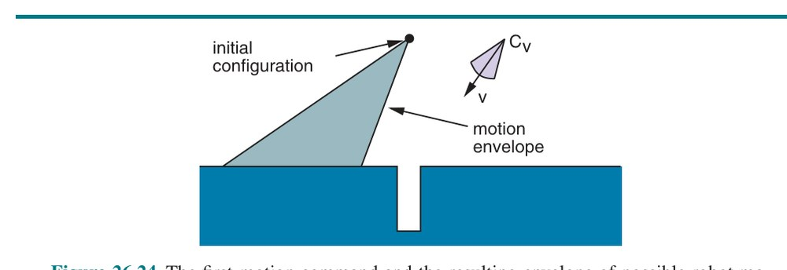

**شکل ۲۶.۲۴ — نخستین فرمانِ حرکت و پوششِ حاصل از حرکت‌های ممکنِ ربات. صرف‌نظر از حرکتِ واقعیِ پیش‌آمده، می‌دانیم پیکربندیِ نهایی در چپِ سوراخ خواهد بود.**

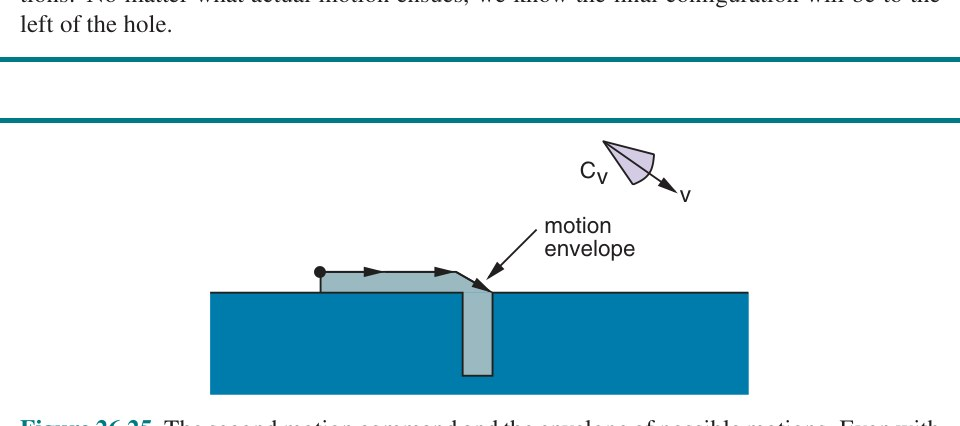

**شکل ۲۶.۲۵ — دومین فرمانِ حرکت و پوششِ حرکت‌های ممکن. حتی با خطا، در نهایت واردِ سوراخ خواهیم شد.**

فنونِ دیگرِ فراتر از حرکت‌های محافظت‌شده تابعِ هزینه را تغییر می‌دهند تا کنش‌هایی را که می‌دانیم به اطلاعات می‌انجامند ترغیب کنند—مانندِ «اکتشافیِ ناوبریِ ساحلی» (Coastal Navigation) که ربات را ملزم می‌کند نزدیکِ نقطه‌های نشانهٔ شناخته‌شده بماند. به‌طورِ کلی‌تر، فنون می‌توانند «بهرهٔ اطلاعاتِ موردانتظار» (کاهشِ آنتروپیِ باور) را به‌عنوانِ عبارتی در تابعِ هزینه بگنجانند، که به استدلالِ صریحِ ربات دربارهٔ اینکه هر کنش چه مقدارِ اطلاعاتی ممکن است بیاورد هنگامِ تصمیم‌گیری می‌انجامد. هرچند از نظرِ محاسباتی دشوارتر، چنین رویکردهایی این مزیت را دارند که ربات کنش‌های جمع‌آوریِ اطلاعاتِ خودش را ابداع می‌کند، به‌جای تکیه بر اکتشافی‌ها و راهبردهای اسکریپت‌شدهٔ ارائه‌شده توسط انسان که اغلب فاقدِ انعطاف‌اند.

## ۲۶.۷ یادگیریِ تقویتی در رباتیک

تاکنون تکلیف‌هایی را در نظر گرفته‌ایم که ربات در آن‌ها به مدلِ دینامیکِ جهان دسترسی دارد. در بسیاری از تکلیف‌ها، نوشتنِ چنین مدلی بسیار دشوار است، که ما را به قلمروِ یادگیریِ تقویتی (RL) می‌برد.

یکی از چالش‌های RL در رباتیک ماهیتِ پیوستهٔ فضاهای حالت و کنش است، که یا از طریقِ گسسته‌سازی، یا معمولاً بیشتر، از طریقِ تقریبِ تابع با آن سروکار داریم. سیاست‌ها یا توابعِ ارزش به‌عنوانِ ترکیب‌هایی از ویژگی‌های شناخته‌شدهٔ مفید، یا به‌عنوانِ شبکه‌های عصبیِ عمیق بازنمایی می‌شوند. شبکه‌های عصبی می‌توانند مستقیماً از ورودی‌های خام به خروجی‌ها نگاشت کنند، و بنابراین تا حدِ زیادی از نیاز به مهندسیِ ویژگی اجتناب می‌کنند، اما به دادهٔ بیشتری نیاز دارند.

چالشِ بزرگ‌تر این است که ربات‌ها در جهانِ واقعی عمل می‌کنند. دیده‌ایم چگونه یادگیریِ تقویتی را می‌توان برای یادگیریِ بازیِ شطرنج یا گو با بازیِ شبیه‌سازی‌شده استفاده کرد. اما وقتی رباتِ واقعی در جهانِ واقعی حرکت می‌کند، باید مطمئن شویم کنش‌هایش ایمن‌اند (چیزها می‌شکنند!)، و باید بپذیریم پیشرفت کندتر از شبیه‌سازی خواهد بود، زیرا جهان حاضر نیست سریع‌تر از یک ثانیه در ثانیه حرکت کند. بخشِ زیادی از آنچه در استفاده از یادگیریِ تقویتی در رباتیک جالب است به این خلاصه می‌شود که چگونه ممکن است «پیچیدگیِ نمونهٔ جهانِ واقعی»—تعدادِ برهم‌کنش‌های با جهانِ فیزیکی که ربات پیش از یادگیریِ نحوهٔ انجامِ تکلیف به آن نیاز دارد—را کاهش دهیم.


**شکل ۲۶.۲۶ — آموزشِ سیاستِ مقاوم. (الف) چندین شبیه‌سازی از دستِ رباتی که اشیا را دست‌کاری می‌کند، با پارامترهای تصادفی‌شدهٔ متفاوت برای فیزیک و نورپردازی، اجرا می‌شود. با اجازه از وویچک زارمبا. (ب) محیطِ جهانِ واقعی، با دستِ رباتیِ تکی در مرکزِ قفس، احاطه‌شده با دوربین‌ها و فاصله‌یاب‌ها. (ج) آموزشِ شبیه‌سازی و جهانِ واقعی سیاست‌های متفاوتِ متعددی برای گرفتنِ اشیا می‌دهد؛ در این‌جا یک گیرهٔ نیشگونی و یک گیرهٔ چهارپایه. با اجازه از OpenAI. آندری‌خویچ و همکاران (2018a) را ببینید.**

### ۲۶.۷.۱ بهره‌برداری از مدل‌ها

راهِ طبیعیِ اجتناب از نیاز به نمونه‌های جهانِ واقعیِ بسیار، استفاده از هرچه بیشترِ دانشِ دینامیکِ جهان است. برای نمونه، ممکن است دقیقاً ندانیم ضریبِ اصطکاک یا جرمِ شیء چیست، اما ممکن است معادله‌هایی داشته باشیم که دینامیک را به‌عنوانِ تابعی از این پارامترها توصیف می‌کنند.

در چنین حالتی، یادگیریِ تقویتیِ مبتنی بر مدل (فصل ۲۲) جذاب است، که ربات می‌تواند بینِ برازشِ پارامترهای دینامیک و محاسبهٔ سیاستِ بهتر تناوب کند. حتی اگر معادله‌ها نادرست باشند، زیرا در مدل‌کردنِ هر جزئیاتِ فیزیک ناکام‌اند، پژوهشگران با یادگیریِ عبارتِ خطایی، علاوه بر پارامترها، آزمایش کرده‌اند که می‌تواند نادقتیِ مدلِ فیزیکی را جبران کند. یا، می‌توانیم معادله‌ها را رها کنیم و در عوض مدل‌های محلیِ خطیِ جهان را برازش کنیم که هر یک دینامیک را در ناحیه‌ای از فضایِ حالت تقریب می‌زنند، رویکردی که در واداشتنِ ربات‌ها به تسلط بر تکلیف‌های دینامیکیِ پیچیده مانندِ ژانگولربازی موفق بوده.

مدلی از جهان همچنین می‌تواند در کاهشِ پیچیدگیِ نمونهٔ روش‌های یادگیریِ تقویتیِ بدونِ مدل با انجامِ «انتقالِ شبیه-به-واقعیت» (Sim-to-Real) مفید باشد: انتقالِ سیاست‌هایی که در شبیه‌سازی کار می‌کنند به جهانِ واقعی. ایده استفاده از مدل به‌عنوانِ شبیه‌ساز برای جستجویِ سیاست (بخش ۲۲.۵) است. برای یادگیریِ سیاستی که خوب انتقال می‌یابد، می‌توانیم در طولِ آموزش به مدل نویز اضافه کنیم، و سیاست را مقاوم‌تر کنیم. یا، می‌توانیم سیاست‌هایی آموزش دهیم که با انواعِ مدل‌ها کار می‌کنند، با نمونه‌برداری از پارامترهای متفاوت در شبیه‌سازی‌ها—که گاهی «تصادفی‌سازیِ حوزه» (Domain Randomization) نامیده می‌شود. نمونه‌ای در شکل ۲۶.۲۶ است، که در آن تکلیفِ دست‌کاریِ چابک با تغییرِ ویژگی‌های بصری، و همچنین ویژگی‌های فیزیکی مانندِ اصطکاک یا میراکنندگی، در شبیه‌سازی آموزش می‌بیند.

سرانجام، رویکردهای هیبریدی که از هر دوِ الگوریتم‌های مبتنی بر مدل و بدونِ مدل ایده وام می‌گیرند، قرار است بهترین هر دو را به ما بدهند. رویکردِ هیبریدی با معماریِ Dyna آغاز شد، که ایده در آن تناوب بینِ عمل‌کردن و بهبودِ سیاست بود، اما بهبودِ سیاست به دو شکلِ مکمل می‌آمد: (۱) راهِ استانداردِ بدونِ مدلِ استفاده از تجربه برای به‌روزرسانیِ مستقیمِ سیاست، و (۲) راهِ مبتنی بر مدلِ استفاده از تجربه برای برازشِ مدل، سپس برنامه‌ریزی با آن برای تولیدِ سیاست.

فنونِ جدیدتر با برازشِ مدل‌های محلی، برنامه‌ریزی با آن‌ها برای تولیدِ کنش‌ها، و استفاده از این کنش‌ها به‌عنوانِ نظارت برای برازشِ سیاست، سپس تکرار برای گرفتنِ مدل‌های بهتر و بهتر دورِ نواحی‌ای که سیاست نیاز دارد، آزمایش کرده‌اند. این با موفقیت در یادگیریِ سرتاسری اعمال شده، جایی که سیاست پیکسل‌ها را به‌عنوانِ ورودی می‌گیرد و مستقیماً گشتاورها را به‌عنوانِ کنش خروجی می‌دهد—نخستین نمایشِ یادگیریِ تقویتیِ عمیق رویِ ربات‌های فیزیکی را ممکن کرد.

مدل‌ها همچنین می‌توانند برای هدفِ تضمینِ کاوشِ ایمن بهره‌برداری شوند. یادگیریِ آهسته اما ایمن ممکن است بهتر از یادگیریِ سریع اما تصادف‌کردن و سوختن در نیمهٔ راه باشد. پس، به‌جرئت می‌توان گفت مهم‌تر از کاهشِ نمونه‌های جهانِ واقعی، کاهشِ نمونه‌های جهانِ واقعی در حالت‌های خطرناک است—نمی‌خواهیم ربات‌ها از صخره‌ها بیفتند، و نمی‌خواهیم لیوان‌های محبوب‌مان را بشکنند یا بدتر، با اشیا و مردم برخورد کنند. مدلِ تقریبی، با عدم‌قطعیتِ مرتبط (مثلاً با درنظرگرفتنِ دامنه‌ای از مقادیر برای پارامترهایش)، می‌تواند کاوش را هدایت کند و قیدهایی بر کنش‌هایی که ربات مجاز به گرفتنشان است اعمال کند تا از این حالت‌های خطرناک اجتناب شود. این حوزهٔ پژوهشیِ فعالی در رباتیک و کنترل است.

### ۲۶.۷.۲ بهره‌برداری از اطلاعاتِ دیگر

مدل‌ها مفیدند، اما کارِ بیشتری برای کاهشِ بیشترِ پیچیدگیِ نمونه می‌توانیم انجام دهیم. هنگامِ برپاکردنِ مسئلهٔ یادگیریِ تقویتی، باید فضاهای حالت و کنش، بازنماییِ سیاست یا تابعِ ارزش، و تابعِ پاداشی که استفاده می‌کنیم را انتخاب کنیم. این تصمیم‌ها اثرِ بزرگی بر اینکه مسئله را چقدر آسان یا دشوار می‌کنیم دارند.

یکی از رویکردها استفاده از «اولیه‌های حرکتِ» (Motion Primitive) سطح‌بالاتر به‌جای کنش‌های سطح‌پایین مانندِ فرمان‌های گشتاور است. اولیهٔ حرکتی مهارتِ پارامتریشده‌ای است که ربات دارد. برای نمونه، بازیکنِ فوتبالِ رباتیک ممکن است مهارتِ «پاسِ توپ به بازیکنِ در (x,y)» را داشته باشد. تنها کاری که سیاست باید بکند فهمیدنِ نحوهٔ ترکیبِ آن‌ها و تنظیمِ پارامترهایشان است، به‌جای ابداعِ دوبارهٔ آن‌ها. این رویکرد اغلب بسیار سریع‌تر از رویکردهای سطح‌پایین یاد می‌گیرد، اما فضایِ رفتارهای ممکنِ یادگیریِ ربات را محدود می‌کند.

راهِ دیگرِ کاهشِ تعدادِ نمونه‌های جهانِ واقعیِ لازم برای یادگیری، استفادهٔ مجدد از اطلاعاتِ دوره‌های یادگیریِ قبلی رویِ تکلیف‌های دیگر است، به‌جای شروع از صفر. این زیرِ چترِ «فرا-یادگیری» (Metalearning) یا یادگیریِ انتقالی قرار می‌گیرد.

سرانجام، مردم منبعِ عالیِ اطلاعات‌اند. در بخشِ بعدی، دربارهٔ نحوهٔ تعامل با مردم صحبت می‌کنیم، و بخشی از آن نحوهٔ استفاده از کنش‌هایشان برای هدایتِ یادگیریِ ربات است.

## ۲۶.۸ انسان‌ها و ربات‌ها

تاکنون، بر رباتی تمرکز کرده‌ایم که به‌صورتِ منزوی برنامه‌ریزی و یاد می‌گیرد چگونه عمل کند. این برای برخی ربات‌ها مفید است، مانندِ مریخ‌نوردهایی که به‌جایِ ما برای کاوشِ سیاراتِ دور می‌فرستیم. اما، در بیشترِ موارد، ربات‌ها را برای کارِ منزوی نمی‌سازیم. آن‌ها را برای کمک به ما و برای کار در محیط‌های انسانی، اطرافِ ما و با ما، می‌سازیم.

این دو چالشِ مکمل برمی‌انگیزد. نخست بهینه‌سازیِ پاداش وقتی مردم در همان محیطِ ربات عمل می‌کنند است. این را مسئلهٔ «هماهنگی» (Coordination) می‌نامیم (بخش ۱۸.۱ را ببینید). وقتی پاداشِ ربات نه فقط به کنش‌های خودش، بلکه به کنش‌هایی که مردم می‌گیرند بستگی دارد، ربات باید کنش‌هایش را به‌گونه‌ای انتخاب کند که با کنش‌های آن‌ها خوب جفت شود. وقتی انسان و ربات در همان تیم‌اند، این به همکاری تبدیل می‌شود.

دوم چالشِ بهینه‌سازیِ برای آنچه مردم واقعاً می‌خواهند است. اگر ربات قرار است به مردم کمک کند، تابعِ پاداشش باید کنش‌هایی را ترغیب کند که مردم می‌خواهند ربات اجرا کند. فهمیدنِ تابعِ پاداشِ درست (یا سیاستِ درست) برای ربات خودش مسئلهٔ تعاملی است. این دو چالش را به‌نوبت کاوش خواهیم کرد.

### ۲۶.۸.۱ هماهنگی

فعلاً فرض کنیم، چنان‌که تاکنون کرده‌ایم، ربات به تابعِ پاداشِ به‌وضوح تعریف‌شده‌ای دسترسی دارد. اما به‌جای نیاز به بهینه‌کردنِ آن به‌صورتِ منزوی، حالا ربات باید آن را دورِ انسانی که همچنین عمل می‌کند بهینه کند. برای نمونه، وقتی خودرویِ خودرانی در بزرگراه ادغام می‌شود، باید مانور را با رانندهٔ انسانیِ در حالِ آمدنِ خطِ هدف مذاکره کند—آیا باید شتاب بگیرد و جلو ادغام شود، یا کند کند و پشت‌سر ادغام شود؟ بعداً، وقتی به علامتِ ایست می‌کشد و برای گردش به راست آماده می‌شود، باید مراقبِ دوچرخه‌سوارِ خطِ دوچرخه و عابرِ پیاده‌ای که در آستانهٔ قدم‌گذاشتن به خطِّ عابر است باشد.

یا، رباتِ متحرکی در راهرو در نظر بگیر. کسی که مستقیم به سمتِ ربات می‌آید کمی به راست قدم می‌گذارد، که نشان می‌دهد می‌خواهد از کدام سمتِ ربات رد شود. ربات باید پاسخ دهد و نیاتش را روشن کند.

**انسان‌ها به‌عنوانِ عامل‌های تقریباً عقلایی:** یکی از راه‌های صورتبندیِ هماهنگی با انسان مدل‌کردنِ آن به‌عنوانِ بازی بینِ ربات و انسان است (بخش ۱۸.۲). با این رویکرد، به‌صورتِ صریح فرض می‌کنیم مردم عامل‌هایی‌اند که توسط هدف‌ها ترغیب می‌شوند. این به‌طورِ خودکار به این معنا نیست که آن‌ها عامل‌های کاملاً عقلایی‌اند (یعنی راه‌حل‌های بهینه در بازی می‌یابند)، اما به این معناست ربات می‌تواند شیوهٔ استدلال‌ش دربارهٔ انسان را از طریقِ مفهومِ هدف‌های ممکنِ انسان ساختار دهد. در این بازی:

- حالتِ محیط پیکربندی‌های هر دوِ عاملِ ربات و انسان را درمی‌گیرد؛ آن را x = (x_R, x_H) بنام؛
- هر عامل می‌تواند کنش بگیرد، به‌ترتیب u_R و u_H؛
- هر عامل هدفی دارد که می‌تواند به‌عنوانِ هزینهٔ J_R و J_H بازنمایی شود: هر عامل می‌خواهد ایمن و کارآمد به هدفش برسد؛
- و، مانندِ هر بازی، هر هدف به حالت و به کنش‌های هر دو عامل بستگی دارد: J_R(x, u_R, u_H) و J_H(x, u_H, u_R). به تعاملِ خودرو-عابر فکر کنید—اگر عابر رد شود خودرو باید بایستد، و اگر عابر منتظر بماند باید جلو برود.

سه جنبهٔ مهم این بازی را پیچیده می‌کند. نخست اینکه انسان و ربات لزوماً هدف‌های یکدیگر را نمی‌دانند. این آن را «بازیِ با اطلاعاتِ ناقص» (Incomplete Information Game) می‌کند. دوم اینکه فضاهای حالت و کنش پیوسته‌اند، چنان‌که در سراسرِ این فصل بوده‌اند. در فصل ۵ یاد گرفتیم چگونه جستجویِ درختی را برای بازی‌های گسسته انجام دهیم، اما چگونه با فضاهای پیوسته سروکار کنیم؟ سوم، حتی اگر در سطحِ بالا مدلِ بازی معنا بدهد—انسان‌ها حرکت می‌کنند و هدف دارند—رفتارِ انسان ممکن است همیشه به‌خوبی به‌عنوانِ راه‌حلِ بازی مشخص نشود. بازی با چالشِ محاسباتی نه فقط برای ربات، بلکه برای ما انسان‌ها نیز می‌آید. مستلزمِ فکرکردن دربارهٔ آنچه ربات در پاسخ به آنچه شخص انجام می‌دهد انجام خواهد داد است، که به آنچه ربات فکر می‌کند شخص انجام خواهد داد بستگی دارد، و خیلی زود به «تو فکر می‌کنی من فکر می‌کنم تو فکر می‌کنی من فکر می‌کنم» می‌رسیم—تا بی‌نهایت لاک‌پشت!

انسان‌ها نمی‌توانند با همهٔ این‌ها سروکار داشته باشند و زیربهینگی‌های خاصی نشان می‌دهند. این بدان‌معناست ربات باید این زیربهینگی‌ها را در نظر بگیرد.

پس، خودرویِ خودران وقتی مسئلهٔ هماهنگی این‌قدر سخت است چه باید بکند؟ کاری شبیهِ آنچه قبلاً در این فصل انجام داده‌ایم خواهیم کرد. برای برنامه‌ریزیِ حرکت و کنترل، MDP را گرفتیم و به برنامه‌ریزیِ مسیر و سپس دنبال‌کردنِ آن با کنترل‌گر شکستیم. این‌جا نیز، بازی را می‌گیریم و به ساختِ پیش‌بینی‌هایی دربارهٔ کنش‌های انسانی، و تصمیم‌گیری دربارهٔ آنچه ربات با توجه به این پیش‌بینی‌ها باید انجام دهد، می‌شکنیم.

**پیش‌بینیِ کنشِ انسانی:** پیش‌بینیِ کنش‌های انسانی سخت است، زیرا به کنش‌های ربات بستگی دارند و برعکس. یکی از ترفندهایی که ربات‌ها استفاده می‌کنند وانمودکردن به اینکه شخص ربات را نادیده می‌گیرد است. ربات فرض می‌کند مردم نسبت به هدف‌شان نویزی-بهینه‌اند، که برای ربات ناشناخته است و مدل می‌شود دیگر به کنش‌های ربات وابسته نیست: J_H(x, u_H). به‌طورِ خاص، هرچه مقدارِ کنش برای هدف بالاتر باشد (هزینه-تا-آینده کمتر)، احتمالِ گرفتنِ آن توسط انسان بیشتر است. ربات می‌تواند مدلی برای P(u_H | x, J_H) ایجاد کند، برای نمونه با تابعِ سافتمکسِ صفحهٔ ۸۱۱:

```
P(u_H | x, J_H) ∝ e^(−Q(x, u_H; J_H))    (26.8)
```

با Q(x, u_H; J_H) تابعِ ارزشِ Qِ متناظر با J_H (علامتِ منفی آن‌جاست، زیرا در رباتیک دوست داریم هزینه را کمینه کنیم، نه پاداش را بیشینه). توجه کنید ربات نه کنش‌های کاملاً بهینه فرض می‌کند، نه فرض می‌کند کنش‌ها بر مبنای استدلال دربارهٔ ربات انتخاب می‌شوند.

مسلح به این مدل، ربات از کنش‌های جاریِ انسان به‌عنوانِ شاهدِ J_H استفاده می‌کند. اگر مدلِ مشاهده‌ای برای نحوهٔ وابستگیِ کنش‌های انسانی به هدفِ انسان داشته باشیم، هر کنشِ انسانی را می‌توان برای به‌روزرسانیِ باورِ ربات دربارهٔ هدفِ شخص لحاظ کرد:

```
b′(J_H) ∝ b(J_H) P(u_H | x, J_H)    (26.9)
```

نمونه‌ای در شکل ۲۶.۲۷ است: ربات مکانِ انسانی را ردیابی می‌کند و با حرکتِ انسان، ربات باورش را رویِ هدف‌های انسانی به‌روزرسانی می‌کند. با حرکتِ انسان به سمتِ پنجره‌ها، ربات احتمالِ اینکه هدف نگاه‌کردن از پنجره باشد را افزایش و احتمالِ اینکه هدف رفتن به آشپزخانه، که در جهتِ دیگر است، باشد را کاهش می‌دهد. این‌گونه است که کنش‌های گذشتهٔ انسان در نهایت به ربات دربارهٔ آنچه انسان در آینده انجام خواهد داد اطلاع می‌دهند. داشتنِ باوری دربارهٔ هدفِ انسان به ربات کمک می‌کند پیش‌بینی کند انسان بعد چه کنش‌هایی خواهد گرفت. نقشهٔ گرماییِ شکل پیش‌بینی‌های آیندهٔ ربات را نشان می‌دهد: قرمز محتمل‌ترین و آبی کم‌محتمل‌ترین است.

![**شکل ۲۶.۲۷ — ساختِ پیش‌بینی‌ها با فرضِ اینکه مردم با توجه به هدف‌شان نویزی-عقلایی‌اند: ربات از کنش‌های گذشته برای به‌روزرسانیِ باوری دربارهٔ اینکه شخص به سمتِ چه هدفی می‌رود استفاده می‌کند، و سپس از باور برای ساختِ پیش‌بینی‌هایی دربارهٔ کنش‌های آینده. (الف) نقشهٔ اتاق. (ب) پیش‌بینی‌ها پس از دیدنِ بخشِ کوچکی از مسیرِ شخص (مسیرِ سفید)؛ (ج) پیش‌بینی‌ها پس از دیدنِ کنش‌های انسانیِ بیشتر: ربات اکنون می‌داند شخص به سمتِ راهرویِ چپ نمی‌رود، زیرا مسیرِ تاکنون‌طی‌شده اگر آن هدفِ شخص بود مسیرِ ضعیفی می‌بود. تصاویر با اجازه از برایان دی. زیبارت. زیبارت و همکاران (2009) را ببینید.**](../figures/ch26/fig-26-27.jpg)

**شکل ۲۶.۲۷ — ساختِ پیش‌بینی‌ها با فرضِ اینکه مردم با توجه به هدف‌شان نویزی-عقلایی‌اند: ربات از کنش‌های گذشته برای به‌روزرسانیِ باوری دربارهٔ اینکه شخص به سمتِ چه هدفی می‌رود استفاده می‌کند، و سپس از باور برای ساختِ پیش‌بینی‌هایی دربارهٔ کنش‌های آینده. (الف) نقشهٔ اتاق. (ب) پیش‌بینی‌ها پس از دیدنِ بخشِ کوچکی از مسیرِ شخص (مسیرِ سفید)؛ (ج) پیش‌بینی‌ها پس از دیدنِ کنش‌های انسانیِ بیشتر: ربات اکنون می‌داند شخص به سمتِ راهرویِ چپ نمی‌رود، زیرا مسیرِ تاکنون‌طی‌شده اگر آن هدفِ شخص بود مسیرِ ضعیفی می‌بود. تصاویر با اجازه از برایان دی. زیبارت. زیبارت و همکاران (2009) را ببینید.**

همین می‌تواند در رانندگی رخ دهد. ممکن است ندانیم رانندهٔ دیگر چقدر برای کارایی ارزش قائل است، اما اگر ببینیم وقتی کسی می‌خواهد جلوش ادغام شود شتاب می‌گیرد، حالا کمی بیشتر درباره‌اش می‌دانیم. و وقتی آن را بدانیم، بهتر می‌توانیم پیش‌بینی کنیم در آینده چه خواهد کرد—همان راننده به احتمالِ زیاد به ما نزدیک‌تر می‌آید یا برای جلوافتادن در ترافیک زیگزاگ می‌رود.

وقتی ربات می‌تواند پیش‌بینی‌هایی دربارهٔ کنش‌های آیندهٔ انسان بسازد، مسئله‌اش را به حلِ MDP کاهش داده است. کنش‌های انسانی تابعِ انتقال را پیچیده می‌کنند، اما تا وقتی ربات می‌تواند پیش‌بینی کند شخص از هر حالتِ آینده چه کنشی خواهد گرفت، ربات می‌تواند P(x′ | x, u_R) را محاسبه کند: می‌تواند P(u_H | x) را از P(u_H | x, J_H) با حذفِ J_H محاسبه کند، و آن را با P(x′ | x, u_R, u_H)، تابعِ انتقال (دینامیک) برای نحوهٔ به‌روزرسانیِ جهان بر مبنای هر دوِ کنشِ ربات و انسان، ترکیب کند. در بخش ۲۶.۵ بر حلِ این در فضاهای حالت و کنشِ پیوسته برای دینامیکِ قطعی تمرکز کردیم، و در بخش ۲۶.۶ انجامش را با دینامیکِ تصادفی و عدم‌قطعیت بحث کردیم.

جداسازیِ پیش‌بینی از کنش، رسیدگیِ ربات به تعامل را آسان‌تر می‌کند، اما همان‌گونه که جداسازیِ تخمین از حرکت، یا جداسازیِ برنامه‌ریزی از کنترل، عملکرد را قربانی می‌کند. رباتی با این جداسازی دیگر نمی‌فهمد کنش‌هایش می‌توانند بر آنچه مردم در نهایت انجام می‌دهند اثر بگذارند. در مقابل، رباتِ شکل ۲۶.۲۷ پیش‌بینی می‌کند مردم به کجا می‌روند و سپس برای رسیدن به هدفِ خودش و اجتناب از برخورد با آن‌ها بهینه می‌کند. در شکل ۲۶.۲۸، خودرویِ خودرانی داریم که در بزرگراه ادغام می‌شود. اگر فقط در واکنش به خودروهای دیگر برنامه‌ریزی می‌کرد، ممکن بود مدتِ طولانی منتظر بماند در حالی که خودروهای دیگر خطِّ هدفش را اشغال می‌کنند. در مقابل، خودرویی که دربارهٔ پیش‌بینی و کنش به‌صورتِ مشترک استدلال می‌کند می‌داند کنش‌های متفاوتی که می‌تواند بگیرد به واکنش‌های متفاوتی از انسان می‌انجامند. اگر شروع به ابرازِ خودش کند، خودروهای دیگر احتمالاً کمی کند می‌کنند و جا باز می‌کنند. رباتیست‌ها به سمتِ تعاملاتِ هماهنگِ این‌چنینی کار می‌کنند تا ربات‌ها بهتر با انسان‌ها کار کنند.

![**شکل ۲۶.۲۸ — (الف) چپ: خودرویِ خودران (خطِّ میانی) پیش‌بینی می‌کند رانندهٔ انسانی (خطِّ چپ) می‌خواهد به جلو ادامه دهد، و مسیری را برنامه‌ریزی می‌کند که کند می‌کند و پشت‌سر ادغام می‌شود. راست: خودرو اثرِ کنش‌هایش بر کنش‌های انسانی را در نظر می‌گیرد و درمی‌یابد می‌تواند جلو ادغام شود و به رانندهٔ انسانی تکیه کند که کند کند. (ب) همان الگوریتم راهبردِ غیرعادی در تقاطع تولید می‌کند: خودرو درمی‌یابد می‌تواند محتمل‌تر کند شخص (پایین) سریع‌تر از تقاطع عبور کند با شروعِ عقب‌زدنِ آهسته. تصاویر با اجازه از آنکا دراگان. صدیق و همکاران (2016) را ببینید.**](../figures/ch26/fig-26-28.jpg)

**شکل ۲۶.۲۸ — (الف) چپ: خودرویِ خودران (خطِّ میانی) پیش‌بینی می‌کند رانندهٔ انسانی (خطِّ چپ) می‌خواهد به جلو ادامه دهد، و مسیری را برنامه‌ریزی می‌کند که کند می‌کند و پشت‌سر ادغام می‌شود. راست: خودرو اثرِ کنش‌هایش بر کنش‌های انسانی را در نظر می‌گیرد و درمی‌یابد می‌تواند جلو ادغام شود و به رانندهٔ انسانی تکیه کند که کند کند. (ب) همان الگوریتم راهبردِ غیرعادی در تقاطع تولید می‌کند: خودرو درمی‌یابد می‌تواند محتمل‌تر کند شخص (پایین) سریع‌تر از تقاطع عبور کند با شروعِ عقب‌زدنِ آهسته. تصاویر با اجازه از آنکا دراگان. صدیق و همکاران (2016) را ببینید.**

**پیش‌بینی‌های انسانی دربارهٔ ربات:** اطلاعاتِ ناقص اغلب دوجانبه است: ربات هدفِ انسان را نمی‌داند و انسان، به‌نوبهٔ خود، هدفِ ربات را نمی‌داند—مردم باید دربارهٔ ربات‌ها پیش‌بینی کنند. به‌عنوانِ طراحانِ ربات، مسئولِ نحوهٔ پیش‌بینیِ انسان نیستیم؛ فقط می‌توانیم آنچه ربات انجام می‌دهد را کنترل کنیم. با این حال، ربات می‌تواند به‌گونه‌ای عمل کند که برای انسان پیش‌بینیِ درست آسان‌تر شود. ربات می‌تواند فرض کند انسان از چیزی تقریباً مشابهِ معادلهٔ (26.8) برای برآوردِ هدفِ رباتِ J_R استفاده می‌کند، و بنابراین ربات طوری عمل می‌کند که هدفِ واقعی‌اش به‌راحتی قابلِ استنتاج باشد.

حالتِ خاصِ بازی وقتی است که انسان و ربات در همان تیم‌اند، به سمتِ همان هدف یا هدفِ مشترک کار می‌کنند: J_H = J_R. تصور کنید رباتِ خانگیِ شخصی‌ای دارید که به شما در آماده‌کردنِ شام یا تمیزکردن کمک می‌کند—این‌ها مثال‌هایی از همکاری‌اند. حالا می‌توانیم «عاملِ مشترک» (Joint Agent) تعریف کنیم که کنش‌هایش دوتایی‌های کنشِ انسان-ربات، (u_H, u_R)، هستند و برای J_H(x, u_H, u_R) = J_R(x, u_R, u_H) بهینه می‌کند، و مسئلهٔ برنامه‌ریزیِ معمولی را حل می‌کنیم. برنامه یا سیاستِ بهینه را برای عاملِ مشترک محاسبه می‌کنیم، و والا، حالا می‌دانیم ربات و انسان باید چه کنند.

این اگر مردم کاملاً بهینه بودند واقعاً خوب کار می‌کرد. ربات سهمِ خودش از برنامهٔ مشترک را انجام می‌داد، انسان سهمِ خودش را. متأسفانه، در عمل، مردم به نظر نمی‌رسد از برنامهٔ کاملاً چیده‌شدهٔ عاملِ مشترک پیروی کنند؛ آن‌ها ذهنِ خودشان را دارند! قبلاً یک راهِ مدیریتِ این را یاد گرفته‌ایم، در بخش ۲۶.۶. آن را کنترلِ پیش‌بینِ مدل (MPC) نامیدیم: ایده ارائهٔ برنامه، اجرایِ نخستین کنش، و سپس بازبرنامه‌ریزی بود. به آن‌شیوه، ربات همیشه برنامه‌اش را با آنچه انسان واقعاً انجام می‌دهد سازگار می‌کند.

بیایید مثالی را کار کنیم. فرض کنید شما و ربات در آشپزخانه‌اید و تصمیم گرفته‌اید وافل درست کنید. شما کمی به یخچال نزدیک‌ترید، پس برنامهٔ مشترکِ بهینه این بود که شما تخم‌مرغ و شیر را از یخچال بردارید، در حالی که ربات آرد را از کابینت می‌آورد. ربات این را می‌داند، زیرا می‌تواند کاملاً دقیق اندازه بگیرد همه کجا هستند. اما فرض کنید شما شروع به رفتن به سمتِ کابینتِ آرد می‌کنید. شما بر خلافِ برنامهٔ مشترکِ بهینه می‌روید. به‌جای چسبیدن به آن و سرسختانه رفتنِ ربات نیز به سمتِ آرد، رباتِ MPC برنامهٔ بهینه را دوباره محاسبه می‌کند، و حالا که شما به اندازهٔ کافی به آرد نزدیکید، بهترین کار برای ربات این است که وافل‌ساز را بردارد. اگر بدانیم مردم ممکن است از بهینگی منحرف شوند، می‌توانیم از قبل آن را در نظر بگیریم.

در مثالِ ما، ربات می‌تواند بکوشد پیش‌بینی کند شما همان لحظه که نخستین قدم را برمی‌دارید به سمتِ آرد می‌روید (مثلاً، با فنِ پیش‌بینیِ بالا). حتی اگر از نظرِ فنی هنوز برای شما بهینه باشد برگردید و به سمتِ یخچال بروید، ربات نباید فرض کند این چیزی است که رخ خواهد داد. در عوض، ربات می‌تواند برنامه‌ای محاسبه کند که در آن شما همان کاری را ادامه می‌دهید که به نظر می‌رسد می‌خواهید.

**انسان‌ها به‌عنوانِ عامل‌های جعبهٔ سیاه:** برای هماهنگ‌کردنِ ربات‌ها با ما، لازم نیست مردم را عامل‌های هدف‌محور و عمدی درمان کنیم. مدلِ جایگزین این است که انسان صرفاً عاملی است که سیاستِ π_H اش با دینامیکِ محیط «ور می‌رود». ربات π_H را نمی‌داند، اما می‌تواند مسئله را به‌عنوانِ نیاز به عمل‌کردن در MDP با دینامیکِ ناشناخته مدل کند. این را قبلاً دیده‌ایم: برای عامل‌های عمومی در فصل ۲۲، و برای ربات‌ها به‌طورِ خاص در بخش ۲۶.۷.

ربات می‌تواند مدلِ سیاستِ π_H را به دادهٔ انسانی برازش کند و از آن برای محاسبهٔ سیاستِ بهینه برای خودش استفاده کند. به‌دلیلِ کمبودِ داده، این تاکنون بیشتر در سطحِ تکلیف استفاده شده. برای نمونه، ربات‌ها از طریقِ تعامل یاد گرفته‌اند مردم چه کنش‌هایی تمایل به گرفتن دارند (در پاسخ به کنش‌های خودش) برای تکلیفِ قراردادن و پیچ‌کردنِ پیچ‌ها در تکلیفِ مونتاژِ صنعتی.

سپس جایگزینِ یادگیریِ تقویتیِ بدونِ مدل نیز هست: ربات می‌تواند با سیاست یا تابعِ ارزشِ اولیه‌ای شروع کند و در طولِ زمان با آزمون و خطا آن را بهبود دهد.

### ۲۶.۸.۲ یادگیریِ انجامِ آنچه انسان‌ها می‌خواهند

راهِ دیگرِ ورودِ تعامل با انسان به رباتیک در خودِ J_R است—تابعِ هزینه یا پاداشِ ربات. چارچوبِ عامل‌های عقلایی و الگوریتم‌های وابسته، مسئلهٔ تولیدِ رفتارِ خوب را به مشخص‌کردنِ تابعِ پاداشِ خوب کاهش می‌دهند. اما برای ربات‌ها، مانندِ بسیاری از عامل‌های هوش مصنوعیِ دیگر، درست‌کردنِ هزینه همچنان دشوار است.

خودروهای خودران را بگیرید: می‌خواهیم به مقصد برسند، ایمن باشند، برای مسافرانشان راحت رانندگی کنند، قوانینِ راهنمایی را رعایت کنند و... طراحِ چنین سامانه‌ای باید این مؤلفه‌های متفاوتِ تابعِ هزینه را با هم مبادله کند. کارِ طراح سخت است، زیرا ربات‌ها برای کمک به کاربرانِ نهایی ساخته می‌شوند، و هر کاربرِ نهایی یکسان نیست. همهٔ ما ترجیح‌های متفاوتی برای اینکه چقدر تهاجمی بخواهیم خودروی‌مان رانندگی کند داریم و...

در زیر، دو جایگزین برای تلاشِ هماهنگ‌کردنِ رفتارِ ربات با آنچه واقعاً می‌خواهیم ربات انجام دهد کاوش می‌کنیم. نخستین یادگیریِ تابعِ هزینه از ورودیِ انسانی است. دومین دورزدنِ تابعِ هزینه و تقلیدِ نمایش‌های انسانیِ تکلیف است.

**یادگیریِ ترجیح: یادگیریِ توابعِ هزینه:** تصور کنید کاربرِ نهایی به ربات نشان می‌دهد چگونه تکلیفی را انجام دهد. برای نمونه، آن‌ها خودرو را به‌شیوه‌ای می‌رانند که دوست دارند ربات آن را براند. آیا می‌توانید راهی بیندیشید که ربات از این کنش‌ها—آن‌ها را «نمایش» (Demonstration) می‌نامیم—برای فهمیدنِ اینکه چه تابعِ هزینه‌ای باید بهینه کند استفاده کند؟


**شکل ۲۶.۲۹ — چپ: به رباتِ متحرکی نمایشی نشان داده می‌شود که رویِ جادهٔ خاکی می‌ماند. وسط: ربات تابعِ هزینهٔ مطلوب را استنتاج می‌کند و در صحنهٔ تازه از آن استفاده می‌کند، و می‌داند هزینهٔ کمتری رویِ جادهٔ آن‌جا بگذارد. راست: ربات مسیری برای صحنهٔ تازه برنامه‌ریزی می‌کند که همچنین رویِ جاده می‌ماند، و ترجیح‌های پشتِ نمایش را بازتولید می‌کند. تصاویر با اجازه از ناتان راتلیف و جیمز ای. باگنل. راتلیف و همکاران (2006) را ببینید.**

در واقع قبلاً پاسخِ این را در بخش ۲۶.۸.۱ دیده‌ایم. آن‌جا، چیدمان کمی متفاوت بود: شخصِ دیگری کنش‌هایی در همان فضایِ ربات می‌گرفت و ربات باید پیش‌بینی می‌کرد شخص چه خواهد کرد. اما یکی از فنونِ ساختِ این پیش‌بینی‌ها فرضِ این بود که مردم برای بهینه‌کردنِ نویزیِ تابعِ هزینهٔ J_H عمل می‌کنند، و می‌توانیم از کنش‌های جاری‌شان به‌عنوانِ شاهدِ اینکه آن تابعِ هزینه چیست استفاده کنیم. می‌توانیم همین را این‌جا انجام دهیم، فقط نه برای هدفِ پیش‌بینیِ رفتارِ انسانی در آینده، بلکه برای کسبِ تابعِ هزینه‌ای که خودِ ربات باید بهینه کند. اگر شخص دفاعی رانندگی کند، تابعِ هزینه‌ای که کنش‌هایش را تبیین می‌کند وزنِ زیادی رویِ ایمنی و وزنِ کمتری رویِ کارایی می‌گذارد. ربات می‌تواند این تابعِ هزینه را به‌عنوانِ تابعِ خودش بپذیرد و هنگامِ رانندگیِ خودش آن را بهینه کند. رباتیست‌ها با الگوریتم‌های متفاوتی برای محاسباتاً قابلِ‌مدیریت‌کردنِ این استنتاجِ هزینه آزمایش کرده‌اند. در شکل ۲۶.۲۹، نمونه‌ای از آموزشِ ربات برای ترجیحِ ماندنِ رویِ جاده بر رفتن رویِ زمینِ چمنی می‌بینیم. به‌طورِ سنتی در چنین روش‌هایی، تابعِ هزینه به‌عنوانِ ترکیبی از ویژگی‌های دست‌ساخته بازنمایی می‌شده، اما کارِ اخیر همچنین نحوهٔ بازنماییِ آن با شبکهٔ عصبیِ عمیق، بدونِ مهندسیِ ویژگی، را مطالعه کرده.

راه‌های دیگری نیز برای ارائهٔ ورودی توسط شخص هست. شخص می‌تواند به‌جای نمایش، از زبان برای آموزشِ ربات استفاده کند. شخص می‌تواند به‌عنوانِ منتقد عمل کند، ربات را در حالِ انجامِ تکلیف به یک شیوه (یا دو شیوه) تماشا کند و سپس بگوید تکلیف چقدر خوب انجام شده (یا کدام شیوه بهتر بود)، یا توصیه‌ای برای بهبود بدهد.

**یادگیریِ مستقیمِ سیاست‌ها از طریقِ تقلید:** جایگزین دورزدنِ توابعِ هزینه و یادگیریِ مستقیمِ سیاستِ مطلوبِ ربات است. در مثالِ خودرویِ ما، نمایش‌های انسانی مجموعهٔ دادهٔ مناسبی از حالت‌های برچسب‌خورده با کنشی که ربات باید در هر حالت بگیرد می‌سازند: D = {(xᵢ, uᵢ)}. ربات می‌تواند یادگیریِ نظارت‌شده را برای برازشِ سیاستِ π : x ↦ u اجرا کند و آن سیاست را اجرا کند. این «یادگیریِ تقلیدی» (Imitation Learning) یا «همتاسازیِ رفتاری» (Behavioral Cloning) نامیده می‌شود.

چالشِ این رویکرد در «تعمیم» (Generalization) به حالت‌های تازه است. ربات نمی‌داند چرا کنش‌های پایگاهِ داده‌اش به‌عنوانِ بهینه علامت خورده‌اند. قاعدهٔ علّی ندارد؛ تنها کاری که می‌تواند بکند اجرایِ الگوریتمِ یادگیریِ نظارت‌شده برای تلاشِ یادگیریِ سیاستی است که به حالت‌های ناشناخته تعمیم می‌یابد. با این حال، هیچ تضمینی نیست تعمیم درست باشد.


**شکل ۲۶.۳۰ — معلمِ انسانی ربات را به پایین هل می‌دهد تا به آن بیاموزد نزدیک‌تر به میز بماند. ربات به‌طورِ مناسب فهمِ خود را از تابعِ هزینهٔ مطلوب به‌روزرسانی می‌کند و شروع به بهینه‌کردنِ آن می‌کند. با اجازه از آنکا دراگان. باجسی و همکاران (2017) را ببینید.**

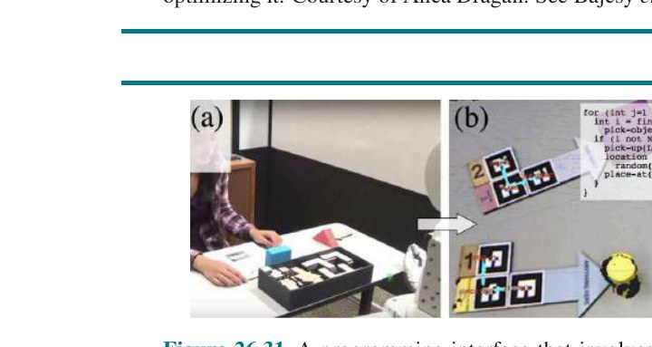

**شکل ۲۶.۳۱ — رابطِ برنامه‌نویسی که شاملِ قراردادنِ بلوک‌های خاص‌طراحی‌شده در فضایِ کارِ ربات برای انتخابِ اشیا و مشخص‌کردنِ کنش‌های سطح‌بالاست. تصاویر با اجازه از مایا چاکماک. صدیق‌گر و همکاران (2017) را ببینید.**

پروژهٔ خودرویِ خودرانِ ALVINN از این رویکرد استفاده کرد و دریافت حتی وقتی از حالتی در D شروع می‌شود، π خطاهای کوچکی خواهد کرد، که خودرو را از مسیرِ نمایش‌داده‌شده دور می‌کند. آن‌جا، π خطایِ بزرگ‌تری خواهد کرد، که خودرو را حتی بیشتر از مسیرِ مطلوب دور می‌کند. می‌توانیم در زمانِ آموزش به این بپردازیم اگر جمع‌آوریِ برچسب‌ها و یادگیری را در هم بیامیزیم: با نمایشی شروع کن، سیاستی یاد بگیر، سپس آن سیاست را اجرا کن و از انسان بخواه در هر حالتِ مسیر چه کنشی بگیرد، سپس تکرار کن. ربات سپس یاد می‌گیرد چگونه اشتباه‌هایش را هنگامِ انحراف از کنش‌های مطلوبِ انسانی تصحیح کند.

یا، می‌توانیم با بهره‌برداری از یادگیریِ تقویتی به آن بپردازیم. ربات می‌تواند مدلِ دینامیکی بر مبنای نمایش‌ها برازش کند، و سپس از کنترلِ بهینه (بخش ۲۶.۵.۴) برای تولیدِ سیاستی که برای نزدیک‌ماندن به نمایش بهینه می‌کند استفاده کند. نسخه‌ای از این برای انجامِ مانورهای بسیار چالش‌برانگیز در سطحِ خبره در هلیکوپترِ کوچکِ کنترلِ رادیویی استفاده شده (شکل ۲۲.۹ (ب) را ببینید).

سامانهٔ DAGGER (تجمیعِ داده) با نمایشِ کارشناسِ انسانی شروع می‌کند. از آن سیاستِ π₁ یاد می‌گیرد و از سیاست برای تولیدِ مجموعهٔ دادهٔ D استفاده می‌کند. سپس از D سیاستِ تازهٔ π₂ تولید می‌کند که بهترین تقلید از دادهٔ انسانیِ اصلی است. این تکرار می‌شود، و در nاُمین تکرار از π_n برای تولیدِ دادهٔ بیشتر، که به D اضافه می‌شود و سپس برای ایجادِ π_{n+1} استفاده می‌شود، استفاده می‌کند. به بیانِ دیگر، در هر تکرار سامانه تحتِ سیاستِ کنونی دادهٔ تازه جمع می‌کند و سیاستِ بعدی را با همهٔ داده‌های جمع‌آوری‌شده تاکنون آموزش می‌دهد.

فنونِ اخیرِ مرتبط از آموزشِ تخاصمی استفاده می‌کنند: بینِ آموزشِ رده‌بندی برای تمایزِ سیاستِ آموخته‌شدهٔ ربات از نمایش‌های انسانی، و آموزشِ سیاستِ رباتیِ تازه از طریقِ یادگیریِ تقویتی برای فریبِ رده‌بند، تناوب می‌کنند. این پیشرفت‌ها ربات را قادر می‌کنند حالت‌های نزدیکِ نمایش‌ها را مدیریت کند، اما تعمیم به حالت‌های دور یا به دینامیکِ تازه کارِ در حالِ پیشرفت است.

**رابط‌های آموزش و مسئلهٔ تناظر.** تاکنون، حالتِ خودرویِ خودران یا هلیکوپترِ خودمختار را تصور کرده‌ایم، که نمایش‌های انسانی در آن‌ها از همان کنش‌هایی استفاده می‌کنند که ربات خودش می‌تواند بگیرد: شتاب‌دادن، ترمزکردن و فرمان‌دادن. اما اگر این کار را برای تکلیف‌هایی مانندِ تمیزکردنِ میزِ آشپزخانه انجام دهیم چه اتفاقی می‌افتد؟ این‌جا دو انتخاب داریم: یا شخص با بدنِ خودش نمایش می‌دهد در حالی که ربات تماشا می‌کند، یا شخص به‌صورتِ فیزیکی اثرگذارهای ربات را هدایت می‌کند.

رویکردِ نخست جذاب است، زیرا برای کاربرانِ نهایی طبیعی می‌آید. متأسفانه، از «مسئلهٔ تناظر» (Correspondence Problem) رنج می‌برد: چگونه کنش‌های انسانی را رویِ کنش‌های ربات نگاشت کنیم. مردم سینماتیک و دینامیکِ متفاوتی از ربات‌ها دارند. نه‌تنها این ترجمه یا بازهدف‌گذاریِ حرکتِ انسانی به حرکتِ ربات را دشوار می‌کند (مثلاً، بازهدف‌گذاریِ گیرهٔ پنج‌انگشتیِ انسانی به گیرهٔ دو-انگشتیِ ربات)، بلکه اغلب راهبردِ سطح‌بالایی که شخص ممکن است استفاده کند برای ربات مناسب نیست.

رویکردِ دوم، که معلمِ انسانی اثرگذارهای ربات را به موقعیت‌های درست حرکت می‌دهد، «آموزشِ حرکتی» (Kinesthetic Teaching) نامیده می‌شود. آموزشِ این‌گونه برای انسان‌ها آسان نیست، به‌ویژه آموزشِ ربات‌های با مفصل‌های متعدد. معلم باید همهٔ درجه‌های آزادی را هنگامِ هدایتِ بازو در طولِ تکلیف هماهنگ کند. پژوهشگران پس از آن جایگزین‌هایی بررسی کرده‌اند، مانندِ نمایشِ «فریم‌های کلیدی» (Keyframe) به‌جای مسیرهای پیوسته، و همچنین استفاده از «برنامه‌نویسیِ بصری» (Visual Programming) تا کاربرانِ نهایی بتوانند اولیه‌های تکلیف را برنامه‌نویسی کنند به‌جای نمایشِ از صفر (شکل ۲۶.۳۱). گاهی هر دو رویکرد ترکیب می‌شوند.

## ۲۶.۹ چارچوب‌های رباتیکِ جایگزین

تاکنون، دیدگاهی از رباتیک گرفته‌ایم که بر مفهومِ تعریف یا یادگیریِ تابعِ پاداش و بهینه‌کردنِ آن تابعِ پاداش توسط ربات (چه از طریقِ برنامه‌ریزی چه یادگیری)، گاهی در هماهنگی یا همکاری با انسان‌ها، مبتنی است. این دیدگاهِ «تعمقمحور» (Deliberative) از رباتیک است، که باید با دیدگاهِ واکنشی در تقابل قرار گیرد.

### ۲۶.۹.۱ کنترل‌گرهای واکنشی

در برخی موارد، برپاکردنِ سیاستِ خوب برای ربات آسان‌تر از مدل‌کردنِ جهان و برنامه‌ریزی است. آنگاه، به‌جای عاملِ عقلایی، عاملِ بازتابی داریم.

برای نمونه، رباتِ پاداری را تصور کنید که می‌کوشد پایش را از رویِ مانعی بلند کند. می‌توانستیم به این ربات قاعده‌ای بدهیم که بگوید پا را به ارتفاعِ کوچکِ h بلند کن و به جلو حرکت بده، و اگر پا با مانعی برخورد کرد، آن را به عقب برگردان و با ارتفاعِ بالاتر از نو شروع کن. می‌توانید بگویید h جنبه‌ای از جهان را مدل می‌کند، اما همچنین می‌توانیم به h به‌عنوانِ متغیرِ کمکیِ کنترل‌گرِ ربات فکر کنیم، عاری از معنایِ فیزیکیِ مستقیم.

یکی از این‌گونه نمونه‌ها رباتِ شش‌پا (هگزاپاد) است که در شکل ۲۶.۳۲ (الف) نشان داده شده، طراحی‌شده برای راه‌رفتن در زمینِ ناهموار. حس‌گذارهای ربات برای به‌دست‌آوردنِ مدل‌های دقیقِ زمین برای برنامه‌ریزیِ مسیر ناکافی‌اند. افزون بر این، حتی اگر دوربین‌ها و فاصله‌یاب‌های دقیق اضافه می‌کردیم، ۱۲ درجهٔ آزادی (دو برای هر پا) مسئلهٔ برنامه‌ریزیِ مسیرِ حاصل را از نظرِ محاسباتی دشوار می‌کرد.

با این حال، امکانِ مشخص‌کردنِ مستقیمِ کنترل‌گر بدونِ مدلِ صریحِ محیط هست. (این را قبلاً با کنترل‌گرِ PD دیده‌ایم، که می‌توانست بازویِ رباتیکِ پیچیده را بدونِ مدلِ صریحِ دینامیکِ ربات رویِ هدف نگه دارد.) برای رباتِ هگزاپاد نخست «الگویِ گام» (Gait)، یا الگویِ حرکتِ اندام‌ها، را انتخاب می‌کنیم. یکی از الگوهایِ گامِ ایستاییِ پایدار این است که نخست پایِ راستِ جلو، پایِ راستِ عقب و پایِ وسطِ چپ را به جلو حرکت دهیم (و سه‌تای دیگر را ثابت نگه داریم)، و سپس سه‌تای دیگر را حرکت دهیم. این الگویِ گام در زمینِ تخت خوب کار می‌کند. در زمینِ ناهموار، موانع ممکن است مانعِ تاب‌خوردنِ پایِ رو به جلو شوند. این مشکل را می‌توان با قاعدهٔ کنترلِ فوق‌العاده ساده‌ای غلبه کرد: وقتی حرکتِ رو به جلوی پا مسدود است، صرفاً آن را جمع کن، بالاتر ببر و دوباره تلاش کن. کنترل‌گرِ حاصل در شکل ۲۶.۳۲ (ب) به‌صورتِ ماشینِ حالتِ متناهیِ ساده‌ای نشان داده شده؛ عاملِ بازتابیِ با حالت است، که حالتِ درونی با شاخصِ حالتِ ماشینِ کنونی (s₁ تا s₄) بازنمایی می‌شود.


**شکل ۲۶.۳۲ — (الف) گنگیس (Genghis)، رباتِ هگزاپاد. (تصویر با اجازه از رادنی ای. بروکس.) (ب) ماشینِ حالتِ متناهیِ افزوده‌شده (AFSM) که یک پا را کنترل می‌کند. AFSM به بازخوردِ حس‌گذار واکنش نشان می‌دهد: اگر پایی در طولِ فازِ تابِ رو به جلو گیر کند، بالاتر و بالاتر بلند می‌شود.**

### ۲۶.۹.۲ معماریِ جذب

«معماریِ جذب» (Subsumption Architecture) (بروکس، 1986) چارچوبی برای مونتاژِ کنترل‌گرهای واکنشی از ماشین‌های حالتِ متناهی است. گره‌های این ماشین‌ها ممکن است شاملِ آزمون‌هایی برای برخی متغیرهای حس‌گذار باشند، که در آن صورت دنبالهٔ اجرایِ ماشینِ حالتِ متناهی بر پیامدِ چنین آزمونی شرطی است. کمان‌ها را می‌توان با پیام‌هایی برچسب‌گذاری کرد که هنگامِ عبور از آن‌ها تولید و به موتورهای ربات یا به ماشین‌های حالتِ متناهیِ دیگر فرستاده می‌شوند. علاوه بر این، ماشین‌های حالتِ متناهی «ساعت‌سنج»های (Clock) درونی دارند که زمانِ عبور از کمان را کنترل می‌کنند. ماشین‌های حاصل «ماشین‌های حالتِ متناهیِ افزوده‌شده» (Augmented Finite State Machine یا AFSM) نامیده می‌شوند، که افزوده به استفاده از ساعت‌سنج‌ها اشاره دارد.

نمونه‌ای از AFSM ساده همان ماشینِ چهارحالته‌ای است که همین حالا درباره‌اش صحبت کردیم، نشان‌داده‌شده در شکل ۲۶.۳۲ (ب). این AFSM کنترل‌گرِ چرخه‌ای را پیاده‌سازی می‌کند، که اجرایش بیشتر به بازخوردِ محیطی وابسته نیست. با این حال، فازِ تابِ رو به جلو به بازخوردِ حس‌گذار وابسته است. اگر پا گیر کند، یعنی در اجرایِ تابِ رو به جلو ناکام مانده، ربات پا را جمع می‌کند، کمی بالاتر می‌برد و بارِ دیگر تلاش می‌کند تابِ رو به جلو را اجرا کند. پس، کنترل‌گر قادر به واکنش به پیشامدهای ناشی از تعاملِ ربات و محیطش است. معماریِ جذب اجزای اضافی برای همگام‌سازیِ AFSMها و برای ترکیبِ مقادیرِ خروجیِ چند AFSMِ احتمالاً متعارض ارائه می‌دهد. به این‌شیوه، برنامه‌نویس را قادر می‌کند کنترل‌گرهای به‌طورِ فزاینده‌ای پیچیده را به‌صورتِ پایین‌به‌بالا ترکیب کند. در مثالِ ما، ممکن است با AFSMهایی برای پاهای منفرد شروع کنیم، سپس AFSM برای هماهنگ‌کردنِ چند پا. رویِ این، ممکن است رفتارهای سطح‌بالاتری مانندِ اجتناب از برخورد، که ممکن است شاملِ عقب‌رفتن و چرخیدن باشد، پیاده‌سازی کنیم.

ایدهٔ ترکیبِ کنترل‌گرهای ربات از AFSMها کاملاً گیراست. تصور کنید تولیدِ همان رفتار با هر یک از الگوریتم‌های برنامه‌ریزیِ مسیرِ فضایِ پیکربندیِ بخشِ قبلی چقدر دشوار می‌بود. نخست، به مدلِ دقیقِ زمین نیاز می‌داشتیم. فضایِ پیکربندیِ رباتِ شش‌پایی که هر پایش توسط دو موتورِ مستقل رانده می‌شود، در مجموع ۱۸ بُعد است (۱۲ بُعد برای پیکربندیِ پاها، و شش بُعد برای مکان و جهتِ ربات نسبت به محیطش). حتی اگر رایانه‌هایمان برای یافتنِ مسیرها در چنین فضاهای پربعدی به‌اندازهٔ کافی سریع بودند، باید دربارهٔ اثرهای ناخوشایندی مانندِ سرخوردنِ ربات از شیب نگران می‌بودیم.

به‌دلیلِ چنین اثرهای تصادفی، مسیرِ تکیِ از میانِ فضایِ پیکربندی تقریباً به‌طورِ قطع بیش‌ازحد شکننده می‌بود، و حتی کنترل‌گرِ PID ممکن است نتواند با چنین پیشامدهایی کنار بیاید. به بیانِ دیگر، تولیدِ تعمقمحورِ رفتارِ حرکتی در برخی موارد برای الگوریتم‌های برنامه‌ریزیِ حرکتِ امروزیِ ربات صرفاً مسئلهٔ بسیار پیچیده‌ای است.

متأسفانه، معماریِ جذب مشکلاتِ خودش را دارد. نخست، AFSMها توسط ورودیِ حس‌گذارِ خام رانده می‌شوند، چیدمانی که اگر دادهٔ حس‌گذار قابلِ‌اعتماد باشد و همهٔ اطلاعاتِ لازم برای تصمیم‌گیری را شامل شود کار می‌کند، اما اگر دادهٔ حس‌گذار باید به‌روش‌های غیربی‌اهمیت در طولِ زمان تلفیق شود شکست می‌خورد. کنترل‌گرهای سبکِ جذب بنابراین بیشتر برای تکلیف‌های ساده، مانندِ دنبال‌کردنِ دیوار یا حرکت به سمتِ منابعِ نورِ دیدنی، اعمال شده‌اند. دوم، کمبودِ تعمق، تغییرِ هدف‌های ربات را دشوار می‌کند. رباتِ با معماریِ جذب معمولاً فقط یک تکلیف انجام می‌دهد، و هیچ تصوری از نحوهٔ اصلاحِ کنترل‌هایش برای جا دادنِ هدف‌های متفاوت ندارد (درست مانندِ سوسکِ سرگین‌غلتانِ صفحهٔ ۴۱).

سوم، در بسیاری از مسائلِ جهانِ واقعی، سیاستی که می‌خواهیم اغلب برای رمزکردنِ صریح بیش‌ازحد پیچیده است. به مثالِ شکل ۲۶.۲۸ فکر کنید، خودرویِ خودرانی که باید تغییرِ خط را با رانندهٔ انسانی مذاکره کند. ممکن است با سیاستِ ساده‌ای شروع کنیم که به خطِّ هدف می‌رود. اما وقتی خودرو را آزمایش می‌کنیم، می‌فهمیم هر راننده‌ای در خطِّ هدف برای راه‌دادنِ خودرو کند نمی‌کند. سپس ممکن است کمی پیچیدگی اضافه کنیم: خودرو را به سمتِ خطِّ هدف هل بده، منتظرِ پاسخِ رانندهٔ آن خط باش، و سپس یا ادامه بده یا عقب‌نشین. اما بعد خودرو را آزمایش می‌کنیم و می‌فهمیم هل‌دادن باید با سرعتِ متفاوتی بسته به سرعتِ وسیلهٔ نقلیهٔ خطِّ هدف، به وجودِ وسیلهٔ نقلیهٔ دیگری در جلویِ خطِّ هدف، به وجودِ وسیلهٔ نقلیه‌ای پشتِ خودرو در خطِّ اولیه و... رخ دهد. تعدادِ شرایطی که برای تعیینِ مسیرِ درستِ کنش باید در نظر بگیریم می‌تواند بسیار بزرگ باشد، حتی برای چنین مانورِ فریبنده‌ای ساده. این به‌نوبهٔ خود چالش‌های مقیاس‌پذیری برای معماری‌های سبکِ جذب ارائه می‌دهد.

با همهٔ این‌ها، رباتیک مسئلهٔ پیچیده‌ای با رویکردهای بسیار است: تعمقمحور، واکنشی، یا مخلوطی از آن‌ها؛ مبتنی بر فیزیک، مدل‌های شناختی، داده، یا مخلوطی از آن‌ها. رویکردِ درست همچنان موضوعِ بحث، کاوشِ علمی و نبوغِ مهندسی است.

## ۲۶.۱۰ حوزه‌های کاربردی

فناوریِ رباتیک از قبل در حالِ نفوذ به جهانِ ماست و پتانسیلِ بهبودِ استقلال، سلامت و بهره‌وریِ ما را دارد. در این‌جا چند کاربردِ نمونه آمده.

**مراقبتِ خانگی:** ربات‌ها شروع به ورود به خانه برای مراقبت از سالمندان و افرادِ دارایِ اختلالِ حرکتی کرده‌اند، با کمک به آن‌ها در فعالیت‌های زندگیِ روزمره و قادرکردنِ آن‌ها به زندگیِ مستقل‌تر. این‌ها شاملِ ویلچرها و بازوهای نصب‌شده‌روی-ویلچر مانندِ بازویِ Kinova از شکل ۲۶.۱ (ب) است. حتی اگر آن‌ها در آغاز توسط انسان مستقیماً کار می‌کنند، این ربات‌ها در حالِ کسبِ خودمختاریِ بیشتر و بیشتری‌اند. در افق، ربات‌هایی هستند که توسط «رابط‌های مغز-ماشین» کار می‌کنند، که نشان داده شده افرادِ دارایِ فلجِ چهاراندام را قادر می‌کنند با بازویِ رباتیک اشیا را بگیرند و حتی به خودشان غذا بدهند (شکل ۲۶.۳۳ (الف)). مرتبط با این‌ها اندام‌های پروتزی هستند که هوشمندانه به کنش‌های ما پاسخ می‌دهند، و اسکلت‌های بیرونی که قدرتِ ابرانسانی به ما می‌دهند یا افرادِ ناتوانِ کنترلِ ماهیچه‌هایِ از کمر به پایین را دوباره قادر به راه‌رفتن می‌کنند. ربات‌های شخصی قرار است در تکلیف‌های روزمره مانندِ تمیزکردن و مرتب‌کردن به ما کمک کنند و وقتِ ما را آزاد کنند. هرچند دست‌کاری هنوز راهی دارد تا بتواند به‌صورتِ بی‌درز در محیط‌های انسانیِ شلوغ و بدونِ ساختار عمل کند، ناوبری پیشرفتی داشته. به‌طورِ خاص، بسیاری از خانه‌ها از جاروبرقیِ رباتیکِ متحرکی مانندِ شکل ۲۶.۳۳ (ب) لذت می‌برند.

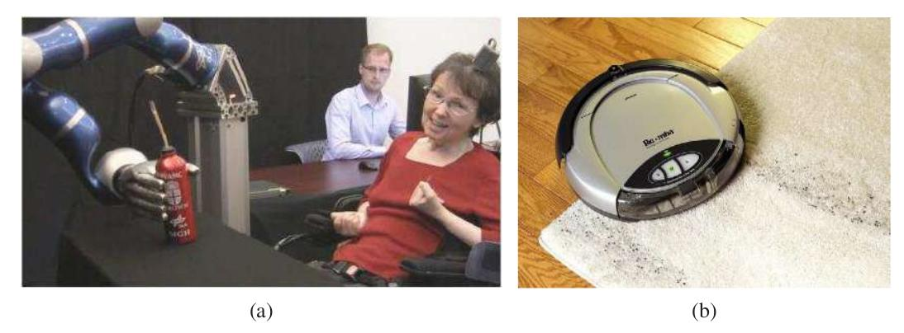

**شکل ۲۶.۳۳ — (الف) بیمارِ با رابطِ مغز-ماشین که بازویِ رباتیک را برای برداشتنِ نوشیدنی کنترل می‌کند. تصویر با اجازه از دانشگاه براون. (ب) رومبا، جاروبرقیِ رباتیک. عکس از HANDOUT/KRT/Newscom.**

**مراقبتِ بهداشتی:** ربات‌ها جراحان را یاری و تقویت می‌کنند، و رویه‌های دقیق‌تر، کم‌تهاجمی‌تر و ایمن‌تری با پیامدهای بهتر برای بیمار ممکن می‌کنند. رباتِ جراحِ داوینچی از شکل ۲۶.۳۴ (الف) اکنون به‌طورِ گسترده‌ای در بیمارستان‌های آمریکا مستقر شده.

**خدمات:** ربات‌های متحرک در ساختمان‌های اداری، هتل‌ها و بیمارستان‌ها کمک می‌کنند. Savioke ربات‌هایی در هتل‌ها گذاشته که محصولاتی مانندِ حوله یا خمیردندان را به اتاقِ شما تحویل می‌دهند. ربات‌های HelpMate و TUG غذا و دارو در بیمارستان‌ها حمل می‌کنند (شکل ۲۶.۳۴ (ب))، در حالی که رباتِ Moxi شرکتِ Diligent Robotics به پرستاران در مسئولیت‌های لجستیکیِ پشت‌صحنه کمک می‌کند. Co-Bot در راهروهای دانشگاه کارنگی‌ملون می‌گردد، آمادهٔ راهنماییِ شما به دفترِ کسی. همچنین می‌توانیم از «ربات‌های حضورِ از راهِ دور» (Telepresence Robot) مانندِ Beam برای شرکت در جلسات و کنفرانس‌ها از راهِ دور، یا سرزدن به پدربزرگ‌ها و مادربزرگ‌ها استفاده کنیم.

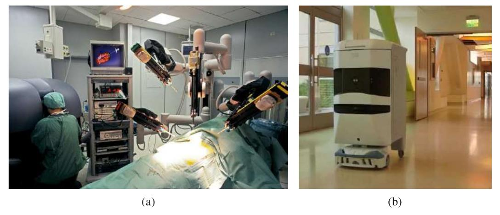

**شکل ۲۶.۳۴ — (الف) رباتِ جراحی در اتاقِ عمل. عکس از Patrick Landmann/Science Source. (ب) رباتِ تحویلِ بیمارستانی. عکس از Wired.**

**خودروهای خودران:** برخی از ما گهگاه هنگامِ رانندگی حواس‌پرتی داریم، توسط تماس‌های تلفنِ همراه، پیامک‌ها یا حواس‌پرتی‌های دیگر. نتیجهٔ غم‌انگیز: بیش از یک میلیون نفر هر سال در تصادفاتِ جاده‌ای می‌میرند. افزون بر این، بسیاری از ما زمانِ زیادی صرفِ رانندگی می‌کنیم و دوست داریم بخشی از آن زمان را بازپس بگیریم. همهٔ این‌ها به تلاشِ عظیمِ در جریان برای استقرارِ خودروهای خودران انجامیده. نمونه‌های اولیه از دههٔ ۱۹۸۰ وجود داشته‌اند، اما پیشرفت توسط چالشِ بزرگِ DARPA در ۲۰۰۵، مسابقهٔ خودرویِ خودمختار بر فرازِ ۲۰۰ کیلومترِ چالش‌برانگیزِ زمینِ بیابانیِ تمرین‌نشده، تحریک شد. خودرویِ استنلیِ استنفورد مسیر را در کمتر از هفت ساعت کامل کرد و جایزهٔ ۲ میلیون دلاری و جایی در موزهٔ ملیِ تاریخِ آمریکا برد.


**شکل ۲۶.۳۵ — (الف) خودرویِ خودرانِ BOSS که چالشِ شهریِ DARPA را برد. عکس از Tangi Quemener/AFP/Getty Images/Newscom. با اجازه از سباستین ترون. (ب) نمایِ هوایی که ادراک و پیش‌بینی‌های خودرویِ خودرانِ ویمو (خودرویِ سفید با مسیرِ سبز) را نشان می‌دهد. سایرِ وسایلِ نقلیه (جعبه‌های آبی) و عابرانِ پیاده (جعبه‌های نارنجی) با مسیرهای پیش‌بینی‌شده نشان داده شده‌اند. مرزهای جاده/پیاده‌رو زردند. عکس با اجازه از ویمو.**

شکل ۲۶.۳۵ (الف) BOSS را ترسیم می‌کند، که در ۲۰۰۷ چالشِ شهریِ DARPA را برد، مسابقهٔ جاده‌ایِ پیچیده‌ای در خیابان‌های شهر که ربات‌ها با ربات‌های دیگر روبه‌رو بودند و باید قوانینِ راهنمایی را رعایت می‌کردند. در ۲۰۰۹، گوگل پروژهٔ رانندگیِ خودمختار (با بسیاری از پژوهشگرانی که رویِ استنلی و BOSS کار کرده بودند) را شروع کرد، که اکنون به‌صورتِ ویمو جدا شده. در ۲۰۱۸ ویمو آزمایشِ بدونِ راننده (با هیچ‌کس در صندلیِ راننده) را در حومه‌های فینیکس، آریزونا شروع کرد. در این میان، شرکت‌های خودرویِ خودران و شرکت‌های اشتراک‌سواریِ دیگر رویِ توسعهٔ فناوریِ خودشان کار می‌کنند، در حالی که خودروسازان خودروهایی با هوشِ کمکیِ بیشتر و بیشتر فروخته‌اند، مانندِ «کمک‌راننده»ی (Driver Assist) تسلا، که برای رانندگیِ بزرگراهی در نظر گرفته شده. شرکت‌های دیگر کاربردهای غیربزرگراهی از جملهِ پردیس‌های دانشگاهی و جوامعِ بازنشستگان را هدف می‌گیرند. هنوز شرکت‌های دیگر بر کاربردهای غیرمسافر مانندِ کامیون‌داری، تحویلِ موادِ غذایی و پارکینگِ ولی تمرکز کرده‌اند.

**سرگرمی:** دیزنی از دههٔ ۱۹۶۳ از ربات‌ها (تحتِ نامِ «انیماترونیک» (Animatronics)) در پارک‌هایش استفاده می‌کند. در اصل، این ربات‌ها به حرکت (و گفتار)ِ دست‌طراحی‌شده، حلقهٔ باز و بدونِ تغییر محدود بودند، اما از ۲۰۰۹ نسخه‌ای به نامِ «اتونوماترونیک» (Autonomatronics) می‌تواند کنش‌های خودمختار تولید کند. ربات‌ها همچنین شکلِ اسباب‌بازی‌های هوشمند برای کودکان را می‌گیرند؛ برای نمونه، Cozmoِ آنکی با کودکان بازی می‌کند و ممکن است وقتی می‌بازد با ناامیدی به میز بکوبد. سرانجام، چهارپره‌هایی مانندِ R1ِ اسکایدیو از شکل ۲۶.۲ (ب) به‌عنوانِ عکاس و فیلم‌بردارِ شخصی عمل می‌کنند، دورِ ما می‌چرخند تا هنگامِ اسکی یا دوچرخه‌سواری عکس‌های اکشن بگیرند.

**کاوش و محیط‌های خطرناک:** ربات‌ها به جاهایی رفته‌اند که هیچ انسانی قبلاً نرفته، از جملهِ سطحِ مریخ. بازوهای رباتیک به فضانوردان در استقرار و بازیابیِ ماهواره‌ها و در ساختنِ ایستگاهِ فضاییِ بین‌المللی کمک می‌کنند. ربات‌ها همچنین به کاوشِ زیرِ دریا کمک می‌کنند. آن‌ها به‌طورِ معمول برای کسبِ نقشه‌های کشتی‌های غرق‌شده استفاده می‌شوند. شکل ۲۶.۳۶ رباتی را نشان می‌دهد که معدنِ زغالِ رها شده را نگاشت می‌کند، همراه با مدلِ سه‌بعدیِ معدنِ به‌دست‌آمده با استفاده از حس‌گذارهای برد. در ۱۹۹۶، تیمی از پژوهشگران رباتِ پاداری را در دهانهٔ آتشفشانِ فعالی رها کردند تا برای پژوهشِ اقلیمی داده کسب کند. ربات‌ها به ابزارهای بسیار مؤثری برای جمع‌آوریِ اطلاعات در حوزه‌هایی تبدیل می‌شوند که دسترسی برای مردم دشوار (یا خطرناک) است.

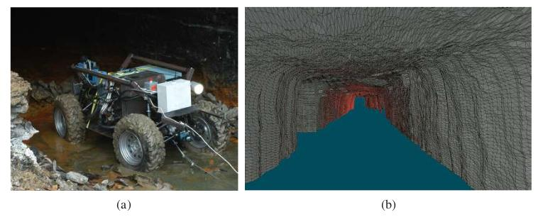

**شکل ۲۶.۳۶ — (الف) رباتی که معدنِ زغالِ رها شده را نگاشت می‌کند. (ب) نقشهٔ سه‌بعدیِ معدن که توسط ربات به‌دست آمده است. (هر دو تصویر با اجازه از سباستین ترون).**

ربات‌ها به مردم در پاکسازیِ زباله‌های هسته‌ای کمک کرده‌اند، به‌ویژه در تری‌مایل‌آیلند، چرنوبیل و فوکوشیما. ربات‌ها پس از فروریختنِ مرکزِ تجارتِ جهانی حاضر بودند، جایی که واردِ سازه‌هایی شدند که برای تیم‌های جستجو و نجاتِ انسانی بیش‌ازحد خطرناک تلقی می‌شدند. این‌جا نیز، این ربات‌ها ابتدا از طریقِ دوراپراتوری مستقر می‌شوند، و با پیشرفتِ فناوری، خودمختارتر و خودمختارتر می‌شوند، با اپراتورِ انسانیِ مسئول اما نه مجبور به مشخص‌کردنِ هر فرمانِ تکی.

**صنعت:** اکثریتِ ربات‌های امروز در کارخانه‌ها مستقرند، و تکلیف‌هایی را خودکار می‌کنند که برای انسان‌ها دشوار، خطرناک یا کسل‌کننده‌اند. (اکثریتِ ربات‌های کارخانه‌ای در کارخانه‌های خودرو هستند.) خودکارکردنِ این تکلیف‌ها از نظرِ تولیدِ کارآمدِ آنچه جامعه نیاز دارد مثبت است. در همان زمان، به معنای جابه‌جاییِ برخی کارگرانِ انسانی از شغل‌هایشان نیز هست. این پیامدهای سیاستی و اقتصادیِ مهمی دارد—نیاز به بازآموزی و آموزش، نیاز به تقسیمِ منصفانهٔ منابع و... این موضوعات در بخش ۲۷.۳.۵ بیشتر بحث می‌شوند.

## خلاصهٔ فصل

رباتیک دربارهٔ عامل‌های فیزیکیِ تجسم‌یافته است، که می‌توانند حالتِ جهانِ فیزیکی را تغییر دهند. در این فصل، مواردِ زیر را یاد گرفته‌ایم:

- رایج‌ترین انواعِ ربات‌ها «دستکار»ها (بازوهای رباتیک) و ربات‌های متحرک‌اند. آن‌ها حس‌گذارهایی برای ادراکِ جهان و عملگرهایی دارند که حرکت تولید می‌کنند، که سپس از طریقِ اثرگذارها بر جهان اثر می‌گذارد.
- مسئلهٔ عمومیِ رباتیک شاملِ تصادفی‌بودن (که با MDPها قابلِ مدیریت است)، مشاهدهٔ جزئی (که با POMDPها قابلِ مدیریت است)، و عمل‌کردن با و دورِ عامل‌های دیگر (که با نظریهٔ بازی قابلِ مدیریت است) است. مسئله حتی سخت‌تر می‌شود، زیرا بیشترِ ربات‌ها در فضاهای حالت و کنشِ پیوسته و پربعد کار می‌کنند. آن‌ها همچنین در جهانِ واقعی عمل می‌کنند، که حاضر نیست سریع‌تر از زمانِ واقعی اجرا شود و در آن شکست‌ها به آسیب‌دیدنِ چیزهای واقعی می‌انجامند، بدونِ قابلیتِ «واگردانی».
- در حالتِ ایده‌آل، ربات کلِ مسئله را یک‌جا حل می‌کرد: مشاهده‌ها به شکلِ خوراکِ حس‌گذارِ خام وارد می‌شوند، و کنش‌ها به شکلِ گشتاورها یا جریان‌های موتور بیرون می‌آیند. در عمل، با این حال، این بیش‌ازحد دلهره‌آور است، و رباتیست‌ها معمولاً جنبه‌های متفاوتِ مسئله را از هم جدا می‌کنند و مستقل درمان می‌کنند.
- معمولاً ادراک (تخمین) را از کنش (تولیدِ حرکت) جدا می‌کنیم. ادراکِ رباتیک شاملِ بیناییِ رایانه برای بازشناسیِ محیط از طریقِ دوربین‌ها، و همچنین مکان‌یابی و نگاشت است.
- ادراکِ رباتیک به برآوردِ کمیت‌های مربوط به تصمیم از دادهٔ حس‌گذار مربوط می‌شود. برای انجامِ این، به بازنماییِ درونی و روشی برای به‌روزرسانیِ این بازنماییِ درونی در طولِ زمان نیاز داریم.
- الگوریتم‌های فیلترِ احتمالاتی مانندِ فیلترهای ذره‌ای و فیلترهای کالمن برای ادراکِ ربات مفیدند. این فنون حالتِ باور، توزیعِ پسینِ رویِ متغیرهای حالت، را حفظ می‌کنند.
- برای تولیدِ حرکت، از فضاهای پیکربندی استفاده می‌کنیم، که نقطه‌ای در آن‌ها هر آنچه برای مکان‌یابیِ هر نقطهٔ بدنهٔ ربات لازم است را مشخص می‌کند. برای نمونه، برای بازویِ رباتیکِ با دو مفصل، پیکربندی شاملِ دو زاویهٔ مفصل است.
- معمولاً مسئلهٔ تولیدِ حرکت را به برنامه‌ریزیِ حرکت، مربوط به تولیدِ برنامه، و کنترلِ دنبال‌کردنِ مسیر، مربوط به تولیدِ سیاستی برای ورودی‌های کنترل (فرمان‌های عملگر) که به اجرایِ برنامه می‌انجامد، تجزیه می‌کنیم.
- برنامه‌ریزیِ حرکت را می‌توان با جستجویِ گراف با استفاده از تجزیهٔ سلولی حل کرد؛ با الگوریتم‌های برنامه‌ریزیِ حرکتِ تصادفی، که نقطه‌های عطف را در فضایِ پیکربندیِ پیوسته نمونه‌برداری می‌کنند؛ یا با بهینه‌سازیِ مسیر، که می‌تواند به‌صورتِ تکراری مسیرِ خطِّ راست را با بهره‌گیری از میدانِ فاصلهٔ علامت‌دار از برخورد بیرون براند.
- مسیری که توسط الگوریتمِ جستجو یافت شده را می‌توان با استفاده از مسیر به‌عنوانِ مسیرِ زمانیِ مرجعِ کنترل‌گرِ PID، که دائماً خطاهای بینِ جایی که ربات هست و جایی که قرار است باشد را تصحیح می‌کند، یا از طریقِ کنترلِ گشتاورِ محاسبه‌شده، که عبارتِ پیش‌خوری می‌افزاید که از دینامیکِ معکوس برای محاسبهٔ تقریبیِ اینکه برای پیشرفت در طولِ مسیر چه گشتاوری بفرستد استفاده می‌کند، اجرا کرد.
- کنترلِ بهینه برنامه‌ریزیِ حرکت و دنبال‌کردنِ مسیر را با محاسبهٔ مستقیمِ مسیرِ بهینه رویِ ورودی‌های کنترل یکی می‌کند. این به‌ویژه وقتی هزینه‌های درجهٔ دوم و دینامیکِ خطی داشته باشیم آسان است، که به تنظیم‌کنندهٔ خطیِ درجهٔ دوم (LQR) می‌انجامد. روش‌های محبوب با خطی‌کردنِ دینامیک و محاسبهٔ تقریب‌های مرتبهٔ دومِ هزینه (ILQR) از این بهره می‌کنند.
- برنامه‌ریزیِ تحتِ عدم‌قطعیت ادراک و کنش را با بازبرنامه‌ریزیِ برخط (مانندِ کنترلِ پیش‌بینِ مدل) و کنش‌های جمع‌آوریِ اطلاعاتی که به ادراک کمک می‌کنند یکی می‌کند.
- یادگیریِ تقویتی در رباتیک اعمال می‌شود، با فنونی که برای کاهشِ تعدادِ برهم‌کنش‌های لازم با جهانِ واقعی می‌کوشند. این فنون تمایل به بهره‌برداری از مدل‌ها دارند، چه برآوردِ مدل‌ها و استفاده از آن‌ها برای برنامه‌ریزی، چه آموزشِ سیاست‌هایی که نسبت به پارامترهای مدلِ متفاوتِ ممکن مقاوم‌اند.
- تعامل با انسان‌ها مستلزمِ تواناییِ هماهنگ‌کردنِ کنش‌های ربات با کنش‌های آن‌هاست، که می‌تواند به‌عنوانِ بازی صورتبندی شود. معمولاً راه‌حل را به پیش‌بینی، که در آن از کنش‌های جاریِ شخص برای برآوردِ آنچه در آینده انجام خواهد داد استفاده می‌کنیم، و کنش، که در آن از پیش‌بینی‌ها برای محاسبهٔ حرکتِ بهینهٔ ربات استفاده می‌کنیم، تجزیه می‌کنیم.
- کمک به انسان‌ها همچنین مستلزمِ تواناییِ یادگیری یا استنتاجِ آنچه می‌خواهند است. ربات‌ها می‌توانند با یادگیریِ تابعِ هزینهٔ مطلوبی که باید بهینه کنند از ورودیِ انسانی، مانندِ نمایش‌ها، اصلاح‌ها یا آموزشِ زبانِ طبیعی به این نزدیک شوند. یا، ربات‌ها می‌توانند رفتارِ انسانی را تقلید کنند و از یادگیریِ تقویتی برای کمک به غلبه بر چالشِ تعمیم به حالت‌های تازه استفاده کنند.

## یادداشت‌های کتابشناختی و تاریخی

واژهٔ «ربات» توسط نمایش‌نامه‌نویسِ چک، کارل چاپک، در نمایشنامهٔ 1920 او R.U.R. (ربات‌های جهانیِ راسوم) رایج شد. ربات‌ها، که به‌جای ساختِ مکانیکی به‌صورتِ شیمیایی رشد داده می‌شدند، در نهایت از اربابانشان متنفر می‌شوند و تصمیم به تسخیر می‌گیرند. به نظر می‌رسد برادرِ چاپک، یوزف، نخستین کسی بود که واژه‌های چکیِ «robota» (کارِ اجباری) و «robotnik» (سرف) را در داستانِ کوتاهِ 1917 خود «Opilec» (گلانس، 1978) ترکیب کرد و «ربات» را ساخت. اصطلاحِ «رباتیک» برای داستانی علمی-تخیلی (آزیموف، 1950) ابداع شد.

ایدهٔ ماشینِ خودمختار هزاران سال از واژهٔ «ربات» پیشی دارد. در اسطوره‌شناسیِ یونانیِ قرنِ هفتمِ پیش از میلاد، رباتی به نامِ تالوس توسط هفایستوس، خدایِ یونانیِ فلزکاری، برای محافظت از جزیرهٔ کرت ساخته شد. افسانه می‌گوید جادوگرِ مدئا با وعدهٔ جاودانگی تالوس را شکست داد اما سپس مایعِ حیاتش را تخلیه کرد. پس، این نخستین نمونهٔ رباتی است که در فرایندِ تغییرِ تابعِ هدفش اشتباه می‌کند.

در 322 پیش از میلاد، ارسطو بیکاریِ فناورانه را پیش‌بینی کرد و حدس زد «اگر هر ابزاری، وقتی فرمان داده شود، یا حتی به‌اختیارِ خودش، می‌توانست کاری را که شایسته‌اش است انجام دهد... آنگاه نه برای استادکاران نیازی به شاگردان بود و نه برای اربابان به برده‌ها.» در قرنِ سومِ پیش از میلاد، رباتِ انسان‌نمایِ واقعی به نامِ «خدمتکارِ فیلون» می‌توانست شراب یا آب در فنجان بریزد؛ مجموعه‌ای از شیرها جریان را در زمانِ درست قطع می‌کردند. اتوماتاهای شگفت‌انگیزی در قرنِ هجدهم ساخته شدند—اردکِ مکانیکیِ ژاک ووکانسون از 1738 یکی از نمونه‌های اولیه است—اما رفتارهای پیچیده‌ای که نشان می‌دادند کاملاً از پیش ثابت شده بودند. احتمالاً قدیمی‌ترین نمونهٔ دستگاهِ ربات‌مانندِ برنامه‌پذیر ماشینِ بافندگیِ ژاکارد (1805) بود، که در صفحهٔ ۱۵ توصیف شده.

«لاک‌پشت»ِ گری والتر، ساخته‌شده در 1948، را می‌توان نخستین رباتِ متحرکِ خودمختار در نظر گرفت، هرچند سامانهٔ کنترلی‌اش برنامه‌پذیر نبود. «هیولای هاپکینز»، ساخته‌شده در 1960 در دانشگاه جانز هاپکینز، بسیار پیچیده‌تر بود؛ سونار و حس‌گذارهای فتوسل، سخت‌افزارِ بازشناسیِ الگو داشت، و می‌توانست صفحهٔ پوششِ پریزِ برقِ استانداردِ AC را بازشناسی کند. قادر به جستجویِ پریزها، وصل‌کردنِ خودش و سپس شارژِ باتری‌هایش بود! با این حال، هیولا مجموعهٔ محدودی از مهارت‌ها داشت.

نخستین رباتِ متحرکِ همه‌منظوره «شیکی» بود، که در آنچه سپس مؤسسهٔ تحقیقاتیِ استنفورد (اکنون SRI) نامیده می‌شد در اواخرِ دههٔ ۱۹۶۰ توسعه یافت (فایکس و نیلسون، 1971؛ نیلسون، 1984). شیکی نخستین رباتی بود که ادراک، برنامه‌ریزی و اجرا را یکپارچه کرد، و پژوهشِ بعدیِ زیادی در هوش مصنوعی تحتِ تأثیرِ این دستاوردِ چشمگیر قرار گرفت. شیکی رویِ جلدِ این کتاب با رهبرِ پروژه، چارلی روزن (1917–2002)، ظاهر می‌شود. پروژه‌های تأثیرگذارِ دیگر شاملِ گاریِ استنفورد و رورِ CMU (موراوس، 1983) است. کاکس و ویل‌فونگ (1990) کارِ کلاسیکِ وسایلِ نقلیهٔ خودمختار را توصیف می‌کنند.

نخستین رباتِ تجاری بازویی به نامِ UNIMATE، مخففِ اتوماسیونِ همگانی، بود که توسط جوزف انگلبرگر و جورج دوول در شرکتِ‌شان، یونیمیشن، توسعه یافت. در 1961، نخستین رباتِ UNIMATE به جنرال‌موتورز برای استفاده در تولیدِ لوله‌های تصویرِ تلویزیون فروخته شد. 1961 همچنین سالی بود که دوول نخستین حق‌امتیازِ آمریکاییِ ربات را گرفت.

در 1973، تویوتا و نیسان شروع به استفاده از نسخهٔ به‌روزشدهٔ UNIMATE برای جوشِ نقطه‌ایِ بدنهٔ خودرو کردند. این انقلابِ بزرگی در تولیدِ خودرو آغاز کرد که عمدتاً در ژاپن و آمریکا رخ داد و هنوز ادامه دارد. یونیمیشن در 1978 با توسعهٔ رباتِ Puma (ماشینِ همگانیِ برنامه‌پذیر برای مونتاژ) دنبال کرد، که برای دو دههٔ پس از آن استانداردِ دِ فاکتوِ دست‌کاریِ رباتیک بود. هر سال حدودِ ۵۰۰٬۰۰۰ ربات فروخته می‌شود، با نیمی از آن‌ها که به صنعتِ خودرو می‌روند.

در دست‌کاری، نخستین تلاشِ بزرگ برای ایجادِ ماشینِ دست-چشم، MH-1ِ هاینریش ارنست بود، توصیف‌شده در پایان‌نامهٔ دکترایِ MIT او (ارنست، 1961). پروژهٔ هوشِ ماشینیِ ادینبورگ نیز سامانهٔ اولیهٔ چشمگیری برای مونتاژِ مبتنی بر بینایی به نامِ FREDDY نشان داد (میچی، 1972).

پژوهشِ رباتیکِ متحرک توسط چند رقابتِ مهم تحریک شده. رقابتِ سالانهٔ رباتِ متحرکِ AAAI در 1992 آغاز شد. نخستین برندهٔ رقابت CARMEL بود (کانگدون و همکاران، 1992). پیشرفت پیوسته و چشمگیر بوده: در رقابت‌های اخیر ربات‌ها واردِ مجموعهٔ کنفرانس شدند، راهشان را به میزِ ثبت‌نام پیدا کردند، برای کنفرانس ثبت‌نام کردند و حتی سخنرانیِ کوتاهی دادند.

رقابتِ RoboCup، که در 1995 توسط کیتانو و همکاران (1997) راه‌اندازی شد، هدفش «توسعهٔ تیمی از ربات‌های انسان‌نمایِ کاملاً خودمختار است که می‌توانند تا 2050 تیمِ قهرمانِ جهانِ انسانی را در فوتبال ببرند». برخی رقابت‌ها از ربات‌های چرخ‌دار، برخی از ربات‌های انسان‌نما و برخی از شبیه‌سازی‌های نرم‌افزاری استفاده می‌کنند. استون (2016) نوآوری‌های اخیرِ RoboCup را توصیف می‌کند. چالشِ بزرگِ DARPA، که توسط DARPA در 2004 و 2005 سازماندهی شد، از وسایلِ نقلیهٔ خودمختار می‌خواست بیش از ۲۰۰ کیلومتر را در بیابان در کمتر از ده ساعت طی کنند (بوهلر و همکاران، 2006). در رویدادِ اصلیِ 2004، هیچ رباتی بیش از هشت مایل نرفت، که بسیاری را به این باور رساند که جایزه هرگز گرفته نمی‌شود. در 2005، رباتِ استنلیِ استنفورد رقابت را در کمی کمتر از هفت ساعت برد (ترون، 2006). DARPA سپس چالشِ شهری را سازماندهی کرد، رقابتی که ربات‌ها در آن باید ۶۰ مایل را در محیطِ شهری با ترافیکِ دیگر ناوبری می‌کردند. رباتِ BOSS دانشگاه کارنگی‌ملون مقامِ نخست را گرفت و جایزهٔ ۲ میلیون دلاری را برد (اورمسون و ویتاکر، 2008). پیشگامانِ اولیه در توسعهٔ خودروهای رباتیک شاملِ دیکمنس و زاپ (1987) و پومرلو (1993) بودند.

حوزهٔ نگاشتِ رباتیک از دو خاستگاهِ متمایز تکامل یافته. نخستین رشته با کارِ اسمیت و چیسمن (1986) آغاز شد، که فیلترهای کالمن را بر مسئلهٔ مکان‌یابی و نگاشتِ هم‌زمان (SLAM) اعمال کردند. این الگوریتم نخستین بار توسط موتارلیه و شتیلا (1989) پیاده‌سازی و بعداً توسط لئونارد و دورانت-وایت (1992) بسط یافت؛ برای مروری بر تغییرهای اولیهٔ فیلترِ کالمن، دیسانایاکه و همکاران (2001) را ببینید. رشتهٔ دوم با توسعهٔ «شبکهٔ اشغال» (Occupancy Grid) برای نگاشتِ احتمالاتی آغاز شد، که احتمالِ اشغال‌شدنِ هر مکانِ (x,y) توسط مانع را مشخص می‌کند (موراوس و الفس، 1985). کویپرس و لویت (1988) از نخستین کسانی بودند که به‌جای نگاشتِ متریک، نگاشتِ توپولوژیک را پیشنهاد کردند، با انگیزه از مدل‌های شناختِ فضاییِ انسانی. مقالهٔ بنیادینِ لو و میلیوس (1997) تنکیِ مسئلهٔ مکان‌یابی و نگاشتِ هم‌زمان را بازشناسی کرد، که به توسعهٔ فنونِ بهینه‌سازیِ غیرخطی توسط کونولیگه (2004) و مونتمرلو و ترون (2004)، و همچنین روش‌های سلسله‌مراتبی توسط بوسه و همکاران (2004) انجامید.

شاتکی و کلبلینگ (1997) و ترون و همکاران (1998) الگوریتمِ EM را برای ارتباطِ داده به حوزهٔ نگاشتِ رباتیک معرفی کردند. نمایِ کلی از روش‌های نگاشتِ احتمالاتی را می‌توان در (ترون و همکاران، 2005) یافت.

فنونِ اولیهٔ مکان‌یابیِ رباتِ متحرک توسط بورنشتاین و همکاران (1996) مرور شده. هرچند فیلترِ کالمن برای دهه‌ها به‌عنوانِ روشِ مکان‌یابی در نظریهٔ کنترل شناخته‌شده بود، صورتبندیِ احتمالاتیِ عمومیِ مسئلهٔ مکان‌یابی تا مدتِ بسیار بعدتر در ادبیاتِ هوش مصنوعی ظاهر نشد، از طریقِ کارِ تام دین و همکاران (دین و همکاران، 1990) و سیمونز و کونیگ (1995). کارِ اخیر اصطلاحِ «مکان‌یابیِ مارکوف» (Markov Localization) را معرفی کرد. نخستین کاربردِ جهانِ واقعیِ این فن توسط بورگارد و همکاران (1999)، از طریقِ مجموعه‌ای از ربات‌های مستقر در موزه‌ها، بود. مکان‌یابیِ مونت‌کارلوِ مبتنی بر فیلترهای ذره‌ای توسط فاکس و همکاران (1999) توسعه یافت و اکنون به‌طورِ گسترده‌ای استفاده می‌شود. «فیلترِ ذره‌ایِ رائو-بلکولایز» فیلترِ ذره‌ایِ مکان‌یابیِ ربات را با فیلترِ دقیقِ نقشه‌سازی ترکیب می‌کند (مورفی و راسل، 2001؛ مونتمرلو و همکاران، 2002).

بخشِ زیادی از کارِ اولیهٔ برنامه‌ریزیِ حرکت بر الگوریتم‌های هندسی برای مسائلِ برنامه‌ریزیِ حرکتِ قطعی و کاملاً مشاهده‌پذیر متمرکز بود. PSPACE-سختیِ برنامه‌ریزیِ حرکتِ ربات در مقالهٔ بنیادینِ رایف (1979) نشان داده شد. بازنماییِ فضایِ پیکربندی متعلق به لوزانو-پرس (1983) است. مجموعه‌ای از مقاله‌های شوارتز و شرییر دربارهٔ آنچه مسئله‌های جابه‌جاییِ پیانو می‌نامیدند (شوارتز و همکاران، 1987) بسیار تأثیرگذار بود.

تجزیهٔ سلولیِ بازگشتی برای برنامه‌ریزیِ فضایِ پیکربندی در کارِ بروکس و لوزانو-پرس (1985) سرچشمه گرفت و توسط ژو و لاتومبه (1991) به‌شکلِ چشمگیری بهبود یافت. نخستین الگوریتم‌های اسکلت‌سازی بر نمودارهای ورونوی (روات، 1979) و گراف‌های دیدپذیری (وسلی و لوزانو-پرس، 1979) مبتنی بودند. گیباس و همکاران (1992) فنونِ کارآمدی برای محاسبهٔ تدریجیِ نمودارهای ورونوی توسعه دادند، و شوسه (1996) نمودارهای ورونوی را به مسائلِ برنامه‌ریزیِ حرکتِ وسیع‌تری تعمیم داد.

جان کنی (1988) نخستین الگوریتمِ تک‌نمایی برای برنامه‌ریزیِ حرکت را برقرار کرد. متنِ بنیادینِ لاتومبه (1991) انواعِ رویکردها به برنامه‌ریزیِ حرکت را پوشش می‌دهد، و همچنین متن‌های شوسه و همکاران (2005) و لاواله (2006). کاوراکی و همکاران (1996) نظریهٔ نقشه‌های راهِ احتمالاتی را توسعه دادند. کوفنر و لاواله (2000) درخت‌های تصادفیِ سریع‌گسترش (RRT) را توسعه دادند. ورودِ بهینه‌سازی به برنامه‌ریزیِ حرکتِ هندسی با نوارهای کشسان (کوینلان و خاتبی، 1993) آغاز شد، که مسیرها را وقتی موانعِ فضایِ پیکربندی تغییر می‌کنند پالایش می‌کنند. راتلیف و همکاران (2009) این ایده را به‌عنوانِ راه‌حلِ مسئلهٔ کنترلِ بهینه صورتبندی کردند، که به مسیرِ اولیه اجازه می‌دهد در برخورد شروع شود، و با نگاشتِ گرادیان‌های مانعِ فضایِ کار از طریقِ ژاکوبین به فضایِ پیکربندی آن را تغییر شکل می‌دهد. شولمن و همکاران (2013) جایگزینِ عملیِ مرتبهٔ دومی پیشنهاد کردند.

کنترلِ ربات‌ها به‌عنوانِ سامانه‌های دینامیکی—چه برای دست‌کاری چه برای ناوبری—ادبیاتِ عظیمی تولید کرده. هرچند این فصل مبانیِ کنترلِ دنبال‌کردنِ مسیر و کنترلِ بهینه را توضیح داد، زیرشاخه‌های کاملی را کنار گذاشت، از جملهِ کنترلِ تطبیقی، کنترلِ مقاوم و تحلیلِ لیاپانوف. کنترلِ تطبیقی به‌جای فرضِ شناخته‌بودنِ همه‌چیزِ سامانه از پیش، هدفش سازگارکردنِ پارامترهای دینامیک و/یا قانونِ کنترل به‌صورتِ برخط است. کنترلِ مقاوم، از سوی دیگر، هدفش طراحیِ کنترل‌گرهایی است که با وجودِ عدم‌قطعیت و اختلال‌های خارجی خوب عمل می‌کنند.

تحلیلِ لیاپانوف در اصل در دههٔ ۱۸۹۰ برای تحلیلِ پایداریِ سامانه‌های غیرخطیِ عمومی توسعه یافت، اما تا اوایلِ دههٔ ۱۹۳۰ نظریه‌پردازانِ کنترل به پتانسیلِ واقعی‌اش پی نبردند. با توسعهٔ روش‌های بهینه‌سازی، تحلیلِ لیاپانوف به توابعِ مانعِ کنترلی بسط یافت، که به‌خوبی خود را به ابزارهای بهینه‌سازیِ مدرن می‌دهند. این روش‌ها به‌طورِ گسترده‌ای در رباتیکِ مدرن برای طراحیِ کنترل‌گرِ زمان-واقعی و تحلیلِ ایمنی استفاده می‌شوند. کارهای حیاتی در کنترلِ رباتیک شاملِ سه‌گانه‌ای دربارهٔ کنترلِ امپدانس توسط هوگان (1985) و مطالعهٔ عمومیِ دینامیکِ ربات توسط فدرستون (1987) است. دین و ولمن (1991) از نخستین کسانی بودند که کوشیدند نظریهٔ کنترل و سامانه‌های برنامه‌ریزیِ هوش مصنوعی را به هم گره بزنند. سه کتابِ درسیِ کلاسیک دربارهٔ ریاضیاتِ دست‌کاریِ ربات متعلق به پل (1981)، کریگ (1989) و یوشیکاوا (1990) است. کنترل برای دست‌کاری توسط موری (2017) پوشش داده شده.

حوزهٔ گرفتن (Grasping) نیز در رباتیک مهم است—مسئلهٔ تعیینِ گیرهٔ پایدار کاملاً دشوار است (میسن و سالیسبری، 1985). گرفتنِ شایسته مستلزمِ حسِ لمس، یا «بازخوردِ لمسی» (Haptic Feedback)، برای تعیینِ نیروهای تماس و تشخیصِ لغزش است (فیرینگ و هولرباخ، 1985). فهمِ نحوهٔ گرفتنِ انواعِ گوناگونِ اشیای جهان کاری دلهره‌آور است. (بوسمالیس و همکاران، 2017) سامانه‌ای توصیف می‌کنند که آزمایشِ جهانِ واقعی را با شبیه‌سازی‌های هدایت‌شده توسط انتقالِ شبیه-به-واقعیت ترکیب می‌کند تا گرفتنِ مقاوم تولید کند.

«کنترلِ میدانِ پتانسیل» (Potential-Field Control)، که می‌کوشد مسائلِ برنامه‌ریزیِ حرکت و کنترل را هم‌زمان حل کند، برای رباتیک توسط خاتبی (1986) توسعه یافت. در رباتیکِ متحرک، این ایده به‌عنوانِ راه‌حلِ عملیِ مسئلهٔ اجتناب از برخورد دیده شد و بعداً توسط بورنشتاین (1991) به الگوریتمی به نامِ «هیستوگرامِ میدانِ برداری» (Vector Field Histogram) بسط یافت.

ILQR اکنون به‌طورِ گسترده‌ای در محلِ تلاقیِ برنامه‌ریزیِ حرکت و کنترل استفاده می‌شود و متعلق به لی و تودوروف (2004) است. این گونه‌ای از فنِ بسیار قدیمی‌ترِ «برنامه‌نویسیِ دینامیکیِ دیفرانسیلی» (Jacobson and Mayne, 1970) است.

برنامه‌ریزیِ حرکتِ ریز با حس‌کردنِ محدود توسط لوزانو-پرس و همکاران (1984) و کنی و رایف (1987) بررسی شد. ناوبریِ مبتنی بر نقطهٔ نشانه (لازاناس و لاتومبه، 1992) بسیاری از همان ایده‌ها را در عرصهٔ رباتِ متحرک استفاده می‌کند. توابعِ ناوبری، نسخهٔ رباتیکِ سیاستِ کنترلی برای MDPهای قطعی، توسط کودیتشک (1987) معرفی شدند. کارِ کلیدیِ اعمالِ روش‌های POMDP (بخش 17.4) برای برنامه‌ریزیِ حرکتِ تحتِ عدم‌قطعیت در رباتیک متعلق به پینو و همکاران (2003) و روی و همکاران (2005) است.

یادگیریِ تقویتی در رباتیک با کارِ بنیادینِ باگنل و اشنایدر (2001) و نگ و همکاران (2003) اوج گرفت، که پارادایم را در بافتِ کنترلِ هلیکوپترِ خودمختار توسعه دادند. کوبر و همکاران (2013) نمایِ کلی از اینکه یادگیریِ تقویتی وقتی بر مسئلهٔ رباتیک اعمال می‌شود چگونه تغییر می‌کند ارائه می‌دهد. بسیاری از فنونِ پیاده‌سازی‌شده رویِ سامانه‌های فیزیکی مدل‌های دینامیکِ تقریبی می‌سازند، که به مدل‌های خطیِ وزن‌دارِ محلیِ آتکسون و همکاران (1997) بازمی‌گردد. اما گرادیان‌های سیاست نیز نقششان را ایفا کردند، و ربات‌های انسان‌نمای (ساده‌شده) را قادر به راه‌رفتن (تدریک و همکاران، 2004)، یا بازویِ رباتیک را قادر به ضربه‌زدن به توپِ بیسبال (پیترز و شال، 2008) کردند.

لوین و همکاران (2016) نخستین کاربردِ یادگیریِ تقویتیِ عمیق را رویِ رباتِ واقعی نشان دادند. در همان زمان، RL بدونِ مدل در شبیه‌سازی به حوزه‌های پیوسته بسط می‌یافت (شولمن و همکاران، 2015a؛ هیس و همکاران، 2016؛ لیلیک‌رپ و همکاران، 2015). کارِ دیگر جمع‌آوریِ دادهٔ فیزیکی را به‌صورتِ عظیم مقیاس‌بندی کرد تا یادگیریِ گیره‌ها و مدل‌های دینامیک را نمایش دهد (پینتو و گوپتا، 2016؛ آگراوال و همکاران، 2017؛ لوین و همکاران، 2018). انتقال از شبیه‌سازی به واقعیت یا شبیه-به-واقعیت (صادقی و لوین، 2016؛ آندری‌خویچ و همکاران، 2018a)، فرا-یادگیری (فین و همکاران، 2017)، و یادگیریِ تقویتیِ بدونِ مدلِ نمونه‌کارآمد (آندری‌خویچ و همکاران، 2018b) حوزه‌های پژوهشیِ فعال‌اند.

روش‌های اولیهٔ پیش‌بینیِ کنش‌های انسانی از رویکردهای فیلترکردن استفاده می‌کردند (مادهاوان و شلنوف، 2003)، اما کارِ بنیادینِ زیبارت و همکاران (2009) پیش‌بینی را با مدل‌کردنِ مردم به‌عنوانِ عامل‌های تقریباً عقلایی پیشنهاد کرد. صدیق و همکاران (2016) درگیرِ این کردند که این پیش‌بینی‌ها در واقع چگونه باید به آنچه ربات تصمیم می‌گیرد انجام دهد بستگی داشته باشند، و به سمتِ محیطِ نظریه‌بازی ساختند. برای محیط‌های همکارانه، سیسبو و همکاران (2007) ایدهٔ درنظرگرفتنِ آنچه مردم در تابعِ هزینهٔ ربات می‌خواهند را پیشگامی کردند. نیکولایدیس و شاه (2013) همکاری را به یادگیریِ نحوهٔ عملِ انسان، و همچنین یادگیریِ نحوهٔ خواستِ انسان از ربات برای عمل، که هر دو از نمایش‌ها قابلِ‌دستیابی‌اند، تجزیه کردند. برای یادگیری از نمایش، آرگال و همکاران (2009) را ببینید. آکگون و همکاران (2012) و صدیق‌گر و همکاران (2017) آموزش توسط کاربرانِ نهایی به‌جای کارشناسان را مطالعه کردند. تلکس و همکاران (2011) نشان دادند ربات‌ها چگونه می‌توانند آنچه مردم از دستورهای زبانِ طبیعی می‌خواهند را استنتاج کنند. سرانجام، نه‌تنها ربات‌ها باید استنتاج کنند مردم چه می‌خواهند و قصدِ انجامِ چه دارند، بلکه مردم نیز باید همان استنتاج‌ها را دربارهٔ ربات‌ها انجام دهند. دراگان و همکاران (2013) مدلی از استنتاج‌های انسانی را در برنامه‌ریزیِ حرکتِ ربات گنجاندند.

حوزهٔ تعاملِ انسان-ربات بسیار گسترده‌تر از آن چیزی است که در این فصل پوشش دادیم، که عمدتاً بر جنبه‌های برنامه‌ریزی و یادگیری متمرکز بود. توماز و همکاران (2016) مروری بر تعامل به‌طورِ گسترده‌تر از دیدگاهِ محاسباتی فراهم می‌کند. راس و همکاران (2011) سامانهٔ DAGGER را توصیف می‌کنند.

موضوعِ معماری‌های نرم‌افزاری برای ربات‌ها بحثِ مذهبیِ زیادی برمی‌انگیزد. نامزدِ قدیمیِ خوب هوش مصنوعی—معماریِ سه‌لایه—به طراحیِ شیکی بازمی‌گردد و توسط گت (1998) مرور شده. معماریِ جذب متعلق به بروکس (1986) است، هرچند ایده‌های مشابهی به‌طورِ مستقل توسط برایتنبرگ توسعه یافت، که کتابش، «وسایلِ نقلیه» (1984)، مجموعه‌ای از ربات‌های ساده را بر مبنای رویکردِ رفتاری توصیف می‌کند.

موفقیتِ رباتِ راه‌روندهٔ شش‌پایِ بروکس توسط پروژه‌های بسیاری دنبال شد. کانل، در پایان‌نامهٔ دکترایش (1989)، رباتِ متحرکِ کاملاً واکنشی‌ای توسعه داد که قادر به بازیابیِ اشیا بود. بسطِ پارادایم به سامانه‌های چندرباته را می‌توان در کارِ پارکر (1996) و ماتاریچ (1997) یافت. GRL (هورسویل، 2000) و COLBERT (کونولیگه، 1997) ایده‌های رباتیکِ هم‌زمانِ مبتنی بر رفتار را در زبان‌های کنترلِ رباتِ عمومی انتزاع می‌کنند. آرکین (1998) برخی از محبوب‌ترین رویکردهای این حوزه را مرور می‌کند.

دو کتابِ درسیِ اولیه، از دودک و جنکین (2000) و مورفی (2000)، رباتیک را به‌طورِ کلی پوشش می‌دهند. مرورهای جدیدتر متعلق به بیکی (2008) و لینچ و پارک (2017) است. کتابِ عالیِ دست‌کاریِ ربات موضوعاتِ پیشرفته‌ای مانندِ حرکتِ سازگار (میسن، 2001) را بررسی می‌کند. برنامه‌ریزیِ حرکتِ ربات در شوسه و همکاران (2005) و لاواله (2006) پوشش داده شده. ترون و همکاران (2005) رباتیکِ احتمالاتی را معرفی می‌کند. «کتابِ راهنمای رباتیک» (سیسیلیانو و خاتبی، 2016) نمایِ کلیِ عظیم و جامعی از همهٔ رباتیک است.

کنفرانسِ برترِ رباتیک «کنفرانسِ رباتیک: علم و سامانه‌ها» است، و پس از آن «کنفرانسِ بین‌المللیِ IEEE رباتیک و اتوماسیون». «تعاملِ انسان-ربات» برترین محلِ برگزاریِ تعامل است. مجله‌های برترِ رباتیک شاملِ IEEE Robotics and Automation، مجلهٔ بین‌المللیِ پژوهشِ رباتیک و Robotics and Autonomous Systems است.

---

**پانوشت‌ها:**

¹ رباتیست‌ها دوست دارند تابعِ هزینهٔ J را کمینه کنند، در حالی که در سایرِ بخش‌های هوش مصنوعی می‌کوشیم تابعِ مطلوبیتِ U یا پاداشِ R را بیشینه کنیم.

² جزئیاتِ f⁻¹ را این‌جا حذف می‌کنیم، اما شاملِ جرم، اینرسی، گرانش و نیروهای کوریولیس و گریز از مرکز است.
